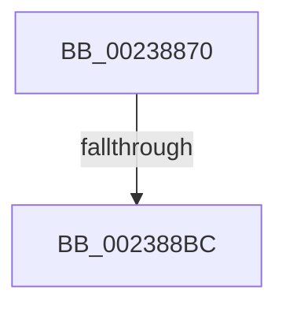

# MiObtainSystemCacheView

- RVA: `0x00238870`–`0x002388C3` (길이 `83` bytes)
- VA: `0x0000000140238870`
- 실행 섹션: `.text`
- PDB 이름 있음: `예`; PDB Function 태그: `예`
- unwind 정보 RVA: `0x00060AA0`
- 디코드: `22`개 명령, `83/83` bytes 표시
- 미해석 바이트: `0` (있으면 어셈블리에 `.byte`로 보존)

> 이 문서는 커널 이미지의 기계어와 PDB 기호를 분석해 생성했습니다. 4번과 5번은 함수 원형과 자료형을 바이너리 사용 방식에서 추정한 C 해석이며 원본 소스 복구 결과는 아닙니다.

## 1. Dependencies

- 직접 호출 지점: **0**; 고유 호출 대상: **0**
- 직접 호출자로 확인된 함수: **2**
- RIP 상대 이미지 참조: **2**

### Outgoing calls
- 직접 디코드된 call 명령이 없습니다.

### Direct callers
- [MmMapViewInSystemCache](../27/MmMapViewInSystemCache_function_00273094.md) at `0x00273149`
- [MmReserveViewInSystemCache](../../page/7F/MmReserveViewInSystemCache_function_007FE368.md) at `0x007FE36F`

### Static image references
- `0x002388AF` → RVA `0x00FC6D20` (`ALMOSTRO`; read)
- `0x002388BC` → RVA `0x00FC6B06` (`ALMOSTRO`; read)

## 2. Other-region calls and transfers

- 다른 실행 섹션으로 향하는 call: **0**
- call이 아닌 외부 분기/꼬리 이동: **1**
  - `0x002388B6` → [sub_00238C72](Unknown_function_00238C72.md) (`tail-transfer`)

## 3. Assembly (complete function range)

```asm
00238870  40 55                           push rbp
00238872  56                              push rsi
00238873  41 54                           push r12
00238875  41 55                           push r13
00238877  41 56                           push r14
00238879  41 57                           push r15
0023887B  48 8B EC                        mov rbp, rsp
0023887E  48 83 EC 38                     sub rsp, 0x38
00238882  48 8D 45 E8                     lea rax, [rbp - 0x18]
00238886  45 33 ED                        xor r13d, r13d
00238889  48 89 45 F0                     mov qword ptr [rbp - 0x10], rax
0023888D  48 8D B1 00 09 00 00            lea rsi, [rcx + 0x900]
00238894  48 8D 45 E8                     lea rax, [rbp - 0x18]
00238898  4C 8B F1                        mov r14, rcx
0023889B  48 89 45 E8                     mov qword ptr [rbp - 0x18], rax
0023889F  45 33 E4                        xor r12d, r12d
002388A2  45 0F 20 C7                     mov r15, cr8
002388A6  B8 02 00 00 00                  mov eax, 2
002388AB  44 0F 22 C0                     mov cr8, rax
002388AF  44 39 25 6A E4 D8 00            cmp dword ptr [rip + 0xd8e46a], r12d
002388B6  0F 85 B6 03 00 00               jne 0x140238c72
002388BC  F6 05 43 E2 D8 00 21            test byte ptr [rip + 0xd8e243], 0x21
```

## 4. C-style interpretation (structured pseudocode)

```c
__int64 __fastcall MiObtainSystemCacheView(__int64 a1)
{
    __int64 v_r12;
    __int64 v_r13;
    __int64 v_rsp;
    unsigned __int64 v_stack_m40;
    unsigned __int64 v_stack_m48;

    v_rsp = (v_rsp) - (56);
    v_r13 = 0;
    v_stack_m40 = v_stack_m48;
    v_stack_m48 = v_stack_m48;
    v_r12 = 0;
    return 2;
}
```

## 5. (Beta) C Style

```c
int64_t MiObtainSystemCacheView(void *Arg1)
{
    uint8_t *arg1 = (uint8_t *)Arg1;

    int64_t local_r12;
    int64_t local_r13;
    int64_t local_rsp;
    uint64_t v_stack_m40;
    uint64_t v_stack_m48;

    local_rsp = (local_rsp) - (56);
    local_r13 = 0;
    v_stack_m40 = v_stack_m48;
    v_stack_m48 = v_stack_m48;
    local_r12 = 0;
    return 2;
}
```

### 관측된 메모리 오프셋

구조체 형식이 확인되지 않은 접근은 인자 기준의 오프셋으로만 기록했습니다.

| 기준 인자 | 오프셋 표현 | 폭 (bit) | 접근 |
|---|---:|---:|---|
| `Arg1` | `+ 0x900` | `64` | `R` |

## 6. Execution-region graph

[열기: 2D/3D 그래프와 함수 탐색 컨트롤 패널](../../../control-panel.html?section=text&rva=0x00238870&view=graph)

- 2D 그래프는 위에서 아래로 흐르고, 3D 그래프는 빈 공간을 드래그해 회전합니다. Shift+드래그는 이동, 휠은 확대·축소, 함수 노드 선택은 대상 보고서 이동입니다.

### Static fallback


