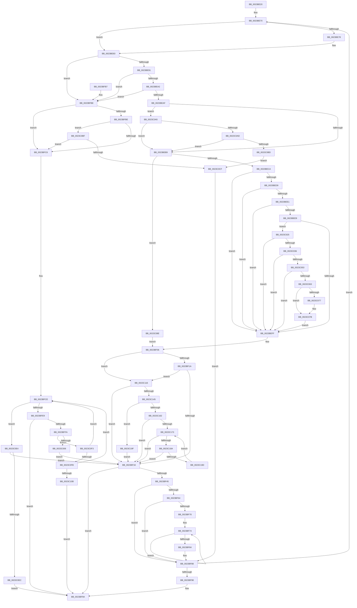

# MiProbeAndLockPacket

- RVA: `0x0023BE20`–`0x0023C1A7` (길이 `903` bytes)
- VA: `0x000000014023BE20`
- 실행 섹션: `.text`
- PDB 이름 있음: `예`; PDB Function 태그: `아니요`
- unwind 정보 RVA: `0x00060E5C`
- 디코드: `220`개 명령, `903/903` bytes 표시
- 미해석 바이트: `0` (있으면 어셈블리에 `.byte`로 보존)

> 이 문서는 커널 이미지의 기계어와 PDB 기호를 분석해 생성했습니다. 4번과 5번은 함수 원형과 자료형을 바이너리 사용 방식에서 추정한 C 해석이며 원본 소스 복구 결과는 아닙니다.

## 1. Dependencies

- 직접 호출 지점: **9**; 고유 호출 대상: **8**
- 직접 호출자로 확인된 함수: **3**
- RIP 상대 이미지 참조: **4**

### Outgoing calls
- `0x0023BF3A` → [MiProbeLockFrame](MiProbeLockFrame_function_0023C1B0.md) (function, `0x0023C1B0`)
- `0x0023BFD1` → [MiLockPageLeafPageTable](MiLockPageLeafPageTable_function_0023D160.md) (function, `0x0023D160`)
- `0x0023BFF1` → [MiProbeLeafPteAccess](MiProbeLeafPteAccess_function_0023D640.md) (function, `0x0023D640`)
- `0x0023C01B` → [MiSetProbePagesAhead](MiSetProbePagesAhead_function_0023DC80.md) (function, `0x0023DC80`)
- `0x0023C0B0` → [MiProbePacketContended](../2A/MiProbePacketContended_function_002AE5A8.md) (function, `0x002AE5A8`)
- `0x0023C0C2` → [MiProbePacketContended](../2A/MiProbePacketContended_function_002AE5A8.md) (function, `0x002AE5A8`)
- `0x0023C0D2` → [MiUnlockProbePacketWorkingSet](MiUnlockProbePacketWorkingSet_function_0023B800.md) (function, `0x0023B800`)
- `0x0023C0DA` → [MiLockProbePacketWorkingSet](../40/MiLockProbePacketWorkingSet_function_0040E500.md) (function, `0x0040E500`)
- `0x0023C0FE` → [MiFaultInProbeAddress](../40/MiFaultInProbeAddress_function_0040E108.md) (function, `0x0040E108`)

### Direct callers
- [MiProbeAndLockPages](MiProbeAndLockPages_function_0023B4F0.md) at `0x0023B55B`
- [MmProbeAndLockPages](MmProbeAndLockPages_function_0023B990.md) at `0x0023BA0E`
- [MmLockPhysicalPagesByVa](../../page/7F/MmLockPhysicalPagesByVa_function_007FB930.md) at `0x007FBA00`

### Static image references
- `0x0023BF0D` → RVA `0x00E2DCE0` (`.data`; read)
- `0x0023BFD8` → RVA `0x00010880` (`.rdata`; read)
- `0x0023C025` → RVA `0x00FC6A88` (`ALMOSTRO`; read)
- `0x0023C10B` → RVA `0x00E30204` (`.data`; read/write)

## 2. Other-region calls and transfers

- 다른 실행 섹션으로 향하는 call: **0**
- 별도 외부 분기/꼬리 이동을 확인하지 못했습니다.

## 3. Assembly (complete function range)

```asm
0023BE20  48 89 5C 24 10                  mov qword ptr [rsp + 0x10], rbx
0023BE25  48 89 6C 24 18                  mov qword ptr [rsp + 0x18], rbp
0023BE2A  48 89 74 24 20                  mov qword ptr [rsp + 0x20], rsi
0023BE2F  57                              push rdi
0023BE30  41 54                           push r12
0023BE32  41 55                           push r13
0023BE34  41 56                           push r14
0023BE36  41 57                           push r15
0023BE38  48 83 EC 20                     sub rsp, 0x20
0023BE3C  33 ED                           xor ebp, ebp
0023BE3E  49 BF 00 D0 BE 7D FB F6 FF FF   movabs r15, 0xfffff6fb7dbed000
0023BE48  33 F6                           xor esi, esi
0023BE4A  49 BC F8 D7 BE 7D FB F6 FF FF   movabs r12, 0xfffff6fb7dbed7f8
0023BE54  48 8B D9                        mov rbx, rcx
0023BE57  49 BD 28 00 00 00 00 DE FF FF   movabs r13, 0xffffde0000000028
0023BE61  49 BE FF FF FF FF FF 00 00 00   movabs r14, 0xffffffffff
0023BE6B  0F 1F 44 00 00                  nop dword ptr [rax + rax]
0023BE70  8B 4B 48                        mov ecx, dword ptr [rbx + 0x48]
0023BE73  F6 C1 40                        test cl, 0x40
0023BE76  75 0B                           jne 0x14023be83
0023BE78  48 8B 43 38                     mov rax, qword ptr [rbx + 0x38]
0023BE7C  48 C7 00 FF FF FF FF            mov qword ptr [rax], 0xffffffffffffffff
0023BE83  BF 01 00 00 00                  mov edi, 1
0023BE88  F6 C1 20                        test cl, 0x20
0023BE8B  0F 84 27 01 00 00               je 0x14023bfb8
0023BE91  48 8B 43 08                     mov rax, qword ptr [rbx + 8]
0023BE95  48 3B 83 98 00 00 00            cmp rax, qword ptr [rbx + 0x98]
0023BE9C  0F 82 16 01 00 00               jb 0x14023bfb8
0023BEA2  48 3B 83 A0 00 00 00            cmp rax, qword ptr [rbx + 0xa0]
0023BEA9  0F 87 09 01 00 00               ja 0x14023bfb8
0023BEAF  40 F6 C5 3F                     test bpl, 0x3f
0023BEB3  0F 84 EC 01 00 00               je 0x14023c0a5
0023BEB9  4C 8B 93 A8 00 00 00            mov r10, qword ptr [rbx + 0xa8]
0023BEC0  49 83 FA FF                     cmp r10, -1
0023BEC4  0F 85 C4 01 00 00               jne 0x14023c08e
0023BECA  4C 8B 4B 18                     mov r9, qword ptr [rbx + 0x18]
0023BECE  4D 8B 01                        mov r8, qword ptr [r9]
0023BED1  49 8B C7                        mov rax, r15
0023BED4  4C 3B C8                        cmp r9, rax
0023BED7  72 26                           jb 0x14023beff
0023BED9  49 8B C4                        mov rax, r12
0023BEDC  4C 3B C8                        cmp r9, rax
0023BEDF  77 1E                           ja 0x14023beff
0023BEE1  49 8B C0                        mov rax, r8
0023BEE4  44 84 C7                        test dil, r8b
0023BEE7  74 16                           je 0x14023beff
0023BEE9  41 F6 C0 42                     test r8b, 0x42
0023BEED  0F 95 C2                        setne dl
0023BEF0  41 F6 C0 20                     test r8b, 0x20
0023BEF4  0F 95 C1                        setne cl
0023BEF7  84 D1                           test cl, dl
0023BEF9  0F 84 26 01 00 00               je 0x14023c025
0023BEFF  49 C1 E8 0C                     shr r8, 0xc
0023BF03  4D 23 C6                        and r8, r14
0023BF06  4C 89 83 88 00 00 00            mov qword ptr [rbx + 0x88], r8
0023BF0D  4C 3B 05 CC 1D BF 00            cmp r8, qword ptr [rip + 0xbf1dcc]
0023BF14  0F 87 FC 01 00 00               ja 0x14023c116
0023BF1A  4B 8D 0C 40                     lea rcx, [r8 + r8*2]
0023BF1E  48 03 C9                        add rcx, rcx
0023BF21  49 8B C5                        mov rax, r13
0023BF24  48 8B 04 C8                     mov rax, qword ptr [rax + rcx*8]
0023BF28  48 C1 E8 36                     shr rax, 0x36
0023BF2C  85 C7                           test edi, eax
0023BF2E  0F 84 E2 01 00 00               je 0x14023c116
0023BF34  48 8B D7                        mov rdx, rdi
0023BF37  48 8B CB                        mov rcx, rbx
0023BF3A  E8 71 02 00 00                  call 0x14023c1b0
0023BF3F  8B F0                           mov esi, eax
0023BF41  85 C0                           test eax, eax
0023BF43  78 55                           js 0x14023bf9a
0023BF45  48 8B CF                        mov rcx, rdi
0023BF48  48 C1 E1 0C                     shl rcx, 0xc
0023BF4C  48 01 4B 08                     add qword ptr [rbx + 8], rcx
0023BF50  48 8D 0C FD 00 00 00 00         lea rcx, [rdi*8]
0023BF58  48 01 4B 18                     add qword ptr [rbx + 0x18], rcx
0023BF5C  8B 4B 48                        mov ecx, dword ptr [rbx + 0x48]
0023BF5F  F6 C1 40                        test cl, 0x40
0023BF62  75 24                           jne 0x14023bf88
0023BF64  48 8B 83 88 00 00 00            mov rax, qword ptr [rbx + 0x88]
0023BF6B  48 85 FF                        test rdi, rdi
0023BF6E  74 18                           je 0x14023bf88
0023BF70  48 8B 4B 38                     mov rcx, qword ptr [rbx + 0x38]
0023BF74  48 89 01                        mov qword ptr [rcx], rax
0023BF77  48 83 C1 08                     add rcx, 8
0023BF7B  48 FF C0                        inc rax
0023BF7E  48 83 EF 01                     sub rdi, 1
0023BF82  75 F0                           jne 0x14023bf74
0023BF84  48 89 4B 38                     mov qword ptr [rbx + 0x38], rcx
0023BF88  48 8B 43 20                     mov rax, qword ptr [rbx + 0x20]
0023BF8C  FF C5                           inc ebp
0023BF8E  48 39 43 18                     cmp qword ptr [rbx + 0x18], rax
0023BF92  0F 86 D8 FE FF FF               jbe 0x14023be70
0023BF98  8B C6                           mov eax, esi
0023BF9A  48 8B 5C 24 58                  mov rbx, qword ptr [rsp + 0x58]
0023BF9F  48 8B 6C 24 60                  mov rbp, qword ptr [rsp + 0x60]
0023BFA4  48 8B 74 24 68                  mov rsi, qword ptr [rsp + 0x68]
0023BFA9  48 83 C4 20                     add rsp, 0x20
0023BFAD  41 5F                           pop r15
0023BFAF  41 5E                           pop r14
0023BFB1  41 5D                           pop r13
0023BFB3  41 5C                           pop r12
0023BFB5  5F                              pop rdi
0023BFB6  C3                              ret
0023BFB7  CC                              int3
0023BFB8  40 F6 C5 0F                     test bpl, 0xf
0023BFBC  75 08                           jne 0x14023bfc6
0023BFBE  85 ED                           test ebp, ebp
0023BFC0  0F 85 F9 00 00 00               jne 0x14023c0bf
0023BFC6  C7 44 24 50 00 00 00 00         mov dword ptr [rsp + 0x50], 0
0023BFCE  48 8B CB                        mov rcx, rbx
0023BFD1  E8 8A 11 00 00                  call 0x14023d160
0023BFD6  8B C8                           mov ecx, eax
0023BFD8  48 8B 05 A1 48 DD FF            mov rax, qword ptr [rip - 0x22b75f]
0023BFDF  48 39 43 30                     cmp qword ptr [rbx + 0x30], rax
0023BFE3  0F 84 FB 00 00 00               je 0x14023c0e4
0023BFE9  48 8D 54 24 50                  lea rdx, [rsp + 0x50]
0023BFEE  48 8B CB                        mov rcx, rbx
0023BFF1  E8 4A 16 00 00                  call 0x14023d640
0023BFF6  85 C0                           test eax, eax
0023BFF8  78 A0                           js 0x14023bf9a
0023BFFA  8B 44 24 50                     mov eax, dword ptr [rsp + 0x50]
0023BFFE  85 C0                           test eax, eax
0023C000  0F 85 ED 00 00 00               jne 0x14023c0f3
0023C006  48 8B 43 30                     mov rax, qword ptr [rbx + 0x30]
0023C00A  48 8B CB                        mov rcx, rbx
0023C00D  48 C1 E8 0C                     shr rax, 0xc
0023C011  49 23 C6                        and rax, r14
0023C014  48 89 83 88 00 00 00            mov qword ptr [rbx + 0x88], rax
0023C01B  E8 60 1C 00 00                  call 0x14023dc80
0023C020  E9 0F FF FF FF                  jmp 0x14023bf34
0023C025  48 F7 05 58 AA D8 00 00 00 60 00  test qword ptr [rip + 0xd8aa58], 0x600000
0023C030  0F 84 C9 FE FF FF               je 0x14023beff
0023C036  65 48 8B 0C 25 88 01 00 00      mov rcx, qword ptr gs:[0x188]
0023C03F  48 8B 91 B8 00 00 00            mov rdx, qword ptr [rcx + 0xb8]
0023C046  40 38 BA 60 01 00 00            cmp byte ptr [rdx + 0x160], dil
0023C04D  0F 84 AC FE FF FF               je 0x14023beff
0023C053  48 8B 8A 08 05 00 00            mov rcx, qword ptr [rdx + 0x508]
0023C05A  48 85 C9                        test rcx, rcx
0023C05D  0F 84 9C FE FF FF               je 0x14023beff
0023C063  49 C1 E9 03                     shr r9, 3
0023C067  41 81 E1 FF 01 00 00            and r9d, 0x1ff
0023C06E  4A 8B 0C C9                     mov rcx, qword ptr [rcx + r9*8]
0023C072  F6 C1 20                        test cl, 0x20
0023C075  74 04                           je 0x14023c07b
0023C077  48 83 C8 20                     or rax, 0x20
0023C07B  4C 8B C0                        mov r8, rax
0023C07E  49 83 C8 42                     or r8, 0x42
0023C082  F6 C1 42                        test cl, 0x42
0023C085  4C 0F 44 C0                     cmove r8, rax
0023C089  E9 71 FE FF FF                  jmp 0x14023beff
0023C08E  4C 8B 43 08                     mov r8, qword ptr [rbx + 8]
0023C092  4C 2B 83 98 00 00 00            sub r8, qword ptr [rbx + 0x98]
0023C099  49 C1 E8 0C                     shr r8, 0xc
0023C09D  4D 03 C2                        add r8, r10
0023C0A0  E9 61 FE FF FF                  jmp 0x14023bf06
0023C0A5  85 ED                           test ebp, ebp
0023C0A7  0F 84 0C FE FF FF               je 0x14023beb9
0023C0AD  48 8B CB                        mov rcx, rbx
0023C0B0  E8 F3 24 07 00                  call 0x1402ae5a8
0023C0B5  85 C0                           test eax, eax
0023C0B7  0F 84 FC FD FF FF               je 0x14023beb9
0023C0BD  EB 10                           jmp 0x14023c0cf
0023C0BF  48 8B CB                        mov rcx, rbx
0023C0C2  E8 E1 24 07 00                  call 0x1402ae5a8
0023C0C7  85 C0                           test eax, eax
0023C0C9  0F 84 F7 FE FF FF               je 0x14023bfc6
0023C0CF  48 8B CB                        mov rcx, rbx
0023C0D2  E8 29 F7 FF FF                  call 0x14023b800
0023C0D7  48 8B CB                        mov rcx, rbx
0023C0DA  E8 21 24 1D 00                  call 0x14040e500
0023C0DF  E9 A4 FE FF FF                  jmp 0x14023bf88
0023C0E4  85 C9                           test ecx, ecx
0023C0E6  0F 89 48 FE FF FF               jns 0x14023bf34
0023C0EC  8B C1                           mov eax, ecx
0023C0EE  E9 A7 FE FF FF                  jmp 0x14023bf9a
0023C0F3  3B C7                           cmp eax, edi
0023C0F5  0F 84 D3 FE FF FF               je 0x14023bfce
0023C0FB  48 8B CB                        mov rcx, rbx
0023C0FE  E8 05 20 1D 00                  call 0x14040e108
0023C103  85 C0                           test eax, eax
0023C105  0F 89 C3 FE FF FF               jns 0x14023bfce
0023C10B  FF 05 F3 40 BF 00               inc dword ptr [rip + 0xbf40f3]
0023C111  E9 84 FE FF FF                  jmp 0x14023bf9a
0023C116  48 8B 43 10                     mov rax, qword ptr [rbx + 0x10]
0023C11A  48 8B 93 A0 00 00 00            mov rdx, qword ptr [rbx + 0xa0]
0023C121  48 FF C2                        inc rdx
0023C124  48 3B C2                        cmp rax, rdx
0023C127  48 0F 46 D0                     cmovbe rdx, rax
0023C12B  48 8B 43 08                     mov rax, qword ptr [rbx + 8]
0023C12F  48 25 00 F0 FF FF               and rax, 0xfffffffffffff000
0023C135  48 2B D0                        sub rdx, rax
0023C138  48 C1 EA 0C                     shr rdx, 0xc
0023C13C  48 3B D7                        cmp rdx, rdi
0023C13F  0F 86 EF FD FF FF               jbe 0x14023bf34
0023C145  49 8B C0                        mov rax, r8
0023C148  B9 00 02 00 00                  mov ecx, 0x200
0023C14D  25 FF 01 00 00                  and eax, 0x1ff
0023C152  48 2B C8                        sub rcx, rax
0023C155  48 3B D1                        cmp rdx, rcx
0023C158  48 0F 46 CA                     cmovbe rcx, rdx
0023C15C  49 83 FA FF                     cmp r10, -1
0023C160  75 3D                           jne 0x14023c19f
0023C162  48 8B 53 18                     mov rdx, qword ptr [rbx + 0x18]
0023C166  48 83 C2 08                     add rdx, 8
0023C16A  48 3B F9                        cmp rdi, rcx
0023C16D  0F 83 C1 FD FF FF               jae 0x14023bf34
0023C173  4C 8B 0A                        mov r9, qword ptr [rdx]
0023C176  49 8D 40 01                     lea rax, [r8 + 1]
0023C17A  49 C1 E9 0C                     shr r9, 0xc
0023C17E  4D 23 CE                        and r9, r14
0023C181  4C 3B C8                        cmp r9, rax
0023C184  0F 85 AA FD FF FF               jne 0x14023bf34
0023C18A  48 83 C2 08                     add rdx, 8
0023C18E  48 FF C7                        inc rdi
0023C191  4D 8B C1                        mov r8, r9
0023C194  48 3B F9                        cmp rdi, rcx
0023C197  0F 83 97 FD FF FF               jae 0x14023bf34
0023C19D  EB D4                           jmp 0x14023c173
0023C19F  48 8B F9                        mov rdi, rcx
0023C1A2  E9 8D FD FF FF                  jmp 0x14023bf34
```

## 4. C-style interpretation (structured pseudocode)

```c
__int64 __fastcall MiProbeAndLockPacket(__int64 a1)
{
    __int64 result;
    __int64 v_rbp;
    __int64 v_rdi;
    __int64 v_rsi;
    __int64 v_rsp;
    unsigned __int64 v_stack_p10;
    unsigned __int64 v_stack_p18;
    unsigned __int64 v_stack_p20;
    unsigned int v_stack_p50;

    v_stack_p10 = v_rbx;
    v_stack_p18 = v_rbp;
    v_stack_p20 = v_rsi;
    v_rsp = (v_rsp) - (32);
    v_rbp = 0;
    v_rsi = 0;
loc_0023BE70:
    if ((((unsigned __int8)((unsigned int)(*(unsigned int *)(a1 + 72)))) & (64)) == 0) {
        result = *(unsigned __int64 *)(a1 + 56);
        *(unsigned __int64 *)(result) = -1;
    }
    if ((((unsigned __int8)((unsigned int)(*(unsigned int *)(a1 + 72)))) & (32)) == 0) goto loc_0023BFB8;
    if ((*(unsigned __int64 *)(a1 + 8)) < (*(unsigned __int64 *)(a1 + 152))) goto loc_0023BFB8;
    if ((*(unsigned __int64 *)(a1 + 8)) > (*(unsigned __int64 *)(a1 + 160))) goto loc_0023BFB8;
    if (((0) & (63)) == 0) goto loc_0023C0A5;
loc_0023BEB9:
    if ((*(unsigned __int64 *)(a1 + 168)) != -1) goto loc_0023C08E;
    if ((*(unsigned __int64 *)(a1 + 24)) < v_r15) goto loc_0023BEFF;
    if ((*(unsigned __int64 *)(a1 + 24)) > v_r12) goto loc_0023BEFF;
    if (((1) & ((unsigned __int8)(*(unsigned __int64 *)(*(unsigned __int64 *)(a1 + 24))))) == 0) goto loc_0023BEFF;
    a2 = ((((unsigned __int8)(*(unsigned __int64 *)(*(unsigned __int64 *)(a1 + 24)))) & (66)) != 0) ? 1 : 0;
    a1 = ((((unsigned __int8)(*(unsigned __int64 *)(*(unsigned __int64 *)(a1 + 24)))) & (32)) != 0) ? 1 : 0;
    if ((((unsigned __int8)(a1)) & ((unsigned __int8)(a2))) == 0) goto loc_0023C025;
loc_0023BEFF:
    a3 = (*(unsigned __int64 *)(*(unsigned __int64 *)(a1 + 24))) >> (12);
    a3 = (a3) & (v_r14);
loc_0023BF06:
    *(unsigned __int64 *)(a1 + 136) = a3;
    if (a3 > (*(unsigned __int64 *)(v_rip + 12525004))) goto loc_0023C116;
    a1 = (a3 + a3 * 2) + (a3 + a3 * 2);
    result = (*(unsigned __int64 *)(v_r13 + a1 * 8)) >> (54);
    if (((1) & ((unsigned int)(result))) == 0) goto loc_0023C116;
loc_0023BF34:
    result = MiProbeLockFrame(a1, 1, a3, *(unsigned __int64 *)(a1 + 24));
    if (sign_flag) goto loc_0023BF9A;
    a1 = (1) << (12);
    if ((((unsigned __int8)((unsigned int)(*(unsigned int *)(a1 + 72)))) & (64)) != 0) goto loc_0023BF88;
    if (1 == 0) goto loc_0023BF88;
loc_0023BF74:
    *(unsigned __int64 *)(*(unsigned __int64 *)(a1 + 56)) = *(unsigned __int64 *)(a1 + 136);
    a1 = (*(unsigned __int64 *)(a1 + 56)) + (8);
    result = (*(unsigned __int64 *)(a1 + 136)) + 1;
    v_rdi = (1) - (1);
    if (condition_is_not_equal) goto loc_0023BF74;
    *(unsigned __int64 *)(a1 + 56) = a1;
loc_0023BF88:
    v_rbp = (unsigned int)((v_rbp) + 1);
    if ((*(unsigned __int64 *)(a1 + 24)) <= (*(unsigned __int64 *)(a1 + 32))) goto loc_0023BE70;
loc_0023BF9A:
    v_rsp = (v_rsp) + (32);
    return (unsigned int)((unsigned int)((unsigned int)((unsigned int)(result))));
loc_0023BFB8:
    if ((((unsigned __int8)(v_stack_p18)) & (15)) != 0) goto loc_0023BFC6;
    if ((unsigned int)(v_stack_p18) != 0) goto loc_0023C0BF;
loc_0023BFC6:
    v_stack_p50 = 0;
loc_0023BFCE:
    result = MiLockPageLeafPageTable(v_stack_p10, 1, a3, *(unsigned __int64 *)(a1 + 24));
    if ((*(unsigned __int64 *)(v_stack_p10 + 48)) == (*(unsigned __int64 *)(v_rip - 2275167))) goto loc_0023C0E4;
    result = MiProbeLeafPteAccess(v_stack_p10, v_stack_p50, a3, *(unsigned __int64 *)(a1 + 24));
    if (sign_flag) goto loc_0023BF9A;
    if ((unsigned int)((unsigned int)(v_stack_p50)) != 0) goto loc_0023C0F3;
    result = (*(unsigned __int64 *)(v_stack_p10 + 48)) >> (12);
    result = (result) & (v_r14);
    *(unsigned __int64 *)(v_stack_p10 + 136) = result;
    result = MiSetProbePagesAhead(v_stack_p10, v_stack_p50, a3, *(unsigned __int64 *)(a1 + 24));
    goto loc_0023BF34;
loc_0023C025:
    if (((*(unsigned __int64 *)(v_rip + 14199384)) & (0x600000ULL)) == 0) goto loc_0023BEFF;
    if ((*(unsigned __int8 *)(*(unsigned __int64 *)(*(unsigned __int64 *)(gs_base + (0 + 392)) + 184) + 352)) == ((unsigned __int8)(v_rdi))) goto loc_0023BEFF;
    if (*(unsigned __int64 *)(*(unsigned __int64 *)(*(unsigned __int64 *)(gs_base + (0 + 392)) + 184) + 1288) == 0) goto loc_0023BEFF;
    a4 = (*(unsigned __int64 *)(a1 + 24)) >> (3);
    a4 = (unsigned int)((a4) & (511));
    if ((((unsigned __int8)(*(unsigned __int64 *)(*(unsigned __int64 *)(*(unsigned __int64 *)(*(unsigned __int64 *)(gs_base + (0 + 392)) + 184) + 1288) + a4 * 8))) & (32)) != 0) {
        result = (result) | (32);
    }
    a3 = (result) | (66);
    if ((((unsigned __int8)(*(unsigned __int64 *)(*(unsigned __int64 *)(*(unsigned __int64 *)(*(unsigned __int64 *)(gs_base + (0 + 392)) + 184) + 1288) + a4 * 8))) & (66)) == 0) { a3 = result; }
    goto loc_0023BEFF;
loc_0023C08E:
    a3 = (*(unsigned __int64 *)(v_stack_p10 + 8)) - (*(unsigned __int64 *)(v_stack_p10 + 152));
    a3 = (a3) >> (12);
    a3 = (a3) + (*(unsigned __int64 *)(a1 + 168));
    goto loc_0023BF06;
loc_0023C0A5:
    if ((unsigned int)(v_stack_p18) == 0) goto loc_0023BEB9;
    result = MiProbePacketContended(v_stack_p10, *(unsigned __int64 *)(*(unsigned __int64 *)(gs_base + (0 + 392)) + 184), a3, a4);
    if ((unsigned int)(result) == 0) goto loc_0023BEB9;
    goto loc_0023C0CF;
loc_0023C0BF:
    result = MiProbePacketContended(v_stack_p10, *(unsigned __int64 *)(*(unsigned __int64 *)(gs_base + (0 + 392)) + 184), a3, a4);
    if ((unsigned int)(result) == 0) goto loc_0023BFC6;
loc_0023C0CF:
    result = MiUnlockProbePacketWorkingSet(v_stack_p10, *(unsigned __int64 *)(*(unsigned __int64 *)(gs_base + (0 + 392)) + 184), a3, a4);
    result = MiLockProbePacketWorkingSet(v_stack_p10, *(unsigned __int64 *)(*(unsigned __int64 *)(gs_base + (0 + 392)) + 184), a3, a4);
    goto loc_0023BF88;
loc_0023C0E4:
    if (!sign_flag) goto loc_0023BF34;
    goto loc_0023BF9A;
loc_0023C0F3:
    if (((unsigned int)((unsigned int)((unsigned int)(v_stack_p10)))) == ((unsigned int)(v_rdi))) goto loc_0023BFCE;
    result = MiFaultInProbeAddress(v_stack_p10, *(unsigned __int64 *)(*(unsigned __int64 *)(gs_base + (0 + 392)) + 184), a3, a4);
    if (!sign_flag) goto loc_0023BFCE;
    goto loc_0023BF9A;
loc_0023C116:
    a2 = (*(unsigned __int64 *)(v_stack_p10 + 160)) + 1;
    if ((*(unsigned __int64 *)(v_stack_p10 + 16)) <= a2) { a2 = *(unsigned __int64 *)(v_stack_p10 + 16); }
    result = (*(unsigned __int64 *)(v_stack_p10 + 8)) & (0xFFFFFFFFFFFFF000ULL);
    a2 = (a2) - (result);
    a2 = (a2) >> (12);
    if (a2 <= v_rdi) goto loc_0023BF34;
    result = (unsigned int)((a3) & (511));
    a1 = (512) - (result);
    if (a2 <= a1) { a1 = a2; }
    if ((*(unsigned __int64 *)(a1 + 168)) != -1) goto loc_0023C19F;
    a2 = (*(unsigned __int64 *)(v_stack_p10 + 24)) + (8);
    if (v_rdi >= a1) goto loc_0023BF34;
loc_0023C173:
    a4 = (*(unsigned __int64 *)(a2)) >> (12);
    a4 = (a4) & (v_r14);
    if (a4 != (a3 + 1)) goto loc_0023BF34;
    a2 = (a2) + (8);
    v_rdi = (v_rdi) + 1;
    if (v_rdi >= a1) goto loc_0023BF34;
    goto loc_0023C173;
loc_0023C19F:
    goto loc_0023BF34;
}
```

## 5. (Beta) C Style

```c
int64_t MiProbeAndLockPacket(void *Arg1)
{
    uint8_t *arg1 = (uint8_t *)Arg1;

    int64_t result;
    int64_t local_rbp;
    int64_t local_rdi;
    int64_t local_rsi;
    int64_t local_rsp;
    uint64_t v_stack_p10;
    uint64_t v_stack_p18;
    uint64_t v_stack_p20;
    uint32_t v_stack_p50;

    v_stack_p10 = local_rbx;
    v_stack_p18 = local_rbp;
    v_stack_p20 = local_rsi;
    local_rsp = (local_rsp) - (32);
    local_rbp = 0;
    local_rsi = 0;
loc_0023BE70:
    if ((((uint8_t)((uint32_t)(*(uint32_t *)(arg1 + 0x48)))) & (64)) == 0) {
        result = *(uint64_t *)(arg1 + 0x38);
        *(uint64_t *)(result) = -1;
    }
    if ((((uint8_t)((uint32_t)(*(uint32_t *)(arg1 + 0x48)))) & (32)) == 0) goto loc_0023BFB8;
    if ((*(uint64_t *)(arg1 + 0x8)) < (*(uint64_t *)(arg1 + 0x98))) goto loc_0023BFB8;
    if ((*(uint64_t *)(arg1 + 0x8)) > (*(uint64_t *)(arg1 + 0xA0))) goto loc_0023BFB8;
    if (((0) & (63)) == 0) goto loc_0023C0A5;
loc_0023BEB9:
    if ((*(uint64_t *)(arg1 + 0xA8)) != -1) goto loc_0023C08E;
    if ((*(uint64_t *)(arg1 + 0x18)) < local_r15) goto loc_0023BEFF;
    if ((*(uint64_t *)(arg1 + 0x18)) > local_r12) goto loc_0023BEFF;
    if (((1) & ((uint8_t)(*(uint64_t *)(*(uint64_t *)(arg1 + 0x18))))) == 0) goto loc_0023BEFF;
    a2 = ((((uint8_t)(*(uint64_t *)(*(uint64_t *)(arg1 + 0x18)))) & (66)) != 0) ? 1 : 0;
    Arg1 = ((((uint8_t)(*(uint64_t *)(*(uint64_t *)(arg1 + 0x18)))) & (32)) != 0) ? 1 : 0;
    if ((((uint8_t)(Arg1)) & ((uint8_t)(a2))) == 0) goto loc_0023C025;
loc_0023BEFF:
    a3 = (*(uint64_t *)(*(uint64_t *)(arg1 + 0x18))) >> (12);
    a3 = (a3) & (local_r14);
loc_0023BF06:
    *(uint64_t *)(arg1 + 0x88) = a3;
    if (a3 > (*(uint64_t *)(v_rip + 0xBF1DCC))) goto loc_0023C116;
    Arg1 = (a3 + a3 * 2) + (a3 + a3 * 2);
    result = (*(uint64_t *)(local_r13 + arg1 * 8)) >> (54);
    if (((1) & ((uint32_t)(result))) == 0) goto loc_0023C116;
loc_0023BF34:
    result = MiProbeLockFrame(Arg1, 1, a3, *(uint64_t *)(arg1 + 0x18));
    if (sign_flag) goto loc_0023BF9A;
    Arg1 = (1) << (12);
    if ((((uint8_t)((uint32_t)(*(uint32_t *)(arg1 + 0x48)))) & (64)) != 0) goto loc_0023BF88;
    if (1 == 0) goto loc_0023BF88;
loc_0023BF74:
    *(uint64_t *)(*(uint64_t *)(arg1 + 0x38)) = *(uint64_t *)(arg1 + 0x88);
    Arg1 = (*(uint64_t *)(arg1 + 0x38)) + (8);
    result = (*(uint64_t *)(arg1 + 0x88)) + 1;
    local_rdi = (1) - (1);
    if (condition_is_not_equal) goto loc_0023BF74;
    *(void **)(arg1 + 0x38) = Arg1;
loc_0023BF88:
    local_rbp = (uint32_t)((local_rbp) + 1);
    if ((*(uint64_t *)(arg1 + 0x18)) <= (*(uint64_t *)(arg1 + 0x20))) goto loc_0023BE70;
loc_0023BF9A:
    local_rsp = (local_rsp) + (32);
    return (uint32_t)((uint32_t)((uint32_t)((uint32_t)(result))));
loc_0023BFB8:
    if ((((uint8_t)(v_stack_p18)) & (15)) != 0) goto loc_0023BFC6;
    if ((uint32_t)(v_stack_p18) != 0) goto loc_0023C0BF;
loc_0023BFC6:
    v_stack_p50 = 0;
loc_0023BFCE:
    result = MiLockPageLeafPageTable(v_stack_p10, 1, a3, *(uint64_t *)(arg1 + 0x18));
    if ((*(uint64_t *)(v_stack_p10 + 0x30)) == (*(uint64_t *)(v_rip - 0x22B75F))) goto loc_0023C0E4;
    result = MiProbeLeafPteAccess(v_stack_p10, v_stack_p50, a3, *(uint64_t *)(arg1 + 0x18));
    if (sign_flag) goto loc_0023BF9A;
    if ((uint32_t)((uint32_t)(v_stack_p50)) != 0) goto loc_0023C0F3;
    result = (*(uint64_t *)(v_stack_p10 + 0x30)) >> (12);
    result = (result) & (local_r14);
    *(uint64_t *)(v_stack_p10 + 0x88) = result;
    result = MiSetProbePagesAhead(v_stack_p10, v_stack_p50, a3, *(uint64_t *)(arg1 + 0x18));
    goto loc_0023BF34;
loc_0023C025:
    if (((*(uint64_t *)(v_rip + 0xD8AA58)) & (0x600000ULL)) == 0) goto loc_0023BEFF;
    if ((*(uint8_t *)(*(uint64_t *)(*(uint64_t *)(gs_base + (0 + 0x188)) + 0xB8) + 0x160)) == ((uint8_t)(local_rdi))) goto loc_0023BEFF;
    if (*(uint64_t *)(*(uint64_t *)(*(uint64_t *)(gs_base + (0 + 0x188)) + 0xB8) + 0x508) == 0) goto loc_0023BEFF;
    a4 = (*(uint64_t *)(arg1 + 0x18)) >> (3);
    a4 = (uint32_t)((a4) & (511));
    if ((((uint8_t)(*(uint64_t *)(*(uint64_t *)(*(uint64_t *)(*(uint64_t *)(gs_base + (0 + 0x188)) + 0xB8) + 0x508) + a4 * 8))) & (32)) != 0) {
        result = (result) | (32);
    }
    a3 = (result) | (66);
    if ((((uint8_t)(*(uint64_t *)(*(uint64_t *)(*(uint64_t *)(*(uint64_t *)(gs_base + (0 + 0x188)) + 0xB8) + 0x508) + a4 * 8))) & (66)) == 0) { a3 = result; }
    goto loc_0023BEFF;
loc_0023C08E:
    a3 = (*(uint64_t *)(v_stack_p10 + 0x8)) - (*(uint64_t *)(v_stack_p10 + 0x98));
    a3 = (a3) >> (12);
    a3 = (a3) + (*(uint64_t *)(arg1 + 0xA8));
    goto loc_0023BF06;
loc_0023C0A5:
    if ((uint32_t)(v_stack_p18) == 0) goto loc_0023BEB9;
    result = MiProbePacketContended(v_stack_p10, *(uint64_t *)(*(uint64_t *)(gs_base + (0 + 0x188)) + 0xB8), a3, a4);
    if ((uint32_t)(result) == 0) goto loc_0023BEB9;
    goto loc_0023C0CF;
loc_0023C0BF:
    result = MiProbePacketContended(v_stack_p10, *(uint64_t *)(*(uint64_t *)(gs_base + (0 + 0x188)) + 0xB8), a3, a4);
    if ((uint32_t)(result) == 0) goto loc_0023BFC6;
loc_0023C0CF:
    result = MiUnlockProbePacketWorkingSet(v_stack_p10, *(uint64_t *)(*(uint64_t *)(gs_base + (0 + 0x188)) + 0xB8), a3, a4);
    result = MiLockProbePacketWorkingSet(v_stack_p10, *(uint64_t *)(*(uint64_t *)(gs_base + (0 + 0x188)) + 0xB8), a3, a4);
    goto loc_0023BF88;
loc_0023C0E4:
    if (!sign_flag) goto loc_0023BF34;
    goto loc_0023BF9A;
loc_0023C0F3:
    if (((uint32_t)((uint32_t)((uint32_t)(v_stack_p10)))) == ((uint32_t)(local_rdi))) goto loc_0023BFCE;
    result = MiFaultInProbeAddress(v_stack_p10, *(uint64_t *)(*(uint64_t *)(gs_base + (0 + 0x188)) + 0xB8), a3, a4);
    if (!sign_flag) goto loc_0023BFCE;
    goto loc_0023BF9A;
loc_0023C116:
    a2 = (*(uint64_t *)(v_stack_p10 + 0xA0)) + 1;
    if ((*(uint64_t *)(v_stack_p10 + 0x10)) <= a2) { a2 = *(uint64_t *)(v_stack_p10 + 0x10); }
    result = (*(uint64_t *)(v_stack_p10 + 0x8)) & (0xFFFFFFFFFFFFF000ULL);
    a2 = (a2) - (result);
    a2 = (a2) >> (12);
    if (a2 <= local_rdi) goto loc_0023BF34;
    result = (uint32_t)((a3) & (511));
    Arg1 = (512) - (result);
    if (a2 <= Arg1) { Arg1 = a2; }
    if ((*(uint64_t *)(arg1 + 0xA8)) != -1) goto loc_0023C19F;
    a2 = (*(uint64_t *)(v_stack_p10 + 0x18)) + (8);
    if (local_rdi >= Arg1) goto loc_0023BF34;
loc_0023C173:
    a4 = (*(uint64_t *)(a2)) >> (12);
    a4 = (a4) & (local_r14);
    if (a4 != (a3 + 1)) goto loc_0023BF34;
    a2 = (a2) + (8);
    local_rdi = (local_rdi) + 1;
    if (local_rdi >= Arg1) goto loc_0023BF34;
    goto loc_0023C173;
loc_0023C19F:
    goto loc_0023BF34;
}
```

### 관측된 메모리 오프셋

구조체 형식이 확인되지 않은 접근은 인자 기준의 오프셋으로만 기록했습니다.

| 기준 인자 | 오프셋 표현 | 폭 (bit) | 접근 |
|---|---:|---:|---|
| `Arg1` | `+ 0x8` | `64` | `R` |
| `Arg1` | `+ 0x8` | `64` | `R/W` |
| `Arg1` | `+ 0x10` | `64` | `R` |
| `Arg1` | `+ 0x18` | `64` | `R` |
| `Arg1` | `+ 0x18` | `64` | `R/W` |
| `Arg1` | `+ 0x20` | `64` | `R` |
| `Arg1` | `+ 0x30` | `64` | `R` |
| `Arg1` | `+ 0x38` | `64` | `R` |
| `Arg1` | `+ 0x38` | `64` | `W` |
| `Arg1` | `+ 0x48` | `32` | `R` |
| `Arg1` | `+ 0x88` | `64` | `R` |
| `Arg1` | `+ 0x88` | `64` | `W` |
| `Arg1` | `+ 0x98` | `64` | `R` |
| `Arg1` | `+ 0xA0` | `64` | `R` |
| `Arg1` | `+ 0xA8` | `64` | `R` |

## 6. Execution-region graph

[열기: 2D/3D 그래프와 함수 탐색 컨트롤 패널](../../../control-panel.html?section=text&rva=0x0023BE20&view=graph)

- 2D 그래프는 위에서 아래로 흐르고, 3D 그래프는 빈 공간을 드래그해 회전합니다. Shift+드래그는 이동, 휠은 확대·축소, 함수 노드 선택은 대상 보고서 이동입니다.

### Static fallback


