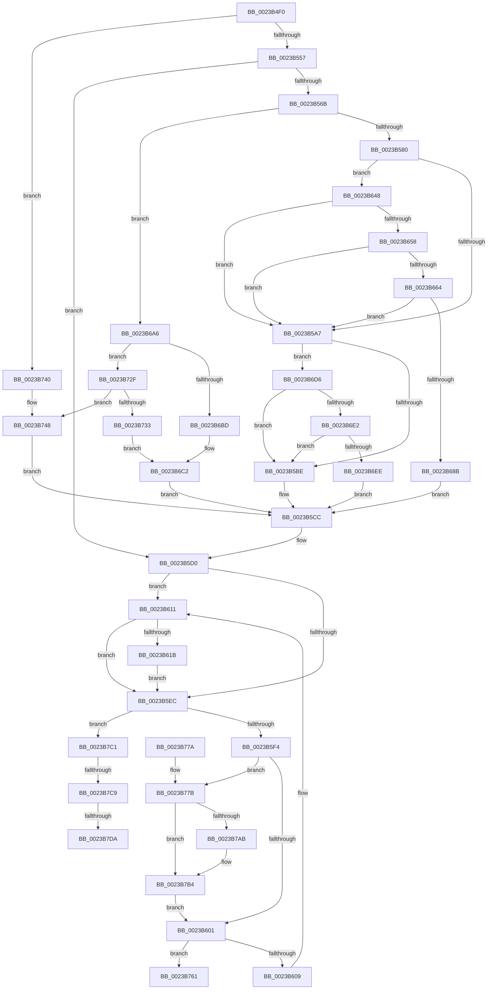

# MiProbeAndLockPages

- RVA: `0x0023B4F0`–`0x0023B7EF` (길이 `767` bytes)
- VA: `0x000000014023B4F0`
- 실행 섹션: `.text`
- PDB 이름 있음: `예`; PDB Function 태그: `예`
- unwind 정보 RVA: `0x00060D94`
- 디코드: `185`개 명령, `767/767` bytes 표시
- 미해석 바이트: `0` (있으면 어셈블리에 `.byte`로 보존)

> 이 문서는 커널 이미지의 기계어와 PDB 기호를 분석해 생성했습니다. 4번과 5번은 함수 원형과 자료형을 바이너리 사용 방식에서 추정한 C 해석이며 원본 소스 복구 결과는 아닙니다.

## 1. Dependencies

- 직접 호출 지점: **13**; 고유 호출 대상: **11**
- 직접 호출자로 확인된 함수: **1**
- RIP 상대 이미지 참조: **2**

### Outgoing calls
- `0x0023B521` → [memset](../6C/memset_function_006C6C40.md) (function, `0x006C6C40`)
- `0x0023B54A` → [MiProbeAndLockPrepare](MiProbeAndLockPrepare_function_0023BB40.md) (function, `0x0023BB40`)
- `0x0023B55B` → [MiProbeAndLockPacket](MiProbeAndLockPacket_function_0023BE20.md) (function, `0x0023BE20`)
- `0x0023B5D8` → [MiUnlockWorkingSetShared](../27/MiUnlockWorkingSetShared_function_0027D690.md) (function, `0x0027D690`)
- `0x0023B60B` → [RtlRaiseStatus](../2F/RtlRaiseStatus_function_002F6A50.md) (function, `0x002F6A50`)
- `0x0023B641` → [MiAddMdlTracker](../49/MiAddMdlTracker_function_0049A240.md) (function, `0x0049A240`)
- `0x0023B69C` → [ExReleaseSpinLockRegardlessFromDpcLevel](ExReleaseSpinLockRegardlessFromDpcLevel_function_0023A330.md) (function, `0x0023A330`)
- `0x0023B6CC` → [KeReleaseInStackQueuedSpinLockFromDpcLevel](../21/KeReleaseInStackQueuedSpinLockFromDpcLevel_function_002171B0.md) (function, `0x002171B0`)
- `0x0023B742` → [RtlRaiseStatus](../2F/RtlRaiseStatus_function_002F6A50.md) (function, `0x002F6A50`)
- `0x0023B757` → [KeReleaseInStackQueuedSpinLockFromDpcLevel](../21/KeReleaseInStackQueuedSpinLockFromDpcLevel_function_002171B0.md) (function, `0x002171B0`)
- `0x0023B7AF` → [MiReturnFullProcessCommitment](../../page/9E/MiReturnFullProcessCommitment_function_009E5D58.md) (function, `0x009E5D58`)
- `0x0023B7B7` → [MiUnlockAndDereferenceVad](../31/MiUnlockAndDereferenceVad_function_00316E60.md) (function, `0x00316E60`)
- `0x0023B7E4` → [MmUnlockPhysicalPagesByVa](../../page/7F/MmUnlockPhysicalPagesByVa_function_007FBA3C.md) (function, `0x007FBA3C`)

### Direct callers
- [MmProbeAndLockPagesPrivate](../48/MmProbeAndLockPagesPrivate_function_0048ED68.md) at `0x0048ED74`

### Static image references
- `0x0023B611` → RVA `0x00FC6BBC` (`ALMOSTRO`; read)
- `0x0023B71F` → RVA `0x00E2F1AC` (`.data`; read)

## 2. Other-region calls and transfers

- 다른 실행 섹션으로 향하는 call: **2**
  - `0x0023B7AF` → [MiReturnFullProcessCommitment](../../page/9E/MiReturnFullProcessCommitment_function_009E5D58.md) (`.text` → `PAGE`)
  - `0x0023B7E4` → [MmUnlockPhysicalPagesByVa](../../page/7F/MmUnlockPhysicalPagesByVa_function_007FBA3C.md) (`.text` → `PAGE`)
- call이 아닌 외부 분기/꼬리 이동: **3**
  - `0x0023B7C3` → [sub_006D7904 + 0x35](../6D/Unknown_function_006D7904.md) (`tail-transfer`)
  - `0x0023B7D4` → [sub_006D7904](../6D/Unknown_function_006D7904.md) (`tail-transfer`)
  - `0x0023B7EA` → [sub_006D7904](../6D/Unknown_function_006D7904.md) (`tail-transfer`)

## 3. Assembly (complete function range)

```asm
0023B4F0  48 89 5C 24 08                  mov qword ptr [rsp + 8], rbx
0023B4F5  48 89 74 24 10                  mov qword ptr [rsp + 0x10], rsi
0023B4FA  48 89 7C 24 18                  mov qword ptr [rsp + 0x18], rdi
0023B4FF  55                              push rbp
0023B500  48 8D 6C 24 A9                  lea rbp, [rsp - 0x57]
0023B505  48 81 EC F0 00 00 00            sub rsp, 0xf0
0023B50C  41 8B D8                        mov ebx, r8d
0023B50F  0F B6 FA                        movzx edi, dl
0023B512  48 8B F1                        mov rsi, rcx
0023B515  33 D2                           xor edx, edx
0023B517  41 B8 B0 00 00 00               mov r8d, 0xb0
0023B51D  48 8D 4D A7                     lea rcx, [rbp - 0x59]
0023B521  E8 1A B7 48 00                  call 0x1406c6c40
0023B526  44 8B 46 2C                     mov r8d, dword ptr [rsi + 0x2c]
0023B52A  48 8D 4D A7                     lea rcx, [rbp - 0x59]
0023B52E  4C 03 46 20                     add r8, qword ptr [rsi + 0x20]
0023B532  48 8B D6                        mov rdx, rsi
0023B535  44 8B 4E 28                     mov r9d, dword ptr [rsi + 0x28]
0023B539  C7 44 24 30 01 00 00 00         mov dword ptr [rsp + 0x30], 1
0023B541  89 5C 24 28                     mov dword ptr [rsp + 0x28], ebx
0023B545  40 88 7C 24 20                  mov byte ptr [rsp + 0x20], dil
0023B54A  E8 F1 05 00 00                  call 0x14023bb40
0023B54F  85 C0                           test eax, eax
0023B551  0F 88 E9 01 00 00               js 0x14023b740
0023B557  48 8D 4D A7                     lea rcx, [rbp - 0x59]
0023B55B  E8 C0 08 00 00                  call 0x14023be20
0023B560  8B F8                           mov edi, eax
0023B562  48 8B 45 CF                     mov rax, qword ptr [rbp - 0x31]
0023B566  48 85 C0                        test rax, rax
0023B569  74 65                           je 0x14023b5d0
0023B56B  48 B9 68 DF BE 7D FB F6 FF FF   movabs rcx, 0xfffff6fb7dbedf68
0023B575  33 DB                           xor ebx, ebx
0023B577  48 3B C1                        cmp rax, rcx
0023B57A  0F 84 26 01 00 00               je 0x14023b6a6
0023B580  48 8B 45 0F                     mov rax, qword ptr [rbp + 0xf]
0023B584  49 B8 00 D0 BE 7D FB F6 FF FF   movabs r8, 0xfffff6fb7dbed000
0023B58E  49 B9 FF DF BE 7D FB F6 FF FF   movabs r9, 0xfffff6fb7dbedfff
0023B598  8B 88 B8 00 00 00               mov ecx, dword ptr [rax + 0xb8]
0023B59E  F6 C1 0F                        test cl, 0xf
0023B5A1  0F 84 A1 00 00 00               je 0x14023b648
0023B5A7  48 8B 45 0F                     mov rax, qword ptr [rbp + 0xf]
0023B5AB  8B 88 B8 00 00 00               mov ecx, dword ptr [rax + 0xb8]
0023B5B1  48 8B 55 CF                     mov rdx, qword ptr [rbp - 0x31]
0023B5B5  F6 C1 0F                        test cl, 0xf
0023B5B8  0F 85 18 01 00 00               jne 0x14023b6d6
0023B5BE  48 B8 FF FF FF FF FF FF FF CF   movabs rax, 0xcfffffffffffffff
0023B5C8  F0 48 21 02                     lock and qword ptr [rdx], rax
0023B5CC  48 89 5D CF                     mov qword ptr [rbp - 0x31], rbx
0023B5D0  0F B6 55 F3                     movzx edx, byte ptr [rbp - 0xd]
0023B5D4  48 8B 4D 0F                     mov rcx, qword ptr [rbp + 0xf]
0023B5D8  E8 B3 20 04 00                  call 0x14027d690
0023B5DD  8B 5D EF                        mov ebx, dword ptr [rbp - 0x11]
0023B5E0  48 8B 75 E7                     mov rsi, qword ptr [rbp - 0x19]
0023B5E4  C1 EB 06                        shr ebx, 6
0023B5E7  83 E3 01                        and ebx, 1
0023B5EA  74 25                           je 0x14023b611
0023B5EC  85 FF                           test edi, edi
0023B5EE  0F 88 CD 01 00 00               js 0x14023b7c1
0023B5F4  48 8B 4D 27                     mov rcx, qword ptr [rbp + 0x27]
0023B5F8  48 85 C9                        test rcx, rcx
0023B5FB  0F 85 7A 01 00 00               jne 0x14023b77b
0023B601  85 FF                           test edi, edi
0023B603  0F 89 58 01 00 00               jns 0x14023b761
0023B609  8B CF                           mov ecx, edi
0023B60B  E8 40 B4 0B 00                  call 0x1402f6a50
0023B610  CC                              int3
0023B611  8B 05 A5 B5 D8 00               mov eax, dword ptr [rip + 0xd8b5a5]
0023B617  A8 01                           test al, 1
0023B619  74 D1                           je 0x14023b5ec
0023B61B  8B 4E 2C                        mov ecx, dword ptr [rsi + 0x2c]
0023B61E  41 B8 03 00 00 00               mov r8d, 3
0023B624  03 4E 20                        add ecx, dword ptr [rsi + 0x20]
0023B627  8B 56 28                        mov edx, dword ptr [rsi + 0x28]
0023B62A  81 E1 FF 0F 00 00               and ecx, 0xfff
0023B630  48 81 C2 FF 0F 00 00            add rdx, 0xfff
0023B637  48 03 D1                        add rdx, rcx
0023B63A  48 8B CE                        mov rcx, rsi
0023B63D  48 C1 EA 0C                     shr rdx, 0xc
0023B641  E8 FA EB 25 00                  call 0x14049a240
0023B646  EB A4                           jmp 0x14023b5ec
0023B648  49 8B C0                        mov rax, r8
0023B64B  48 8B 4D CF                     mov rcx, qword ptr [rbp - 0x31]
0023B64F  48 3B C8                        cmp rcx, rax
0023B652  0F 82 4F FF FF FF               jb 0x14023b5a7
0023B658  49 8B C1                        mov rax, r9
0023B65B  48 3B C8                        cmp rcx, rax
0023B65E  0F 87 43 FF FF FF               ja 0x14023b5a7
0023B664  65 48 8B 04 25 88 01 00 00      mov rax, qword ptr gs:[0x188]
0023B66D  48 8B 88 B8 00 00 00            mov rcx, qword ptr [rax + 0xb8]
0023B674  48 8B 81 10 04 00 00            mov rax, qword ptr [rcx + 0x410]
0023B67B  48 8B 88 68 05 00 00            mov rcx, qword ptr [rax + 0x568]
0023B682  48 85 C9                        test rcx, rcx
0023B685  0F 84 1C FF FF FF               je 0x14023b5a7
0023B68B  48 8B 45 CF                     mov rax, qword ptr [rbp - 0x31]
0023B68F  48 C1 E8 03                     shr rax, 3
0023B693  25 FF 01 00 00                  and eax, 0x1ff
0023B698  48 8D 0C 81                     lea rcx, [rcx + rax*4]
0023B69C  E8 8F EC FF FF                  call 0x14023a330
0023B6A1  E9 26 FF FF FF                  jmp 0x14023b5cc
0023B6A6  65 48 8B 14 25 20 00 00 00      mov rdx, qword ptr gs:[0x20]
0023B6AF  48 8B 4D 0F                     mov rcx, qword ptr [rbp + 0xf]
0023B6B3  8B 81 B8 00 00 00               mov eax, dword ptr [rcx + 0xb8]
0023B6B9  24 0F                           and al, 0xf
0023B6BB  75 72                           jne 0x14023b72f
0023B6BD  B9 30 00 00 00                  mov ecx, 0x30
0023B6C2  48 81 C2 40 9C 00 00            add rdx, 0x9c40
0023B6C9  48 03 CA                        add rcx, rdx
0023B6CC  E8 DF BA FD FF                  call 0x1402171b0
0023B6D1  E9 F6 FE FF FF                  jmp 0x14023b5cc
0023B6D6  49 8B C0                        mov rax, r8
0023B6D9  48 3B D0                        cmp rdx, rax
0023B6DC  0F 82 DC FE FF FF               jb 0x14023b5be
0023B6E2  49 8B C1                        mov rax, r9
0023B6E5  48 3B D0                        cmp rdx, rax
0023B6E8  0F 87 D0 FE FF FF               ja 0x14023b5be
0023B6EE  49 8B C0                        mov rax, r8
0023B6F1  48 2B D0                        sub rdx, rax
0023B6F4  48 8B 45 0F                     mov rax, qword ptr [rbp + 0xf]
0023B6F8  48 C1 FA 03                     sar rdx, 3
0023B6FC  8B 80 B8 00 00 00               mov eax, dword ptr [rax + 0xb8]
0023B702  44 8D 04 12                     lea r8d, [rdx + rdx]
0023B706  BA 02 00 00 00                  mov edx, 2
0023B70B  41 8B C8                        mov ecx, r8d
0023B70E  41 8B C0                        mov eax, r8d
0023B711  83 E1 1F                        and ecx, 0x1f
0023B714  D3 E2                           shl edx, cl
0023B716  F7 D2                           not edx
0023B718  0F B3 CA                        btr edx, ecx
0023B71B  48 C1 E8 05                     shr rax, 5
0023B71F  48 8D 0D 86 3A BF 00            lea rcx, [rip + 0xbf3a86]
0023B726  F0 21 14 81                     lock and dword ptr [rcx + rax*4], edx
0023B72A  E9 9D FE FF FF                  jmp 0x14023b5cc
0023B72F  3C 07                           cmp al, 7
0023B731  74 15                           je 0x14023b748
0023B733  3C 05                           cmp al, 5
0023B735  B9 48 00 00 00                  mov ecx, 0x48
0023B73A  48 0F 44 CB                     cmove rcx, rbx
0023B73E  EB 82                           jmp 0x14023b6c2
0023B740  8B C8                           mov ecx, eax
0023B742  E8 09 B3 0B 00                  call 0x1402f6a50
0023B747  CC                              int3
0023B748  48 81 C2 40 9C 00 00            add rdx, 0x9c40
0023B74F  B9 18 00 00 00                  mov ecx, 0x18
0023B754  48 03 CA                        add rcx, rdx
0023B757  E8 54 BA FD FF                  call 0x1402171b0
0023B75C  E9 6B FE FF FF                  jmp 0x14023b5cc
0023B761  4C 8D 9C 24 F0 00 00 00         lea r11, [rsp + 0xf0]
0023B769  49 8B 5B 10                     mov rbx, qword ptr [r11 + 0x10]
0023B76D  49 8B 73 18                     mov rsi, qword ptr [r11 + 0x18]
0023B771  49 8B 7B 20                     mov rdi, qword ptr [r11 + 0x20]
0023B775  49 8B E3                        mov rsp, r11
0023B778  5D                              pop rbp
0023B779  C3                              ret
0023B77A  CC                              int3
0023B77B  8B 49 34                        mov ecx, dword ptr [rcx + 0x34]
0023B77E  48 8B 45 27                     mov rax, qword ptr [rbp + 0x27]
0023B782  0F B6 50 22                     movzx edx, byte ptr [rax + 0x22]
0023B786  48 8B 45 17                     mov rax, qword ptr [rbp + 0x17]
0023B78A  48 8B 5D 27                     mov rbx, qword ptr [rbp + 0x27]
0023B78E  48 C1 E2 20                     shl rdx, 0x20
0023B792  48 0B D1                        or rdx, rcx
0023B795  48 03 D0                        add rdx, rax
0023B798  89 53 34                        mov dword ptr [rbx + 0x34], edx
0023B79B  48 C1 EA 20                     shr rdx, 0x20
0023B79F  88 53 22                        mov byte ptr [rbx + 0x22], dl
0023B7A2  48 8B 55 1F                     mov rdx, qword ptr [rbp + 0x1f]
0023B7A6  48 2B D0                        sub rdx, rax
0023B7A9  74 09                           je 0x14023b7b4
0023B7AB  48 8B 4D FF                     mov rcx, qword ptr [rbp - 1]
0023B7AF  E8 A4 A5 7A 00                  call 0x1409e5d58
0023B7B4  48 8B CB                        mov rcx, rbx
0023B7B7  E8 A4 B6 0D 00                  call 0x140316e60
0023B7BC  E9 40 FE FF FF                  jmp 0x14023b601
0023B7C1  85 DB                           test ebx, ebx
0023B7C3  0F 84 70 C1 49 00               je 0x1406d7939
0023B7C9  48 8B 5D AF                     mov rbx, qword ptr [rbp - 0x51]
0023B7CD  48 8B 4D A7                     mov rcx, qword ptr [rbp - 0x59]
0023B7D1  48 3B D9                        cmp rbx, rcx
0023B7D4  0F 86 2A C1 49 00               jbe 0x1406d7904
0023B7DA  44 8B 4D 07                     mov r9d, dword ptr [rbp + 7]
0023B7DE  48 8B D3                        mov rdx, rbx
0023B7E1  48 2B D1                        sub rdx, rcx
0023B7E4  E8 53 02 5C 00                  call 0x1407fba3c
0023B7E9  90                              nop
0023B7EA  E9 15 C1 49 00                  jmp 0x1406d7904
```

## 4. C-style interpretation (structured pseudocode)

```c
__int64 __fastcall MiProbeAndLockPages(__int64 a1, int a2, int a3)
{
    __int64 result;
    __int64 v_rbx;
    __int64 v_rsp;
    unsigned __int64 v_stack_m38;
    unsigned __int64 v_stack_m40;
    unsigned __int64 v_stack_m48;
    unsigned __int64 v_stack_m50;
    unsigned int v_stack_m58;
    unsigned __int64 v_stack_m5F;
    unsigned __int64 v_stack_m60;
    unsigned __int8 v_stack_m6C;
    unsigned int v_stack_m70;
    unsigned __int64 v_stack_m78;
    unsigned __int64 v_stack_m8;
    unsigned __int64 v_stack_m90;
    unsigned __int64 v_stack_mB0;
    unsigned __int64 v_stack_mB8;
    unsigned int v_stack_mC8;
    unsigned int v_stack_mD0;
    unsigned __int8 v_stack_mD8;
    unsigned __int64 v_stack_p10;
    unsigned __int64 v_stack_p18;
    unsigned __int64 v_stack_p8;

    v_stack_p8 = v_rbx;
    v_stack_p10 = v_rsi;
    v_stack_p18 = v_rdi;
    v_rsp = (v_rsp) - (240);
    a2 = 0;
    result = memset(v_stack_mB8, a2, 176, a4);
    a3 = ((unsigned int)(*(unsigned int *)(a1 + 44))) + (*(unsigned __int64 *)(a1 + 32));
    v_stack_mC8 = 1;
    v_stack_mD0 = (unsigned int)((unsigned int)(a3));
    v_stack_mD8 = (unsigned __int8)((unsigned __int8)(a2));
    result = MiProbeAndLockPrepare(v_stack_mB8, a1, a3, (unsigned int)(*(unsigned int *)(a1 + 40)));
    if (sign_flag) goto loc_0023B740;
    result = MiProbeAndLockPacket(v_stack_mB8, a1, a3, (unsigned int)(*(unsigned int *)(a1 + 40)));
    if (v_stack_m90 == 0) goto loc_0023B5D0;
    v_rbx = 0;
    if (v_stack_m90 == v_stack_mB8) goto loc_0023B6A6;
    if ((((unsigned __int8)((unsigned int)(*(unsigned int *)(v_stack_m50 + 184)))) & (15)) == 0) goto loc_0023B648;
loc_0023B5A7:
    if ((((unsigned __int8)((unsigned int)(*(unsigned int *)(v_stack_m50 + 184)))) & (15)) != 0) goto loc_0023B6D6;
loc_0023B5BE:
loc_0023B5CC:
    v_stack_m90 = 0;
loc_0023B5D0:
    result = MiUnlockWorkingSetShared(v_stack_m50, v_stack_m6C, a3, (unsigned int)(*(unsigned int *)(a1 + 40)));
    v_rbx = (unsigned int)(((unsigned int)(v_stack_m70)) >> (6));
    v_rbx = (unsigned int)((v_rbx) & (1));
    if (condition_is_equal) goto loc_0023B611;
loc_0023B5EC:
    if (sign_flag) goto loc_0023B7C1;
    if (v_stack_m38 != 0) goto loc_0023B77B;
loc_0023B601:
    if (!sign_flag) goto loc_0023B761;
    result = RtlRaiseStatus((unsigned int)((unsigned int)((unsigned int)((unsigned int)(result)))), v_stack_m6C, a3, (unsigned int)(*(unsigned int *)(a1 + 40)));
loc_0023B611:
    if ((((unsigned __int8)((unsigned int)(*(unsigned int *)(v_rip + 14202277)))) & (1)) == 0) goto loc_0023B5EC;
    a1 = (unsigned int)(((unsigned int)(*(unsigned int *)(v_stack_m78 + 44))) + (*(unsigned int *)(v_stack_m78 + 32)));
    a1 = (unsigned int)((a1) & (0xFFFULL));
    a2 = ((unsigned int)(*(unsigned int *)(v_stack_m78 + 40))) + (0xFFFULL);
    a2 = (a2) + (a1);
    a2 = (a2) >> (12);
    result = MiAddMdlTracker(v_stack_m78, a2, 3, (unsigned int)(*(unsigned int *)(a1 + 40)));
    goto loc_0023B5EC;
loc_0023B648:
    if (v_stack_m90 < 3) goto loc_0023B5A7;
    if (v_stack_m90 > ((unsigned int)(*(unsigned int *)(a1 + 40)))) goto loc_0023B5A7;
    if (*(unsigned __int64 *)(*(unsigned __int64 *)(*(unsigned __int64 *)(*(unsigned __int64 *)(gs_base + (0 + 392)) + 184) + 1040) + 1384) == 0) goto loc_0023B5A7;
    result = (v_stack_m90) >> (3);
    result = (unsigned int)((result) & (511));
    result = ExReleaseSpinLockRegardlessFromDpcLevel(*(unsigned __int64 *)(*(unsigned __int64 *)(*(unsigned __int64 *)(*(unsigned __int64 *)(gs_base + (0 + 392)) + 184) + 1040) + 1384) + result * 4, a2, 3, (unsigned int)(*(unsigned int *)(a1 + 40)));
    goto loc_0023B5CC;
loc_0023B6A6:
    result = (unsigned __int8)(((unsigned int)(*(unsigned int *)(v_stack_m50 + 184))) & (15));
    if (condition_is_not_equal) goto loc_0023B72F;
loc_0023B6C2:
    a2 = (*(unsigned __int64 *)(gs_base + (0 + 32))) + (0x9C40ULL);
    a1 = (48) + (a2);
    result = KeReleaseInStackQueuedSpinLockFromDpcLevel(a1, a2, 3, (unsigned int)(*(unsigned int *)(a1 + 40)));
    goto loc_0023B5CC;
loc_0023B6D6:
    if (a2 < 3) goto loc_0023B5BE;
    if (a2 > ((unsigned int)(*(unsigned int *)(a1 + 40)))) goto loc_0023B5BE;
    a2 = (a2) - (3);
    a2 = (a2) >> (3);
    a1 = (unsigned int)(((unsigned int)((unsigned int)(a2 + a2 * 1))) & (31));
    a2 = (unsigned int)((2) << ((unsigned __int8)(a1)));
    a2 = (unsigned int)(~(a2));
    result = ((unsigned int)((unsigned int)(a2 + a2 * 1))) >> (5);
    goto loc_0023B5CC;
loc_0023B72F:
    if (((unsigned __int8)(result)) == 7) goto loc_0023B748;
    a1 = 72;
    if (((unsigned __int8)(result)) == 5) { a1 = v_rbx; }
    goto loc_0023B6C2;
loc_0023B740:
    result = RtlRaiseStatus((unsigned int)((unsigned int)(result)), a2, a2 + a2 * 1, (unsigned int)(*(unsigned int *)(a1 + 40)));
loc_0023B748:
    a2 = (a2) + (0x9C40ULL);
    a1 = (24) + (a2);
    result = KeReleaseInStackQueuedSpinLockFromDpcLevel(a1, a2, a2 + a2 * 1, (unsigned int)(*(unsigned int *)(a1 + 40)));
    goto loc_0023B5CC;
loc_0023B761:
    return result;
loc_0023B77B:
    a2 = (*(unsigned __int8 *)(v_stack_m38 + 34)) << (32);
    a2 = (a2) | ((unsigned int)(*(unsigned int *)(a1 + 52)));
    a2 = (a2) + (v_stack_m48);
    *(unsigned int *)(v_stack_m38 + 52) = a2;
    a2 = (a2) >> (32);
    *(unsigned __int8 *)(v_stack_m38 + 34) = (unsigned __int8)(a2);
    a2 = (v_stack_m40) - (v_stack_m48);
    result = v_stack_m48;
    if (!(condition_is_equal)) {
        a1 = v_stack_m60;
        result = MiReturnFullProcessCommitment(a1, a2, a2 + a2 * 1, (unsigned int)(*(unsigned int *)(a1 + 40)));
    }
    result = MiUnlockAndDereferenceVad(v_stack_m38, a2, a2 + a2 * 1, (unsigned int)(*(unsigned int *)(a1 + 40)));
    goto loc_0023B601;
loc_0023B7C1:
    a2 = (v_stack_mB0) - (v_stack_mB8);
    result = MmUnlockPhysicalPagesByVa(v_stack_mB8, a2, a2 + a2 * 1, (unsigned int)(v_stack_m58));
}
```

## 5. (Beta) C Style

```c
int64_t MiProbeAndLockPages(void *Arg1, int32_t Arg2, int32_t Arg3)
{
    uint8_t *arg1 = (uint8_t *)Arg1;

    int64_t result;
    int64_t local_rbx;
    int64_t local_rsp;
    uint64_t v_stack_m38;
    uint64_t v_stack_m40;
    uint64_t v_stack_m48;
    uint64_t v_stack_m50;
    uint32_t v_stack_m58;
    uint64_t v_stack_m5F;
    uint64_t v_stack_m60;
    uint8_t v_stack_m6C;
    uint32_t v_stack_m70;
    uint64_t v_stack_m78;
    uint64_t v_stack_m8;
    uint64_t v_stack_m90;
    uint64_t v_stack_mB0;
    uint64_t v_stack_mB8;
    uint32_t v_stack_mC8;
    uint32_t v_stack_mD0;
    uint8_t v_stack_mD8;
    uint64_t v_stack_p10;
    uint64_t v_stack_p18;
    uint64_t v_stack_p8;

    v_stack_p8 = local_rbx;
    v_stack_p10 = local_rsi;
    v_stack_p18 = local_rdi;
    local_rsp = (local_rsp) - (240);
    Arg2 = 0;
    result = memset(v_stack_mB8, Arg2, 176, a4);
    Arg3 = ((uint32_t)(*(uint32_t *)(arg1 + 0x2C))) + (*(uint64_t *)(arg1 + 0x20));
    v_stack_mC8 = 1;
    v_stack_mD0 = (uint32_t)((uint32_t)(Arg3));
    v_stack_mD8 = (uint8_t)((uint8_t)(Arg2));
    result = MiProbeAndLockPrepare(v_stack_mB8, Arg1, Arg3, (uint32_t)(*(uint32_t *)(arg1 + 0x28)));
    if (sign_flag) goto loc_0023B740;
    result = MiProbeAndLockPacket(v_stack_mB8, Arg1, Arg3, (uint32_t)(*(uint32_t *)(arg1 + 0x28)));
    if (v_stack_m90 == 0) goto loc_0023B5D0;
    local_rbx = 0;
    if (v_stack_m90 == v_stack_mB8) goto loc_0023B6A6;
    if ((((uint8_t)((uint32_t)(*(uint32_t *)(v_stack_m50 + 0xB8)))) & (15)) == 0) goto loc_0023B648;
loc_0023B5A7:
    if ((((uint8_t)((uint32_t)(*(uint32_t *)(v_stack_m50 + 0xB8)))) & (15)) != 0) goto loc_0023B6D6;
loc_0023B5BE:
loc_0023B5CC:
    v_stack_m90 = 0;
loc_0023B5D0:
    result = MiUnlockWorkingSetShared(v_stack_m50, v_stack_m6C, Arg3, (uint32_t)(*(uint32_t *)(arg1 + 0x28)));
    local_rbx = (uint32_t)(((uint32_t)(v_stack_m70)) >> (6));
    local_rbx = (uint32_t)((local_rbx) & (1));
    if (condition_is_equal) goto loc_0023B611;
loc_0023B5EC:
    if (sign_flag) goto loc_0023B7C1;
    if (v_stack_m38 != 0) goto loc_0023B77B;
loc_0023B601:
    if (!sign_flag) goto loc_0023B761;
    result = RtlRaiseStatus((uint32_t)((uint32_t)((uint32_t)((uint32_t)(result)))), v_stack_m6C, Arg3, (uint32_t)(*(uint32_t *)(arg1 + 0x28)));
loc_0023B611:
    if ((((uint8_t)((uint32_t)(*(uint32_t *)(v_rip + 0xD8B5A5)))) & (1)) == 0) goto loc_0023B5EC;
    Arg1 = (uint32_t)(((uint32_t)(*(uint32_t *)(v_stack_m78 + 0x2C))) + (*(uint32_t *)(v_stack_m78 + 0x20)));
    Arg1 = (uint32_t)((Arg1) & (0xFFFULL));
    Arg2 = ((uint32_t)(*(uint32_t *)(v_stack_m78 + 0x28))) + (0xFFFULL);
    Arg2 = (Arg2) + (Arg1);
    Arg2 = (Arg2) >> (12);
    result = MiAddMdlTracker(v_stack_m78, Arg2, 3, (uint32_t)(*(uint32_t *)(arg1 + 0x28)));
    goto loc_0023B5EC;
loc_0023B648:
    if (v_stack_m90 < 3) goto loc_0023B5A7;
    if (v_stack_m90 > ((uint32_t)(*(uint32_t *)(arg1 + 0x28)))) goto loc_0023B5A7;
    if (*(uint64_t *)(*(uint64_t *)(*(uint64_t *)(*(uint64_t *)(gs_base + (0 + 0x188)) + 0xB8) + 0x410) + 0x568) == 0) goto loc_0023B5A7;
    result = (v_stack_m90) >> (3);
    result = (uint32_t)((result) & (511));
    result = ExReleaseSpinLockRegardlessFromDpcLevel(*(uint64_t *)(*(uint64_t *)(*(uint64_t *)(*(uint64_t *)(gs_base + (0 + 0x188)) + 0xB8) + 0x410) + 0x568) + result * 4, Arg2, 3, (uint32_t)(*(uint32_t *)(arg1 + 0x28)));
    goto loc_0023B5CC;
loc_0023B6A6:
    result = (uint8_t)(((uint32_t)(*(uint32_t *)(v_stack_m50 + 0xB8))) & (15));
    if (condition_is_not_equal) goto loc_0023B72F;
loc_0023B6C2:
    Arg2 = (*(uint64_t *)(gs_base + (0 + 0x20))) + (0x9C40ULL);
    Arg1 = (48) + (Arg2);
    result = KeReleaseInStackQueuedSpinLockFromDpcLevel(Arg1, Arg2, 3, (uint32_t)(*(uint32_t *)(arg1 + 0x28)));
    goto loc_0023B5CC;
loc_0023B6D6:
    if (Arg2 < 3) goto loc_0023B5BE;
    if (Arg2 > ((uint32_t)(*(uint32_t *)(arg1 + 0x28)))) goto loc_0023B5BE;
    Arg2 = (Arg2) - (3);
    Arg2 = (Arg2) >> (3);
    Arg1 = (uint32_t)(((uint32_t)((uint32_t)(Arg2 + Arg2 * 1))) & (31));
    Arg2 = (uint32_t)((2) << ((uint8_t)(Arg1)));
    Arg2 = (uint32_t)(~(Arg2));
    result = ((uint32_t)((uint32_t)(Arg2 + Arg2 * 1))) >> (5);
    goto loc_0023B5CC;
loc_0023B72F:
    if (((uint8_t)(result)) == 7) goto loc_0023B748;
    Arg1 = 72;
    if (((uint8_t)(result)) == 5) { Arg1 = local_rbx; }
    goto loc_0023B6C2;
loc_0023B740:
    result = RtlRaiseStatus((uint32_t)((uint32_t)(result)), Arg2, Arg2 + Arg2 * 1, (uint32_t)(*(uint32_t *)(arg1 + 0x28)));
loc_0023B748:
    Arg2 = (Arg2) + (0x9C40ULL);
    Arg1 = (24) + (Arg2);
    result = KeReleaseInStackQueuedSpinLockFromDpcLevel(Arg1, Arg2, Arg2 + Arg2 * 1, (uint32_t)(*(uint32_t *)(arg1 + 0x28)));
    goto loc_0023B5CC;
loc_0023B761:
    return result;
loc_0023B77B:
    Arg2 = (*(uint8_t *)(v_stack_m38 + 0x22)) << (32);
    Arg2 = (Arg2) | ((uint32_t)(*(uint32_t *)(arg1 + 0x34)));
    Arg2 = (Arg2) + (v_stack_m48);
    *(uint32_t *)(v_stack_m38 + 0x34) = Arg2;
    Arg2 = (Arg2) >> (32);
    *(uint8_t *)(v_stack_m38 + 0x22) = (uint8_t)(Arg2);
    Arg2 = (v_stack_m40) - (v_stack_m48);
    result = v_stack_m48;
    if (!(condition_is_equal)) {
        Arg1 = v_stack_m60;
        result = MiReturnFullProcessCommitment(Arg1, Arg2, Arg2 + Arg2 * 1, (uint32_t)(*(uint32_t *)(arg1 + 0x28)));
    }
    result = MiUnlockAndDereferenceVad(v_stack_m38, Arg2, Arg2 + Arg2 * 1, (uint32_t)(*(uint32_t *)(arg1 + 0x28)));
    goto loc_0023B601;
loc_0023B7C1:
    Arg2 = (v_stack_mB0) - (v_stack_mB8);
    result = MmUnlockPhysicalPagesByVa(v_stack_mB8, Arg2, Arg2 + Arg2 * 1, (uint32_t)(v_stack_m58));
}
```

### 관측된 메모리 오프셋

구조체 형식이 확인되지 않은 접근은 인자 기준의 오프셋으로만 기록했습니다.

| 기준 인자 | 오프셋 표현 | 폭 (bit) | 접근 |
|---|---:|---:|---|
| `Arg1` | `+ 0x20` | `64` | `R` |
| `Arg1` | `+ 0x28` | `32` | `R` |
| `Arg1` | `+ 0x2C` | `32` | `R` |

## 6. Execution-region graph

[열기: 2D/3D 그래프와 함수 탐색 컨트롤 패널](../../../control-panel.html?section=text&rva=0x0023B4F0&view=graph)

- 2D 그래프는 위에서 아래로 흐르고, 3D 그래프는 빈 공간을 드래그해 회전합니다. Shift+드래그는 이동, 휠은 확대·축소, 함수 노드 선택은 대상 보고서 이동입니다.

### Static fallback


