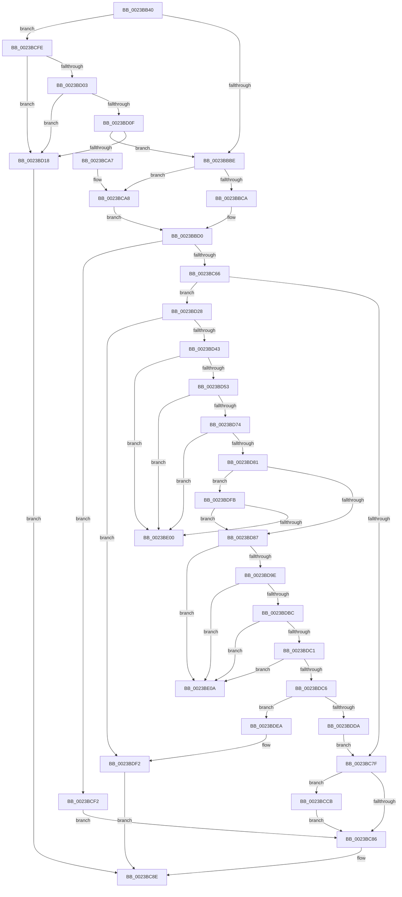

# MiProbeAndLockPrepare

- RVA: `0x0023BB40`–`0x0023BE14` (길이 `724` bytes)
- VA: `0x000000014023BB40`
- 실행 섹션: `.text`
- PDB 이름 있음: `예`; PDB Function 태그: `예`
- unwind 정보 RVA: `0x00060E30`
- 디코드: `181`개 명령, `724/724` bytes 표시
- 미해석 바이트: `0` (있으면 어셈블리에 `.byte`로 보존)

> 이 문서는 커널 이미지의 기계어와 PDB 기호를 분석해 생성했습니다. 4번과 5번은 함수 원형과 자료형을 바이너리 사용 방식에서 추정한 C 해석이며 원본 소스 복구 결과는 아닙니다.

## 1. Dependencies

- 직접 호출 지점: **5**; 고유 호출 대상: **5**
- 직접 호출자로 확인된 함수: **5**
- RIP 상대 이미지 참조: **1**

### Outgoing calls
- `0x0023BC89` → [MiInitializeProbePacketVm](../40/MiInitializeProbePacketVm_function_0040E240.md) (function, `0x0040E240`)
- `0x0023BD32` → [MiObtainReferencedVadEx](../31/MiObtainReferencedVadEx_function_00316690.md) (function, `0x00316690`)
- `0x0023BD46` → [MiVadPureReserve](../2C/MiVadPureReserve_function_002C34C0.md) (function, `0x002C34C0`)
- `0x0023BDCD` → [MiChargeFullProcessCommitment](../../page/88/MiChargeFullProcessCommitment_function_00887630.md) (function, `0x00887630`)
- `0x0023BDED` → [MiUnlockAndDereferenceVad](../31/MiUnlockAndDereferenceVad_function_00316E60.md) (function, `0x00316E60`)

### Direct callers
- [MiProbeAndLockPages](MiProbeAndLockPages_function_0023B4F0.md) at `0x0023B54A`
- [MmProbeAndLockPages](MmProbeAndLockPages_function_0023B990.md) at `0x0023B9FC`
- [MmStoreProbeAndLockPages](MmStoreProbeAndLockPages_function_0023E570.md) at `0x0023E5EE`
- [sub_0023F815](Unknown_function_0023F815.md) at `0x0023F860`
- [MmLockPhysicalPagesByVa](../../page/7F/MmLockPhysicalPagesByVa_function_007FB930.md) at `0x007FB9EE`

### Static image references
- `0x0023BD18` → RVA `0x00E30200` (`.data`; read/write)

## 2. Other-region calls and transfers

- 다른 실행 섹션으로 향하는 call: **1**
  - `0x0023BDCD` → [MiChargeFullProcessCommitment](../../page/88/MiChargeFullProcessCommitment_function_00887630.md) (`.text` → `PAGE`)
- call이 아닌 외부 분기/꼬리 이동: **2**
  - `0x0023BE05` → [sub_006D799A](../6D/Unknown_function_006D799A.md) (`tail-transfer`)
  - `0x0023BE0F` → [sub_006D799A](../6D/Unknown_function_006D799A.md) (`tail-transfer`)

## 3. Assembly (complete function range)

```asm
0023BB40  48 8B C4                        mov rax, rsp
0023BB43  48 89 58 08                     mov qword ptr [rax + 8], rbx
0023BB47  48 89 68 10                     mov qword ptr [rax + 0x10], rbp
0023BB4B  48 89 70 18                     mov qword ptr [rax + 0x18], rsi
0023BB4F  57                              push rdi
0023BB50  41 55                           push r13
0023BB52  41 56                           push r14
0023BB54  48 83 EC 20                     sub rsp, 0x20
0023BB58  48 8B D9                        mov rbx, rcx
0023BB5B  48 89 51 40                     mov qword ptr [rcx + 0x40], rdx
0023BB5F  4D 8B F0                        mov r14, r8
0023BB62  49 8B F1                        mov rsi, r9
0023BB65  44 8B 44 24 68                  mov r8d, dword ptr [rsp + 0x68]
0023BB6A  41 BD 02 00 00 00               mov r13d, 2
0023BB70  83 60 30 00                     and dword ptr [rax + 0x30], 0
0023BB74  48 BF FF FF FE FF FF 7F 00 00   movabs rdi, 0x7ffffffeffff
0023BB7E  8B 43 48                        mov eax, dword ptr [rbx + 0x48]
0023BB81  65 4C 8B 0C 25 88 01 00 00      mov r9, qword ptr gs:[0x188]
0023BB8A  49 8D 2C 36                     lea rbp, [r14 + rsi]
0023BB8E  4C 89 49 50                     mov qword ptr [rcx + 0x50], r9
0023BB92  83 E0 BF                        and eax, 0xffffffbf
0023BB95  44 89 41 60                     mov dword ptr [rcx + 0x60], r8d
0023BB99  4C 89 31                        mov qword ptr [rcx], r14
0023BB9C  4C 89 71 08                     mov qword ptr [rcx + 8], r14
0023BBA0  8B 4C 24 70                     mov ecx, dword ptr [rsp + 0x70]
0023BBA4  41 23 CD                        and ecx, r13d
0023BBA7  48 89 6B 10                     mov qword ptr [rbx + 0x10], rbp
0023BBAB  C1 E1 05                        shl ecx, 5
0023BBAE  0B C8                           or ecx, eax
0023BBB0  80 7C 24 60 00                  cmp byte ptr [rsp + 0x60], 0
0023BBB5  89 4B 48                        mov dword ptr [rbx + 0x48], ecx
0023BBB8  0F 85 40 01 00 00               jne 0x14023bcfe
0023BBBE  48 FF CD                        dec rbp
0023BBC1  F6 C1 40                        test cl, 0x40
0023BBC4  0F 84 DE 00 00 00               je 0x14023bca8
0023BBCA  48 C1 EE 0C                     shr rsi, 0xc
0023BBCE  33 C0                           xor eax, eax
0023BBD0  49 8B CE                        mov rcx, r14
0023BBD3  48 89 43 38                     mov qword ptr [rbx + 0x38], rax
0023BBD7  48 C1 E9 09                     shr rcx, 9
0023BBDB  49 BB F8 FF FF FF 7F 00 00 00   movabs r11, 0x7ffffffff8
0023BBE5  49 23 CB                        and rcx, r11
0023BBE8  49 BA 00 00 00 00 80 F6 FF FF   movabs r10, 0xfffff68000000000
0023BBF2  49 8B C2                        mov rax, r10
0023BBF5  48 03 C8                        add rcx, rax
0023BBF8  48 89 4B 18                     mov qword ptr [rbx + 0x18], rcx
0023BBFC  48 8B CD                        mov rcx, rbp
0023BBFF  48 C1 E9 09                     shr rcx, 9
0023BC03  49 23 CB                        and rcx, r11
0023BC06  49 8B C2                        mov rax, r10
0023BC09  48 03 C8                        add rcx, rax
0023BC0C  41 BA 7F FF FF FF               mov r10d, 0xffffff7f
0023BC12  48 89 4B 20                     mov qword ptr [rbx + 0x20], rcx
0023BC16  48 B8 FF FF FF FF 3F 00 00 00   movabs rax, 0x3fffffffff
0023BC20  0F B7 4A 0A                     movzx ecx, word ptr [rdx + 0xa]
0023BC24  48 89 83 90 00 00 00            mov qword ptr [rbx + 0x90], rax
0023BC2B  0F B7 C1                        movzx eax, cx
0023BC2E  66 41 23 C2                     and ax, r10w
0023BC32  41 BA 80 00 00 00               mov r10d, 0x80
0023BC38  66 41 0B CA                     or cx, r10w
0023BC3C  45 85 C0                        test r8d, r8d
0023BC3F  66 0F 44 C8                     cmove cx, ax
0023BC43  48 83 A3 80 00 00 00 00         and qword ptr [rbx + 0x80], 0
0023BC4B  48 83 63 70 00                  and qword ptr [rbx + 0x70], 0
0023BC50  66 41 0B CD                     or cx, r13w
0023BC54  48 83 63 78 00                  and qword ptr [rbx + 0x78], 0
0023BC59  66 89 4A 0A                     mov word ptr [rdx + 0xa], cx
0023BC5D  4C 3B F7                        cmp r14, rdi
0023BC60  0F 87 8C 00 00 00               ja 0x14023bcf2
0023BC66  49 8B 81 B8 00 00 00            mov rax, qword ptr [r9 + 0xb8]
0023BC6D  48 89 43 58                     mov qword ptr [rbx + 0x58], rax
0023BC71  48 89 42 10                     mov qword ptr [rdx + 0x10], rax
0023BC75  41 83 F8 03                     cmp r8d, 3
0023BC79  0F 84 A9 00 00 00               je 0x14023bd28
0023BC7F  F6 44 24 70 01                  test byte ptr [rsp + 0x70], 1
0023BC84  75 45                           jne 0x14023bccb
0023BC86  48 8B CB                        mov rcx, rbx
0023BC89  E8 B2 25 1D 00                  call 0x14040e240
0023BC8E  48 8B 5C 24 40                  mov rbx, qword ptr [rsp + 0x40]
0023BC93  48 8B 6C 24 48                  mov rbp, qword ptr [rsp + 0x48]
0023BC98  48 8B 74 24 50                  mov rsi, qword ptr [rsp + 0x50]
0023BC9D  48 83 C4 20                     add rsp, 0x20
0023BCA1  41 5E                           pop r14
0023BCA3  41 5D                           pop r13
0023BCA5  5F                              pop rdi
0023BCA6  C3                              ret
0023BCA7  CC                              int3
0023BCA8  8B 4B 08                        mov ecx, dword ptr [rbx + 8]
0023BCAB  48 8D 42 30                     lea rax, [rdx + 0x30]
0023BCAF  8B 72 28                        mov esi, dword ptr [rdx + 0x28]
0023BCB2  81 E1 FF 0F 00 00               and ecx, 0xfff
0023BCB8  48 81 C6 FF 0F 00 00            add rsi, 0xfff
0023BCBF  48 03 F1                        add rsi, rcx
0023BCC2  48 C1 EE 0C                     shr rsi, 0xc
0023BCC6  E9 05 FF FF FF                  jmp 0x14023bbd0
0023BCCB  65 8B 0C 25 A4 01 00 00         mov ecx, dword ptr gs:[0x1a4]
0023BCD3  48 8B 43 58                     mov rax, qword ptr [rbx + 0x58]
0023BCD7  48 D1 E9                        shr rcx, 1
0023BCDA  83 E1 03                        and ecx, 3
0023BCDD  48 83 C1 08                     add rcx, 8
0023BCE1  48 C1 E1 06                     shl rcx, 6
0023BCE5  48 03 88 10 04 00 00            add rcx, qword ptr [rax + 0x410]
0023BCEC  F0 48 01 31                     lock add qword ptr [rcx], rsi
0023BCF0  EB 94                           jmp 0x14023bc86
0023BCF2  48 83 63 58 00                  and qword ptr [rbx + 0x58], 0
0023BCF7  48 83 62 10 00                  and qword ptr [rdx + 0x10], 0
0023BCFC  EB 88                           jmp 0x14023bc86
0023BCFE  48 85 F6                        test rsi, rsi
0023BD01  74 15                           je 0x14023bd18
0023BD03  49 8D 46 FF                     lea rax, [r14 - 1]
0023BD07  48 03 C6                        add rax, rsi
0023BD0A  49 3B C6                        cmp rax, r14
0023BD0D  72 09                           jb 0x14023bd18
0023BD0F  48 3B C7                        cmp rax, rdi
0023BD12  0F 86 A6 FE FF FF               jbe 0x14023bbbe
0023BD18  FF 05 E2 44 BF 00               inc dword ptr [rip + 0xbf44e2]
0023BD1E  B8 05 00 00 C0                  mov eax, 0xc0000005
0023BD23  E9 66 FF FF FF                  jmp 0x14023bc8e
0023BD28  4C 8D 44 24 68                  lea r8, [rsp + 0x68]
0023BD2D  33 D2                           xor edx, edx
0023BD2F  49 8B CE                        mov rcx, r14
0023BD32  E8 59 A9 0D 00                  call 0x140316690
0023BD37  48 8B F8                        mov rdi, rax
0023BD3A  48 85 C0                        test rax, rax
0023BD3D  0F 84 AF 00 00 00               je 0x14023bdf2
0023BD43  48 8B C8                        mov rcx, rax
0023BD46  E8 75 77 08 00                  call 0x1402c34c0
0023BD4B  85 C0                           test eax, eax
0023BD4D  0F 85 AD 00 00 00               jne 0x14023be00
0023BD53  8B 4F 34                        mov ecx, dword ptr [rdi + 0x34]
0023BD56  48 B8 FD FF FF FF 07 00 00 00   movabs rax, 0x7fffffffd
0023BD60  0F B6 57 22                     movzx edx, byte ptr [rdi + 0x22]
0023BD64  48 C1 E2 20                     shl rdx, 0x20
0023BD68  48 0B D1                        or rdx, rcx
0023BD6B  48 3B D0                        cmp rdx, rax
0023BD6E  0F 83 8C 00 00 00               jae 0x14023be00
0023BD74  8B 4F 30                        mov ecx, dword ptr [rdi + 0x30]
0023BD77  8B C1                           mov eax, ecx
0023BD79  83 E0 70                        and eax, 0x70
0023BD7C  83 F8 10                        cmp eax, 0x10
0023BD7F  74 7F                           je 0x14023be00
0023BD81  0F BA E1 15                     bt ecx, 0x15
0023BD85  73 74                           jae 0x14023bdfb
0023BD87  0F B6 57 20                     movzx edx, byte ptr [rdi + 0x20]
0023BD8B  8B 47 18                        mov eax, dword ptr [rdi + 0x18]
0023BD8E  48 C1 E2 20                     shl rdx, 0x20
0023BD92  48 0B D0                        or rdx, rax
0023BD95  48 C1 E2 0C                     shl rdx, 0xc
0023BD99  4C 3B F2                        cmp r14, rdx
0023BD9C  72 6C                           jb 0x14023be0a
0023BD9E  0F B6 4F 21                     movzx ecx, byte ptr [rdi + 0x21]
0023BDA2  8B 47 1C                        mov eax, dword ptr [rdi + 0x1c]
0023BDA5  48 C1 E1 20                     shl rcx, 0x20
0023BDA9  48 0B C8                        or rcx, rax
0023BDAC  48 C1 E1 0C                     shl rcx, 0xc
0023BDB0  48 81 C9 FF 0F 00 00            or rcx, 0xfff
0023BDB7  4C 3B F1                        cmp r14, rcx
0023BDBA  77 4E                           ja 0x14023be0a
0023BDBC  48 3B EA                        cmp rbp, rdx
0023BDBF  72 49                           jb 0x14023be0a
0023BDC1  48 3B E9                        cmp rbp, rcx
0023BDC4  77 44                           ja 0x14023be0a
0023BDC6  48 8B 4B 58                     mov rcx, qword ptr [rbx + 0x58]
0023BDCA  48 8B D6                        mov rdx, rsi
0023BDCD  E8 5E B8 64 00                  call 0x140887630
0023BDD2  89 44 24 68                     mov dword ptr [rsp + 0x68], eax
0023BDD6  85 C0                           test eax, eax
0023BDD8  78 10                           js 0x14023bdea
0023BDDA  48 89 BB 80 00 00 00            mov qword ptr [rbx + 0x80], rdi
0023BDE1  48 89 73 78                     mov qword ptr [rbx + 0x78], rsi
0023BDE5  E9 95 FE FF FF                  jmp 0x14023bc7f
0023BDEA  48 8B CF                        mov rcx, rdi
0023BDED  E8 6E B0 0D 00                  call 0x140316e60
0023BDF2  8B 44 24 68                     mov eax, dword ptr [rsp + 0x68]
0023BDF6  E9 93 FE FF FF                  jmp 0x14023bc8e
0023BDFB  83 F8 20                        cmp eax, 0x20
0023BDFE  74 87                           je 0x14023bd87
0023BE00  BB 05 00 00 C0                  mov ebx, 0xc0000005
0023BE05  E9 90 BB 49 00                  jmp 0x1406d799a
0023BE0A  BB 18 00 00 C0                  mov ebx, 0xc0000018
0023BE0F  E9 86 BB 49 00                  jmp 0x1406d799a
```

## 4. C-style interpretation (structured pseudocode)

```c
__int64 __fastcall MiProbeAndLockPrepare(__int64 a1, __int64 a2, __int64 a3, __int64 a4, unsigned __int8 a5, unsigned int a6, unsigned __int8 a7)
{
    __int64 result;
    __int64 v_rbp;
    __int64 v_rsi;
    __int64 v_rsp;
    unsigned __int64 v_stack_p10;
    unsigned __int64 v_stack_p18;
    unsigned int v_stack_p68;
    unsigned __int64 v_stack_p8;

    *(unsigned __int64 *)(v_rsp + 8) = v_rbx;
    *(unsigned __int64 *)(v_rsp + 16) = v_rbp;
    *(unsigned __int64 *)(v_rsp + 24) = v_rsi;
    v_rsp = (v_rsp) - (32);
    *(unsigned __int64 *)(a1 + 64) = a2;
    *(unsigned __int64 *)(a1 + 80) = *(unsigned __int64 *)(gs_base + (0 + 392));
    result = (unsigned int)(((unsigned int)(*(unsigned int *)(a1 + 72))) & (0xFFFFFFBFULL));
    *(unsigned int *)(a1 + 96) = (unsigned int)((unsigned int)(a6));
    *(unsigned __int64 *)(a1) = a3;
    *(unsigned __int64 *)(a1 + 8) = a3;
    a1 = (unsigned int)(((unsigned int)(a7)) & (2));
    *(unsigned __int64 *)(a1 + 16) = a3 + a4 * 1;
    a1 = (unsigned int)((a1) << (5));
    a1 = (unsigned int)((a1) | ((unsigned int)(result)));
    *(unsigned int *)(a1 + 72) = (unsigned int)(a1);
    if (a5 != 0) goto loc_0023BCFE;
loc_0023BBBE:
    v_rbp = (a3 + a4 * 1) - 1;
    if ((((unsigned __int8)(a1)) & (64)) == 0) goto loc_0023BCA8;
    v_rsi = (a4) >> (12);
    result = 0;
loc_0023BBD0:
    *(unsigned __int64 *)(a1 + 56) = 0;
    a1 = (a3) >> (9);
    a1 = (a1) & (v_r11);
    a1 = (a1) + (v_r10);
    *(unsigned __int64 *)(a1 + 24) = a1;
    a1 = (v_rbp) >> (9);
    a1 = (a1) & (v_r11);
    a1 = (a1) + (v_r10);
    *(unsigned __int64 *)(a1 + 32) = a1;
    *(unsigned __int64 *)(a1 + 144) = v_r10;
    result = (unsigned __int16)(((unsigned __int16)(*(unsigned __int16 *)(a2 + 10))) & ((unsigned __int16)((unsigned int)(0xFFFFFF7FULL))));
    a1 = (unsigned __int16)((*(unsigned __int16 *)(a2 + 10)) | (128));
    if ((unsigned int)((unsigned int)(a6)) == 0) { a1 = (unsigned __int16)(result); }
    a1 = (unsigned __int16)((a1) | (2));
    *(unsigned __int16 *)(a2 + 10) = (unsigned __int16)(a1);
    if (a3 > v_rdi) goto loc_0023BCF2;
    *(unsigned __int64 *)(a1 + 88) = *(unsigned __int64 *)(*(unsigned __int64 *)(gs_base + (0 + 392)) + 184);
    *(unsigned __int64 *)(a2 + 16) = *(unsigned __int64 *)(*(unsigned __int64 *)(gs_base + (0 + 392)) + 184);
    if (((unsigned int)((unsigned int)(a6))) == 3) goto loc_0023BD28;
loc_0023BC7F:
    if (((a7) & (1)) != 0) goto loc_0023BCCB;
loc_0023BC86:
    result = MiInitializeProbePacketVm(a1, a2, (unsigned int)(a6), *(unsigned __int64 *)(gs_base + (0 + 392)));
loc_0023BC8E:
    v_rsp = (v_rsp) + (32);
    return result;
loc_0023BCA8:
    a1 = (unsigned int)(((unsigned int)(*(unsigned int *)(v_stack_p8 + 8))) & (0xFFFULL));
    v_rsi = ((unsigned int)(*(unsigned int *)(a2 + 40))) + (0xFFFULL);
    v_rsi = (v_rsi) + (a1);
    v_rsi = (v_rsi) >> (12);
    goto loc_0023BBD0;
loc_0023BCCB:
    a1 = ((unsigned int)(*(unsigned int *)(gs_base + (0 + 420)))) >> (1);
    a1 = (unsigned int)((a1) & (3));
    a1 = (a1) + (8);
    a1 = (a1) << (6);
    a1 = (a1) + (*(unsigned __int64 *)(*(unsigned __int64 *)(v_stack_p8 + 88) + 1040));
    goto loc_0023BC86;
loc_0023BCF2:
    goto loc_0023BC86;
loc_0023BCFE:
    if (v_rsi == 0) goto loc_0023BD18;
    result = (a3 - 1) + (v_rsi);
    if (result < a3) goto loc_0023BD18;
    if (result <= v_rdi) goto loc_0023BBBE;
loc_0023BD18:
    goto loc_0023BC8E;
loc_0023BD28:
    a2 = 0;
    result = MiObtainReferencedVadEx(a3, a2, a6, *(unsigned __int64 *)(gs_base + (0 + 392)));
    if (result == 0) goto loc_0023BDF2;
    result = MiVadPureReserve(result, a2, a6, *(unsigned __int64 *)(gs_base + (0 + 392)));
    if ((unsigned int)(result) != 0) goto loc_0023BE00;
    a2 = (*(unsigned __int8 *)(result + 34)) << (32);
    a2 = (a2) | ((unsigned int)(*(unsigned int *)(result + 52)));
    if (a2 >= result) goto loc_0023BE00;
    result = (unsigned int)(((unsigned int)((unsigned int)((unsigned int)(*(unsigned int *)(result + 48))))) & (112));
    if (((unsigned int)(result)) == 16) goto loc_0023BE00;
    if (((unsigned int)(result)) >= 16) goto loc_0023BDFB;
loc_0023BD87:
    a2 = (*(unsigned __int8 *)(result + 32)) << (32);
    a2 = (a2) | ((unsigned int)(*(unsigned int *)(result + 24)));
    a2 = (a2) << (12);
    if (a3 < a2) goto loc_0023BE0A;
    a1 = (*(unsigned __int8 *)(result + 33)) << (32);
    a1 = (a1) | ((unsigned int)(*(unsigned int *)(result + 28)));
    a1 = (a1) << (12);
    a1 = (a1) | (0xFFFULL);
    if (a3 > a1) goto loc_0023BE0A;
    if (v_stack_p10 < a2) goto loc_0023BE0A;
    if (v_stack_p10 > a1) goto loc_0023BE0A;
    result = MiChargeFullProcessCommitment(*(unsigned __int64 *)(v_stack_p8 + 88), v_rsi, a6, *(unsigned __int64 *)(gs_base + (0 + 392)));
    v_stack_p68 = (unsigned int)(result);
    if (sign_flag) goto loc_0023BDEA;
    *(unsigned __int64 *)(v_stack_p8 + 128) = result;
    *(unsigned __int64 *)(v_stack_p8 + 120) = v_rsi;
    goto loc_0023BC7F;
loc_0023BDEA:
    result = MiUnlockAndDereferenceVad(result, v_rsi, a6, *(unsigned __int64 *)(gs_base + (0 + 392)));
loc_0023BDF2:
    goto loc_0023BC8E;
loc_0023BDFB:
    if (((unsigned int)((unsigned int)(a6))) == 32) goto loc_0023BD87;
loc_0023BE00:
loc_0023BE0A:
}
```

## 5. (Beta) C Style

```c
int64_t MiProbeAndLockPrepare(void *Arg1, void *Arg2, void *Arg3, int64_t Arg4, uint8_t Arg5, uint32_t Arg6, uint8_t Arg7)
{
    uint8_t *arg1 = (uint8_t *)Arg1;
    uint8_t *arg2 = (uint8_t *)Arg2;
    uint8_t *arg3 = (uint8_t *)Arg3;

    int64_t result;
    int64_t local_rbp;
    int64_t local_rsi;
    int64_t local_rsp;
    uint64_t v_stack_p10;
    uint64_t v_stack_p18;
    uint32_t v_stack_p68;
    uint64_t v_stack_p8;

    *(uint64_t *)(local_rsp + 0x8) = local_rbx;
    *(uint64_t *)(local_rsp + 0x10) = local_rbp;
    *(uint64_t *)(local_rsp + 0x18) = local_rsi;
    local_rsp = (local_rsp) - (32);
    *(void **)(arg1 + 0x40) = Arg2;
    *(uint64_t *)(arg1 + 0x50) = *(uint64_t *)(gs_base + (0 + 0x188));
    result = (uint32_t)(((uint32_t)(*(uint32_t *)(arg1 + 0x48))) & (0xFFFFFFBFULL));
    *(uint32_t *)(arg1 + 0x60) = (uint32_t)((uint32_t)(Arg6));
    *(void **)(arg1) = Arg3;
    *(void **)(arg1 + 0x8) = Arg3;
    Arg1 = (uint32_t)(((uint32_t)(Arg7)) & (2));
    *(void **)(arg1 + 0x10) = Arg3 + Arg4 * 1;
    Arg1 = (uint32_t)((Arg1) << (5));
    Arg1 = (uint32_t)((Arg1) | ((uint32_t)(result)));
    *(uint32_t *)(arg1 + 0x48) = (uint32_t)(Arg1);
    if (Arg5 != 0) goto loc_0023BCFE;
loc_0023BBBE:
    local_rbp = (Arg3 + Arg4 * 1) - 1;
    if ((((uint8_t)(Arg1)) & (64)) == 0) goto loc_0023BCA8;
    local_rsi = (Arg4) >> (12);
    result = 0;
loc_0023BBD0:
    *(uint64_t *)(arg1 + 0x38) = 0;
    Arg1 = (Arg3) >> (9);
    Arg1 = (Arg1) & (local_r11);
    Arg1 = (Arg1) + (local_r10);
    *(void **)(arg1 + 0x18) = Arg1;
    Arg1 = (local_rbp) >> (9);
    Arg1 = (Arg1) & (local_r11);
    Arg1 = (Arg1) + (local_r10);
    *(void **)(arg1 + 0x20) = Arg1;
    *(uint64_t *)(arg1 + 0x90) = local_r10;
    result = (uint16_t)(((uint16_t)(*(uint16_t *)(arg2 + 0xA))) & ((uint16_t)((uint32_t)(0xFFFFFF7FULL))));
    Arg1 = (uint16_t)((*(uint16_t *)(arg2 + 0xA)) | (128));
    if ((uint32_t)((uint32_t)(Arg6)) == 0) { Arg1 = (uint16_t)(result); }
    Arg1 = (uint16_t)((Arg1) | (2));
    *(uint16_t *)(arg2 + 0xA) = (uint16_t)(Arg1);
    if (Arg3 > local_rdi) goto loc_0023BCF2;
    *(uint64_t *)(arg1 + 0x58) = *(uint64_t *)(*(uint64_t *)(gs_base + (0 + 0x188)) + 0xB8);
    *(uint64_t *)(arg2 + 0x10) = *(uint64_t *)(*(uint64_t *)(gs_base + (0 + 0x188)) + 0xB8);
    if (((uint32_t)((uint32_t)(Arg6))) == 3) goto loc_0023BD28;
loc_0023BC7F:
    if (((Arg7) & (1)) != 0) goto loc_0023BCCB;
loc_0023BC86:
    result = MiInitializeProbePacketVm(Arg1, Arg2, (uint32_t)(Arg6), *(uint64_t *)(gs_base + (0 + 0x188)));
loc_0023BC8E:
    local_rsp = (local_rsp) + (32);
    return result;
loc_0023BCA8:
    Arg1 = (uint32_t)(((uint32_t)(*(uint32_t *)(v_stack_p8 + 0x8))) & (0xFFFULL));
    local_rsi = ((uint32_t)(*(uint32_t *)(arg2 + 0x28))) + (0xFFFULL);
    local_rsi = (local_rsi) + (Arg1);
    local_rsi = (local_rsi) >> (12);
    goto loc_0023BBD0;
loc_0023BCCB:
    Arg1 = ((uint32_t)(*(uint32_t *)(gs_base + (0 + 0x1A4)))) >> (1);
    Arg1 = (uint32_t)((Arg1) & (3));
    Arg1 = (Arg1) + (8);
    Arg1 = (Arg1) << (6);
    Arg1 = (Arg1) + (*(uint64_t *)(*(uint64_t *)(v_stack_p8 + 0x58) + 0x410));
    goto loc_0023BC86;
loc_0023BCF2:
    goto loc_0023BC86;
loc_0023BCFE:
    if (local_rsi == 0) goto loc_0023BD18;
    result = (Arg3 - 1) + (local_rsi);
    if (result < Arg3) goto loc_0023BD18;
    if (result <= local_rdi) goto loc_0023BBBE;
loc_0023BD18:
    goto loc_0023BC8E;
loc_0023BD28:
    Arg2 = 0;
    result = MiObtainReferencedVadEx(Arg3, Arg2, Arg6, *(uint64_t *)(gs_base + (0 + 0x188)));
    if (result == 0) goto loc_0023BDF2;
    result = MiVadPureReserve(result, Arg2, Arg6, *(uint64_t *)(gs_base + (0 + 0x188)));
    if ((uint32_t)(result) != 0) goto loc_0023BE00;
    Arg2 = (*(uint8_t *)(result + 0x22)) << (32);
    Arg2 = (Arg2) | ((uint32_t)(*(uint32_t *)(result + 0x34)));
    if (Arg2 >= result) goto loc_0023BE00;
    result = (uint32_t)(((uint32_t)((uint32_t)((uint32_t)(*(uint32_t *)(result + 0x30))))) & (112));
    if (((uint32_t)(result)) == 16) goto loc_0023BE00;
    if (((uint32_t)(result)) >= 16) goto loc_0023BDFB;
loc_0023BD87:
    Arg2 = (*(uint8_t *)(result + 0x20)) << (32);
    Arg2 = (Arg2) | ((uint32_t)(*(uint32_t *)(result + 0x18)));
    Arg2 = (Arg2) << (12);
    if (Arg3 < Arg2) goto loc_0023BE0A;
    Arg1 = (*(uint8_t *)(result + 0x21)) << (32);
    Arg1 = (Arg1) | ((uint32_t)(*(uint32_t *)(result + 0x1C)));
    Arg1 = (Arg1) << (12);
    Arg1 = (Arg1) | (0xFFFULL);
    if (Arg3 > Arg1) goto loc_0023BE0A;
    if (v_stack_p10 < Arg2) goto loc_0023BE0A;
    if (v_stack_p10 > Arg1) goto loc_0023BE0A;
    result = MiChargeFullProcessCommitment(*(uint64_t *)(v_stack_p8 + 0x58), local_rsi, Arg6, *(uint64_t *)(gs_base + (0 + 0x188)));
    v_stack_p68 = (uint32_t)(result);
    if (sign_flag) goto loc_0023BDEA;
    *(uint64_t *)(v_stack_p8 + 0x80) = result;
    *(uint64_t *)(v_stack_p8 + 0x78) = local_rsi;
    goto loc_0023BC7F;
loc_0023BDEA:
    result = MiUnlockAndDereferenceVad(result, local_rsi, Arg6, *(uint64_t *)(gs_base + (0 + 0x188)));
loc_0023BDF2:
    goto loc_0023BC8E;
loc_0023BDFB:
    if (((uint32_t)((uint32_t)(Arg6))) == 32) goto loc_0023BD87;
loc_0023BE00:
loc_0023BE0A:
}
```

### 관측된 메모리 오프셋

구조체 형식이 확인되지 않은 접근은 인자 기준의 오프셋으로만 기록했습니다.

| 기준 인자 | 오프셋 표현 | 폭 (bit) | 접근 |
|---|---:|---:|---|
| `Arg1` | `+ 0x0` | `64` | `W` |
| `Arg1` | `+ 0x8` | `32` | `R` |
| `Arg1` | `+ 0x8` | `64` | `W` |
| `Arg1` | `+ 0x10` | `64` | `W` |
| `Arg1` | `+ 0x18` | `64` | `W` |
| `Arg1` | `+ 0x20` | `64` | `W` |
| `Arg1` | `+ 0x38` | `64` | `W` |
| `Arg1` | `+ 0x40` | `64` | `W` |
| `Arg1` | `+ 0x48` | `32` | `R` |
| `Arg1` | `+ 0x48` | `32` | `W` |
| `Arg1` | `+ 0x50` | `64` | `W` |
| `Arg1` | `+ 0x58` | `64` | `R` |
| `Arg1` | `+ 0x58` | `64` | `R/W` |
| `Arg1` | `+ 0x58` | `64` | `W` |
| `Arg1` | `+ 0x60` | `32` | `W` |
| `Arg1` | `+ 0x70` | `64` | `R/W` |
| `Arg1` | `+ 0x78` | `64` | `R/W` |
| `Arg1` | `+ 0x78` | `64` | `W` |
| `Arg1` | `+ 0x80` | `64` | `R/W` |
| `Arg1` | `+ 0x80` | `64` | `W` |
| `Arg1` | `+ 0x90` | `64` | `W` |
| `Arg2` | `+ 0xA` | `16` | `R` |
| `Arg2` | `+ 0xA` | `16` | `W` |
| `Arg2` | `+ 0x10` | `64` | `R/W` |
| `Arg2` | `+ 0x10` | `64` | `W` |
| `Arg2` | `+ 0x28` | `32` | `R` |
| `Arg2` | `+ 0x30` | `64` | `R` |
| `Arg3` | `- 0x1` | `64` | `R` |
| `Arg3` | `+ 0x0 + rsi*1` | `64` | `R` |

## 6. Execution-region graph

[열기: 2D/3D 그래프와 함수 탐색 컨트롤 패널](../../../control-panel.html?section=text&rva=0x0023BB40&view=graph)

- 2D 그래프는 위에서 아래로 흐르고, 3D 그래프는 빈 공간을 드래그해 회전합니다. Shift+드래그는 이동, 휠은 확대·축소, 함수 노드 선택은 대상 보고서 이동입니다.

### Static fallback


