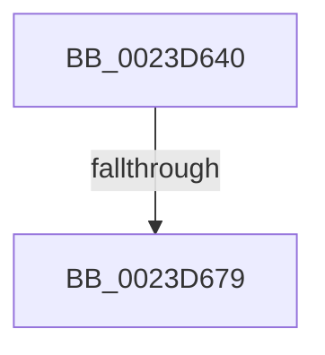

# MiProbeLeafPteAccess

- RVA: `0x0023D640`–`0x0023D67C` (길이 `60` bytes)
- VA: `0x000000014023D640`
- 실행 섹션: `.text`
- PDB 이름 있음: `예`; PDB Function 태그: `예`
- unwind 정보 RVA: `0x00061058`
- 디코드: `20`개 명령, `60/60` bytes 표시
- 미해석 바이트: `0` (있으면 어셈블리에 `.byte`로 보존)

> 이 문서는 커널 이미지의 기계어와 PDB 기호를 분석해 생성했습니다. 4번과 5번은 함수 원형과 자료형을 바이너리 사용 방식에서 추정한 C 해석이며 원본 소스 복구 결과는 아닙니다.

## 1. Dependencies

- 직접 호출 지점: **0**; 고유 호출 대상: **0**
- 직접 호출자로 확인된 함수: **3**
- RIP 상대 이미지 참조: **0**

### Outgoing calls
- 직접 디코드된 call 명령이 없습니다.

### Direct callers
- [MiProbeAndLockPacket](MiProbeAndLockPacket_function_0023BE20.md) at `0x0023BFF1`
- [MmStoreProbeAndLockPages](MmStoreProbeAndLockPages_function_0023E570.md) at `0x0023E641`
- [sub_0023F815](Unknown_function_0023F815.md) at `0x0023F91D`

### Static image references
- 디코드된 RIP-relative 메모리 참조가 없습니다.

## 2. Other-region calls and transfers

- 다른 실행 섹션으로 향하는 call: **0**
- call이 아닌 외부 분기/꼬리 이동: **1**
  - `0x0023D673` → [sub_0023D9E3](Unknown_function_0023D9E3.md) (`tail-transfer`)

## 3. Assembly (complete function range)

```asm
0023D640  48 89 54 24 10                  mov qword ptr [rsp + 0x10], rdx
0023D645  53                              push rbx
0023D646  55                              push rbp
0023D647  56                              push rsi
0023D648  41 55                           push r13
0023D64A  41 56                           push r14
0023D64C  41 57                           push r15
0023D64E  48 83 EC 38                     sub rsp, 0x38
0023D652  8B 69 48                        mov ebp, dword ptr [rcx + 0x48]
0023D655  45 33 F6                        xor r14d, r14d
0023D658  48 8B 59 30                     mov rbx, qword ptr [rcx + 0x30]
0023D65C  83 E5 0F                        and ebp, 0xf
0023D65F  4C 8B 69 08                     mov r13, qword ptr [rcx + 8]
0023D663  4C 8B C2                        mov r8, rdx
0023D666  44 8B 79 60                     mov r15d, dword ptr [rcx + 0x60]
0023D66A  48 8B F1                        mov rsi, rcx
0023D66D  44 89 32                        mov dword ptr [rdx], r14d
0023D670  F6 C3 04                        test bl, 4
0023D673  0F 84 6A 03 00 00               je 0x14023d9e3
0023D679  48 8B C3                        mov rax, rbx
```

## 4. C-style interpretation (structured pseudocode)

```c
__int64 __fastcall MiProbeLeafPteAccess(__int64 a1, __int64 a2)
{
    __int64 v_r14;
    __int64 v_rbp;
    __int64 v_rsp;
    unsigned __int64 v_stack_p10;

    v_stack_p10 = a2;
    v_rsp = (v_rsp) - (56);
    v_r14 = 0;
    v_rbp = (unsigned int)(((unsigned int)(*(unsigned int *)(a1 + 72))) & (15));
    *(unsigned int *)(a2) = 0;
    return *(unsigned __int64 *)(a1 + 48);
}
```

## 5. (Beta) C Style

```c
int64_t MiProbeLeafPteAccess(void *Arg1, void *Arg2)
{
    uint8_t *arg1 = (uint8_t *)Arg1;
    uint8_t *arg2 = (uint8_t *)Arg2;

    int64_t local_r14;
    int64_t local_rbp;
    int64_t local_rsp;
    uint64_t v_stack_p10;

    v_stack_p10 = Arg2;
    local_rsp = (local_rsp) - (56);
    local_r14 = 0;
    local_rbp = (uint32_t)(((uint32_t)(*(uint32_t *)(arg1 + 0x48))) & (15));
    *(uint32_t *)(arg2) = 0;
    return *(uint64_t *)(arg1 + 0x30);
}
```

### 관측된 메모리 오프셋

구조체 형식이 확인되지 않은 접근은 인자 기준의 오프셋으로만 기록했습니다.

| 기준 인자 | 오프셋 표현 | 폭 (bit) | 접근 |
|---|---:|---:|---|
| `Arg1` | `+ 0x8` | `64` | `R` |
| `Arg1` | `+ 0x30` | `64` | `R` |
| `Arg1` | `+ 0x48` | `32` | `R` |
| `Arg1` | `+ 0x60` | `32` | `R` |
| `Arg2` | `+ 0x0` | `32` | `W` |

## 6. Execution-region graph

[열기: 2D/3D 그래프와 함수 탐색 컨트롤 패널](../../../control-panel.html?section=text&rva=0x0023D640&view=graph)

- 2D 그래프는 위에서 아래로 흐르고, 3D 그래프는 빈 공간을 드래그해 회전합니다. Shift+드래그는 이동, 휠은 확대·축소, 함수 노드 선택은 대상 보고서 이동입니다.

### Static fallback


