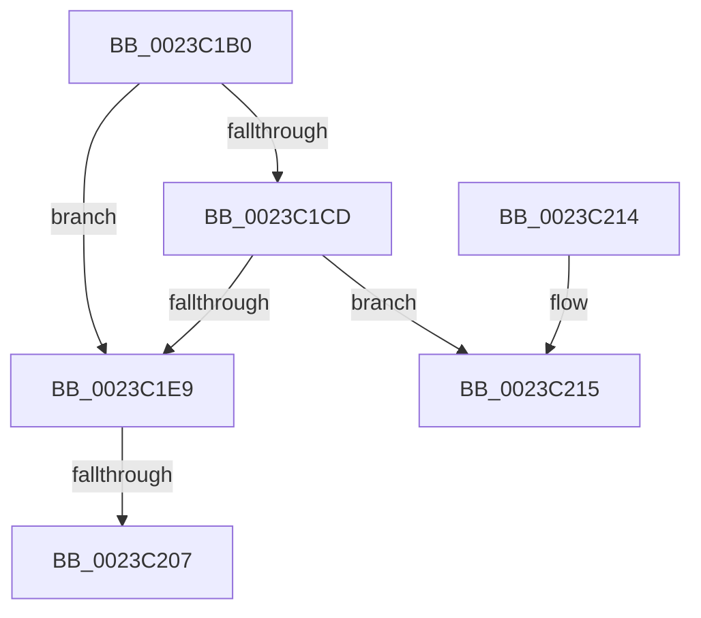

# MiProbeLockFrame

- RVA: `0x0023C1B0`–`0x0023C21A` (길이 `106` bytes)
- VA: `0x000000014023C1B0`
- 실행 섹션: `.text`
- PDB 이름 있음: `예`; PDB Function 태그: `아니요`
- unwind 정보 RVA: `0x00060E7C`
- 디코드: `30`개 명령, `106/106` bytes 표시
- 미해석 바이트: `0` (있으면 어셈블리에 `.byte`로 보존)

> 이 문서는 커널 이미지의 기계어와 PDB 기호를 분석해 생성했습니다. 4번과 5번은 함수 원형과 자료형을 바이너리 사용 방식에서 추정한 C 해석이며 원본 소스 복구 결과는 아닙니다.

## 1. Dependencies

- 직접 호출 지점: **1**; 고유 호출 대상: **1**
- 직접 호출자로 확인된 함수: **2**
- RIP 상대 이미지 참조: **2**

### Outgoing calls
- `0x0023C1FA` → [MiReferenceIoPages](MiReferenceIoPages_function_0023C804.md) (function, `0x0023C804`)

### Direct callers
- [MiProbeAndLockPacket](MiProbeAndLockPacket_function_0023BE20.md) at `0x0023BF3A`
- [sub_0023F815](Unknown_function_0023F815.md) at `0x0023F95C`

### Static image references
- `0x0023C1C4` → RVA `0x00E2DCE0` (`.data`; read)
- `0x0023C207` → RVA `0x00E30220` (`.data`; read/write)

## 2. Other-region calls and transfers

- 다른 실행 섹션으로 향하는 call: **0**
- call이 아닌 외부 분기/꼬리 이동: **1**
  - `0x0023C201` → [sub_0023C7C9](Unknown_function_0023C7C9.md) (`tail-transfer`)

## 3. Assembly (complete function range)

```asm
0023C1B0  40 56                           push rsi
0023C1B2  57                              push rdi
0023C1B3  48 83 EC 48                     sub rsp, 0x48
0023C1B7  4C 8B C2                        mov r8, rdx
0023C1BA  48 8B F9                        mov rdi, rcx
0023C1BD  48 8B 91 88 00 00 00            mov rdx, qword ptr [rcx + 0x88]
0023C1C4  48 3B 15 15 1B BF 00            cmp rdx, qword ptr [rip + 0xbf1b15]
0023C1CB  77 1C                           ja 0x14023c1e9
0023C1CD  48 8D 04 52                     lea rax, [rdx + rdx*2]
0023C1D1  48 03 C0                        add rax, rax
0023C1D4  48 B9 28 00 00 00 00 DE FF FF   movabs rcx, 0xffffde0000000028
0023C1DE  48 8B 04 C1                     mov rax, qword ptr [rcx + rax*8]
0023C1E2  48 0F BA E0 36                  bt rax, 0x36
0023C1E7  72 2C                           jb 0x14023c215
0023C1E9  33 F6                           xor esi, esi
0023C1EB  45 33 C9                        xor r9d, r9d
0023C1EE  48 89 74 24 28                  mov qword ptr [rsp + 0x28], rsi
0023C1F3  33 C9                           xor ecx, ecx
0023C1F5  48 89 74 24 20                  mov qword ptr [rsp + 0x20], rsi
0023C1FA  E8 05 06 00 00                  call 0x14023c804
0023C1FF  85 C0                           test eax, eax
0023C201  0F 89 C2 05 00 00               jns 0x14023c7c9
0023C207  FF 05 13 40 BF 00               inc dword ptr [rip + 0xbf4013]
0023C20D  48 83 C4 48                     add rsp, 0x48
0023C211  5F                              pop rdi
0023C212  5E                              pop rsi
0023C213  C3                              ret
0023C214  CC                              int3
0023C215  8B 47 48                        mov eax, dword ptr [rdi + 0x48]
0023C218  33 F6                           xor esi, esi
```

## 4. C-style interpretation (structured pseudocode)

```c
__int64 __fastcall MiProbeLockFrame(__int64 a1, __int64 a2, __int64 a3, int a4)
{
    __int64 result;
    __int64 v_rsi;
    __int64 v_rsp;
    unsigned __int64 v_stack_m30;
    unsigned __int64 v_stack_m38;

    v_rsp = (v_rsp) - (72);
    if ((*(unsigned __int64 *)(a1 + 136)) > (*(unsigned __int64 *)(v_rip + 12524309))) goto loc_0023C1E9;
    result = (*(unsigned __int64 *)(a1 + 136) + *(unsigned __int64 *)(a1 + 136) * 2) + (*(unsigned __int64 *)(a1 + 136) + *(unsigned __int64 *)(a1 + 136) * 2);
    if (condition_is_below) goto loc_0023C215;
loc_0023C1E9:
    v_rsi = 0;
    a4 = 0;
    v_stack_m30 = 0;
    a1 = 0;
    v_stack_m38 = 0;
    result = MiReferenceIoPages(a1, *(unsigned __int64 *)(a1 + 136), a2, a4);
    v_rsp = (v_rsp) + (72);
    return result;
loc_0023C215:
    v_rsi = 0;
    return (unsigned int)(*(unsigned int *)(a1 + 72));
}
```

## 5. (Beta) C Style

```c
int64_t MiProbeLockFrame(void *Arg1, int64_t Arg2, int64_t Arg3, int32_t Arg4)
{
    uint8_t *arg1 = (uint8_t *)Arg1;

    int64_t result;
    int64_t local_rsi;
    int64_t local_rsp;
    uint64_t v_stack_m30;
    uint64_t v_stack_m38;

    local_rsp = (local_rsp) - (72);
    if ((*(uint64_t *)(arg1 + 0x88)) > (*(uint64_t *)(v_rip + 0xBF1B15))) goto loc_0023C1E9;
    result = (*(uint64_t *)(arg1 + 0x88) + *(uint64_t *)(arg1 + 0x88) * 2) + (*(uint64_t *)(arg1 + 0x88) + *(uint64_t *)(arg1 + 0x88) * 2);
    if (condition_is_below) goto loc_0023C215;
loc_0023C1E9:
    local_rsi = 0;
    Arg4 = 0;
    v_stack_m30 = 0;
    Arg1 = 0;
    v_stack_m38 = 0;
    result = MiReferenceIoPages(Arg1, *(uint64_t *)(arg1 + 0x88), Arg2, Arg4);
    local_rsp = (local_rsp) + (72);
    return result;
loc_0023C215:
    local_rsi = 0;
    return (uint32_t)(*(uint32_t *)(arg1 + 0x48));
}
```

### 관측된 메모리 오프셋

구조체 형식이 확인되지 않은 접근은 인자 기준의 오프셋으로만 기록했습니다.

| 기준 인자 | 오프셋 표현 | 폭 (bit) | 접근 |
|---|---:|---:|---|
| `Arg1` | `+ 0x48` | `32` | `R` |
| `Arg1` | `+ 0x88` | `64` | `R` |

## 6. Execution-region graph

[열기: 2D/3D 그래프와 함수 탐색 컨트롤 패널](../../../control-panel.html?section=text&rva=0x0023C1B0&view=graph)

- 2D 그래프는 위에서 아래로 흐르고, 3D 그래프는 빈 공간을 드래그해 회전합니다. Shift+드래그는 이동, 휠은 확대·축소, 함수 노드 선택은 대상 보고서 이동입니다.

### Static fallback


