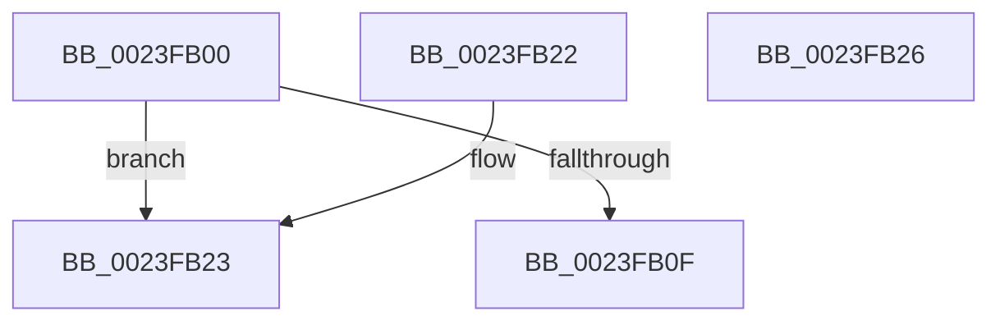

# MiPteInShadowRange

- RVA: `0x0023FB00`–`0x0023FB27` (길이 `39` bytes)
- VA: `0x000000014023FB00`
- 실행 섹션: `.text`
- PDB 이름 있음: `예`; PDB Function 태그: `아니요`
- unwind 정보 RVA: `0x000DB714`
- 디코드: `12`개 명령, `39/39` bytes 표시
- 미해석 바이트: `0` (있으면 어셈블리에 `.byte`로 보존)

> 이 문서는 커널 이미지의 기계어와 PDB 기호를 분석해 생성했습니다. 4번과 5번은 함수 원형과 자료형을 바이너리 사용 방식에서 추정한 C 해석이며 원본 소스 복구 결과는 아닙니다.

## 1. Dependencies

- 직접 호출 지점: **0**; 고유 호출 대상: **0**
- 직접 호출자로 확인된 함수: **42**
- RIP 상대 이미지 참조: **0**

### Outgoing calls
- 직접 디코드된 call 명령이 없습니다.

### Direct callers
- [MmSetAddressRangeModifiedEx](MmSetAddressRangeModifiedEx_function_00236F20.md) at `0x002370D5`
- [sub_0023EEBA](Unknown_function_0023EEBA.md) at `0x0023F044`
- [sub_0023F124](Unknown_function_0023F124.md) at `0x0023F3F0`
- [MiUnlockNestedPageTableWritePte](MiUnlockNestedPageTableWritePte_function_0023F4E4.md) at `0x0023F575`
- [MiUnlockNestedPageTableWritePte](MiUnlockNestedPageTableWritePte_function_0023F4E4.md) at `0x0023F5D5`
- [MiUnlockNestedPageTableWritePte](MiUnlockNestedPageTableWritePte_function_0023F4E4.md) at `0x0023F734`
- [sub_002401BF](../24/Unknown_function_002401BF.md) at `0x00240256`
- [MiMigratePfn](../28/MiMigratePfn_function_0028DBB0.md) at `0x0028DEAF`
- [sub_00293F76](../29/Unknown_function_00293F76.md) at `0x00294135`
- [MiMakePteClean](../2A/MiMakePteClean_function_002A901C.md) at `0x002A90B0`
- [MiReplaceTransitionPage](../2B/MiReplaceTransitionPage_function_002B1120.md) at `0x002B168B`
- [MiStealPage](../2B/MiStealPage_function_002B28D0.md) at `0x002B30E5`
- [MiStealPage](../2B/MiStealPage_function_002B28D0.md) at `0x002B32FE`
- [MiResolveProtoPteFault](../32/MiResolveProtoPteFault_function_00321750.md) at `0x00321EDA`
- [MiRewritePteWithLockBit](../32/MiRewritePteWithLockBit_function_00322FEC.md) at `0x00323058`
- [MiRewritePteWithLockBit](../32/MiRewritePteWithLockBit_function_00322FEC.md) at `0x0032312B`
- [MiRewritePteWithLockBit](../32/MiRewritePteWithLockBit_function_00322FEC.md) at `0x0032321F`
- [MiCompletePrivateZeroFault](../33/MiCompletePrivateZeroFault_function_00330CC0.md) at `0x0033126F`
- [MiCompletePrivateZeroFault](../33/MiCompletePrivateZeroFault_function_00330CC0.md) at `0x00331976`
- [MiRestoreTransitionPte](../33/MiRestoreTransitionPte_function_0033DD90.md) at `0x0033DEEF`
- [MiMakeFaultPfnActive](../36/MiMakeFaultPfnActive_function_00361D00.md) at `0x00361E12`
- [MiCopyOnWrite](../36/MiCopyOnWrite_function_00362A0C.md) at `0x00363184`
- [MiWriteEnclavePte](../36/MiWriteEnclavePte_function_00368570.md) at `0x0036861A`
- [MiOutSwapWorkingSetPte](../37/MiOutSwapWorkingSetPte_function_00372190.md) at `0x003722B1`
- [MiTradeActivePage](../37/MiTradeActivePage_function_00374424.md) at `0x003744F6`
- [MiTradeActivePage](../37/MiTradeActivePage_function_00374424.md) at `0x003745FC`
- [MiWriteValidPteNewPage](../37/MiWriteValidPteNewPage_function_00376068.md) at `0x003760C7`
- [MiRewriteTrimPteAsDemandZero](../38/MiRewriteTrimPteAsDemandZero_function_003823F4.md) at `0x00382454`
- [MiSwapNumaStandbyPage](../38/MiSwapNumaStandbyPage_function_00385144.md) at `0x003853FC`
- [MiSwapHardFaultPage](../38/MiSwapHardFaultPage_function_00385F34.md) at `0x00385F92`
- [MiInvalidateCollidedIos](../38/MiInvalidateCollidedIos_function_00386110.md) at `0x0038634A`
- [MiInsertLargeVadMapping](../3F/MiInsertLargeVadMapping_function_003F0498.md) at `0x003F0568`
- [MiShadowTopLevelPxes](../46/MiShadowTopLevelPxes_function_0046C6B0.md) at `0x0046C7A3`
- [MiWriteRepurposedTransitionPte](../4B/MiWriteRepurposedTransitionPte_function_004B0EC8.md) at `0x004B0F12`
- [MiProtectAweRegion](../4C/MiProtectAweRegion_function_004CE62C.md) at `0x004CED10`
- [MiSplitDirectMapPage](../4D/MiSplitDirectMapPage_function_004DAAA0.md) at `0x004DACBD`
- [MiDbgReleaseAddress](../68/MiDbgReleaseAddress_function_00685630.md) at `0x006856B1`
- [MiDbgWriteCheck](../68/MiDbgWriteCheck_function_00685BE4.md) at `0x00685E87`
- [MiTransformValidPteViaIpi](../68/MiTransformValidPteViaIpi_function_0068A978.md) at `0x0068A9D7`
- [sub_006D7BDC](../6D/Unknown_function_006D7BDC.md) at `0x006D7BE3`
- [sub_006DC4D4](../6D/Unknown_function_006DC4D4.md) at `0x006DC62C`
- [sub_006EE9B6](../6E/Unknown_function_006EE9B6.md) at `0x006EE9C0`
- [sub_006EE9B6](../6E/Unknown_function_006EE9B6.md) at `0x006EEA25`
- [MiCreateHardwareEnclave](../../page/80/MiCreateHardwareEnclave_function_00808500.md) at `0x0080877A`
- [MiUpdateUserMappings](../../pagelk/B7/MiUpdateUserMappings_function_00B7966C.md) at `0x00B796D1`
- [MiUpdateUserMappings](../../pagelk/B7/MiUpdateUserMappings_function_00B7966C.md) at `0x00B79716`
- [MiMapDummyPages](../../init/C6/MiMapDummyPages_function_00C60A58.md) at `0x00C60AED`
- [MxZeroBootMappings](../../init/C6/MxZeroBootMappings_function_00C61344.md) at `0x00C613ED`
- [MiClearStaleSecurePageMapping](../../init/C6/MiClearStaleSecurePageMapping_function_00C61CD8.md) at `0x00C61CFC`
- [MiFillGapPtes](../../init/C6/MiFillGapPtes_function_00C65AC0.md) at `0x00C65B53`
- [MiInitializeBootShadowStackPage](../../init/C6/MiInitializeBootShadowStackPage_function_00C67D8C.md) at `0x00C67F97`
- [MiInitializeBootShadowStackPage](../../init/C6/MiInitializeBootShadowStackPage_function_00C67D8C.md) at `0x00C68022`

### Static image references
- 디코드된 RIP-relative 메모리 참조가 없습니다.

## 2. Other-region calls and transfers

- 다른 실행 섹션으로 향하는 call: **0**
- 별도 외부 분기/꼬리 이동을 확인하지 못했습니다.

## 3. Assembly (complete function range)

```asm
0023FB00  48 B8 00 D0 BE 7D FB F6 FF FF   movabs rax, 0xfffff6fb7dbed000
0023FB0A  48 3B C8                        cmp rcx, rax
0023FB0D  72 14                           jb 0x14023fb23
0023FB0F  48 BA F8 D7 BE 7D FB F6 FF FF   movabs rdx, 0xfffff6fb7dbed7f8
0023FB19  33 C0                           xor eax, eax
0023FB1B  48 3B CA                        cmp rcx, rdx
0023FB1E  0F 96 C0                        setbe al
0023FB21  C3                              ret
0023FB22  CC                              int3
0023FB23  33 C0                           xor eax, eax
0023FB25  C3                              ret
0023FB26  CC                              int3
```

## 4. C-style interpretation (structured pseudocode)

```c
__int64 __fastcall MiPteInShadowRange(__int64 a1)
{
    __int64 result;

    if (a1 < result) goto loc_0023FB23;
    result = 0;
    result = (a1 <= a2) ? 1 : 0;
    return result;
loc_0023FB23:
    result = 0;
    return result;
}
```

## 5. (Beta) C Style

```c
int64_t MiPteInShadowRange(int64_t Arg1)
{
    int64_t result;

    if (Arg1 < result) goto loc_0023FB23;
    result = 0;
    result = (Arg1 <= a2) ? 1 : 0;
    return result;
loc_0023FB23:
    result = 0;
    return result;
}
```

## 6. Execution-region graph

[열기: 2D/3D 그래프와 함수 탐색 컨트롤 패널](../../../control-panel.html?section=text&rva=0x0023FB00&view=graph)

- 2D 그래프는 위에서 아래로 흐르고, 3D 그래프는 빈 공간을 드래그해 회전합니다. Shift+드래그는 이동, 휠은 확대·축소, 함수 노드 선택은 대상 보고서 이동입니다.

### Static fallback


