# MiQueuePinDriverAddressLog

- RVA: `0x0023ADA4`–`0x0023B11A` (길이 `886` bytes)
- VA: `0x000000014023ADA4`
- 실행 섹션: `.text`
- PDB 이름 있음: `예`; PDB Function 태그: `아니요`
- unwind 정보 RVA: `0x00060D4C`
- 디코드: `228`개 명령, `886/886` bytes 표시
- 미해석 바이트: `0` (있으면 어셈블리에 `.byte`로 보존)

> 이 문서는 커널 이미지의 기계어와 PDB 기호를 분석해 생성했습니다. 4번과 5번은 함수 원형과 자료형을 바이너리 사용 방식에서 추정한 C 해석이며 원본 소스 복구 결과는 아닙니다.

## 1. Dependencies

- 직접 호출 지점: **3**; 고유 호출 대상: **3**
- 직접 호출자로 확인된 함수: **3**
- RIP 상대 이미지 참조: **14**

### Outgoing calls
- `0x0023AF00` → [RtlInterlockedSetClearRun](../37/RtlInterlockedSetClearRun_function_00377F10.md) (function, `0x00377F10`)
- `0x0023AF62` → [KiLowerIrqlProcessIrqlFlags](../4F/KiLowerIrqlProcessIrqlFlags_function_004F5698.md) (function, `0x004F5698`)
- `0x0023B0B1` → [KiRaiseIrqlProcessIrqlFlags](../4F/KiRaiseIrqlProcessIrqlFlags_function_004F56FC.md) (function, `0x004F56FC`)

### Direct callers
- [MmGetPhysicalAddress](MmGetPhysicalAddress_function_0023A500.md) at `0x0023A688`
- [MmBuildMdlForNonPagedPool](MmBuildMdlForNonPagedPool_function_0023A870.md) at `0x0023AD92`
- [MiGetPhysicalAddress](MiGetPhysicalAddress_function_0023B120.md) at `0x0023B24B`

### Static image references
- `0x0023ADBA` → RVA `0x00F0BD23` (`.data`; read)
- `0x0023ADD0` → RVA `0x00F4754C` (`.data`; read)
- `0x0023ADDE` → RVA `0x00F55BC4` (`.data`; read)
- `0x0023AE01` → RVA `0x00FC6D20` (`ALMOSTRO`; read)
- `0x0023AE17` → RVA `0x00EF4FD2` (`.data`; reference)
- `0x0023AE24` → RVA `0x00EF4E60` (`.data`; read)
- `0x0023AE2F` → RVA `0x00EF4E68` (`.data`; read)
- `0x0023AF16` → RVA `0x00F475F8` (`.data`; read)
- `0x0023AF1D` → RVA `0x00EF4F70` (`.data`; read)
- `0x0023AF24` → RVA `0x00EF4F78` (`.data`; read)
- `0x0023AFA0` → RVA `0x00FC6A88` (`ALMOSTRO`; read)
- `0x0023B034` → RVA `0x00E2DCE0` (`.data`; read)
- `0x0023B07A` → RVA `0x00EF0E60` (`.data`; read)
- `0x0023B0D4` → RVA `0x00F475DC` (`.data`; read)

## 2. Other-region calls and transfers

- 다른 실행 섹션으로 향하는 call: **0**
- 별도 외부 분기/꼬리 이동을 확인하지 못했습니다.

## 3. Assembly (complete function range)

```asm
0023ADA4  48 89 5C 24 08                  mov qword ptr [rsp + 8], rbx
0023ADA9  48 89 6C 24 10                  mov qword ptr [rsp + 0x10], rbp
0023ADAE  56                              push rsi
0023ADAF  57                              push rdi
0023ADB0  41 55                           push r13
0023ADB2  41 56                           push r14
0023ADB4  41 57                           push r15
0023ADB6  48 83 EC 30                     sub rsp, 0x30
0023ADBA  80 3D 62 0F CD 00 00            cmp byte ptr [rip + 0xcd0f62], 0
0023ADC1  48 8B F2                        mov rsi, rdx
0023ADC4  41 8B D8                        mov ebx, r8d
0023ADC7  4C 8B F9                        mov r15, rcx
0023ADCA  0F 85 9F 01 00 00               jne 0x14023af6f
0023ADD0  8B 05 76 C7 D0 00               mov eax, dword ptr [rip + 0xd0c776]
0023ADD6  A8 03                           test al, 3
0023ADD8  0F 85 91 01 00 00               jne 0x14023af6f
0023ADDE  83 3D DF AD D1 00 00            cmp dword ptr [rip + 0xd1addf], 0
0023ADE5  0F 85 84 01 00 00               jne 0x14023af6f
0023ADEB  44 0F 20 C5                     mov rbp, cr8
0023ADEF  B8 02 00 00 00                  mov eax, 2
0023ADF4  40 3A E8                        cmp bpl, al
0023ADF7  73 15                           jae 0x14023ae0e
0023ADF9  44 0F 20 C1                     mov rcx, cr8
0023ADFD  44 0F 22 C0                     mov cr8, rax
0023AE01  83 3D 18 BF D8 00 00            cmp dword ptr [rip + 0xd8bf18], 0
0023AE08  0F 85 A1 02 00 00               jne 0x14023b0af
0023AE0E  83 CF FF                        or edi, 0xffffffff
0023AE11  41 BE 01 00 00 00               mov r14d, 1
0023AE17  44 84 35 B4 A1 CB 00            test byte ptr [rip + 0xcba1b4], r14b
0023AE1E  0F 84 F2 00 00 00               je 0x14023af16
0023AE24  44 8B 1D 35 A0 CB 00            mov r11d, dword ptr [rip + 0xcba035]
0023AE2B  44 8D 6F 01                     lea r13d, [rdi + 1]
0023AE2F  4C 8B 35 32 A0 CB 00            mov r14, qword ptr [rip + 0xcba032]
0023AE36  49 8B CE                        mov rcx, r14
0023AE39  83 E1 04                        and ecx, 4
0023AE3C  8B C1                           mov eax, ecx
0023AE3E  41 8D 53 FF                     lea edx, [r11 - 1]
0023AE42  48 F7 D8                        neg rax
0023AE45  45 1B C9                        sbb r9d, r9d
0023AE48  41 83 E1 20                     and r9d, 0x20
0023AE4C  45 3B EB                        cmp r13d, r11d
0023AE4F  45 1B C0                        sbb r8d, r8d
0023AE52  45 23 C5                        and r8d, r13d
0023AE55  48 F7 D9                        neg rcx
0023AE58  48 1B C0                        sbb rax, rax
0023AE5B  83 E0 04                        and eax, 4
0023AE5E  4C 2B F0                        sub r14, rax
0023AE61  83 64 24 78 00                  and dword ptr [rsp + 0x78], 0
0023AE66  45 8D 14 11                     lea r10d, [r9 + rdx]
0023AE6A  41 8B C2                        mov eax, r10d
0023AE6D  43 8D 0C 01                     lea ecx, [r9 + r8]
0023AE71  2B C1                           sub eax, ecx
0023AE73  FF C0                           inc eax
0023AE75  83 F8 01                        cmp eax, 1
0023AE78  0F 82 0E 02 00 00               jb 0x14023b08c
0023AE7E  41 8B C2                        mov eax, r10d
0023AE81  48 C1 E8 06                     shr rax, 6
0023AE85  49 8D 14 C6                     lea rdx, [r14 + rax*8]
0023AE89  8B C1                           mov eax, ecx
0023AE8B  48 C1 E8 06                     shr rax, 6
0023AE8F  80 E1 3F                        and cl, 0x3f
0023AE92  49 8D 3C C6                     lea rdi, [r14 + rax*8]
0023AE96  B8 01 00 00 00                  mov eax, 1
0023AE9B  48 D3 E0                        shl rax, cl
0023AE9E  48 FF C8                        dec rax
0023AEA1  48 0B 07                        or rax, qword ptr [rdi]
0023AEA4  48 83 F8 FF                     cmp rax, -1
0023AEA8  75 12                           jne 0x14023aebc
0023AEAA  48 83 C7 08                     add rdi, 8
0023AEAE  48 3B FA                        cmp rdi, rdx
0023AEB1  0F 87 D5 01 00 00               ja 0x14023b08c
0023AEB7  48 8B 07                        mov rax, qword ptr [rdi]
0023AEBA  EB E8                           jmp 0x14023aea4
0023AEBC  49 2B FE                        sub rdi, r14
0023AEBF  48 F7 D0                        not rax
0023AEC2  48 0F BC C0                     bsf rax, rax
0023AEC6  48 C1 FF 03                     sar rdi, 3
0023AECA  C1 E7 06                        shl edi, 6
0023AECD  03 F8                           add edi, eax
0023AECF  89 44 24 78                     mov dword ptr [rsp + 0x78], eax
0023AED3  83 C8 FF                        or eax, 0xffffffff
0023AED6  41 3B FA                        cmp edi, r10d
0023AED9  0F 87 B0 01 00 00               ja 0x14023b08f
0023AEDF  3B F8                           cmp edi, eax
0023AEE1  0F 84 AA 01 00 00               je 0x14023b091
0023AEE7  41 2B F9                        sub edi, r9d
0023AEEA  41 BE 01 00 00 00               mov r14d, 1
0023AEF0  3B F8                           cmp edi, eax
0023AEF2  74 22                           je 0x14023af16
0023AEF4  45 8B C6                        mov r8d, r14d
0023AEF7  48 8D 0D 62 9F CB 00            lea rcx, [rip + 0xcb9f62]
0023AEFE  8B D7                           mov edx, edi
0023AF00  E8 0B D0 13 00                  call 0x140377f10
0023AF05  85 C0                           test eax, eax
0023AF07  0F 84 17 FF FF FF               je 0x14023ae24
0023AF0D  BA 00 08 00 00                  mov edx, 0x800
0023AF12  3B FA                           cmp edi, edx
0023AF14  72 71                           jb 0x14023af87
0023AF16  80 3D DB C6 D0 00 00            cmp byte ptr [rip + 0xd0c6db], 0
0023AF1D  48 8D 05 4C A0 CB 00            lea rax, [rip + 0xcba04c]
0023AF24  48 8D 15 4D A0 CB 00            lea rdx, [rip + 0xcba04d]
0023AF2B  41 B8 02 00 00 00               mov r8d, 2
0023AF31  48 0F 44 D0                     cmove rdx, rax
0023AF35  48 8B CB                        mov rcx, rbx
0023AF38  44 3A C5                        cmp r8b, bpl
0023AF3B  48 1B C0                        sbb rax, rax
0023AF3E  48 C1 E1 05                     shl rcx, 5
0023AF42  83 E0 10                        and eax, 0x10
0023AF45  48 03 C2                        add rax, rdx
0023AF48  F0 44 01 34 01                  lock add dword ptr [rcx + rax], r14d
0023AF4D  41 3A E8                        cmp bpl, r8b
0023AF50  73 1D                           jae 0x14023af6f
0023AF52  83 3D C7 BD D8 00 00            cmp dword ptr [rip + 0xd8bdc7], 0
0023AF59  74 0C                           je 0x14023af67
0023AF5B  44 0F 20 C1                     mov rcx, cr8
0023AF5F  40 8A D5                        mov dl, bpl
0023AF62  E8 31 A7 2B 00                  call 0x1404f5698
0023AF67  40 0F B6 C5                     movzx eax, bpl
0023AF6B  44 0F 22 C0                     mov cr8, rax
0023AF6F  48 8B 5C 24 60                  mov rbx, qword ptr [rsp + 0x60]
0023AF74  48 8B 6C 24 68                  mov rbp, qword ptr [rsp + 0x68]
0023AF79  48 83 C4 30                     add rsp, 0x30
0023AF7D  41 5F                           pop r15
0023AF7F  41 5E                           pop r14
0023AF81  41 5D                           pop r13
0023AF83  5F                              pop rdi
0023AF84  5E                              pop rsi
0023AF85  C3                              ret
0023AF86  CC                              int3
0023AF87  41 23 DE                        and ebx, r14d
0023AF8A  49 81 E7 00 F0 FF FF            and r15, 0xfffffffffffff000
0023AF91  03 DB                           add ebx, ebx
0023AF93  4C 89 7C 24 28                  mov qword ptr [rsp + 0x28], r15
0023AF98  41 8B C7                        mov eax, r15d
0023AF9B  83 E0 FD                        and eax, 0xfffffffd
0023AF9E  0B D8                           or ebx, eax
0023AFA0  48 8B 05 E1 BA D8 00            mov rax, qword ptr [rip + 0xd8bae1]
0023AFA7  48 8B C8                        mov rcx, rax
0023AFAA  41 0B DE                        or ebx, r14d
0023AFAD  48 C1 E9 04                     shr rcx, 4
0023AFB1  83 E1 03                        and ecx, 3
0023AFB4  0F 84 01 01 00 00               je 0x14023b0bb
0023AFBA  49 3B CE                        cmp rcx, r14
0023AFBD  0F 84 3D 01 00 00               je 0x14023b100
0023AFC3  0F BA F3 08                     btr ebx, 8
0023AFC7  0F BA EB 09                     bts ebx, 9
0023AFCB  41 B8 02 00 00 00               mov r8d, 2
0023AFD1  41 3A E8                        cmp bpl, r8b
0023AFD4  0F 83 EC 00 00 00               jae 0x14023b0c6
0023AFDA  81 E3 3F FF FF FF               and ebx, 0xffffff3f
0023AFE0  80 3D 11 C6 D0 00 00            cmp byte ptr [rip + 0xd0c611], 0
0023AFE7  0F 85 E7 00 00 00               jne 0x14023b0d4
0023AFED  41 84 F6                        test r14b, sil
0023AFF0  0F 84 FE 00 00 00               je 0x14023b0f4
0023AFF6  48 8B CE                        mov rcx, rsi
0023AFF9  48 23 CA                        and rcx, rdx
0023AFFC  8B D3                           mov edx, ebx
0023AFFE  83 CA 08                        or edx, 8
0023B001  48 85 C9                        test rcx, rcx
0023B004  0F 44 D3                        cmove edx, ebx
0023B007  8B CA                           mov ecx, edx
0023B009  89 54 24 28                     mov dword ptr [rsp + 0x28], edx
0023B00D  83 C9 10                        or ecx, 0x10
0023B010  48 85 F6                        test rsi, rsi
0023B013  78 04                           js 0x14023b019
0023B015  89 4C 24 28                     mov dword ptr [rsp + 0x28], ecx
0023B019  0F 48 CA                        cmovs ecx, edx
0023B01C  48 C1 EE 0C                     shr rsi, 0xc
0023B020  48 BA FF FF FF FF FF 00 00 00   movabs rdx, 0xffffffffff
0023B02A  48 23 F2                        and rsi, rdx
0023B02D  48 0F BA E0 1D                  bt rax, 0x1d
0023B032  73 41                           jae 0x14023b075
0023B034  48 3B 35 A5 2C BF 00            cmp rsi, qword ptr [rip + 0xbf2ca5]
0023B03B  77 38                           ja 0x14023b075
0023B03D  48 8D 14 76                     lea rdx, [rsi + rsi*2]
0023B041  48 03 D2                        add rdx, rdx
0023B044  48 B8 28 00 00 00 00 DE FF FF   movabs rax, 0xffffde0000000028
0023B04E  48 8B 04 D0                     mov rax, qword ptr [rax + rdx*8]
0023B052  48 C1 E8 36                     shr rax, 0x36
0023B056  41 85 C6                        test r14d, eax
0023B059  74 1A                           je 0x14023b075
0023B05B  48 B8 20 00 00 00 00 DE FF FF   movabs rax, 0xffffde0000000020
0023B065  8B 04 D0                        mov eax, dword ptr [rax + rdx*8]
0023B068  66 41 3B C6                     cmp ax, r14w
0023B06C  76 07                           jbe 0x14023b075
0023B06E  83 C9 20                        or ecx, 0x20
0023B071  89 4C 24 28                     mov dword ptr [rsp + 0x28], ecx
0023B075  48 8B 44 24 28                  mov rax, qword ptr [rsp + 0x28]
0023B07A  48 8D 15 DF 5D CB 00            lea rdx, [rip + 0xcb5ddf]
0023B081  8B CF                           mov ecx, edi
0023B083  48 89 04 CA                     mov qword ptr [rdx + rcx*8], rax
0023B087  E9 C1 FE FF FF                  jmp 0x14023af4d
0023B08C  83 C8 FF                        or eax, 0xffffffff
0023B08F  8B F8                           mov edi, eax
0023B091  45 85 C0                        test r8d, r8d
0023B094  0F 84 50 FE FF FF               je 0x14023aeea
0023B09A  41 8D 55 01                     lea edx, [r13 + 1]
0023B09E  41 3B D3                        cmp edx, r11d
0023B0A1  41 0F 47 D3                     cmova edx, r11d
0023B0A5  03 D0                           add edx, eax
0023B0A7  45 33 C0                        xor r8d, r8d
0023B0AA  E9 B2 FD FF FF                  jmp 0x14023ae61
0023B0AF  8A D0                           mov dl, al
0023B0B1  E8 46 A6 2B 00                  call 0x1404f56fc
0023B0B6  E9 53 FD FF FF                  jmp 0x14023ae0e
0023B0BB  81 E3 FF FC FF FF               and ebx, 0xfffffcff
0023B0C1  E9 05 FF FF FF                  jmp 0x14023afcb
0023B0C6  74 20                           je 0x14023b0e8
0023B0C8  83 E3 BF                        and ebx, 0xffffffbf
0023B0CB  0F BA EB 07                     bts ebx, 7
0023B0CF  E9 0C FF FF FF                  jmp 0x14023afe0
0023B0D4  80 3D 01 C5 D0 00 00            cmp byte ptr [rip + 0xd0c501], 0
0023B0DB  75 30                           jne 0x14023b10d
0023B0DD  0F BA F3 0A                     btr ebx, 0xa
0023B0E1  0B DA                           or ebx, edx
0023B0E3  E9 05 FF FF FF                  jmp 0x14023afed
0023B0E8  0F BA F3 07                     btr ebx, 7
0023B0EC  83 CB 40                        or ebx, 0x40
0023B0EF  E9 EC FE FF FF                  jmp 0x14023afe0
0023B0F4  83 CB 04                        or ebx, 4
0023B0F7  89 5C 24 28                     mov dword ptr [rsp + 0x28], ebx
0023B0FB  E9 75 FF FF FF                  jmp 0x14023b075
0023B100  0F BA F3 09                     btr ebx, 9
0023B104  0F BA EB 08                     bts ebx, 8
0023B108  E9 BE FE FF FF                  jmp 0x14023afcb
0023B10D  0F BA F3 0B                     btr ebx, 0xb
0023B111  0F BA EB 0A                     bts ebx, 0xa
0023B115  E9 D3 FE FF FF                  jmp 0x14023afed
```

## 4. C-style interpretation (structured pseudocode)

```c
__int64 __fastcall MiQueuePinDriverAddressLog(__int64 a1, __int64 a2, int a3, int a4)
{
    __int64 result;
    __int64 v_r14;
    __int64 v_r15;
    __int64 v_rbx;
    __int64 v_rdi;
    __int64 v_rsi;
    __int64 v_rsp;
    unsigned __int64 v_stack_p10;
    unsigned int v_stack_p20;
    unsigned __int64 v_stack_p28;
    unsigned __int64 v_stack_p8;

    v_stack_p8 = v_rbx;
    v_stack_p10 = v_rbp;
    v_rsp = (v_rsp) - (48);
    if ((*(unsigned __int8 *)(v_rip + 13438818)) != 0) goto loc_0023AF6F;
    if ((((unsigned __int8)((unsigned int)(*(unsigned int *)(v_rip + 13682550)))) & (3)) != 0) goto loc_0023AF6F;
    if ((*(unsigned int *)(v_rip + 13741535)) != 0) goto loc_0023AF6F;
    if (((unsigned __int8)(v_cr8)) >= 2) goto loc_0023AE0E;
    if ((*(unsigned int *)(v_rip + 14204696)) != 0) goto loc_0023B0AF;
loc_0023AE0E:
    v_rdi = (unsigned int)((v_rdi) | (0xFFFFFFFFULL));
    if (((*(unsigned __int8 *)(v_rip + 13345204)) & (1)) == 0) goto loc_0023AF16;
loc_0023AE24:
    a1 = (unsigned int)((*(unsigned __int64 *)(v_rip + 13344818)) & (4));
    result = -((unsigned int)((unsigned int)(a1)));
    a4 = (unsigned int)((a4) & (32));
    a3 = (unsigned int)((a3) & ((unsigned int)(v_rdi + 1)));
    a1 = -(a1);
    result = (unsigned int)((result) & (4));
    v_r14 = (*(unsigned __int64 *)(v_rip + 13344818)) - (result);
loc_0023AE61:
    result = (unsigned int)(((unsigned int)((unsigned int)(a4 + (unsigned int)(*(unsigned int *)(v_rip + 13344821)) - 1 * 1))) - ((unsigned int)(a4 + a3 * 1)));
    result = (unsigned int)((result) + 1);
    if (((unsigned int)(result)) < 1) goto loc_0023B08C;
    result = ((unsigned int)((unsigned int)(a4 + (unsigned int)(*(unsigned int *)(v_rip + 13344821)) - 1 * 1))) >> (6);
    result = ((unsigned int)((unsigned int)(a4 + a3 * 1))) >> (6);
    a1 = (unsigned __int8)((a4 + a3 * 1) & (63));
    result = (1) << ((unsigned __int8)(a1));
    result = (result) - 1;
    result = (result) | (*(unsigned __int64 *)(v_r14 + result * 8));
loc_0023AEA4:
    if (result != -1) goto loc_0023AEBC;
    v_rdi = (v_r14 + result * 8) + (8);
    if (v_rdi > (v_r14 + result * 8)) goto loc_0023B08C;
    goto loc_0023AEA4;
loc_0023AEBC:
    v_rdi = (v_rdi) - (v_r14);
    result = ~(*(unsigned __int64 *)(v_rdi));
    v_rdi = (v_rdi) >> (3);
    v_rdi = (unsigned int)((v_rdi) << (6));
    v_rdi = (unsigned int)((v_rdi) + ((unsigned int)(result)));
    v_stack_p20 = (unsigned int)(result);
    result = (unsigned int)((result) | (0xFFFFFFFFULL));
    if (((unsigned int)(v_rdi)) > ((unsigned int)(a4 + (unsigned int)(*(unsigned int *)(v_rip + 13344821)) - 1 * 1))) goto loc_0023B08F;
    if (((unsigned int)(v_rdi)) == ((unsigned int)(result))) goto loc_0023B091;
    v_rdi = (unsigned int)((v_rdi) - (a4));
loc_0023AEEA:
    if (((unsigned int)(v_rdi)) == ((unsigned int)(result))) goto loc_0023AF16;
    result = RtlInterlockedSetClearRun(v_rip + 13344610, (unsigned int)((unsigned int)(v_rdi)), 1, a4);
    if ((unsigned int)(result) == 0) goto loc_0023AE24;
    if (((unsigned int)(v_rdi)) < ((unsigned int)((unsigned int)(0x800ULL)))) goto loc_0023AF87;
loc_0023AF16:
    a2 = v_rip + 13344845;
    if ((*(unsigned __int8 *)(v_rip + 13682395)) == 0) { a2 = v_rip + 13344844; }
    a1 = ((unsigned int)(a3)) << (5);
    result = (unsigned int)((v_rip + 13344844) & (16));
    result = (result) + (a2);
loc_0023AF4D:
    if (((unsigned __int8)(v_cr8)) >= 2) goto loc_0023AF6F;
    if ((*(unsigned int *)(v_rip + 14204359)) != 0) {
        a1 = 2;
        a2 = (unsigned __int8)(v_cr8);
        result = KiLowerIrqlProcessIrqlFlags(a1, a2, 2, a4);
    }
loc_0023AF6F:
    v_rsp = (v_rsp) + (48);
    return (unsigned __int8)(v_cr8);
loc_0023AF87:
    v_rbx = (unsigned int)((v_stack_p8) & (1));
    v_r15 = (a1) & (0xFFFFFFFFFFFFF000ULL);
    v_rbx = (unsigned int)((v_rbx) + ((unsigned int)(v_rbx)));
    v_stack_p28 = v_r15;
    result = (unsigned int)(((unsigned int)((unsigned int)(v_r15))) & (0xFFFFFFFDULL));
    v_rbx = (unsigned int)((v_rbx) | ((unsigned int)(result)));
    v_rbx = (unsigned int)((v_rbx) | (1));
    a1 = (*(unsigned __int64 *)(v_rip + 14203617)) >> (4);
    a1 = (unsigned int)((a1) & (3));
    if (condition_is_equal) goto loc_0023B0BB;
    if (a1 == 1) goto loc_0023B100;
loc_0023AFCB:
    if (((unsigned __int8)(v_stack_p10)) >= 2) goto loc_0023B0C6;
    v_rbx = (unsigned int)((v_rbx) & (0xFFFFFF3FULL));
loc_0023AFE0:
    if ((*(unsigned __int8 *)(v_rip + 13682193)) != 0) goto loc_0023B0D4;
loc_0023AFED:
    if (((1) & ((unsigned __int8)(a2))) == 0) goto loc_0023B0F4;
    a1 = (a2) & (a2);
    a2 = (unsigned int)(((unsigned int)((unsigned int)(v_rbx))) | (8));
    if (a1 == 0) { a2 = (unsigned int)(v_rbx); }
    v_stack_p28 = (unsigned int)(a2);
    a1 = (unsigned int)(((unsigned int)((unsigned int)(a2))) | (16));
    if (!(sign_flag)) {
        v_stack_p28 = (unsigned int)(a1);
    }
    if (sign_flag) { a1 = (unsigned int)(a2); }
    v_rsi = (a2) >> (12);
    v_rsi = (v_rsi) & (a2);
    if (condition_is_above_or_equal) goto loc_0023B075;
    if (v_rsi > (*(unsigned __int64 *)(v_rip + 12528805))) goto loc_0023B075;
    a2 = (v_rsi + v_rsi * 2) + (v_rsi + v_rsi * 2);
    result = (*(unsigned __int64 *)(*(unsigned __int64 *)(v_rip + 14203617) + a2 * 8)) >> (54);
    if (((1) & ((unsigned int)(result))) == 0) goto loc_0023B075;
    if (((unsigned __int16)((unsigned int)(*(unsigned int *)(result + a2 * 8)))) >= = 1) {
        a1 = (unsigned int)((a1) | (32));
        v_stack_p28 = (unsigned int)(a1);
    }
    *(unsigned __int64 *)(v_rip + 13327839 + (unsigned int)((unsigned int)(v_rdi)) * 8) = v_stack_p28;
    goto loc_0023AF4D;
loc_0023B08C:
    result = (unsigned int)((v_stack_p28) | (0xFFFFFFFFULL));
loc_0023B08F:
loc_0023B091:
    if (2 == 0) goto loc_0023AEEA;
    a2 = v_rdi + 1 + 1;
    if (((unsigned int)(v_rdi + 1 + 1)) > ((unsigned int)((unsigned int)(*(unsigned int *)(v_rip + 13344821))))) { a2 = (unsigned int)((unsigned int)(*(unsigned int *)(v_rip + 13344821))); }
    a2 = (unsigned int)((a2) + ((unsigned int)(result)));
    a3 = 0;
    goto loc_0023AE61;
loc_0023B0AF:
    result = KiRaiseIrqlProcessIrqlFlags((unsigned int)((unsigned int)(v_rdi)), (unsigned __int8)(result), a3, a4);
    goto loc_0023AE0E;
loc_0023B0BB:
    v_rbx = (unsigned int)((v_rbx) & (0xFFFFFCFFULL));
    goto loc_0023AFCB;
loc_0023B0C6:
    if (condition_is_equal) goto loc_0023B0E8;
    v_rbx = (unsigned int)((v_rbx) & (0xFFFFFFBFULL));
    goto loc_0023AFE0;
loc_0023B0D4:
    if ((*(unsigned __int8 *)(v_rip + 13681921)) != 0) goto loc_0023B10D;
    v_rbx = (unsigned int)((v_rbx) | ((unsigned int)((unsigned __int8)(result))));
    goto loc_0023AFED;
loc_0023B0E8:
    v_rbx = (unsigned int)((v_rbx) | (64));
    goto loc_0023AFE0;
loc_0023B0F4:
    v_rbx = (unsigned int)((v_rbx) | (4));
    v_stack_p28 = (unsigned int)(v_rbx);
    goto loc_0023B075;
loc_0023B100:
    goto loc_0023AFCB;
loc_0023B10D:
    goto loc_0023AFED;
}
```

## 5. (Beta) C Style

```c
int64_t MiQueuePinDriverAddressLog(int64_t Arg1, int64_t Arg2, int32_t Arg3, int32_t Arg4)
{
    int64_t result;
    int64_t local_r14;
    int64_t local_r15;
    int64_t local_rbx;
    int64_t local_rdi;
    int64_t local_rsi;
    int64_t local_rsp;
    uint64_t v_stack_p10;
    uint32_t v_stack_p20;
    uint64_t v_stack_p28;
    uint64_t v_stack_p8;

    v_stack_p8 = local_rbx;
    v_stack_p10 = local_rbp;
    local_rsp = (local_rsp) - (48);
    if ((*(uint8_t *)(v_rip + 0xCD0F62)) != 0) goto loc_0023AF6F;
    if ((((uint8_t)((uint32_t)(*(uint32_t *)(v_rip + 0xD0C776)))) & (3)) != 0) goto loc_0023AF6F;
    if ((*(uint32_t *)(v_rip + 0xD1ADDF)) != 0) goto loc_0023AF6F;
    if (((uint8_t)(v_cr8)) >= 2) goto loc_0023AE0E;
    if ((*(uint32_t *)(v_rip + 0xD8BF18)) != 0) goto loc_0023B0AF;
loc_0023AE0E:
    local_rdi = (uint32_t)((local_rdi) | (0xFFFFFFFFULL));
    if (((*(uint8_t *)(v_rip + 0xCBA1B4)) & (1)) == 0) goto loc_0023AF16;
loc_0023AE24:
    Arg1 = (uint32_t)((*(uint64_t *)(v_rip + 0xCBA032)) & (4));
    result = -((uint32_t)((uint32_t)(Arg1)));
    Arg4 = (uint32_t)((Arg4) & (32));
    Arg3 = (uint32_t)((Arg3) & ((uint32_t)(local_rdi + 1)));
    Arg1 = -(Arg1);
    result = (uint32_t)((result) & (4));
    local_r14 = (*(uint64_t *)(v_rip + 0xCBA032)) - (result);
loc_0023AE61:
    result = (uint32_t)(((uint32_t)((uint32_t)(Arg4 + (uint32_t)(*(uint32_t *)(v_rip + 0xCBA035)) - 1 * 1))) - ((uint32_t)(Arg4 + Arg3 * 1)));
    result = (uint32_t)((result) + 1);
    if (((uint32_t)(result)) < 1) goto loc_0023B08C;
    result = ((uint32_t)((uint32_t)(Arg4 + (uint32_t)(*(uint32_t *)(v_rip + 0xCBA035)) - 1 * 1))) >> (6);
    result = ((uint32_t)((uint32_t)(Arg4 + Arg3 * 1))) >> (6);
    Arg1 = (uint8_t)((Arg4 + Arg3 * 1) & (63));
    result = (1) << ((uint8_t)(Arg1));
    result = (result) - 1;
    result = (result) | (*(uint64_t *)(local_r14 + result * 8));
loc_0023AEA4:
    if (result != -1) goto loc_0023AEBC;
    local_rdi = (local_r14 + result * 8) + (8);
    if (local_rdi > (local_r14 + result * 8)) goto loc_0023B08C;
    goto loc_0023AEA4;
loc_0023AEBC:
    local_rdi = (local_rdi) - (local_r14);
    result = ~(*(uint64_t *)(local_rdi));
    local_rdi = (local_rdi) >> (3);
    local_rdi = (uint32_t)((local_rdi) << (6));
    local_rdi = (uint32_t)((local_rdi) + ((uint32_t)(result)));
    v_stack_p20 = (uint32_t)(result);
    result = (uint32_t)((result) | (0xFFFFFFFFULL));
    if (((uint32_t)(local_rdi)) > ((uint32_t)(Arg4 + (uint32_t)(*(uint32_t *)(v_rip + 0xCBA035)) - 1 * 1))) goto loc_0023B08F;
    if (((uint32_t)(local_rdi)) == ((uint32_t)(result))) goto loc_0023B091;
    local_rdi = (uint32_t)((local_rdi) - (Arg4));
loc_0023AEEA:
    if (((uint32_t)(local_rdi)) == ((uint32_t)(result))) goto loc_0023AF16;
    result = RtlInterlockedSetClearRun(v_rip + 13344610, (uint32_t)((uint32_t)(local_rdi)), 1, Arg4);
    if ((uint32_t)(result) == 0) goto loc_0023AE24;
    if (((uint32_t)(local_rdi)) < ((uint32_t)((uint32_t)(0x800ULL)))) goto loc_0023AF87;
loc_0023AF16:
    Arg2 = v_rip + 13344845;
    if ((*(uint8_t *)(v_rip + 0xD0C6DB)) == 0) { Arg2 = v_rip + 13344844; }
    Arg1 = ((uint32_t)(Arg3)) << (5);
    result = (uint32_t)((v_rip + 13344844) & (16));
    result = (result) + (Arg2);
loc_0023AF4D:
    if (((uint8_t)(v_cr8)) >= 2) goto loc_0023AF6F;
    if ((*(uint32_t *)(v_rip + 0xD8BDC7)) != 0) {
        Arg1 = 2;
        Arg2 = (uint8_t)(v_cr8);
        result = KiLowerIrqlProcessIrqlFlags(Arg1, Arg2, 2, Arg4);
    }
loc_0023AF6F:
    local_rsp = (local_rsp) + (48);
    return (uint8_t)(v_cr8);
loc_0023AF87:
    local_rbx = (uint32_t)((v_stack_p8) & (1));
    local_r15 = (Arg1) & (0xFFFFFFFFFFFFF000ULL);
    local_rbx = (uint32_t)((local_rbx) + ((uint32_t)(local_rbx)));
    v_stack_p28 = local_r15;
    result = (uint32_t)(((uint32_t)((uint32_t)(local_r15))) & (0xFFFFFFFDULL));
    local_rbx = (uint32_t)((local_rbx) | ((uint32_t)(result)));
    local_rbx = (uint32_t)((local_rbx) | (1));
    Arg1 = (*(uint64_t *)(v_rip + 0xD8BAE1)) >> (4);
    Arg1 = (uint32_t)((Arg1) & (3));
    if (condition_is_equal) goto loc_0023B0BB;
    if (Arg1 == 1) goto loc_0023B100;
loc_0023AFCB:
    if (((uint8_t)(v_stack_p10)) >= 2) goto loc_0023B0C6;
    local_rbx = (uint32_t)((local_rbx) & (0xFFFFFF3FULL));
loc_0023AFE0:
    if ((*(uint8_t *)(v_rip + 0xD0C611)) != 0) goto loc_0023B0D4;
loc_0023AFED:
    if (((1) & ((uint8_t)(Arg2))) == 0) goto loc_0023B0F4;
    Arg1 = (Arg2) & (Arg2);
    Arg2 = (uint32_t)(((uint32_t)((uint32_t)(local_rbx))) | (8));
    if (Arg1 == 0) { Arg2 = (uint32_t)(local_rbx); }
    v_stack_p28 = (uint32_t)(Arg2);
    Arg1 = (uint32_t)(((uint32_t)((uint32_t)(Arg2))) | (16));
    if (!(sign_flag)) {
        v_stack_p28 = (uint32_t)(Arg1);
    }
    if (sign_flag) { Arg1 = (uint32_t)(Arg2); }
    local_rsi = (Arg2) >> (12);
    local_rsi = (local_rsi) & (Arg2);
    if (condition_is_above_or_equal) goto loc_0023B075;
    if (local_rsi > (*(uint64_t *)(v_rip + 0xBF2CA5))) goto loc_0023B075;
    Arg2 = (local_rsi + local_rsi * 2) + (local_rsi + local_rsi * 2);
    result = (*(uint64_t *)(*(uint64_t *)(v_rip + 0xD8BAE1) + Arg2 * 8)) >> (54);
    if (((1) & ((uint32_t)(result))) == 0) goto loc_0023B075;
    if (((uint16_t)((uint32_t)(*(uint32_t *)(result + Arg2 * 8)))) >= = 1) {
        Arg1 = (uint32_t)((Arg1) | (32));
        v_stack_p28 = (uint32_t)(Arg1);
    }
    *(uint64_t *)(v_rip + 0xCB5DDF + (uint32_t)((uint32_t)(local_rdi)) * 8) = v_stack_p28;
    goto loc_0023AF4D;
loc_0023B08C:
    result = (uint32_t)((v_stack_p28) | (0xFFFFFFFFULL));
loc_0023B08F:
loc_0023B091:
    if (2 == 0) goto loc_0023AEEA;
    Arg2 = local_rdi + 1 + 1;
    if (((uint32_t)(local_rdi + 1 + 1)) > ((uint32_t)((uint32_t)(*(uint32_t *)(v_rip + 0xCBA035))))) { Arg2 = (uint32_t)((uint32_t)(*(uint32_t *)(v_rip + 0xCBA035))); }
    Arg2 = (uint32_t)((Arg2) + ((uint32_t)(result)));
    Arg3 = 0;
    goto loc_0023AE61;
loc_0023B0AF:
    result = KiRaiseIrqlProcessIrqlFlags((uint32_t)((uint32_t)(local_rdi)), (uint8_t)(result), Arg3, Arg4);
    goto loc_0023AE0E;
loc_0023B0BB:
    local_rbx = (uint32_t)((local_rbx) & (0xFFFFFCFFULL));
    goto loc_0023AFCB;
loc_0023B0C6:
    if (condition_is_equal) goto loc_0023B0E8;
    local_rbx = (uint32_t)((local_rbx) & (0xFFFFFFBFULL));
    goto loc_0023AFE0;
loc_0023B0D4:
    if ((*(uint8_t *)(v_rip + 0xD0C501)) != 0) goto loc_0023B10D;
    local_rbx = (uint32_t)((local_rbx) | ((uint32_t)((uint8_t)(result))));
    goto loc_0023AFED;
loc_0023B0E8:
    local_rbx = (uint32_t)((local_rbx) | (64));
    goto loc_0023AFE0;
loc_0023B0F4:
    local_rbx = (uint32_t)((local_rbx) | (4));
    v_stack_p28 = (uint32_t)(local_rbx);
    goto loc_0023B075;
loc_0023B100:
    goto loc_0023AFCB;
loc_0023B10D:
    goto loc_0023AFED;
}
```

## 6. Execution-region graph

[열기: 2D/3D 그래프와 함수 탐색 컨트롤 패널](../../../control-panel.html?section=text&rva=0x0023ADA4&view=graph)

- 2D 그래프는 위에서 아래로 흐르고, 3D 그래프는 빈 공간을 드래그해 회전합니다. Shift+드래그는 이동, 휠은 확대·축소, 함수 노드 선택은 대상 보고서 이동입니다.

### Static fallback

```mermaid
flowchart TD
  bb_0023ADA4[BB_0023ADA4]
  bb_0023ADD0[BB_0023ADD0]
  bb_0023ADDE[BB_0023ADDE]
  bb_0023ADEB[BB_0023ADEB]
  bb_0023ADF9[BB_0023ADF9]
  bb_0023AE0E[BB_0023AE0E]
  bb_0023AE24[BB_0023AE24]
  bb_0023AE61[BB_0023AE61]
  bb_0023AE7E[BB_0023AE7E]
  bb_0023AEA4[BB_0023AEA4]
  bb_0023AEAA[BB_0023AEAA]
  bb_0023AEB7[BB_0023AEB7]
  bb_0023AEBC[BB_0023AEBC]
  bb_0023AEDF[BB_0023AEDF]
  bb_0023AEE7[BB_0023AEE7]
  bb_0023AEEA[BB_0023AEEA]
  bb_0023AEF4[BB_0023AEF4]
  bb_0023AF0D[BB_0023AF0D]
  bb_0023AF16[BB_0023AF16]
  bb_0023AF4D[BB_0023AF4D]
  bb_0023AF52[BB_0023AF52]
  bb_0023AF5B[BB_0023AF5B]
  bb_0023AF67[BB_0023AF67]
  bb_0023AF6F[BB_0023AF6F]
  bb_0023AF86[BB_0023AF86]
  bb_0023AF87[BB_0023AF87]
  bb_0023AFBA[BB_0023AFBA]
  bb_0023AFC3[BB_0023AFC3]
  bb_0023AFCB[BB_0023AFCB]
  bb_0023AFDA[BB_0023AFDA]
  bb_0023AFE0[BB_0023AFE0]
  bb_0023AFED[BB_0023AFED]
  bb_0023AFF6[BB_0023AFF6]
  bb_0023B015[BB_0023B015]
  bb_0023B019[BB_0023B019]
  bb_0023B034[BB_0023B034]
  bb_0023B03D[BB_0023B03D]
  bb_0023B05B[BB_0023B05B]
  bb_0023B06E[BB_0023B06E]
  bb_0023B075[BB_0023B075]
  bb_0023B08C[BB_0023B08C]
  bb_0023B08F[BB_0023B08F]
  bb_0023B091[BB_0023B091]
  bb_0023B09A[BB_0023B09A]
  bb_0023B0AF[BB_0023B0AF]
  bb_0023B0BB[BB_0023B0BB]
  bb_0023B0C6[BB_0023B0C6]
  bb_0023B0C8[BB_0023B0C8]
  bb_0023B0D4[BB_0023B0D4]
  bb_0023B0DD[BB_0023B0DD]
  bb_0023B0E8[BB_0023B0E8]
  bb_0023B0F4[BB_0023B0F4]
  bb_0023B100[BB_0023B100]
  bb_0023B10D[BB_0023B10D]
  bb_0023ADA4 -->|branch| bb_0023AF6F
  bb_0023ADA4 -->|fallthrough| bb_0023ADD0
  bb_0023ADD0 -->|branch| bb_0023AF6F
  bb_0023ADD0 -->|fallthrough| bb_0023ADDE
  bb_0023ADDE -->|branch| bb_0023AF6F
  bb_0023ADDE -->|fallthrough| bb_0023ADEB
  bb_0023ADEB -->|branch| bb_0023AE0E
  bb_0023ADEB -->|fallthrough| bb_0023ADF9
  bb_0023ADF9 -->|branch| bb_0023B0AF
  bb_0023ADF9 -->|fallthrough| bb_0023AE0E
  bb_0023AE0E -->|branch| bb_0023AF16
  bb_0023AE0E -->|fallthrough| bb_0023AE24
  bb_0023AE24 -->|flow| bb_0023AE61
  bb_0023AE61 -->|branch| bb_0023B08C
  bb_0023AE61 -->|fallthrough| bb_0023AE7E
  bb_0023AE7E -->|flow| bb_0023AEA4
  bb_0023AEA4 -->|branch| bb_0023AEBC
  bb_0023AEA4 -->|fallthrough| bb_0023AEAA
  bb_0023AEAA -->|branch| bb_0023B08C
  bb_0023AEAA -->|fallthrough| bb_0023AEB7
  bb_0023AEB7 -->|branch| bb_0023AEA4
  bb_0023AEBC -->|branch| bb_0023B08F
  bb_0023AEBC -->|fallthrough| bb_0023AEDF
  bb_0023AEDF -->|branch| bb_0023B091
  bb_0023AEDF -->|fallthrough| bb_0023AEE7
  bb_0023AEE7 -->|flow| bb_0023AEEA
  bb_0023AEEA -->|branch| bb_0023AF16
  bb_0023AEEA -->|fallthrough| bb_0023AEF4
  bb_0023AEF4 -->|branch| bb_0023AE24
  bb_0023AEF4 -->|fallthrough| bb_0023AF0D
  bb_0023AF0D -->|branch| bb_0023AF87
  bb_0023AF0D -->|fallthrough| bb_0023AF16
  bb_0023AF16 -->|flow| bb_0023AF4D
  bb_0023AF4D -->|branch| bb_0023AF6F
  bb_0023AF4D -->|fallthrough| bb_0023AF52
  bb_0023AF52 -->|branch| bb_0023AF67
  bb_0023AF52 -->|fallthrough| bb_0023AF5B
  bb_0023AF5B -->|flow| bb_0023AF67
  bb_0023AF67 -->|flow| bb_0023AF6F
  bb_0023AF86 -->|flow| bb_0023AF87
  bb_0023AF87 -->|branch| bb_0023B0BB
  bb_0023AF87 -->|fallthrough| bb_0023AFBA
  bb_0023AFBA -->|branch| bb_0023B100
  bb_0023AFBA -->|fallthrough| bb_0023AFC3
  bb_0023AFC3 -->|flow| bb_0023AFCB
  bb_0023AFCB -->|branch| bb_0023B0C6
  bb_0023AFCB -->|fallthrough| bb_0023AFDA
  bb_0023AFDA -->|flow| bb_0023AFE0
  bb_0023AFE0 -->|branch| bb_0023B0D4
  bb_0023AFE0 -->|fallthrough| bb_0023AFED
  bb_0023AFED -->|branch| bb_0023B0F4
  bb_0023AFED -->|fallthrough| bb_0023AFF6
  bb_0023AFF6 -->|branch| bb_0023B019
  bb_0023AFF6 -->|fallthrough| bb_0023B015
  bb_0023B015 -->|flow| bb_0023B019
  bb_0023B019 -->|branch| bb_0023B075
  bb_0023B019 -->|fallthrough| bb_0023B034
  bb_0023B034 -->|branch| bb_0023B075
  bb_0023B034 -->|fallthrough| bb_0023B03D
  bb_0023B03D -->|branch| bb_0023B075
  bb_0023B03D -->|fallthrough| bb_0023B05B
  bb_0023B05B -->|branch| bb_0023B075
  bb_0023B05B -->|fallthrough| bb_0023B06E
  bb_0023B06E -->|flow| bb_0023B075
  bb_0023B075 -->|branch| bb_0023AF4D
  bb_0023B08C -->|flow| bb_0023B08F
  bb_0023B08F -->|flow| bb_0023B091
  bb_0023B091 -->|branch| bb_0023AEEA
  bb_0023B091 -->|fallthrough| bb_0023B09A
  bb_0023B09A -->|branch| bb_0023AE61
  bb_0023B0AF -->|branch| bb_0023AE0E
  bb_0023B0BB -->|branch| bb_0023AFCB
  bb_0023B0C6 -->|branch| bb_0023B0E8
  bb_0023B0C6 -->|fallthrough| bb_0023B0C8
  bb_0023B0C8 -->|branch| bb_0023AFE0
  bb_0023B0D4 -->|branch| bb_0023B10D
  bb_0023B0D4 -->|fallthrough| bb_0023B0DD
  bb_0023B0DD -->|branch| bb_0023AFED
  bb_0023B0E8 -->|branch| bb_0023AFE0
  bb_0023B0F4 -->|branch| bb_0023B075
  bb_0023B100 -->|branch| bb_0023AFCB
  bb_0023B10D -->|branch| bb_0023AFED
```


