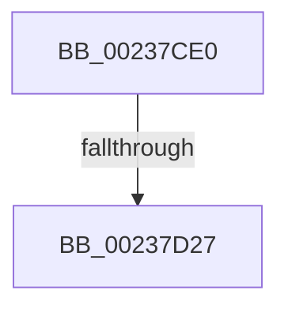

# MiReleasePteMappings

- RVA: `0x00237CE0`–`0x00237D2C` (길이 `76` bytes)
- VA: `0x0000000140237CE0`
- 실행 섹션: `.text`
- PDB 이름 있음: `예`; PDB Function 태그: `아니요`
- unwind 정보 RVA: `0x000609D4`
- 디코드: `22`개 명령, `76/76` bytes 표시
- 미해석 바이트: `0` (있으면 어셈블리에 `.byte`로 보존)

> 이 문서는 커널 이미지의 기계어와 PDB 기호를 분석해 생성했습니다. 4번과 5번은 함수 원형과 자료형을 바이너리 사용 방식에서 추정한 C 해석이며 원본 소스 복구 결과는 아닙니다.

## 1. Dependencies

- 직접 호출 지점: **1**; 고유 호출 대상: **1**
- 직접 호출자로 확인된 함수: **2**
- RIP 상대 이미지 참조: **1**

### Outgoing calls
- `0x00237D19` → [memset](../6C/memset_function_006C6C40.md) (function, `0x006C6C40`)

### Direct callers
- [sub_00247C30](../24/Unknown_function_00247C30.md) at `0x00247CB7`
- [sub_00247C30](../24/Unknown_function_00247C30.md) at `0x00247D17`
- [MiEmptyPteBins](../31/MiEmptyPteBins_function_0031AAE4.md) at `0x0031ACF3`

### Static image references
- `0x00237CF3` → RVA `0x00E0A740` (`.data`; read)

## 2. Other-region calls and transfers

- 다른 실행 섹션으로 향하는 call: **0**
- call이 아닌 외부 분기/꼬리 이동: **1**
  - `0x00237D21` → [sub_00238582](Unknown_function_00238582.md) (`tail-transfer`)

## 3. Assembly (complete function range)

```asm
00237CE0  40 55                           push rbp
00237CE2  53                              push rbx
00237CE3  56                              push rsi
00237CE4  57                              push rdi
00237CE5  41 57                           push r15
00237CE7  48 8D 6C 24 90                  lea rbp, [rsp - 0x70]
00237CEC  48 81 EC 70 01 00 00            sub rsp, 0x170
00237CF3  48 8B 05 46 2A BD 00            mov rax, qword ptr [rip + 0xbd2a46]
00237CFA  48 33 C4                        xor rax, rsp
00237CFD  48 89 45 50                     mov qword ptr [rbp + 0x50], rax
00237D01  41 8B D8                        mov ebx, r8d
00237D04  48 8B FA                        mov rdi, rdx
00237D07  4C 8B F9                        mov r15, rcx
00237D0A  33 D2                           xor edx, edx
00237D0C  41 B8 C8 00 00 00               mov r8d, 0xc8
00237D12  48 8D 4D 80                     lea rcx, [rbp - 0x80]
00237D16  41 8B F1                        mov esi, r9d
00237D19  E8 22 EF 48 00                  call 0x1406c6c40
00237D1E  83 FE 02                        cmp esi, 2
00237D21  0F 84 5B 08 00 00               je 0x140238582
00237D27  48 8B 07                        mov rax, qword ptr [rdi]
00237D2A  33 C9                           xor ecx, ecx
```

## 4. C-style interpretation (structured pseudocode)

```c
__int64 __fastcall MiReleasePteMappings(__int64 a1, __int64 a2, int a3, int a4)
{
    __int64 result;
    __int64 v_rsp;
    unsigned __int64 v_stack_m118;
    unsigned __int64 v_stack_m48;
    unsigned __int64 v_stack_m98;

    v_rsp = (v_rsp) - (368);
    result = (*(unsigned __int64 *)(v_rip + 12397126)) ^ (v_rsp);
    v_stack_m48 = result;
    a2 = 0;
    result = memset(v_stack_m118, a2, 200, a4);
    a1 = 0;
    return *(unsigned __int64 *)(a2);
}
```

## 5. (Beta) C Style

```c
int64_t MiReleasePteMappings(int64_t Arg1, void *Arg2, int32_t Arg3, int32_t Arg4)
{
    uint8_t *arg2 = (uint8_t *)Arg2;

    int64_t result;
    int64_t local_rsp;
    uint64_t v_stack_m118;
    uint64_t v_stack_m48;
    uint64_t v_stack_m98;

    local_rsp = (local_rsp) - (368);
    result = (*(uint64_t *)(v_rip + 0xBD2A46)) ^ (local_rsp);
    v_stack_m48 = result;
    Arg2 = 0;
    result = memset(v_stack_m118, Arg2, 200, Arg4);
    Arg1 = 0;
    return *(uint64_t *)(arg2);
}
```

### 관측된 메모리 오프셋

구조체 형식이 확인되지 않은 접근은 인자 기준의 오프셋으로만 기록했습니다.

| 기준 인자 | 오프셋 표현 | 폭 (bit) | 접근 |
|---|---:|---:|---|
| `Arg2` | `+ 0x0` | `64` | `R` |

## 6. Execution-region graph

[열기: 2D/3D 그래프와 함수 탐색 컨트롤 패널](../../../control-panel.html?section=text&rva=0x00237CE0&view=graph)

- 2D 그래프는 위에서 아래로 흐르고, 3D 그래프는 빈 공간을 드래그해 회전합니다. Shift+드래그는 이동, 휠은 확대·축소, 함수 노드 선택은 대상 보고서 이동입니다.

### Static fallback


