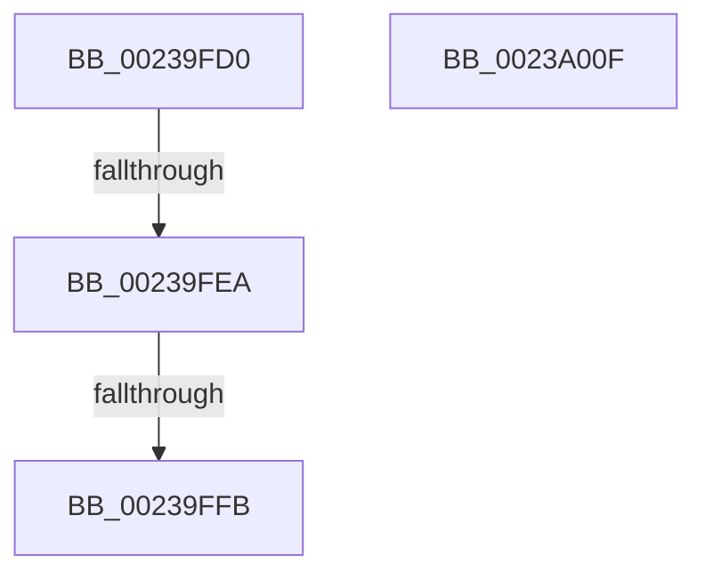

# MiReleaseWalkLocks

- RVA: `0x00239FD0`–`0x0023A010` (길이 `64` bytes)
- VA: `0x0000000140239FD0`
- 실행 섹션: `.text`
- PDB 이름 있음: `예`; PDB Function 태그: `아니요`
- unwind 정보 RVA: `0x00060C48`
- 디코드: `20`개 명령, `64/64` bytes 표시
- 미해석 바이트: `0` (있으면 어셈블리에 `.byte`로 보존)

> 이 문서는 커널 이미지의 기계어와 PDB 기호를 분석해 생성했습니다. 4번과 5번은 함수 원형과 자료형을 바이너리 사용 방식에서 추정한 C 해석이며 원본 소스 복구 결과는 아닙니다.

## 1. Dependencies

- 직접 호출 지점: **1**; 고유 호출 대상: **1**
- 직접 호출자로 확인된 함수: **9**
- RIP 상대 이미지 참조: **0**

### Outgoing calls
- `0x00239FFB` → [MiUnlockWorkingSetShared](../27/MiUnlockWorkingSetShared_function_0027D690.md) (function, `0x0027D690`)

### Direct callers
- [MiReacquireHigherPageTableLock](MiReacquireHigherPageTableLock_function_00239650.md) at `0x00239BE6`
- [MiYieldPageTableWalk](MiYieldPageTableWalk_function_00239D20.md) at `0x00239DF3`
- [MiDeleteVaDirect](../27/MiDeleteVaDirect_function_00277560.md) at `0x00277CB7`
- [MiWalkPageTablesRecursively](../27/MiWalkPageTablesRecursively_function_002796C0.md) at `0x0027992B`
- [MiQueryVpabAccessedState](../42/MiQueryVpabAccessedState_function_00428E70.md) at `0x00428E9D`
- [MiDeleteEmptyPageTableTail](../48/MiDeleteEmptyPageTableTail_function_00483280.md) at `0x004832D2`
- [MiProtectDriverSectionPte](../67/MiProtectDriverSectionPte_function_006706C0.md) at `0x0067075D`
- [MiProtectDriverSectionPte](../67/MiProtectDriverSectionPte_function_006706C0.md) at `0x00670909`
- [MiUnlockPhysicalPageByVa](../67/MiUnlockPhysicalPageByVa_function_00673EB0.md) at `0x00673F8B`
- [MiCombineWorkingSetTail](../68/MiCombineWorkingSetTail_function_0068BD00.md) at `0x0068BD17`

### Static image references
- 디코드된 RIP-relative 메모리 참조가 없습니다.

## 2. Other-region calls and transfers

- 다른 실행 섹션으로 향하는 call: **0**
- call이 아닌 외부 분기/꼬리 이동: **2**
  - `0x00239FE8` → [sub_0023A010](Unknown_function_0023A010.md) (`tail-transfer`)
  - `0x00239FF5` → [sub_0023A18A](Unknown_function_0023A18A.md) (`tail-transfer`)

## 3. Assembly (complete function range)

```asm
00239FD0  48 89 5C 24 10                  mov qword ptr [rsp + 0x10], rbx
00239FD5  57                              push rdi
00239FD6  48 83 EC 20                     sub rsp, 0x20
00239FDA  48 8B 51 38                     mov rdx, qword ptr [rcx + 0x38]
00239FDE  48 8B D9                        mov rbx, rcx
00239FE1  48 8B 79 20                     mov rdi, qword ptr [rcx + 0x20]
00239FE5  48 85 D2                        test rdx, rdx
00239FE8  75 26                           jne 0x14023a010
00239FEA  8B 03                           mov eax, dword ptr [rbx]
00239FEC  48 8B CF                        mov rcx, rdi
00239FEF  0F B6 53 09                     movzx edx, byte ptr [rbx + 9]
00239FF3  A8 04                           test al, 4
00239FF5  0F 84 8F 01 00 00               je 0x14023a18a
00239FFB  E8 90 36 04 00                  call 0x14027d690
0023A000  83 4B 04 01                     or dword ptr [rbx + 4], 1
0023A004  48 8B 5C 24 38                  mov rbx, qword ptr [rsp + 0x38]
0023A009  48 83 C4 20                     add rsp, 0x20
0023A00D  5F                              pop rdi
0023A00E  C3                              ret
0023A00F  CC                              int3
```

## 4. C-style interpretation (structured pseudocode)

```c
__int64 __fastcall MiReleaseWalkLocks(__int64 a1)
{
    __int64 result;
    __int64 v_rsp;
    unsigned __int64 v_stack_p10;

    v_stack_p10 = v_rbx;
    v_rsp = (v_rsp) - (32);
    result = MiUnlockWorkingSetShared(*(unsigned __int64 *)(a1 + 32), *(unsigned __int8 *)(a1 + 9), a3, a4);
    v_rsp = (v_rsp) + (32);
    return result;
}
```

## 5. (Beta) C Style

```c
int64_t MiReleaseWalkLocks(void *Arg1)
{
    uint8_t *arg1 = (uint8_t *)Arg1;

    int64_t result;
    int64_t local_rsp;
    uint64_t v_stack_p10;

    v_stack_p10 = local_rbx;
    local_rsp = (local_rsp) - (32);
    result = MiUnlockWorkingSetShared(*(uint64_t *)(arg1 + 0x20), *(uint8_t *)(arg1 + 0x9), a3, a4);
    local_rsp = (local_rsp) + (32);
    return result;
}
```

### 관측된 메모리 오프셋

구조체 형식이 확인되지 않은 접근은 인자 기준의 오프셋으로만 기록했습니다.

| 기준 인자 | 오프셋 표현 | 폭 (bit) | 접근 |
|---|---:|---:|---|
| `Arg1` | `+ 0x0` | `32` | `R` |
| `Arg1` | `+ 0x4` | `32` | `R/W` |
| `Arg1` | `+ 0x9` | `8` | `R` |
| `Arg1` | `+ 0x20` | `64` | `R` |
| `Arg1` | `+ 0x38` | `64` | `R` |

## 6. Execution-region graph

[열기: 2D/3D 그래프와 함수 탐색 컨트롤 패널](../../../control-panel.html?section=text&rva=0x00239FD0&view=graph)

- 2D 그래프는 위에서 아래로 흐르고, 3D 그래프는 빈 공간을 드래그해 회전합니다. Shift+드래그는 이동, 휠은 확대·축소, 함수 노드 선택은 대상 보고서 이동입니다.

### Static fallback


