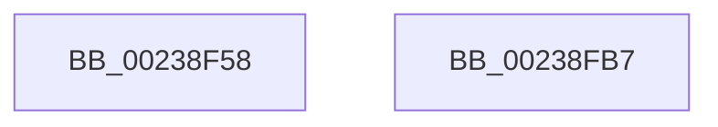

# MiSetSystemCacheReverseMap

- RVA: `0x00238F58`–`0x00238FB8` (길이 `96` bytes)
- VA: `0x0000000140238F58`
- 실행 섹션: `.text`
- PDB 이름 있음: `예`; PDB Function 태그: `아니요`
- unwind 정보 RVA: `0x0005C788`
- 디코드: `20`개 명령, `96/96` bytes 표시
- 미해석 바이트: `0` (있으면 어셈블리에 `.byte`로 보존)

> 이 문서는 커널 이미지의 기계어와 PDB 기호를 분석해 생성했습니다. 4번과 5번은 함수 원형과 자료형을 바이너리 사용 방식에서 추정한 C 해석이며 원본 소스 복구 결과는 아닙니다.

## 1. Dependencies

- 직접 호출 지점: **1**; 고유 호출 대상: **1**
- 직접 호출자로 확인된 함수: **3**
- RIP 상대 이미지 참조: **0**

### Outgoing calls
- `0x00238FAD` → [MiSetPageTablePfnBuddy](../4A/MiSetPageTablePfnBuddy_function_004A3394.md) (function, `0x004A3394`)

### Direct callers
- [sub_00238945](Unknown_function_00238945.md) at `0x00238AE3`
- [MiExpandSystemCache](../3B/MiExpandSystemCache_function_003B3DC8.md) at `0x003B3EA1`
- [MiExpandSystemCache](../3B/MiExpandSystemCache_function_003B3DC8.md) at `0x003B3F82`
- [MiReturnSystemCacheRegionsToKva](../49/MiReturnSystemCacheRegionsToKva_function_00494DFC.md) at `0x00494E8A`

### Static image references
- 디코드된 RIP-relative 메모리 참조가 없습니다.

## 2. Other-region calls and transfers

- 다른 실행 섹션으로 향하는 call: **0**
- 별도 외부 분기/꼬리 이동을 확인하지 못했습니다.

## 3. Assembly (complete function range)

```asm
00238F58  48 83 EC 28                     sub rsp, 0x28
00238F5C  48 C1 EA 12                     shr rdx, 0x12
00238F60  4D 8B C8                        mov r9, r8
00238F63  81 E2 F8 FF FF 3F               and edx, 0x3ffffff8
00238F69  48 B8 00 00 00 40 FB F6 FF FF   movabs rax, 0xfffff6fb40000000
00238F73  48 8B 04 02                     mov rax, qword ptr [rdx + rax]
00238F77  48 B9 FF FF FF FF FF 00 00 00   movabs rcx, 0xffffffffff
00238F81  48 C1 E8 0C                     shr rax, 0xc
00238F85  48 23 C1                        and rax, rcx
00238F88  48 8D 0C 40                     lea rcx, [rax + rax*2]
00238F8C  48 C1 E1 04                     shl rcx, 4
00238F90  48 B8 00 00 00 00 00 DE FF FF   movabs rax, 0xffffde0000000000
00238F9A  48 03 C8                        add rcx, rax
00238F9D  41 B8 10 00 00 00               mov r8d, 0x10
00238FA3  49 8B D1                        mov rdx, r9
00238FA6  48 C7 01 00 00 00 00            mov qword ptr [rcx], 0
00238FAD  E8 E2 A3 26 00                  call 0x1404a3394
00238FB2  48 83 C4 28                     add rsp, 0x28
00238FB6  C3                              ret
00238FB7  CC                              int3
```

## 4. C-style interpretation (structured pseudocode)

```c
__int64 __fastcall MiSetSystemCacheReverseMap(__int64 a1, __int64 a2, __int64 a3)
{
    __int64 result;
    __int64 v_rsp;

    v_rsp = (v_rsp) - (40);
    a2 = (a2) >> (18);
    a2 = (unsigned int)((a2) & (0x3FFFFFF8ULL));
    result = (*(unsigned __int64 *)(a2 + result * 1)) >> (12);
    result = (result) & (a1);
    a1 = (result + result * 2) << (4);
    a1 = (a1) + (result);
    *(unsigned __int64 *)(a1) = 0;
    result = MiSetPageTablePfnBuddy(a1, a3, 16, a3);
    v_rsp = (v_rsp) + (40);
    return result;
}
```

## 5. (Beta) C Style

```c
int64_t MiSetSystemCacheReverseMap(int64_t Arg1, int64_t Arg2, int64_t Arg3)
{
    int64_t result;
    int64_t local_rsp;

    local_rsp = (local_rsp) - (40);
    Arg2 = (Arg2) >> (18);
    Arg2 = (uint32_t)((Arg2) & (0x3FFFFFF8ULL));
    result = (*(uint64_t *)(Arg2 + result * 1)) >> (12);
    result = (result) & (Arg1);
    Arg1 = (result + result * 2) << (4);
    Arg1 = (Arg1) + (result);
    *(uint64_t *)(Arg1) = 0;
    result = MiSetPageTablePfnBuddy(Arg1, Arg3, 16, Arg3);
    local_rsp = (local_rsp) + (40);
    return result;
}
```

## 6. Execution-region graph

[열기: 2D/3D 그래프와 함수 탐색 컨트롤 패널](../../../control-panel.html?section=text&rva=0x00238F58&view=graph)

- 2D 그래프는 위에서 아래로 흐르고, 3D 그래프는 빈 공간을 드래그해 회전합니다. Shift+드래그는 이동, 휠은 확대·축소, 함수 노드 선택은 대상 보고서 이동입니다.

### Static fallback


