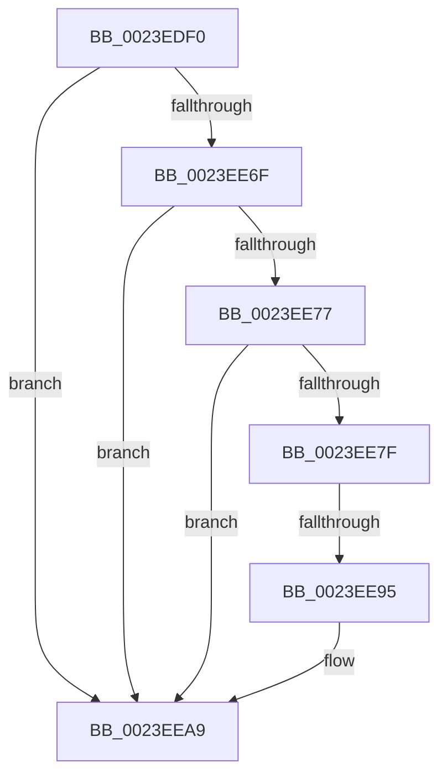

# MiTerminateWsle

- RVA: `0x0023EDF0`–`0x0023EEBA` (길이 `202` bytes)
- VA: `0x000000014023EDF0`
- 실행 섹션: `.text`
- PDB 이름 있음: `예`; PDB Function 태그: `아니요`
- unwind 정보 RVA: `0x00061558`
- 디코드: `48`개 명령, `202/202` bytes 표시
- 미해석 바이트: `0` (있으면 어셈블리에 `.byte`로 보존)

> 이 문서는 커널 이미지의 기계어와 PDB 기호를 분석해 생성했습니다. 4번과 5번은 함수 원형과 자료형을 바이너리 사용 방식에서 추정한 C 해석이며 원본 소스 복구 결과는 아닙니다.

## 1. Dependencies

- 직접 호출 지점: **0**; 고유 호출 대상: **0**
- 직접 호출자로 확인된 함수: **2**
- RIP 상대 이미지 참조: **0**

### Outgoing calls
- 직접 디코드된 call 명령이 없습니다.

### Direct callers
- [MiDecommitAddToList](../24/MiDecommitAddToList_function_00242264.md) at `0x002423C5`
- [MiRemoveSystemImagePage](../48/MiRemoveSystemImagePage_function_0048B398.md) at `0x0048B412`

### Static image references
- 디코드된 RIP-relative 메모리 참조가 없습니다.

## 2. Other-region calls and transfers

- 다른 실행 섹션으로 향하는 call: **0**
- call이 아닌 외부 분기/꼬리 이동: **1**
  - `0x0023EE8F` → [sub_0023F0B3](Unknown_function_0023F0B3.md) (`tail-transfer`)

## 3. Assembly (complete function range)

```asm
0023EDF0  44 89 44 24 18                  mov dword ptr [rsp + 0x18], r8d
0023EDF5  48 89 54 24 10                  mov qword ptr [rsp + 0x10], rdx
0023EDFA  48 89 4C 24 08                  mov qword ptr [rsp + 8], rcx
0023EDFF  53                              push rbx
0023EE00  55                              push rbp
0023EE01  57                              push rdi
0023EE02  41 54                           push r12
0023EE04  41 55                           push r13
0023EE06  41 56                           push r14
0023EE08  41 57                           push r15
0023EE0A  48 83 EC 50                     sub rsp, 0x50
0023EE0E  45 33 ED                        xor r13d, r13d
0023EE11  C7 44 24 30 0A 00 00 00         mov dword ptr [rsp + 0x30], 0xa
0023EE19  4C 8B FA                        mov r15, rdx
0023EE1C  44 89 6C 24 34                  mov dword ptr [rsp + 0x34], r13d
0023EE21  49 C1 EF 09                     shr r15, 9
0023EE25  48 B8 F8 FF FF FF 7F 00 00 00   movabs rax, 0x7ffffffff8
0023EE2F  45 8B E1                        mov r12d, r9d
0023EE32  4C 23 F8                        and r15, rax
0023EE35  4C 8B DA                        mov r11, rdx
0023EE38  49 B9 00 00 00 00 80 F6 FF FF   movabs r9, 0xfffff68000000000
0023EE42  BD 01 00 00 00                  mov ebp, 1
0023EE47  41 8B FD                        mov edi, r13d
0023EE4A  49 8B C1                        mov rax, r9
0023EE4D  4C 03 F8                        add r15, rax
0023EE50  48 B9 00 D0 BE 7D FB F6 FF FF   movabs rcx, 0xfffff6fb7dbed000
0023EE5A  49 8B 17                        mov rdx, qword ptr [r15]
0023EE5D  48 8B C1                        mov rax, rcx
0023EE60  49 B8 F8 D7 BE 7D FB F6 FF FF   movabs r8, 0xfffff6fb7dbed7f8
0023EE6A  4C 3B F8                        cmp r15, rax
0023EE6D  72 3A                           jb 0x14023eea9
0023EE6F  49 8B C0                        mov rax, r8
0023EE72  4C 3B F8                        cmp r15, rax
0023EE75  77 32                           ja 0x14023eea9
0023EE77  48 8B C2                        mov rax, rdx
0023EE7A  40 84 D5                        test bpl, dl
0023EE7D  74 2A                           je 0x14023eea9
0023EE7F  F6 C2 42                        test dl, 0x42
0023EE82  41 0F 95 C0                     setne r8b
0023EE86  F6 C2 20                        test dl, 0x20
0023EE89  0F 95 C1                        setne cl
0023EE8C  44 84 C1                        test cl, r8b
0023EE8F  0F 84 1E 02 00 00               je 0x14023f0b3
0023EE95  48 B9 00 D0 BE 7D FB F6 FF FF   movabs rcx, 0xfffff6fb7dbed000
0023EE9F  49 B8 F8 D7 BE 7D FB F6 FF FF   movabs r8, 0xfffff6fb7dbed7f8
0023EEA9  48 B8 FF FF FF FF FF 00 00 00   movabs rax, 0xffffffffff
0023EEB3  48 C1 EA 0C                     shr rdx, 0xc
0023EEB7  48 23 D0                        and rdx, rax
```

## 4. C-style interpretation (structured pseudocode)

```c
__int64 __fastcall MiTerminateWsle(__int64 a1, __int64 a2, int a3, int a4)
{
    __int64 v_r13;
    __int64 v_r15;
    __int64 v_rsp;
    unsigned int v_stack_m54;
    unsigned int v_stack_m58;
    unsigned __int64 v_stack_p10;
    unsigned int v_stack_p18;
    unsigned __int64 v_stack_p8;

    v_stack_p18 = a3;
    v_stack_p10 = a2;
    v_stack_p8 = a1;
    v_rsp = (v_rsp) - (80);
    v_r13 = 0;
    v_stack_m58 = 10;
    v_stack_m54 = 0;
    v_r15 = (a2) >> (9);
    v_r15 = (v_r15) & (result);
    v_r15 = (v_r15) + (a4);
    if (v_r15 < a1) goto loc_0023EEA9;
    if (v_r15 > a3) goto loc_0023EEA9;
    if (((1) & ((unsigned __int8)(*(unsigned __int64 *)(v_r15)))) == 0) goto loc_0023EEA9;
    a3 = ((((unsigned __int8)(*(unsigned __int64 *)(v_r15))) & (66)) != 0) ? 1 : 0;
    a1 = ((((unsigned __int8)(*(unsigned __int64 *)(v_r15))) & (32)) != 0) ? 1 : 0;
loc_0023EEA9:
    a2 = (*(unsigned __int64 *)(v_r15)) >> (12);
    a2 = (a2) & (*(unsigned __int64 *)(v_r15));
    return *(unsigned __int64 *)(v_r15);
}
```

## 5. (Beta) C Style

```c
int64_t MiTerminateWsle(int64_t Arg1, int64_t Arg2, int32_t Arg3, int32_t Arg4)
{
    int64_t local_r13;
    int64_t local_r15;
    int64_t local_rsp;
    uint32_t v_stack_m54;
    uint32_t v_stack_m58;
    uint64_t v_stack_p10;
    uint32_t v_stack_p18;
    uint64_t v_stack_p8;

    v_stack_p18 = Arg3;
    v_stack_p10 = Arg2;
    v_stack_p8 = Arg1;
    local_rsp = (local_rsp) - (80);
    local_r13 = 0;
    v_stack_m58 = 10;
    v_stack_m54 = 0;
    local_r15 = (Arg2) >> (9);
    local_r15 = (local_r15) & (result);
    local_r15 = (local_r15) + (Arg4);
    if (local_r15 < Arg1) goto loc_0023EEA9;
    if (local_r15 > Arg3) goto loc_0023EEA9;
    if (((1) & ((uint8_t)(*(uint64_t *)(local_r15)))) == 0) goto loc_0023EEA9;
    Arg3 = ((((uint8_t)(*(uint64_t *)(local_r15))) & (66)) != 0) ? 1 : 0;
    Arg1 = ((((uint8_t)(*(uint64_t *)(local_r15))) & (32)) != 0) ? 1 : 0;
loc_0023EEA9:
    Arg2 = (*(uint64_t *)(local_r15)) >> (12);
    Arg2 = (Arg2) & (*(uint64_t *)(local_r15));
    return *(uint64_t *)(local_r15);
}
```

## 6. Execution-region graph

[열기: 2D/3D 그래프와 함수 탐색 컨트롤 패널](../../../control-panel.html?section=text&rva=0x0023EDF0&view=graph)

- 2D 그래프는 위에서 아래로 흐르고, 3D 그래프는 빈 공간을 드래그해 회전합니다. Shift+드래그는 이동, 휠은 확대·축소, 함수 노드 선택은 대상 보고서 이동입니다.

### Static fallback


