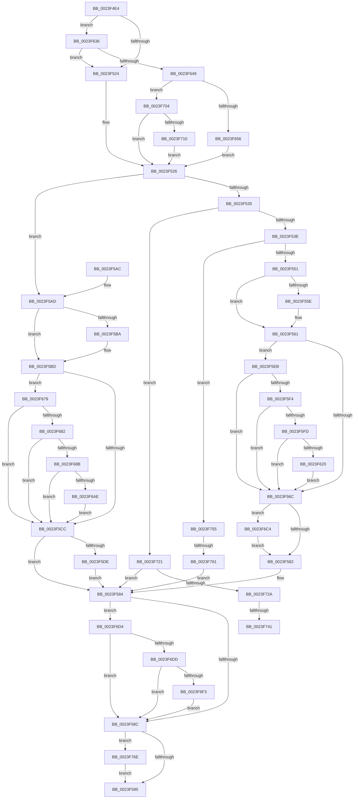

# MiUnlockNestedPageTableWritePte

- RVA: `0x0023F4E4`–`0x0023F77E` (길이 `666` bytes)
- VA: `0x000000014023F4E4`
- 실행 섹션: `.text`
- PDB 이름 있음: `예`; PDB Function 태그: `예`
- unwind 정보 RVA: `0x000615A8`
- 디코드: `153`개 명령, `666/666` bytes 표시
- 미해석 바이트: `0` (있으면 어셈블리에 `.byte`로 보존)

> 이 문서는 커널 이미지의 기계어와 PDB 기호를 분석해 생성했습니다. 4번과 5번은 함수 원형과 자료형을 바이너리 사용 방식에서 추정한 C 해석이며 원본 소스 복구 결과는 아닙니다.

## 1. Dependencies

- 직접 호출 지점: **14**; 고유 호출 대상: **10**
- 직접 호출자로 확인된 함수: **5**
- RIP 상대 이미지 참조: **2**

### Outgoing calls
- `0x0023F544` → [MiShouldLockPteDirectly](../40/MiShouldLockPteDirectly_function_0040BC70.md) (function, `0x0040BC70`)
- `0x0023F575` → [MiPteInShadowRange](MiPteInShadowRange_function_0023FB00.md) (function, `0x0023FB00`)
- `0x0023F5D5` → [MiPteInShadowRange](MiPteInShadowRange_function_0023FB00.md) (function, `0x0023FB00`)
- `0x0023F5E4` → [MiWritePteShadow](../29/MiWritePteShadow_function_00294EAC.md) (function, `0x00294EAC`)
- `0x0023F62C` → [MiCheckLinearProtectedPteAccessedBit](../29/MiCheckLinearProtectedPteAccessedBit_function_00292D80.md) (function, `0x00292D80`)
- `0x0023F6BA` → [MiCheckLinearProtectedPteAccessedBit](../29/MiCheckLinearProtectedPteAccessedBit_function_00292D80.md) (function, `0x00292D80`)
- `0x0023F6CA` → [MiWritePteShadow](../29/MiWritePteShadow_function_00294EAC.md) (function, `0x00294EAC`)
- `0x0023F6E5` → [MiReplicatePteChange](../4F/MiReplicatePteChange_function_004F8A24.md) (function, `0x004F8A24`)
- `0x0023F6FA` → [ExReleaseSpinLockExclusiveFromDpcLevel](../24/ExReleaseSpinLockExclusiveFromDpcLevel_function_002497E0.md) (function, `0x002497E0`)
- `0x0023F717` → [ExAcquireSpinLockExclusiveAtDpcLevel](../24/ExAcquireSpinLockExclusiveAtDpcLevel_function_00248E80.md) (function, `0x00248E80`)
- `0x0023F734` → [MiPteInShadowRange](MiPteInShadowRange_function_0023FB00.md) (function, `0x0023FB00`)
- `0x0023F746` → [MiSanitizeShadowPxe](../29/MiSanitizeShadowPxe_function_00294B68.md) (function, `0x00294B68`)
- `0x0023F764` → [MiWriteValidPteNewProtection](../28/MiWriteValidPteNewProtection_function_00281810.md) (function, `0x00281810`)
- `0x0023F774` → [MiUnlockPageTable](../21/MiUnlockPageTable_function_00216EC0.md) (function, `0x00216EC0`)

### Direct callers
- [sub_0023F124](Unknown_function_0023F124.md) at `0x0023F268`
- [MiWsleFlush](MiWsleFlush_function_0023FB30.md) at `0x0023FD6A`
- [MiClearPteAccessed](../29/MiClearPteAccessed_function_00290630.md) at `0x00290968`
- [MiEvictPageTableLock](../2C/MiEvictPageTableLock_function_002C1FBC.md) at `0x002C2071`
- [MiRewritePteWithLockBit](../32/MiRewritePteWithLockBit_function_00322FEC.md) at `0x00323117`

### Static image references
- `0x0023F551` → RVA `0x00FC6A88` (`ALMOSTRO`; read)
- `0x0023F6F3` → RVA `0x00E374C0` (`.data`; read)

## 2. Other-region calls and transfers

- 다른 실행 섹션으로 향하는 call: **0**
- call이 아닌 외부 분기/꼬리 이동: **3**
  - `0x0023F73B` → [sub_006D7BDC + 0x21](../6D/Unknown_function_006D7BDC.md) (`tail-transfer`)
  - `0x0023F750` → [sub_006D7BDC + 0x1F](../6D/Unknown_function_006D7BDC.md) (`tail-transfer`)
  - `0x0023F75B` → [sub_006D7BDC](../6D/Unknown_function_006D7BDC.md) (`tail-transfer`)

## 3. Assembly (complete function range)

```asm
0023F4E4  48 89 5C 24 18                  mov qword ptr [rsp + 0x18], rbx
0023F4E9  48 89 6C 24 20                  mov qword ptr [rsp + 0x20], rbp
0023F4EE  56                              push rsi
0023F4EF  57                              push rdi
0023F4F0  41 54                           push r12
0023F4F2  41 56                           push r14
0023F4F4  41 57                           push r15
0023F4F6  48 83 EC 20                     sub rsp, 0x20
0023F4FA  8B 81 B8 00 00 00               mov eax, dword ptr [rcx + 0xb8]
0023F500  45 8B E1                        mov r12d, r9d
0023F503  49 8B D8                        mov rbx, r8
0023F506  48 8B FA                        mov rdi, rdx
0023F509  4C 8B F1                        mov r14, rcx
0023F50C  33 F6                           xor esi, esi
0023F50E  45 33 FF                        xor r15d, r15d
0023F511  48 B9 00 D0 BE 7D FB F6 FF FF   movabs rcx, 0xfffff6fb7dbed000
0023F51B  48 3B D1                        cmp rdx, rcx
0023F51E  0F 83 12 01 00 00               jae 0x14023f636
0023F524  33 ED                           xor ebp, ebp
0023F526  48 B8 68 DF BE 7D FB F6 FF FF   movabs rax, 0xfffff6fb7dbedf68
0023F530  48 3B F8                        cmp rdi, rax
0023F533  74 78                           je 0x14023f5ad
0023F535  48 85 F6                        test rsi, rsi
0023F538  0F 85 E3 01 00 00               jne 0x14023f721
0023F53E  48 8B D7                        mov rdx, rdi
0023F541  49 8B CE                        mov rcx, r14
0023F544  E8 27 C7 1C 00                  call 0x14040bc70
0023F549  85 C0                           test eax, eax
0023F54B  0F 84 04 02 00 00               je 0x14023f755
0023F551  48 F7 05 2C 75 D8 00 00 00 00 02  test qword ptr [rip + 0xd8752c], 0x2000000
0023F55C  74 03                           je 0x14023f561
0023F55E  0F AE E8                        lfence
0023F561  48 0F BA 25 1E 75 D8 00 24      bt qword ptr [rip + 0xd8751e], 0x24
0023F56A  72 7F                           jb 0x14023f5eb
0023F56C  48 8B C3                        mov rax, rbx
0023F56F  48 8B CF                        mov rcx, rdi
0023F572  48 87 07                        xchg qword ptr [rdi], rax
0023F575  E8 86 05 00 00                  call 0x14023fb00
0023F57A  85 C0                           test eax, eax
0023F57C  0F 85 42 01 00 00               jne 0x14023f6c4
0023F582  33 FF                           xor edi, edi
0023F584  85 ED                           test ebp, ebp
0023F586  0F 85 48 01 00 00               jne 0x14023f6d4
0023F58C  48 85 FF                        test rdi, rdi
0023F58F  0F 85 D9 01 00 00               jne 0x14023f76e
0023F595  48 8B 5C 24 60                  mov rbx, qword ptr [rsp + 0x60]
0023F59A  48 8B 6C 24 68                  mov rbp, qword ptr [rsp + 0x68]
0023F59F  48 83 C4 20                     add rsp, 0x20
0023F5A3  41 5F                           pop r15
0023F5A5  41 5E                           pop r14
0023F5A7  41 5C                           pop r12
0023F5A9  5F                              pop rdi
0023F5AA  5E                              pop rsi
0023F5AB  C3                              ret
0023F5AC  CC                              int3
0023F5AD  48 F7 05 D0 74 D8 00 00 00 00 02  test qword ptr [rip + 0xd874d0], 0x2000000
0023F5B8  74 03                           je 0x14023f5bd
0023F5BA  0F AE E8                        lfence
0023F5BD  48 0F BA 25 C2 74 D8 00 24      bt qword ptr [rip + 0xd874c2], 0x24
0023F5C6  0F 82 AD 00 00 00               jb 0x14023f679
0023F5CC  48 8B C3                        mov rax, rbx
0023F5CF  48 8B CF                        mov rcx, rdi
0023F5D2  48 87 07                        xchg qword ptr [rdi], rax
0023F5D5  E8 26 05 00 00                  call 0x14023fb00
0023F5DA  85 C0                           test eax, eax
0023F5DC  74 A6                           je 0x14023f584
0023F5DE  48 8B D3                        mov rdx, rbx
0023F5E1  48 8B CF                        mov rcx, rdi
0023F5E4  E8 C3 58 05 00                  call 0x140294eac
0023F5E9  EB 99                           jmp 0x14023f584
0023F5EB  F6 C3 01                        test bl, 1
0023F5EE  0F 84 78 FF FF FF               je 0x14023f56c
0023F5F4  F6 C3 20                        test bl, 0x20
0023F5F7  0F 85 6F FF FF FF               jne 0x14023f56c
0023F5FD  48 B8 00 00 00 00 80 F6 FF FF   movabs rax, 0xfffff68000000000
0023F607  48 8B C0                        mov rax, rax
0023F60A  48 B9 00 00 00 00 40 00 00 00   movabs rcx, 0x4000000000
0023F614  48 03 C1                        add rax, rcx
0023F617  48 3B F8                        cmp rdi, rax
0023F61A  0F 82 4C FF FF FF               jb 0x14023f56c
0023F620  41 B8 80 00 00 00               mov r8d, 0x80
0023F626  48 8B D3                        mov rdx, rbx
0023F629  48 8B CF                        mov rcx, rdi
0023F62C  E8 4F 37 05 00                  call 0x140292d80
0023F631  E9 36 FF FF FF                  jmp 0x14023f56c
0023F636  48 B9 FF DF BE 7D FB F6 FF FF   movabs rcx, 0xfffff6fb7dbedfff
0023F640  48 3B F9                        cmp rdi, rcx
0023F643  0F 87 DB FE FF FF               ja 0x14023f524
0023F649  BD 01 00 00 00                  mov ebp, 1
0023F64E  A8 0F                           test al, 0xf
0023F650  0F 85 AE 00 00 00               jne 0x14023f704
0023F656  65 48 8B 04 25 88 01 00 00      mov rax, qword ptr gs:[0x188]
0023F65F  48 8B 88 B8 00 00 00            mov rcx, qword ptr [rax + 0xb8]
0023F666  48 8B 81 10 04 00 00            mov rax, qword ptr [rcx + 0x410]
0023F66D  48 8B B0 68 05 00 00            mov rsi, qword ptr [rax + 0x568]
0023F674  E9 AD FE FF FF                  jmp 0x14023f526
0023F679  F6 C3 01                        test bl, 1
0023F67C  0F 84 4A FF FF FF               je 0x14023f5cc
0023F682  F6 C3 20                        test bl, 0x20
0023F685  0F 85 41 FF FF FF               jne 0x14023f5cc
0023F68B  48 B8 00 00 00 00 80 F6 FF FF   movabs rax, 0xfffff68000000000
0023F695  48 8B C0                        mov rax, rax
0023F698  48 B9 00 00 00 00 40 00 00 00   movabs rcx, 0x4000000000
0023F6A2  48 03 C1                        add rax, rcx
0023F6A5  48 3B F8                        cmp rdi, rax
0023F6A8  0F 82 1E FF FF FF               jb 0x14023f5cc
0023F6AE  41 B8 80 00 00 00               mov r8d, 0x80
0023F6B4  48 8B D3                        mov rdx, rbx
0023F6B7  48 8B CF                        mov rcx, rdi
0023F6BA  E8 C1 36 05 00                  call 0x140292d80
0023F6BF  E9 08 FF FF FF                  jmp 0x14023f5cc
0023F6C4  48 8B D3                        mov rdx, rbx
0023F6C7  48 8B CF                        mov rcx, rdi
0023F6CA  E8 DD 57 05 00                  call 0x140294eac
0023F6CF  E9 AE FE FF FF                  jmp 0x14023f582
0023F6D4  45 85 FF                        test r15d, r15d
0023F6D7  0F 84 AF FE FF FF               je 0x14023f58c
0023F6DD  BA 01 00 00 00                  mov edx, 1
0023F6E2  48 8B CF                        mov rcx, rdi
0023F6E5  E8 3A 93 2B 00                  call 0x1404f8a24
0023F6EA  45 85 E4                        test r12d, r12d
0023F6ED  0F 85 99 FE FF FF               jne 0x14023f58c
0023F6F3  48 8D 0D C6 7D BF 00            lea rcx, [rip + 0xbf7dc6]
0023F6FA  E8 E1 A0 00 00                  call 0x1402497e0
0023F6FF  E9 88 FE FF FF                  jmp 0x14023f58c
0023F704  44 8B FD                        mov r15d, ebp
0023F707  45 85 E4                        test r12d, r12d
0023F70A  0F 85 16 FE FF FF               jne 0x14023f526
0023F710  48 8D 0D A9 7D BF 00            lea rcx, [rip + 0xbf7da9]
0023F717  E8 64 97 00 00                  call 0x140248e80
0023F71C  E9 05 FE FF FF                  jmp 0x14023f526
0023F721  F6 C3 01                        test bl, 1
0023F724  0F 85 5A FE FF FF               jne 0x14023f584
0023F72A  48 8B CF                        mov rcx, rdi
0023F72D  48 89 5C 24 50                  mov qword ptr [rsp + 0x50], rbx
0023F732  33 F6                           xor esi, esi
0023F734  E8 C7 03 00 00                  call 0x14023fb00
0023F739  85 C0                           test eax, eax
0023F73B  0F 84 BC 84 49 00               je 0x1406d7bfd
0023F741  48 8D 54 24 50                  lea rdx, [rsp + 0x50]
0023F746  E8 1D 54 05 00                  call 0x140294b68
0023F74B  48 8B 5C 24 50                  mov rbx, qword ptr [rsp + 0x50]
0023F750  E9 A6 84 49 00                  jmp 0x1406d7bfb
0023F755  48 8B CF                        mov rcx, rdi
0023F758  F6 C3 01                        test bl, 1
0023F75B  0F 84 7B 84 49 00               je 0x1406d7bdc
0023F761  48 8B D3                        mov rdx, rbx
0023F764  E8 A7 20 04 00                  call 0x140281810
0023F769  E9 16 FE FF FF                  jmp 0x14023f584
0023F76E  48 8B D7                        mov rdx, rdi
0023F771  49 8B CE                        mov rcx, r14
0023F774  E8 47 77 FD FF                  call 0x140216ec0
0023F779  E9 17 FE FF FF                  jmp 0x14023f595
```

## 4. C-style interpretation (structured pseudocode)

```c
__int64 __fastcall MiUnlockNestedPageTableWritePte(__int64 a1, __int64 a2, __int64 a3, int a4)
{
    __int64 result;
    __int64 v_r15;
    __int64 v_rbp;
    __int64 v_rdi;
    __int64 v_rsi;
    __int64 v_rsp;
    unsigned __int64 v_stack_p18;
    unsigned __int64 v_stack_p20;
    unsigned __int64 v_stack_p50;

    v_stack_p18 = v_rbx;
    v_stack_p20 = v_rbp;
    v_rsp = (v_rsp) - (32);
    v_rsi = 0;
    v_r15 = 0;
    if (a2 >= a1) goto loc_0023F636;
loc_0023F524:
    v_rbp = 0;
loc_0023F526:
    if (a2 == ((unsigned int)(*(unsigned int *)(a1 + 184)))) goto loc_0023F5AD;
    if (0 != 0) goto loc_0023F721;
    result = MiShouldLockPteDirectly(a1, a2, a3, a4);
    if ((unsigned int)(result) == 0) goto loc_0023F755;
    if (((*(unsigned __int64 *)(v_rip + 14185772)) & (0x2000000ULL)) != 0) {
    }
    if (condition_is_below) goto loc_0023F5EB;
loc_0023F56C:
    result = MiPteInShadowRange(a2, a2, a3, a4);
    if ((unsigned int)(result) != 0) goto loc_0023F6C4;
loc_0023F582:
    v_rdi = 0;
loc_0023F584:
    if (0 != 0) goto loc_0023F6D4;
loc_0023F58C:
    if (0 != 0) goto loc_0023F76E;
loc_0023F595:
    v_rsp = (v_rsp) + (32);
    return result;
loc_0023F5AD:
    if (((*(unsigned __int64 *)(v_rip + 14185680)) & (0x2000000ULL)) != 0) {
    }
    if (condition_is_below) goto loc_0023F679;
loc_0023F5CC:
    result = MiPteInShadowRange(0, a2, a3, a4);
    if ((unsigned int)(result) == 0) goto loc_0023F584;
    result = MiWritePteShadow(0, v_stack_p18, a3, a4);
    goto loc_0023F584;
loc_0023F5EB:
    if ((((unsigned __int8)(v_stack_p18)) & (1)) == 0) goto loc_0023F56C;
    if ((((unsigned __int8)(v_stack_p18)) & (32)) != 0) goto loc_0023F56C;
    result = (result) + (0);
    if (0 < result) goto loc_0023F56C;
    result = MiCheckLinearProtectedPteAccessedBit(0, v_stack_p18, 128, a4);
    goto loc_0023F56C;
loc_0023F636:
    if (0 > 0) goto loc_0023F524;
    if ((((unsigned __int8)(result)) & (15)) != 0) goto loc_0023F704;
    goto loc_0023F526;
loc_0023F679:
    if ((((unsigned __int8)(v_stack_p18)) & (1)) == 0) goto loc_0023F5CC;
    if ((((unsigned __int8)(v_stack_p18)) & (32)) != 0) goto loc_0023F5CC;
    result = (*(unsigned __int64 *)(*(unsigned __int64 *)(*(unsigned __int64 *)(gs_base + (0 + 392)) + 184) + 1040)) + (*(unsigned __int64 *)(*(unsigned __int64 *)(gs_base + (0 + 392)) + 184));
    if (0 < result) goto loc_0023F5CC;
    result = MiCheckLinearProtectedPteAccessedBit(0, v_stack_p18, 128, a4);
    goto loc_0023F5CC;
loc_0023F6C4:
    result = MiWritePteShadow(0, v_stack_p18, 128, a4);
    goto loc_0023F582;
loc_0023F6D4:
    if (0 == 0) goto loc_0023F58C;
    result = MiReplicatePteChange(0, 1, 128, a4);
    if ((unsigned int)((unsigned int)(a4)) != 0) goto loc_0023F58C;
    result = ExReleaseSpinLockExclusiveFromDpcLevel(v_rip + 12549574, 1, 128, a4);
    goto loc_0023F58C;
loc_0023F704:
    if ((unsigned int)((unsigned int)(a4)) != 0) goto loc_0023F526;
    result = ExAcquireSpinLockExclusiveAtDpcLevel(v_rip + 12549545, 1, 128, a4);
    goto loc_0023F526;
loc_0023F721:
    if ((((unsigned __int8)(v_stack_p18)) & (1)) != 0) goto loc_0023F584;
    v_stack_p50 = v_stack_p18;
    v_rsi = 0;
    result = MiPteInShadowRange(0, 1, 128, a4);
    result = MiSanitizeShadowPxe(0, v_stack_p50, 128, a4);
loc_0023F755:
    result = MiWriteValidPteNewProtection(0, v_stack_p50, 128, a4);
    goto loc_0023F584;
loc_0023F76E:
    result = MiUnlockPageTable(a1, 0, 128, a4);
    goto loc_0023F595;
}
```

## 5. (Beta) C Style

```c
int64_t MiUnlockNestedPageTableWritePte(void *Arg1, int64_t Arg2, int64_t Arg3, int32_t Arg4)
{
    uint8_t *arg1 = (uint8_t *)Arg1;

    int64_t result;
    int64_t local_r15;
    int64_t local_rbp;
    int64_t local_rdi;
    int64_t local_rsi;
    int64_t local_rsp;
    uint64_t v_stack_p18;
    uint64_t v_stack_p20;
    uint64_t v_stack_p50;

    v_stack_p18 = local_rbx;
    v_stack_p20 = local_rbp;
    local_rsp = (local_rsp) - (32);
    local_rsi = 0;
    local_r15 = 0;
    if (Arg2 >= Arg1) goto loc_0023F636;
loc_0023F524:
    local_rbp = 0;
loc_0023F526:
    if (Arg2 == ((uint32_t)(*(uint32_t *)(arg1 + 0xB8)))) goto loc_0023F5AD;
    if (0 != 0) goto loc_0023F721;
    result = MiShouldLockPteDirectly(Arg1, Arg2, Arg3, Arg4);
    if ((uint32_t)(result) == 0) goto loc_0023F755;
    if (((*(uint64_t *)(v_rip + 0xD8752C)) & (0x2000000ULL)) != 0) {
    }
    if (condition_is_below) goto loc_0023F5EB;
loc_0023F56C:
    result = MiPteInShadowRange(Arg2, Arg2, Arg3, Arg4);
    if ((uint32_t)(result) != 0) goto loc_0023F6C4;
loc_0023F582:
    local_rdi = 0;
loc_0023F584:
    if (0 != 0) goto loc_0023F6D4;
loc_0023F58C:
    if (0 != 0) goto loc_0023F76E;
loc_0023F595:
    local_rsp = (local_rsp) + (32);
    return result;
loc_0023F5AD:
    if (((*(uint64_t *)(v_rip + 0xD874D0)) & (0x2000000ULL)) != 0) {
    }
    if (condition_is_below) goto loc_0023F679;
loc_0023F5CC:
    result = MiPteInShadowRange(0, Arg2, Arg3, Arg4);
    if ((uint32_t)(result) == 0) goto loc_0023F584;
    result = MiWritePteShadow(0, v_stack_p18, Arg3, Arg4);
    goto loc_0023F584;
loc_0023F5EB:
    if ((((uint8_t)(v_stack_p18)) & (1)) == 0) goto loc_0023F56C;
    if ((((uint8_t)(v_stack_p18)) & (32)) != 0) goto loc_0023F56C;
    result = (result) + (0);
    if (0 < result) goto loc_0023F56C;
    result = MiCheckLinearProtectedPteAccessedBit(0, v_stack_p18, 128, Arg4);
    goto loc_0023F56C;
loc_0023F636:
    if (0 > 0) goto loc_0023F524;
    if ((((uint8_t)(result)) & (15)) != 0) goto loc_0023F704;
    goto loc_0023F526;
loc_0023F679:
    if ((((uint8_t)(v_stack_p18)) & (1)) == 0) goto loc_0023F5CC;
    if ((((uint8_t)(v_stack_p18)) & (32)) != 0) goto loc_0023F5CC;
    result = (*(uint64_t *)(*(uint64_t *)(*(uint64_t *)(gs_base + (0 + 0x188)) + 0xB8) + 0x410)) + (*(uint64_t *)(*(uint64_t *)(gs_base + (0 + 0x188)) + 0xB8));
    if (0 < result) goto loc_0023F5CC;
    result = MiCheckLinearProtectedPteAccessedBit(0, v_stack_p18, 128, Arg4);
    goto loc_0023F5CC;
loc_0023F6C4:
    result = MiWritePteShadow(0, v_stack_p18, 128, Arg4);
    goto loc_0023F582;
loc_0023F6D4:
    if (0 == 0) goto loc_0023F58C;
    result = MiReplicatePteChange(0, 1, 128, Arg4);
    if ((uint32_t)((uint32_t)(Arg4)) != 0) goto loc_0023F58C;
    result = ExReleaseSpinLockExclusiveFromDpcLevel(v_rip + 12549574, 1, 128, Arg4);
    goto loc_0023F58C;
loc_0023F704:
    if ((uint32_t)((uint32_t)(Arg4)) != 0) goto loc_0023F526;
    result = ExAcquireSpinLockExclusiveAtDpcLevel(v_rip + 12549545, 1, 128, Arg4);
    goto loc_0023F526;
loc_0023F721:
    if ((((uint8_t)(v_stack_p18)) & (1)) != 0) goto loc_0023F584;
    v_stack_p50 = v_stack_p18;
    local_rsi = 0;
    result = MiPteInShadowRange(0, 1, 128, Arg4);
    result = MiSanitizeShadowPxe(0, v_stack_p50, 128, Arg4);
loc_0023F755:
    result = MiWriteValidPteNewProtection(0, v_stack_p50, 128, Arg4);
    goto loc_0023F584;
loc_0023F76E:
    result = MiUnlockPageTable(Arg1, 0, 128, Arg4);
    goto loc_0023F595;
}
```

### 관측된 메모리 오프셋

구조체 형식이 확인되지 않은 접근은 인자 기준의 오프셋으로만 기록했습니다.

| 기준 인자 | 오프셋 표현 | 폭 (bit) | 접근 |
|---|---:|---:|---|
| `Arg1` | `+ 0xB8` | `32` | `R` |

## 6. Execution-region graph

[열기: 2D/3D 그래프와 함수 탐색 컨트롤 패널](../../../control-panel.html?section=text&rva=0x0023F4E4&view=graph)

- 2D 그래프는 위에서 아래로 흐르고, 3D 그래프는 빈 공간을 드래그해 회전합니다. Shift+드래그는 이동, 휠은 확대·축소, 함수 노드 선택은 대상 보고서 이동입니다.

### Static fallback


