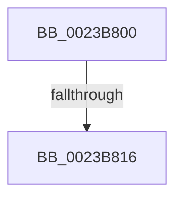

# MiUnlockProbePacketWorkingSet

- RVA: `0x0023B800`–`0x0023B81A` (길이 `26` bytes)
- VA: `0x000000014023B800`
- 실행 섹션: `.text`
- PDB 이름 있음: `예`; PDB Function 태그: `아니요`
- unwind 정보 RVA: `0x00060DC0`
- 디코드: `8`개 명령, `26/26` bytes 표시
- 미해석 바이트: `0` (있으면 어셈블리에 `.byte`로 보존)

> 이 문서는 커널 이미지의 기계어와 PDB 기호를 분석해 생성했습니다. 4번과 5번은 함수 원형과 자료형을 바이너리 사용 방식에서 추정한 C 해석이며 원본 소스 복구 결과는 아닙니다.

## 1. Dependencies

- 직접 호출 지점: **0**; 고유 호출 대상: **0**
- 직접 호출자로 확인된 함수: **9**
- RIP 상대 이미지 참조: **0**

### Outgoing calls
- 직접 디코드된 call 명령이 없습니다.

### Direct callers
- [MmProbeAndLockPages](MmProbeAndLockPages_function_0023B990.md) at `0x0023BA1A`
- [MiProbeAndLockPacket](MiProbeAndLockPacket_function_0023BE20.md) at `0x0023C0D2`
- [sub_0023D89B](Unknown_function_0023D89B.md) at `0x0023D8BA`
- [MmStoreProbeAndLockPages](MmStoreProbeAndLockPages_function_0023E570.md) at `0x0023E730`
- [MmStoreProbeAndLockPages](MmStoreProbeAndLockPages_function_0023E570.md) at `0x0023E836`
- [sub_0023F9E7](Unknown_function_0023F9E7.md) at `0x0023FA37`
- [MiFaultInProbeAddress](../40/MiFaultInProbeAddress_function_0040E108.md) at `0x0040E1AB`
- [MiProbeAndLockComplete](../49/MiProbeAndLockComplete_function_0049A18C.md) at `0x0049A1A8`
- [MiSplitReducedCommitClonePage](../4F/MiSplitReducedCommitClonePage_function_004FA808.md) at `0x004FA83D`
- [MiSplitReducedCommitClonePage](../4F/MiSplitReducedCommitClonePage_function_004FA808.md) at `0x004FA986`
- [sub_006D7AEE](../6D/Unknown_function_006D7AEE.md) at `0x006D7B16`
- [sub_006D7AEE](../6D/Unknown_function_006D7AEE.md) at `0x006D7B8D`

### Static image references
- 디코드된 RIP-relative 메모리 참조가 없습니다.

## 2. Other-region calls and transfers

- 다른 실행 섹션으로 향하는 call: **0**
- call이 아닌 외부 분기/꼬리 이동: **1**
  - `0x0023B814` → [sub_0023B87B](Unknown_function_0023B87B.md) (`tail-transfer`)

## 3. Assembly (complete function range)

```asm
0023B800  48 89 5C 24 10                  mov qword ptr [rsp + 0x10], rbx
0023B805  57                              push rdi
0023B806  48 83 EC 20                     sub rsp, 0x20
0023B80A  48 8B 41 28                     mov rax, qword ptr [rcx + 0x28]
0023B80E  48 8B D9                        mov rbx, rcx
0023B811  48 85 C0                        test rax, rax
0023B814  74 65                           je 0x14023b87b
0023B816  4C 8B 49 68                     mov r9, qword ptr [rcx + 0x68]
```

## 4. C-style interpretation (structured pseudocode)

```c
__int64 __fastcall MiUnlockProbePacketWorkingSet(__int64 a1)
{
    __int64 v_rsp;
    unsigned __int64 v_stack_p10;

    v_stack_p10 = v_rbx;
    v_rsp = (v_rsp) - (32);
    return *(unsigned __int64 *)(a1 + 40);
}
```

## 5. (Beta) C Style

```c
int64_t MiUnlockProbePacketWorkingSet(void *Arg1)
{
    uint8_t *arg1 = (uint8_t *)Arg1;

    int64_t local_rsp;
    uint64_t v_stack_p10;

    v_stack_p10 = local_rbx;
    local_rsp = (local_rsp) - (32);
    return *(uint64_t *)(arg1 + 0x28);
}
```

### 관측된 메모리 오프셋

구조체 형식이 확인되지 않은 접근은 인자 기준의 오프셋으로만 기록했습니다.

| 기준 인자 | 오프셋 표현 | 폭 (bit) | 접근 |
|---|---:|---:|---|
| `Arg1` | `+ 0x28` | `64` | `R` |
| `Arg1` | `+ 0x68` | `64` | `R` |

## 6. Execution-region graph

[열기: 2D/3D 그래프와 함수 탐색 컨트롤 패널](../../../control-panel.html?section=text&rva=0x0023B800&view=graph)

- 2D 그래프는 위에서 아래로 흐르고, 3D 그래프는 빈 공간을 드래그해 회전합니다. Shift+드래그는 이동, 휠은 확대·축소, 함수 노드 선택은 대상 보고서 이동입니다.

### Static fallback


