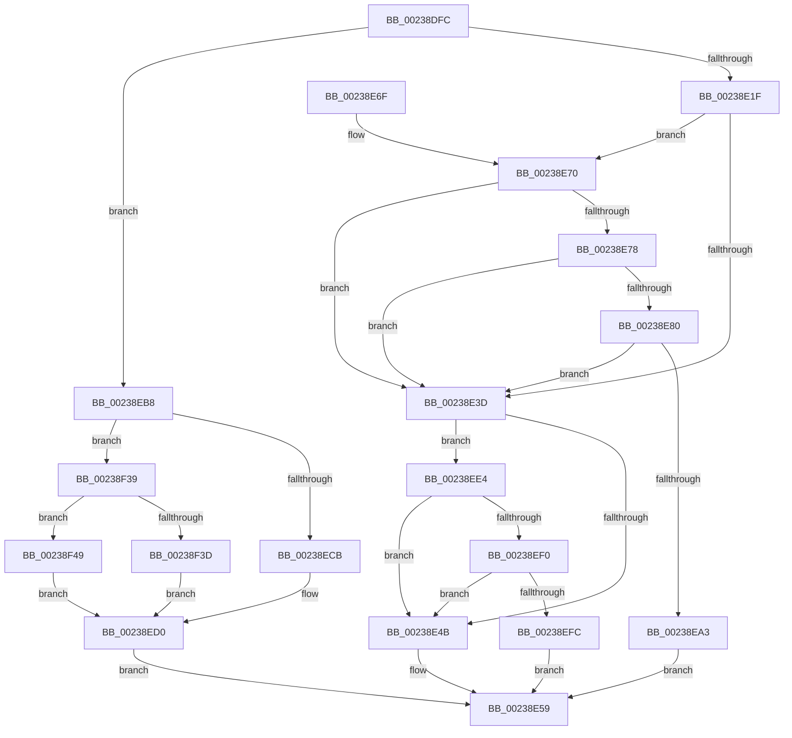

# MiUnlockWorkingSetOptimal

- RVA: `0x00238DFC`–`0x00238F50` (길이 `340` bytes)
- VA: `0x0000000140238DFC`
- 실행 섹션: `.text`
- PDB 이름 있음: `예`; PDB Function 태그: `아니요`
- unwind 정보 RVA: `0x00060B94`
- 디코드: `83`개 명령, `340/340` bytes 표시
- 미해석 바이트: `0` (있으면 어셈블리에 `.byte`로 보존)

> 이 문서는 커널 이미지의 기계어와 PDB 기호를 분석해 생성했습니다. 4번과 5번은 함수 원형과 자료형을 바이너리 사용 방식에서 추정한 C 해석이며 원본 소스 복구 결과는 아닙니다.

## 1. Dependencies

- 직접 호출 지점: **3**; 고유 호출 대상: **3**
- 직접 호출자로 확인된 함수: **18**
- RIP 상대 이미지 참조: **1**

### Outgoing calls
- `0x00238E5F` → [MiUnlockWorkingSetShared](../27/MiUnlockWorkingSetShared_function_0027D690.md) (function, `0x0027D690`)
- `0x00238EB1` → [ExReleaseSpinLockRegardlessFromDpcLevel](ExReleaseSpinLockRegardlessFromDpcLevel_function_0023A330.md) (function, `0x0023A330`)
- `0x00238EDA` → [KeReleaseInStackQueuedSpinLockFromDpcLevel](../21/KeReleaseInStackQueuedSpinLockFromDpcLevel_function_002171B0.md) (function, `0x002171B0`)

### Direct callers
- [MmSetAddressRangeModifiedEx](MmSetAddressRangeModifiedEx_function_00236F20.md) at `0x002372EF`
- [MiDirtyPte](MiDirtyPte_function_00237C5C.md) at `0x00237CBA`
- [sub_00238945](Unknown_function_00238945.md) at `0x00238AF7`
- [MmMapViewInSystemCache](../27/MmMapViewInSystemCache_function_00273094.md) at `0x00273294`
- [sub_00293C9B](../29/Unknown_function_00293C9B.md) at `0x00293EB0`
- [sub_00293F76](../29/Unknown_function_00293F76.md) at `0x002942E7`
- [MiMakeSystemCachePteValid](../2A/MiMakeSystemCachePteValid_function_002A35D8.md) at `0x002A3761`
- [sub_003490AD](../34/Unknown_function_003490AD.md) at `0x003491D1`
- [sub_003490AD](../34/Unknown_function_003490AD.md) at `0x00349318`
- [MiExpandSystemCache](../3B/MiExpandSystemCache_function_003B3DC8.md) at `0x003B3F9E`
- [MiReturnSystemCacheRegionsToKva](../49/MiReturnSystemCacheRegionsToKva_function_00494DFC.md) at `0x00494E9A`
- [MiBuildForkPageTable](../4A/MiBuildForkPageTable_function_004ACF5C.md) at `0x004AD254`
- [MiAddMappedPtesPadding](../4D/MiAddMappedPtesPadding_function_004DA2E8.md) at `0x004DA399`
- [MiAddMappedPtesPadding](../4D/MiAddMappedPtesPadding_function_004DA2E8.md) at `0x004DA3DA`
- [MiInitializeDynamicBitmap](../67/MiInitializeDynamicBitmap_function_0067F5BC.md) at `0x0067F731`
- [MiInitializeDynamicBitmap](../67/MiInitializeDynamicBitmap_function_0067F5BC.md) at `0x0067F7C6`
- [MiInitializeDynamicBitmap](../67/MiInitializeDynamicBitmap_function_0067F5BC.md) at `0x0067F946`
- [MiMarkBootGuardPage](../68/MiMarkBootGuardPage_function_0068643C.md) at `0x006864AB`
- [MiMarkBootGuardPage](../68/MiMarkBootGuardPage_function_0068643C.md) at `0x00686542`
- [sub_006FB3A8](../6F/Unknown_function_006FB3A8.md) at `0x006FB411`
- [MiMapDummyPages](../../init/C6/MiMapDummyPages_function_00C60A58.md) at `0x00C60B78`
- [MiProtectSharedUserPage](../../init/C6/MiProtectSharedUserPage_function_00C60F44.md) at `0x00C610C1`
- [MiInitializeBootShadowStackPage](../../init/C6/MiInitializeBootShadowStackPage_function_00C67D8C.md) at `0x00C67F10`
- [MiInitializeBootShadowStackPage](../../init/C6/MiInitializeBootShadowStackPage_function_00C67D8C.md) at `0x00C68096`

### Static image references
- `0x00238F29` → RVA `0x00E2F1AC` (`.data`; read)

## 2. Other-region calls and transfers

- 다른 실행 섹션으로 향하는 call: **0**
- 별도 외부 분기/꼬리 이동을 확인하지 못했습니다.

## 3. Assembly (complete function range)

```asm
00238DFC  48 89 5C 24 08                  mov qword ptr [rsp + 8], rbx
00238E01  57                              push rdi
00238E02  48 83 EC 20                     sub rsp, 0x20
00238E06  41 8A F8                        mov dil, r8b
00238E09  48 8B D9                        mov rbx, rcx
00238E0C  48 B8 68 DF BE 7D FB F6 FF FF   movabs rax, 0xfffff6fb7dbedf68
00238E16  48 3B D0                        cmp rdx, rax
00238E19  0F 84 99 00 00 00               je 0x140238eb8
00238E1F  8B 81 B8 00 00 00               mov eax, dword ptr [rcx + 0xb8]
00238E25  49 B8 00 D0 BE 7D FB F6 FF FF   movabs r8, 0xfffff6fb7dbed000
00238E2F  49 B9 FF DF BE 7D FB F6 FF FF   movabs r9, 0xfffff6fb7dbedfff
00238E39  A8 0F                           test al, 0xf
00238E3B  74 33                           je 0x140238e70
00238E3D  8B 83 B8 00 00 00               mov eax, dword ptr [rbx + 0xb8]
00238E43  A8 0F                           test al, 0xf
00238E45  0F 85 99 00 00 00               jne 0x140238ee4
00238E4B  48 B8 FF FF FF FF FF FF FF CF   movabs rax, 0xcfffffffffffffff
00238E55  F0 48 21 02                     lock and qword ptr [rdx], rax
00238E59  40 8A D7                        mov dl, dil
00238E5C  48 8B CB                        mov rcx, rbx
00238E5F  E8 2C 48 04 00                  call 0x14027d690
00238E64  48 8B 5C 24 30                  mov rbx, qword ptr [rsp + 0x30]
00238E69  48 83 C4 20                     add rsp, 0x20
00238E6D  5F                              pop rdi
00238E6E  C3                              ret
00238E6F  CC                              int3
00238E70  49 8B C0                        mov rax, r8
00238E73  48 3B D0                        cmp rdx, rax
00238E76  72 C5                           jb 0x140238e3d
00238E78  49 8B C1                        mov rax, r9
00238E7B  48 3B D0                        cmp rdx, rax
00238E7E  77 BD                           ja 0x140238e3d
00238E80  65 48 8B 04 25 88 01 00 00      mov rax, qword ptr gs:[0x188]
00238E89  48 8B 88 B8 00 00 00            mov rcx, qword ptr [rax + 0xb8]
00238E90  48 8B 81 10 04 00 00            mov rax, qword ptr [rcx + 0x410]
00238E97  48 8B 88 68 05 00 00            mov rcx, qword ptr [rax + 0x568]
00238E9E  48 85 C9                        test rcx, rcx
00238EA1  74 9A                           je 0x140238e3d
00238EA3  48 C1 EA 03                     shr rdx, 3
00238EA7  81 E2 FF 01 00 00               and edx, 0x1ff
00238EAD  48 8D 0C 91                     lea rcx, [rcx + rdx*4]
00238EB1  E8 7A 14 00 00                  call 0x14023a330
00238EB6  EB A1                           jmp 0x140238e59
00238EB8  65 48 8B 0C 25 20 00 00 00      mov rcx, qword ptr gs:[0x20]
00238EC1  8B 83 B8 00 00 00               mov eax, dword ptr [rbx + 0xb8]
00238EC7  24 0F                           and al, 0xf
00238EC9  75 6E                           jne 0x140238f39
00238ECB  B8 30 00 00 00                  mov eax, 0x30
00238ED0  48 81 C1 40 9C 00 00            add rcx, 0x9c40
00238ED7  48 03 C8                        add rcx, rax
00238EDA  E8 D1 E2 FD FF                  call 0x1402171b0
00238EDF  E9 75 FF FF FF                  jmp 0x140238e59
00238EE4  49 8B C0                        mov rax, r8
00238EE7  48 3B D0                        cmp rdx, rax
00238EEA  0F 82 5B FF FF FF               jb 0x140238e4b
00238EF0  49 8B C1                        mov rax, r9
00238EF3  48 3B D0                        cmp rdx, rax
00238EF6  0F 87 4F FF FF FF               ja 0x140238e4b
00238EFC  49 8B C0                        mov rax, r8
00238EFF  48 2B D0                        sub rdx, rax
00238F02  8B 83 B8 00 00 00               mov eax, dword ptr [rbx + 0xb8]
00238F08  48 C1 FA 03                     sar rdx, 3
00238F0C  44 8D 04 12                     lea r8d, [rdx + rdx]
00238F10  BA 02 00 00 00                  mov edx, 2
00238F15  41 8B C8                        mov ecx, r8d
00238F18  41 8B C0                        mov eax, r8d
00238F1B  83 E1 1F                        and ecx, 0x1f
00238F1E  D3 E2                           shl edx, cl
00238F20  F7 D2                           not edx
00238F22  0F B3 CA                        btr edx, ecx
00238F25  48 C1 E8 05                     shr rax, 5
00238F29  48 8D 0D 7C 62 BF 00            lea rcx, [rip + 0xbf627c]
00238F30  F0 21 14 81                     lock and dword ptr [rcx + rax*4], edx
00238F34  E9 20 FF FF FF                  jmp 0x140238e59
00238F39  3C 07                           cmp al, 7
00238F3B  74 0C                           je 0x140238f49
00238F3D  2C 05                           sub al, 5
00238F3F  F6 D8                           neg al
00238F41  48 1B C0                        sbb rax, rax
00238F44  83 E0 48                        and eax, 0x48
00238F47  EB 87                           jmp 0x140238ed0
00238F49  B8 18 00 00 00                  mov eax, 0x18
00238F4E  EB 80                           jmp 0x140238ed0
```

## 4. C-style interpretation (structured pseudocode)

```c
__int64 __fastcall MiUnlockWorkingSetOptimal(__int64 a1, __int64 a2, unsigned __int8 a3)
{
    __int64 result;
    __int64 v_rsp;
    unsigned __int64 v_stack_p8;

    v_stack_p8 = v_rbx;
    v_rsp = (v_rsp) - (32);
    if (a2 == result) goto loc_00238EB8;
    if ((((unsigned __int8)((unsigned int)(*(unsigned int *)(a1 + 184)))) & (15)) == 0) goto loc_00238E70;
loc_00238E3D:
    if ((((unsigned __int8)((unsigned int)(*(unsigned int *)(a1 + 184)))) & (15)) != 0) goto loc_00238EE4;
loc_00238E4B:
loc_00238E59:
    result = MiUnlockWorkingSetShared(a1, a3, a3, a4);
    v_rsp = (v_rsp) + (32);
    return result;
loc_00238E70:
    if (a3 < a3) goto loc_00238E3D;
    if (a3 > a4) goto loc_00238E3D;
    if (*(unsigned __int64 *)(*(unsigned __int64 *)(*(unsigned __int64 *)(*(unsigned __int64 *)(gs_base + (0 + 392)) + 184) + 1040) + 1384) == 0) goto loc_00238E3D;
    a2 = (a3) >> (3);
    a2 = (unsigned int)((a2) & (511));
    result = ExReleaseSpinLockRegardlessFromDpcLevel(*(unsigned __int64 *)(*(unsigned __int64 *)(*(unsigned __int64 *)(*(unsigned __int64 *)(gs_base + (0 + 392)) + 184) + 1040) + 1384) + a2 * 4, a2, a3, a4);
    goto loc_00238E59;
loc_00238EB8:
    result = (unsigned __int8)(((unsigned int)(*(unsigned int *)(v_stack_p8 + 184))) & (15));
    if (condition_is_not_equal) goto loc_00238F39;
loc_00238ED0:
    a1 = (*(unsigned __int64 *)(gs_base + (0 + 32))) + (0x9C40ULL);
    a1 = (a1) + (48);
    result = KeReleaseInStackQueuedSpinLockFromDpcLevel(a1, a2, a3, a4);
    goto loc_00238E59;
loc_00238EE4:
    if (a2 < a3) goto loc_00238E4B;
    if (a2 > a4) goto loc_00238E4B;
    a2 = (a2) - (a3);
    a2 = (a2) >> (3);
    a1 = (unsigned int)(((unsigned int)((unsigned int)(a2 + a2 * 1))) & (31));
    a2 = (unsigned int)((2) << ((unsigned __int8)(a1)));
    a2 = (unsigned int)(~(a2));
    result = ((unsigned int)((unsigned int)(a2 + a2 * 1))) >> (5);
    goto loc_00238E59;
loc_00238F39:
    if (((unsigned __int8)(result)) == 7) goto loc_00238F49;
    result = (unsigned __int8)((result) - (5));
    result = (unsigned __int8)(-(result));
    result = (unsigned int)((result) & (72));
    goto loc_00238ED0;
loc_00238F49:
    goto loc_00238ED0;
}
```

## 5. (Beta) C Style

```c
int64_t MiUnlockWorkingSetOptimal(void *Arg1, int64_t Arg2, uint8_t Arg3)
{
    uint8_t *arg1 = (uint8_t *)Arg1;

    int64_t result;
    int64_t local_rsp;
    uint64_t v_stack_p8;

    v_stack_p8 = local_rbx;
    local_rsp = (local_rsp) - (32);
    if (Arg2 == result) goto loc_00238EB8;
    if ((((uint8_t)((uint32_t)(*(uint32_t *)(arg1 + 0xB8)))) & (15)) == 0) goto loc_00238E70;
loc_00238E3D:
    if ((((uint8_t)((uint32_t)(*(uint32_t *)(arg1 + 0xB8)))) & (15)) != 0) goto loc_00238EE4;
loc_00238E4B:
loc_00238E59:
    result = MiUnlockWorkingSetShared(Arg1, Arg3, Arg3, a4);
    local_rsp = (local_rsp) + (32);
    return result;
loc_00238E70:
    if (Arg3 < Arg3) goto loc_00238E3D;
    if (Arg3 > a4) goto loc_00238E3D;
    if (*(uint64_t *)(*(uint64_t *)(*(uint64_t *)(*(uint64_t *)(gs_base + (0 + 0x188)) + 0xB8) + 0x410) + 0x568) == 0) goto loc_00238E3D;
    Arg2 = (Arg3) >> (3);
    Arg2 = (uint32_t)((Arg2) & (511));
    result = ExReleaseSpinLockRegardlessFromDpcLevel(*(uint64_t *)(*(uint64_t *)(*(uint64_t *)(*(uint64_t *)(gs_base + (0 + 0x188)) + 0xB8) + 0x410) + 0x568) + Arg2 * 4, Arg2, Arg3, a4);
    goto loc_00238E59;
loc_00238EB8:
    result = (uint8_t)(((uint32_t)(*(uint32_t *)(v_stack_p8 + 0xB8))) & (15));
    if (condition_is_not_equal) goto loc_00238F39;
loc_00238ED0:
    Arg1 = (*(uint64_t *)(gs_base + (0 + 0x20))) + (0x9C40ULL);
    Arg1 = (Arg1) + (48);
    result = KeReleaseInStackQueuedSpinLockFromDpcLevel(Arg1, Arg2, Arg3, a4);
    goto loc_00238E59;
loc_00238EE4:
    if (Arg2 < Arg3) goto loc_00238E4B;
    if (Arg2 > a4) goto loc_00238E4B;
    Arg2 = (Arg2) - (Arg3);
    Arg2 = (Arg2) >> (3);
    Arg1 = (uint32_t)(((uint32_t)((uint32_t)(Arg2 + Arg2 * 1))) & (31));
    Arg2 = (uint32_t)((2) << ((uint8_t)(Arg1)));
    Arg2 = (uint32_t)(~(Arg2));
    result = ((uint32_t)((uint32_t)(Arg2 + Arg2 * 1))) >> (5);
    goto loc_00238E59;
loc_00238F39:
    if (((uint8_t)(result)) == 7) goto loc_00238F49;
    result = (uint8_t)((result) - (5));
    result = (uint8_t)(-(result));
    result = (uint32_t)((result) & (72));
    goto loc_00238ED0;
loc_00238F49:
    goto loc_00238ED0;
}
```

### 관측된 메모리 오프셋

구조체 형식이 확인되지 않은 접근은 인자 기준의 오프셋으로만 기록했습니다.

| 기준 인자 | 오프셋 표현 | 폭 (bit) | 접근 |
|---|---:|---:|---|
| `Arg1` | `+ 0xB8` | `32` | `R` |

## 6. Execution-region graph

[열기: 2D/3D 그래프와 함수 탐색 컨트롤 패널](../../../control-panel.html?section=text&rva=0x00238DFC&view=graph)

- 2D 그래프는 위에서 아래로 흐르고, 3D 그래프는 빈 공간을 드래그해 회전합니다. Shift+드래그는 이동, 휠은 확대·축소, 함수 노드 선택은 대상 보고서 이동입니다.

### Static fallback


