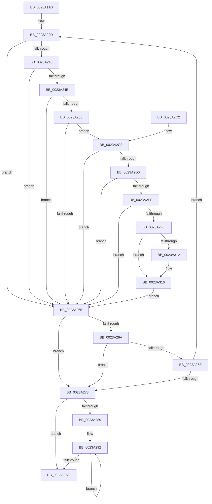

# MiVaToPfnEx

- RVA: `0x0023A1A0`–`0x0023A329` (길이 `393` bytes)
- VA: `0x000000014023A1A0`
- 실행 섹션: `.text`
- PDB 이름 있음: `예`; PDB Function 태그: `아니요`
- unwind 정보 RVA: `0x00060CCC`
- 디코드: `99`개 명령, `393/393` bytes 표시
- 미해석 바이트: `0` (있으면 어셈블리에 `.byte`로 보존)

> 이 문서는 커널 이미지의 기계어와 PDB 기호를 분석해 생성했습니다. 4번과 5번은 함수 원형과 자료형을 바이너리 사용 방식에서 추정한 C 해석이며 원본 소스 복구 결과는 아닙니다.

## 1. Dependencies

- 직접 호출 지점: **0**; 고유 호출 대상: **0**
- 직접 호출자로 확인된 함수: **6**
- RIP 상대 이미지 참조: **1**

### Outgoing calls
- 직접 디코드된 call 명령이 없습니다.

### Direct callers
- [MmGetPhysicalAddress](MmGetPhysicalAddress_function_0023A500.md) at `0x0023A816`
- [MiGetPhysicalAddress](MiGetPhysicalAddress_function_0023B120.md) at `0x0023B2D8`
- [MiCheckKernelShadow](../43/MiCheckKernelShadow_function_00432540.md) at `0x004325F3`
- [MiFreeInitializationCode](../../page/7F/MiFreeInitializationCode_function_007F88A0.md) at `0x007F89AA`
- [MiInitializeShadowPageTable](../../page/80/MiInitializeShadowPageTable_function_0080778C.md) at `0x00807830`
- [MiInitializeNonPagedPool](../../init/C6/MiInitializeNonPagedPool_function_00C64A24.md) at `0x00C64BD1`

### Static image references
- `0x0023A2C3` → RVA `0x00FC6A88` (`ALMOSTRO`; read)

## 2. Other-region calls and transfers

- 다른 실행 섹션으로 향하는 call: **0**
- 별도 외부 분기/꼬리 이동을 확인하지 못했습니다.

## 3. Assembly (complete function range)

```asm
0023A1A0  48 89 5C 24 08                  mov qword ptr [rsp + 8], rbx
0023A1A5  48 89 74 24 10                  mov qword ptr [rsp + 0x10], rsi
0023A1AA  57                              push rdi
0023A1AB  48 83 EC 20                     sub rsp, 0x20
0023A1AF  48 8B D1                        mov rdx, rcx
0023A1B2  49 B8 F8 FF FF FF 7F 00 00 00   movabs r8, 0x7ffffffff8
0023A1BC  48 C1 EA 09                     shr rdx, 9
0023A1C0  48 8B D9                        mov rbx, rcx
0023A1C3  49 23 D0                        and rdx, r8
0023A1C6  48 B9 00 00 00 00 80 F6 FF FF   movabs rcx, 0xfffff68000000000
0023A1D0  48 8B C1                        mov rax, rcx
0023A1D3  48 03 D0                        add rdx, rax
0023A1D6  48 89 14 24                     mov qword ptr [rsp], rdx
0023A1DA  48 C1 EA 09                     shr rdx, 9
0023A1DE  49 23 D0                        and rdx, r8
0023A1E1  48 8B C1                        mov rax, rcx
0023A1E4  48 03 D0                        add rdx, rax
0023A1E7  48 89 54 24 08                  mov qword ptr [rsp + 8], rdx
0023A1EC  48 C1 EA 09                     shr rdx, 9
0023A1F0  49 23 D0                        and rdx, r8
0023A1F3  48 8B C1                        mov rax, rcx
0023A1F6  48 03 D0                        add rdx, rax
0023A1F9  48 89 54 24 10                  mov qword ptr [rsp + 0x10], rdx
0023A1FE  48 C1 EA 09                     shr rdx, 9
0023A202  49 23 D0                        and rdx, r8
0023A205  48 8B C1                        mov rax, rcx
0023A208  48 03 D0                        add rdx, rax
0023A20B  48 BE 00 D0 BE 7D FB F6 FF FF   movabs rsi, 0xfffff6fb7dbed000
0023A215  41 BB 04 00 00 00               mov r11d, 4
0023A21B  48 89 54 24 18                  mov qword ptr [rsp + 0x18], rdx
0023A220  45 8B CB                        mov r9d, r11d
0023A223  48 BF F8 D7 BE 7D FB F6 FF FF   movabs rdi, 0xfffff6fb7dbed7f8
0023A22D  4E 8B 54 CC F8                  mov r10, qword ptr [rsp + r9*8 - 8]
0023A232  49 FF C9                        dec r9
0023A235  41 FF CB                        dec r11d
0023A238  49 8B 12                        mov rdx, qword ptr [r10]
0023A23B  48 8B C6                        mov rax, rsi
0023A23E  4C 3B D0                        cmp r10, rax
0023A241  72 22                           jb 0x14023a265
0023A243  48 8B C7                        mov rax, rdi
0023A246  4C 3B D0                        cmp r10, rax
0023A249  77 1A                           ja 0x14023a265
0023A24B  48 8B C2                        mov rax, rdx
0023A24E  F6 C2 01                        test dl, 1
0023A251  74 12                           je 0x14023a265
0023A253  F6 C2 42                        test dl, 0x42
0023A256  41 0F 95 C0                     setne r8b
0023A25A  F6 C2 20                        test dl, 0x20
0023A25D  0F 95 C1                        setne cl
0023A260  44 84 C1                        test cl, r8b
0023A263  74 5E                           je 0x14023a2c3
0023A265  4D 85 C9                        test r9, r9
0023A268  74 09                           je 0x14023a273
0023A26A  84 D2                           test dl, dl
0023A26C  78 05                           js 0x14023a273
0023A26E  4D 85 C9                        test r9, r9
0023A271  75 BA                           jne 0x14023a22d
0023A273  48 C1 EA 0C                     shr rdx, 0xc
0023A277  48 B8 FF FF FF FF FF 00 00 00   movabs rax, 0xffffffffff
0023A281  48 23 D0                        and rdx, rax
0023A284  45 85 DB                        test r11d, r11d
0023A287  74 26                           je 0x14023a2af
0023A289  B9 01 00 00 00                  mov ecx, 1
0023A28E  48 C1 EB 0C                     shr rbx, 0xc
0023A292  48 8B C3                        mov rax, rbx
0023A295  48 C1 EB 09                     shr rbx, 9
0023A299  25 FF 01 00 00                  and eax, 0x1ff
0023A29E  48 0F AF C1                     imul rax, rcx
0023A2A2  48 C1 E1 09                     shl rcx, 9
0023A2A6  48 03 D0                        add rdx, rax
0023A2A9  41 83 EB 01                     sub r11d, 1
0023A2AD  75 E3                           jne 0x14023a292
0023A2AF  48 8B 5C 24 30                  mov rbx, qword ptr [rsp + 0x30]
0023A2B4  48 8B C2                        mov rax, rdx
0023A2B7  48 8B 74 24 38                  mov rsi, qword ptr [rsp + 0x38]
0023A2BC  48 83 C4 20                     add rsp, 0x20
0023A2C0  5F                              pop rdi
0023A2C1  C3                              ret
0023A2C2  CC                              int3
0023A2C3  48 F7 05 BA C7 D8 00 00 00 60 00  test qword ptr [rip + 0xd8c7ba], 0x600000
0023A2CE  74 95                           je 0x14023a265
0023A2D0  65 48 8B 0C 25 88 01 00 00      mov rcx, qword ptr gs:[0x188]
0023A2D9  4C 8B 81 B8 00 00 00            mov r8, qword ptr [rcx + 0xb8]
0023A2E0  41 80 B8 60 01 00 00 01         cmp byte ptr [r8 + 0x160], 1
0023A2E8  0F 84 77 FF FF FF               je 0x14023a265
0023A2EE  49 8B 88 08 05 00 00            mov rcx, qword ptr [r8 + 0x508]
0023A2F5  48 85 C9                        test rcx, rcx
0023A2F8  0F 84 67 FF FF FF               je 0x14023a265
0023A2FE  49 C1 EA 03                     shr r10, 3
0023A302  41 81 E2 FF 01 00 00            and r10d, 0x1ff
0023A309  4A 8B 0C D1                     mov rcx, qword ptr [rcx + r10*8]
0023A30D  F6 C1 20                        test cl, 0x20
0023A310  74 04                           je 0x14023a316
0023A312  48 83 C8 20                     or rax, 0x20
0023A316  48 8B D0                        mov rdx, rax
0023A319  48 83 CA 42                     or rdx, 0x42
0023A31D  F6 C1 42                        test cl, 0x42
0023A320  48 0F 44 D0                     cmove rdx, rax
0023A324  E9 3C FF FF FF                  jmp 0x14023a265
```

## 4. C-style interpretation (structured pseudocode)

```c
__int64 __fastcall MiVaToPfnEx(__int64 a1)
{
    __int64 result;
    __int64 v_r10;
    __int64 v_r11;
    __int64 v_rbx;
    __int64 v_rsp;
    unsigned __int64 v_stack_m10;
    unsigned __int64 v_stack_m18;
    unsigned __int64 v_stack_m20;
    unsigned __int64 v_stack_m28;
    unsigned __int64 v_stack_p10;
    unsigned __int64 v_stack_p8;

    v_stack_p8 = v_rbx;
    v_stack_p10 = v_rsi;
    v_rsp = (v_rsp) - (32);
    a2 = (a1) >> (9);
    a2 = (a2) & (a3);
    a2 = (a2) + (a1);
    v_stack_m28 = a2;
    a2 = (a2) >> (9);
    a2 = (a2) & (a3);
    a2 = (a2) + (a1);
    v_stack_m20 = a2;
    a2 = (a2) >> (9);
    a2 = (a2) & (a3);
    a2 = (a2) + (a1);
    v_stack_m18 = a2;
    a2 = (a2) >> (9);
    a2 = (a2) & (a3);
    a2 = (a2) + (a1);
    v_stack_m10 = a2;
loc_0023A22D:
    a4 = (4) - 1;
    v_r11 = (unsigned int)((4) - 1);
    if ((*(unsigned __int64 *)(v_rsp + 4 * 8 - 8)) < v_rsi) goto loc_0023A265;
    if ((*(unsigned __int64 *)(v_rsp + 4 * 8 - 8)) > v_rdi) goto loc_0023A265;
    if ((((unsigned __int8)(*(unsigned __int64 *)(*(unsigned __int64 *)(v_rsp + 4 * 8 - 8)))) & (1)) == 0) goto loc_0023A265;
    a3 = ((((unsigned __int8)(*(unsigned __int64 *)(*(unsigned __int64 *)(v_rsp + 4 * 8 - 8)))) & (66)) != 0) ? 1 : 0;
    a1 = ((((unsigned __int8)(*(unsigned __int64 *)(*(unsigned __int64 *)(v_rsp + 4 * 8 - 8)))) & (32)) != 0) ? 1 : 0;
    if ((((unsigned __int8)(a1)) & ((unsigned __int8)(a3))) == 0) goto loc_0023A2C3;
loc_0023A265:
    if (a4 == 0) goto loc_0023A273;
    if (sign_flag) goto loc_0023A273;
    if (a4 != 0) goto loc_0023A22D;
loc_0023A273:
    a2 = (*(unsigned __int64 *)(*(unsigned __int64 *)(v_rsp + 4 * 8 - 8))) >> (12);
    a2 = (a2) & (*(unsigned __int64 *)(*(unsigned __int64 *)(v_rsp + 4 * 8 - 8)));
    if ((unsigned int)(v_r11) == 0) goto loc_0023A2AF;
    v_rbx = (a1) >> (12);
loc_0023A292:
    v_rbx = (v_rbx) >> (9);
    result = (unsigned int)((v_rbx) & (511));
    result = (result) * (1);
    a1 = (1) << (9);
    a2 = (a2) + (result);
    v_r11 = (unsigned int)((v_r11) - (1));
    if (condition_is_not_equal) goto loc_0023A292;
loc_0023A2AF:
    v_rsp = (v_rsp) + (32);
    return a2;
loc_0023A2C3:
    if (((*(unsigned __int64 *)(v_rip + 14206906)) & (0x600000ULL)) == 0) goto loc_0023A265;
    if ((*(unsigned __int8 *)(*(unsigned __int64 *)(*(unsigned __int64 *)(gs_base + (0 + 392)) + 184) + 352)) == 1) goto loc_0023A265;
    if (*(unsigned __int64 *)(*(unsigned __int64 *)(*(unsigned __int64 *)(gs_base + (0 + 392)) + 184) + 1288) == 0) goto loc_0023A265;
    v_r10 = (*(unsigned __int64 *)(v_rsp + 4 * 8 - 8)) >> (3);
    v_r10 = (unsigned int)((v_r10) & (511));
    result = a2;
    if ((((unsigned __int8)(*(unsigned __int64 *)(*(unsigned __int64 *)(*(unsigned __int64 *)(*(unsigned __int64 *)(gs_base + (0 + 392)) + 184) + 1288) + v_r10 * 8))) & (32)) != 0) {
        result = (a2) | (32);
    }
    a2 = (result) | (66);
    if ((((unsigned __int8)(*(unsigned __int64 *)(*(unsigned __int64 *)(*(unsigned __int64 *)(*(unsigned __int64 *)(gs_base + (0 + 392)) + 184) + 1288) + v_r10 * 8))) & (66)) == 0) { a2 = result; }
    goto loc_0023A265;
}
```

## 5. (Beta) C Style

```c
int64_t MiVaToPfnEx(int64_t Arg1)
{
    int64_t result;
    int64_t local_r10;
    int64_t local_r11;
    int64_t local_rbx;
    int64_t local_rsp;
    uint64_t v_stack_m10;
    uint64_t v_stack_m18;
    uint64_t v_stack_m20;
    uint64_t v_stack_m28;
    uint64_t v_stack_p10;
    uint64_t v_stack_p8;

    v_stack_p8 = local_rbx;
    v_stack_p10 = local_rsi;
    local_rsp = (local_rsp) - (32);
    a2 = (Arg1) >> (9);
    a2 = (a2) & (a3);
    a2 = (a2) + (Arg1);
    v_stack_m28 = a2;
    a2 = (a2) >> (9);
    a2 = (a2) & (a3);
    a2 = (a2) + (Arg1);
    v_stack_m20 = a2;
    a2 = (a2) >> (9);
    a2 = (a2) & (a3);
    a2 = (a2) + (Arg1);
    v_stack_m18 = a2;
    a2 = (a2) >> (9);
    a2 = (a2) & (a3);
    a2 = (a2) + (Arg1);
    v_stack_m10 = a2;
loc_0023A22D:
    a4 = (4) - 1;
    local_r11 = (uint32_t)((4) - 1);
    if ((*(uint64_t *)(local_rsp + 0x4 * 8 - 0x8)) < local_rsi) goto loc_0023A265;
    if ((*(uint64_t *)(local_rsp + 0x4 * 8 - 0x8)) > local_rdi) goto loc_0023A265;
    if ((((uint8_t)(*(uint64_t *)(*(uint64_t *)(local_rsp + 0x4 * 8 - 0x8)))) & (1)) == 0) goto loc_0023A265;
    a3 = ((((uint8_t)(*(uint64_t *)(*(uint64_t *)(local_rsp + 0x4 * 8 - 0x8)))) & (66)) != 0) ? 1 : 0;
    Arg1 = ((((uint8_t)(*(uint64_t *)(*(uint64_t *)(local_rsp + 0x4 * 8 - 0x8)))) & (32)) != 0) ? 1 : 0;
    if ((((uint8_t)(Arg1)) & ((uint8_t)(a3))) == 0) goto loc_0023A2C3;
loc_0023A265:
    if (a4 == 0) goto loc_0023A273;
    if (sign_flag) goto loc_0023A273;
    if (a4 != 0) goto loc_0023A22D;
loc_0023A273:
    a2 = (*(uint64_t *)(*(uint64_t *)(local_rsp + 0x4 * 8 - 0x8))) >> (12);
    a2 = (a2) & (*(uint64_t *)(*(uint64_t *)(local_rsp + 0x4 * 8 - 0x8)));
    if ((uint32_t)(local_r11) == 0) goto loc_0023A2AF;
    local_rbx = (Arg1) >> (12);
loc_0023A292:
    local_rbx = (local_rbx) >> (9);
    result = (uint32_t)((local_rbx) & (511));
    result = (result) * (1);
    Arg1 = (1) << (9);
    a2 = (a2) + (result);
    local_r11 = (uint32_t)((local_r11) - (1));
    if (condition_is_not_equal) goto loc_0023A292;
loc_0023A2AF:
    local_rsp = (local_rsp) + (32);
    return a2;
loc_0023A2C3:
    if (((*(uint64_t *)(v_rip + 0xD8C7BA)) & (0x600000ULL)) == 0) goto loc_0023A265;
    if ((*(uint8_t *)(*(uint64_t *)(*(uint64_t *)(gs_base + (0 + 0x188)) + 0xB8) + 0x160)) == 1) goto loc_0023A265;
    if (*(uint64_t *)(*(uint64_t *)(*(uint64_t *)(gs_base + (0 + 0x188)) + 0xB8) + 0x508) == 0) goto loc_0023A265;
    local_r10 = (*(uint64_t *)(local_rsp + 0x4 * 8 - 0x8)) >> (3);
    local_r10 = (uint32_t)((local_r10) & (511));
    result = a2;
    if ((((uint8_t)(*(uint64_t *)(*(uint64_t *)(*(uint64_t *)(*(uint64_t *)(gs_base + (0 + 0x188)) + 0xB8) + 0x508) + local_r10 * 8))) & (32)) != 0) {
        result = (a2) | (32);
    }
    a2 = (result) | (66);
    if ((((uint8_t)(*(uint64_t *)(*(uint64_t *)(*(uint64_t *)(*(uint64_t *)(gs_base + (0 + 0x188)) + 0xB8) + 0x508) + local_r10 * 8))) & (66)) == 0) { a2 = result; }
    goto loc_0023A265;
}
```

## 6. Execution-region graph

[열기: 2D/3D 그래프와 함수 탐색 컨트롤 패널](../../../control-panel.html?section=text&rva=0x0023A1A0&view=graph)

- 2D 그래프는 위에서 아래로 흐르고, 3D 그래프는 빈 공간을 드래그해 회전합니다. Shift+드래그는 이동, 휠은 확대·축소, 함수 노드 선택은 대상 보고서 이동입니다.

### Static fallback


