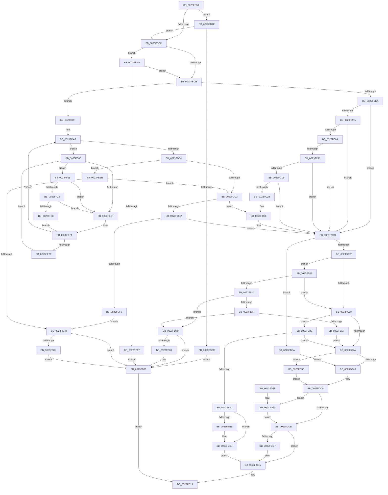

# MiWsleFlush

- RVA: `0x0023FB30`–`0x0023FF3C` (길이 `1,036` bytes)
- VA: `0x000000014023FB30`
- 실행 섹션: `.text`
- PDB 이름 있음: `예`; PDB Function 태그: `아니요`
- unwind 정보 RVA: `0x0006166C`
- 디코드: `247`개 명령, `1,036/1,036` bytes 표시
- 미해석 바이트: `0` (있으면 어셈블리에 `.byte`로 보존)

> 이 문서는 커널 이미지의 기계어와 PDB 기호를 분석해 생성했습니다. 4번과 5번은 함수 원형과 자료형을 바이너리 사용 방식에서 추정한 C 해석이며 원본 소스 복구 결과는 아닙니다.

## 1. Dependencies

- 직접 호출 지점: **15**; 고유 호출 대상: **14**
- 직접 호출자로 확인된 함수: **1**
- RIP 상대 이미지 참조: **3**

### Outgoing calls
- `0x0023FB7E` → [MI_READ_PTE_LOCK_FREE](../28/MI_READ_PTE_LOCK_FREE_function_002828A0.md) (function, `0x002828A0`)
- `0x0023FC31` → [MiCaptureWriteWatchDirtyBit](../46/MiCaptureWriteWatchDirtyBit_function_00465224.md) (function, `0x00465224`)
- `0x0023FC9C` → [MiSwizzleInvalidPte](../28/MiSwizzleInvalidPte_function_0028F5E0.md) (function, `0x0028F5E0`)
- `0x0023FCBC` → [MI_WRITE_INVALID_PTE_TB_FLUSH_NEEDED](../24/MI_WRITE_INVALID_PTE_TB_FLUSH_NEEDED_function_002400C0.md) (function, `0x002400C0`)
- `0x0023FCE0` → [MiCheckReservePageFileSpace](MiCheckReservePageFileSpace_function_0023FF50.md) (function, `0x0023FF50`)
- `0x0023FD45` → [MiPteForTrimmedProto](../29/MiPteForTrimmedProto_function_0029496C.md) (function, `0x0029496C`)
- `0x0023FD6A` → [MiUnlockNestedPageTableWritePte](MiUnlockNestedPageTableWritePte_function_0023F4E4.md) (function, `0x0023F4E4`)
- `0x0023FD7F` → [MiUnlockPageTable](../21/MiUnlockPageTable_function_00216EC0.md) (function, `0x00216EC0`)
- `0x0023FE27` → [MiLockNestedPageTable](MiLockNestedPageTable_function_0023E890.md) (function, `0x0023E890`)
- `0x0023FE4A` → [MiLockedPageTableHasActiveLargeEntries](../48/MiLockedPageTableHasActiveLargeEntries_function_00486048.md) (function, `0x00486048`)
- `0x0023FE93` → [MiPteForProtoPoolMadeDemandFill](../4A/MiPteForProtoPoolMadeDemandFill_function_004A378C.md) (function, `0x004A378C`)
- `0x0023FEB3` → [MI_WRITE_INVALID_PTE_TB_FLUSH_NEEDED](../24/MI_WRITE_INVALID_PTE_TB_FLUSH_NEEDED_function_002400C0.md) (function, `0x002400C0`)
- `0x0023FED0` → [MiFlushSingleTbEntry](../28/MiFlushSingleTbEntry_function_0028E730.md) (function, `0x0028E730`)
- `0x0023FF23` → [KiCheckVpBackingLongSpinWaitHypercall](../30/KiCheckVpBackingLongSpinWaitHypercall_function_0030F490.md) (function, `0x0030F490`)
- `0x0023FF32` → [HvlNotifyLongSpinWait](../30/HvlNotifyLongSpinWait_function_0030F460.md) (function, `0x0030F460`)

### Direct callers
- [MiFreeWsleList](../24/MiFreeWsleList_function_00241168.md) at `0x00241270`

### Static image references
- `0x0023FE63` → RVA `0x00FC52AC` (`ALMOSTRO`; reference)
- `0x0023FE80` → RVA `0x00E380C0` (`.data`; read)
- `0x0023FF15` → RVA `0x00FC6AB8` (`ALMOSTRO`; read)

## 2. Other-region calls and transfers

- 다른 실행 섹션으로 향하는 call: **0**
- 별도 외부 분기/꼬리 이동을 확인하지 못했습니다.

## 3. Assembly (complete function range)

```asm
0023FB30  48 89 5C 24 08                  mov qword ptr [rsp + 8], rbx
0023FB35  4C 89 4C 24 20                  mov qword ptr [rsp + 0x20], r9
0023FB3A  44 89 44 24 18                  mov dword ptr [rsp + 0x18], r8d
0023FB3F  55                              push rbp
0023FB40  56                              push rsi
0023FB41  57                              push rdi
0023FB42  41 54                           push r12
0023FB44  41 55                           push r13
0023FB46  41 56                           push r14
0023FB48  41 57                           push r15
0023FB4A  48 83 EC 20                     sub rsp, 0x20
0023FB4E  4C 8B FA                        mov r15, rdx
0023FB51  48 BB 00 00 00 00 80 F6 FF FF   movabs rbx, 0xfffff68000000000
0023FB5B  49 C1 EF 09                     shr r15, 9
0023FB5F  48 B8 F8 FF FF FF 7F 00 00 00   movabs rax, 0x7ffffffff8
0023FB69  4C 23 F8                        and r15, rax
0023FB6C  4D 8B E9                        mov r13, r9
0023FB6F  4C 8B E2                        mov r12, rdx
0023FB72  4C 8B F1                        mov r14, rcx
0023FB75  48 8B C3                        mov rax, rbx
0023FB78  4C 03 F8                        add r15, rax
0023FB7B  49 8B CF                        mov rcx, r15
0023FB7E  E8 1D 2D 04 00                  call 0x1402828a0
0023FB83  48 8B F8                        mov rdi, rax
0023FB86  48 B9 FF FF FF FF FF 00 00 00   movabs rcx, 0xffffffffff
0023FB90  48 C1 E8 0C                     shr rax, 0xc
0023FB94  48 23 C1                        and rax, rcx
0023FB97  48 8D 34 40                     lea rsi, [rax + rax*2]
0023FB9B  48 C1 E6 04                     shl rsi, 4
0023FB9F  48 B8 00 00 00 00 00 DE FF FF   movabs rax, 0xffffde0000000000
0023FBA9  48 03 F0                        add rsi, rax
0023FBAC  48 BA FF FF FF FF FF FF FF 3F   movabs rdx, 0x3fffffffffffffff
0023FBB6  41 B8 01 00 00 00               mov r8d, 1
0023FBBC  48 8B 46 18                     mov rax, qword ptr [rsi + 0x18]
0023FBC0  48 23 C2                        and rax, rdx
0023FBC3  49 3B C0                        cmp rax, r8
0023FBC6  0F 87 83 01 00 00               ja 0x14023fd4f
0023FBCC  41 8B 86 B8 00 00 00            mov eax, dword ptr [r14 + 0xb8]
0023FBD3  A8 0F                           test al, 0xf
0023FBD5  0F 85 1F 02 00 00               jne 0x14023fdfa
0023FBDB  41 8B 86 B8 00 00 00            mov eax, dword ptr [r14 + 0xb8]
0023FBE2  A8 0F                           test al, 0xf
0023FBE4  0F 85 B5 01 00 00               jne 0x14023fd9f
0023FBEA  48 8B 46 28                     mov rax, qword ptr [rsi + 0x28]
0023FBEE  33 ED                           xor ebp, ebp
0023FBF0  48 85 C0                        test rax, rax
0023FBF3  78 47                           js 0x14023fc3c
0023FBF5  48 8B C3                        mov rax, rbx
0023FBF8  48 B9 78 FF FF FF 3F 00 00 00   movabs rcx, 0x3fffffff78
0023FC02  48 03 C1                        add rax, rcx
0023FC05  4C 3B F8                        cmp r15, rax
0023FC08  77 32                           ja 0x14023fc3c
0023FC0A  48 8B C3                        mov rax, rbx
0023FC0D  4C 3B F8                        cmp r15, rax
0023FC10  72 2A                           jb 0x14023fc3c
0023FC12  40 F6 C7 42                     test dil, 0x42
0023FC16  74 24                           je 0x14023fc3c
0023FC18  49 8D 8E 00 FC FF FF            lea rcx, [r14 - 0x400]
0023FC1F  F7 81 F4 01 00 00 00 80 00 00   test dword ptr [rcx + 0x1f4], 0x8000
0023FC29  74 11                           je 0x14023fc3c
0023FC2B  45 33 C0                        xor r8d, r8d
0023FC2E  49 8B D4                        mov rdx, r12
0023FC31  E8 EE 55 22 00                  call 0x140465224
0023FC36  41 B8 01 00 00 00               mov r8d, 1
0023FC3C  48 8B 46 28                     mov rax, qword ptr [rsi + 0x28]
0023FC40  48 8B DF                        mov rbx, rdi
0023FC43  48 83 E3 FB                     and rbx, 0xfffffffffffffffb
0023FC47  33 D2                           xor edx, edx
0023FC49  48 85 C0                        test rax, rax
0023FC4C  0F 88 E8 00 00 00               js 0x14023fd3a
0023FC52  48 B8 00 00 00 00 80 F6 FF FF   movabs rax, 0xfffff68000000000
0023FC5C  48 8B C0                        mov rax, rax
0023FC5F  4C 3B E0                        cmp r12, rax
0023FC62  0F 83 A1 01 00 00               jae 0x14023fe09
0023FC68  48 8B 46 28                     mov rax, qword ptr [rsi + 0x28]
0023FC6C  48 C1 E8 3C                     shr rax, 0x3c
0023FC70  24 07                           and al, 7
0023FC72  3C 04                           cmp al, 4
0023FC74  0F 84 06 02 00 00               je 0x14023fe80
0023FC7A  8B 4E 10                        mov ecx, dword ptr [rsi + 0x10]
0023FC7D  48 B8 00 F0 FF FF FF FF 0F 00   movabs rax, 0xffffffffff000
0023FC87  48 C1 E9 05                     shr rcx, 5
0023FC8B  48 23 F8                        and rdi, rax
0023FC8E  83 E1 1F                        and ecx, 0x1f
0023FC91  48 83 C9 40                     or rcx, 0x40
0023FC95  48 C1 E1 05                     shl rcx, 5
0023FC99  48 0B CF                        or rcx, rdi
0023FC9C  E8 3F F9 04 00                  call 0x14028f5e0
0023FCA1  85 D2                           test edx, edx
0023FCA3  0F 85 B5 00 00 00               jne 0x14023fd5e
0023FCA9  48 8B CD                        mov rcx, rbp
0023FCAC  48 8B D0                        mov rdx, rax
0023FCAF  48 F7 D9                        neg rcx
0023FCB2  49 8B CF                        mov rcx, r15
0023FCB5  45 1B C0                        sbb r8d, r8d
0023FCB8  41 83 E0 40                     and r8d, 0x40
0023FCBC  E8 FF 03 00 00                  call 0x1402400c0
0023FCC1  33 FF                           xor edi, edi
0023FCC3  85 C0                           test eax, eax
0023FCC5  40 0F 95 C7                     setne dil
0023FCC9  48 85 ED                        test rbp, rbp
0023FCCC  75 5B                           jne 0x14023fd29
0023FCCE  48 8B 46 28                     mov rax, qword ptr [rsi + 0x28]
0023FCD2  48 85 C0                        test rax, rax
0023FCD5  78 0E                           js 0x14023fce5
0023FCD7  4D 8B C6                        mov r8, r14
0023FCDA  49 8B D7                        mov rdx, r15
0023FCDD  48 8B CE                        mov rcx, rsi
0023FCE0  E8 6B 02 00 00                  call 0x14023ff50
0023FCE5  41 8B 85 58 30 00 00            mov eax, dword ptr [r13 + 0x3058]
0023FCEC  49 89 9C C5 60 30 00 00         mov qword ptr [r13 + rax*8 + 0x3060], rbx
0023FCF4  41 8B 85 68 40 00 00            mov eax, dword ptr [r13 + 0x4068]
0023FCFB  41 FF 85 58 30 00 00            inc dword ptr [r13 + 0x3058]
0023FD02  4D 89 A4 C5 70 40 00 00         mov qword ptr [r13 + rax*8 + 0x4070], r12
0023FD0A  8B C7                           mov eax, edi
0023FD0C  41 FF 85 68 40 00 00            inc dword ptr [r13 + 0x4068]
0023FD13  48 8B 5C 24 60                  mov rbx, qword ptr [rsp + 0x60]
0023FD18  48 83 C4 20                     add rsp, 0x20
0023FD1C  41 5F                           pop r15
0023FD1E  41 5E                           pop r14
0023FD20  41 5D                           pop r13
0023FD22  41 5C                           pop r12
0023FD24  5F                              pop rdi
0023FD25  5E                              pop rsi
0023FD26  5D                              pop rbp
0023FD27  C3                              ret
0023FD28  CC                              int3
0023FD29  48 B8 FF FF FF FF FF FF FF 7F   movabs rax, 0x7fffffffffffffff
0023FD33  F0 48 21 45 18                  lock and qword ptr [rbp + 0x18], rax
0023FD38  EB 94                           jmp 0x14023fcce
0023FD3A  44 8B 44 24 70                  mov r8d, dword ptr [rsp + 0x70]
0023FD3F  49 8B D4                        mov rdx, r12
0023FD42  49 8B CE                        mov rcx, r14
0023FD45  E8 22 4C 05 00                  call 0x14029496c
0023FD4A  E9 5A FF FF FF                  jmp 0x14023fca9
0023FD4F  48 8B 46 28                     mov rax, qword ptr [rsi + 0x28]
0023FD53  48 85 C0                        test rax, rax
0023FD56  0F 88 70 FE FF FF               js 0x14023fbcc
0023FD5C  EB 3A                           jmp 0x14023fd98
0023FD5E  45 33 C9                        xor r9d, r9d
0023FD61  4C 8B C0                        mov r8, rax
0023FD64  49 8B D7                        mov rdx, r15
0023FD67  49 8B CE                        mov rcx, r14
0023FD6A  E8 75 F7 FF FF                  call 0x14023f4e4
0023FD6F  BF 01 00 00 00                  mov edi, 1
0023FD74  E9 50 FF FF FF                  jmp 0x14023fcc9
0023FD79  49 8B D7                        mov rdx, r15
0023FD7C  49 8B CE                        mov rcx, r14
0023FD7F  E8 3C 71 FD FF                  call 0x140216ec0
0023FD84  48 85 ED                        test rbp, rbp
0023FD87  74 0F                           je 0x14023fd98
0023FD89  48 B8 FF FF FF FF FF FF FF 7F   movabs rax, 0x7fffffffffffffff
0023FD93  F0 48 21 45 18                  lock and qword ptr [rbp + 0x18], rax
0023FD98  33 C0                           xor eax, eax
0023FD9A  E9 74 FF FF FF                  jmp 0x14023fd13
0023FD9F  48 8B EE                        mov rbp, rsi
0023FDA2  33 DB                           xor ebx, ebx
0023FDA4  4D 8B E8                        mov r13, r8
0023FDA7  F0 48 0F BA 6E 18 3F            lock bts qword ptr [rsi + 0x18], 0x3f
0023FDAE  0F 82 AC 00 00 00               jb 0x14023fe60
0023FDB4  48 8B 46 18                     mov rax, qword ptr [rsi + 0x18]
0023FDB8  48 B9 FF FF FF FF FF FF FF 3F   movabs rcx, 0x3fffffffffffffff
0023FDC2  48 23 C1                        and rax, rcx
0023FDC5  49 3B C5                        cmp rax, r13
0023FDC8  4C 8B 6C 24 78                  mov r13, qword ptr [rsp + 0x78]
0023FDCD  0F 87 18 01 00 00               ja 0x14023feeb
0023FDD3  41 8B 86 B8 00 00 00            mov eax, dword ptr [r14 + 0xb8]
0023FDDA  A8 0F                           test al, 0xf
0023FDDC  0F 84 54 FE FF FF               je 0x14023fc36
0023FDE2  8B 46 20                        mov eax, dword ptr [rsi + 0x20]
0023FDE5  41 B8 01 00 00 00               mov r8d, 1
0023FDEB  66 41 3B C0                     cmp ax, r8w
0023FDEF  0F 86 47 FE FF FF               jbe 0x14023fc3c
0023FDF5  E9 FE 00 00 00                  jmp 0x14023fef8
0023FDFA  8B 46 20                        mov eax, dword ptr [rsi + 0x20]
0023FDFD  66 41 3B C0                     cmp ax, r8w
0023FE01  0F 86 D4 FD FF FF               jbe 0x14023fbdb
0023FE07  EB 8F                           jmp 0x14023fd98
0023FE09  48 B8 FF FF FF FF FF F6 FF FF   movabs rax, 0xfffff6ffffffffff
0023FE13  4C 3B E0                        cmp r12, rax
0023FE16  0F 87 4C FE FF FF               ja 0x14023fc68
0023FE1C  49 8B D7                        mov rdx, r15
0023FE1F  44 89 44 24 68                  mov dword ptr [rsp + 0x68], r8d
0023FE24  49 8B CE                        mov rcx, r14
0023FE27  E8 64 EA FF FF                  call 0x14023e890
0023FE2C  48 8B 46 18                     mov rax, qword ptr [rsi + 0x18]
0023FE30  48 B9 FF FF FF FF FF FF FF 3F   movabs rcx, 0x3fffffffffffffff
0023FE3A  48 23 C1                        and rax, rcx
0023FE3D  48 83 F8 01                     cmp rax, 1
0023FE41  0F 85 32 FF FF FF               jne 0x14023fd79
0023FE47  49 8B CC                        mov rcx, r12
0023FE4A  E8 F9 61 24 00                  call 0x140486048
0023FE4F  85 C0                           test eax, eax
0023FE51  0F 85 22 FF FF FF               jne 0x14023fd79
0023FE57  8B 54 24 68                     mov edx, dword ptr [rsp + 0x68]
0023FE5B  E9 1A FE FF FF                  jmp 0x14023fc7a
0023FE60  41 03 DD                        add ebx, r13d
0023FE63  85 1D 43 54 D8 00               test dword ptr [rip + 0xd85443], ebx
0023FE69  0F 84 A6 00 00 00               je 0x14023ff15
0023FE6F  F3 90                           pause
0023FE71  48 8B 46 18                     mov rax, qword ptr [rsi + 0x18]
0023FE75  48 85 C0                        test rax, rax
0023FE78  0F 89 29 FF FF FF               jns 0x14023fda7
0023FE7E  EB E0                           jmp 0x14023fe60
0023FE80  48 8D 05 39 82 BF 00            lea rax, [rip + 0xbf8239]
0023FE87  4C 3B F0                        cmp r14, rax
0023FE8A  0F 85 EA FD FF FF               jne 0x14023fc7a
0023FE90  48 8B CE                        mov rcx, rsi
0023FE93  E8 F4 38 26 00                  call 0x1404a378c
0023FE98  48 8B CD                        mov rcx, rbp
0023FE9B  48 83 CB 04                     or rbx, 4
0023FE9F  48 F7 D9                        neg rcx
0023FEA2  48 8B D0                        mov rdx, rax
0023FEA5  49 8B CF                        mov rcx, r15
0023FEA8  45 1B C0                        sbb r8d, r8d
0023FEAB  41 83 E0 40                     and r8d, 0x40
0023FEAF  41 83 C0 02                     add r8d, 2
0023FEB3  E8 08 02 00 00                  call 0x1402400c0
0023FEB8  8B F8                           mov edi, eax
0023FEBA  85 C0                           test eax, eax
0023FEBC  74 19                           je 0x14023fed7
0023FEBE  BA 01 00 00 00                  mov edx, 1
0023FEC3  49 81 E4 00 F0 FF FF            and r12, 0xfffffffffffff000
0023FECA  44 8B C2                        mov r8d, edx
0023FECD  49 8B CC                        mov rcx, r12
0023FED0  E8 5B E8 04 00                  call 0x14028e730
0023FED5  33 FF                           xor edi, edi
0023FED7  48 B8 FF FF FF FF FF FF FF 7F   movabs rax, 0x7fffffffffffffff
0023FEE1  F0 48 21 45 18                  lock and qword ptr [rbp + 0x18], rax
0023FEE6  E9 FA FD FF FF                  jmp 0x14023fce5
0023FEEB  48 8B 46 28                     mov rax, qword ptr [rsi + 0x28]
0023FEEF  48 85 C0                        test rax, rax
0023FEF2  0F 88 DB FE FF FF               js 0x14023fdd3
0023FEF8  48 85 F6                        test rsi, rsi
0023FEFB  0F 84 97 FE FF FF               je 0x14023fd98
0023FF01  48 B8 FF FF FF FF FF FF FF 7F   movabs rax, 0x7fffffffffffffff
0023FF0B  F0 48 21 46 18                  lock and qword ptr [rsi + 0x18], rax
0023FF10  E9 83 FE FF FF                  jmp 0x14023fd98
0023FF15  8B 05 9D 6B D8 00               mov eax, dword ptr [rip + 0xd86b9d]
0023FF1B  A8 40                           test al, 0x40
0023FF1D  0F 84 4C FF FF FF               je 0x14023fe6f
0023FF23  E8 68 F5 0C 00                  call 0x14030f490
0023FF28  84 C0                           test al, al
0023FF2A  0F 84 3F FF FF FF               je 0x14023fe6f
0023FF30  8B CB                           mov ecx, ebx
0023FF32  E8 29 F5 0C 00                  call 0x14030f460
0023FF37  E9 35 FF FF FF                  jmp 0x14023fe71
```

## 4. C-style interpretation (structured pseudocode)

```c
__int64 __fastcall MiWsleFlush(__int64 a1, __int64 a2, int a3, __int64 a4)
{
    __int64 result;
    __int64 v_r12;
    __int64 v_r15;
    __int64 v_rbp;
    __int64 v_rbx;
    __int64 v_rdi;
    __int64 v_rsi;
    __int64 v_rsp;
    unsigned int v_stack_p18;
    unsigned __int64 v_stack_p20;
    unsigned int v_stack_p68;
    unsigned int v_stack_p70;
    unsigned __int64 v_stack_p78;
    unsigned __int64 v_stack_p8;

    v_stack_p8 = v_rbx;
    v_stack_p20 = a4;
    v_stack_p18 = a3;
    v_rsp = (v_rsp) - (32);
    v_r15 = (a2) >> (9);
    v_r15 = (v_r15) & (result);
    v_r15 = (v_r15) + (v_rbx);
    result = MI_READ_PTE_LOCK_FREE(v_r15, a2, a3, a4);
    result = (result) >> (12);
    result = (result) & (v_r15);
    v_rsi = (result + result * 2) << (4);
    v_rsi = (v_rsi) + (result);
    result = (*(unsigned __int64 *)(v_rsi + 24)) & (a2);
    if (result > 1) goto loc_0023FD4F;
loc_0023FBCC:
    if ((((unsigned __int8)((unsigned int)(*(unsigned int *)(a1 + 184)))) & (15)) != 0) goto loc_0023FDFA;
loc_0023FBDB:
    if ((((unsigned __int8)((unsigned int)(*(unsigned int *)(a1 + 184)))) & (15)) != 0) goto loc_0023FD9F;
    v_rbp = 0;
    if (sign_flag) goto loc_0023FC3C;
    result = (v_rbx) + (v_r15);
    if (v_r15 > result) goto loc_0023FC3C;
    if (v_r15 < v_rbx) goto loc_0023FC3C;
    if ((((unsigned __int8)(result)) & (66)) == 0) goto loc_0023FC3C;
    if (((*(unsigned int *)(a1 - 1024 + 500)) & (0x8000ULL)) == 0) goto loc_0023FC3C;
    a3 = 0;
    result = MiCaptureWriteWatchDirtyBit(a1 - 1024, a2, a3, a4);
loc_0023FC36:
loc_0023FC3C:
    v_rbx = (result) & (-5);
    a2 = 0;
    if (sign_flag) goto loc_0023FD3A;
    if (0 >= (*(unsigned __int64 *)(v_rsi + 40))) goto loc_0023FE09;
loc_0023FC68:
    result = (*(unsigned __int64 *)(v_rsi + 40)) >> (60);
    result = (unsigned __int8)((result) & (7));
    if (((unsigned __int8)(result)) == 4) goto loc_0023FE80;
loc_0023FC7A:
    a1 = ((unsigned int)(*(unsigned int *)(v_rsi + 16))) >> (5);
    v_rdi = (result) & (result);
    a1 = (unsigned int)((a1) & (31));
    a1 = (a1) | (64);
    a1 = (a1) << (5);
    a1 = (a1) | (v_rdi);
    result = MiSwizzleInvalidPte(a1, a2, 1, a4);
    if (0 != 0) goto loc_0023FD5E;
loc_0023FCA9:
    a1 = -(0);
    a3 = (unsigned int)((1) & (64));
    result = MI_WRITE_INVALID_PTE_TB_FLUSH_NEEDED(v_r15, result, a3, a4);
    v_rdi = 0;
    v_rdi = ((unsigned int)(result) != 0) ? 1 : 0;
loc_0023FCC9:
    if (0 != 0) goto loc_0023FD29;
loc_0023FCCE:
    result = *(unsigned __int64 *)(v_rsi + 40);
    if (!(sign_flag)) {
        a3 = a1;
        a2 = v_r15;
        a1 = v_rsi;
        result = MiCheckReservePageFileSpace(a1, a2, a3, a4);
    }
    *(unsigned __int64 *)(a4 + (unsigned int)(*(unsigned int *)(a4 + 12376)) * 8 + 12384) = v_rbx;
    *(unsigned __int64 *)(a4 + (unsigned int)(*(unsigned int *)(a4 + 16488)) * 8 + 16496) = a2;
loc_0023FD13:
    v_rsp = (v_rsp) + (32);
    return (unsigned int)((unsigned int)(v_rdi));
loc_0023FD29:
    goto loc_0023FCCE;
loc_0023FD3A:
    result = MiPteForTrimmedProto(a1, a2, (unsigned int)(v_stack_p70), a4);
    goto loc_0023FCA9;
loc_0023FD4F:
    if (sign_flag) goto loc_0023FBCC;
    goto loc_0023FD98;
loc_0023FD5E:
    a4 = 0;
    result = MiUnlockNestedPageTableWritePte(a1, v_r15, *(unsigned __int64 *)(v_rsi + 40), a4);
    goto loc_0023FCC9;
loc_0023FD79:
    result = MiUnlockPageTable(a1, v_r15, *(unsigned __int64 *)(v_rsi + 40), a4);
    if (0 != 0) {
    }
    result = 0;
    goto loc_0023FD13;
loc_0023FD9F:
    v_rbx = 0;
loc_0023FDA7:
    if (condition_is_below) goto loc_0023FE60;
    result = (*(unsigned __int64 *)(v_rsi + 24)) & (a1);
    if (result > (*(unsigned __int64 *)(v_rsi + 40))) goto loc_0023FEEB;
loc_0023FDD3:
    if ((((unsigned __int8)((unsigned int)(*(unsigned int *)(a1 + 184)))) & (15)) == 0) goto loc_0023FC36;
    if (((unsigned __int16)((unsigned int)(*(unsigned int *)(v_rsi + 32)))) <= 1) goto loc_0023FC3C;
    goto loc_0023FEF8;
loc_0023FDFA:
    if (((unsigned __int16)((unsigned int)(*(unsigned int *)(v_rsi + 32)))) <= 1) goto loc_0023FBDB;
    goto loc_0023FD98;
loc_0023FE09:
    if (a2 > ((unsigned int)(*(unsigned int *)(v_rsi + 32)))) goto loc_0023FC68;
    v_stack_p68 = 1;
    result = MiLockNestedPageTable(a1, v_r15, 1, a4);
    result = (*(unsigned __int64 *)(v_rsi + 24)) & (a1);
    if (result != 1) goto loc_0023FD79;
    result = MiLockedPageTableHasActiveLargeEntries(a2, v_r15, 1, a4);
    if ((unsigned int)(result) != 0) goto loc_0023FD79;
    goto loc_0023FC7A;
loc_0023FE60:
    v_rbx = (unsigned int)((v_rbx) + ((unsigned int)(v_stack_p78)));
    if (((*(unsigned int *)(v_rip + 14177347)) & ((unsigned int)(v_rbx))) == 0) goto loc_0023FF15;
loc_0023FE6F:
loc_0023FE71:
    if (!sign_flag) goto loc_0023FDA7;
    goto loc_0023FE60;
loc_0023FE80:
    if (a1 != (v_rip + 12550713)) goto loc_0023FC7A;
    result = MiPteForProtoPoolMadeDemandFill(v_rsi, (unsigned int)(v_stack_p68), 1, a4);
    v_rbx = (v_rbx) | (4);
    a1 = -(v_rsi);
    a3 = (unsigned int)((1) & (64));
    a3 = (unsigned int)((a3) + (2));
    result = MI_WRITE_INVALID_PTE_TB_FLUSH_NEEDED(v_r15, result, a3, a4);
    v_rdi = (unsigned int)((unsigned int)(result));
    v_r12 = a2;
    if ((unsigned int)(result) != 0) {
        a2 = 1;
        v_r12 = (a2) & (0xFFFFFFFFFFFFF000ULL);
        a3 = (unsigned int)(a2);
        a1 = v_r12;
        result = MiFlushSingleTbEntry(a1, a2, a3, a4);
        v_rdi = 0;
    }
    goto loc_0023FCE5;
loc_0023FEEB:
    if (sign_flag) goto loc_0023FDD3;
loc_0023FEF8:
    if (v_rsi == 0) goto loc_0023FD98;
    goto loc_0023FD98;
loc_0023FF15:
    if ((((unsigned __int8)((unsigned int)(*(unsigned int *)(v_rip + 14183325)))) & (64)) == 0) goto loc_0023FE6F;
    result = KiCheckVpBackingLongSpinWaitHypercall(a1, a2, a3, a4);
    if ((unsigned __int8)(result) == 0) goto loc_0023FE6F;
    result = HvlNotifyLongSpinWait((unsigned int)((unsigned int)(v_rbx)), a2, a3, a4);
    goto loc_0023FE71;
}
```

## 5. (Beta) C Style

```c
int64_t MiWsleFlush(void *Arg1, int64_t Arg2, int32_t Arg3, int64_t Arg4)
{
    uint8_t *arg1 = (uint8_t *)Arg1;

    int64_t result;
    int64_t local_r12;
    int64_t local_r15;
    int64_t local_rbp;
    int64_t local_rbx;
    int64_t local_rdi;
    int64_t local_rsi;
    int64_t local_rsp;
    uint32_t v_stack_p18;
    uint64_t v_stack_p20;
    uint32_t v_stack_p68;
    uint32_t v_stack_p70;
    uint64_t v_stack_p78;
    uint64_t v_stack_p8;

    v_stack_p8 = local_rbx;
    v_stack_p20 = Arg4;
    v_stack_p18 = Arg3;
    local_rsp = (local_rsp) - (32);
    local_r15 = (Arg2) >> (9);
    local_r15 = (local_r15) & (result);
    local_r15 = (local_r15) + (local_rbx);
    result = MI_READ_PTE_LOCK_FREE(local_r15, Arg2, Arg3, Arg4);
    result = (result) >> (12);
    result = (result) & (local_r15);
    local_rsi = (result + result * 2) << (4);
    local_rsi = (local_rsi) + (result);
    result = (*(uint64_t *)(local_rsi + 0x18)) & (Arg2);
    if (result > 1) goto loc_0023FD4F;
loc_0023FBCC:
    if ((((uint8_t)((uint32_t)(*(uint32_t *)(arg1 + 0xB8)))) & (15)) != 0) goto loc_0023FDFA;
loc_0023FBDB:
    if ((((uint8_t)((uint32_t)(*(uint32_t *)(arg1 + 0xB8)))) & (15)) != 0) goto loc_0023FD9F;
    local_rbp = 0;
    if (sign_flag) goto loc_0023FC3C;
    result = (local_rbx) + (local_r15);
    if (local_r15 > result) goto loc_0023FC3C;
    if (local_r15 < local_rbx) goto loc_0023FC3C;
    if ((((uint8_t)(result)) & (66)) == 0) goto loc_0023FC3C;
    if (((*(uint32_t *)(arg1 - 0x400 + 0x1F4)) & (0x8000ULL)) == 0) goto loc_0023FC3C;
    Arg3 = 0;
    result = MiCaptureWriteWatchDirtyBit(Arg1 - 1024, Arg2, Arg3, Arg4);
loc_0023FC36:
loc_0023FC3C:
    local_rbx = (result) & (-5);
    Arg2 = 0;
    if (sign_flag) goto loc_0023FD3A;
    if (0 >= (*(uint64_t *)(local_rsi + 0x28))) goto loc_0023FE09;
loc_0023FC68:
    result = (*(uint64_t *)(local_rsi + 0x28)) >> (60);
    result = (uint8_t)((result) & (7));
    if (((uint8_t)(result)) == 4) goto loc_0023FE80;
loc_0023FC7A:
    Arg1 = ((uint32_t)(*(uint32_t *)(local_rsi + 0x10))) >> (5);
    local_rdi = (result) & (result);
    Arg1 = (uint32_t)((Arg1) & (31));
    Arg1 = (Arg1) | (64);
    Arg1 = (Arg1) << (5);
    Arg1 = (Arg1) | (local_rdi);
    result = MiSwizzleInvalidPte(Arg1, Arg2, 1, Arg4);
    if (0 != 0) goto loc_0023FD5E;
loc_0023FCA9:
    Arg1 = -(0);
    Arg3 = (uint32_t)((1) & (64));
    result = MI_WRITE_INVALID_PTE_TB_FLUSH_NEEDED(local_r15, result, Arg3, Arg4);
    local_rdi = 0;
    local_rdi = ((uint32_t)(result) != 0) ? 1 : 0;
loc_0023FCC9:
    if (0 != 0) goto loc_0023FD29;
loc_0023FCCE:
    result = *(uint64_t *)(local_rsi + 0x28);
    if (!(sign_flag)) {
        Arg3 = Arg1;
        Arg2 = local_r15;
        Arg1 = local_rsi;
        result = MiCheckReservePageFileSpace(Arg1, Arg2, Arg3, Arg4);
    }
    *(uint64_t *)(Arg4 + (uint32_t)(*(uint32_t *)(Arg4 + 0x3058)) * 8 + 0x3060) = local_rbx;
    *(uint64_t *)(Arg4 + (uint32_t)(*(uint32_t *)(Arg4 + 0x4068)) * 8 + 0x4070) = Arg2;
loc_0023FD13:
    local_rsp = (local_rsp) + (32);
    return (uint32_t)((uint32_t)(local_rdi));
loc_0023FD29:
    goto loc_0023FCCE;
loc_0023FD3A:
    result = MiPteForTrimmedProto(Arg1, Arg2, (uint32_t)(v_stack_p70), Arg4);
    goto loc_0023FCA9;
loc_0023FD4F:
    if (sign_flag) goto loc_0023FBCC;
    goto loc_0023FD98;
loc_0023FD5E:
    Arg4 = 0;
    result = MiUnlockNestedPageTableWritePte(Arg1, local_r15, *(uint64_t *)(local_rsi + 0x28), Arg4);
    goto loc_0023FCC9;
loc_0023FD79:
    result = MiUnlockPageTable(Arg1, local_r15, *(uint64_t *)(local_rsi + 0x28), Arg4);
    if (0 != 0) {
    }
    result = 0;
    goto loc_0023FD13;
loc_0023FD9F:
    local_rbx = 0;
loc_0023FDA7:
    if (condition_is_below) goto loc_0023FE60;
    result = (*(uint64_t *)(local_rsi + 0x18)) & (Arg1);
    if (result > (*(uint64_t *)(local_rsi + 0x28))) goto loc_0023FEEB;
loc_0023FDD3:
    if ((((uint8_t)((uint32_t)(*(uint32_t *)(arg1 + 0xB8)))) & (15)) == 0) goto loc_0023FC36;
    if (((uint16_t)((uint32_t)(*(uint32_t *)(local_rsi + 0x20)))) <= 1) goto loc_0023FC3C;
    goto loc_0023FEF8;
loc_0023FDFA:
    if (((uint16_t)((uint32_t)(*(uint32_t *)(local_rsi + 0x20)))) <= 1) goto loc_0023FBDB;
    goto loc_0023FD98;
loc_0023FE09:
    if (Arg2 > ((uint32_t)(*(uint32_t *)(local_rsi + 0x20)))) goto loc_0023FC68;
    v_stack_p68 = 1;
    result = MiLockNestedPageTable(Arg1, local_r15, 1, Arg4);
    result = (*(uint64_t *)(local_rsi + 0x18)) & (Arg1);
    if (result != 1) goto loc_0023FD79;
    result = MiLockedPageTableHasActiveLargeEntries(Arg2, local_r15, 1, Arg4);
    if ((uint32_t)(result) != 0) goto loc_0023FD79;
    goto loc_0023FC7A;
loc_0023FE60:
    local_rbx = (uint32_t)((local_rbx) + ((uint32_t)(v_stack_p78)));
    if (((*(uint32_t *)(v_rip + 0xD85443)) & ((uint32_t)(local_rbx))) == 0) goto loc_0023FF15;
loc_0023FE6F:
loc_0023FE71:
    if (!sign_flag) goto loc_0023FDA7;
    goto loc_0023FE60;
loc_0023FE80:
    if (Arg1 != (v_rip + 12550713)) goto loc_0023FC7A;
    result = MiPteForProtoPoolMadeDemandFill(local_rsi, (uint32_t)(v_stack_p68), 1, Arg4);
    local_rbx = (local_rbx) | (4);
    Arg1 = -(local_rsi);
    Arg3 = (uint32_t)((1) & (64));
    Arg3 = (uint32_t)((Arg3) + (2));
    result = MI_WRITE_INVALID_PTE_TB_FLUSH_NEEDED(local_r15, result, Arg3, Arg4);
    local_rdi = (uint32_t)((uint32_t)(result));
    local_r12 = Arg2;
    if ((uint32_t)(result) != 0) {
        Arg2 = 1;
        local_r12 = (Arg2) & (0xFFFFFFFFFFFFF000ULL);
        Arg3 = (uint32_t)(Arg2);
        Arg1 = local_r12;
        result = MiFlushSingleTbEntry(Arg1, Arg2, Arg3, Arg4);
        local_rdi = 0;
    }
    goto loc_0023FCE5;
loc_0023FEEB:
    if (sign_flag) goto loc_0023FDD3;
loc_0023FEF8:
    if (local_rsi == 0) goto loc_0023FD98;
    goto loc_0023FD98;
loc_0023FF15:
    if ((((uint8_t)((uint32_t)(*(uint32_t *)(v_rip + 0xD86B9D)))) & (64)) == 0) goto loc_0023FE6F;
    result = KiCheckVpBackingLongSpinWaitHypercall(Arg1, Arg2, Arg3, Arg4);
    if ((uint8_t)(result) == 0) goto loc_0023FE6F;
    result = HvlNotifyLongSpinWait((uint32_t)((uint32_t)(local_rbx)), Arg2, Arg3, Arg4);
    goto loc_0023FE71;
}
```

### 관측된 메모리 오프셋

구조체 형식이 확인되지 않은 접근은 인자 기준의 오프셋으로만 기록했습니다.

| 기준 인자 | 오프셋 표현 | 폭 (bit) | 접근 |
|---|---:|---:|---|
| `Arg1` | `- 0x400` | `64` | `R` |
| `Arg1` | `+ 0xB8` | `32` | `R` |
| `Arg1` | `+ 0x1F4` | `32` | `R` |

## 6. Execution-region graph

[열기: 2D/3D 그래프와 함수 탐색 컨트롤 패널](../../../control-panel.html?section=text&rva=0x0023FB30&view=graph)

- 2D 그래프는 위에서 아래로 흐르고, 3D 그래프는 빈 공간을 드래그해 회전합니다. Shift+드래그는 이동, 휠은 확대·축소, 함수 노드 선택은 대상 보고서 이동입니다.

### Static fallback


