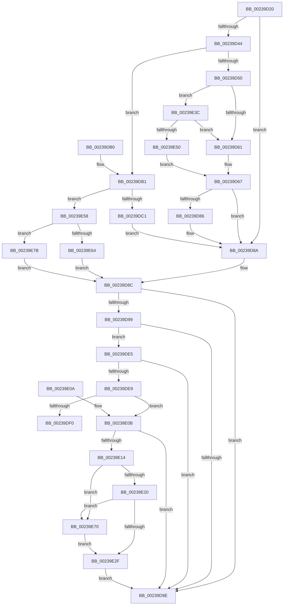

# MiYieldPageTableWalk

- RVA: `0x00239D20`–`0x00239E8A` (길이 `362` bytes)
- VA: `0x0000000140239D20`
- 실행 섹션: `.text`
- PDB 이름 있음: `예`; PDB Function 태그: `아니요`
- unwind 정보 RVA: `0x00060C14`
- 디코드: `97`개 명령, `362/362` bytes 표시
- 미해석 바이트: `0` (있으면 어셈블리에 `.byte`로 보존)

> 이 문서는 커널 이미지의 기계어와 PDB 기호를 분석해 생성했습니다. 4번과 5번은 함수 원형과 자료형을 바이너리 사용 방식에서 추정한 C 해석이며 원본 소스 복구 결과는 아닙니다.

## 1. Dependencies

- 직접 호출 지점: **6**; 고유 호출 대상: **5**
- 직접 호출자로 확인된 함수: **1**
- RIP 상대 이미지 참조: **6**

### Outgoing calls
- `0x00239D7A` → [MiAgeTrimListsTail](MiAgeTrimListsTail_function_00239E90.md) (function, `0x00239E90`)
- `0x00239DDE` → [MiAgeTrimListsTail](MiAgeTrimListsTail_function_00239E90.md) (function, `0x00239E90`)
- `0x00239DF3` → [MiReleaseWalkLocks](MiReleaseWalkLocks_function_00239FD0.md) (function, `0x00239FD0`)
- `0x00239E64` → [MiDeleteVaTail](../47/MiDeleteVaTail_function_00473EF0.md) (function, `0x00473EF0`)
- `0x00239E74` → [MiUnlockPageTable](../21/MiUnlockPageTable_function_00216EC0.md) (function, `0x00216EC0`)
- `0x00239E7E` → [guard_dispatch_icall](../6B/guard_dispatch_icall_function_006BAAD0.md) (function, `0x006BAAD0`)

### Direct callers
- [MiWalkPageTablesRecursively](../27/MiWalkPageTablesRecursively_function_002796C0.md) at `0x0027A449`

### Static image references
- `0x00239D44` → RVA `0x00428D10` (`MiAgeWorkingSetTail`; read)
- `0x00239D67` → RVA `0x0048DE00` (`MiAgeWorkingSetVpabCallback`; read)
- `0x00239DB1` → RVA `0x00428C00` (`MiUpdateOldWorkingSetPagesTail`; read)
- `0x00239DC8` → RVA `0x0049CF50` (`MiUpdateOldPagesVpabCallback`; read)
- `0x00239E3C` → RVA `0x004ACD40` (`MiSimpleAgePte`; read)
- `0x00239E58` → RVA `0x00473EF0` (`MiDeleteVaTail`; read)

## 2. Other-region calls and transfers

- 다른 실행 섹션으로 향하는 call: **0**
- 별도 외부 분기/꼬리 이동을 확인하지 못했습니다.

## 3. Assembly (complete function range)

```asm
00239D20  48 89 5C 24 08                  mov qword ptr [rsp + 8], rbx
00239D25  48 89 74 24 10                  mov qword ptr [rsp + 0x10], rsi
00239D2A  57                              push rdi
00239D2B  48 83 EC 30                     sub rsp, 0x30
00239D2F  4C 8B 81 B0 00 00 00            mov r8, qword ptr [rcx + 0xb0]
00239D36  8B F2                           mov esi, edx
00239D38  83 49 04 20                     or dword ptr [rcx + 4], 0x20
00239D3C  48 8B D9                        mov rbx, rcx
00239D3F  4D 85 C0                        test r8, r8
00239D42  74 46                           je 0x140239d8a
00239D44  48 8D 05 C5 EF 1E 00            lea rax, [rip + 0x1eefc5]
00239D4B  4C 3B C0                        cmp r8, rax
00239D4E  75 61                           jne 0x140239db1
00239D50  48 8B B9 B8 00 00 00            mov rdi, qword ptr [rcx + 0xb8]
00239D57  8B 07                           mov eax, dword ptr [rdi]
00239D59  A8 03                           test al, 3
00239D5B  0F 84 DB 00 00 00               je 0x140239e3c
00239D61  41 B9 01 00 00 00               mov r9d, 1
00239D67  48 8D 05 92 40 25 00            lea rax, [rip + 0x254092]
00239D6E  45 33 C0                        xor r8d, r8d
00239D71  48 8D 57 38                     lea rdx, [rdi + 0x38]
00239D75  48 89 44 24 20                  mov qword ptr [rsp + 0x20], rax
00239D7A  E8 11 01 00 00                  call 0x140239e90
00239D7F  8B 43 04                        mov eax, dword ptr [rbx + 4]
00239D82  A8 20                           test al, 0x20
00239D84  74 04                           je 0x140239d8a
00239D86  C6 47 06 01                     mov byte ptr [rdi + 6], 1
00239D8A  33 FF                           xor edi, edi
00239D8C  8B 43 04                        mov eax, dword ptr [rbx + 4]
00239D8F  83 E0 DF                        and eax, 0xffffffdf
00239D92  89 43 04                        mov dword ptr [rbx + 4], eax
00239D95  A8 01                           test al, 1
00239D97  75 05                           jne 0x140239d9e
00239D99  83 FF 04                        cmp edi, 4
00239D9C  7C 47                           jl 0x140239de5
00239D9E  8B C7                           mov eax, edi
00239DA0  48 8B 5C 24 40                  mov rbx, qword ptr [rsp + 0x40]
00239DA5  48 8B 74 24 48                  mov rsi, qword ptr [rsp + 0x48]
00239DAA  48 83 C4 30                     add rsp, 0x30
00239DAE  5F                              pop rdi
00239DAF  C3                              ret
00239DB0  CC                              int3
00239DB1  48 8D 05 48 EE 1E 00            lea rax, [rip + 0x1eee48]
00239DB8  4C 3B C0                        cmp r8, rax
00239DBB  0F 85 97 00 00 00               jne 0x140239e58
00239DC1  48 8B 91 B8 00 00 00            mov rdx, qword ptr [rcx + 0xb8]
00239DC8  48 8D 05 81 31 26 00            lea rax, [rip + 0x263181]
00239DCF  48 83 C2 30                     add rdx, 0x30
00239DD3  48 89 44 24 20                  mov qword ptr [rsp + 0x20], rax
00239DD8  45 33 C9                        xor r9d, r9d
00239DDB  45 33 C0                        xor r8d, r8d
00239DDE  E8 AD 00 00 00                  call 0x140239e90
00239DE3  EB A5                           jmp 0x140239d8a
00239DE5  85 F6                           test esi, esi
00239DE7  74 B5                           je 0x140239d9e
00239DE9  8B 0B                           mov ecx, dword ptr [rbx]
00239DEB  F6 C1 02                        test cl, 2
00239DEE  74 1B                           je 0x140239e0b
00239DF0  48 8B CB                        mov rcx, rbx
00239DF3  E8 D8 01 00 00                  call 0x140239fd0
00239DF8  48 8B 5C 24 40                  mov rbx, qword ptr [rsp + 0x40]
00239DFD  8B C7                           mov eax, edi
00239DFF  48 8B 74 24 48                  mov rsi, qword ptr [rsp + 0x48]
00239E04  48 83 C4 30                     add rsp, 0x30
00239E08  5F                              pop rdi
00239E09  C3                              ret
00239E0A  CC                              int3
00239E0B  48 8B 53 38                     mov rdx, qword ptr [rbx + 0x38]
00239E0F  48 85 D2                        test rdx, rdx
00239E12  74 8A                           je 0x140239d9e
00239E14  83 C8 02                        or eax, 2
00239E17  89 43 04                        mov dword ptr [rbx + 4], eax
00239E1A  0F BA E1 0C                     bt ecx, 0xc
00239E1E  73 50                           jae 0x140239e70
00239E20  48 B8 68 DF BE 7D FB F6 FF FF   movabs rax, 0xfffff6fb7dbedf68
00239E2A  48 3B D0                        cmp rdx, rax
00239E2D  75 41                           jne 0x140239e70
00239E2F  48 C7 43 38 00 00 00 00         mov qword ptr [rbx + 0x38], 0
00239E37  E9 62 FF FF FF                  jmp 0x140239d9e
00239E3C  48 8D 05 FD 2E 27 00            lea rax, [rip + 0x272efd]
00239E43  48 39 81 A8 00 00 00            cmp qword ptr [rcx + 0xa8], rax
00239E4A  0F 84 11 FF FF FF               je 0x140239d61
00239E50  45 33 C9                        xor r9d, r9d
00239E53  E9 0F FF FF FF                  jmp 0x140239d67
00239E58  48 8D 05 91 A0 23 00            lea rax, [rip + 0x23a091]
00239E5F  4C 3B C0                        cmp r8, rax
00239E62  75 17                           jne 0x140239e7b
00239E64  E8 87 A0 23 00                  call 0x140473ef0
00239E69  8B F8                           mov edi, eax
00239E6B  E9 1C FF FF FF                  jmp 0x140239d8c
00239E70  48 8B 4B 20                     mov rcx, qword ptr [rbx + 0x20]
00239E74  E8 47 D0 FD FF                  call 0x140216ec0
00239E79  EB B4                           jmp 0x140239e2f
00239E7B  49 8B C0                        mov rax, r8
00239E7E  E8 4D 0C 48 00                  call 0x1406baad0
00239E83  8B F8                           mov edi, eax
00239E85  E9 02 FF FF FF                  jmp 0x140239d8c
```

## 4. C-style interpretation (structured pseudocode)

```c
__int64 __fastcall MiYieldPageTableWalk(__int64 a1, int a2)
{
    __int64 result;
    __int64 v_rdi;
    __int64 v_rsp;
    unsigned __int64 v_stack_m18;
    unsigned __int64 v_stack_p10;
    unsigned __int64 v_stack_p20;
    unsigned __int64 v_stack_p40;
    unsigned __int64 v_stack_p48;
    unsigned __int64 v_stack_p8;

    v_stack_p8 = v_rbx;
    v_stack_p10 = v_rsi;
    v_rsp = (v_rsp) - (48);
    if (*(unsigned __int64 *)(a1 + 176) == 0) goto loc_00239D8A;
    if ((*(unsigned __int64 *)(a1 + 176)) != (v_rip + 2027461)) goto loc_00239DB1;
    if ((((unsigned __int8)((unsigned int)(*(unsigned int *)(*(unsigned __int64 *)(a1 + 184))))) & (3)) == 0) goto loc_00239E3C;
loc_00239D61:
loc_00239D67:
    a3 = 0;
    v_stack_m18 = v_rip + 2441362;
    result = MiAgeTrimListsTail(a1, *(unsigned __int64 *)(a1 + 184) + 56, a3, 1);
    if ((((unsigned __int8)((unsigned int)(*(unsigned int *)(a1 + 4)))) & (32)) != 0) {
        *(unsigned __int8 *)(*(unsigned __int64 *)(a1 + 184) + 6) = 1;
    }
    v_rdi = 0;
loc_00239D8C:
    result = (unsigned int)(((unsigned int)(*(unsigned int *)(a1 + 4))) & (0xFFFFFFDFULL));
    *(unsigned int *)(a1 + 4) = (unsigned int)(result);
    if ((((unsigned __int8)(result)) & (1)) != 0) goto loc_00239D9E;
    if (0 < 4) goto loc_00239DE5;
loc_00239D9E:
    v_rsp = (v_rsp) + (48);
    return 0;
loc_00239DB1:
    if (0 != (v_rip + 2027080)) goto loc_00239E58;
    a2 = (*(unsigned __int64 *)(a1 + 184)) + (48);
    v_stack_p20 = v_rip + 2503041;
    a4 = 0;
    a3 = 0;
    result = MiAgeTrimListsTail(a1, a2, a3, a4);
    goto loc_00239D8A;
loc_00239DE5:
    if ((unsigned int)(v_stack_p10) == 0) goto loc_00239D9E;
    if ((((unsigned __int8)((unsigned int)(*(unsigned int *)(v_stack_p8)))) & (2)) == 0) goto loc_00239E0B;
    result = MiReleaseWalkLocks(v_stack_p8, a2, a3, a4);
    v_rsp = (v_rsp) + (48);
    return 0;
loc_00239E0B:
    if (*(unsigned __int64 *)(v_stack_p40 + 56) == 0) goto loc_00239D9E;
    result = (unsigned int)((0) | (2));
    *(unsigned int *)(v_stack_p40 + 4) = (unsigned int)(result);
    if (condition_is_above_or_equal) goto loc_00239E70;
    if ((*(unsigned __int64 *)(v_stack_p40 + 56)) != result) goto loc_00239E70;
loc_00239E2F:
    *(unsigned __int64 *)(v_stack_p40 + 56) = 0;
    goto loc_00239D9E;
loc_00239E3C:
    if ((*(unsigned __int64 *)(v_stack_p8 + 168)) == (v_rip + 2567933)) goto loc_00239D61;
    a4 = 0;
    goto loc_00239D67;
loc_00239E58:
    if (0 != (v_rip + 2334865)) goto loc_00239E7B;
    result = MiDeleteVaTail(v_stack_p8, *(unsigned __int64 *)(v_stack_p40 + 56), a3, a4);
    goto loc_00239D8C;
loc_00239E70:
    result = MiUnlockPageTable(*(unsigned __int64 *)(v_stack_p40 + 32), *(unsigned __int64 *)(v_stack_p40 + 56), a3, a4);
    goto loc_00239E2F;
loc_00239E7B:
    result = guard_dispatch_icall(*(unsigned __int64 *)(v_stack_p40 + 32), *(unsigned __int64 *)(v_stack_p40 + 56), a3, a4);
    goto loc_00239D8C;
}
```

## 5. (Beta) C Style

```c
int64_t MiYieldPageTableWalk(void *Arg1, int32_t Arg2)
{
    uint8_t *arg1 = (uint8_t *)Arg1;

    int64_t result;
    int64_t local_rdi;
    int64_t local_rsp;
    uint64_t v_stack_m18;
    uint64_t v_stack_p10;
    uint64_t v_stack_p20;
    uint64_t v_stack_p40;
    uint64_t v_stack_p48;
    uint64_t v_stack_p8;

    v_stack_p8 = local_rbx;
    v_stack_p10 = local_rsi;
    local_rsp = (local_rsp) - (48);
    if (*(uint64_t *)(arg1 + 0xB0) == 0) goto loc_00239D8A;
    if ((*(uint64_t *)(arg1 + 0xB0)) != (v_rip + 2027461)) goto loc_00239DB1;
    if ((((uint8_t)((uint32_t)(*(uint32_t *)(*(uint64_t *)(arg1 + 0xB8))))) & (3)) == 0) goto loc_00239E3C;
loc_00239D61:
loc_00239D67:
    a3 = 0;
    v_stack_m18 = v_rip + 2441362;
    result = MiAgeTrimListsTail(Arg1, *(uint64_t *)(arg1 + 0xB8) + 56, a3, 1);
    if ((((uint8_t)((uint32_t)(*(uint32_t *)(arg1 + 0x4)))) & (32)) != 0) {
        *(uint8_t *)(*(uint64_t *)(arg1 + 0xB8) + 0x6) = 1;
    }
    local_rdi = 0;
loc_00239D8C:
    result = (uint32_t)(((uint32_t)(*(uint32_t *)(arg1 + 0x4))) & (0xFFFFFFDFULL));
    *(uint32_t *)(arg1 + 0x4) = (uint32_t)(result);
    if ((((uint8_t)(result)) & (1)) != 0) goto loc_00239D9E;
    if (0 < 4) goto loc_00239DE5;
loc_00239D9E:
    local_rsp = (local_rsp) + (48);
    return 0;
loc_00239DB1:
    if (0 != (v_rip + 2027080)) goto loc_00239E58;
    Arg2 = (*(uint64_t *)(arg1 + 0xB8)) + (48);
    v_stack_p20 = v_rip + 2503041;
    a4 = 0;
    a3 = 0;
    result = MiAgeTrimListsTail(Arg1, Arg2, a3, a4);
    goto loc_00239D8A;
loc_00239DE5:
    if ((uint32_t)(v_stack_p10) == 0) goto loc_00239D9E;
    if ((((uint8_t)((uint32_t)(*(uint32_t *)(v_stack_p8)))) & (2)) == 0) goto loc_00239E0B;
    result = MiReleaseWalkLocks(v_stack_p8, Arg2, a3, a4);
    local_rsp = (local_rsp) + (48);
    return 0;
loc_00239E0B:
    if (*(uint64_t *)(v_stack_p40 + 0x38) == 0) goto loc_00239D9E;
    result = (uint32_t)((0) | (2));
    *(uint32_t *)(v_stack_p40 + 0x4) = (uint32_t)(result);
    if (condition_is_above_or_equal) goto loc_00239E70;
    if ((*(uint64_t *)(v_stack_p40 + 0x38)) != result) goto loc_00239E70;
loc_00239E2F:
    *(uint64_t *)(v_stack_p40 + 0x38) = 0;
    goto loc_00239D9E;
loc_00239E3C:
    if ((*(uint64_t *)(v_stack_p8 + 0xA8)) == (v_rip + 2567933)) goto loc_00239D61;
    a4 = 0;
    goto loc_00239D67;
loc_00239E58:
    if (0 != (v_rip + 2334865)) goto loc_00239E7B;
    result = MiDeleteVaTail(v_stack_p8, *(uint64_t *)(v_stack_p40 + 0x38), a3, a4);
    goto loc_00239D8C;
loc_00239E70:
    result = MiUnlockPageTable(*(uint64_t *)(v_stack_p40 + 0x20), *(uint64_t *)(v_stack_p40 + 0x38), a3, a4);
    goto loc_00239E2F;
loc_00239E7B:
    result = guard_dispatch_icall(*(uint64_t *)(v_stack_p40 + 0x20), *(uint64_t *)(v_stack_p40 + 0x38), a3, a4);
    goto loc_00239D8C;
}
```

### 관측된 메모리 오프셋

구조체 형식이 확인되지 않은 접근은 인자 기준의 오프셋으로만 기록했습니다.

| 기준 인자 | 오프셋 표현 | 폭 (bit) | 접근 |
|---|---:|---:|---|
| `Arg1` | `+ 0x0` | `32` | `R` |
| `Arg1` | `+ 0x4` | `32` | `R` |
| `Arg1` | `+ 0x4` | `32` | `R/W` |
| `Arg1` | `+ 0x4` | `32` | `W` |
| `Arg1` | `+ 0x20` | `64` | `R` |
| `Arg1` | `+ 0x38` | `64` | `R` |
| `Arg1` | `+ 0x38` | `64` | `W` |
| `Arg1` | `+ 0xA8` | `64` | `R` |
| `Arg1` | `+ 0xB0` | `64` | `R` |
| `Arg1` | `+ 0xB8` | `64` | `R` |

## 6. Execution-region graph

[열기: 2D/3D 그래프와 함수 탐색 컨트롤 패널](../../../control-panel.html?section=text&rva=0x00239D20&view=graph)

- 2D 그래프는 위에서 아래로 흐르고, 3D 그래프는 빈 공간을 드래그해 회전합니다. Shift+드래그는 이동, 휠은 확대·축소, 함수 노드 선택은 대상 보고서 이동입니다.

### Static fallback


