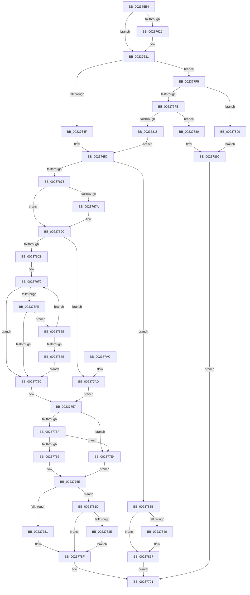

# MmFlushSection

- RVA: `0x002375E4`–`0x002378AD` (길이 `713` bytes)
- VA: `0x00000001402375E4`
- 실행 섹션: `.text`
- PDB 이름 있음: `예`; PDB Function 태그: `아니요`
- unwind 정보 RVA: `0x00060960`
- 디코드: `189`개 명령, `713/713` bytes 표시
- 미해석 바이트: `0` (있으면 어셈블리에 `.byte`로 보존)

> 이 문서는 커널 이미지의 기계어와 PDB 기호를 분석해 생성했습니다. 4번과 5번은 함수 원형과 자료형을 바이너리 사용 방식에서 추정한 C 해석이며 원본 소스 복구 결과는 아닙니다.

## 1. Dependencies

- 직접 호출 지점: **15**; 고유 호출 대상: **12**
- 직접 호출자로 확인된 함수: **8**
- RIP 상대 이미지 참조: **1**

### Outgoing calls
- `0x00237668` → [MiComputeFlushRange](../2B/MiComputeFlushRange_function_002BB8D0.md) (function, `0x002BB8D0`)
- `0x002376D8` → [MiReferenceControlAreaFileWithTag](../34/MiReferenceControlAreaFileWithTag_function_00348390.md) (function, `0x00348390`)
- `0x002376F3` → [FsRtlAcquireFileForCcFlushEx](../../page/9D/FsRtlAcquireFileForCcFlushEx_function_009D72F0.md) (function, `0x009D72F0`)
- `0x00237721` → [MiFlushSection](../40/MiFlushSection_function_004036B0.md) (function, `0x004036B0`)
- `0x0023772B` → [FsRtlReleaseFileForCcFlush](../../page/9D/FsRtlReleaseFileForCcFlush_function_009D75A0.md) (function, `0x009D75A0`)
- `0x0023774E` → [ObFastDereferenceObjectDeferDelete](ObFastDereferenceObjectDeferDelete_function_002378C0.md) (function, `0x002378C0`)
- `0x0023778A` → [MiFlushRelease](../29/MiFlushRelease_function_002982C0.md) (function, `0x002982C0`)
- `0x002377D8` → [MiFlushSection](../40/MiFlushSection_function_004036B0.md) (function, `0x004036B0`)
- `0x0023780B` → [MiAllocatePool](../35/MiAllocatePool_function_0035B540.md) (function, `0x0035B540`)
- `0x00237831` → [MiFreeOverlappedFlushEntry](../29/MiFreeOverlappedFlushEntry_function_00298240.md) (function, `0x00298240`)
- `0x00237845` → [ExFreePoolWithTag](../../poolcode/B8/ExFreePoolWithTag_function_00B82870.md) (function, `0x00B82870`)
- `0x00237852` → [KeSetEvent](../33/KeSetEvent_function_0033F310.md) (function, `0x0033F310`)
- `0x0023786C` → [KeDelayExecutionThread](../20/KeDelayExecutionThread_function_00209550.md) (function, `0x00209550`)
- `0x00237888` → [KeSetEvent](../33/KeSetEvent_function_0033F310.md) (function, `0x0033F310`)
- `0x002378A1` → [KeSetEvent](../33/KeSetEvent_function_0033F310.md) (function, `0x0033F310`)

### Direct callers
- [CcFlushCacheOneRange](CcFlushCacheOneRange_function_00236A30.md) at `0x00236D63`
- [CcSetFileSizesEx](../26/CcSetFileSizesEx_function_0026D070.md) at `0x0026D1C1`
- [CcFlushCachePostProcessOneRange](../35/CcFlushCachePostProcessOneRange_function_00359710.md) at `0x00359B68`
- [CcFlushCachePreProcess](../35/CcFlushCachePreProcess_function_0035A9B0.md) at `0x0035AD68`
- [CcPurgeAndClearCacheSection](../38/CcPurgeAndClearCacheSection_function_0038A614.md) at `0x0038A7E7`
- [CcMdlWriteComplete2](../3C/CcMdlWriteComplete2_function_003CA36C.md) at `0x003CA487`
- [MiFlushDataSection](../48/MiFlushDataSection_function_0048ED88.md) at `0x0048EE10`
- [CcUnpinRepinnedBcb](../49/CcUnpinRepinnedBcb_function_0049F560.md) at `0x0049F63C`

### Static image references
- `0x00237861` → RVA `0x00010780` (`.rdata`; read)

## 2. Other-region calls and transfers

- 다른 실행 섹션으로 향하는 call: **3**
  - `0x002376F3` → [FsRtlAcquireFileForCcFlushEx](../../page/9D/FsRtlAcquireFileForCcFlushEx_function_009D72F0.md) (`.text` → `PAGE`)
  - `0x0023772B` → [FsRtlReleaseFileForCcFlush](../../page/9D/FsRtlReleaseFileForCcFlush_function_009D75A0.md) (`.text` → `PAGE`)
  - `0x00237845` → [ExFreePoolWithTag](../../poolcode/B8/ExFreePoolWithTag_function_00B82870.md) (`.text` → `POOLCODE`)
- 별도 외부 분기/꼬리 이동을 확인하지 못했습니다.

## 3. Assembly (complete function range)

```asm
002375E4  48 89 5C 24 08                  mov qword ptr [rsp + 8], rbx
002375E9  4C 89 44 24 18                  mov qword ptr [rsp + 0x18], r8
002375EE  55                              push rbp
002375EF  56                              push rsi
002375F0  57                              push rdi
002375F1  41 54                           push r12
002375F3  41 55                           push r13
002375F5  41 56                           push r14
002375F7  41 57                           push r15
002375F9  48 8B EC                        mov rbp, rsp
002375FC  48 81 EC 80 00 00 00            sub rsp, 0x80
00237603  0F 57 C0                        xorps xmm0, xmm0
00237606  4C 8B E9                        mov r13, rcx
00237609  33 C9                           xor ecx, ecx
0023760B  49 8B F1                        mov rsi, r9
0023760E  48 89 4D 58                     mov qword ptr [rbp + 0x58], rcx
00237612  4C 8B FA                        mov r15, rdx
00237615  0F 11 45 D0                     movups xmmword ptr [rbp - 0x30], xmm0
00237619  0F 11 45 E0                     movups xmmword ptr [rbp - 0x20], xmm0
0023761D  0F 11 45 F0                     movups xmmword ptr [rbp - 0x10], xmm0
00237621  48 85 D2                        test rdx, rdx
00237624  74 0B                           je 0x140237631
00237626  48 8B 02                        mov rax, qword ptr [rdx]
00237629  4C 8D 7D 58                     lea r15, [rbp + 0x58]
0023762D  48 89 45 58                     mov qword ptr [rbp + 0x58], rax
00237631  48 8B 7D 60                     mov rdi, qword ptr [rbp + 0x60]
00237635  44 8B 65 68                     mov r12d, dword ptr [rbp + 0x68]
00237639  45 8B F4                        mov r14d, r12d
0023763C  41 83 E6 01                     and r14d, 1
00237640  89 0F                           mov dword ptr [rdi], ecx
00237642  48 89 4F 08                     mov qword ptr [rdi + 8], rcx
00237646  48 85 F6                        test rsi, rsi
00237649  0F 85 A6 01 00 00               jne 0x1402377f5
0023764F  48 8B D9                        mov rbx, rcx
00237652  4C 8B 45 50                     mov r8, qword ptr [rbp + 0x50]
00237656  48 8D 45 D0                     lea rax, [rbp - 0x30]
0023765A  45 33 C9                        xor r9d, r9d
0023765D  48 89 44 24 20                  mov qword ptr [rsp + 0x20], rax
00237662  49 8B D7                        mov rdx, r15
00237665  49 8B CD                        mov rcx, r13
00237668  E8 63 42 08 00                  call 0x1402bb8d0
0023766D  85 C0                           test eax, eax
0023766F  0F 84 C6 01 00 00               je 0x14023783b
00237675  48 85 DB                        test rbx, rbx
00237678  74 22                           je 0x14023769c
0023767A  48 8B 45 E8                     mov rax, qword ptr [rbp - 0x18]
0023767E  83 63 14 00                     and dword ptr [rbx + 0x14], 0
00237682  48 89 03                        mov qword ptr [rbx], rax
00237685  48 8B 45 F0                     mov rax, qword ptr [rbp - 0x10]
00237689  48 89 43 08                     mov qword ptr [rbx + 8], rax
0023768D  48 89 73 20                     mov qword ptr [rbx + 0x20], rsi
00237691  48 89 7B 18                     mov qword ptr [rbx + 0x18], rdi
00237695  C7 43 10 01 00 00 00            mov dword ptr [rbx + 0x10], 1
0023769C  65 4C 8B 3C 25 88 01 00 00      mov r15, qword ptr gs:[0x188]
002376A5  4C 8B 6D D0                     mov r13, qword ptr [rbp - 0x30]
002376A9  4C 89 7D C8                     mov qword ptr [rbp - 0x38], r15
002376AD  41 8A 87 AC 05 00 00            mov al, byte ptr [r15 + 0x5ac]
002376B4  88 45 60                        mov byte ptr [rbp + 0x60], al
002376B7  41 C6 87 AC 05 00 00 01         mov byte ptr [r15 + 0x5ac], 1
002376BF  45 85 F6                        test r14d, r14d
002376C2  0F 84 E5 00 00 00               je 0x1402377ad
002376C8  33 C0                           xor eax, eax
002376CA  45 33 C0                        xor r8d, r8d
002376CD  BA 4D 6D 53 63                  mov edx, 0x63536d4d
002376D2  89 45 48                        mov dword ptr [rbp + 0x48], eax
002376D5  49 8B CD                        mov rcx, r13
002376D8  E8 B3 0C 11 00                  call 0x140348390
002376DD  4C 8B 75 F0                     mov r14, qword ptr [rbp - 0x10]
002376E1  4C 8B E8                        mov r13, rax
002376E4  4C 8B 65 E8                     mov r12, qword ptr [rbp - 0x18]
002376E8  44 8B 7D 68                     mov r15d, dword ptr [rbp + 0x68]
002376EC  48 89 45 C0                     mov qword ptr [rbp - 0x40], rax
002376F0  49 8B CD                        mov rcx, r13
002376F3  E8 F8 FB 79 00                  call 0x1409d72f0
002376F8  8B F0                           mov esi, eax
002376FA  85 C0                           test eax, eax
002376FC  78 3E                           js 0x14023773c
002376FE  48 8B 55 E0                     mov rdx, qword ptr [rbp - 0x20]
00237702  4D 8B CE                        mov r9, r14
00237705  48 8B 4D D8                     mov rcx, qword ptr [rbp - 0x28]
00237709  4D 8B C4                        mov r8, r12
0023770C  48 89 7C 24 38                  mov qword ptr [rsp + 0x38], rdi
00237711  48 83 64 24 30 00               and qword ptr [rsp + 0x30], 0
00237717  44 89 7C 24 28                  mov dword ptr [rsp + 0x28], r15d
0023771C  48 89 5C 24 20                  mov qword ptr [rsp + 0x20], rbx
00237721  E8 8A BF 1C 00                  call 0x1404036b0
00237726  49 8B CD                        mov rcx, r13
00237729  8B F0                           mov esi, eax
0023772B  E8 70 FE 79 00                  call 0x1409d75a0
00237730  81 FE 54 00 00 C0               cmp esi, 0xc0000054
00237736  0F 84 22 01 00 00               je 0x14023785e
0023773C  4C 8B 6D D0                     mov r13, qword ptr [rbp - 0x30]
00237740  41 B8 4D 6D 53 63               mov r8d, 0x63536d4d
00237746  48 8B 55 C0                     mov rdx, qword ptr [rbp - 0x40]
0023774A  49 8D 4D 40                     lea rcx, [r13 + 0x40]
0023774E  E8 6D 01 00 00                  call 0x1402378c0
00237753  4C 8B 7D C8                     mov r15, qword ptr [rbp - 0x38]
00237757  85 F6                           test esi, esi
00237759  0F 88 85 00 00 00               js 0x1402377e4
0023775F  48 83 7F 08 00                  cmp qword ptr [rdi + 8], 0
00237764  75 7E                           jne 0x1402377e4
00237766  48 8B 45 50                     mov rax, qword ptr [rbp + 0x50]
0023776A  48 89 47 08                     mov qword ptr [rdi + 8], rax
0023776E  8A 45 60                        mov al, byte ptr [rbp + 0x60]
00237771  41 88 87 AC 05 00 00            mov byte ptr [r15 + 0x5ac], al
00237778  48 85 DB                        test rbx, rbx
0023777B  0F 85 9C 00 00 00               jne 0x14023781d
00237781  4D 8B C6                        mov r8, r14
00237784  49 8B D4                        mov rdx, r12
00237787  49 8B CD                        mov rcx, r13
0023778A  E8 31 0B 06 00                  call 0x1402982c0
0023778F  8B C6                           mov eax, esi
00237791  48 8B 9C 24 C0 00 00 00         mov rbx, qword ptr [rsp + 0xc0]
00237799  48 81 C4 80 00 00 00            add rsp, 0x80
002377A0  41 5F                           pop r15
002377A2  41 5E                           pop r14
002377A4  41 5D                           pop r13
002377A6  41 5C                           pop r12
002377A8  5F                              pop rdi
002377A9  5E                              pop rsi
002377AA  5D                              pop rbp
002377AB  C3                              ret
002377AC  CC                              int3
002377AD  4C 8B 75 F0                     mov r14, qword ptr [rbp - 0x10]
002377B1  48 8B 55 E0                     mov rdx, qword ptr [rbp - 0x20]
002377B5  4D 8B CE                        mov r9, r14
002377B8  48 8B 4D D8                     mov rcx, qword ptr [rbp - 0x28]
002377BC  48 89 7C 24 38                  mov qword ptr [rsp + 0x38], rdi
002377C1  48 83 64 24 30 00               and qword ptr [rsp + 0x30], 0
002377C7  44 89 64 24 28                  mov dword ptr [rsp + 0x28], r12d
002377CC  4C 8B 65 E8                     mov r12, qword ptr [rbp - 0x18]
002377D0  4D 8B C4                        mov r8, r12
002377D3  48 89 5C 24 20                  mov qword ptr [rsp + 0x20], rbx
002377D8  E8 D3 BE 1C 00                  call 0x1404036b0
002377DD  8B F0                           mov esi, eax
002377DF  E9 73 FF FF FF                  jmp 0x140237757
002377E4  44 8B 4D F8                     mov r9d, dword ptr [rbp - 8]
002377E8  41 C1 E1 0C                     shl r9d, 0xc
002377EC  4C 01 4F 08                     add qword ptr [rdi + 8], r9
002377F0  E9 79 FF FF FF                  jmp 0x14023776e
002377F5  45 85 F6                        test r14d, r14d
002377F8  0F 85 9B 00 00 00               jne 0x140237899
002377FE  41 8D 56 30                     lea edx, [r14 + 0x30]
00237802  41 B8 4D 6D 4F 6C               mov r8d, 0x6c4f6d4d
00237808  8D 4A 10                        lea ecx, [rdx + 0x10]
0023780B  E8 30 3D 12 00                  call 0x14035b540
00237810  48 8B D8                        mov rbx, rax
00237813  48 85 C0                        test rax, rax
00237816  74 68                           je 0x140237880
00237818  E9 35 FE FF FF                  jmp 0x140237652
0023781D  83 C8 FF                        or eax, 0xffffffff
00237820  F0 0F C1 43 10                  lock xadd dword ptr [rbx + 0x10], eax
00237825  83 F8 01                        cmp eax, 1
00237828  0F 85 61 FF FF FF               jne 0x14023778f
0023782E  48 8B CB                        mov rcx, rbx
00237831  E8 0A 0A 06 00                  call 0x140298240
00237836  E9 54 FF FF FF                  jmp 0x14023778f
0023783B  48 85 DB                        test rbx, rbx
0023783E  74 17                           je 0x140237857
00237840  33 D2                           xor edx, edx
00237842  48 8B CB                        mov rcx, rbx
00237845  E8 26 B0 94 00                  call 0x140b82870
0023784A  45 33 C0                        xor r8d, r8d
0023784D  33 D2                           xor edx, edx
0023784F  48 8B CE                        mov rcx, rsi
00237852  E8 B9 7A 10 00                  call 0x14033f310
00237857  33 C0                           xor eax, eax
00237859  E9 33 FF FF FF                  jmp 0x140237791
0023785E  FF 45 48                        inc dword ptr [rbp + 0x48]
00237861  4C 8D 05 18 8F DD FF            lea r8, [rip - 0x2270e8]
00237868  33 D2                           xor edx, edx
0023786A  33 C9                           xor ecx, ecx
0023786C  E8 DF 1C FD FF                  call 0x140209550
00237871  83 7D 48 05                     cmp dword ptr [rbp + 0x48], 5
00237875  0F 82 75 FE FF FF               jb 0x1402376f0
0023787B  E9 BC FE FF FF                  jmp 0x14023773c
00237880  45 33 C0                        xor r8d, r8d
00237883  33 D2                           xor edx, edx
00237885  48 8B CE                        mov rcx, rsi
00237888  E8 83 7A 10 00                  call 0x14033f310
0023788D  B8 9A 00 00 C0                  mov eax, 0xc000009a
00237892  89 07                           mov dword ptr [rdi], eax
00237894  E9 F8 FE FF FF                  jmp 0x140237791
00237899  45 33 C0                        xor r8d, r8d
0023789C  33 D2                           xor edx, edx
0023789E  48 8B CE                        mov rcx, rsi
002378A1  E8 6A 7A 10 00                  call 0x14033f310
002378A6  B8 F4 00 00 C0                  mov eax, 0xc00000f4
002378AB  EB E5                           jmp 0x140237892
```

## 4. C-style interpretation (structured pseudocode)

```c
__int64 __fastcall MmFlushSection(__int64 a1, __int64 a2, __int64 a3, __int64 a4, unsigned __int8 a5, unsigned int a6)
{
    __int64 result;
    __int64 v_r14;
    __int64 v_r15;
    __int64 v_rsp;
    unsigned int v_stack_m40;
    unsigned __int64 v_stack_m48;
    unsigned __int64 v_stack_m50;
    unsigned __int64 v_stack_m58;
    unsigned __int64 v_stack_m60;
    unsigned __int64 v_stack_m68;
    unsigned __int64 v_stack_m70;
    unsigned __int64 v_stack_m78;
    unsigned __int64 v_stack_m80;
    unsigned __int64 v_stack_m88;
    unsigned int v_stack_m90;
    unsigned __int64 v_stack_m98;
    unsigned int v_stack_p10;
    unsigned __int64 v_stack_p18;
    unsigned __int64 v_stack_p20;
    unsigned __int8 v_stack_p28;
    unsigned __int64 v_stack_p30;
    unsigned __int64 v_stack_p38;
    unsigned __int64 v_stack_p8;

    v_stack_p8 = v_rbx;
    v_stack_p18 = a3;
    v_rsp = (v_rsp) - (128);
    a1 = 0;
    v_stack_p20 = 0;
    v_stack_m68 = v_xmm0;
    v_stack_m58 = v_xmm0;
    v_stack_m48 = v_xmm0;
    v_r15 = a2;
    if (a2 != 0) {
        result = *(unsigned __int64 *)(a2);
        v_r15 = v_stack_p20;
        v_stack_p20 = result;
    }
    v_r14 = (unsigned int)(((unsigned int)((unsigned int)((unsigned int)(a6)))) & (1));
    *(unsigned int *)(a5) = 0;
    *(unsigned __int64 *)(a5 + 8) = 0;
    if (a4 != 0) goto loc_002377F5;
loc_00237652:
    a4 = 0;
    v_stack_m98 = v_stack_m68;
    result = MiComputeFlushRange(0, v_r15, v_stack_p18, a4);
    if ((unsigned int)(result) == 0) goto loc_0023783B;
    if (0 != 0) {
        result = v_stack_m50;
        *(unsigned __int64 *)(0) = result;
        result = v_stack_m48;
        *(unsigned __int64 *)(0 + 8) = result;
        *(unsigned __int64 *)(0 + 32) = 0;
        *(unsigned __int64 *)(0 + 24) = a5;
        *(unsigned int *)(0 + 16) = 1;
    }
    v_stack_m70 = *(unsigned __int64 *)(gs_base + (0 + 392));
    v_stack_p28 = (unsigned __int8)(*(unsigned __int8 *)(*(unsigned __int64 *)(gs_base + (0 + 392)) + 1452));
    *(unsigned __int8 *)(*(unsigned __int64 *)(gs_base + (0 + 392)) + 1452) = 1;
    if ((unsigned int)(v_r14) == 0) goto loc_002377AD;
    result = 0;
    a3 = 0;
    v_stack_p10 = 0;
    result = MiReferenceControlAreaFileWithTag(v_stack_m68, (unsigned int)(0x63536D4DULL), a3, a4);
    v_stack_m78 = result;
loc_002376F0:
    result = FsRtlAcquireFileForCcFlushEx(result, (unsigned int)(0x63536D4DULL), a3, a4);
    if (sign_flag) goto loc_0023773C;
    v_stack_m80 = a5;
    v_stack_m90 = (unsigned int)((unsigned int)(a6));
    v_stack_m98 = 0;
    result = MiFlushSection(v_stack_m60, v_stack_m58, v_stack_m50, v_stack_m48);
    result = FsRtlReleaseFileForCcFlush(result, v_stack_m58, v_stack_m50, v_stack_m48);
    if (((unsigned int)((unsigned int)((unsigned int)(result)))) == 0xC0000054ULL) goto loc_0023785E;
loc_0023773C:
    result = ObFastDereferenceObjectDeferDelete(v_stack_m68 + 64, v_stack_m78, (unsigned int)(0x63536D4DULL), v_stack_m48);
loc_00237757:
    if (sign_flag) goto loc_002377E4;
    if ((*(unsigned __int64 *)(a5 + 8)) != 0) goto loc_002377E4;
    *(unsigned __int64 *)(a5 + 8) = v_stack_p18;
loc_0023776E:
    *(unsigned __int8 *)(v_stack_m70 + 1452) = a5;
    if (0 != 0) goto loc_0023781D;
    result = MiFlushRelease(v_stack_m68, v_stack_m50, v_stack_m48, v_stack_m48);
loc_0023778F:
loc_00237791:
    v_rsp = (v_rsp) + (128);
    return (unsigned int)((unsigned int)((unsigned int)((unsigned int)(result))));
loc_002377AD:
    v_stack_p38 = a5;
    v_stack_p28 = (unsigned int)(v_stack_m50);
    v_stack_p20 = v_stack_p8;
    result = MiFlushSection(v_stack_m60, v_stack_m58, v_stack_m50, v_stack_m48);
    goto loc_00237757;
loc_002377E4:
    a4 = (unsigned int)(((unsigned int)(v_stack_m40)) << (12));
    goto loc_0023776E;
loc_002377F5:
    if ((unsigned int)(v_stack_m48) != 0) goto loc_00237899;
    result = MiAllocatePool(v_stack_m48 + 48 + 16, v_stack_m48 + 48, (unsigned int)(0x6C4F6D4DULL), a4);
    if (result == 0) goto loc_00237880;
    goto loc_00237652;
loc_0023781D:
    result = (unsigned int)((result) | (0xFFFFFFFFULL));
    if (((unsigned int)(result)) != 1) goto loc_0023778F;
    result = MiFreeOverlappedFlushEntry(result, v_stack_m48 + 48, (unsigned int)(0x6C4F6D4DULL), a4);
    goto loc_0023778F;
loc_0023783B:
    if (result != 0) {
        a2 = 0;
        a1 = result;
        result = ExFreePoolWithTag(a1, a2, (unsigned int)(0x6C4F6D4DULL), a4);
        a3 = 0;
        a2 = 0;
        a1 = (unsigned int)((unsigned int)(result));
        result = KeSetEvent(a1, a2, a3, a4);
    }
    result = 0;
    goto loc_00237791;
loc_0023785E:
    a2 = 0;
    a1 = 0;
    result = KeDelayExecutionThread(a1, a2, v_rip - 2257128, a4);
    if (v_stack_p10 < 5) goto loc_002376F0;
    goto loc_0023773C;
loc_00237880:
    a3 = 0;
    a2 = 0;
    result = KeSetEvent((unsigned int)((unsigned int)(result)), a2, a3, a4);
loc_00237892:
    *(unsigned int *)(a5) = (unsigned int)((unsigned int)(0xC000009AULL));
    goto loc_00237791;
loc_00237899:
    a3 = 0;
    a2 = 0;
    result = KeSetEvent((unsigned int)((unsigned int)(result)), a2, a3, a4);
    goto loc_00237892;
}
```

## 5. (Beta) C Style

```c
int64_t MmFlushSection(int64_t Arg1, int64_t Arg2, int64_t Arg3, int64_t Arg4, void *Arg5, uint32_t Arg6)
{
    uint8_t *arg5 = (uint8_t *)Arg5;

    int64_t result;
    int64_t local_r14;
    int64_t local_r15;
    int64_t local_rsp;
    uint32_t v_stack_m40;
    uint64_t v_stack_m48;
    uint64_t v_stack_m50;
    uint64_t v_stack_m58;
    uint64_t v_stack_m60;
    uint64_t v_stack_m68;
    uint64_t v_stack_m70;
    uint64_t v_stack_m78;
    uint64_t v_stack_m80;
    uint64_t v_stack_m88;
    uint32_t v_stack_m90;
    uint64_t v_stack_m98;
    uint32_t v_stack_p10;
    uint64_t v_stack_p18;
    uint64_t v_stack_p20;
    uint8_t v_stack_p28;
    uint64_t v_stack_p30;
    uint64_t v_stack_p38;
    uint64_t v_stack_p8;

    v_stack_p8 = local_rbx;
    v_stack_p18 = Arg3;
    local_rsp = (local_rsp) - (128);
    Arg1 = 0;
    v_stack_p20 = 0;
    v_stack_m68 = v_xmm0;
    v_stack_m58 = v_xmm0;
    v_stack_m48 = v_xmm0;
    local_r15 = Arg2;
    if (Arg2 != 0) {
        result = *(uint64_t *)(Arg2);
        local_r15 = v_stack_p20;
        v_stack_p20 = result;
    }
    local_r14 = (uint32_t)(((uint32_t)((uint32_t)((uint32_t)(Arg6)))) & (1));
    *(uint32_t *)(arg5) = 0;
    *(uint64_t *)(arg5 + 0x8) = 0;
    if (Arg4 != 0) goto loc_002377F5;
loc_00237652:
    Arg4 = 0;
    v_stack_m98 = v_stack_m68;
    result = MiComputeFlushRange(0, local_r15, v_stack_p18, Arg4);
    if ((uint32_t)(result) == 0) goto loc_0023783B;
    if (0 != 0) {
        result = v_stack_m50;
        *(uint64_t *)(0) = result;
        result = v_stack_m48;
        *(uint64_t *)(0 + 0x8) = result;
        *(uint64_t *)(0 + 0x20) = 0;
        *(void **)(0 + 0x18) = Arg5;
        *(uint32_t *)(0 + 0x10) = 1;
    }
    v_stack_m70 = *(uint64_t *)(gs_base + (0 + 0x188));
    v_stack_p28 = (uint8_t)(*(uint8_t *)(*(uint64_t *)(gs_base + (0 + 0x188)) + 0x5AC));
    *(uint8_t *)(*(uint64_t *)(gs_base + (0 + 0x188)) + 0x5AC) = 1;
    if ((uint32_t)(local_r14) == 0) goto loc_002377AD;
    result = 0;
    Arg3 = 0;
    v_stack_p10 = 0;
    result = MiReferenceControlAreaFileWithTag(v_stack_m68, (uint32_t)(0x63536D4DULL), Arg3, Arg4);
    v_stack_m78 = result;
loc_002376F0:
    result = FsRtlAcquireFileForCcFlushEx(result, (uint32_t)(0x63536D4DULL), Arg3, Arg4);
    if (sign_flag) goto loc_0023773C;
    v_stack_m80 = Arg5;
    v_stack_m90 = (uint32_t)((uint32_t)(Arg6));
    v_stack_m98 = 0;
    result = MiFlushSection(v_stack_m60, v_stack_m58, v_stack_m50, v_stack_m48);
    result = FsRtlReleaseFileForCcFlush(result, v_stack_m58, v_stack_m50, v_stack_m48);
    if (((uint32_t)((uint32_t)((uint32_t)(result)))) == 0xC0000054ULL) goto loc_0023785E;
loc_0023773C:
    result = ObFastDereferenceObjectDeferDelete(v_stack_m68 + 64, v_stack_m78, (uint32_t)(0x63536D4DULL), v_stack_m48);
loc_00237757:
    if (sign_flag) goto loc_002377E4;
    if ((*(uint64_t *)(arg5 + 0x8)) != 0) goto loc_002377E4;
    *(uint64_t *)(arg5 + 0x8) = v_stack_p18;
loc_0023776E:
    *(uint8_t *)(v_stack_m70 + 0x5AC) = Arg5;
    if (0 != 0) goto loc_0023781D;
    result = MiFlushRelease(v_stack_m68, v_stack_m50, v_stack_m48, v_stack_m48);
loc_0023778F:
loc_00237791:
    local_rsp = (local_rsp) + (128);
    return (uint32_t)((uint32_t)((uint32_t)((uint32_t)(result))));
loc_002377AD:
    v_stack_p38 = Arg5;
    v_stack_p28 = (uint32_t)(v_stack_m50);
    v_stack_p20 = v_stack_p8;
    result = MiFlushSection(v_stack_m60, v_stack_m58, v_stack_m50, v_stack_m48);
    goto loc_00237757;
loc_002377E4:
    Arg4 = (uint32_t)(((uint32_t)(v_stack_m40)) << (12));
    goto loc_0023776E;
loc_002377F5:
    if ((uint32_t)(v_stack_m48) != 0) goto loc_00237899;
    result = MiAllocatePool(v_stack_m48 + 48 + 16, v_stack_m48 + 48, (uint32_t)(0x6C4F6D4DULL), Arg4);
    if (result == 0) goto loc_00237880;
    goto loc_00237652;
loc_0023781D:
    result = (uint32_t)((result) | (0xFFFFFFFFULL));
    if (((uint32_t)(result)) != 1) goto loc_0023778F;
    result = MiFreeOverlappedFlushEntry(result, v_stack_m48 + 48, (uint32_t)(0x6C4F6D4DULL), Arg4);
    goto loc_0023778F;
loc_0023783B:
    if (result != 0) {
        Arg2 = 0;
        Arg1 = result;
        result = ExFreePoolWithTag(Arg1, Arg2, (uint32_t)(0x6C4F6D4DULL), Arg4);
        Arg3 = 0;
        Arg2 = 0;
        Arg1 = (uint32_t)((uint32_t)(result));
        result = KeSetEvent(Arg1, Arg2, Arg3, Arg4);
    }
    result = 0;
    goto loc_00237791;
loc_0023785E:
    Arg2 = 0;
    Arg1 = 0;
    result = KeDelayExecutionThread(Arg1, Arg2, v_rip - 2257128, Arg4);
    if (v_stack_p10 < 5) goto loc_002376F0;
    goto loc_0023773C;
loc_00237880:
    Arg3 = 0;
    Arg2 = 0;
    result = KeSetEvent((uint32_t)((uint32_t)(result)), Arg2, Arg3, Arg4);
loc_00237892:
    *(uint32_t *)(arg5) = (uint32_t)((uint32_t)(0xC000009AULL));
    goto loc_00237791;
loc_00237899:
    Arg3 = 0;
    Arg2 = 0;
    result = KeSetEvent((uint32_t)((uint32_t)(result)), Arg2, Arg3, Arg4);
    goto loc_00237892;
}
```

### 관측된 메모리 오프셋

구조체 형식이 확인되지 않은 접근은 인자 기준의 오프셋으로만 기록했습니다.

| 기준 인자 | 오프셋 표현 | 폭 (bit) | 접근 |
|---|---:|---:|---|
| `Arg5` | `+ 0x0` | `32` | `W` |
| `Arg5` | `+ 0x8` | `64` | `R` |
| `Arg5` | `+ 0x8` | `64` | `R/W` |
| `Arg5` | `+ 0x8` | `64` | `W` |

## 6. Execution-region graph

[열기: 2D/3D 그래프와 함수 탐색 컨트롤 패널](../../../control-panel.html?section=text&rva=0x002375E4&view=graph)

- 2D 그래프는 위에서 아래로 흐르고, 3D 그래프는 빈 공간을 드래그해 회전합니다. Shift+드래그는 이동, 휠은 확대·축소, 함수 노드 선택은 대상 보고서 이동입니다.

### Static fallback


