# MmGetPhysicalAddress

- RVA: `0x0023A500`–`0x0023A861` (길이 `865` bytes)
- VA: `0x000000014023A500`
- 실행 섹션: `.text`
- PDB 이름 있음: `예`; PDB Function 태그: `아니요`
- unwind 정보 RVA: `0x00060D10`
- 디코드: `208`개 명령, `865/865` bytes 표시
- 미해석 바이트: `0` (있으면 어셈블리에 `.byte`로 보존)

> 이 문서는 커널 이미지의 기계어와 PDB 기호를 분석해 생성했습니다. 4번과 5번은 함수 원형과 자료형을 바이너리 사용 방식에서 추정한 C 해석이며 원본 소스 복구 결과는 아닙니다.

## 1. Dependencies

- 직접 호출 지점: **3**; 고유 호출 대상: **3**
- 직접 호출자로 확인된 함수: **84**
- RIP 상대 이미지 참조: **2**

### Outgoing calls
- `0x0023A688` → [MiQueuePinDriverAddressLog](MiQueuePinDriverAddressLog_function_0023ADA4.md) (function, `0x0023ADA4`)
- `0x0023A816` → [MiVaToPfnEx](MiVaToPfnEx_function_0023A1A0.md) (function, `0x0023A1A0`)
- `0x0023A826` → [MI_READ_PTE_LOCK_FREE](../28/MI_READ_PTE_LOCK_FREE_function_002828A0.md) (function, `0x002828A0`)

### Direct callers
- [HalpAcpiAccessSecureAddress](HalpAcpiAccessSecureAddress_function_0023A3D0.md) at `0x0023A406`
- [SmPrepareForFatalHeapCorruption](../26/SmPrepareForFatalHeapCorruption_function_00267AC0.md) at `0x00267AE6`
- [IopLiveDumpDiscardVirtualAddressRange](../29/IopLiveDumpDiscardVirtualAddressRange_function_002977F4.md) at `0x00297841`
- [HvlpSlowSendSyntheticClusterIpiEx](../30/HvlpSlowSendSyntheticClusterIpiEx_function_003034E0.md) at `0x00303602`
- [HalpIommuMapLogical](../30/HalpIommuMapLogical_function_00308290.md) at `0x00308510`
- [HalpDmaAllocateMapRegisters](../3D/HalpDmaAllocateMapRegisters_function_003DDA0C.md) at `0x003DDD08`
- [HalpDmaAllocateMapRegisters](../3D/HalpDmaAllocateMapRegisters_function_003DDA0C.md) at `0x003DDDB1`
- [HalpAllocateDomainCommonBufferInternal](../3E/HalpAllocateDomainCommonBufferInternal_function_003E8B64.md) at `0x003E8E44`
- [HalpAllocateCommonBufferDmaThin](../3E/HalpAllocateCommonBufferDmaThin_function_003E9788.md) at `0x003E98C6`
- [HalAllocateCommonBufferExV2](../3E/HalAllocateCommonBufferExV2_function_003E9DB0.md) at `0x003E9E1D`
- [EtwTraceContAllocationEvent](../3E/EtwTraceContAllocationEvent_function_003EA680.md) at `0x003EA7BF`
- [HalpDmaAllocateContiguousMemory](../3E/HalpDmaAllocateContiguousMemory_function_003EBD0C.md) at `0x003EBDBA`
- [HvlpSlowFlushAddressSpaceTb](../44/HvlpSlowFlushAddressSpaceTb_function_004402C4.md) at `0x004403E8`
- [HsaUpdateDeviceTableEntry](../44/HsaUpdateDeviceTableEntry_function_0044E404.md) at `0x0044E4F9`
- [PoSetHiberRange](../47/PoSetHiberRange_function_0047C580.md) at `0x0047C645`
- [PoSetHiberRange](../47/PoSetHiberRange_function_0047C580.md) at `0x0047C675`
- [IvtUpdateScalableModePasidTablesForPasid](../4C/IvtUpdateScalableModePasidTablesForPasid_function_004CD628.md) at `0x004CD6DC`
- [IvtBuildScalableModePasidDirectoryEntry](../4E/IvtBuildScalableModePasidDirectoryEntry_function_004E2D28.md) at `0x004E2D4C`
- [HvlSetQpcBias](../4F/HvlSetQpcBias_function_004F8EF0.md) at `0x004F900F`
- [IvtBuildScalableModeContextEntry](../4F/IvtBuildScalableModeContextEntry_function_004FA57C.md) at `0x004FA5C9`
- [HalpInterruptBuildGlobalStartupStub](../54/HalpInterruptBuildGlobalStartupStub_function_0054343C.md) at `0x005434A9`
- [HalpHvStartVirtualProcessor](../54/HalpHvStartVirtualProcessor_function_0054CF98.md) at `0x0054D093`
- [HalpDmaAllocateMapRegisterFrame](../55/HalpDmaAllocateMapRegisterFrame_function_005506BC.md) at `0x00550739`
- [HalpDmaFreeMapRegisterFrame](../55/HalpDmaFreeMapRegisterFrame_function_005510D4.md) at `0x005510F9`
- [HalpDmaControllerInitializeController](../55/HalpDmaControllerInitializeController_function_00554198.md) at `0x00554220`
- [HalpInterruptBuildStartupStub](../55/HalpInterruptBuildStartupStub_function_0055A470.md) at `0x0055A48B`
- [HalpMmUpdateTiledMemoryMapTargetStub](../55/HalpMmUpdateTiledMemoryMapTargetStub_function_0055A974.md) at `0x0055A9B7`
- [ExtEnvAllocatePhysicalMemory](../56/ExtEnvAllocatePhysicalMemory_function_00561124.md) at `0x0056124F`
- [HalpIommuGetDmarptRootAddress](../56/HalpIommuGetDmarptRootAddress_function_00568EC0.md) at `0x00568F0B`
- [HalpIommuInitializeDmarPageTable](../56/HalpIommuInitializeDmarPageTable_function_00568F24.md) at `0x0056906C`
- [HalpIommuMapLogicalRange](../56/HalpIommuMapLogicalRange_function_005690DC.md) at `0x0056922A`
- [IvtLegacyBuildScalableModeContextEntry](../57/IvtLegacyBuildScalableModeContextEntry_function_00571198.md) at `0x005711E1`
- [HsaAllocatePasidTables](../57/HsaAllocatePasidTables_function_005735DC.md) at `0x00573776`
- [HvlSetupPhysicalFaultNotificationQueue](../58/HvlSetupPhysicalFaultNotificationQueue_function_00584CE0.md) at `0x00584D4E`
- [HvlpSetupCachedHypercallPages](../58/HvlpSetupCachedHypercallPages_function_00586844.md) at `0x00586888`
- [HvlpSetupCachedHypercallPages](../58/HvlpSetupCachedHypercallPages_function_00586844.md) at `0x005868B2`
- [HvlpSetupSchedulerAssist](../58/HvlpSetupSchedulerAssist_function_005868F8.md) at `0x00586951`
- [HvlpTryConfigureInterface](../58/HvlpTryConfigureInterface_function_0058CABC.md) at `0x0058CBDF`
- [HvlpPhase0Enlightenments](../58/HvlpPhase0Enlightenments_function_0058D1B8.md) at `0x0058D213`
- [HvlpSetupPageListIteration](../58/HvlpSetupPageListIteration_function_0058D85C.md) at `0x0058D8AE`
- [HvlpStartSecurePageListIteration](../58/HvlpStartSecurePageListIteration_function_0058D908.md) at `0x0058D9A7`
- [HvlpStartSecurePageListIteration](../58/HvlpStartSecurePageListIteration_function_0058D908.md) at `0x0058D9D6`
- [HvlSetupLiveDumpBuffer](../58/HvlSetupLiveDumpBuffer_function_0058DA4C.md) at `0x0058DB95`
- [HvlSetupLiveDumpBuffer](../58/HvlSetupLiveDumpBuffer_function_0058DA4C.md) at `0x0058DBE7`
- [HvlSetupLiveDumpBuffer](../58/HvlSetupLiveDumpBuffer_function_0058DA4C.md) at `0x0058DCB8`
- [HvlSetupLiveDumpBuffer](../58/HvlSetupLiveDumpBuffer_function_0058DA4C.md) at `0x0058DD68`
- [VslFinalizeLiveDumpInSk](../58/VslFinalizeLiveDumpInSk_function_0058E16C.md) at `0x0058E1DA`
- [VslFinishStartSecureProcessor](../58/VslFinishStartSecureProcessor_function_0058E25C.md) at `0x0058E2BE`
- [VslpAddLiveDumpBufferChunk](../58/VslpAddLiveDumpBufferChunk_function_0058FA30.md) at `0x0058FA74`
- [IoFreeDumpRange](../59/IoFreeDumpRange_function_005927B0.md) at `0x005927DE`
- [IoFreeDumpRange](../59/IoFreeDumpRange_function_005927B0.md) at `0x0059283D`
- [IoSetDumpRange](../59/IoSetDumpRange_function_005931F0.md) at `0x00593222`
- [IoSetDumpRange](../59/IoSetDumpRange_function_005931F0.md) at `0x00593354`
- [IopRemovePageDumpRange](../59/IopRemovePageDumpRange_function_00595EAC.md) at `0x00595FE2`
- [IopWriteTriageDumpToFirmware](../59/IopWriteTriageDumpToFirmware_function_00596984.md) at `0x00596A03`
- [IopWriteTriageDumpToFirmware](../59/IopWriteTriageDumpToFirmware_function_00596984.md) at `0x00596A25`
- [PnprCopyReservedMapping](../5A/PnprCopyReservedMapping_function_005A8864.md) at `0x005A8902`
- [PnprCopyReservedMapping](../5A/PnprCopyReservedMapping_function_005A8864.md) at `0x005A89E2`
- [PnprRecopyAddress](../5A/PnprRecopyAddress_function_005A8E90.md) at `0x005A8EB1`
- [PopGetNextTable](../5D/PopGetNextTable_function_005D4C54.md) at `0x005D4D61`
- [sub_005F0477](../5F/Unknown_function_005F0477.md) at `0x005F049A`
- [sub_005F0477](../5F/Unknown_function_005F0477.md) at `0x005F04C4`
- [SmEtwLogStoreCorruption](../60/SmEtwLogStoreCorruption_function_0060F458.md) at `0x0060F4D0`
- [SmRecordDecompressionFailureDumpPayload](../61/SmRecordDecompressionFailureDumpPayload_function_00611120.md) at `0x00611294`
- [SmRecordDecompressionFailureDumpPayload](../61/SmRecordDecompressionFailureDumpPayload_function_00611120.md) at `0x006112D8`
- [SmRecordDecompressionFailureDumpPayload](../61/SmRecordDecompressionFailureDumpPayload_function_00611120.md) at `0x006112F4`
- [MiDbgCopyMemory](../68/MiDbgCopyMemory_function_00684A18.md) at `0x00684C34`
- [MiDbgCopyMemory](../68/MiDbgCopyMemory_function_00684A18.md) at `0x00684C92`
- [MmStoreLogDecompressionFailure](../69/MmStoreLogDecompressionFailure_function_00693208.md) at `0x0069324F`
- [MmStoreLogDecompressionFailure](../69/MmStoreLogDecompressionFailure_function_00693208.md) at `0x00693284`
- [BgpFwLibraryEnable](../69/BgpFwLibraryEnable_function_0069ED8C.md) at `0x0069EF16`
- [sub_006E0928](../6E/Unknown_function_006E0928.md) at `0x006E097D`
- [sub_006E0928](../6E/Unknown_function_006E0928.md) at `0x006E0A35`
- [sub_006E10B0](../6E/Unknown_function_006E10B0.md) at `0x006E110D`
- [sub_006EA22C](../6E/Unknown_function_006EA22C.md) at `0x006EA310`
- [sub_006EA22C](../6E/Unknown_function_006EA22C.md) at `0x006EA317`
- [sub_006EADCA](../6E/Unknown_function_006EADCA.md) at `0x006EADCD`
- [sub_006F3C0A](../6F/Unknown_function_006F3C0A.md) at `0x006F3C85`
- [sub_006FB0BC](../6F/Unknown_function_006FB0BC.md) at `0x006FB10D`
- [HalpDmaCvmMakeContiguousVirtualBufferPrivate](../../page/70/HalpDmaCvmMakeContiguousVirtualBufferPrivate_function_00709408.md) at `0x00709418`
- [HalpDmaCvmMakeContiguousVirtualBufferShared](../../page/70/HalpDmaCvmMakeContiguousVirtualBufferShared_function_00709484.md) at `0x007094D4`
- [HvlInitializeProcessor](../../page/71/HvlInitializeProcessor_function_0071804C.md) at `0x00718140`
- [HvlInitializeProcessor](../../page/71/HvlInitializeProcessor_function_0071804C.md) at `0x00718243`
- [VslStartSecureProcessor](../../page/71/VslStartSecureProcessor_function_00719714.md) at `0x00719814`
- [VslStartSecureProcessor](../../page/71/VslStartSecureProcessor_function_00719714.md) at `0x007198D6`
- [EtwpBuildMdlForTraceBuffer](../../page/7B/EtwpBuildMdlForTraceBuffer_function_007BEB50.md) at `0x007BEBC1`
- [HalpCommitCR3Worker](../../pagelk/B5/HalpCommitCR3Worker_function_00B5E8D8.md) at `0x00B5E909`
- [HalpMapCR3Ex](../../pagelk/B5/HalpMapCR3Ex_function_00B5E95C.md) at `0x00B5E9F9`
- [HalpMapCR3Ex](../../pagelk/B5/HalpMapCR3Ex_function_00B5E95C.md) at `0x00B5EA26`
- [HalpMmBuildTiledMemoryMap](../../pagelk/B5/HalpMmBuildTiledMemoryMap_function_00B5EA50.md) at `0x00B5EAC9`
- [HalpCheckLowMemoryPreSleep](../../pagelk/B5/HalpCheckLowMemoryPreSleep_function_00B5EB88.md) at `0x00B5EBEF`
- [IvtInitializeIommu](../../pagelk/B6/IvtInitializeIommu_function_00B61FE0.md) at `0x00B628C2`
- [HsaInitializeIommu](../../pagelk/B6/HsaInitializeIommu_function_00B63140.md) at `0x00B635EA`
- [PopBuildMemoryImageHeader](../../pagelk/B6/PopBuildMemoryImageHeader_function_00B6CA20.md) at `0x00B6CA86`
- [PopHiberReadChecksums](../../pagelk/B6/PopHiberReadChecksums_function_00B6DD54.md) at `0x00B6DEC1`
- [PopRequestRead](../../pagelk/B6/PopRequestRead_function_00B6E6DC.md) at `0x00B6E952`
- [PopRequestWrite](../../pagelk/B6/PopRequestWrite_function_00B6EB14.md) at `0x00B6ED96`
- [PopWriteHiberPages](../../pagelk/B6/PopWriteHiberPages_function_00B6FF78.md) at `0x00B701D1`
- [ViAllocateMapRegisterFile](../../pagevrfy/B9/ViAllocateMapRegisterFile_function_00B97E9C.md) at `0x00B97FB5`
- [BgpFwLibraryInitialize](../../pagebgfx/BC/BgpFwLibraryInitialize_function_00BC5400.md) at `0x00BC566C`
- [sub_00BF16D0](../../init/BF/Unknown_function_00BF16D0.md) at `0x00C16CA3`
- [sub_00BF16D0](../../init/BF/Unknown_function_00BF16D0.md) at `0x00C16D83`
- [sub_00BF16D0](../../init/BF/Unknown_function_00BF16D0.md) at `0x00C16DA7`
- [sub_00C19464](../../init/C1/Unknown_function_00C19464.md) at `0x00C1A4B5`
- [IommupHvInitializeLibrary](../../init/C2/IommupHvInitializeLibrary_function_00C25024.md) at `0x00C2514B`
- [VslBindNtIum](../../init/C2/VslBindNtIum_function_00C29B74.md) at `0x00C29C69`
- [VslBindNtIum](../../init/C2/VslBindNtIum_function_00C29B74.md) at `0x00C29C94`
- [VslpIumPhase0Initialize](../../init/C2/VslpIumPhase0Initialize_function_00C2A0A4.md) at `0x00C2A14D`
- [VslpIumPhase0Initialize](../../init/C2/VslpIumPhase0Initialize_function_00C2A0A4.md) at `0x00C2A1D4`
- [VslpIumPhase0Initialize](../../init/C2/VslpIumPhase0Initialize_function_00C2A0A4.md) at `0x00C2A1E0`

### Static image references
- `0x0023A65F` → RVA `0x00E38AA8` (`.data`; read)
- `0x0023A6BD` → RVA `0x00FC6A88` (`ALMOSTRO`; read)

## 2. Other-region calls and transfers

- 다른 실행 섹션으로 향하는 call: **0**
- 별도 외부 분기/꼬리 이동을 확인하지 못했습니다.

## 3. Assembly (complete function range)

```asm
0023A500  48 89 5C 24 10                  mov qword ptr [rsp + 0x10], rbx
0023A505  48 89 6C 24 18                  mov qword ptr [rsp + 0x18], rbp
0023A50A  48 89 74 24 20                  mov qword ptr [rsp + 0x20], rsi
0023A50F  57                              push rdi
0023A510  41 56                           push r14
0023A512  41 57                           push r15
0023A514  48 83 EC 60                     sub rsp, 0x60
0023A518  4C 8B D1                        mov r10, rcx
0023A51B  49 BB 00 00 00 00 80 F6 FF FF   movabs r11, 0xfffff68000000000
0023A525  49 C1 EA 09                     shr r10, 9
0023A529  33 F6                           xor esi, esi
0023A52B  48 BF F8 FF FF FF 7F 00 00 00   movabs rdi, 0x7ffffffff8
0023A535  48 8B E9                        mov rbp, rcx
0023A538  4C 23 D7                        and r10, rdi
0023A53B  8B DE                           mov ebx, esi
0023A53D  49 8B C3                        mov rax, r11
0023A540  4C 03 D0                        add r10, rax
0023A543  4D 8B CA                        mov r9, r10
0023A546  4C 89 54 24 20                  mov qword ptr [rsp + 0x20], r10
0023A54B  49 C1 E9 09                     shr r9, 9
0023A54F  4C 23 CF                        and r9, rdi
0023A552  49 8B C3                        mov rax, r11
0023A555  4C 03 C8                        add r9, rax
0023A558  4D 8B C1                        mov r8, r9
0023A55B  4C 89 4C 24 28                  mov qword ptr [rsp + 0x28], r9
0023A560  49 C1 E8 09                     shr r8, 9
0023A564  4C 23 C7                        and r8, rdi
0023A567  49 8B C3                        mov rax, r11
0023A56A  4C 03 C0                        add r8, rax
0023A56D  49 8B D0                        mov rdx, r8
0023A570  4C 89 44 24 30                  mov qword ptr [rsp + 0x30], r8
0023A575  48 C1 EA 09                     shr rdx, 9
0023A579  48 23 D7                        and rdx, rdi
0023A57C  49 8B C3                        mov rax, r11
0023A57F  48 03 D0                        add rdx, rax
0023A582  4C 89 54 24 40                  mov qword ptr [rsp + 0x40], r10
0023A587  41 BB 04 00 00 00               mov r11d, 4
0023A58D  48 89 54 24 38                  mov qword ptr [rsp + 0x38], rdx
0023A592  45 8B F3                        mov r14d, r11d
0023A595  48 89 54 24 58                  mov qword ptr [rsp + 0x58], rdx
0023A59A  45 8B D3                        mov r10d, r11d
0023A59D  4C 89 4C 24 48                  mov qword ptr [rsp + 0x48], r9
0023A5A2  4C 89 44 24 50                  mov qword ptr [rsp + 0x50], r8
0023A5A7  48 BF 00 D0 BE 7D FB F6 FF FF   movabs rdi, 0xfffff6fb7dbed000
0023A5B1  49 BF F8 D7 BE 7D FB F6 FF FF   movabs r15, 0xfffff6fb7dbed7f8
0023A5BB  4E 8B 4C D4 38                  mov r9, qword ptr [rsp + r10*8 + 0x38]
0023A5C0  49 FF CA                        dec r10
0023A5C3  41 FF CE                        dec r14d
0023A5C6  49 8B 01                        mov rax, qword ptr [r9]
0023A5C9  48 8B CF                        mov rcx, rdi
0023A5CC  4C 3B C9                        cmp r9, rcx
0023A5CF  72 23                           jb 0x14023a5f4
0023A5D1  49 8B CF                        mov rcx, r15
0023A5D4  4C 3B C9                        cmp r9, rcx
0023A5D7  77 1B                           ja 0x14023a5f4
0023A5D9  48 8B C8                        mov rcx, rax
0023A5DC  A8 01                           test al, 1
0023A5DE  74 20                           je 0x14023a600
0023A5E0  A8 42                           test al, 0x42
0023A5E2  41 0F 95 C0                     setne r8b
0023A5E6  A8 20                           test al, 0x20
0023A5E8  0F 95 C2                        setne dl
0023A5EB  44 84 C2                        test dl, r8b
0023A5EE  0F 84 32 01 00 00               je 0x14023a726
0023A5F4  A8 01                           test al, 1
0023A5F6  0F 85 F3 01 00 00               jne 0x14023a7ef
0023A5FC  0F 1F 40 00                     nop dword ptr [rax]
0023A600  4A 8B 54 DC 18                  mov rdx, qword ptr [rsp + r11*8 + 0x18]
0023A605  49 FF CB                        dec r11
0023A608  48 8B 02                        mov rax, qword ptr [rdx]
0023A60B  48 8B CF                        mov rcx, rdi
0023A60E  48 3B D1                        cmp rdx, rcx
0023A611  72 24                           jb 0x14023a637
0023A613  49 8B CF                        mov rcx, r15
0023A616  48 3B D1                        cmp rdx, rcx
0023A619  77 1C                           ja 0x14023a637
0023A61B  48 8B C8                        mov rcx, rax
0023A61E  A8 01                           test al, 1
0023A620  74 75                           je 0x14023a697
0023A622  A8 42                           test al, 0x42
0023A624  41 0F 95 C1                     setne r9b
0023A628  A8 20                           test al, 0x20
0023A62A  41 0F 95 C0                     setne r8b
0023A62E  45 84 C8                        test r8b, r9b
0023A631  0F 84 86 00 00 00               je 0x14023a6bd
0023A637  A8 01                           test al, 1
0023A639  74 5C                           je 0x14023a697
0023A63B  49 83 FB 01                     cmp r11, 1
0023A63F  75 BF                           jne 0x14023a600
0023A641  48 8B 44 24 20                  mov rax, qword ptr [rsp + 0x20]
0023A646  48 8B 38                        mov rdi, qword ptr [rax]
0023A649  48 B8 00 00 00 00 00 80 FF FF   movabs rax, 0xffff800000000000
0023A653  48 3B E8                        cmp rbp, rax
0023A656  0F 82 A6 01 00 00               jb 0x14023a802
0023A65C  48 8B C5                        mov rax, rbp
0023A65F  48 8D 0D 42 E4 BF 00            lea rcx, [rip + 0xbfe442]
0023A666  48 C1 E8 27                     shr rax, 0x27
0023A66A  25 FF 01 00 00                  and eax, 0x1ff
0023A66F  2D 00 01 00 00                  sub eax, 0x100
0023A674  44 0F B6 34 08                  movzx r14d, byte ptr [rax + rcx]
0023A679  41 83 FE 0B                     cmp r14d, 0xb
0023A67D  75 0E                           jne 0x14023a68d
0023A67F  45 33 C0                        xor r8d, r8d
0023A682  48 8B D7                        mov rdx, rdi
0023A685  48 8B CD                        mov rcx, rbp
0023A688  E8 17 07 00 00                  call 0x14023ada4
0023A68D  40 F6 C7 01                     test dil, 1
0023A691  0F 85 F9 00 00 00               jne 0x14023a790
0023A697  8B C6                           mov eax, esi
0023A699  4C 8D 5C 24 60                  lea r11, [rsp + 0x60]
0023A69E  85 C0                           test eax, eax
0023A6A0  49 8B 6B 30                     mov rbp, qword ptr [r11 + 0x30]
0023A6A4  48 0F 45 F3                     cmovne rsi, rbx
0023A6A8  49 8B 5B 28                     mov rbx, qword ptr [r11 + 0x28]
0023A6AC  48 8B C6                        mov rax, rsi
0023A6AF  49 8B 73 38                     mov rsi, qword ptr [r11 + 0x38]
0023A6B3  49 8B E3                        mov rsp, r11
0023A6B6  41 5F                           pop r15
0023A6B8  41 5E                           pop r14
0023A6BA  5F                              pop rdi
0023A6BB  C3                              ret
0023A6BC  CC                              int3
0023A6BD  48 F7 05 C0 C3 D8 00 00 00 60 00  test qword ptr [rip + 0xd8c3c0], 0x600000
0023A6C8  0F 84 69 FF FF FF               je 0x14023a637
0023A6CE  65 4C 8B 04 25 88 01 00 00      mov r8, qword ptr gs:[0x188]
0023A6D7  4D 8B 88 B8 00 00 00            mov r9, qword ptr [r8 + 0xb8]
0023A6DE  41 80 B9 60 01 00 00 01         cmp byte ptr [r9 + 0x160], 1
0023A6E6  0F 84 4B FF FF FF               je 0x14023a637
0023A6EC  4D 8B 81 08 05 00 00            mov r8, qword ptr [r9 + 0x508]
0023A6F3  4D 85 C0                        test r8, r8
0023A6F6  0F 84 3B FF FF FF               je 0x14023a637
0023A6FC  48 C1 EA 03                     shr rdx, 3
0023A700  81 E2 FF 01 00 00               and edx, 0x1ff
0023A706  49 8B 14 D0                     mov rdx, qword ptr [r8 + rdx*8]
0023A70A  F6 C2 20                        test dl, 0x20
0023A70D  74 04                           je 0x14023a713
0023A70F  48 83 C9 20                     or rcx, 0x20
0023A713  48 8B C1                        mov rax, rcx
0023A716  48 83 C8 42                     or rax, 0x42
0023A71A  F6 C2 42                        test dl, 0x42
0023A71D  48 0F 44 C1                     cmove rax, rcx
0023A721  E9 11 FF FF FF                  jmp 0x14023a637
0023A726  48 F7 05 57 C3 D8 00 00 00 60 00  test qword ptr [rip + 0xd8c357], 0x600000
0023A731  0F 84 BD FE FF FF               je 0x14023a5f4
0023A737  65 48 8B 14 25 88 01 00 00      mov rdx, qword ptr gs:[0x188]
0023A740  4C 8B 82 B8 00 00 00            mov r8, qword ptr [rdx + 0xb8]
0023A747  41 80 B8 60 01 00 00 01         cmp byte ptr [r8 + 0x160], 1
0023A74F  0F 84 9F FE FF FF               je 0x14023a5f4
0023A755  49 8B 90 08 05 00 00            mov rdx, qword ptr [r8 + 0x508]
0023A75C  48 85 D2                        test rdx, rdx
0023A75F  0F 84 8F FE FF FF               je 0x14023a5f4
0023A765  49 C1 E9 03                     shr r9, 3
0023A769  41 81 E1 FF 01 00 00            and r9d, 0x1ff
0023A770  4A 8B 14 CA                     mov rdx, qword ptr [rdx + r9*8]
0023A774  F6 C2 20                        test dl, 0x20
0023A777  74 04                           je 0x14023a77d
0023A779  48 83 C9 20                     or rcx, 0x20
0023A77D  48 8B C1                        mov rax, rcx
0023A780  48 83 C8 42                     or rax, 0x42
0023A784  F6 C2 42                        test dl, 0x42
0023A787  48 0F 44 C1                     cmove rax, rcx
0023A78B  E9 64 FE FF FF                  jmp 0x14023a5f4
0023A790  41 83 FE 04                     cmp r14d, 4
0023A794  75 1B                           jne 0x14023a7b1
0023A796  4C 8B 44 24 20                  mov r8, qword ptr [rsp + 0x20]
0023A79B  49 8B 00                        mov rax, qword ptr [r8]
0023A79E  48 0F BA E0 09                  bt rax, 9
0023A7A3  0F 83 87 00 00 00               jae 0x14023a830
0023A7A9  48 8B 44 24 20                  mov rax, qword ptr [rsp + 0x20]
0023A7AE  48 8B 38                        mov rdi, qword ptr [rax]
0023A7B1  48 C1 EF 0C                     shr rdi, 0xc
0023A7B5  48 B8 FF FF FF FF FF 00 00 00   movabs rax, 0xffffffffff
0023A7BF  48 23 F8                        and rdi, rax
0023A7C2  48 C1 E7 0C                     shl rdi, 0xc
0023A7C6  81 E5 FF 0F 00 00               and ebp, 0xfff
0023A7CC  48 89 BC 24 80 00 00 00         mov qword ptr [rsp + 0x80], rdi
0023A7D4  03 EF                           add ebp, edi
0023A7D6  89 AC 24 80 00 00 00            mov dword ptr [rsp + 0x80], ebp
0023A7DD  B8 01 00 00 00                  mov eax, 1
0023A7E2  48 8B 9C 24 80 00 00 00         mov rbx, qword ptr [rsp + 0x80]
0023A7EA  E9 AA FE FF FF                  jmp 0x14023a699
0023A7EF  84 C0                           test al, al
0023A7F1  78 17                           js 0x14023a80a
0023A7F3  49 83 FA 01                     cmp r10, 1
0023A7F7  0F 84 03 FE FF FF               je 0x14023a600
0023A7FD  E9 B9 FD FF FF                  jmp 0x14023a5bb
0023A802  44 8B F6                        mov r14d, esi
0023A805  E9 83 FE FF FF                  jmp 0x14023a68d
0023A80A  45 85 F6                        test r14d, r14d
0023A80D  0F 84 ED FD FF FF               je 0x14023a600
0023A813  48 8B CD                        mov rcx, rbp
0023A816  E8 85 F9 FF FF                  call 0x14023a1a0
0023A81B  49 63 CE                        movsxd rcx, r14d
0023A81E  48 8B F8                        mov rdi, rax
0023A821  48 8B 4C CC 20                  mov rcx, qword ptr [rsp + rcx*8 + 0x20]
0023A826  E8 75 80 04 00                  call 0x1402828a0
0023A82B  EB 95                           jmp 0x14023a7c2
0023A82D  0F 1F 00                        nop dword ptr [rax]
0023A830  48 8B C8                        mov rcx, rax
0023A833  48 81 C9 20 02 00 00            or rcx, 0x220
0023A83A  48 F7 05 43 C2 D8 00 00 00 00 02  test qword ptr [rip + 0xd8c243], 0x2000000
0023A845  74 03                           je 0x14023a84a
0023A847  0F AE E8                        lfence
0023A84A  F0 49 0F B1 08                  lock cmpxchg qword ptr [r8], rcx
0023A84F  0F 84 54 FF FF FF               je 0x14023a7a9
0023A855  48 0F BA E0 09                  bt rax, 9
0023A85A  73 D4                           jae 0x14023a830
0023A85C  E9 48 FF FF FF                  jmp 0x14023a7a9
```

## 4. C-style interpretation (structured pseudocode)

```c
__int64 __fastcall MmGetPhysicalAddress(__int64 a1)
{
    __int64 result;
    __int64 v_r10;
    __int64 v_r11;
    __int64 v_r14;
    __int64 v_rbp;
    __int64 v_rdi;
    __int64 v_rsi;
    __int64 v_rsp;
    unsigned __int64 v_stack_m18;
    unsigned __int64 v_stack_m20;
    unsigned __int64 v_stack_m28;
    unsigned __int64 v_stack_m30;
    unsigned __int64 v_stack_m38;
    unsigned __int64 v_stack_m40;
    unsigned __int64 v_stack_m48;
    unsigned __int64 v_stack_m50;
    unsigned __int64 v_stack_m58;
    unsigned __int64 v_stack_p10;
    unsigned __int64 v_stack_p18;
    unsigned __int64 v_stack_p20;

    v_stack_p10 = v_rbx;
    v_stack_p18 = v_rbp;
    v_stack_p20 = v_rsi;
    v_rsp = (v_rsp) - (96);
    v_r10 = (a1) >> (9);
    v_rsi = 0;
    v_r10 = (v_r10) & (v_rdi);
    v_r10 = (v_r10) + (v_r11);
    v_stack_m58 = v_r10;
    a4 = (v_r10) >> (9);
    a4 = (a4) & (v_rdi);
    a4 = (a4) + (v_r11);
    v_stack_m50 = a4;
    a3 = (a4) >> (9);
    a3 = (a3) & (v_rdi);
    a3 = (a3) + (v_r11);
    v_stack_m48 = a3;
    a2 = (a3) >> (9);
    a2 = (a2) & (v_rdi);
    a2 = (a2) + (v_r11);
    v_stack_m38 = v_r10;
    v_stack_m40 = a2;
    v_stack_m20 = a2;
    v_stack_m30 = a4;
    v_stack_m28 = a3;
loc_0023A5BB:
    v_r10 = (4) - 1;
    v_r14 = (unsigned int)((4) - 1);
    if ((*(unsigned __int64 *)(v_rsp + 4 * 8 + 56)) < v_rdi) goto loc_0023A5F4;
    if ((*(unsigned __int64 *)(v_rsp + 4 * 8 + 56)) > v_r15) goto loc_0023A5F4;
    if ((((unsigned __int8)(*(unsigned __int64 *)(*(unsigned __int64 *)(v_rsp + 4 * 8 + 56)))) & (1)) == 0) goto loc_0023A600;
    a3 = ((((unsigned __int8)(*(unsigned __int64 *)(*(unsigned __int64 *)(v_rsp + 4 * 8 + 56)))) & (66)) != 0) ? 1 : 0;
    a2 = ((((unsigned __int8)(*(unsigned __int64 *)(*(unsigned __int64 *)(v_rsp + 4 * 8 + 56)))) & (32)) != 0) ? 1 : 0;
    if ((((unsigned __int8)(a2)) & ((unsigned __int8)(a3))) == 0) goto loc_0023A726;
loc_0023A5F4:
    if ((((unsigned __int8)(*(unsigned __int64 *)(*(unsigned __int64 *)(v_rsp + 4 * 8 + 56)))) & (1)) != 0) goto loc_0023A7EF;
loc_0023A600:
    v_r11 = (4) - 1;
    if ((*(unsigned __int64 *)(v_rsp + 4 * 8 + 24)) < v_rdi) goto loc_0023A637;
    if ((*(unsigned __int64 *)(v_rsp + 4 * 8 + 24)) > v_r15) goto loc_0023A637;
    if ((((unsigned __int8)(*(unsigned __int64 *)(*(unsigned __int64 *)(v_rsp + 4 * 8 + 24)))) & (1)) == 0) goto loc_0023A697;
    a4 = ((((unsigned __int8)(*(unsigned __int64 *)(*(unsigned __int64 *)(v_rsp + 4 * 8 + 24)))) & (66)) != 0) ? 1 : 0;
    a3 = ((((unsigned __int8)(*(unsigned __int64 *)(*(unsigned __int64 *)(v_rsp + 4 * 8 + 24)))) & (32)) != 0) ? 1 : 0;
    if ((((unsigned __int8)(a3)) & ((unsigned __int8)(a4))) == 0) goto loc_0023A6BD;
loc_0023A637:
    if ((((unsigned __int8)(*(unsigned __int64 *)(*(unsigned __int64 *)(v_rsp + 4 * 8 + 24)))) & (1)) == 0) goto loc_0023A697;
    if (v_r11 != 1) goto loc_0023A600;
    if (a1 < v_stack_m58) goto loc_0023A802;
    result = (a1) >> (39);
    result = (unsigned int)((result) & (511));
    result = (unsigned int)((result) - (256));
    if (((unsigned int)(*(unsigned __int8 *)(result + v_rip + 12575810 * 1))) == 11) {
        a3 = 0;
        a2 = *(unsigned __int64 *)(v_stack_m58);
        a1 = a1;
        result = MiQueuePinDriverAddressLog(a1, a2, a3, a4);
    }
    if ((((unsigned __int8)(*(unsigned __int64 *)(v_stack_m58))) & (1)) != 0) goto loc_0023A790;
loc_0023A697:
loc_0023A699:
    if (0 != 0) { v_rsi = 0; }
    return v_rsi;
loc_0023A6BD:
    if (((*(unsigned __int64 *)(v_rip + 14205888)) & (0x600000ULL)) == 0) goto loc_0023A637;
    if ((*(unsigned __int8 *)(*(unsigned __int64 *)(*(unsigned __int64 *)(gs_base + (0 + 392)) + 184) + 352)) == 1) goto loc_0023A637;
    if (*(unsigned __int64 *)(*(unsigned __int64 *)(*(unsigned __int64 *)(gs_base + (0 + 392)) + 184) + 1288) == 0) goto loc_0023A637;
    a2 = (a2) >> (3);
    a2 = (unsigned int)((a2) & (511));
    if ((((unsigned __int8)(*(unsigned __int64 *)(*(unsigned __int64 *)(*(unsigned __int64 *)(*(unsigned __int64 *)(gs_base + (0 + 392)) + 184) + 1288) + a2 * 8))) & (32)) != 0) {
        a1 = (a1) | (32);
    }
    result = (a1) | (66);
    if ((((unsigned __int8)(*(unsigned __int64 *)(*(unsigned __int64 *)(*(unsigned __int64 *)(*(unsigned __int64 *)(gs_base + (0 + 392)) + 184) + 1288) + a2 * 8))) & (66)) == 0) { result = a1; }
    goto loc_0023A637;
loc_0023A726:
    if (((*(unsigned __int64 *)(v_rip + 14205783)) & (0x600000ULL)) == 0) goto loc_0023A5F4;
    if ((*(unsigned __int8 *)(*(unsigned __int64 *)(*(unsigned __int64 *)(gs_base + (0 + 392)) + 184) + 352)) == 1) goto loc_0023A5F4;
    if (*(unsigned __int64 *)(*(unsigned __int64 *)(*(unsigned __int64 *)(gs_base + (0 + 392)) + 184) + 1288) == 0) goto loc_0023A5F4;
    a4 = (*(unsigned __int64 *)(*(unsigned __int64 *)(gs_base + (0 + 392)) + 184)) >> (3);
    a4 = (unsigned int)((a4) & (511));
    if ((((unsigned __int8)(*(unsigned __int64 *)(*(unsigned __int64 *)(*(unsigned __int64 *)(*(unsigned __int64 *)(gs_base + (0 + 392)) + 184) + 1288) + a4 * 8))) & (32)) != 0) {
        a1 = (a1) | (32);
    }
    result = (a1) | (66);
    if ((((unsigned __int8)(*(unsigned __int64 *)(*(unsigned __int64 *)(*(unsigned __int64 *)(*(unsigned __int64 *)(gs_base + (0 + 392)) + 184) + 1288) + a4 * 8))) & (66)) == 0) { result = a1; }
    goto loc_0023A5F4;
loc_0023A790:
    if (((unsigned int)(*(unsigned __int8 *)(result + v_rip + 12575810 * 1))) != 4) goto loc_0023A7B1;
    if (((unsigned int)(*(unsigned __int8 *)(result + v_rip + 12575810 * 1))) >= 4) goto loc_0023A830;
loc_0023A7A9:
loc_0023A7B1:
    v_rdi = (*(unsigned __int64 *)(v_stack_m40)) >> (12);
    v_rdi = (v_rdi) & (v_stack_m40);
loc_0023A7C2:
    v_rdi = (v_rdi) << (12);
    v_rbp = (unsigned int)((*(unsigned __int64 *)(v_stack_m18 + 48)) & (0xFFFULL));
    v_stack_p20 = v_rdi;
    v_rbp = (unsigned int)((v_rbp) + ((unsigned int)(v_rdi)));
    v_stack_p20 = (unsigned int)(v_rbp);
    goto loc_0023A699;
loc_0023A7EF:
    if (sign_flag) goto loc_0023A80A;
    if (v_r10 == 1) goto loc_0023A600;
    goto loc_0023A5BB;
loc_0023A802:
    goto loc_0023A68D;
loc_0023A80A:
    if ((unsigned int)((unsigned int)((unsigned int)(*(unsigned __int64 *)(v_stack_m18 + 56)))) == 0) goto loc_0023A600;
    result = MiVaToPfnEx(v_rbp, *(unsigned __int64 *)(*(unsigned __int64 *)(*(unsigned __int64 *)(*(unsigned __int64 *)(gs_base + (0 + 392)) + 184) + 1288) + a4 * 8), v_stack_m40, a4);
    result = MI_READ_PTE_LOCK_FREE(*(unsigned __int64 *)(v_stack_m18 + (int)((unsigned int)((unsigned int)((unsigned int)(*(unsigned __int64 *)(v_stack_m18 + 56))))) * 8 + 32), *(unsigned __int64 *)(*(unsigned __int64 *)(*(unsigned __int64 *)(*(unsigned __int64 *)(gs_base + (0 + 392)) + 184) + 1288) + a4 * 8), v_stack_m40, a4);
    goto loc_0023A7C2;
loc_0023A830:
    a1 = (result) | (544);
    if (((*(unsigned __int64 *)(v_rip + 14205507)) & (0x2000000ULL)) != 0) {
    }
    if (((*(unsigned __int64 *)(v_rip + 14205507)) & (0x2000000ULL)) == 0) goto loc_0023A7A9;
    if (condition_is_above_or_equal) goto loc_0023A830;
    goto loc_0023A7A9;
}
```

## 5. (Beta) C Style

```c
int64_t MmGetPhysicalAddress(int64_t Arg1)
{
    int64_t result;
    int64_t local_r10;
    int64_t local_r11;
    int64_t local_r14;
    int64_t local_rbp;
    int64_t local_rdi;
    int64_t local_rsi;
    int64_t local_rsp;
    uint64_t v_stack_m18;
    uint64_t v_stack_m20;
    uint64_t v_stack_m28;
    uint64_t v_stack_m30;
    uint64_t v_stack_m38;
    uint64_t v_stack_m40;
    uint64_t v_stack_m48;
    uint64_t v_stack_m50;
    uint64_t v_stack_m58;
    uint64_t v_stack_p10;
    uint64_t v_stack_p18;
    uint64_t v_stack_p20;

    v_stack_p10 = local_rbx;
    v_stack_p18 = local_rbp;
    v_stack_p20 = local_rsi;
    local_rsp = (local_rsp) - (96);
    local_r10 = (Arg1) >> (9);
    local_rsi = 0;
    local_r10 = (local_r10) & (local_rdi);
    local_r10 = (local_r10) + (local_r11);
    v_stack_m58 = local_r10;
    a4 = (local_r10) >> (9);
    a4 = (a4) & (local_rdi);
    a4 = (a4) + (local_r11);
    v_stack_m50 = a4;
    a3 = (a4) >> (9);
    a3 = (a3) & (local_rdi);
    a3 = (a3) + (local_r11);
    v_stack_m48 = a3;
    a2 = (a3) >> (9);
    a2 = (a2) & (local_rdi);
    a2 = (a2) + (local_r11);
    v_stack_m38 = local_r10;
    v_stack_m40 = a2;
    v_stack_m20 = a2;
    v_stack_m30 = a4;
    v_stack_m28 = a3;
loc_0023A5BB:
    local_r10 = (4) - 1;
    local_r14 = (uint32_t)((4) - 1);
    if ((*(uint64_t *)(local_rsp + 0x4 * 8 + 0x38)) < local_rdi) goto loc_0023A5F4;
    if ((*(uint64_t *)(local_rsp + 0x4 * 8 + 0x38)) > local_r15) goto loc_0023A5F4;
    if ((((uint8_t)(*(uint64_t *)(*(uint64_t *)(local_rsp + 0x4 * 8 + 0x38)))) & (1)) == 0) goto loc_0023A600;
    a3 = ((((uint8_t)(*(uint64_t *)(*(uint64_t *)(local_rsp + 0x4 * 8 + 0x38)))) & (66)) != 0) ? 1 : 0;
    a2 = ((((uint8_t)(*(uint64_t *)(*(uint64_t *)(local_rsp + 0x4 * 8 + 0x38)))) & (32)) != 0) ? 1 : 0;
    if ((((uint8_t)(a2)) & ((uint8_t)(a3))) == 0) goto loc_0023A726;
loc_0023A5F4:
    if ((((uint8_t)(*(uint64_t *)(*(uint64_t *)(local_rsp + 0x4 * 8 + 0x38)))) & (1)) != 0) goto loc_0023A7EF;
loc_0023A600:
    local_r11 = (4) - 1;
    if ((*(uint64_t *)(local_rsp + 0x4 * 8 + 0x18)) < local_rdi) goto loc_0023A637;
    if ((*(uint64_t *)(local_rsp + 0x4 * 8 + 0x18)) > local_r15) goto loc_0023A637;
    if ((((uint8_t)(*(uint64_t *)(*(uint64_t *)(local_rsp + 0x4 * 8 + 0x18)))) & (1)) == 0) goto loc_0023A697;
    a4 = ((((uint8_t)(*(uint64_t *)(*(uint64_t *)(local_rsp + 0x4 * 8 + 0x18)))) & (66)) != 0) ? 1 : 0;
    a3 = ((((uint8_t)(*(uint64_t *)(*(uint64_t *)(local_rsp + 0x4 * 8 + 0x18)))) & (32)) != 0) ? 1 : 0;
    if ((((uint8_t)(a3)) & ((uint8_t)(a4))) == 0) goto loc_0023A6BD;
loc_0023A637:
    if ((((uint8_t)(*(uint64_t *)(*(uint64_t *)(local_rsp + 0x4 * 8 + 0x18)))) & (1)) == 0) goto loc_0023A697;
    if (local_r11 != 1) goto loc_0023A600;
    if (Arg1 < v_stack_m58) goto loc_0023A802;
    result = (Arg1) >> (39);
    result = (uint32_t)((result) & (511));
    result = (uint32_t)((result) - (256));
    if (((uint32_t)(*(uint8_t *)(result + v_rip + 0xBFE442 * 1))) == 11) {
        a3 = 0;
        a2 = *(uint64_t *)(v_stack_m58);
        Arg1 = Arg1;
        result = MiQueuePinDriverAddressLog(Arg1, a2, a3, a4);
    }
    if ((((uint8_t)(*(uint64_t *)(v_stack_m58))) & (1)) != 0) goto loc_0023A790;
loc_0023A697:
loc_0023A699:
    if (0 != 0) { local_rsi = 0; }
    return local_rsi;
loc_0023A6BD:
    if (((*(uint64_t *)(v_rip + 0xD8C3C0)) & (0x600000ULL)) == 0) goto loc_0023A637;
    if ((*(uint8_t *)(*(uint64_t *)(*(uint64_t *)(gs_base + (0 + 0x188)) + 0xB8) + 0x160)) == 1) goto loc_0023A637;
    if (*(uint64_t *)(*(uint64_t *)(*(uint64_t *)(gs_base + (0 + 0x188)) + 0xB8) + 0x508) == 0) goto loc_0023A637;
    a2 = (a2) >> (3);
    a2 = (uint32_t)((a2) & (511));
    if ((((uint8_t)(*(uint64_t *)(*(uint64_t *)(*(uint64_t *)(*(uint64_t *)(gs_base + (0 + 0x188)) + 0xB8) + 0x508) + a2 * 8))) & (32)) != 0) {
        Arg1 = (Arg1) | (32);
    }
    result = (Arg1) | (66);
    if ((((uint8_t)(*(uint64_t *)(*(uint64_t *)(*(uint64_t *)(*(uint64_t *)(gs_base + (0 + 0x188)) + 0xB8) + 0x508) + a2 * 8))) & (66)) == 0) { result = Arg1; }
    goto loc_0023A637;
loc_0023A726:
    if (((*(uint64_t *)(v_rip + 0xD8C357)) & (0x600000ULL)) == 0) goto loc_0023A5F4;
    if ((*(uint8_t *)(*(uint64_t *)(*(uint64_t *)(gs_base + (0 + 0x188)) + 0xB8) + 0x160)) == 1) goto loc_0023A5F4;
    if (*(uint64_t *)(*(uint64_t *)(*(uint64_t *)(gs_base + (0 + 0x188)) + 0xB8) + 0x508) == 0) goto loc_0023A5F4;
    a4 = (*(uint64_t *)(*(uint64_t *)(gs_base + (0 + 0x188)) + 0xB8)) >> (3);
    a4 = (uint32_t)((a4) & (511));
    if ((((uint8_t)(*(uint64_t *)(*(uint64_t *)(*(uint64_t *)(*(uint64_t *)(gs_base + (0 + 0x188)) + 0xB8) + 0x508) + a4 * 8))) & (32)) != 0) {
        Arg1 = (Arg1) | (32);
    }
    result = (Arg1) | (66);
    if ((((uint8_t)(*(uint64_t *)(*(uint64_t *)(*(uint64_t *)(*(uint64_t *)(gs_base + (0 + 0x188)) + 0xB8) + 0x508) + a4 * 8))) & (66)) == 0) { result = Arg1; }
    goto loc_0023A5F4;
loc_0023A790:
    if (((uint32_t)(*(uint8_t *)(result + v_rip + 0xBFE442 * 1))) != 4) goto loc_0023A7B1;
    if (((uint32_t)(*(uint8_t *)(result + v_rip + 0xBFE442 * 1))) >= 4) goto loc_0023A830;
loc_0023A7A9:
loc_0023A7B1:
    local_rdi = (*(uint64_t *)(v_stack_m40)) >> (12);
    local_rdi = (local_rdi) & (v_stack_m40);
loc_0023A7C2:
    local_rdi = (local_rdi) << (12);
    local_rbp = (uint32_t)((*(uint64_t *)(v_stack_m18 + 0x30)) & (0xFFFULL));
    v_stack_p20 = local_rdi;
    local_rbp = (uint32_t)((local_rbp) + ((uint32_t)(local_rdi)));
    v_stack_p20 = (uint32_t)(local_rbp);
    goto loc_0023A699;
loc_0023A7EF:
    if (sign_flag) goto loc_0023A80A;
    if (local_r10 == 1) goto loc_0023A600;
    goto loc_0023A5BB;
loc_0023A802:
    goto loc_0023A68D;
loc_0023A80A:
    if ((uint32_t)((uint32_t)((uint32_t)(*(uint64_t *)(v_stack_m18 + 0x38)))) == 0) goto loc_0023A600;
    result = MiVaToPfnEx(local_rbp, *(uint64_t *)(*(uint64_t *)(*(uint64_t *)(*(uint64_t *)(gs_base + (0 + 0x188)) + 0xB8) + 0x508) + a4 * 8), v_stack_m40, a4);
    result = MI_READ_PTE_LOCK_FREE(*(uint64_t *)(v_stack_m18 + (int32_t)((uint32_t)((uint32_t)((uint32_t)(*(uint64_t *)(v_stack_m18 + 0x38))))) * 8 + 0x20), *(uint64_t *)(*(uint64_t *)(*(uint64_t *)(*(uint64_t *)(gs_base + (0 + 0x188)) + 0xB8) + 0x508) + a4 * 8), v_stack_m40, a4);
    goto loc_0023A7C2;
loc_0023A830:
    Arg1 = (result) | (544);
    if (((*(uint64_t *)(v_rip + 0xD8C243)) & (0x2000000ULL)) != 0) {
    }
    if (((*(uint64_t *)(v_rip + 0xD8C243)) & (0x2000000ULL)) == 0) goto loc_0023A7A9;
    if (condition_is_above_or_equal) goto loc_0023A830;
    goto loc_0023A7A9;
}
```

## 6. Execution-region graph

[열기: 2D/3D 그래프와 함수 탐색 컨트롤 패널](../../../control-panel.html?section=text&rva=0x0023A500&view=graph)

- 2D 그래프는 위에서 아래로 흐르고, 3D 그래프는 빈 공간을 드래그해 회전합니다. Shift+드래그는 이동, 휠은 확대·축소, 함수 노드 선택은 대상 보고서 이동입니다.

### Static fallback

```mermaid
flowchart TD
  bb_0023A500[BB_0023A500]
  bb_0023A5BB[BB_0023A5BB]
  bb_0023A5D1[BB_0023A5D1]
  bb_0023A5D9[BB_0023A5D9]
  bb_0023A5E0[BB_0023A5E0]
  bb_0023A5F4[BB_0023A5F4]
  bb_0023A5FC[BB_0023A5FC]
  bb_0023A600[BB_0023A600]
  bb_0023A613[BB_0023A613]
  bb_0023A61B[BB_0023A61B]
  bb_0023A622[BB_0023A622]
  bb_0023A637[BB_0023A637]
  bb_0023A63B[BB_0023A63B]
  bb_0023A641[BB_0023A641]
  bb_0023A65C[BB_0023A65C]
  bb_0023A67F[BB_0023A67F]
  bb_0023A68D[BB_0023A68D]
  bb_0023A697[BB_0023A697]
  bb_0023A699[BB_0023A699]
  bb_0023A6BC[BB_0023A6BC]
  bb_0023A6BD[BB_0023A6BD]
  bb_0023A6CE[BB_0023A6CE]
  bb_0023A6EC[BB_0023A6EC]
  bb_0023A6FC[BB_0023A6FC]
  bb_0023A70F[BB_0023A70F]
  bb_0023A713[BB_0023A713]
  bb_0023A726[BB_0023A726]
  bb_0023A737[BB_0023A737]
  bb_0023A755[BB_0023A755]
  bb_0023A765[BB_0023A765]
  bb_0023A779[BB_0023A779]
  bb_0023A77D[BB_0023A77D]
  bb_0023A790[BB_0023A790]
  bb_0023A796[BB_0023A796]
  bb_0023A7A9[BB_0023A7A9]
  bb_0023A7B1[BB_0023A7B1]
  bb_0023A7C2[BB_0023A7C2]
  bb_0023A7EF[BB_0023A7EF]
  bb_0023A7F3[BB_0023A7F3]
  bb_0023A7FD[BB_0023A7FD]
  bb_0023A802[BB_0023A802]
  bb_0023A80A[BB_0023A80A]
  bb_0023A813[BB_0023A813]
  bb_0023A82D[BB_0023A82D]
  bb_0023A830[BB_0023A830]
  bb_0023A847[BB_0023A847]
  bb_0023A84A[BB_0023A84A]
  bb_0023A855[BB_0023A855]
  bb_0023A85C[BB_0023A85C]
  bb_0023A500 -->|flow| bb_0023A5BB
  bb_0023A5BB -->|branch| bb_0023A5F4
  bb_0023A5BB -->|fallthrough| bb_0023A5D1
  bb_0023A5D1 -->|branch| bb_0023A5F4
  bb_0023A5D1 -->|fallthrough| bb_0023A5D9
  bb_0023A5D9 -->|branch| bb_0023A600
  bb_0023A5D9 -->|fallthrough| bb_0023A5E0
  bb_0023A5E0 -->|branch| bb_0023A726
  bb_0023A5E0 -->|fallthrough| bb_0023A5F4
  bb_0023A5F4 -->|branch| bb_0023A7EF
  bb_0023A5F4 -->|fallthrough| bb_0023A5FC
  bb_0023A5FC -->|flow| bb_0023A600
  bb_0023A600 -->|branch| bb_0023A637
  bb_0023A600 -->|fallthrough| bb_0023A613
  bb_0023A613 -->|branch| bb_0023A637
  bb_0023A613 -->|fallthrough| bb_0023A61B
  bb_0023A61B -->|branch| bb_0023A697
  bb_0023A61B -->|fallthrough| bb_0023A622
  bb_0023A622 -->|branch| bb_0023A6BD
  bb_0023A622 -->|fallthrough| bb_0023A637
  bb_0023A637 -->|branch| bb_0023A697
  bb_0023A637 -->|fallthrough| bb_0023A63B
  bb_0023A63B -->|branch| bb_0023A600
  bb_0023A63B -->|fallthrough| bb_0023A641
  bb_0023A641 -->|branch| bb_0023A802
  bb_0023A641 -->|fallthrough| bb_0023A65C
  bb_0023A65C -->|branch| bb_0023A68D
  bb_0023A65C -->|fallthrough| bb_0023A67F
  bb_0023A67F -->|flow| bb_0023A68D
  bb_0023A68D -->|branch| bb_0023A790
  bb_0023A68D -->|fallthrough| bb_0023A697
  bb_0023A697 -->|flow| bb_0023A699
  bb_0023A6BC -->|flow| bb_0023A6BD
  bb_0023A6BD -->|branch| bb_0023A637
  bb_0023A6BD -->|fallthrough| bb_0023A6CE
  bb_0023A6CE -->|branch| bb_0023A637
  bb_0023A6CE -->|fallthrough| bb_0023A6EC
  bb_0023A6EC -->|branch| bb_0023A637
  bb_0023A6EC -->|fallthrough| bb_0023A6FC
  bb_0023A6FC -->|branch| bb_0023A713
  bb_0023A6FC -->|fallthrough| bb_0023A70F
  bb_0023A70F -->|flow| bb_0023A713
  bb_0023A713 -->|branch| bb_0023A637
  bb_0023A726 -->|branch| bb_0023A5F4
  bb_0023A726 -->|fallthrough| bb_0023A737
  bb_0023A737 -->|branch| bb_0023A5F4
  bb_0023A737 -->|fallthrough| bb_0023A755
  bb_0023A755 -->|branch| bb_0023A5F4
  bb_0023A755 -->|fallthrough| bb_0023A765
  bb_0023A765 -->|branch| bb_0023A77D
  bb_0023A765 -->|fallthrough| bb_0023A779
  bb_0023A779 -->|flow| bb_0023A77D
  bb_0023A77D -->|branch| bb_0023A5F4
  bb_0023A790 -->|branch| bb_0023A7B1
  bb_0023A790 -->|fallthrough| bb_0023A796
  bb_0023A796 -->|branch| bb_0023A830
  bb_0023A796 -->|fallthrough| bb_0023A7A9
  bb_0023A7A9 -->|flow| bb_0023A7B1
  bb_0023A7B1 -->|flow| bb_0023A7C2
  bb_0023A7C2 -->|branch| bb_0023A699
  bb_0023A7EF -->|branch| bb_0023A80A
  bb_0023A7EF -->|fallthrough| bb_0023A7F3
  bb_0023A7F3 -->|branch| bb_0023A600
  bb_0023A7F3 -->|fallthrough| bb_0023A7FD
  bb_0023A7FD -->|branch| bb_0023A5BB
  bb_0023A802 -->|branch| bb_0023A68D
  bb_0023A80A -->|branch| bb_0023A600
  bb_0023A80A -->|fallthrough| bb_0023A813
  bb_0023A813 -->|branch| bb_0023A7C2
  bb_0023A82D -->|flow| bb_0023A830
  bb_0023A830 -->|branch| bb_0023A84A
  bb_0023A830 -->|fallthrough| bb_0023A847
  bb_0023A847 -->|flow| bb_0023A84A
  bb_0023A84A -->|branch| bb_0023A7A9
  bb_0023A84A -->|fallthrough| bb_0023A855
  bb_0023A855 -->|branch| bb_0023A830
  bb_0023A855 -->|fallthrough| bb_0023A85C
  bb_0023A85C -->|branch| bb_0023A7A9
```


