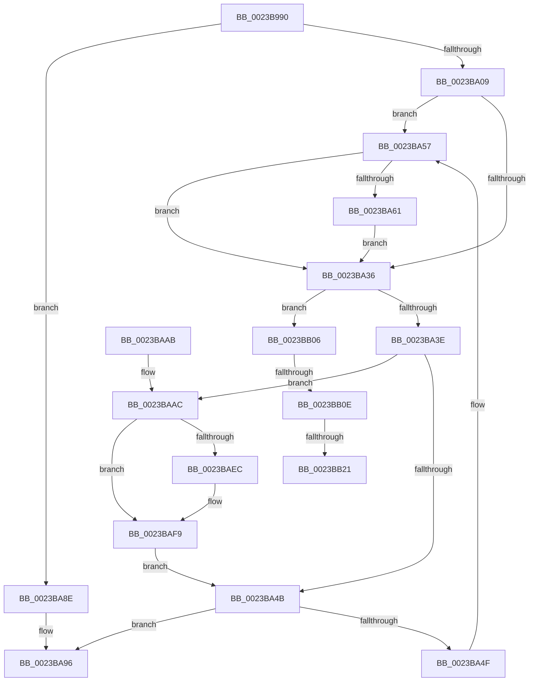

# MmProbeAndLockPages

- RVA: `0x0023B990`–`0x0023BB3A` (길이 `426` bytes)
- VA: `0x000000014023B990`
- 실행 섹션: `.text`
- PDB 이름 있음: `예`; PDB Function 태그: `예`
- unwind 정보 RVA: `0x00060E08`
- 디코드: `103`개 명령, `426/426` bytes 표시
- 미해석 바이트: `0` (있으면 어셈블리에 `.byte`로 보존)

> 이 문서는 커널 이미지의 기계어와 PDB 기호를 분석해 생성했습니다. 4번과 5번은 함수 원형과 자료형을 바이너리 사용 방식에서 추정한 C 해석이며 원본 소스 복구 결과는 아닙니다.

## 1. Dependencies

- 직접 호출 지점: **10**; 고유 호출 대상: **9**
- 직접 호출자로 확인된 함수: **48**
- RIP 상대 이미지 참조: **1**

### Outgoing calls
- `0x0023B9B8` → [memset](../6C/memset_function_006C6C40.md) (function, `0x006C6C40`)
- `0x0023B9FC` → [MiProbeAndLockPrepare](MiProbeAndLockPrepare_function_0023BB40.md) (function, `0x0023BB40`)
- `0x0023BA0E` → [MiProbeAndLockPacket](MiProbeAndLockPacket_function_0023BE20.md) (function, `0x0023BE20`)
- `0x0023BA1A` → [MiUnlockProbePacketWorkingSet](MiUnlockProbePacketWorkingSet_function_0023B800.md) (function, `0x0023B800`)
- `0x0023BA51` → [RtlRaiseStatus](../2F/RtlRaiseStatus_function_002F6A50.md) (function, `0x002F6A50`)
- `0x0023BA87` → [MiAddMdlTracker](../49/MiAddMdlTracker_function_0049A240.md) (function, `0x0049A240`)
- `0x0023BA90` → [RtlRaiseStatus](../2F/RtlRaiseStatus_function_002F6A50.md) (function, `0x002F6A50`)
- `0x0023BAF4` → [MiReturnFullProcessCommitment](../../page/9E/MiReturnFullProcessCommitment_function_009E5D58.md) (function, `0x009E5D58`)
- `0x0023BAFC` → [MiUnlockAndDereferenceVad](../31/MiUnlockAndDereferenceVad_function_00316E60.md) (function, `0x00316E60`)
- `0x0023BB2F` → [MmUnlockPhysicalPagesByVa](../../page/7F/MmUnlockPhysicalPagesByVa_function_007FBA3C.md) (function, `0x007FBA3C`)

### Direct callers
- [VslpLockPagesForTransfer](../29/VslpLockPagesForTransfer_function_0029E0FC.md) at `0x0029E226`
- [VslpLockMdlForTransfer](../29/VslpLockMdlForTransfer_function_0029E3FC.md) at `0x0029E46C`
- [MiGetWorkingSetInfo](../29/MiGetWorkingSetInfo_function_0029E498.md) at `0x0029E577`
- [CcZeroDataInCache](../29/CcZeroDataInCache_function_0029E894.md) at `0x0029E98B`
- [IopProbeAndLockPages](../29/IopProbeAndLockPages_function_0029F1B0.md) at `0x0029F1C2`
- [MiGetWorkingSetInfoList](../2A/MiGetWorkingSetInfoList_function_002AF770.md) at `0x002B0910`
- [KeSwappablePageReference](../36/KeSwappablePageReference_function_0036A864.md) at `0x0036A914`
- [CcLockSystemCacheBuffer](../3C/CcLockSystemCacheBuffer_function_003CC5B8.md) at `0x003CC60B`
- [IopProbeAndLockPages](../45/IopProbeAndLockPages_function_0045641C.md) at `0x0045642C`
- [IopProbeAndLockPages](../47/IopProbeAndLockPages_function_00479708.md) at `0x0047971B`
- [CcPrepareMdlWrite](../49/CcPrepareMdlWrite_function_004996D0.md) at `0x004998AB`
- [VslFinalizeSecureImageHash](../4A/VslFinalizeSecureImageHash_function_004AA400.md) at `0x004AA497`
- [IopProbeAndLockPages](../4B/IopProbeAndLockPages_function_004B1188.md) at `0x004B119E`
- [sub_0051AC10](../51/Unknown_function_0051AC10.md) at `0x0051AC66`
- [KiOpPatchCode](../5C/KiOpPatchCode_function_005C6900.md) at `0x005C69F3`
- [PspIumAllocatePartitionState](../5E/PspIumAllocatePartitionState_function_005E43A8.md) at `0x005E4472`
- [SmRecordDecompressionFailureDumpPayload](../61/SmRecordDecompressionFailureDumpPayload_function_00611120.md) at `0x006111FA`
- [DifMmProbeAndLockPagesWrapper](../63/DifMmProbeAndLockPagesWrapper_function_00636400.md) at `0x006364E7`
- [VmProbeAndLockPages](../64/VmProbeAndLockPages_function_0064C340.md) at `0x0064C3A0`
- [MiPrepareImagePagesForHotPatch](../68/MiPrepareImagePagesForHotPatch_function_00683800.md) at `0x00683BA4`
- [VslObtainHotPatchUndoTable](../../page/71/VslObtainHotPatchUndoTable_function_00718F50.md) at `0x0071903A`
- [IopAllocateAndLockMdl](../../page/71/IopAllocateAndLockMdl_function_0071AC6C.md) at `0x0071ACB0`
- [IopSetFileObjectIosbRange](../../page/71/IopSetFileObjectIosbRange_function_0071C1C8.md) at `0x0071C3B4`
- [NtQueryQuotaInformationFile](../../page/72/NtQueryQuotaInformationFile_function_00720FE0.md) at `0x007215FA`
- [SmProcessStatsRequest](../../page/7A/SmProcessStatsRequest_function_007A6E68.md) at `0x007A708C`
- [ExInitializeLeapSecondData](../../page/7C/ExInitializeLeapSecondData_function_007C562C.md) at `0x007C577E`
- [NtStartProfile](../../page/7D/NtStartProfile_function_007D22C0.md) at `0x007D2418`
- [NtPssCaptureVaSpaceBulk](../../page/7D/NtPssCaptureVaSpaceBulk_function_007D4EA0.md) at `0x007D50B6`
- [CmpLockKeyBodyIntoMemory](../../page/7E/CmpLockKeyBodyIntoMemory_function_007EAF10.md) at `0x007EAFAA`
- [CmpLockKeyBodyIntoMemory](../../page/7E/CmpLockKeyBodyIntoMemory_function_007EAF10.md) at `0x007EB002`
- [MiApplyImageHotPatch](../../page/80/MiApplyImageHotPatch_function_00802330.md) at `0x008023E8`
- [IopReadFile](../../page/8A/IopReadFile_function_008AEFF0.md) at `0x008AF7EF`
- [IopXxxControlFile](../../page/8E/IopXxxControlFile_function_008E9AD0.md) at `0x008EAA27`
- [ExLockUserBuffer](../../page/95/ExLockUserBuffer_function_009533B8.md) at `0x0095346E`
- [WbMakeUserDataPagesKernelWritable](../../page/9A/WbMakeUserDataPagesKernelWritable_function_009A15FC.md) at `0x009A1695`
- [MiCopyVirtualMemory](../../page/9B/MiCopyVirtualMemory_function_009BBB50.md) at `0x009BBEFC`
- [MmProbeAndLockProcessPages](../../page/9F/MmProbeAndLockProcessPages_function_009FE840.md) at `0x009FE8B7`
- [FsRtlKernelFsControlFile](../../page/A0/FsRtlKernelFsControlFile_function_00A0CA70.md) at `0x00A0CD38`
- [VslCallEnclave](../../page/A0/VslCallEnclave_function_00A0D838.md) at `0x00A0D929`
- [AlpcpInitializeCompletionList](../../page/A1/AlpcpInitializeCompletionList_function_00A1A6D0.md) at `0x00A1A815`
- [MiRotateToFrameBuffer](../../page/A3/MiRotateToFrameBuffer_function_00A38214.md) at `0x00A383F2`
- [MiCopyPagesIntoEnclave](../../page/A4/MiCopyPagesIntoEnclave_function_00A472AC.md) at `0x00A47618`
- [VslValidateDynamicCodePages](../../page/A5/VslValidateDynamicCodePages_function_00A5687C.md) at `0x00A56970`
- [PspCreateSecureThread](../../page/A8/PspCreateSecureThread_function_00A89160.md) at `0x00A89223`
- [CcMdlRead](../../page/AB/CcMdlRead_function_00ABA520.md) at `0x00ABA693`
- [PopReadPagesFromHiberFile](../../page/AC/PopReadPagesFromHiberFile_function_00AC8F78.md) at `0x00AC90F3`
- [MiLoadDataIntoVsmEnclave](../../page/AC/MiLoadDataIntoVsmEnclave_function_00ACD114.md) at `0x00ACD3E9`
- [MiQueryMemoryPhysicalContiguity](../../page/AD/MiQueryMemoryPhysicalContiguity_function_00AD5B98.md) at `0x00AD5E51`
- [MiLockKernelScpSection](../../init/C6/MiLockKernelScpSection_function_00C666B8.md) at `0x00C666F9`

### Static image references
- `0x0023BA57` → RVA `0x00FC6BBC` (`ALMOSTRO`; read)

## 2. Other-region calls and transfers

- 다른 실행 섹션으로 향하는 call: **2**
  - `0x0023BAF4` → [MiReturnFullProcessCommitment](../../page/9E/MiReturnFullProcessCommitment_function_009E5D58.md) (`.text` → `PAGE`)
  - `0x0023BB2F` → [MmUnlockPhysicalPagesByVa](../../page/7F/MmUnlockPhysicalPagesByVa_function_007FBA3C.md) (`.text` → `PAGE`)
- call이 아닌 외부 분기/꼬리 이동: **3**
  - `0x0023BB08` → [sub_006D794C + 0x3A](../6D/Unknown_function_006D794C.md) (`tail-transfer`)
  - `0x0023BB1B` → [sub_006D794C](../6D/Unknown_function_006D794C.md) (`tail-transfer`)
  - `0x0023BB35` → [sub_006D794C](../6D/Unknown_function_006D794C.md) (`tail-transfer`)

## 3. Assembly (complete function range)

```asm
0023B990  48 89 5C 24 08                  mov qword ptr [rsp + 8], rbx
0023B995  48 89 74 24 10                  mov qword ptr [rsp + 0x10], rsi
0023B99A  57                              push rdi
0023B99B  48 81 EC F0 00 00 00            sub rsp, 0xf0
0023B9A2  41 8B D8                        mov ebx, r8d
0023B9A5  0F B6 FA                        movzx edi, dl
0023B9A8  48 8B F1                        mov rsi, rcx
0023B9AB  33 D2                           xor edx, edx
0023B9AD  41 B8 B0 00 00 00               mov r8d, 0xb0
0023B9B3  48 8D 4C 24 40                  lea rcx, [rsp + 0x40]
0023B9B8  E8 83 B2 48 00                  call 0x1406c6c40
0023B9BD  44 8B 46 2C                     mov r8d, dword ptr [rsi + 0x2c]
0023B9C1  48 8D 4C 24 40                  lea rcx, [rsp + 0x40]
0023B9C6  44 8B 4E 28                     mov r9d, dword ptr [rsi + 0x28]
0023B9CA  85 DB                           test ebx, ebx
0023B9CC  41 BB 01 00 00 00               mov r11d, 1
0023B9D2  C7 44 24 30 01 00 00 00         mov dword ptr [rsp + 0x30], 1
0023B9DA  44 0F 44 DB                     cmove r11d, ebx
0023B9DE  41 BA 01 00 00 00               mov r10d, 1
0023B9E4  44 89 5C 24 28                  mov dword ptr [rsp + 0x28], r11d
0023B9E9  40 84 FF                        test dil, dil
0023B9EC  48 8B D6                        mov rdx, rsi
0023B9EF  44 0F 44 D7                     cmove r10d, edi
0023B9F3  4C 03 46 20                     add r8, qword ptr [rsi + 0x20]
0023B9F7  44 88 54 24 20                  mov byte ptr [rsp + 0x20], r10b
0023B9FC  E8 3F 01 00 00                  call 0x14023bb40
0023BA01  85 C0                           test eax, eax
0023BA03  0F 88 85 00 00 00               js 0x14023ba8e
0023BA09  48 8D 4C 24 40                  lea rcx, [rsp + 0x40]
0023BA0E  E8 0D 04 00 00                  call 0x14023be20
0023BA13  48 8D 4C 24 40                  lea rcx, [rsp + 0x40]
0023BA18  8B D8                           mov ebx, eax
0023BA1A  E8 E1 FD FF FF                  call 0x14023b800
0023BA1F  8B BC 24 88 00 00 00            mov edi, dword ptr [rsp + 0x88]
0023BA26  48 8B B4 24 80 00 00 00         mov rsi, qword ptr [rsp + 0x80]
0023BA2E  C1 EF 06                        shr edi, 6
0023BA31  83 E7 01                        and edi, 1
0023BA34  74 21                           je 0x14023ba57
0023BA36  85 DB                           test ebx, ebx
0023BA38  0F 88 C8 00 00 00               js 0x14023bb06
0023BA3E  48 8B 8C 24 C0 00 00 00         mov rcx, qword ptr [rsp + 0xc0]
0023BA46  48 85 C9                        test rcx, rcx
0023BA49  75 61                           jne 0x14023baac
0023BA4B  85 DB                           test ebx, ebx
0023BA4D  79 47                           jns 0x14023ba96
0023BA4F  8B CB                           mov ecx, ebx
0023BA51  E8 FA AF 0B 00                  call 0x1402f6a50
0023BA56  CC                              int3
0023BA57  8B 05 5F B1 D8 00               mov eax, dword ptr [rip + 0xd8b15f]
0023BA5D  A8 01                           test al, 1
0023BA5F  74 D5                           je 0x14023ba36
0023BA61  8B 4E 2C                        mov ecx, dword ptr [rsi + 0x2c]
0023BA64  41 B8 03 00 00 00               mov r8d, 3
0023BA6A  03 4E 20                        add ecx, dword ptr [rsi + 0x20]
0023BA6D  8B 56 28                        mov edx, dword ptr [rsi + 0x28]
0023BA70  81 E1 FF 0F 00 00               and ecx, 0xfff
0023BA76  48 81 C2 FF 0F 00 00            add rdx, 0xfff
0023BA7D  48 03 D1                        add rdx, rcx
0023BA80  48 8B CE                        mov rcx, rsi
0023BA83  48 C1 EA 0C                     shr rdx, 0xc
0023BA87  E8 B4 E7 25 00                  call 0x14049a240
0023BA8C  EB A8                           jmp 0x14023ba36
0023BA8E  8B C8                           mov ecx, eax
0023BA90  E8 BB AF 0B 00                  call 0x1402f6a50
0023BA95  CC                              int3
0023BA96  4C 8D 9C 24 F0 00 00 00         lea r11, [rsp + 0xf0]
0023BA9E  49 8B 5B 10                     mov rbx, qword ptr [r11 + 0x10]
0023BAA2  49 8B 73 18                     mov rsi, qword ptr [r11 + 0x18]
0023BAA6  49 8B E3                        mov rsp, r11
0023BAA9  5F                              pop rdi
0023BAAA  C3                              ret
0023BAAB  CC                              int3
0023BAAC  8B 49 34                        mov ecx, dword ptr [rcx + 0x34]
0023BAAF  48 8B 84 24 C0 00 00 00         mov rax, qword ptr [rsp + 0xc0]
0023BAB7  0F B6 50 22                     movzx edx, byte ptr [rax + 0x22]
0023BABB  48 8B 84 24 B0 00 00 00         mov rax, qword ptr [rsp + 0xb0]
0023BAC3  48 8B BC 24 C0 00 00 00         mov rdi, qword ptr [rsp + 0xc0]
0023BACB  48 C1 E2 20                     shl rdx, 0x20
0023BACF  48 0B D1                        or rdx, rcx
0023BAD2  48 03 D0                        add rdx, rax
0023BAD5  89 57 34                        mov dword ptr [rdi + 0x34], edx
0023BAD8  48 C1 EA 20                     shr rdx, 0x20
0023BADC  88 57 22                        mov byte ptr [rdi + 0x22], dl
0023BADF  48 8B 94 24 B8 00 00 00         mov rdx, qword ptr [rsp + 0xb8]
0023BAE7  48 2B D0                        sub rdx, rax
0023BAEA  74 0D                           je 0x14023baf9
0023BAEC  48 8B 8C 24 98 00 00 00         mov rcx, qword ptr [rsp + 0x98]
0023BAF4  E8 5F A2 7A 00                  call 0x1409e5d58
0023BAF9  48 8B CF                        mov rcx, rdi
0023BAFC  E8 5F B3 0D 00                  call 0x140316e60
0023BB01  E9 45 FF FF FF                  jmp 0x14023ba4b
0023BB06  85 FF                           test edi, edi
0023BB08  0F 84 78 BE 49 00               je 0x1406d7986
0023BB0E  48 8B 7C 24 48                  mov rdi, qword ptr [rsp + 0x48]
0023BB13  48 8B 4C 24 40                  mov rcx, qword ptr [rsp + 0x40]
0023BB18  48 3B F9                        cmp rdi, rcx
0023BB1B  0F 86 2B BE 49 00               jbe 0x1406d794c
0023BB21  44 8B 8C 24 A0 00 00 00         mov r9d, dword ptr [rsp + 0xa0]
0023BB29  48 8B D7                        mov rdx, rdi
0023BB2C  48 2B D1                        sub rdx, rcx
0023BB2F  E8 08 FF 5B 00                  call 0x1407fba3c
0023BB34  90                              nop
0023BB35  E9 12 BE 49 00                  jmp 0x1406d794c
```

## 4. C-style interpretation (structured pseudocode)

```c
__int64 __fastcall MmProbeAndLockPages(__int64 a1, int a2, int a3)
{
    __int64 result;
    __int64 v_r10;
    __int64 v_r11;
    __int64 v_rdi;
    __int64 v_rsp;
    unsigned __int64 v_stack_m30;
    unsigned __int64 v_stack_m38;
    unsigned __int64 v_stack_m40;
    unsigned int v_stack_m50;
    unsigned __int64 v_stack_m58;
    unsigned int v_stack_m70;
    unsigned __int64 v_stack_m78;
    unsigned __int64 v_stack_m8;
    unsigned __int64 v_stack_mA8;
    unsigned __int64 v_stack_mB0;
    unsigned __int64 v_stack_mB8;
    unsigned int v_stack_mC8;
    unsigned int v_stack_mD0;
    unsigned __int8 v_stack_mD8;
    unsigned __int64 v_stack_p10;
    unsigned __int64 v_stack_p8;

    v_stack_p8 = v_rbx;
    v_stack_p10 = v_rsi;
    v_rsp = (v_rsp) - (240);
    a2 = 0;
    result = memset(v_stack_mB8, a2, 176, a4);
    v_stack_mC8 = 1;
    v_r11 = 1;
    if ((unsigned int)((unsigned int)(a3)) == 0) { v_r11 = (unsigned int)((unsigned int)(a3)); }
    v_stack_mD0 = (unsigned int)(v_r11);
    v_r10 = 1;
    if ((unsigned __int8)((unsigned __int8)(a2)) == 0) { v_r10 = (unsigned int)((unsigned __int8)(a2)); }
    a3 = ((unsigned int)(*(unsigned int *)(a1 + 44))) + (*(unsigned __int64 *)(a1 + 32));
    v_stack_mD8 = (unsigned __int8)(v_r10);
    result = MiProbeAndLockPrepare(v_stack_mB8, a1, a3, (unsigned int)(*(unsigned int *)(a1 + 40)));
    if (sign_flag) goto loc_0023BA8E;
    result = MiProbeAndLockPacket(v_stack_mB8, a1, a3, (unsigned int)(*(unsigned int *)(a1 + 40)));
    result = MiUnlockProbePacketWorkingSet(v_stack_mB8, a1, a3, (unsigned int)(*(unsigned int *)(a1 + 40)));
    v_rdi = (unsigned int)(((unsigned int)(v_stack_m70)) >> (6));
    v_rdi = (unsigned int)((v_rdi) & (1));
    if (condition_is_equal) goto loc_0023BA57;
loc_0023BA36:
    if (sign_flag) goto loc_0023BB06;
    if (v_stack_m38 != 0) goto loc_0023BAAC;
loc_0023BA4B:
    if (!sign_flag) goto loc_0023BA96;
    result = RtlRaiseStatus((unsigned int)((unsigned int)((unsigned int)((unsigned int)(result)))), a1, a3, (unsigned int)(*(unsigned int *)(a1 + 40)));
loc_0023BA57:
    if ((((unsigned __int8)((unsigned int)(*(unsigned int *)(v_rip + 14201183)))) & (1)) == 0) goto loc_0023BA36;
    a1 = (unsigned int)(((unsigned int)(*(unsigned int *)(v_stack_m78 + 44))) + (*(unsigned int *)(v_stack_m78 + 32)));
    a1 = (unsigned int)((a1) & (0xFFFULL));
    a2 = ((unsigned int)(*(unsigned int *)(v_stack_m78 + 40))) + (0xFFFULL);
    a2 = (a2) + (a1);
    a2 = (a2) >> (12);
    result = MiAddMdlTracker(v_stack_m78, a2, 3, (unsigned int)(*(unsigned int *)(a1 + 40)));
    goto loc_0023BA36;
loc_0023BA8E:
    result = RtlRaiseStatus((unsigned int)((unsigned int)(result)), a2, 3, (unsigned int)(*(unsigned int *)(a1 + 40)));
loc_0023BA96:
    return result;
loc_0023BAAC:
    a2 = (*(unsigned __int8 *)(v_stack_m30 + 34)) << (32);
    a2 = (a2) | ((unsigned int)(*(unsigned int *)((unsigned int)((unsigned int)(result)) + 52)));
    a2 = (a2) + (v_stack_m40);
    *(unsigned int *)(v_stack_m30 + 52) = a2;
    a2 = (a2) >> (32);
    *(unsigned __int8 *)(v_stack_m30 + 34) = (unsigned __int8)(a2);
    a2 = (v_stack_m38) - (v_stack_m40);
    result = v_stack_m40;
    if (!(condition_is_equal)) {
        a1 = v_stack_m58;
        result = MiReturnFullProcessCommitment(a1, a2, 3, (unsigned int)(*(unsigned int *)(a1 + 40)));
    }
    result = MiUnlockAndDereferenceVad(v_stack_m30, a2, 3, (unsigned int)(*(unsigned int *)(a1 + 40)));
    goto loc_0023BA4B;
loc_0023BB06:
    a2 = (v_stack_mA8) - (v_stack_mB0);
    result = MmUnlockPhysicalPagesByVa(v_stack_mB0, a2, 3, (unsigned int)(v_stack_m50));
}
```

## 5. (Beta) C Style

```c
int64_t MmProbeAndLockPages(void *Arg1, int32_t Arg2, int32_t Arg3)
{
    uint8_t *arg1 = (uint8_t *)Arg1;

    int64_t result;
    int64_t local_r10;
    int64_t local_r11;
    int64_t local_rdi;
    int64_t local_rsp;
    uint64_t v_stack_m30;
    uint64_t v_stack_m38;
    uint64_t v_stack_m40;
    uint32_t v_stack_m50;
    uint64_t v_stack_m58;
    uint32_t v_stack_m70;
    uint64_t v_stack_m78;
    uint64_t v_stack_m8;
    uint64_t v_stack_mA8;
    uint64_t v_stack_mB0;
    uint64_t v_stack_mB8;
    uint32_t v_stack_mC8;
    uint32_t v_stack_mD0;
    uint8_t v_stack_mD8;
    uint64_t v_stack_p10;
    uint64_t v_stack_p8;

    v_stack_p8 = local_rbx;
    v_stack_p10 = local_rsi;
    local_rsp = (local_rsp) - (240);
    Arg2 = 0;
    result = memset(v_stack_mB8, Arg2, 176, a4);
    v_stack_mC8 = 1;
    local_r11 = 1;
    if ((uint32_t)((uint32_t)(Arg3)) == 0) { local_r11 = (uint32_t)((uint32_t)(Arg3)); }
    v_stack_mD0 = (uint32_t)(local_r11);
    local_r10 = 1;
    if ((uint8_t)((uint8_t)(Arg2)) == 0) { local_r10 = (uint32_t)((uint8_t)(Arg2)); }
    Arg3 = ((uint32_t)(*(uint32_t *)(arg1 + 0x2C))) + (*(uint64_t *)(arg1 + 0x20));
    v_stack_mD8 = (uint8_t)(local_r10);
    result = MiProbeAndLockPrepare(v_stack_mB8, Arg1, Arg3, (uint32_t)(*(uint32_t *)(arg1 + 0x28)));
    if (sign_flag) goto loc_0023BA8E;
    result = MiProbeAndLockPacket(v_stack_mB8, Arg1, Arg3, (uint32_t)(*(uint32_t *)(arg1 + 0x28)));
    result = MiUnlockProbePacketWorkingSet(v_stack_mB8, Arg1, Arg3, (uint32_t)(*(uint32_t *)(arg1 + 0x28)));
    local_rdi = (uint32_t)(((uint32_t)(v_stack_m70)) >> (6));
    local_rdi = (uint32_t)((local_rdi) & (1));
    if (condition_is_equal) goto loc_0023BA57;
loc_0023BA36:
    if (sign_flag) goto loc_0023BB06;
    if (v_stack_m38 != 0) goto loc_0023BAAC;
loc_0023BA4B:
    if (!sign_flag) goto loc_0023BA96;
    result = RtlRaiseStatus((uint32_t)((uint32_t)((uint32_t)((uint32_t)(result)))), Arg1, Arg3, (uint32_t)(*(uint32_t *)(arg1 + 0x28)));
loc_0023BA57:
    if ((((uint8_t)((uint32_t)(*(uint32_t *)(v_rip + 0xD8B15F)))) & (1)) == 0) goto loc_0023BA36;
    Arg1 = (uint32_t)(((uint32_t)(*(uint32_t *)(v_stack_m78 + 0x2C))) + (*(uint32_t *)(v_stack_m78 + 0x20)));
    Arg1 = (uint32_t)((Arg1) & (0xFFFULL));
    Arg2 = ((uint32_t)(*(uint32_t *)(v_stack_m78 + 0x28))) + (0xFFFULL);
    Arg2 = (Arg2) + (Arg1);
    Arg2 = (Arg2) >> (12);
    result = MiAddMdlTracker(v_stack_m78, Arg2, 3, (uint32_t)(*(uint32_t *)(arg1 + 0x28)));
    goto loc_0023BA36;
loc_0023BA8E:
    result = RtlRaiseStatus((uint32_t)((uint32_t)(result)), Arg2, 3, (uint32_t)(*(uint32_t *)(arg1 + 0x28)));
loc_0023BA96:
    return result;
loc_0023BAAC:
    Arg2 = (*(uint8_t *)(v_stack_m30 + 0x22)) << (32);
    Arg2 = (Arg2) | ((uint32_t)(*(uint32_t *)((uint32_t)((uint32_t)(result)) + 0x34)));
    Arg2 = (Arg2) + (v_stack_m40);
    *(uint32_t *)(v_stack_m30 + 0x34) = Arg2;
    Arg2 = (Arg2) >> (32);
    *(uint8_t *)(v_stack_m30 + 0x22) = (uint8_t)(Arg2);
    Arg2 = (v_stack_m38) - (v_stack_m40);
    result = v_stack_m40;
    if (!(condition_is_equal)) {
        Arg1 = v_stack_m58;
        result = MiReturnFullProcessCommitment(Arg1, Arg2, 3, (uint32_t)(*(uint32_t *)(arg1 + 0x28)));
    }
    result = MiUnlockAndDereferenceVad(v_stack_m30, Arg2, 3, (uint32_t)(*(uint32_t *)(arg1 + 0x28)));
    goto loc_0023BA4B;
loc_0023BB06:
    Arg2 = (v_stack_mA8) - (v_stack_mB0);
    result = MmUnlockPhysicalPagesByVa(v_stack_mB0, Arg2, 3, (uint32_t)(v_stack_m50));
}
```

### 관측된 메모리 오프셋

구조체 형식이 확인되지 않은 접근은 인자 기준의 오프셋으로만 기록했습니다.

| 기준 인자 | 오프셋 표현 | 폭 (bit) | 접근 |
|---|---:|---:|---|
| `Arg1` | `+ 0x20` | `64` | `R` |
| `Arg1` | `+ 0x28` | `32` | `R` |
| `Arg1` | `+ 0x2C` | `32` | `R` |

## 6. Execution-region graph

[열기: 2D/3D 그래프와 함수 탐색 컨트롤 패널](../../../control-panel.html?section=text&rva=0x0023B990&view=graph)

- 2D 그래프는 위에서 아래로 흐르고, 3D 그래프는 빈 공간을 드래그해 회전합니다. Shift+드래그는 이동, 휠은 확대·축소, 함수 노드 선택은 대상 보고서 이동입니다.

### Static fallback


