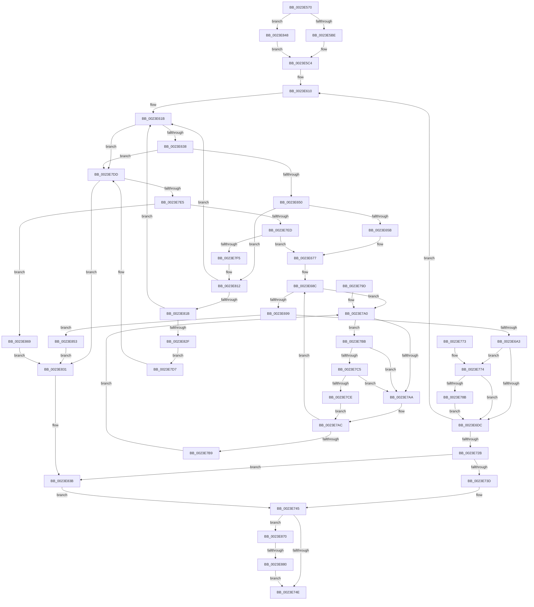

# MmStoreProbeAndLockPages

- RVA: `0x0023E570`–`0x0023E88A` (길이 `794` bytes)
- VA: `0x000000014023E570`
- 실행 섹션: `.text`
- PDB 이름 있음: `예`; PDB Function 태그: `예`
- unwind 정보 RVA: `0x00061370`
- 디코드: `194`개 명령, `794/794` bytes 표시
- 미해석 바이트: `0` (있으면 어셈블리에 `.byte`로 보존)

> 이 문서는 커널 이미지의 기계어와 PDB 기호를 분석해 생성했습니다. 4번과 5번은 함수 원형과 자료형을 바이너리 사용 방식에서 추정한 C 해석이며 원본 소스 복구 결과는 아닙니다.

## 1. Dependencies

- 직접 호출 지점: **16**; 고유 호출 대상: **15**
- 직접 호출자로 확인된 함수: **1**
- RIP 상대 이미지 참조: **4**

### Outgoing calls
- `0x0023E59E` → [memset](../6C/memset_function_006C6C40.md) (function, `0x006C6C40`)
- `0x0023E5EE` → [MiProbeAndLockPrepare](MiProbeAndLockPrepare_function_0023BB40.md) (function, `0x0023BB40`)
- `0x0023E620` → [MiLockPageLeafPageTable](MiLockPageLeafPageTable_function_0023D160.md) (function, `0x0023D160`)
- `0x0023E641` → [MiProbeLeafPteAccess](MiProbeLeafPteAccess_function_0023D640.md) (function, `0x0023D640`)
- `0x0023E66F` → [MiSetProbePagesAhead](MiSetProbePagesAhead_function_0023DC80.md) (function, `0x0023DC80`)
- `0x0023E730` → [MiUnlockProbePacketWorkingSet](MiUnlockProbePacketWorkingSet_function_0023B800.md) (function, `0x0023B800`)
- `0x0023E740` → [MiStoreMarkLockedPagesModified](../43/MiStoreMarkLockedPagesModified_function_00438EF0.md) (function, `0x00438EF0`)
- `0x0023E77E` → [MiGetPagePrivilege](../28/MiGetPagePrivilege_function_00285420.md) (function, `0x00285420`)
- `0x0023E793` → [MiClearPfnImageVerified](../40/MiClearPfnImageVerified_function_00407000.md) (function, `0x00407000`)
- `0x0023E7C5` → [KiCheckVpBackingLongSpinWaitHypercall](../30/KiCheckVpBackingLongSpinWaitHypercall_function_0030F490.md) (function, `0x0030F490`)
- `0x0023E7D0` → [HvlNotifyLongSpinWait](../30/HvlNotifyLongSpinWait_function_0030F460.md) (function, `0x0030F460`)
- `0x0023E80C` → [KeBugCheckEx](../4F/KeBugCheckEx_function_004FD660.md) (function, `0x004FD660`)
- `0x0023E820` → [MiFaultInProbeAddress](../40/MiFaultInProbeAddress_function_0040E108.md) (function, `0x0040E108`)
- `0x0023E836` → [MiUnlockProbePacketWorkingSet](MiUnlockProbePacketWorkingSet_function_0023B800.md) (function, `0x0023B800`)
- `0x0023E83E` → [MiUnlockStoreLockedPages](../37/MiUnlockStoreLockedPages_function_003735C0.md) (function, `0x003735C0`)
- `0x0023E873` → [MmStoreIsVirtualAddressPoisoned](../69/MmStoreIsVirtualAddressPoisoned_function_00693120.md) (function, `0x00693120`)

### Direct callers
- [SmKmProbeAndLockAddress](../3C/SmKmProbeAndLockAddress_function_003C3DCC.md) at `0x003C3E26`

### Static image references
- `0x0023E627` → RVA `0x00010880` (`.rdata`; read)
- `0x0023E7A2` → RVA `0x00FC52AC` (`ALMOSTRO`; reference)
- `0x0023E7BB` → RVA `0x00FC6AB8` (`ALMOSTRO`; read)
- `0x0023E7D7` → RVA `0x00E30204` (`.data`; read/write)

## 2. Other-region calls and transfers

- 다른 실행 섹션으로 향하는 call: **0**
- call이 아닌 외부 분기/꼬리 이동: **1**
  - `0x0023E87A` → [sub_006D7BC0](../6D/Unknown_function_006D7BC0.md) (`tail-transfer`)

## 3. Assembly (complete function range)

```asm
0023E570  48 89 5C 24 18                  mov qword ptr [rsp + 0x18], rbx
0023E575  55                              push rbp
0023E576  56                              push rsi
0023E577  57                              push rdi
0023E578  41 54                           push r12
0023E57A  41 55                           push r13
0023E57C  41 56                           push r14
0023E57E  41 57                           push r15
0023E580  48 8D 6C 24 D9                  lea rbp, [rsp - 0x27]
0023E585  48 81 EC F0 00 00 00            sub rsp, 0xf0
0023E58C  8B DA                           mov ebx, edx
0023E58E  4C 8B F9                        mov r15, rcx
0023E591  33 D2                           xor edx, edx
0023E593  48 8D 4C 24 40                  lea rcx, [rsp + 0x40]
0023E598  41 B8 B0 00 00 00               mov r8d, 0xb0
0023E59E  E8 9D 86 48 00                  call 0x1406c6c40
0023E5A3  65 4C 8B 2C 25 88 01 00 00      mov r13, qword ptr gs:[0x188]
0023E5AC  45 33 F6                        xor r14d, r14d
0023E5AF  41 8B 85 A4 05 00 00            mov eax, dword ptr [r13 + 0x5a4]
0023E5B6  85 DB                           test ebx, ebx
0023E5B8  0F 85 8A 02 00 00               jne 0x14023e848
0023E5BE  83 E0 F7                        and eax, 0xfffffff7
0023E5C1  83 C8 04                        or eax, 4
0023E5C4  41 89 85 A4 05 00 00            mov dword ptr [r13 + 0x5a4], eax
0023E5CB  48 8D 4C 24 40                  lea rcx, [rsp + 0x40]
0023E5D0  45 8B 47 2C                     mov r8d, dword ptr [r15 + 0x2c]
0023E5D4  49 8B D7                        mov rdx, r15
0023E5D7  4D 03 47 20                     add r8, qword ptr [r15 + 0x20]
0023E5DB  45 8B 4F 28                     mov r9d, dword ptr [r15 + 0x28]
0023E5DF  44 89 74 24 30                  mov dword ptr [rsp + 0x30], r14d
0023E5E4  44 89 74 24 28                  mov dword ptr [rsp + 0x28], r14d
0023E5E9  C6 44 24 20 01                  mov byte ptr [rsp + 0x20], 1
0023E5EE  E8 4D D5 FF FF                  call 0x14023bb40
0023E5F3  48 8B 4D AF                     mov rcx, qword ptr [rbp - 0x51]
0023E5F7  49 BC FF FF FF FF FF 00 00 00   movabs r12, 0xffffffffff
0023E601  48 BE 00 00 00 00 00 DE FF FF   movabs rsi, 0xffffde0000000000
0023E60B  0F 1F 44 00 00                  nop dword ptr [rax + rax]
0023E610  48 C7 01 FF FF FF FF            mov qword ptr [rcx], 0xffffffffffffffff
0023E617  44 89 75 6F                     mov dword ptr [rbp + 0x6f], r14d
0023E61B  48 8D 4C 24 40                  lea rcx, [rsp + 0x40]
0023E620  E8 3B EB FF FF                  call 0x14023d160
0023E625  8B F8                           mov edi, eax
0023E627  48 8B 05 52 22 DD FF            mov rax, qword ptr [rip - 0x22ddae]
0023E62E  48 39 45 A7                     cmp qword ptr [rbp - 0x59], rax
0023E632  0F 84 A5 01 00 00               je 0x14023e7dd
0023E638  48 8D 55 6F                     lea rdx, [rbp + 0x6f]
0023E63C  48 8D 4C 24 40                  lea rcx, [rsp + 0x40]
0023E641  E8 FA EF FF FF                  call 0x14023d640
0023E646  8B F8                           mov edi, eax
0023E648  85 C0                           test eax, eax
0023E64A  0F 88 8D 01 00 00               js 0x14023e7dd
0023E650  8B 45 6F                        mov eax, dword ptr [rbp + 0x6f]
0023E653  85 C0                           test eax, eax
0023E655  0F 85 B7 01 00 00               jne 0x14023e812
0023E65B  48 8B 45 A7                     mov rax, qword ptr [rbp - 0x59]
0023E65F  48 8D 4C 24 40                  lea rcx, [rsp + 0x40]
0023E664  48 C1 E8 0C                     shr rax, 0xc
0023E668  49 23 C4                        and rax, r12
0023E66B  48 89 45 FF                     mov qword ptr [rbp - 1], rax
0023E66F  E8 0C F6 FF FF                  call 0x14023dc80
0023E674  41 8B FE                        mov edi, r14d
0023E677  48 8B 45 FF                     mov rax, qword ptr [rbp - 1]
0023E67B  48 8D 1C 40                     lea rbx, [rax + rax*2]
0023E67F  48 C1 E3 04                     shl rbx, 4
0023E683  48 8B C6                        mov rax, rsi
0023E686  48 03 D8                        add rbx, rax
0023E689  41 8B F6                        mov esi, r14d
0023E68C  F0 48 0F BA 6B 18 3F            lock bts qword ptr [rbx + 0x18], 0x3f
0023E693  0F 82 07 01 00 00               jb 0x14023e7a0
0023E699  F6 43 22 08                     test byte ptr [rbx + 0x22], 8
0023E69D  0F 85 B0 01 00 00               jne 0x14023e853
0023E6A3  48 8B 43 28                     mov rax, qword ptr [rbx + 0x28]
0023E6A7  8B 43 20                        mov eax, dword ptr [rbx + 0x20]
0023E6AA  89 45 67                        mov dword ptr [rbp + 0x67], eax
0023E6AD  66 FF C0                        inc ax
0023E6B0  66 89 45 67                     mov word ptr [rbp + 0x67], ax
0023E6B4  8B 45 67                        mov eax, dword ptr [rbp + 0x67]
0023E6B7  89 43 20                        mov dword ptr [rbx + 0x20], eax
0023E6BA  8B 43 20                        mov eax, dword ptr [rbx + 0x20]
0023E6BD  89 45 67                        mov dword ptr [rbp + 0x67], eax
0023E6C0  C1 E8 10                        shr eax, 0x10
0023E6C3  0C 08                           or al, 8
0023E6C5  88 45 69                        mov byte ptr [rbp + 0x69], al
0023E6C8  8B 45 67                        mov eax, dword ptr [rbp + 0x67]
0023E6CB  89 43 20                        mov dword ptr [rbx + 0x20], eax
0023E6CE  8B 43 10                        mov eax, dword ptr [rbx + 0x10]
0023E6D1  48 0F BA E0 0A                  bt rax, 0xa
0023E6D6  0F 83 98 00 00 00               jae 0x14023e774
0023E6DC  48 B8 FF FF FF FF FF FF FF 7F   movabs rax, 0x7fffffffffffffff
0023E6E6  F0 48 21 43 18                  lock and qword ptr [rbx + 0x18], rax
0023E6EB  48 8B 4D AF                     mov rcx, qword ptr [rbp - 0x51]
0023E6EF  48 8B 45 FF                     mov rax, qword ptr [rbp - 1]
0023E6F3  48 BE 00 00 00 00 00 DE FF FF   movabs rsi, 0xffffde0000000000
0023E6FD  48 89 01                        mov qword ptr [rcx], rax
0023E700  48 8B 4D AF                     mov rcx, qword ptr [rbp - 0x51]
0023E704  48 8B 45 8F                     mov rax, qword ptr [rbp - 0x71]
0023E708  48 83 C1 08                     add rcx, 8
0023E70C  48 81 44 24 48 00 10 00 00      add qword ptr [rsp + 0x48], 0x1000
0023E715  48 83 C0 08                     add rax, 8
0023E719  48 89 4D AF                     mov qword ptr [rbp - 0x51], rcx
0023E71D  48 89 45 8F                     mov qword ptr [rbp - 0x71], rax
0023E721  48 3B 45 97                     cmp rax, qword ptr [rbp - 0x69]
0023E725  0F 86 E5 FE FF FF               jbe 0x14023e610
0023E72B  48 8D 4C 24 40                  lea rcx, [rsp + 0x40]
0023E730  E8 CB D0 FF FF                  call 0x14023b800
0023E735  85 FF                           test edi, edi
0023E737  0F 88 FE 00 00 00               js 0x14023e83b
0023E73D  49 8B CF                        mov rcx, r15
0023E740  E8 AB A7 1F 00                  call 0x140438ef0
0023E745  4D 85 F6                        test r14, r14
0023E748  0F 85 22 01 00 00               jne 0x14023e870
0023E74E  41 83 A5 A4 05 00 00 F3         and dword ptr [r13 + 0x5a4], 0xfffffff3
0023E756  8B C7                           mov eax, edi
0023E758  48 8B 9C 24 40 01 00 00         mov rbx, qword ptr [rsp + 0x140]
0023E760  48 81 C4 F0 00 00 00            add rsp, 0xf0
0023E767  41 5F                           pop r15
0023E769  41 5E                           pop r14
0023E76B  41 5D                           pop r13
0023E76D  41 5C                           pop r12
0023E76F  5F                              pop rdi
0023E770  5E                              pop rsi
0023E771  5D                              pop rbp
0023E772  C3                              ret
0023E773  CC                              int3
0023E774  45 33 C0                        xor r8d, r8d
0023E777  48 8B CB                        mov rcx, rbx
0023E77A  41 8D 50 01                     lea edx, [r8 + 1]
0023E77E  E8 9D 6C 04 00                  call 0x140285420
0023E783  A8 10                           test al, 0x10
0023E785  0F 84 51 FF FF FF               je 0x14023e6dc
0023E78B  BA 1C 00 00 00                  mov edx, 0x1c
0023E790  48 8B CB                        mov rcx, rbx
0023E793  E8 68 88 1C 00                  call 0x140407000
0023E798  E9 3F FF FF FF                  jmp 0x14023e6dc
0023E79D  0F 1F 00                        nop dword ptr [rax]
0023E7A0  FF C6                           inc esi
0023E7A2  85 35 04 6B D8 00               test dword ptr [rip + 0xd86b04], esi
0023E7A8  74 11                           je 0x14023e7bb
0023E7AA  F3 90                           pause
0023E7AC  48 8B 43 18                     mov rax, qword ptr [rbx + 0x18]
0023E7B0  48 85 C0                        test rax, rax
0023E7B3  0F 89 D3 FE FF FF               jns 0x14023e68c
0023E7B9  EB E5                           jmp 0x14023e7a0
0023E7BB  8B 05 F7 82 D8 00               mov eax, dword ptr [rip + 0xd882f7]
0023E7C1  A8 40                           test al, 0x40
0023E7C3  74 E5                           je 0x14023e7aa
0023E7C5  E8 C6 0C 0D 00                  call 0x14030f490
0023E7CA  84 C0                           test al, al
0023E7CC  74 DC                           je 0x14023e7aa
0023E7CE  8B CE                           mov ecx, esi
0023E7D0  E8 8B 0C 0D 00                  call 0x14030f460
0023E7D5  EB D5                           jmp 0x14023e7ac
0023E7D7  FF 05 27 1A BF 00               inc dword ptr [rip + 0xbf1a27]
0023E7DD  81 FF 17 00 00 C0               cmp edi, 0xc0000017
0023E7E3  74 4C                           je 0x14023e831
0023E7E5  81 FF 05 00 00 C0               cmp edi, 0xc0000005
0023E7EB  74 7C                           je 0x14023e869
0023E7ED  85 FF                           test edi, edi
0023E7EF  0F 89 82 FE FF FF               jns 0x14023e677
0023E7F5  4C 8B 4C 24 48                  mov r9, qword ptr [rsp + 0x48]
0023E7FA  BA 01 60 00 00                  mov edx, 0x6001
0023E7FF  4C 63 C7                        movsxd r8, edi
0023E802  B9 1A 00 00 00                  mov ecx, 0x1a
0023E807  4C 89 7C 24 20                  mov qword ptr [rsp + 0x20], r15
0023E80C  E8 4F EE 2B 00                  call 0x1404fd660
0023E811  CC                              int3
0023E812  83 F8 01                        cmp eax, 1
0023E815  0F 84 00 FE FF FF               je 0x14023e61b
0023E81B  48 8D 4C 24 40                  lea rcx, [rsp + 0x40]
0023E820  E8 E3 F8 1C 00                  call 0x14040e108
0023E825  8B F8                           mov edi, eax
0023E827  85 C0                           test eax, eax
0023E829  0F 89 EC FD FF FF               jns 0x14023e61b
0023E82F  EB A6                           jmp 0x14023e7d7
0023E831  48 8D 4C 24 40                  lea rcx, [rsp + 0x40]
0023E836  E8 C5 CF FF FF                  call 0x14023b800
0023E83B  49 8B CF                        mov rcx, r15
0023E83E  E8 7D 4D 13 00                  call 0x1403735c0
0023E843  E9 FD FE FF FF                  jmp 0x14023e745
0023E848  83 E0 FB                        and eax, 0xfffffffb
0023E84B  83 C8 08                        or eax, 8
0023E84E  E9 71 FD FF FF                  jmp 0x14023e5c4
0023E853  48 B8 FF FF FF FF FF FF FF 7F   movabs rax, 0x7fffffffffffffff
0023E85D  F0 48 21 43 18                  lock and qword ptr [rbx + 0x18], rax
0023E862  BF 33 04 00 C0                  mov edi, 0xc0000433
0023E867  EB C8                           jmp 0x14023e831
0023E869  4C 8B 74 24 48                  mov r14, qword ptr [rsp + 0x48]
0023E86E  EB C1                           jmp 0x14023e831
0023E870  49 8B CE                        mov rcx, r14
0023E873  E8 A8 48 45 00                  call 0x140693120
0023E878  85 C0                           test eax, eax
0023E87A  0F 84 40 93 49 00               je 0x1406d7bc0
0023E880  BF E2 04 00 C0                  mov edi, 0xc00004e2
0023E885  E9 C4 FE FF FF                  jmp 0x14023e74e
```

## 4. C-style interpretation (structured pseudocode)

```c
__int64 __fastcall MmStoreProbeAndLockPages(__int64 a1, int a2)
{
    __int64 result;
    __int64 v_r14;
    __int64 v_rbx;
    __int64 v_rsi;
    __int64 v_rsp;
    unsigned int v_stack_m100;
    unsigned __int8 v_stack_m108;
    unsigned __int64 v_stack_m5F;
    unsigned __int64 v_stack_m60;
    unsigned __int64 v_stack_mB0;
    unsigned __int64 v_stack_mB8;
    unsigned __int64 v_stack_mC8;
    unsigned __int64 v_stack_mD0;
    unsigned __int64 v_stack_mE0;
    unsigned __int64 v_stack_mE8;
    unsigned int v_stack_mF8;
    unsigned int v_stack_p10;
    unsigned __int64 v_stack_p18;
    unsigned __int64 v_stack_p20;
    unsigned __int64 v_stack_p40;
    unsigned __int64 v_stack_p48;
    unsigned int v_stack_p8;
    unsigned __int8 v_stack_pA;

    v_stack_p18 = v_rbx;
    v_rsp = (v_rsp) - (240);
    a2 = 0;
    result = memset(v_stack_mE8, a2, 176, a4);
    v_r14 = 0;
    if ((unsigned int)((unsigned int)(a2)) != 0) goto loc_0023E848;
    result = (unsigned int)(((unsigned int)(*(unsigned int *)(*(unsigned __int64 *)(gs_base + (0 + 392)) + 1444))) & (0xFFFFFFF7ULL));
    result = (unsigned int)((result) | (4));
loc_0023E5C4:
    *(unsigned int *)(*(unsigned __int64 *)(gs_base + (0 + 392)) + 1444) = (unsigned int)(result);
    a3 = ((unsigned int)(*(unsigned int *)(a1 + 44))) + (*(unsigned __int64 *)(a1 + 32));
    v_stack_mF8 = 0;
    v_stack_m100 = 0;
    v_stack_m108 = 1;
    result = MiProbeAndLockPrepare(v_stack_mE8, a1, a3, (unsigned int)(*(unsigned int *)(a1 + 40)));
loc_0023E610:
    *(unsigned __int64 *)(v_stack_mB0) = -1;
    v_stack_p10 = 0;
loc_0023E61B:
    result = MiLockPageLeafPageTable(v_stack_mE8, a1, a3, (unsigned int)(*(unsigned int *)(a1 + 40)));
    if (v_stack_mB8 == (*(unsigned __int64 *)(v_rip - 2284974))) goto loc_0023E7DD;
    result = MiProbeLeafPteAccess(v_stack_mE8, v_stack_p10, a3, (unsigned int)(*(unsigned int *)(a1 + 40)));
    if (sign_flag) goto loc_0023E7DD;
    if ((unsigned int)((unsigned int)(v_stack_p10)) != 0) goto loc_0023E812;
    result = (v_stack_mB8) >> (12);
    result = (result) & (v_r12);
    v_stack_m60 = result;
    result = MiSetProbePagesAhead(v_stack_mE8, v_stack_p10, a3, (unsigned int)(*(unsigned int *)(a1 + 40)));
loc_0023E677:
    v_rbx = (v_stack_m60 + v_stack_m60 * 2) << (4);
    v_rbx = (v_rbx) + (v_rsi);
loc_0023E68C:
    if (condition_is_below) goto loc_0023E7A0;
    if (((*(unsigned __int8 *)(v_rbx + 34)) & (8)) != 0) goto loc_0023E853;
    v_stack_p8 = (unsigned int)((unsigned int)(*(unsigned int *)(v_rbx + 32)));
    result = (unsigned __int16)(((unsigned int)(*(unsigned int *)(v_rbx + 32))) + 1);
    v_stack_p8 = (unsigned __int16)(result);
    *(unsigned int *)(v_rbx + 32) = (unsigned int)((unsigned int)(v_stack_p8));
    v_stack_p8 = (unsigned int)((unsigned int)(*(unsigned int *)(v_rbx + 32)));
    result = (unsigned int)(((unsigned int)(*(unsigned int *)(v_rbx + 32))) >> (16));
    result = (unsigned __int8)((result) | (8));
    v_stack_pA = (unsigned __int8)(result);
    *(unsigned int *)(v_rbx + 32) = (unsigned int)((unsigned int)(v_stack_p8));
    if (condition_is_above_or_equal) goto loc_0023E774;
loc_0023E6DC:
    *(unsigned __int64 *)(v_stack_mB0) = v_stack_m60;
    a1 = (v_stack_mB0) + (8);
    result = (v_stack_mD0) + (8);
    v_stack_mB0 = a1;
    v_stack_mD0 = result;
    if (result <= v_stack_mC8) goto loc_0023E610;
    result = MiUnlockProbePacketWorkingSet(v_stack_mE8, v_stack_p10, a3, (unsigned int)(*(unsigned int *)(a1 + 40)));
    if (sign_flag) goto loc_0023E83B;
    result = MiStoreMarkLockedPagesModified(a1, v_stack_p10, a3, (unsigned int)(*(unsigned int *)(a1 + 40)));
loc_0023E745:
    if (0 != 0) goto loc_0023E870;
loc_0023E74E:
    v_rsp = (v_rsp) + (240);
    return 0;
loc_0023E774:
    a3 = 0;
    result = MiGetPagePrivilege(v_stack_p18, a3 + 1, a3, (unsigned int)(*(unsigned int *)(a1 + 40)));
    if ((((unsigned __int8)(result)) & (16)) == 0) goto loc_0023E6DC;
    result = MiClearPfnImageVerified(v_stack_p18, 28, a3, (unsigned int)(*(unsigned int *)(a1 + 40)));
    goto loc_0023E6DC;
loc_0023E7A0:
    v_rsi = (unsigned int)((0) + 1);
    if (((*(unsigned int *)(v_rip + 14183172)) & ((unsigned int)(v_rsi))) == 0) goto loc_0023E7BB;
loc_0023E7AA:
loc_0023E7AC:
    if (!sign_flag) goto loc_0023E68C;
    goto loc_0023E7A0;
loc_0023E7BB:
    if ((((unsigned __int8)((unsigned int)(*(unsigned int *)(v_rip + 14189303)))) & (64)) == 0) goto loc_0023E7AA;
    result = KiCheckVpBackingLongSpinWaitHypercall(v_stack_p18, 28, a3, (unsigned int)(*(unsigned int *)(a1 + 40)));
    if ((unsigned __int8)(result) == 0) goto loc_0023E7AA;
    result = HvlNotifyLongSpinWait((unsigned int)((unsigned int)(v_rsi)), 28, a3, (unsigned int)(*(unsigned int *)(a1 + 40)));
    goto loc_0023E7AC;
loc_0023E7D7:
loc_0023E7DD:
    if (0 == 0xC0000017ULL) goto loc_0023E831;
    if (0 == 0xC0000005ULL) goto loc_0023E869;
    if (!sign_flag) goto loc_0023E677;
    v_stack_p20 = a1;
    result = KeBugCheckEx(26, (unsigned int)(0x6001ULL), (int)(0), v_stack_p48);
loc_0023E812:
    if (((unsigned int)(result)) == 1) goto loc_0023E61B;
    result = MiFaultInProbeAddress(v_stack_p40, (unsigned int)(0x6001ULL), (int)(0), v_stack_p48);
    if (!sign_flag) goto loc_0023E61B;
    goto loc_0023E7D7;
loc_0023E831:
    result = MiUnlockProbePacketWorkingSet(v_stack_p40, (unsigned int)(0x6001ULL), (int)(0), v_stack_p48);
loc_0023E83B:
    result = MiUnlockStoreLockedPages(a1, (unsigned int)(0x6001ULL), (int)(0), v_stack_p48);
    goto loc_0023E745;
loc_0023E848:
    result = (unsigned int)((result) & (0xFFFFFFFBULL));
    result = (unsigned int)((result) | (8));
    goto loc_0023E5C4;
loc_0023E853:
    goto loc_0023E831;
loc_0023E869:
    goto loc_0023E831;
loc_0023E870:
    result = MmStoreIsVirtualAddressPoisoned(v_stack_p48, (unsigned int)(0x6001ULL), (int)(0), v_stack_p48);
    goto loc_0023E74E;
}
```

## 5. (Beta) C Style

```c
int64_t MmStoreProbeAndLockPages(void *Arg1, int32_t Arg2)
{
    uint8_t *arg1 = (uint8_t *)Arg1;

    int64_t result;
    int64_t local_r14;
    int64_t local_rbx;
    int64_t local_rsi;
    int64_t local_rsp;
    uint32_t v_stack_m100;
    uint8_t v_stack_m108;
    uint64_t v_stack_m5F;
    uint64_t v_stack_m60;
    uint64_t v_stack_mB0;
    uint64_t v_stack_mB8;
    uint64_t v_stack_mC8;
    uint64_t v_stack_mD0;
    uint64_t v_stack_mE0;
    uint64_t v_stack_mE8;
    uint32_t v_stack_mF8;
    uint32_t v_stack_p10;
    uint64_t v_stack_p18;
    uint64_t v_stack_p20;
    uint64_t v_stack_p40;
    uint64_t v_stack_p48;
    uint32_t v_stack_p8;
    uint8_t v_stack_pA;

    v_stack_p18 = local_rbx;
    local_rsp = (local_rsp) - (240);
    Arg2 = 0;
    result = memset(v_stack_mE8, Arg2, 176, a4);
    local_r14 = 0;
    if ((uint32_t)((uint32_t)(Arg2)) != 0) goto loc_0023E848;
    result = (uint32_t)(((uint32_t)(*(uint32_t *)(*(uint64_t *)(gs_base + (0 + 0x188)) + 0x5A4))) & (0xFFFFFFF7ULL));
    result = (uint32_t)((result) | (4));
loc_0023E5C4:
    *(uint32_t *)(*(uint64_t *)(gs_base + (0 + 0x188)) + 0x5A4) = (uint32_t)(result);
    a3 = ((uint32_t)(*(uint32_t *)(arg1 + 0x2C))) + (*(uint64_t *)(arg1 + 0x20));
    v_stack_mF8 = 0;
    v_stack_m100 = 0;
    v_stack_m108 = 1;
    result = MiProbeAndLockPrepare(v_stack_mE8, Arg1, a3, (uint32_t)(*(uint32_t *)(arg1 + 0x28)));
loc_0023E610:
    *(uint64_t *)(v_stack_mB0) = -1;
    v_stack_p10 = 0;
loc_0023E61B:
    result = MiLockPageLeafPageTable(v_stack_mE8, Arg1, a3, (uint32_t)(*(uint32_t *)(arg1 + 0x28)));
    if (v_stack_mB8 == (*(uint64_t *)(v_rip - 0x22DDAE))) goto loc_0023E7DD;
    result = MiProbeLeafPteAccess(v_stack_mE8, v_stack_p10, a3, (uint32_t)(*(uint32_t *)(arg1 + 0x28)));
    if (sign_flag) goto loc_0023E7DD;
    if ((uint32_t)((uint32_t)(v_stack_p10)) != 0) goto loc_0023E812;
    result = (v_stack_mB8) >> (12);
    result = (result) & (local_r12);
    v_stack_m60 = result;
    result = MiSetProbePagesAhead(v_stack_mE8, v_stack_p10, a3, (uint32_t)(*(uint32_t *)(arg1 + 0x28)));
loc_0023E677:
    local_rbx = (v_stack_m60 + v_stack_m60 * 2) << (4);
    local_rbx = (local_rbx) + (local_rsi);
loc_0023E68C:
    if (condition_is_below) goto loc_0023E7A0;
    if (((*(uint8_t *)(local_rbx + 0x22)) & (8)) != 0) goto loc_0023E853;
    v_stack_p8 = (uint32_t)((uint32_t)(*(uint32_t *)(local_rbx + 0x20)));
    result = (uint16_t)(((uint32_t)(*(uint32_t *)(local_rbx + 0x20))) + 1);
    v_stack_p8 = (uint16_t)(result);
    *(uint32_t *)(local_rbx + 0x20) = (uint32_t)((uint32_t)(v_stack_p8));
    v_stack_p8 = (uint32_t)((uint32_t)(*(uint32_t *)(local_rbx + 0x20)));
    result = (uint32_t)(((uint32_t)(*(uint32_t *)(local_rbx + 0x20))) >> (16));
    result = (uint8_t)((result) | (8));
    v_stack_pA = (uint8_t)(result);
    *(uint32_t *)(local_rbx + 0x20) = (uint32_t)((uint32_t)(v_stack_p8));
    if (condition_is_above_or_equal) goto loc_0023E774;
loc_0023E6DC:
    *(uint64_t *)(v_stack_mB0) = v_stack_m60;
    Arg1 = (v_stack_mB0) + (8);
    result = (v_stack_mD0) + (8);
    v_stack_mB0 = Arg1;
    v_stack_mD0 = result;
    if (result <= v_stack_mC8) goto loc_0023E610;
    result = MiUnlockProbePacketWorkingSet(v_stack_mE8, v_stack_p10, a3, (uint32_t)(*(uint32_t *)(arg1 + 0x28)));
    if (sign_flag) goto loc_0023E83B;
    result = MiStoreMarkLockedPagesModified(Arg1, v_stack_p10, a3, (uint32_t)(*(uint32_t *)(arg1 + 0x28)));
loc_0023E745:
    if (0 != 0) goto loc_0023E870;
loc_0023E74E:
    local_rsp = (local_rsp) + (240);
    return 0;
loc_0023E774:
    a3 = 0;
    result = MiGetPagePrivilege(v_stack_p18, a3 + 1, a3, (uint32_t)(*(uint32_t *)(arg1 + 0x28)));
    if ((((uint8_t)(result)) & (16)) == 0) goto loc_0023E6DC;
    result = MiClearPfnImageVerified(v_stack_p18, 28, a3, (uint32_t)(*(uint32_t *)(arg1 + 0x28)));
    goto loc_0023E6DC;
loc_0023E7A0:
    local_rsi = (uint32_t)((0) + 1);
    if (((*(uint32_t *)(v_rip + 0xD86B04)) & ((uint32_t)(local_rsi))) == 0) goto loc_0023E7BB;
loc_0023E7AA:
loc_0023E7AC:
    if (!sign_flag) goto loc_0023E68C;
    goto loc_0023E7A0;
loc_0023E7BB:
    if ((((uint8_t)((uint32_t)(*(uint32_t *)(v_rip + 0xD882F7)))) & (64)) == 0) goto loc_0023E7AA;
    result = KiCheckVpBackingLongSpinWaitHypercall(v_stack_p18, 28, a3, (uint32_t)(*(uint32_t *)(arg1 + 0x28)));
    if ((uint8_t)(result) == 0) goto loc_0023E7AA;
    result = HvlNotifyLongSpinWait((uint32_t)((uint32_t)(local_rsi)), 28, a3, (uint32_t)(*(uint32_t *)(arg1 + 0x28)));
    goto loc_0023E7AC;
loc_0023E7D7:
loc_0023E7DD:
    if (0 == 0xC0000017ULL) goto loc_0023E831;
    if (0 == 0xC0000005ULL) goto loc_0023E869;
    if (!sign_flag) goto loc_0023E677;
    v_stack_p20 = Arg1;
    result = KeBugCheckEx(26, (uint32_t)(0x6001ULL), (int32_t)(0), v_stack_p48);
loc_0023E812:
    if (((uint32_t)(result)) == 1) goto loc_0023E61B;
    result = MiFaultInProbeAddress(v_stack_p40, (uint32_t)(0x6001ULL), (int32_t)(0), v_stack_p48);
    if (!sign_flag) goto loc_0023E61B;
    goto loc_0023E7D7;
loc_0023E831:
    result = MiUnlockProbePacketWorkingSet(v_stack_p40, (uint32_t)(0x6001ULL), (int32_t)(0), v_stack_p48);
loc_0023E83B:
    result = MiUnlockStoreLockedPages(Arg1, (uint32_t)(0x6001ULL), (int32_t)(0), v_stack_p48);
    goto loc_0023E745;
loc_0023E848:
    result = (uint32_t)((result) & (0xFFFFFFFBULL));
    result = (uint32_t)((result) | (8));
    goto loc_0023E5C4;
loc_0023E853:
    goto loc_0023E831;
loc_0023E869:
    goto loc_0023E831;
loc_0023E870:
    result = MmStoreIsVirtualAddressPoisoned(v_stack_p48, (uint32_t)(0x6001ULL), (int32_t)(0), v_stack_p48);
    goto loc_0023E74E;
}
```

### 관측된 메모리 오프셋

구조체 형식이 확인되지 않은 접근은 인자 기준의 오프셋으로만 기록했습니다.

| 기준 인자 | 오프셋 표현 | 폭 (bit) | 접근 |
|---|---:|---:|---|
| `Arg1` | `+ 0x20` | `64` | `R` |
| `Arg1` | `+ 0x28` | `32` | `R` |
| `Arg1` | `+ 0x2C` | `32` | `R` |

## 6. Execution-region graph

[열기: 2D/3D 그래프와 함수 탐색 컨트롤 패널](../../../control-panel.html?section=text&rva=0x0023E570&view=graph)

- 2D 그래프는 위에서 아래로 흐르고, 3D 그래프는 빈 공간을 드래그해 회전합니다. Shift+드래그는 이동, 휠은 확대·축소, 함수 노드 선택은 대상 보고서 이동입니다.

### Static fallback


