# NtCancelTimer

- RVA: `0x00230D90`–`0x0023116A` (길이 `986` bytes)
- VA: `0x0000000140230D90`
- 실행 섹션: `.text`
- PDB 이름 있음: `예`; PDB Function 태그: `예`
- unwind 정보 RVA: `0x0006033C`
- 디코드: `232`개 명령, `986/986` bytes 표시
- 미해석 바이트: `0` (있으면 어셈블리에 `.byte`로 보존)

> 이 문서는 커널 이미지의 기계어와 PDB 기호를 분석해 생성했습니다. 4번과 5번은 함수 원형과 자료형을 바이너리 사용 방식에서 추정한 C 해석이며 원본 소스 복구 결과는 아닙니다.

## 1. Dependencies

- 직접 호출 지점: **16**; 고유 호출 대상: **13**
- 직접 호출자로 확인된 함수: **0**
- RIP 상대 이미지 참조: **10**

### Outgoing calls
- `0x00230DE3` → [ObReferenceObjectByHandle](../../page/86/ObReferenceObjectByHandle_function_00868DB0.md) (function, `0x00868DB0`)
- `0x00230E59` → [KeAcquireSpinLockRaiseToDpc](../20/KeAcquireSpinLockRaiseToDpc_function_00208470.md) (function, `0x00208470`)
- `0x00230E85` → [ExpCancelTimer](ExpCancelTimer_function_00232700.md) (function, `0x00232700`)
- `0x00230EB9` → [KiLowerIrqlProcessIrqlFlags](../4F/KiLowerIrqlProcessIrqlFlags_function_004F5698.md) (function, `0x004F5698`)
- `0x00230F09` → [ObpPushStackInfo](../21/ObpPushStackInfo_function_002109E4.md) (function, `0x002109E4`)
- `0x00230F4F` → [ObfDereferenceObjectWithTag](../2F/ObfDereferenceObjectWithTag_function_002F78E0.md) (function, `0x002F78E0`)
- `0x00230F83` → [KiReleaseSpinLockInstrumented](../39/KiReleaseSpinLockInstrumented_function_00392EF0.md) (function, `0x00392EF0`)
- `0x00230FBB` → [ObpDeferObjectDeletion](../3A/ObpDeferObjectDeletion_function_003A2394.md) (function, `0x003A2394`)
- `0x00230FCB` → [KeReleaseSpinLock](../39/KeReleaseSpinLock_function_00392BA0.md) (function, `0x00392BA0`)
- `0x00230FF2` → [KeAbPreAcquire](../21/KeAbPreAcquire_function_00210230.md) (function, `0x00210230`)
- `0x00231017` → [ExfAcquirePushLockExclusiveEx](../20/ExfAcquirePushLockExclusiveEx_function_0020FC90.md) (function, `0x0020FC90`)
- `0x00231032` → [KeAcquireSpinLockRaiseToDpc](../20/KeAcquireSpinLockRaiseToDpc_function_00208470.md) (function, `0x00208470`)
- `0x0023109A` → [ObfDereferenceObjectWithTag](../2F/ObfDereferenceObjectWithTag_function_002F78E0.md) (function, `0x002F78E0`)
- `0x0023111C` → [KeBugCheckEx](../4F/KeBugCheckEx_function_004FD660.md) (function, `0x004FD660`)
- `0x00231137` → [KeBugCheckEx](../4F/KeBugCheckEx_function_004FD660.md) (function, `0x004FD660`)
- `0x00231160` → [PoDestroyReasonContext](PoDestroyReasonContext_function_00230944.md) (function, `0x00230944`)

### Direct callers
- 이 함수 시작 RVA로 연결되는 직접 call은 확인되지 않았습니다. 간접 호출은 완전히 역산할 수 없습니다.

### Static image references
- `0x00230E16` → RVA `0x00FC6E4C` (`ALMOSTRO`; read)
- `0x00230E20` → RVA `0x00FC7800` (`ALMOSTRO`; read)
- `0x00230E2B` → RVA `0x00FC6F20` (`ALMOSTRO`; read)
- `0x00230E38` → RVA `0x00FC6D98` (`ALMOSTRO`; read)
- `0x00230E8E` → RVA `0x00FC6B06` (`ALMOSTRO`; read)
- `0x00230EA9` → RVA `0x00FC6D20` (`ALMOSTRO`; read)
- `0x00230EED` → RVA `0x00FC5010` (`ALMOSTRO`; read)
- `0x00230F6A` → RVA `0x00F0DE58` (`.data`; read)
- `0x00230FEB` → RVA `0x00EFABA8` (`.data`; read)
- `0x00230FFA` → RVA `0x00EFABA8` (`.data`; read/write)

## 2. Other-region calls and transfers

- 다른 실행 섹션으로 향하는 call: **1**
  - `0x00230DE3` → [ObReferenceObjectByHandle](../../page/86/ObReferenceObjectByHandle_function_00868DB0.md) (`.text` → `PAGE`)
- call이 아닌 외부 분기/꼬리 이동: **5**
  - `0x0023108F` → [sub_006D7372](../6D/Unknown_function_006D7372.md) (`tail-transfer`)
  - `0x002310AC` → [sub_006D7372 + 0x1A](../6D/Unknown_function_006D7372.md) (`tail-transfer`)
  - `0x002310C8` → [sub_006D7372 + 0x13](../6D/Unknown_function_006D7372.md) (`tail-transfer`)
  - `0x002310D1` → [sub_006D7372 + 0x13](../6D/Unknown_function_006D7372.md) (`tail-transfer`)
  - `0x002310E1` → [sub_006D7372 + 0x1A](../6D/Unknown_function_006D7372.md) (`tail-transfer`)

## 3. Assembly (complete function range)

```asm
00230D90  40 53                           push rbx
00230D92  56                              push rsi
00230D93  57                              push rdi
00230D94  41 54                           push r12
00230D96  41 55                           push r13
00230D98  41 56                           push r14
00230D9A  41 57                           push r15
00230D9C  48 83 EC 60                     sub rsp, 0x60
00230DA0  48 8B F2                        mov rsi, rdx
00230DA3  4C 8B D1                        mov r10, rcx
00230DA6  65 48 8B 04 25 88 01 00 00      mov rax, qword ptr gs:[0x188]
00230DAF  44 0F B6 B0 32 02 00 00         movzx r14d, byte ptr [rax + 0x232]
00230DB7  48 85 D2                        test rdx, rdx
00230DBA  0F 85 A0 02 00 00               jne 0x140231060
00230DC0  33 FF                           xor edi, edi
00230DC2  48 89 7C 24 30                  mov qword ptr [rsp + 0x30], rdi
00230DC7  48 89 7C 24 28                  mov qword ptr [rsp + 0x28], rdi
00230DCC  48 8D 44 24 30                  lea rax, [rsp + 0x30]
00230DD1  48 89 44 24 20                  mov qword ptr [rsp + 0x20], rax
00230DD6  45 0F B6 CE                     movzx r9d, r14b
00230DDA  45 33 C0                        xor r8d, r8d
00230DDD  8D 57 02                        lea edx, [rdi + 2]
00230DE0  49 8B CA                        mov rcx, r10
00230DE3  E8 C8 7F 63 00                  call 0x140868db0
00230DE8  8B D8                           mov ebx, eax
00230DEA  89 84 24 B8 00 00 00            mov dword ptr [rsp + 0xb8], eax
00230DF1  85 C0                           test eax, eax
00230DF3  0F 88 3B 01 00 00               js 0x140230f34
00230DF9  4C 8B 7C 24 30                  mov r15, qword ptr [rsp + 0x30]
00230DFE  49 8D 47 D0                     lea rax, [r15 - 0x30]
00230E02  48 C1 E8 08                     shr rax, 8
00230E06  0F B6 C0                        movzx eax, al
00230E09  48 89 44 24 50                  mov qword ptr [rsp + 0x50], rax
00230E0E  41 0F B6 57 E8                  movzx edx, byte ptr [r15 - 0x18]
00230E13  48 33 D0                        xor rdx, rax
00230E16  0F B6 05 2F 60 D9 00            movzx eax, byte ptr [rip + 0xd9602f]
00230E1D  48 33 D0                        xor rdx, rax
00230E20  48 8D 05 D9 69 D9 00            lea rax, [rip + 0xd969d9]
00230E27  48 8B 04 D0                     mov rax, qword ptr [rax + rdx*8]
00230E2B  48 3B 05 EE 60 D9 00            cmp rax, qword ptr [rip + 0xd960ee]
00230E32  0F 84 51 02 00 00               je 0x140231089
00230E38  48 3B 05 59 5F D9 00            cmp rax, qword ptr [rip + 0xd95f59]
00230E3F  0F 85 02 01 00 00               jne 0x140230f47
00230E45  48 89 7C 24 40                  mov qword ptr [rsp + 0x40], rdi
00230E4A  40 88 BC 24 B0 00 00 00         mov byte ptr [rsp + 0xb0], dil
00230E52  4D 8D 6F 40                     lea r13, [r15 + 0x40]
00230E56  49 8B CD                        mov rcx, r13
00230E59  E8 12 76 FD FF                  call 0x140208470
00230E5E  0F B6 C8                        movzx ecx, al
00230E61  88 84 24 A8 00 00 00            mov byte ptr [rsp + 0xa8], al
00230E68  49 8B 87 00 01 00 00            mov rax, qword ptr [r15 + 0x100]
00230E6F  48 89 44 24 38                  mov qword ptr [rsp + 0x38], rax
00230E74  48 89 44 24 48                  mov qword ptr [rsp + 0x48], rax
00230E79  48 85 C0                        test rax, rax
00230E7C  0F 85 43 01 00 00               jne 0x140230fc5
00230E82  49 8B CF                        mov rcx, r15
00230E85  E8 76 18 00 00                  call 0x140232700
00230E8A  44 8D 60 01                     lea r12d, [rax + 1]
00230E8E  F6 05 71 5C D9 00 01            test byte ptr [rip + 0xd95c71], 1
00230E95  0F 85 CF 00 00 00               jne 0x140230f6a
00230E9B  F0 49 21 7D 00                  lock and qword ptr [r13], rdi
00230EA0  44 0F B6 BC 24 A8 00 00 00      movzx r15d, byte ptr [rsp + 0xa8]
00230EA9  39 3D 71 5E D9 00               cmp dword ptr [rip + 0xd95e71], edi
00230EAF  74 0D                           je 0x140230ebe
00230EB1  44 0F 20 C1                     mov rcx, cr8
00230EB5  41 0F B6 D7                     movzx edx, r15b
00230EB9  E8 DA 47 2C 00                  call 0x1404f5698
00230EBE  41 0F B6 C7                     movzx eax, r15b
00230EC2  44 0F 22 C0                     mov cr8, rax
00230EC6  4C 8B 6C 24 38                  mov r13, qword ptr [rsp + 0x38]
00230ECB  40 38 BC 24 B0 00 00 00         cmp byte ptr [rsp + 0xb0], dil
00230ED3  0F 85 D0 01 00 00               jne 0x1402310a9
00230ED9  48 8B 44 24 30                  mov rax, qword ptr [rsp + 0x30]
00230EDE  0F B6 48 04                     movzx ecx, byte ptr [rax + 4]
00230EE2  88 8C 24 A8 00 00 00            mov byte ptr [rsp + 0xa8], cl
00230EE9  4C 8D 78 D0                     lea r15, [rax - 0x30]
00230EED  39 3D 1D 41 D9 00               cmp dword ptr [rip + 0xd9411d], edi
00230EF3  40 0F 95 C7                     setne dil
00230EF7  85 FF                           test edi, edi
00230EF9  74 13                           je 0x140230f0e
00230EFB  41 B9 44 66 6C 74               mov r9d, 0x746c6644
00230F01  45 8B C4                        mov r8d, r12d
00230F04  33 D2                           xor edx, edx
00230F06  49 8B CF                        mov rcx, r15
00230F09  E8 D6 FA FD FF                  call 0x1402109e4
00230F0E  41 8B C4                        mov eax, r12d
00230F11  F7 D8                           neg eax
00230F13  48 63 C8                        movsxd rcx, eax
00230F16  F0 49 0F C1 0F                  lock xadd qword ptr [r15], rcx
00230F1B  49 63 C4                        movsxd rax, r12d
00230F1E  48 2B C8                        sub rcx, rax
00230F21  48 85 C9                        test rcx, rcx
00230F24  7E 7C                           jle 0x140230fa2
00230F26  48 85 F6                        test rsi, rsi
00230F29  75 62                           jne 0x140230f8d
00230F2B  4D 85 ED                        test r13, r13
00230F2E  0F 85 29 02 00 00               jne 0x14023115d
00230F34  8B C3                           mov eax, ebx
00230F36  48 83 C4 60                     add rsp, 0x60
00230F3A  41 5F                           pop r15
00230F3C  41 5E                           pop r14
00230F3E  41 5D                           pop r13
00230F40  41 5C                           pop r12
00230F42  5F                              pop rdi
00230F43  5E                              pop rsi
00230F44  5B                              pop rbx
00230F45  C3                              ret
00230F46  CC                              int3
00230F47  BA 44 66 6C 74                  mov edx, 0x746c6644
00230F4C  49 8B CF                        mov rcx, r15
00230F4F  E8 8C 69 0C 00                  call 0x1402f78e0
00230F54  B8 24 00 00 C0                  mov eax, 0xc0000024
00230F59  48 83 C4 60                     add rsp, 0x60
00230F5D  41 5F                           pop r15
00230F5F  41 5E                           pop r14
00230F61  41 5D                           pop r13
00230F63  41 5C                           pop r12
00230F65  5F                              pop rdi
00230F66  5E                              pop rsi
00230F67  5B                              pop rbx
00230F68  C3                              ret
00230F69  CC                              int3
00230F6A  8B 15 E8 CE CD 00               mov edx, dword ptr [rip + 0xcdcee8]
00230F70  85 D2                           test edx, edx
00230F72  0F 85 23 FF FF FF               jne 0x140230e9b
00230F78  48 8B 94 24 98 00 00 00         mov rdx, qword ptr [rsp + 0x98]
00230F80  49 8B CD                        mov rcx, r13
00230F83  E8 68 1F 16 00                  call 0x140392ef0
00230F88  E9 13 FF FF FF                  jmp 0x140230ea0
00230F8D  45 84 F6                        test r14b, r14b
00230F90  0F 85 A7 01 00 00               jne 0x14023113d
00230F96  0F B6 84 24 A8 00 00 00         movzx eax, byte ptr [rsp + 0xa8]
00230F9E  88 06                           mov byte ptr [rsi], al
00230FA0  EB 89                           jmp 0x140230f2b
00230FA2  4D 8B 4F 08                     mov r9, qword ptr [r15 + 8]
00230FA6  4D 85 C9                        test r9, r9
00230FA9  0F 85 37 01 00 00               jne 0x1402310e6
00230FAF  48 85 C9                        test rcx, rcx
00230FB2  0F 88 6A 01 00 00               js 0x140231122
00230FB8  49 8B CF                        mov rcx, r15
00230FBB  E8 D4 13 17 00                  call 0x1403a2394
00230FC0  E9 61 FF FF FF                  jmp 0x140230f26
00230FC5  0F B6 D1                        movzx edx, cl
00230FC8  49 8B CD                        mov rcx, r13
00230FCB  E8 D0 1B 16 00                  call 0x140392ba0
00230FD0  65 48 8B 04 25 88 01 00 00      mov rax, qword ptr gs:[0x188]
00230FD9  48 89 44 24 40                  mov qword ptr [rsp + 0x40], rax
00230FDE  66 FF 88 E4 01 00 00            dec word ptr [rax + 0x1e4]
00230FE5  90                              nop
00230FE6  45 33 C0                        xor r8d, r8d
00230FE9  33 D2                           xor edx, edx
00230FEB  48 8D 0D B6 9B CC 00            lea rcx, [rip + 0xcc9bb6]
00230FF2  E8 39 F2 FD FF                  call 0x140210230
00230FF7  4C 8B E0                        mov r12, rax
00230FFA  F0 48 0F BA 2D A4 9B CC 00 00   lock bts qword ptr [rip + 0xcc9ba4], 0
00231004  73 16                           jae 0x14023101c
00231006  4C 8D 05 9B 9B CC 00            lea r8, [rip + 0xcc9b9b]
0023100D  48 8B D0                        mov rdx, rax
00231010  48 8D 0D 91 9B CC 00            lea rcx, [rip + 0xcc9b91]
00231017  E8 74 EC FD FF                  call 0x14020fc90
0023101C  4D 85 E4                        test r12, r12
0023101F  74 06                           je 0x140231027
00231021  41 C6 44 24 0A 01               mov byte ptr [r12 + 0xa], 1
00231027  C6 84 24 B0 00 00 00 01         mov byte ptr [rsp + 0xb0], 1
0023102F  49 8B CD                        mov rcx, r13
00231032  E8 39 74 FD FF                  call 0x140208470
00231037  88 84 24 A8 00 00 00            mov byte ptr [rsp + 0xa8], al
0023103E  49 8B 87 00 01 00 00            mov rax, qword ptr [r15 + 0x100]
00231045  48 89 44 24 38                  mov qword ptr [rsp + 0x38], rax
0023104A  48 89 44 24 48                  mov qword ptr [rsp + 0x48], rax
0023104F  49 89 BF 00 01 00 00            mov qword ptr [r15 + 0x100], rdi
00231056  4C 8B 7C 24 30                  mov r15, qword ptr [rsp + 0x30]
0023105B  E9 22 FE FF FF                  jmp 0x140230e82
00231060  45 84 F6                        test r14b, r14b
00231063  0F 84 57 FD FF FF               je 0x140230dc0
00231069  48 B9 00 00 FF FF FF 7F 00 00   movabs rcx, 0x7fffffff0000
00231073  48 3B F1                        cmp rsi, rcx
00231076  48 0F 42 CE                     cmovb rcx, rsi
0023107A  0F B6 01                        movzx eax, byte ptr [rcx]
0023107D  88 01                           mov byte ptr [rcx], al
0023107F  E9 3C FD FF FF                  jmp 0x140230dc0
00231084  E9 AD FE FF FF                  jmp 0x140230f36
00231089  49 8B CF                        mov rcx, r15
0023108C  48 85 F6                        test rsi, rsi
0023108F  0F 84 DD 62 4A 00               je 0x1406d7372
00231095  BA 44 66 6C 74                  mov edx, 0x746c6644
0023109A  E8 41 68 0C 00                  call 0x1402f78e0
0023109F  B8 0D 00 00 C0                  mov eax, 0xc000000d
002310A4  E9 8D FE FF FF                  jmp 0x140230f36
002310A9  4D 85 ED                        test r13, r13
002310AC  0F 84 DA 62 4A 00               je 0x1406d738c
002310B2  48 8B 44 24 30                  mov rax, qword ptr [rsp + 0x30]
002310B7  48 05 08 01 00 00               add rax, 0x108
002310BD  48 8B 10                        mov rdx, qword ptr [rax]
002310C0  48 8B 48 08                     mov rcx, qword ptr [rax + 8]
002310C4  48 39 42 08                     cmp qword ptr [rdx + 8], rax
002310C8  0F 85 B7 62 4A 00               jne 0x1406d7385
002310CE  48 39 01                        cmp qword ptr [rcx], rax
002310D1  0F 85 AE 62 4A 00               jne 0x1406d7385
002310D7  48 89 11                        mov qword ptr [rcx], rdx
002310DA  48 89 4A 08                     mov qword ptr [rdx + 8], rcx
002310DE  48 89 38                        mov qword ptr [rax], rdi
002310E1  E9 A6 62 4A 00                  jmp 0x1406d738c
002310E6  4C 8B 44 24 30                  mov r8, qword ptr [rsp + 0x30]
002310EB  41 0F B6 50 E8                  movzx edx, byte ptr [r8 - 0x18]
002310F0  0F B6 44 24 50                  movzx eax, byte ptr [rsp + 0x50]
002310F5  48 33 D0                        xor rdx, rax
002310F8  0F B6 05 4D 5D D9 00            movzx eax, byte ptr [rip + 0xd95d4d]
002310FF  48 33 D0                        xor rdx, rax
00231102  4C 89 4C 24 20                  mov qword ptr [rsp + 0x20], r9
00231107  41 B9 06 00 00 00               mov r9d, 6
0023110D  48 8D 05 EC 66 D9 00            lea rax, [rip + 0xd966ec]
00231114  48 8B 14 D0                     mov rdx, qword ptr [rax + rdx*8]
00231118  41 8D 49 12                     lea ecx, [r9 + 0x12]
0023111C  E8 3F C5 2C 00                  call 0x1404fd660
00231121  CC                              int3
00231122  48 89 4C 24 20                  mov qword ptr [rsp + 0x20], rcx
00231127  41 B9 05 00 00 00               mov r9d, 5
0023112D  4C 8B 44 24 30                  mov r8, qword ptr [rsp + 0x30]
00231132  33 D2                           xor edx, edx
00231134  8D 4A 18                        lea ecx, [rdx + 0x18]
00231137  E8 24 C5 2C 00                  call 0x1404fd660
0023113C  90                              nop
0023113D  0F B6 84 24 A8 00 00 00         movzx eax, byte ptr [rsp + 0xa8]
00231145  88 06                           mov byte ptr [rsi], al
00231147  E9 DF FD FF FF                  jmp 0x140230f2b
0023114C  4C 8B 6C 24 48                  mov r13, qword ptr [rsp + 0x48]
00231151  8B 9C 24 B8 00 00 00            mov ebx, dword ptr [rsp + 0xb8]
00231158  E9 CE FD FF FF                  jmp 0x140230f2b
0023115D  49 8B CD                        mov rcx, r13
00231160  E8 DF F7 FF FF                  call 0x140230944
00231165  E9 CA FD FF FF                  jmp 0x140230f34
```

## 4. C-style interpretation (structured pseudocode)

```c
__int64 __fastcall NtCancelTimer(__int64 a1, __int64 a2, int a3)
{
    __int64 result;
    __int64 v_rdi;
    __int64 v_rsp;
    unsigned __int64 v_stack_m48;
    unsigned __int64 v_stack_m50;
    unsigned __int64 v_stack_m58;
    unsigned __int64 v_stack_m60;
    unsigned __int64 v_stack_m68;
    unsigned __int64 v_stack_m70;
    unsigned __int64 v_stack_m78;
    unsigned __int8 v_stack_p10;
    unsigned __int64 v_stack_p130;
    unsigned __int8 v_stack_p140;
    unsigned __int8 v_stack_p148;
    unsigned int v_stack_p150;
    unsigned __int8 v_stack_p18;
    unsigned int v_stack_p20;
    unsigned __int64 v_stack_pB8;
    unsigned __int64 v_stack_pC8;
    unsigned __int64 v_stack_pD0;
    unsigned __int64 v_stack_pD8;
    unsigned __int64 v_stack_pE0;
    unsigned __int8 v_stack_pE8;

    v_rsp = (v_rsp) - (96);
    if (a2 != 0) goto loc_00231060;
loc_00230DC0:
    v_rdi = 0;
    v_stack_m68 = 0;
    v_stack_m70 = 0;
    v_stack_m78 = v_stack_m68;
    a3 = 0;
    result = ObReferenceObjectByHandle(a1, v_rdi + 2, a3, (unsigned __int8)(*(unsigned __int8 *)(*(unsigned __int64 *)(gs_base + (0 + 392)) + 562)));
    v_stack_p20 = (unsigned int)(result);
    if (sign_flag) goto loc_00230F34;
    result = (v_stack_m68 - 48) >> (8);
    v_stack_m48 = (unsigned __int8)(result);
    a2 = (*(unsigned __int8 *)(v_stack_m68 - 24)) ^ ((unsigned __int8)(result));
    a2 = (a2) ^ (*(unsigned __int8 *)(v_rip + 14245935));
    if ((*(unsigned __int64 *)(v_rip + 14248409 + a2 * 8)) == (*(unsigned __int64 *)(v_rip + 14246126))) goto loc_00231089;
    if ((*(unsigned __int64 *)(v_rip + 14248409 + a2 * 8)) != (*(unsigned __int64 *)(v_rip + 14245721))) goto loc_00230F47;
    v_stack_m58 = 0;
    v_stack_p18 = 0;
    result = KeAcquireSpinLockRaiseToDpc(v_stack_m68 + 64, a2, a3, (unsigned __int8)(*(unsigned __int8 *)(*(unsigned __int64 *)(gs_base + (0 + 392)) + 562)));
    v_stack_p10 = (unsigned __int8)(result);
    v_stack_m60 = *(unsigned __int64 *)(v_stack_m68 + 256);
    v_stack_m50 = *(unsigned __int64 *)(v_stack_m68 + 256);
    if (*(unsigned __int64 *)(v_stack_m68 + 256) != 0) goto loc_00230FC5;
loc_00230E82:
    result = ExpCancelTimer(v_stack_m68, a2, a3, (unsigned __int8)(*(unsigned __int8 *)(*(unsigned __int64 *)(gs_base + (0 + 392)) + 562)));
    if (((*(unsigned __int8 *)(v_rip + 14244977)) & (1)) != 0) goto loc_00230F6A;
loc_00230E9B:
loc_00230EA0:
    if ((*(unsigned int *)(v_rip + 14245489)) != 0) {
        a1 = v_cr8;
        a2 = (unsigned __int8)(v_stack_p10);
        result = KiLowerIrqlProcessIrqlFlags(a1, a2, a3, (unsigned __int8)(*(unsigned __int8 *)(*(unsigned __int64 *)(gs_base + (0 + 392)) + 562)));
    }
    if (v_stack_p18 != 0) goto loc_002310A9;
    v_stack_p10 = (unsigned __int8)(*(unsigned __int8 *)(v_stack_m68 + 4));
    v_rdi = ((*(unsigned int *)(v_rip + 14237981)) != 0) ? 1 : 0;
    result = v_stack_m68;
    if ((unsigned int)(v_rdi) != 0) {
        a4 = 0x746C6644ULL;
        a3 = (unsigned int)(result + 1);
        a2 = 0;
        a1 = v_stack_m68 - 48;
        result = ObpPushStackInfo(a1, a2, a3, a4);
    }
    result = (unsigned int)(-((unsigned int)((unsigned int)(result + 1))));
    a1 = ((int)((unsigned int)(result))) - ((int)((unsigned int)(result + 1)));
    if (condition_is_less_or_equal) goto loc_00230FA2;
loc_00230F26:
    if (0 != 0) goto loc_00230F8D;
loc_00230F2B:
    if (v_stack_m60 != 0) goto loc_0023115D;
loc_00230F34:
loc_00230F36:
    v_rsp = (v_rsp) + (96);
    return (unsigned int)((unsigned int)((unsigned int)((unsigned int)(result))));
loc_00230F47:
    result = ObfDereferenceObjectWithTag(v_stack_m68 - 48, (unsigned int)(0x746C6644ULL), a3, a4);
    v_rsp = (v_rsp) + (96);
    return (unsigned int)(0xC0000024ULL);
loc_00230F6A:
    if ((unsigned int)((unsigned int)(*(unsigned int *)(v_rip + 13487848))) != 0) goto loc_00230E9B;
    result = KiReleaseSpinLockInstrumented(v_stack_m60, v_stack_p130, a3, a4);
    goto loc_00230EA0;
loc_00230F8D:
    if ((unsigned __int8)(*(unsigned __int8 *)(*(unsigned __int64 *)(gs_base + (0 + 392)) + 562)) != 0) goto loc_0023113D;
    *(unsigned __int8 *)(a2) = (unsigned __int8)(v_stack_p140);
    goto loc_00230F2B;
loc_00230FA2:
    if (*(unsigned __int64 *)(v_stack_m68 - 48 + 8) != 0) goto loc_002310E6;
    if (sign_flag) goto loc_00231122;
    result = ObpDeferObjectDeletion(v_stack_m68 - 48, v_stack_p130, a3, *(unsigned __int64 *)(v_stack_m68 - 48 + 8));
    goto loc_00230F26;
loc_00230FC5:
    result = KeReleaseSpinLock(v_stack_m60, (unsigned __int8)(v_stack_m68 - 48), a3, *(unsigned __int64 *)(v_stack_m68 - 48 + 8));
    v_stack_pD8 = *(unsigned __int64 *)(gs_base + (0 + 392));
    a3 = 0;
    a2 = 0;
    result = KeAbPreAcquire(v_rip + 13409206, a2, a3, *(unsigned __int64 *)(v_stack_m68 - 48 + 8));
    if (!(condition_is_above_or_equal)) {
        a3 = v_rip + 13409179;
        a2 = result;
        a1 = v_rip + 13409169;
        result = ExfAcquirePushLockExclusiveEx(a1, a2, a3, *(unsigned __int64 *)(v_stack_m68 - 48 + 8));
    }
    if (result != 0) {
        *(unsigned __int8 *)(result + 10) = 1;
    }
    v_stack_p148 = 1;
    result = KeAcquireSpinLockRaiseToDpc(v_stack_m60, a2, a3, *(unsigned __int64 *)(v_stack_m68 - 48 + 8));
    v_stack_p140 = (unsigned __int8)(result);
    v_stack_pD0 = *(unsigned __int64 *)(v_stack_m68 - 48 + 256);
    v_stack_pE0 = *(unsigned __int64 *)(v_stack_m68 - 48 + 256);
    *(unsigned __int64 *)(v_stack_m68 - 48 + 256) = v_rdi;
    goto loc_00230E82;
loc_00231060:
    if ((unsigned __int8)(*(unsigned __int8 *)(*(unsigned __int64 *)(gs_base + (0 + 392)) + 562)) == 0) goto loc_00230DC0;
    a1 = v_stack_m60;
    if (a2 < v_stack_m60) { a1 = a2; }
    *(unsigned __int8 *)(a1) = (unsigned __int8)(*(unsigned __int8 *)(a1));
    goto loc_00230DC0;
loc_00231089:
    result = ObfDereferenceObjectWithTag(v_stack_pC8, (unsigned int)(0x746C6644ULL), a3, *(unsigned __int64 *)(v_stack_m68 - 48 + 8));
    goto loc_00230F36;
loc_002310A9:
    result = (v_stack_pC8) + (264);
    *(unsigned __int64 *)(*(unsigned __int64 *)(result + 8)) = *(unsigned __int64 *)(result);
    *(unsigned __int64 *)(*(unsigned __int64 *)(result) + 8) = *(unsigned __int64 *)(result + 8);
    *(unsigned __int64 *)(result) = v_rdi;
loc_002310E6:
    a2 = (*(unsigned __int8 *)(v_stack_pC8 - 24)) ^ (v_stack_pE8);
    a2 = (a2) ^ (*(unsigned __int8 *)(v_rip + 14245197));
    v_stack_pB8 = *(unsigned __int64 *)(v_stack_m68 - 48 + 8);
    result = KeBugCheckEx(6 + 18, *(unsigned __int64 *)(v_rip + 14247660 + a2 * 8), v_stack_pC8, 6);
loc_00231122:
    v_stack_pB8 = 6 + 18;
    a2 = 0;
    result = KeBugCheckEx(a2 + 24, a2, v_stack_pC8, 5);
loc_0023113D:
    *(unsigned __int8 *)(a2) = (unsigned __int8)(v_stack_p140);
    goto loc_00230F2B;
loc_0023115D:
    result = PoDestroyReasonContext(v_stack_m60, a2, v_stack_pC8, 5);
    goto loc_00230F34;
}
```

## 5. (Beta) C Style

```c
int64_t NtCancelTimer(int64_t Arg1, int64_t Arg2, int32_t Arg3)
{
    int64_t result;
    int64_t local_rdi;
    int64_t local_rsp;
    uint64_t v_stack_m48;
    uint64_t v_stack_m50;
    uint64_t v_stack_m58;
    uint64_t v_stack_m60;
    uint64_t v_stack_m68;
    uint64_t v_stack_m70;
    uint64_t v_stack_m78;
    uint8_t v_stack_p10;
    uint64_t v_stack_p130;
    uint8_t v_stack_p140;
    uint8_t v_stack_p148;
    uint32_t v_stack_p150;
    uint8_t v_stack_p18;
    uint32_t v_stack_p20;
    uint64_t v_stack_pB8;
    uint64_t v_stack_pC8;
    uint64_t v_stack_pD0;
    uint64_t v_stack_pD8;
    uint64_t v_stack_pE0;
    uint8_t v_stack_pE8;

    local_rsp = (local_rsp) - (96);
    if (Arg2 != 0) goto loc_00231060;
loc_00230DC0:
    local_rdi = 0;
    v_stack_m68 = 0;
    v_stack_m70 = 0;
    v_stack_m78 = v_stack_m68;
    Arg3 = 0;
    result = ObReferenceObjectByHandle(Arg1, local_rdi + 2, Arg3, (uint8_t)(*(uint8_t *)(*(uint64_t *)(gs_base + (0 + 0x188)) + 0x232)));
    v_stack_p20 = (uint32_t)(result);
    if (sign_flag) goto loc_00230F34;
    result = (v_stack_m68 - 48) >> (8);
    v_stack_m48 = (uint8_t)(result);
    Arg2 = (*(uint8_t *)(v_stack_m68 - 0x18)) ^ ((uint8_t)(result));
    Arg2 = (Arg2) ^ (*(uint8_t *)(v_rip + 0xD9602F));
    if ((*(uint64_t *)(v_rip + 0xD969D9 + Arg2 * 8)) == (*(uint64_t *)(v_rip + 0xD960EE))) goto loc_00231089;
    if ((*(uint64_t *)(v_rip + 0xD969D9 + Arg2 * 8)) != (*(uint64_t *)(v_rip + 0xD95F59))) goto loc_00230F47;
    v_stack_m58 = 0;
    v_stack_p18 = 0;
    result = KeAcquireSpinLockRaiseToDpc(v_stack_m68 + 64, Arg2, Arg3, (uint8_t)(*(uint8_t *)(*(uint64_t *)(gs_base + (0 + 0x188)) + 0x232)));
    v_stack_p10 = (uint8_t)(result);
    v_stack_m60 = *(uint64_t *)(v_stack_m68 + 0x100);
    v_stack_m50 = *(uint64_t *)(v_stack_m68 + 0x100);
    if (*(uint64_t *)(v_stack_m68 + 0x100) != 0) goto loc_00230FC5;
loc_00230E82:
    result = ExpCancelTimer(v_stack_m68, Arg2, Arg3, (uint8_t)(*(uint8_t *)(*(uint64_t *)(gs_base + (0 + 0x188)) + 0x232)));
    if (((*(uint8_t *)(v_rip + 0xD95C71)) & (1)) != 0) goto loc_00230F6A;
loc_00230E9B:
loc_00230EA0:
    if ((*(uint32_t *)(v_rip + 0xD95E71)) != 0) {
        Arg1 = v_cr8;
        Arg2 = (uint8_t)(v_stack_p10);
        result = KiLowerIrqlProcessIrqlFlags(Arg1, Arg2, Arg3, (uint8_t)(*(uint8_t *)(*(uint64_t *)(gs_base + (0 + 0x188)) + 0x232)));
    }
    if (v_stack_p18 != 0) goto loc_002310A9;
    v_stack_p10 = (uint8_t)(*(uint8_t *)(v_stack_m68 + 0x4));
    local_rdi = ((*(uint32_t *)(v_rip + 0xD9411D)) != 0) ? 1 : 0;
    result = v_stack_m68;
    if ((uint32_t)(local_rdi) != 0) {
        a4 = 0x746C6644ULL;
        Arg3 = (uint32_t)(result + 1);
        Arg2 = 0;
        Arg1 = v_stack_m68 - 48;
        result = ObpPushStackInfo(Arg1, Arg2, Arg3, a4);
    }
    result = (uint32_t)(-((uint32_t)((uint32_t)(result + 1))));
    Arg1 = ((int32_t)((uint32_t)(result))) - ((int32_t)((uint32_t)(result + 1)));
    if (condition_is_less_or_equal) goto loc_00230FA2;
loc_00230F26:
    if (0 != 0) goto loc_00230F8D;
loc_00230F2B:
    if (v_stack_m60 != 0) goto loc_0023115D;
loc_00230F34:
loc_00230F36:
    local_rsp = (local_rsp) + (96);
    return (uint32_t)((uint32_t)((uint32_t)((uint32_t)(result))));
loc_00230F47:
    result = ObfDereferenceObjectWithTag(v_stack_m68 - 48, (uint32_t)(0x746C6644ULL), Arg3, a4);
    local_rsp = (local_rsp) + (96);
    return (uint32_t)(0xC0000024ULL);
loc_00230F6A:
    if ((uint32_t)((uint32_t)(*(uint32_t *)(v_rip + 0xCDCEE8))) != 0) goto loc_00230E9B;
    result = KiReleaseSpinLockInstrumented(v_stack_m60, v_stack_p130, Arg3, a4);
    goto loc_00230EA0;
loc_00230F8D:
    if ((uint8_t)(*(uint8_t *)(*(uint64_t *)(gs_base + (0 + 0x188)) + 0x232)) != 0) goto loc_0023113D;
    *(uint8_t *)(Arg2) = (uint8_t)(v_stack_p140);
    goto loc_00230F2B;
loc_00230FA2:
    if (*(uint64_t *)(v_stack_m68 - 0x30 + 0x8) != 0) goto loc_002310E6;
    if (sign_flag) goto loc_00231122;
    result = ObpDeferObjectDeletion(v_stack_m68 - 48, v_stack_p130, Arg3, *(uint64_t *)(v_stack_m68 - 0x30 + 0x8));
    goto loc_00230F26;
loc_00230FC5:
    result = KeReleaseSpinLock(v_stack_m60, (uint8_t)(v_stack_m68 - 48), Arg3, *(uint64_t *)(v_stack_m68 - 0x30 + 0x8));
    v_stack_pD8 = *(uint64_t *)(gs_base + (0 + 0x188));
    Arg3 = 0;
    Arg2 = 0;
    result = KeAbPreAcquire(v_rip + 13409206, Arg2, Arg3, *(uint64_t *)(v_stack_m68 - 0x30 + 0x8));
    if (!(condition_is_above_or_equal)) {
        Arg3 = v_rip + 13409179;
        Arg2 = result;
        Arg1 = v_rip + 13409169;
        result = ExfAcquirePushLockExclusiveEx(Arg1, Arg2, Arg3, *(uint64_t *)(v_stack_m68 - 0x30 + 0x8));
    }
    if (result != 0) {
        *(uint8_t *)(result + 0xA) = 1;
    }
    v_stack_p148 = 1;
    result = KeAcquireSpinLockRaiseToDpc(v_stack_m60, Arg2, Arg3, *(uint64_t *)(v_stack_m68 - 0x30 + 0x8));
    v_stack_p140 = (uint8_t)(result);
    v_stack_pD0 = *(uint64_t *)(v_stack_m68 - 0x30 + 0x100);
    v_stack_pE0 = *(uint64_t *)(v_stack_m68 - 0x30 + 0x100);
    *(uint64_t *)(v_stack_m68 - 0x30 + 0x100) = local_rdi;
    goto loc_00230E82;
loc_00231060:
    if ((uint8_t)(*(uint8_t *)(*(uint64_t *)(gs_base + (0 + 0x188)) + 0x232)) == 0) goto loc_00230DC0;
    Arg1 = v_stack_m60;
    if (Arg2 < v_stack_m60) { Arg1 = Arg2; }
    *(uint8_t *)(Arg1) = (uint8_t)(*(uint8_t *)(Arg1));
    goto loc_00230DC0;
loc_00231089:
    result = ObfDereferenceObjectWithTag(v_stack_pC8, (uint32_t)(0x746C6644ULL), Arg3, *(uint64_t *)(v_stack_m68 - 0x30 + 0x8));
    goto loc_00230F36;
loc_002310A9:
    result = (v_stack_pC8) + (264);
    *(uint64_t *)(*(uint64_t *)(result + 0x8)) = *(uint64_t *)(result);
    *(uint64_t *)(*(uint64_t *)(result) + 0x8) = *(uint64_t *)(result + 0x8);
    *(uint64_t *)(result) = local_rdi;
loc_002310E6:
    Arg2 = (*(uint8_t *)(v_stack_pC8 - 0x18)) ^ (v_stack_pE8);
    Arg2 = (Arg2) ^ (*(uint8_t *)(v_rip + 0xD95D4D));
    v_stack_pB8 = *(uint64_t *)(v_stack_m68 - 0x30 + 0x8);
    result = KeBugCheckEx(6 + 18, *(uint64_t *)(v_rip + 0xD966EC + Arg2 * 8), v_stack_pC8, 6);
loc_00231122:
    v_stack_pB8 = 6 + 18;
    Arg2 = 0;
    result = KeBugCheckEx(Arg2 + 24, Arg2, v_stack_pC8, 5);
loc_0023113D:
    *(uint8_t *)(Arg2) = (uint8_t)(v_stack_p140);
    goto loc_00230F2B;
loc_0023115D:
    result = PoDestroyReasonContext(v_stack_m60, Arg2, v_stack_pC8, 5);
    goto loc_00230F34;
}
```

## 6. Execution-region graph

[열기: 2D/3D 그래프와 함수 탐색 컨트롤 패널](../../../control-panel.html?section=text&rva=0x00230D90&view=graph)

- 2D 그래프는 위에서 아래로 흐르고, 3D 그래프는 빈 공간을 드래그해 회전합니다. Shift+드래그는 이동, 휠은 확대·축소, 함수 노드 선택은 대상 보고서 이동입니다.

### Static fallback

```mermaid
flowchart TD
  bb_00230D90[BB_00230D90]
  bb_00230DC0[BB_00230DC0]
  bb_00230DF9[BB_00230DF9]
  bb_00230E38[BB_00230E38]
  bb_00230E45[BB_00230E45]
  bb_00230E82[BB_00230E82]
  bb_00230E9B[BB_00230E9B]
  bb_00230EA0[BB_00230EA0]
  bb_00230EB1[BB_00230EB1]
  bb_00230EBE[BB_00230EBE]
  bb_00230ED9[BB_00230ED9]
  bb_00230EFB[BB_00230EFB]
  bb_00230F0E[BB_00230F0E]
  bb_00230F26[BB_00230F26]
  bb_00230F2B[BB_00230F2B]
  bb_00230F34[BB_00230F34]
  bb_00230F36[BB_00230F36]
  bb_00230F46[BB_00230F46]
  bb_00230F47[BB_00230F47]
  bb_00230F69[BB_00230F69]
  bb_00230F6A[BB_00230F6A]
  bb_00230F78[BB_00230F78]
  bb_00230F8D[BB_00230F8D]
  bb_00230F96[BB_00230F96]
  bb_00230FA2[BB_00230FA2]
  bb_00230FAF[BB_00230FAF]
  bb_00230FB8[BB_00230FB8]
  bb_00230FC5[BB_00230FC5]
  bb_00231006[BB_00231006]
  bb_0023101C[BB_0023101C]
  bb_00231021[BB_00231021]
  bb_00231027[BB_00231027]
  bb_00231060[BB_00231060]
  bb_00231069[BB_00231069]
  bb_00231084[BB_00231084]
  bb_00231089[BB_00231089]
  bb_00231095[BB_00231095]
  bb_002310A9[BB_002310A9]
  bb_002310B2[BB_002310B2]
  bb_002310CE[BB_002310CE]
  bb_002310D7[BB_002310D7]
  bb_002310E6[BB_002310E6]
  bb_00231122[BB_00231122]
  bb_0023113D[BB_0023113D]
  bb_0023114C[BB_0023114C]
  bb_0023115D[BB_0023115D]
  bb_00230D90 -->|branch| bb_00231060
  bb_00230D90 -->|fallthrough| bb_00230DC0
  bb_00230DC0 -->|branch| bb_00230F34
  bb_00230DC0 -->|fallthrough| bb_00230DF9
  bb_00230DF9 -->|branch| bb_00231089
  bb_00230DF9 -->|fallthrough| bb_00230E38
  bb_00230E38 -->|branch| bb_00230F47
  bb_00230E38 -->|fallthrough| bb_00230E45
  bb_00230E45 -->|branch| bb_00230FC5
  bb_00230E45 -->|fallthrough| bb_00230E82
  bb_00230E82 -->|branch| bb_00230F6A
  bb_00230E82 -->|fallthrough| bb_00230E9B
  bb_00230E9B -->|flow| bb_00230EA0
  bb_00230EA0 -->|branch| bb_00230EBE
  bb_00230EA0 -->|fallthrough| bb_00230EB1
  bb_00230EB1 -->|flow| bb_00230EBE
  bb_00230EBE -->|branch| bb_002310A9
  bb_00230EBE -->|fallthrough| bb_00230ED9
  bb_00230ED9 -->|branch| bb_00230F0E
  bb_00230ED9 -->|fallthrough| bb_00230EFB
  bb_00230EFB -->|flow| bb_00230F0E
  bb_00230F0E -->|branch| bb_00230FA2
  bb_00230F0E -->|fallthrough| bb_00230F26
  bb_00230F26 -->|branch| bb_00230F8D
  bb_00230F26 -->|fallthrough| bb_00230F2B
  bb_00230F2B -->|branch| bb_0023115D
  bb_00230F2B -->|fallthrough| bb_00230F34
  bb_00230F34 -->|flow| bb_00230F36
  bb_00230F46 -->|flow| bb_00230F47
  bb_00230F69 -->|flow| bb_00230F6A
  bb_00230F6A -->|branch| bb_00230E9B
  bb_00230F6A -->|fallthrough| bb_00230F78
  bb_00230F78 -->|branch| bb_00230EA0
  bb_00230F8D -->|branch| bb_0023113D
  bb_00230F8D -->|fallthrough| bb_00230F96
  bb_00230F96 -->|branch| bb_00230F2B
  bb_00230FA2 -->|branch| bb_002310E6
  bb_00230FA2 -->|fallthrough| bb_00230FAF
  bb_00230FAF -->|branch| bb_00231122
  bb_00230FAF -->|fallthrough| bb_00230FB8
  bb_00230FB8 -->|branch| bb_00230F26
  bb_00230FC5 -->|branch| bb_0023101C
  bb_00230FC5 -->|fallthrough| bb_00231006
  bb_00231006 -->|flow| bb_0023101C
  bb_0023101C -->|branch| bb_00231027
  bb_0023101C -->|fallthrough| bb_00231021
  bb_00231021 -->|flow| bb_00231027
  bb_00231027 -->|branch| bb_00230E82
  bb_00231060 -->|branch| bb_00230DC0
  bb_00231060 -->|fallthrough| bb_00231069
  bb_00231069 -->|branch| bb_00230DC0
  bb_00231084 -->|branch| bb_00230F36
  bb_00231089 -->|fallthrough| bb_00231095
  bb_00231095 -->|branch| bb_00230F36
  bb_002310A9 -->|fallthrough| bb_002310B2
  bb_002310B2 -->|fallthrough| bb_002310CE
  bb_002310CE -->|fallthrough| bb_002310D7
  bb_002310E6 -->|flow| bb_00231122
  bb_00231122 -->|flow| bb_0023113D
  bb_0023113D -->|branch| bb_00230F2B
  bb_0023114C -->|branch| bb_00230F2B
  bb_0023115D -->|branch| bb_00230F34
```


