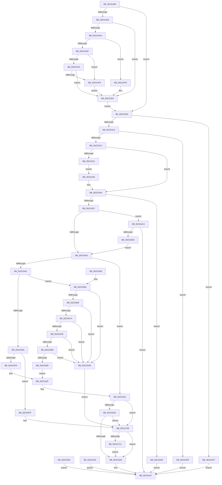

# NtSetTimerEx

- RVA: `0x00231480`–`0x00231726` (길이 `678` bytes)
- VA: `0x0000000140231480`
- 실행 섹션: `.text`
- PDB 이름 있음: `예`; PDB Function 태그: `아니요`
- unwind 정보 RVA: `0x000603C8`
- 디코드: `169`개 명령, `678/678` bytes 표시
- 미해석 바이트: `0` (있으면 어셈블리에 `.byte`로 보존)

> 이 문서는 커널 이미지의 기계어와 PDB 기호를 분석해 생성했습니다. 4번과 5번은 함수 원형과 자료형을 바이너리 사용 방식에서 추정한 C 해석이며 원본 소스 복구 결과는 아닙니다.

## 1. Dependencies

- 직접 호출 지점: **8**; 고유 호출 대상: **7**
- 직접 호출자로 확인된 함수: **0**
- RIP 상대 이미지 참조: **4**

### Outgoing calls
- `0x002314FE` → [ExRaiseDatatypeMisalignment](../../page/89/ExRaiseDatatypeMisalignment_function_00899FD0.md) (function, `0x00899FD0`)
- `0x0023159D` → [ObReferenceObjectByHandle](../../page/86/ObReferenceObjectByHandle_function_00868DB0.md) (function, `0x00868DB0`)
- `0x0023162A` → [ExpSetTimerObject](ExpSetTimerObject_function_00231730.md) (function, `0x00231730`)
- `0x00231699` → [ExpSetTimerObject2](../3A/ExpSetTimerObject2_function_003A0658.md) (function, `0x003A0658`)
- `0x002316B6` → [ObfDereferenceObjectWithTag](../2F/ObfDereferenceObjectWithTag_function_002F78E0.md) (function, `0x002F78E0`)
- `0x002316E0` → [PoCaptureReasonContext](PoCaptureReasonContext_function_00230A38.md) (function, `0x00230A38`)
- `0x00231704` → [ObfDereferenceObjectWithTag](../2F/ObfDereferenceObjectWithTag_function_002F78E0.md) (function, `0x002F78E0`)
- `0x0023171C` → [PoDestroyReasonContext](PoDestroyReasonContext_function_00230944.md) (function, `0x00230944`)

### Direct callers
- 이 함수 시작 RVA로 연결되는 직접 call은 확인되지 않았습니다. 간접 호출은 완전히 역산할 수 없습니다.

### Static image references
- `0x002315C4` → RVA `0x00FC6E4C` (`ALMOSTRO`; read)
- `0x002315CE` → RVA `0x00FC7800` (`ALMOSTRO`; read)
- `0x002315D9` → RVA `0x00FC6F20` (`ALMOSTRO`; read)
- `0x002315E9` → RVA `0x00FC6D98` (`ALMOSTRO`; read)

## 2. Other-region calls and transfers

- 다른 실행 섹션으로 향하는 call: **2**
  - `0x002314FE` → [ExRaiseDatatypeMisalignment](../../page/89/ExRaiseDatatypeMisalignment_function_00899FD0.md) (`.text` → `PAGE`)
  - `0x0023159D` → [ObReferenceObjectByHandle](../../page/86/ObReferenceObjectByHandle_function_00868DB0.md) (`.text` → `PAGE`)
- 별도 외부 분기/꼬리 이동을 확인하지 못했습니다.

## 3. Assembly (complete function range)

```asm
00231480  48 8B C4                        mov rax, rsp
00231483  48 89 58 08                     mov qword ptr [rax + 8], rbx
00231487  48 89 70 10                     mov qword ptr [rax + 0x10], rsi
0023148B  48 89 78 18                     mov qword ptr [rax + 0x18], rdi
0023148F  4C 89 60 20                     mov qword ptr [rax + 0x20], r12
00231493  41 55                           push r13
00231495  41 56                           push r14
00231497  41 57                           push r15
00231499  48 81 EC A0 00 00 00            sub rsp, 0xa0
002314A0  49 8B D8                        mov rbx, r8
002314A3  48 8B F9                        mov rdi, rcx
002314A6  0F 57 C0                        xorps xmm0, xmm0
002314A9  0F 11 40 B0                     movups xmmword ptr [rax - 0x50], xmm0
002314AD  0F 11 40 C0                     movups xmmword ptr [rax - 0x40], xmm0
002314B1  0F 11 40 D0                     movups xmmword ptr [rax - 0x30], xmm0
002314B5  C6 40 98 00                     mov byte ptr [rax - 0x68], 0
002314B9  45 33 C0                        xor r8d, r8d
002314BC  4C 89 40 A0                     mov qword ptr [rax - 0x60], r8
002314C0  65 48 8B 04 25 88 01 00 00      mov rax, qword ptr gs:[0x188]
002314C9  0F B6 B0 32 02 00 00            movzx esi, byte ptr [rax + 0x232]
002314D0  40 84 F6                        test sil, sil
002314D3  74 35                           je 0x14023150a
002314D5  45 85 C9                        test r9d, r9d
002314D8  74 29                           je 0x140231503
002314DA  F6 C3 03                        test bl, 3
002314DD  75 1F                           jne 0x1402314fe
002314DF  41 8B C9                        mov ecx, r9d
002314E2  48 03 CB                        add rcx, rbx
002314E5  48 B8 00 00 FF FF FF 7F 00 00   movabs rax, 0x7fffffff0000
002314EF  48 3B C8                        cmp rcx, rax
002314F2  77 05                           ja 0x1402314f9
002314F4  48 3B CB                        cmp rcx, rbx
002314F7  73 0A                           jae 0x140231503
002314F9  0F B6 00                        movzx eax, byte ptr [rax]
002314FC  EB 05                           jmp 0x140231503
002314FE  E8 CD 8A 66 00                  call 0x140899fd0
00231503  EB 05                           jmp 0x14023150a
00231505  E9 3D 01 00 00                  jmp 0x140231647
0023150A  85 D2                           test edx, edx
0023150C  0F 85 95 01 00 00               jne 0x1402316a7
00231512  41 83 F9 30                     cmp r9d, 0x30
00231516  0F 85 D9 01 00 00               jne 0x1402316f5
0023151C  40 84 F6                        test sil, sil
0023151F  74 29                           je 0x14023154a
00231521  0F 10 03                        movups xmm0, xmmword ptr [rbx]
00231524  0F 11 44 24 68                  movups xmmword ptr [rsp + 0x68], xmm0
00231529  0F 10 4B 10                     movups xmm1, xmmword ptr [rbx + 0x10]
0023152D  0F 11 4C 24 78                  movups xmmword ptr [rsp + 0x78], xmm1
00231532  0F 10 43 20                     movups xmm0, xmmword ptr [rbx + 0x20]
00231536  0F 11 84 24 88 00 00 00         movups xmmword ptr [rsp + 0x88], xmm0
0023153E  EB 05                           jmp 0x140231545
00231540  E9 02 01 00 00                  jmp 0x140231647
00231545  48 8D 5C 24 68                  lea rbx, [rsp + 0x68]
0023154A  81 7B 20 FF FF FF 7F            cmp dword ptr [rbx + 0x20], 0x7fffffff
00231551  0F 87 49 01 00 00               ja 0x1402316a0
00231557  48 8B 4B 18                     mov rcx, qword ptr [rbx + 0x18]
0023155B  48 85 C9                        test rcx, rcx
0023155E  0F 85 5E 01 00 00               jne 0x1402316c2
00231564  4C 8B 73 28                     mov r14, qword ptr [rbx + 0x28]
00231568  44 8B 6B 24                     mov r13d, dword ptr [rbx + 0x24]
0023156C  8B 43 20                        mov eax, dword ptr [rbx + 0x20]
0023156F  89 44 24 54                     mov dword ptr [rsp + 0x54], eax
00231573  4C 8B 7B 10                     mov r15, qword ptr [rbx + 0x10]
00231577  4C 8B 63 08                     mov r12, qword ptr [rbx + 8]
0023157B  4C 89 44 24 60                  mov qword ptr [rsp + 0x60], r8
00231580  4C 89 44 24 28                  mov qword ptr [rsp + 0x28], r8
00231585  48 8D 44 24 60                  lea rax, [rsp + 0x60]
0023158A  48 89 44 24 20                  mov qword ptr [rsp + 0x20], rax
0023158F  44 0F B6 CE                     movzx r9d, sil
00231593  45 33 C0                        xor r8d, r8d
00231596  41 8D 50 02                     lea edx, [r8 + 2]
0023159A  48 8B CF                        mov rcx, rdi
0023159D  E8 0E 78 63 00                  call 0x140868db0
002315A2  8B F8                           mov edi, eax
002315A4  85 C0                           test eax, eax
002315A6  0F 88 85 00 00 00               js 0x140231631
002315AC  4C 8B 54 24 60                  mov r10, qword ptr [rsp + 0x60]
002315B1  49 8D 42 D0                     lea rax, [r10 - 0x30]
002315B5  48 C1 E8 08                     shr rax, 8
002315B9  0F B6 D0                        movzx edx, al
002315BC  41 0F B6 42 E8                  movzx eax, byte ptr [r10 - 0x18]
002315C1  48 33 D0                        xor rdx, rax
002315C4  0F B6 05 81 58 D9 00            movzx eax, byte ptr [rip + 0xd95881]
002315CB  48 33 D0                        xor rdx, rax
002315CE  48 8D 05 2B 62 D9 00            lea rax, [rip + 0xd9622b]
002315D5  48 8B 04 D0                     mov rax, qword ptr [rax + rdx*8]
002315D9  48 3B 05 40 59 D9 00            cmp rax, qword ptr [rip + 0xd95940]
002315E0  0F 84 84 00 00 00               je 0x14023166a
002315E6  49 8B CA                        mov rcx, r10
002315E9  48 3B 05 A8 57 D9 00            cmp rax, qword ptr [rip + 0xd957a8]
002315F0  0F 85 09 01 00 00               jne 0x1402316ff
002315F6  4C 89 74 24 48                  mov qword ptr [rsp + 0x48], r14
002315FB  44 89 6C 24 40                  mov dword ptr [rsp + 0x40], r13d
00231600  8B 44 24 54                     mov eax, dword ptr [rsp + 0x54]
00231604  89 44 24 38                     mov dword ptr [rsp + 0x38], eax
00231608  0F B6 44 24 50                  movzx eax, byte ptr [rsp + 0x50]
0023160D  88 44 24 30                     mov byte ptr [rsp + 0x30], al
00231611  48 8B 44 24 58                  mov rax, qword ptr [rsp + 0x58]
00231616  48 89 44 24 28                  mov qword ptr [rsp + 0x28], rax
0023161B  4C 89 7C 24 20                  mov qword ptr [rsp + 0x20], r15
00231620  4D 8B CC                        mov r9, r12
00231623  4C 8B C3                        mov r8, rbx
00231626  40 0F B6 D6                     movzx edx, sil
0023162A  E8 01 01 00 00                  call 0x140231730
0023162F  8B F8                           mov edi, eax
00231631  85 FF                           test edi, edi
00231633  0F 88 D5 00 00 00               js 0x14023170e
00231639  81 FF 25 00 00 40               cmp edi, 0x40000025
0023163F  0F 84 C9 00 00 00               je 0x14023170e
00231645  8B C7                           mov eax, edi
00231647  4C 8D 9C 24 A0 00 00 00         lea r11, [rsp + 0xa0]
0023164F  49 8B 5B 20                     mov rbx, qword ptr [r11 + 0x20]
00231653  49 8B 73 28                     mov rsi, qword ptr [r11 + 0x28]
00231657  49 8B 7B 30                     mov rdi, qword ptr [r11 + 0x30]
0023165B  4D 8B 63 38                     mov r12, qword ptr [r11 + 0x38]
0023165F  49 8B E3                        mov rsp, r11
00231662  41 5F                           pop r15
00231664  41 5E                           pop r14
00231666  41 5D                           pop r13
00231668  C3                              ret
00231669  CC                              int3
0023166A  4D 85 E4                        test r12, r12
0023166D  75 3F                           jne 0x1402316ae
0023166F  4D 85 FF                        test r15, r15
00231672  75 3A                           jne 0x1402316ae
00231674  4C 39 7C 24 58                  cmp qword ptr [rsp + 0x58], r15
00231679  75 33                           jne 0x1402316ae
0023167B  45 85 ED                        test r13d, r13d
0023167E  75 2E                           jne 0x1402316ae
00231680  4D 85 F6                        test r14, r14
00231683  75 29                           jne 0x1402316ae
00231685  8B 44 24 54                     mov eax, dword ptr [rsp + 0x54]
00231689  4C 69 C0 10 27 00 00            imul r8, rax, 0x2710
00231690  45 33 C9                        xor r9d, r9d
00231693  48 8B D3                        mov rdx, rbx
00231696  49 8B CA                        mov rcx, r10
00231699  E8 BA EF 16 00                  call 0x1403a0658
0023169E  EB 8F                           jmp 0x14023162f
002316A0  B8 F1 00 00 C0                  mov eax, 0xc00000f1
002316A5  EB A0                           jmp 0x140231647
002316A7  B8 03 00 00 C0                  mov eax, 0xc0000003
002316AC  EB 99                           jmp 0x140231647
002316AE  BA 44 66 6C 74                  mov edx, 0x746c6644
002316B3  49 8B CA                        mov rcx, r10
002316B6  E8 25 62 0C 00                  call 0x1402f78e0
002316BB  BF 0D 00 00 C0                  mov edi, 0xc000000d
002316C0  EB 4C                           jmp 0x14023170e
002316C2  48 8D 44 24 58                  lea rax, [rsp + 0x58]
002316C7  48 89 44 24 28                  mov qword ptr [rsp + 0x28], rax
002316CC  48 8D 44 24 50                  lea rax, [rsp + 0x50]
002316D1  48 89 44 24 20                  mov qword ptr [rsp + 0x20], rax
002316D6  45 33 C9                        xor r9d, r9d
002316D9  45 33 C0                        xor r8d, r8d
002316DC  40 0F B6 D6                     movzx edx, sil
002316E0  E8 53 F3 FF FF                  call 0x140230a38
002316E5  85 C0                           test eax, eax
002316E7  0F 88 5A FF FF FF               js 0x140231647
002316ED  45 33 C0                        xor r8d, r8d
002316F0  E9 6F FE FF FF                  jmp 0x140231564
002316F5  B8 04 00 00 C0                  mov eax, 0xc0000004
002316FA  E9 48 FF FF FF                  jmp 0x140231647
002316FF  BA 44 66 6C 74                  mov edx, 0x746c6644
00231704  E8 D7 61 0C 00                  call 0x1402f78e0
00231709  BF 24 00 00 C0                  mov edi, 0xc0000024
0023170E  48 8B 4C 24 58                  mov rcx, qword ptr [rsp + 0x58]
00231713  48 85 C9                        test rcx, rcx
00231716  0F 84 29 FF FF FF               je 0x140231645
0023171C  E8 23 F2 FF FF                  call 0x140230944
00231721  E9 1F FF FF FF                  jmp 0x140231645
```

## 4. C-style interpretation (structured pseudocode)

```c
__int64 __fastcall NtSetTimerEx(__int64 a1, int a2, __int64 a3, int a4)
{
    __int64 result;
    __int64 v_rsp;
    unsigned __int64 v_stack_m18;
    unsigned __int64 v_stack_m30;
    unsigned __int64 v_stack_m40;
    unsigned __int64 v_stack_m48;
    unsigned int v_stack_m4C;
    unsigned __int64 v_stack_m50;
    unsigned __int64 v_stack_m58;
    unsigned __int64 v_stack_m60;
    unsigned int v_stack_m64;
    unsigned __int8 v_stack_m68;
    unsigned __int64 v_stack_m70;
    unsigned int v_stack_m78;
    unsigned int v_stack_m80;
    unsigned __int8 v_stack_m88;
    unsigned __int64 v_stack_m90;
    unsigned __int64 v_stack_m98;

    *(unsigned __int64 *)(v_rsp + 8) = v_rbx;
    *(unsigned __int64 *)(v_rsp + 16) = v_rsi;
    *(unsigned __int64 *)(v_rsp + 24) = v_rdi;
    *(unsigned __int64 *)(v_rsp + 32) = v_r12;
    v_rsp = (v_rsp) - (160);
    *(unsigned __int64 *)(v_rsp - 80) = v_xmm0;
    *(unsigned __int64 *)(v_rsp - 64) = v_xmm0;
    *(unsigned __int64 *)(v_rsp - 48) = v_xmm0;
    *(unsigned __int8 *)(v_rsp - 104) = 0;
    a3 = 0;
    *(unsigned __int64 *)(v_rsp - 96) = 0;
    if ((unsigned __int8)(*(unsigned __int8 *)(*(unsigned __int64 *)(gs_base + (0 + 392)) + 562)) == 0) goto loc_0023150A;
    if (a4 == 0) goto loc_00231503;
    if (((0) & (3)) != 0) goto loc_002314FE;
    a1 = ((unsigned int)(a4)) + (0);
    if (a1 > (*(unsigned __int64 *)(gs_base + (0 + 392)))) goto loc_002314F9;
    if (a1 >= 0) goto loc_00231503;
loc_002314F9:
    goto loc_00231503;
loc_002314FE:
    result = ExRaiseDatatypeMisalignment(a1, a2, a3, a4);
loc_00231503:
    goto loc_0023150A;
loc_0023150A:
    if (a2 != 0) goto loc_002316A7;
    if (a4 != 48) goto loc_002316F5;
    if ((unsigned __int8)(*(unsigned __int8 *)(*(unsigned __int64 *)(gs_base + (0 + 392)) + 562)) == 0) goto loc_0023154A;
    v_stack_m50 = v_xmm0;
    v_stack_m40 = v_xmm1;
    v_stack_m30 = v_xmm0;
    goto loc_00231545;
loc_00231545:
loc_0023154A:
    if ((*(unsigned int *)(v_stack_m50 + 32)) > 0x7FFFFFFFULL) goto loc_002316A0;
    if (*(unsigned __int64 *)(v_stack_m50 + 24) != 0) goto loc_002316C2;
loc_00231564:
    v_stack_m64 = (unsigned int)((unsigned int)(*(unsigned int *)(v_stack_m50 + 32)));
    v_stack_m58 = 0;
    v_stack_m90 = 0;
    v_stack_m98 = v_stack_m58;
    a3 = 0;
    result = ObReferenceObjectByHandle(a1, a3 + 2, a3, (unsigned __int8)(*(unsigned __int8 *)(*(unsigned __int64 *)(gs_base + (0 + 392)) + 562)));
    if (sign_flag) goto loc_00231631;
    result = (v_stack_m58 - 48) >> (8);
    a2 = ((unsigned __int8)(result)) ^ (*(unsigned __int8 *)(v_stack_m58 - 24));
    a2 = (a2) ^ (*(unsigned __int8 *)(v_rip + 14243969));
    if ((*(unsigned __int64 *)(v_rip + 14246443 + a2 * 8)) == (*(unsigned __int64 *)(v_rip + 14244160))) goto loc_0023166A;
    if ((*(unsigned __int64 *)(v_rip + 14246443 + a2 * 8)) != (*(unsigned __int64 *)(v_rip + 14243752))) goto loc_002316FF;
    v_stack_m70 = *(unsigned __int64 *)(v_stack_m50 + 40);
    v_stack_m78 = (unsigned int)((unsigned int)(*(unsigned int *)(v_stack_m50 + 36)));
    v_stack_m80 = (unsigned int)((unsigned int)(v_stack_m64));
    v_stack_m88 = (unsigned __int8)(v_stack_m68);
    v_stack_m90 = v_stack_m60;
    v_stack_m98 = *(unsigned __int64 *)(v_stack_m50 + 16);
    result = ExpSetTimerObject(v_stack_m58, (unsigned __int8)(*(unsigned __int8 *)(*(unsigned __int64 *)(gs_base + (0 + 392)) + 562)), v_stack_m50, *(unsigned __int64 *)(v_stack_m50 + 8));
loc_0023162F:
loc_00231631:
    if (sign_flag) goto loc_0023170E;
    if (((unsigned int)((unsigned int)((unsigned int)(result)))) == 0x40000025ULL) goto loc_0023170E;
loc_00231645:
loc_00231647:
    return (unsigned int)((unsigned int)((unsigned int)((unsigned int)(result))));
loc_0023166A:
    if (*(unsigned __int64 *)(v_stack_m18 + 56) != 0) goto loc_002316AE;
    if (*(unsigned __int64 *)(v_stack_m50 + 16) != 0) goto loc_002316AE;
    if (v_stack_m48 != (*(unsigned __int64 *)(v_stack_m50 + 16))) goto loc_002316AE;
    if ((unsigned int)((unsigned int)(*(unsigned int *)(v_stack_m50 + 36))) != 0) goto loc_002316AE;
    if (*(unsigned __int64 *)(v_stack_m50 + 40) != 0) goto loc_002316AE;
    a3 = (v_stack_m50) * ((unsigned int)(v_stack_m4C));
    a4 = 0;
    result = ExpSetTimerObject2(v_stack_m58, *(unsigned __int64 *)(v_stack_m18 + 32), a3, a4);
    goto loc_0023162F;
loc_002316A0:
    goto loc_00231647;
loc_002316A7:
    goto loc_00231647;
loc_002316AE:
    result = ObfDereferenceObjectWithTag(v_stack_m58, (unsigned int)(0x746C6644ULL), a3, a4);
    goto loc_0023170E;
loc_002316C2:
    v_stack_m78 = v_stack_m48;
    v_stack_m80 = v_stack_m50;
    a4 = 0;
    a3 = 0;
    result = PoCaptureReasonContext(v_stack_m58, (unsigned __int8)(*(unsigned __int64 *)(v_stack_m18 + 40)), a3, a4);
    if (sign_flag) goto loc_00231647;
    a3 = 0;
    goto loc_00231564;
loc_002316F5:
    goto loc_00231647;
loc_002316FF:
    result = ObfDereferenceObjectWithTag(v_stack_m58, (unsigned int)(0x746C6644ULL), a3, a4);
loc_0023170E:
    if (v_stack_m48 == 0) goto loc_00231645;
    result = PoDestroyReasonContext(v_stack_m48, (unsigned int)(0x746C6644ULL), a3, a4);
    goto loc_00231645;
}
```

## 5. (Beta) C Style

```c
int64_t NtSetTimerEx(int64_t Arg1, int32_t Arg2, int64_t Arg3, int32_t Arg4)
{
    int64_t result;
    int64_t local_rsp;
    uint64_t v_stack_m18;
    uint64_t v_stack_m30;
    uint64_t v_stack_m40;
    uint64_t v_stack_m48;
    uint32_t v_stack_m4C;
    uint64_t v_stack_m50;
    uint64_t v_stack_m58;
    uint64_t v_stack_m60;
    uint32_t v_stack_m64;
    uint8_t v_stack_m68;
    uint64_t v_stack_m70;
    uint32_t v_stack_m78;
    uint32_t v_stack_m80;
    uint8_t v_stack_m88;
    uint64_t v_stack_m90;
    uint64_t v_stack_m98;

    *(uint64_t *)(local_rsp + 0x8) = local_rbx;
    *(uint64_t *)(local_rsp + 0x10) = local_rsi;
    *(uint64_t *)(local_rsp + 0x18) = local_rdi;
    *(uint64_t *)(local_rsp + 0x20) = local_r12;
    local_rsp = (local_rsp) - (160);
    *(uint64_t *)(local_rsp - 0x50) = v_xmm0;
    *(uint64_t *)(local_rsp - 0x40) = v_xmm0;
    *(uint64_t *)(local_rsp - 0x30) = v_xmm0;
    *(uint8_t *)(local_rsp - 0x68) = 0;
    Arg3 = 0;
    *(uint64_t *)(local_rsp - 0x60) = 0;
    if ((uint8_t)(*(uint8_t *)(*(uint64_t *)(gs_base + (0 + 0x188)) + 0x232)) == 0) goto loc_0023150A;
    if (Arg4 == 0) goto loc_00231503;
    if (((0) & (3)) != 0) goto loc_002314FE;
    Arg1 = ((uint32_t)(Arg4)) + (0);
    if (Arg1 > (*(uint64_t *)(gs_base + (0 + 0x188)))) goto loc_002314F9;
    if (Arg1 >= 0) goto loc_00231503;
loc_002314F9:
    goto loc_00231503;
loc_002314FE:
    result = ExRaiseDatatypeMisalignment(Arg1, Arg2, Arg3, Arg4);
loc_00231503:
    goto loc_0023150A;
loc_0023150A:
    if (Arg2 != 0) goto loc_002316A7;
    if (Arg4 != 48) goto loc_002316F5;
    if ((uint8_t)(*(uint8_t *)(*(uint64_t *)(gs_base + (0 + 0x188)) + 0x232)) == 0) goto loc_0023154A;
    v_stack_m50 = v_xmm0;
    v_stack_m40 = v_xmm1;
    v_stack_m30 = v_xmm0;
    goto loc_00231545;
loc_00231545:
loc_0023154A:
    if ((*(uint32_t *)(v_stack_m50 + 0x20)) > 0x7FFFFFFFULL) goto loc_002316A0;
    if (*(uint64_t *)(v_stack_m50 + 0x18) != 0) goto loc_002316C2;
loc_00231564:
    v_stack_m64 = (uint32_t)((uint32_t)(*(uint32_t *)(v_stack_m50 + 0x20)));
    v_stack_m58 = 0;
    v_stack_m90 = 0;
    v_stack_m98 = v_stack_m58;
    Arg3 = 0;
    result = ObReferenceObjectByHandle(Arg1, Arg3 + 2, Arg3, (uint8_t)(*(uint8_t *)(*(uint64_t *)(gs_base + (0 + 0x188)) + 0x232)));
    if (sign_flag) goto loc_00231631;
    result = (v_stack_m58 - 48) >> (8);
    Arg2 = ((uint8_t)(result)) ^ (*(uint8_t *)(v_stack_m58 - 0x18));
    Arg2 = (Arg2) ^ (*(uint8_t *)(v_rip + 0xD95881));
    if ((*(uint64_t *)(v_rip + 0xD9622B + Arg2 * 8)) == (*(uint64_t *)(v_rip + 0xD95940))) goto loc_0023166A;
    if ((*(uint64_t *)(v_rip + 0xD9622B + Arg2 * 8)) != (*(uint64_t *)(v_rip + 0xD957A8))) goto loc_002316FF;
    v_stack_m70 = *(uint64_t *)(v_stack_m50 + 0x28);
    v_stack_m78 = (uint32_t)((uint32_t)(*(uint32_t *)(v_stack_m50 + 0x24)));
    v_stack_m80 = (uint32_t)((uint32_t)(v_stack_m64));
    v_stack_m88 = (uint8_t)(v_stack_m68);
    v_stack_m90 = v_stack_m60;
    v_stack_m98 = *(uint64_t *)(v_stack_m50 + 0x10);
    result = ExpSetTimerObject(v_stack_m58, (uint8_t)(*(uint8_t *)(*(uint64_t *)(gs_base + (0 + 0x188)) + 0x232)), v_stack_m50, *(uint64_t *)(v_stack_m50 + 0x8));
loc_0023162F:
loc_00231631:
    if (sign_flag) goto loc_0023170E;
    if (((uint32_t)((uint32_t)((uint32_t)(result)))) == 0x40000025ULL) goto loc_0023170E;
loc_00231645:
loc_00231647:
    return (uint32_t)((uint32_t)((uint32_t)((uint32_t)(result))));
loc_0023166A:
    if (*(uint64_t *)(v_stack_m18 + 0x38) != 0) goto loc_002316AE;
    if (*(uint64_t *)(v_stack_m50 + 0x10) != 0) goto loc_002316AE;
    if (v_stack_m48 != (*(uint64_t *)(v_stack_m50 + 0x10))) goto loc_002316AE;
    if ((uint32_t)((uint32_t)(*(uint32_t *)(v_stack_m50 + 0x24))) != 0) goto loc_002316AE;
    if (*(uint64_t *)(v_stack_m50 + 0x28) != 0) goto loc_002316AE;
    Arg3 = (v_stack_m50) * ((uint32_t)(v_stack_m4C));
    Arg4 = 0;
    result = ExpSetTimerObject2(v_stack_m58, *(uint64_t *)(v_stack_m18 + 0x20), Arg3, Arg4);
    goto loc_0023162F;
loc_002316A0:
    goto loc_00231647;
loc_002316A7:
    goto loc_00231647;
loc_002316AE:
    result = ObfDereferenceObjectWithTag(v_stack_m58, (uint32_t)(0x746C6644ULL), Arg3, Arg4);
    goto loc_0023170E;
loc_002316C2:
    v_stack_m78 = v_stack_m48;
    v_stack_m80 = v_stack_m50;
    Arg4 = 0;
    Arg3 = 0;
    result = PoCaptureReasonContext(v_stack_m58, (uint8_t)(*(uint64_t *)(v_stack_m18 + 0x28)), Arg3, Arg4);
    if (sign_flag) goto loc_00231647;
    Arg3 = 0;
    goto loc_00231564;
loc_002316F5:
    goto loc_00231647;
loc_002316FF:
    result = ObfDereferenceObjectWithTag(v_stack_m58, (uint32_t)(0x746C6644ULL), Arg3, Arg4);
loc_0023170E:
    if (v_stack_m48 == 0) goto loc_00231645;
    result = PoDestroyReasonContext(v_stack_m48, (uint32_t)(0x746C6644ULL), Arg3, Arg4);
    goto loc_00231645;
}
```

## 6. Execution-region graph

[열기: 2D/3D 그래프와 함수 탐색 컨트롤 패널](../../../control-panel.html?section=text&rva=0x00231480&view=graph)

- 2D 그래프는 위에서 아래로 흐르고, 3D 그래프는 빈 공간을 드래그해 회전합니다. Shift+드래그는 이동, 휠은 확대·축소, 함수 노드 선택은 대상 보고서 이동입니다.

### Static fallback


