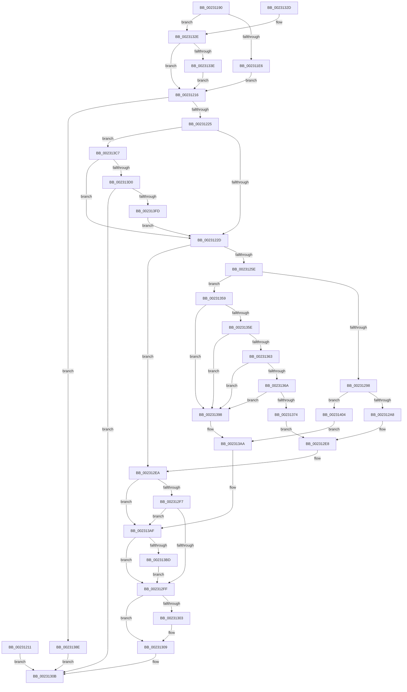

# NtSetTimer

- RVA: `0x00231190`–`0x00231415` (길이 `645` bytes)
- VA: `0x0000000140231190`
- 실행 섹션: `.text`
- PDB 이름 있음: `예`; PDB Function 태그: `아니요`
- unwind 정보 RVA: `0x00060390`
- 디코드: `154`개 명령, `645/645` bytes 표시
- 미해석 바이트: `0` (있으면 어셈블리에 `.byte`로 보존)

> 이 문서는 커널 이미지의 기계어와 PDB 기호를 분석해 생성했습니다. 4번과 5번은 함수 원형과 자료형을 바이너리 사용 방식에서 추정한 C 해석이며 원본 소스 복구 결과는 아닙니다.

## 1. Dependencies

- 직접 호출 지점: **7**; 고유 호출 대상: **6**
- 직접 호출자로 확인된 함수: **0**
- RIP 상대 이미지 참조: **5**

### Outgoing calls
- `0x0023124F` → [ObReferenceObjectByHandle](../../page/86/ObReferenceObjectByHandle_function_00868DB0.md) (function, `0x00868DB0`)
- `0x002312E3` → [ExpSetTimerObject](ExpSetTimerObject_function_00231730.md) (function, `0x00231730`)
- `0x00231384` → [ExpSetTimerObject2](../3A/ExpSetTimerObject2_function_003A0658.md) (function, `0x003A0658`)
- `0x002313A0` → [ObfDereferenceObjectWithTag](../2F/ObfDereferenceObjectWithTag_function_002F78E0.md) (function, `0x002F78E0`)
- `0x002313BD` → [PoDestroyReasonContext](PoDestroyReasonContext_function_00230944.md) (function, `0x00230944`)
- `0x002313F0` → [PoCaptureReasonContext](PoCaptureReasonContext_function_00230A38.md) (function, `0x00230A38`)
- `0x00231409` → [ObfDereferenceObjectWithTag](../2F/ObfDereferenceObjectWithTag_function_002F78E0.md) (function, `0x002F78E0`)

### Direct callers
- 이 함수 시작 RVA로 연결되는 직접 call은 확인되지 않았습니다. 간접 호출은 완전히 역산할 수 없습니다.

### Static image references
- `0x00231276` → RVA `0x00FC6E4C` (`ALMOSTRO`; read)
- `0x00231280` → RVA `0x00FC7800` (`ALMOSTRO`; read)
- `0x0023128B` → RVA `0x00FC6F20` (`ALMOSTRO`; read)
- `0x0023129B` → RVA `0x00FC6D98` (`ALMOSTRO`; read)
- `0x00231347` → RVA `0x00F0BD20` (`.data`; read)

## 2. Other-region calls and transfers

- 다른 실행 섹션으로 향하는 call: **1**
  - `0x0023124F` → [ObReferenceObjectByHandle](../../page/86/ObReferenceObjectByHandle_function_00868DB0.md) (`.text` → `PAGE`)
- 별도 외부 분기/꼬리 이동을 확인하지 못했습니다.

## 3. Assembly (complete function range)

```asm
00231190  4C 8B DC                        mov r11, rsp
00231193  49 89 5B 08                     mov qword ptr [r11 + 8], rbx
00231197  49 89 73 10                     mov qword ptr [r11 + 0x10], rsi
0023119B  49 89 7B 18                     mov qword ptr [r11 + 0x18], rdi
0023119F  4D 89 63 20                     mov qword ptr [r11 + 0x20], r12
002311A3  41 55                           push r13
002311A5  41 56                           push r14
002311A7  41 57                           push r15
002311A9  48 81 EC 80 00 00 00            sub rsp, 0x80
002311B0  4D 8B E1                        mov r12, r9
002311B3  4D 8B E8                        mov r13, r8
002311B6  4C 8B F2                        mov r14, rdx
002311B9  48 8B D9                        mov rbx, rcx
002311BC  33 C9                           xor ecx, ecx
002311BE  49 89 4B C8                     mov qword ptr [r11 - 0x38], rcx
002311C2  88 4C 24 50                     mov byte ptr [rsp + 0x50], cl
002311C6  49 89 4B C0                     mov qword ptr [r11 - 0x40], rcx
002311CA  45 32 FF                        xor r15b, r15b
002311CD  65 48 8B 04 25 88 01 00 00      mov rax, qword ptr gs:[0x188]
002311D6  0F B6 B0 32 02 00 00            movzx esi, byte ptr [rax + 0x232]
002311DD  40 84 F6                        test sil, sil
002311E0  0F 84 48 01 00 00               je 0x14023132e
002311E6  48 B8 00 00 FF FF FF 7F 00 00   movabs rax, 0x7fffffff0000
002311F0  48 3B D0                        cmp rdx, rax
002311F3  48 0F 42 C2                     cmovb rax, rdx
002311F7  90                              nop
002311F8  48 8B 00                        mov rax, qword ptr [rax]
002311FB  49 89 43 C8                     mov qword ptr [r11 - 0x38], rax
002311FF  4D 8D 73 C8                     lea r14, [r11 - 0x38]
00231203  4D 89 73 D8                     mov qword ptr [r11 - 0x28], r14
00231207  0F B6 84 24 C0 00 00 00         movzx eax, byte ptr [rsp + 0xc0]
0023120F  EB 05                           jmp 0x140231216
00231211  E9 F5 00 00 00                  jmp 0x14023130b
00231216  8B BC 24 C8 00 00 00            mov edi, dword ptr [rsp + 0xc8]
0023121D  85 FF                           test edi, edi
0023121F  0F 88 69 01 00 00               js 0x14023138e
00231225  84 C0                           test al, al
00231227  0F 85 9A 01 00 00               jne 0x1402313c7
0023122D  48 89 4C 24 68                  mov qword ptr [rsp + 0x68], rcx
00231232  48 89 4C 24 28                  mov qword ptr [rsp + 0x28], rcx
00231237  48 8D 44 24 68                  lea rax, [rsp + 0x68]
0023123C  48 89 44 24 20                  mov qword ptr [rsp + 0x20], rax
00231241  44 0F B6 CE                     movzx r9d, sil
00231245  45 33 C0                        xor r8d, r8d
00231248  41 8D 50 02                     lea edx, [r8 + 2]
0023124C  48 8B CB                        mov rcx, rbx
0023124F  E8 5C 7B 63 00                  call 0x140868db0
00231254  8B D8                           mov ebx, eax
00231256  85 C0                           test eax, eax
00231258  0F 88 8C 00 00 00               js 0x1402312ea
0023125E  4C 8B 54 24 68                  mov r10, qword ptr [rsp + 0x68]
00231263  49 8D 42 D0                     lea rax, [r10 - 0x30]
00231267  48 C1 E8 08                     shr rax, 8
0023126B  0F B6 D0                        movzx edx, al
0023126E  41 0F B6 42 E8                  movzx eax, byte ptr [r10 - 0x18]
00231273  48 33 D0                        xor rdx, rax
00231276  0F B6 05 CF 5B D9 00            movzx eax, byte ptr [rip + 0xd95bcf]
0023127D  48 33 D0                        xor rdx, rax
00231280  48 8D 05 79 65 D9 00            lea rax, [rip + 0xd96579]
00231287  48 8B 04 D0                     mov rax, qword ptr [rax + rdx*8]
0023128B  48 3B 05 8E 5C D9 00            cmp rax, qword ptr [rip + 0xd95c8e]
00231292  0F 84 C1 00 00 00               je 0x140231359
00231298  49 8B CA                        mov rcx, r10
0023129B  48 3B 05 F6 5A D9 00            cmp rax, qword ptr [rip + 0xd95af6]
002312A2  0F 85 5C 01 00 00               jne 0x140231404
002312A8  48 8B 84 24 D0 00 00 00         mov rax, qword ptr [rsp + 0xd0]
002312B0  48 89 44 24 48                  mov qword ptr [rsp + 0x48], rax
002312B5  C7 44 24 40 00 00 00 00         mov dword ptr [rsp + 0x40], 0
002312BD  89 7C 24 38                     mov dword ptr [rsp + 0x38], edi
002312C1  0F B6 44 24 50                  movzx eax, byte ptr [rsp + 0x50]
002312C6  88 44 24 30                     mov byte ptr [rsp + 0x30], al
002312CA  48 8B 44 24 58                  mov rax, qword ptr [rsp + 0x58]
002312CF  48 89 44 24 28                  mov qword ptr [rsp + 0x28], rax
002312D4  4C 89 64 24 20                  mov qword ptr [rsp + 0x20], r12
002312D9  4D 8B CD                        mov r9, r13
002312DC  4D 8B C6                        mov r8, r14
002312DF  40 0F B6 D6                     movzx edx, sil
002312E3  E8 48 04 00 00                  call 0x140231730
002312E8  8B D8                           mov ebx, eax
002312EA  BF 25 00 00 40                  mov edi, 0x40000025
002312EF  85 DB                           test ebx, ebx
002312F1  0F 88 B8 00 00 00               js 0x1402313af
002312F7  3B DF                           cmp ebx, edi
002312F9  0F 84 B0 00 00 00               je 0x1402313af
002312FF  85 DB                           test ebx, ebx
00231301  78 06                           js 0x140231309
00231303  45 84 FF                        test r15b, r15b
00231306  0F 45 DF                        cmovne ebx, edi
00231309  8B C3                           mov eax, ebx
0023130B  4C 8D 9C 24 80 00 00 00         lea r11, [rsp + 0x80]
00231313  49 8B 5B 20                     mov rbx, qword ptr [r11 + 0x20]
00231317  49 8B 73 28                     mov rsi, qword ptr [r11 + 0x28]
0023131B  49 8B 7B 30                     mov rdi, qword ptr [r11 + 0x30]
0023131F  4D 8B 63 38                     mov r12, qword ptr [r11 + 0x38]
00231323  49 8B E3                        mov rsp, r11
00231326  41 5F                           pop r15
00231328  41 5E                           pop r14
0023132A  41 5D                           pop r13
0023132C  C3                              ret
0023132D  CC                              int3
0023132E  0F B6 84 24 C0 00 00 00         movzx eax, byte ptr [rsp + 0xc0]
00231336  84 C0                           test al, al
00231338  0F 84 D8 FE FF FF               je 0x140231216
0023133E  45 0F B6 FF                     movzx r15d, r15b
00231342  B9 01 00 00 00                  mov ecx, 1
00231347  80 3D D2 A9 CD 00 00            cmp byte ptr [rip + 0xcda9d2], 0
0023134E  44 0F 45 F9                     cmovne r15d, ecx
00231352  33 C9                           xor ecx, ecx
00231354  E9 BD FE FF FF                  jmp 0x140231216
00231359  4D 85 ED                        test r13, r13
0023135C  75 3A                           jne 0x140231398
0023135E  4D 85 E4                        test r12, r12
00231361  75 35                           jne 0x140231398
00231363  4C 39 64 24 58                  cmp qword ptr [rsp + 0x58], r12
00231368  75 2E                           jne 0x140231398
0023136A  4C 39 A4 24 D0 00 00 00         cmp qword ptr [rsp + 0xd0], r12
00231372  75 24                           jne 0x140231398
00231374  4C 69 C7 10 27 00 00            imul r8, rdi, 0x2710
0023137B  45 33 C9                        xor r9d, r9d
0023137E  49 8B D6                        mov rdx, r14
00231381  49 8B CA                        mov rcx, r10
00231384  E8 CF F2 16 00                  call 0x1403a0658
00231389  E9 5A FF FF FF                  jmp 0x1402312e8
0023138E  B8 F4 00 00 C0                  mov eax, 0xc00000f4
00231393  E9 73 FF FF FF                  jmp 0x14023130b
00231398  BA 44 66 6C 74                  mov edx, 0x746c6644
0023139D  49 8B CA                        mov rcx, r10
002313A0  E8 3B 65 0C 00                  call 0x1402f78e0
002313A5  BB 0D 00 00 C0                  mov ebx, 0xc000000d
002313AA  BF 25 00 00 40                  mov edi, 0x40000025
002313AF  48 8B 4C 24 58                  mov rcx, qword ptr [rsp + 0x58]
002313B4  48 85 C9                        test rcx, rcx
002313B7  0F 84 42 FF FF FF               je 0x1402312ff
002313BD  E8 82 F5 FF FF                  call 0x140230944
002313C2  E9 38 FF FF FF                  jmp 0x1402312ff
002313C7  45 84 FF                        test r15b, r15b
002313CA  0F 85 5D FE FF FF               jne 0x14023122d
002313D0  48 8D 44 24 58                  lea rax, [rsp + 0x58]
002313D5  48 89 44 24 28                  mov qword ptr [rsp + 0x28], rax
002313DA  48 8D 44 24 50                  lea rax, [rsp + 0x50]
002313DF  48 89 44 24 20                  mov qword ptr [rsp + 0x20], rax
002313E4  41 B1 01                        mov r9b, 1
002313E7  45 33 C0                        xor r8d, r8d
002313EA  40 0F B6 D6                     movzx edx, sil
002313EE  33 C9                           xor ecx, ecx
002313F0  E8 43 F6 FF FF                  call 0x140230a38
002313F5  85 C0                           test eax, eax
002313F7  0F 88 0E FF FF FF               js 0x14023130b
002313FD  33 C9                           xor ecx, ecx
002313FF  E9 29 FE FF FF                  jmp 0x14023122d
00231404  BA 44 66 6C 74                  mov edx, 0x746c6644
00231409  E8 D2 64 0C 00                  call 0x1402f78e0
0023140E  BB 24 00 00 C0                  mov ebx, 0xc0000024
00231413  EB 95                           jmp 0x1402313aa
```

## 4. C-style interpretation (structured pseudocode)

```c
__int64 __fastcall NtSetTimer(__int64 a1, __int64 a2, __int64 a3, __int64 a4, unsigned __int8 a5, unsigned int a6, __int64 a7)
{
    __int64 result;
    __int64 v_r15;
    __int64 v_rbx;
    __int64 v_rsp;
    unsigned __int64 v_stack_m18;
    unsigned __int64 v_stack_m28;
    unsigned __int64 v_stack_m30;
    unsigned __int64 v_stack_m40;
    unsigned __int8 v_stack_m48;
    unsigned __int64 v_stack_m50;
    unsigned int v_stack_m58;
    unsigned int v_stack_m60;
    unsigned __int8 v_stack_m68;
    unsigned __int64 v_stack_m70;
    unsigned __int64 v_stack_m78;

    *(unsigned __int64 *)(v_rsp + 8) = v_rbx;
    *(unsigned __int64 *)(v_rsp + 16) = v_rsi;
    *(unsigned __int64 *)(v_rsp + 24) = v_rdi;
    *(unsigned __int64 *)(v_rsp + 32) = v_r12;
    v_rsp = (v_rsp) - (128);
    a1 = 0;
    *(unsigned __int64 *)(v_rsp - 56) = 0;
    v_stack_m48 = 0;
    *(unsigned __int64 *)(v_rsp - 64) = 0;
    v_r15 = 0;
    if ((unsigned __int8)(*(unsigned __int8 *)(*(unsigned __int64 *)(gs_base + (0 + 392)) + 562)) == 0) goto loc_0023132E;
    result = *(unsigned __int64 *)(gs_base + (0 + 392));
    if (a2 < (*(unsigned __int64 *)(gs_base + (0 + 392)))) { result = a2; }
    *(unsigned __int64 *)(v_rsp - 56) = *(unsigned __int64 *)(result);
    *(unsigned __int64 *)(v_rsp - 40) = v_rsp - 56;
    goto loc_00231216;
loc_00231216:
    if (sign_flag) goto loc_0023138E;
    if (a5 != 0) goto loc_002313C7;
loc_0023122D:
    v_stack_m30 = 0;
    v_stack_m70 = 0;
    v_stack_m78 = v_stack_m30;
    a3 = 0;
    result = ObReferenceObjectByHandle(0, a3 + 2, a3, (unsigned __int8)(*(unsigned __int8 *)(*(unsigned __int64 *)(gs_base + (0 + 392)) + 562)));
    if (sign_flag) goto loc_002312EA;
    result = (v_stack_m30 - 48) >> (8);
    a2 = ((unsigned __int8)(result)) ^ (*(unsigned __int8 *)(v_stack_m30 - 24));
    a2 = (a2) ^ (*(unsigned __int8 *)(v_rip + 14244815));
    if ((*(unsigned __int64 *)(v_rip + 14247289 + a2 * 8)) == (*(unsigned __int64 *)(v_rip + 14245006))) goto loc_00231359;
    if ((*(unsigned __int64 *)(v_rip + 14247289 + a2 * 8)) != (*(unsigned __int64 *)(v_rip + 14244598))) goto loc_00231404;
    v_stack_m50 = a7;
    v_stack_m58 = 0;
    v_stack_m60 = (unsigned int)((unsigned int)(a6));
    v_stack_m68 = (unsigned __int8)(v_stack_m48);
    v_stack_m70 = v_stack_m40;
    v_stack_m78 = a4;
    result = ExpSetTimerObject(v_stack_m30, (unsigned __int8)(*(unsigned __int8 *)(*(unsigned __int64 *)(gs_base + (0 + 392)) + 562)), v_rsp - 56, 0);
loc_002312E8:
loc_002312EA:
    if (sign_flag) goto loc_002313AF;
    if (((unsigned int)((unsigned int)((unsigned int)(result)))) == ((unsigned int)((unsigned int)(0x40000025ULL)))) goto loc_002313AF;
loc_002312FF:
    v_rbx = (unsigned int)((unsigned int)(result));
    if (!(sign_flag)) {
        v_rbx = (unsigned int)((unsigned int)(result));
        if (0 != 0) { v_rbx = (unsigned int)((unsigned int)(0x40000025ULL)); }
    }
loc_0023130B:
    return (unsigned int)((unsigned int)(v_rbx));
loc_0023132E:
    if (a5 == 0) goto loc_00231216;
    v_r15 = 0;
    if ((*(unsigned __int8 *)(v_rip + 13478354)) != 0) { v_r15 = 1; }
    a1 = 0;
    goto loc_00231216;
loc_00231359:
    if (0 != 0) goto loc_00231398;
    if (*(unsigned __int64 *)(v_stack_m18 + 56) != 0) goto loc_00231398;
    if (v_stack_m28 != (*(unsigned __int64 *)(v_stack_m18 + 56))) goto loc_00231398;
    if (a7 != (*(unsigned __int64 *)(v_stack_m18 + 56))) goto loc_00231398;
    a3 = (v_rsp - 56) * (*(unsigned __int64 *)(v_stack_m18 + 48));
    a4 = 0;
    result = ExpSetTimerObject2(v_stack_m30, v_rsp - 56, a3, a4);
    goto loc_002312E8;
loc_0023138E:
    goto loc_0023130B;
loc_00231398:
    result = ObfDereferenceObjectWithTag(v_stack_m30, (unsigned int)(0x746C6644ULL), a3, a4);
loc_002313AA:
loc_002313AF:
    if (v_stack_m28 == 0) goto loc_002312FF;
    result = PoDestroyReasonContext(v_stack_m28, (unsigned int)(0x746C6644ULL), a3, a4);
    goto loc_002312FF;
loc_002313C7:
    if ((unsigned __int8)(v_r15) != 0) goto loc_0023122D;
    v_stack_m58 = v_stack_m28;
    v_stack_m60 = v_stack_m30;
    a3 = 0;
    a1 = 0;
    result = PoCaptureReasonContext(a1, (unsigned __int8)(*(unsigned __int64 *)(v_stack_m18 + 40)), a3, 1);
    if (sign_flag) goto loc_0023130B;
    a1 = 0;
    goto loc_0023122D;
loc_00231404:
    result = ObfDereferenceObjectWithTag(a1, (unsigned int)(0x746C6644ULL), a3, 1);
    goto loc_002313AA;
}
```

## 5. (Beta) C Style

```c
int64_t NtSetTimer(int64_t Arg1, int64_t Arg2, int64_t Arg3, int64_t Arg4, uint8_t Arg5, uint32_t Arg6, int64_t Arg7)
{
    int64_t result;
    int64_t local_r15;
    int64_t local_rbx;
    int64_t local_rsp;
    uint64_t v_stack_m18;
    uint64_t v_stack_m28;
    uint64_t v_stack_m30;
    uint64_t v_stack_m40;
    uint8_t v_stack_m48;
    uint64_t v_stack_m50;
    uint32_t v_stack_m58;
    uint32_t v_stack_m60;
    uint8_t v_stack_m68;
    uint64_t v_stack_m70;
    uint64_t v_stack_m78;

    *(uint64_t *)(local_rsp + 0x8) = local_rbx;
    *(uint64_t *)(local_rsp + 0x10) = local_rsi;
    *(uint64_t *)(local_rsp + 0x18) = local_rdi;
    *(uint64_t *)(local_rsp + 0x20) = local_r12;
    local_rsp = (local_rsp) - (128);
    Arg1 = 0;
    *(uint64_t *)(local_rsp - 0x38) = 0;
    v_stack_m48 = 0;
    *(uint64_t *)(local_rsp - 0x40) = 0;
    local_r15 = 0;
    if ((uint8_t)(*(uint8_t *)(*(uint64_t *)(gs_base + (0 + 0x188)) + 0x232)) == 0) goto loc_0023132E;
    result = *(uint64_t *)(gs_base + (0 + 0x188));
    if (Arg2 < (*(uint64_t *)(gs_base + (0 + 0x188)))) { result = Arg2; }
    *(uint64_t *)(local_rsp - 0x38) = *(uint64_t *)(result);
    *(uint64_t *)(local_rsp - 0x28) = local_rsp - 56;
    goto loc_00231216;
loc_00231216:
    if (sign_flag) goto loc_0023138E;
    if (Arg5 != 0) goto loc_002313C7;
loc_0023122D:
    v_stack_m30 = 0;
    v_stack_m70 = 0;
    v_stack_m78 = v_stack_m30;
    Arg3 = 0;
    result = ObReferenceObjectByHandle(0, Arg3 + 2, Arg3, (uint8_t)(*(uint8_t *)(*(uint64_t *)(gs_base + (0 + 0x188)) + 0x232)));
    if (sign_flag) goto loc_002312EA;
    result = (v_stack_m30 - 48) >> (8);
    Arg2 = ((uint8_t)(result)) ^ (*(uint8_t *)(v_stack_m30 - 0x18));
    Arg2 = (Arg2) ^ (*(uint8_t *)(v_rip + 0xD95BCF));
    if ((*(uint64_t *)(v_rip + 0xD96579 + Arg2 * 8)) == (*(uint64_t *)(v_rip + 0xD95C8E))) goto loc_00231359;
    if ((*(uint64_t *)(v_rip + 0xD96579 + Arg2 * 8)) != (*(uint64_t *)(v_rip + 0xD95AF6))) goto loc_00231404;
    v_stack_m50 = Arg7;
    v_stack_m58 = 0;
    v_stack_m60 = (uint32_t)((uint32_t)(Arg6));
    v_stack_m68 = (uint8_t)(v_stack_m48);
    v_stack_m70 = v_stack_m40;
    v_stack_m78 = Arg4;
    result = ExpSetTimerObject(v_stack_m30, (uint8_t)(*(uint8_t *)(*(uint64_t *)(gs_base + (0 + 0x188)) + 0x232)), local_rsp - 56, 0);
loc_002312E8:
loc_002312EA:
    if (sign_flag) goto loc_002313AF;
    if (((uint32_t)((uint32_t)((uint32_t)(result)))) == ((uint32_t)((uint32_t)(0x40000025ULL)))) goto loc_002313AF;
loc_002312FF:
    local_rbx = (uint32_t)((uint32_t)(result));
    if (!(sign_flag)) {
        local_rbx = (uint32_t)((uint32_t)(result));
        if (0 != 0) { local_rbx = (uint32_t)((uint32_t)(0x40000025ULL)); }
    }
loc_0023130B:
    return (uint32_t)((uint32_t)(local_rbx));
loc_0023132E:
    if (Arg5 == 0) goto loc_00231216;
    local_r15 = 0;
    if ((*(uint8_t *)(v_rip + 0xCDA9D2)) != 0) { local_r15 = 1; }
    Arg1 = 0;
    goto loc_00231216;
loc_00231359:
    if (0 != 0) goto loc_00231398;
    if (*(uint64_t *)(v_stack_m18 + 0x38) != 0) goto loc_00231398;
    if (v_stack_m28 != (*(uint64_t *)(v_stack_m18 + 0x38))) goto loc_00231398;
    if (Arg7 != (*(uint64_t *)(v_stack_m18 + 0x38))) goto loc_00231398;
    Arg3 = (local_rsp - 56) * (*(uint64_t *)(v_stack_m18 + 0x30));
    Arg4 = 0;
    result = ExpSetTimerObject2(v_stack_m30, local_rsp - 56, Arg3, Arg4);
    goto loc_002312E8;
loc_0023138E:
    goto loc_0023130B;
loc_00231398:
    result = ObfDereferenceObjectWithTag(v_stack_m30, (uint32_t)(0x746C6644ULL), Arg3, Arg4);
loc_002313AA:
loc_002313AF:
    if (v_stack_m28 == 0) goto loc_002312FF;
    result = PoDestroyReasonContext(v_stack_m28, (uint32_t)(0x746C6644ULL), Arg3, Arg4);
    goto loc_002312FF;
loc_002313C7:
    if ((uint8_t)(local_r15) != 0) goto loc_0023122D;
    v_stack_m58 = v_stack_m28;
    v_stack_m60 = v_stack_m30;
    Arg3 = 0;
    Arg1 = 0;
    result = PoCaptureReasonContext(Arg1, (uint8_t)(*(uint64_t *)(v_stack_m18 + 0x28)), Arg3, 1);
    if (sign_flag) goto loc_0023130B;
    Arg1 = 0;
    goto loc_0023122D;
loc_00231404:
    result = ObfDereferenceObjectWithTag(Arg1, (uint32_t)(0x746C6644ULL), Arg3, 1);
    goto loc_002313AA;
}
```

## 6. Execution-region graph

[열기: 2D/3D 그래프와 함수 탐색 컨트롤 패널](../../../control-panel.html?section=text&rva=0x00231190&view=graph)

- 2D 그래프는 위에서 아래로 흐르고, 3D 그래프는 빈 공간을 드래그해 회전합니다. Shift+드래그는 이동, 휠은 확대·축소, 함수 노드 선택은 대상 보고서 이동입니다.

### Static fallback


