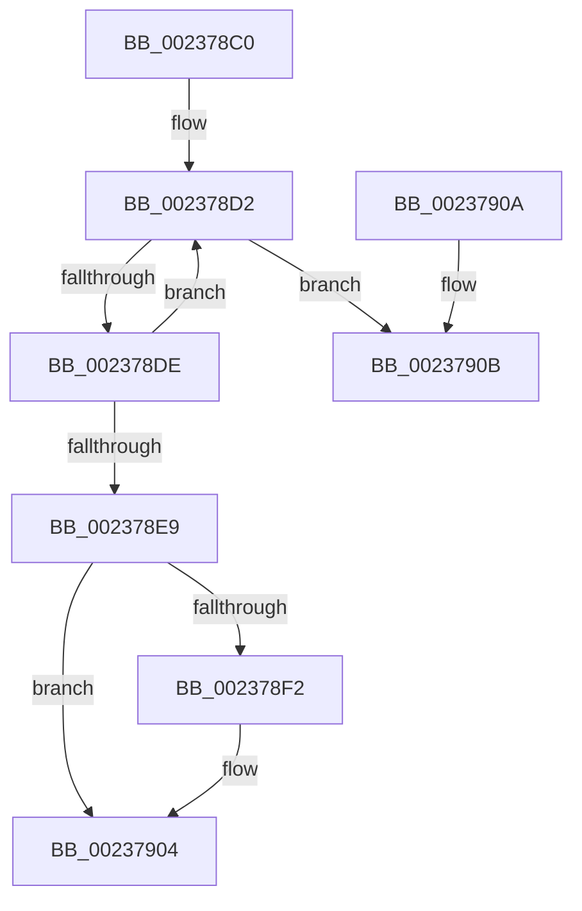

# ObFastDereferenceObjectDeferDelete

- RVA: `0x002378C0`–`0x00237912` (길이 `82` bytes)
- VA: `0x00000001402378C0`
- 실행 섹션: `.text`
- PDB 이름 있음: `예`; PDB Function 태그: `아니요`
- unwind 정보 RVA: `0x0006097C`
- 디코드: `25`개 명령, `82/82` bytes 표시
- 미해석 바이트: `0` (있으면 어셈블리에 `.byte`로 보존)

> 이 문서는 커널 이미지의 기계어와 PDB 기호를 분석해 생성했습니다. 4번과 5번은 함수 원형과 자료형을 바이너리 사용 방식에서 추정한 C 해석이며 원본 소스 복구 결과는 아닙니다.

## 1. Dependencies

- 직접 호출 지점: **1**; 고유 호출 대상: **1**
- 직접 호출자로 확인된 함수: **25**
- RIP 상대 이미지 참조: **1**

### Outgoing calls
- `0x002378FF` → [ObpPushStackInfo](../21/ObpPushStackInfo_function_002109E4.md) (function, `0x002109E4`)

### Direct callers
- [CcFlushCacheOneRange](CcFlushCacheOneRange_function_00236A30.md) at `0x00236CB9`
- [MmFlushSection](MmFlushSection_function_002375E4.md) at `0x0023774E`
- [MiLogPageAccess](../24/MiLogPageAccess_function_00240870.md) at `0x00240A42`
- [MiDeleteCachedSubsection](../29/MiDeleteCachedSubsection_function_00297888.md) at `0x00297BA6`
- [MiMakeSystemCachePteValid](../2A/MiMakeSystemCachePteValid_function_002A35D8.md) at `0x002A37C9`
- [MiCompleteRestrictedImageFault](../2C/MiCompleteRestrictedImageFault_function_002C60D4.md) at `0x002C63D5`
- [sub_0034753C](../34/Unknown_function_0034753C.md) at `0x003475A7`
- [MiEmptyPageAccessLog](../34/MiEmptyPageAccessLog_function_00348700.md) at `0x00348892`
- [CcWriteBehindPostProcess](../35/CcWriteBehindPostProcess_function_00357BB4.md) at `0x00357E0A`
- [CcWriteBehindPostProcess](../35/CcWriteBehindPostProcess_function_00357BB4.md) at `0x00357E61`
- [CcGetDirtyPagesHelper](../35/CcGetDirtyPagesHelper_function_00358D40.md) at `0x00358FC5`
- [CcPurgeAndClearCacheSection](../38/CcPurgeAndClearCacheSection_function_0038A614.md) at `0x0038A682`
- [CcDeleteSharedCacheMap](../38/CcDeleteSharedCacheMap_function_0038A804.md) at `0x0038A9C2`
- [MiFlushSection](../40/MiFlushSection_function_004036B0.md) at `0x00403E65`
- [MiFlushSection](../40/MiFlushSection_function_004036B0.md) at `0x004040CC`
- [MiGatherMappedPages](../40/MiGatherMappedPages_function_00404E80.md) at `0x00405117`
- [MiGatherMappedPages](../40/MiGatherMappedPages_function_00404E80.md) at `0x00405140`
- [MiGatherMappedPages](../40/MiGatherMappedPages_function_00404E80.md) at `0x00405221`
- [MiGatherMappedPages](../40/MiGatherMappedPages_function_00404E80.md) at `0x00405407`
- [CcIsFatalWriteError](../40/CcIsFatalWriteError_function_0040855C.md) at `0x004085B7`
- [MiDeprioritizeVad](../42/MiDeprioritizeVad_function_0042AAB4.md) at `0x0042AB4C`
- [MiCreateSystemSection](../45/MiCreateSystemSection_function_00453158.md) at `0x00453269`
- [CcPerfLogFlushCache](../47/CcPerfLogFlushCache_function_00479A54.md) at `0x00479AAE`
- [CcPerfLogFlushSection](../47/CcPerfLogFlushSection_function_0047CE0C.md) at `0x0047CE62`
- [MiSetPagesModified](../49/MiSetPagesModified_function_0049DC2C.md) at `0x0049DE4B`
- [CcUnpinRepinnedBcb](../49/CcUnpinRepinnedBcb_function_0049F560.md) at `0x0049F650`
- [sub_006E2A72](../6E/Unknown_function_006E2A72.md) at `0x006E2A93`
- [sub_006E2B2A](../6E/Unknown_function_006E2B2A.md) at `0x006E2B65`
- [sub_006EC582](../6E/Unknown_function_006EC582.md) at `0x006EC5B7`
- [sub_009E96D3](../../page/9E/Unknown_function_009E96D3.md) at `0x009E96EE`

### Static image references
- `0x002378E9` → RVA `0x00FC5010` (`ALMOSTRO`; read)

## 2. Other-region calls and transfers

- 다른 실행 섹션으로 향하는 call: **0**
- 별도 외부 분기/꼬리 이동을 확인하지 못했습니다.

## 3. Assembly (complete function range)

```asm
002378C0  40 53                           push rbx
002378C2  48 83 EC 30                     sub rsp, 0x30
002378C6  45 8B D0                        mov r10d, r8d
002378C9  48 8B DA                        mov rbx, rdx
002378CC  0F 0D 09                        prefetchw byte ptr [rcx]
002378CF  48 8B 01                        mov rax, qword ptr [rcx]
002378D2  4C 8B C8                        mov r9, rax
002378D5  4C 33 CB                        xor r9, rbx
002378D8  49 83 F9 0F                     cmp r9, 0xf
002378DC  73 2D                           jae 0x14023790b
002378DE  4C 8D 40 01                     lea r8, [rax + 1]
002378E2  F0 4C 0F B1 01                  lock cmpxchg qword ptr [rcx], r8
002378E7  75 E9                           jne 0x1402378d2
002378E9  83 3D 20 D7 D8 00 00            cmp dword ptr [rip + 0xd8d720], 0
002378F0  74 12                           je 0x140237904
002378F2  48 8D 4A D0                     lea rcx, [rdx - 0x30]
002378F6  45 8B CA                        mov r9d, r10d
002378F9  33 D2                           xor edx, edx
002378FB  44 8D 42 01                     lea r8d, [rdx + 1]
002378FF  E8 E0 90 FD FF                  call 0x1402109e4
00237904  48 83 C4 30                     add rsp, 0x30
00237908  5B                              pop rbx
00237909  C3                              ret
0023790A  CC                              int3
0023790B  83 3D FE D6 D8 00 00            cmp dword ptr [rip + 0xd8d6fe], 0
```

## 4. C-style interpretation (structured pseudocode)

```c
__int64 __fastcall ObFastDereferenceObjectDeferDelete(__int64 a1, __int64 a2, int a3)
{
    __int64 result;
    __int64 v_rsp;

    v_rsp = (v_rsp) - (48);
loc_002378D2:
    a4 = (*(unsigned __int64 *)(a1)) ^ (a2);
    if (a4 >= 15) goto loc_0023790B;
    if (a4 != 15) goto loc_002378D2;
    result = *(unsigned __int64 *)(a1);
    if ((*(unsigned int *)(v_rip + 14210848)) != 0) {
        a1 = a2 - 48;
        a4 = (unsigned int)((unsigned int)(a3));
        a2 = 0;
        a3 = a2 + 1;
        result = ObpPushStackInfo(a1, a2, a3, a4);
    }
    v_rsp = (v_rsp) + (48);
    return result;
loc_0023790B:
    return result;
}
```

## 5. (Beta) C Style

```c
int64_t ObFastDereferenceObjectDeferDelete(void *Arg1, void *Arg2, int32_t Arg3)
{
    uint8_t *arg1 = (uint8_t *)Arg1;
    uint8_t *arg2 = (uint8_t *)Arg2;

    int64_t result;
    int64_t local_rsp;

    local_rsp = (local_rsp) - (48);
loc_002378D2:
    a4 = (*(uint64_t *)(arg1)) ^ (Arg2);
    if (a4 >= 15) goto loc_0023790B;
    if (a4 != 15) goto loc_002378D2;
    result = *(uint64_t *)(arg1);
    if ((*(uint32_t *)(v_rip + 0xD8D720)) != 0) {
        Arg1 = Arg2 - 48;
        a4 = (uint32_t)((uint32_t)(Arg3));
        Arg2 = 0;
        Arg3 = Arg2 + 1;
        result = ObpPushStackInfo(Arg1, Arg2, Arg3, a4);
    }
    local_rsp = (local_rsp) + (48);
    return result;
loc_0023790B:
    return result;
}
```

### 관측된 메모리 오프셋

구조체 형식이 확인되지 않은 접근은 인자 기준의 오프셋으로만 기록했습니다.

| 기준 인자 | 오프셋 표현 | 폭 (bit) | 접근 |
|---|---:|---:|---|
| `Arg1` | `+ 0x0` | `8` | `R` |
| `Arg1` | `+ 0x0` | `64` | `R` |
| `Arg2` | `- 0x30` | `64` | `R` |

## 6. Execution-region graph

[열기: 2D/3D 그래프와 함수 탐색 컨트롤 패널](../../../control-panel.html?section=text&rva=0x002378C0&view=graph)

- 2D 그래프는 위에서 아래로 흐르고, 3D 그래프는 빈 공간을 드래그해 회전합니다. Shift+드래그는 이동, 휠은 확대·축소, 함수 노드 선택은 대상 보고서 이동입니다.

### Static fallback


