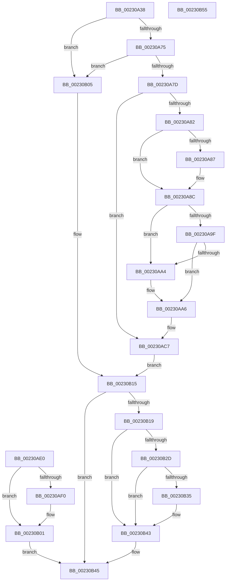

# PoCaptureReasonContext

- RVA: `0x00230A38`–`0x00230B56` (길이 `286` bytes)
- VA: `0x0000000140230A38`
- 실행 섹션: `.text`
- PDB 이름 있음: `예`; PDB Function 태그: `아니요`
- unwind 정보 RVA: `0x000602D4`
- 디코드: `77`개 명령, `286/286` bytes 표시
- 미해석 바이트: `0` (있으면 어셈블리에 `.byte`로 보존)

> 이 문서는 커널 이미지의 기계어와 PDB 기호를 분석해 생성했습니다. 4번과 5번은 함수 원형과 자료형을 바이너리 사용 방식에서 추정한 C 해석이며 원본 소스 복구 결과는 아닙니다.

## 1. Dependencies

- 직접 호출 지점: **6**; 고유 호출 대상: **4**
- 직접 호출자로 확인된 함수: **13**
- RIP 상대 이미지 참조: **0**

### Outgoing calls
- `0x00230A87` → [ExRaiseDatatypeMisalignment](../../page/89/ExRaiseDatatypeMisalignment_function_00899FD0.md) (function, `0x00899FD0`)
- `0x00230AD5` → [PopCaptureReasonContext](../41/PopCaptureReasonContext_function_0041CE0C.md) (function, `0x0041CE0C`)
- `0x00230AF8` → [ExFreePoolWithTag](../../poolcode/B8/ExFreePoolWithTag_function_00B82870.md) (function, `0x00B82870`)
- `0x00230B10` → [PopCaptureReasonContext](../41/PopCaptureReasonContext_function_0041CE0C.md) (function, `0x0041CE0C`)
- `0x00230B22` → [PoGetRequester](../5C/PoGetRequester_function_005CE468.md) (function, `0x005CE468`)
- `0x00230B3A` → [ExFreePoolWithTag](../../poolcode/B8/ExFreePoolWithTag_function_00B82870.md) (function, `0x00B82870`)

### Direct callers
- [PopPowerRequestCreateUserModeRequest](../22/PopPowerRequestCreateUserModeRequest_function_0022F91C.md) at `0x0022F956`
- [PoCreatePowerRequest](PoCreatePowerRequest_function_002309A0.md) at `0x002309DD`
- [NtSetTimer](NtSetTimer_function_00231190.md) at `0x002313F0`
- [NtSetTimerEx](NtSetTimerEx_function_00231480.md) at `0x002316E0`
- [PoRegisterSystemState](../48/PoRegisterSystemState_function_00482740.md) at `0x00482798`
- [PoCreatePowerLimitRequest](../../page/75/PoCreatePowerLimitRequest_function_00755960.md) at `0x007559AE`
- [PoSetPowerLimitValue](../../page/75/PoSetPowerLimitValue_function_00755C30.md) at `0x00755C92`
- [PoCreateThermalRequest](../../page/75/PoCreateThermalRequest_function_00756BF0.md) at `0x00756C47`
- [NtInitiatePowerAction](../../page/75/NtInitiatePowerAction_function_0075FCB0.md) at `0x0075FDAE`
- [NtSetThreadExecutionState](../../page/AC/NtSetThreadExecutionState_function_00AC0A40.md) at `0x00AC0B05`
- [NtSetSystemPowerState](../../pagelk/B7/NtSetSystemPowerState_function_00B70890.md) at `0x00B709BF`
- [PopInitializeHighPerfPowerRequest](../../init/C3/PopInitializeHighPerfPowerRequest_function_00C3D718.md) at `0x00C3D807`
- [PopPowerAggregatorInitialize](../../init/C7/PopPowerAggregatorInitialize_function_00C77B94.md) at `0x00C77D58`

### Static image references
- 디코드된 RIP-relative 메모리 참조가 없습니다.

## 2. Other-region calls and transfers

- 다른 실행 섹션으로 향하는 call: **3**
  - `0x00230A87` → [ExRaiseDatatypeMisalignment](../../page/89/ExRaiseDatatypeMisalignment_function_00899FD0.md) (`.text` → `PAGE`)
  - `0x00230AF8` → [ExFreePoolWithTag](../../poolcode/B8/ExFreePoolWithTag_function_00B82870.md) (`.text` → `POOLCODE`)
  - `0x00230B3A` → [ExFreePoolWithTag](../../poolcode/B8/ExFreePoolWithTag_function_00B82870.md) (`.text` → `POOLCODE`)
- 별도 외부 분기/꼬리 이동을 확인하지 못했습니다.

## 3. Assembly (complete function range)

```asm
00230A38  48 89 5C 24 08                  mov qword ptr [rsp + 8], rbx
00230A3D  48 89 74 24 10                  mov qword ptr [rsp + 0x10], rsi
00230A42  57                              push rdi
00230A43  48 83 EC 50                     sub rsp, 0x50
00230A47  49 8B F0                        mov rsi, r8
00230A4A  40 8A FA                        mov dil, dl
00230A4D  0F 57 C0                        xorps xmm0, xmm0
00230A50  33 C0                           xor eax, eax
00230A52  0F 11 44 24 28                  movups xmmword ptr [rsp + 0x28], xmm0
00230A57  0F 11 44 24 38                  movups xmmword ptr [rsp + 0x38], xmm0
00230A5C  48 89 44 24 48                  mov qword ptr [rsp + 0x48], rax
00230A61  48 8B 9C 24 88 00 00 00         mov rbx, qword ptr [rsp + 0x88]
00230A69  48 21 03                        and qword ptr [rbx], rax
00230A6C  48 85 C9                        test rcx, rcx
00230A6F  0F 84 90 00 00 00               je 0x140230b05
00230A75  84 D2                           test dl, dl
00230A77  0F 84 88 00 00 00               je 0x140230b05
00230A7D  45 84 C9                        test r9b, r9b
00230A80  75 45                           jne 0x140230ac7
00230A82  F6 C1 03                        test cl, 3
00230A85  74 05                           je 0x140230a8c
00230A87  E8 44 95 66 00                  call 0x140899fd0
00230A8C  48 8D 41 28                     lea rax, [rcx + 0x28]
00230A90  48 BA 00 00 FF FF FF 7F 00 00   movabs rdx, 0x7fffffff0000
00230A9A  48 3B C2                        cmp rax, rdx
00230A9D  77 05                           ja 0x140230aa4
00230A9F  48 3B C1                        cmp rax, rcx
00230AA2  73 02                           jae 0x140230aa6
00230AA4  8A 02                           mov al, byte ptr [rdx]
00230AA6  0F 10 01                        movups xmm0, xmmword ptr [rcx]
00230AA9  0F 11 44 24 28                  movups xmmword ptr [rsp + 0x28], xmm0
00230AAE  0F 10 49 10                     movups xmm1, xmmword ptr [rcx + 0x10]
00230AB2  0F 11 4C 24 38                  movups xmmword ptr [rsp + 0x38], xmm1
00230AB7  F2 0F 10 41 20                  movsd xmm0, qword ptr [rcx + 0x20]
00230ABC  F2 0F 11 44 24 48               movsd qword ptr [rsp + 0x48], xmm0
00230AC2  48 8D 4C 24 28                  lea rcx, [rsp + 0x28]
00230AC7  4C 8B CB                        mov r9, rbx
00230ACA  4C 8B 84 24 80 00 00 00         mov r8, qword ptr [rsp + 0x80]
00230AD2  40 8A D7                        mov dl, dil
00230AD5  E8 32 C3 1E 00                  call 0x14041ce0c
00230ADA  89 44 24 20                     mov dword ptr [rsp + 0x20], eax
00230ADE  EB 35                           jmp 0x140230b15
00230AE0  8B F8                           mov edi, eax
00230AE2  48 8B 9C 24 88 00 00 00         mov rbx, qword ptr [rsp + 0x88]
00230AEA  48 83 3B 00                     cmp qword ptr [rbx], 0
00230AEE  74 11                           je 0x140230b01
00230AF0  BA 50 52 43 78                  mov edx, 0x78435250
00230AF5  48 8B 0B                        mov rcx, qword ptr [rbx]
00230AF8  E8 73 1D 95 00                  call 0x140b82870
00230AFD  48 83 23 00                     and qword ptr [rbx], 0
00230B01  8B C7                           mov eax, edi
00230B03  EB 40                           jmp 0x140230b45
00230B05  4C 8B CB                        mov r9, rbx
00230B08  4C 8B 84 24 80 00 00 00         mov r8, qword ptr [rsp + 0x80]
00230B10  E8 F7 C2 1E 00                  call 0x14041ce0c
00230B15  85 C0                           test eax, eax
00230B17  78 2C                           js 0x140230b45
00230B19  4C 8B 03                        mov r8, qword ptr [rbx]
00230B1C  48 8B D6                        mov rdx, rsi
00230B1F  40 8A CF                        mov cl, dil
00230B22  E8 41 D9 39 00                  call 0x1405ce468
00230B27  8B F8                           mov edi, eax
00230B29  85 C0                           test eax, eax
00230B2B  79 16                           jns 0x140230b43
00230B2D  48 8B 0B                        mov rcx, qword ptr [rbx]
00230B30  48 85 C9                        test rcx, rcx
00230B33  74 0E                           je 0x140230b43
00230B35  BA 50 52 43 78                  mov edx, 0x78435250
00230B3A  E8 31 1D 95 00                  call 0x140b82870
00230B3F  48 83 23 00                     and qword ptr [rbx], 0
00230B43  8B C7                           mov eax, edi
00230B45  48 8B 5C 24 60                  mov rbx, qword ptr [rsp + 0x60]
00230B4A  48 8B 74 24 68                  mov rsi, qword ptr [rsp + 0x68]
00230B4F  48 83 C4 50                     add rsp, 0x50
00230B53  5F                              pop rdi
00230B54  C3                              ret
00230B55  CC                              int3
```

## 4. C-style interpretation (structured pseudocode)

```c
__int64 __fastcall PoCaptureReasonContext(__int64 a1, unsigned __int8 a2, __int64 a3, unsigned __int8 a4, __int64 a5, __int64 a6)
{
    __int64 result;
    __int64 v_rsp;
    unsigned __int64 v_stack_m10;
    unsigned __int64 v_stack_m20;
    unsigned __int64 v_stack_m30;
    unsigned int v_stack_m38;
    unsigned __int64 v_stack_p10;
    unsigned __int64 v_stack_p30;
    unsigned __int64 v_stack_p8;

    v_stack_p8 = v_rbx;
    v_stack_p10 = v_rsi;
    v_rsp = (v_rsp) - (80);
    result = 0;
    v_stack_m30 = v_xmm0;
    v_stack_m20 = v_xmm0;
    v_stack_m10 = 0;
    if (a1 == 0) goto loc_00230B05;
    if (a2 == 0) goto loc_00230B05;
    if (a4 != 0) goto loc_00230AC7;
    if ((((unsigned __int8)(a1)) & (3)) != 0) {
        result = ExRaiseDatatypeMisalignment(a1, a2, a3, a4);
    }
    if ((a1 + 40) > a2) goto loc_00230AA4;
    result = a1 + 40;
    if ((a1 + 40) < a1) {
        result = *(unsigned __int8 *)(a2);
    }
    v_stack_m30 = v_xmm0;
    v_stack_m20 = v_xmm1;
    v_stack_m10 = v_xmm0;
loc_00230AC7:
    result = PopCaptureReasonContext(v_stack_m30, a2, a5, a6);
    v_stack_m38 = (unsigned int)(result);
    goto loc_00230B15;
loc_00230B05:
    result = PopCaptureReasonContext(v_stack_m30, a2, a5, a6);
loc_00230B15:
    if (sign_flag) goto loc_00230B45;
    result = PoGetRequester(a2, a3, *(unsigned __int64 *)(a6), a6);
    if (!sign_flag) goto loc_00230B43;
    if (*(unsigned __int64 *)(a6) != 0) {
        a2 = 0x78435250ULL;
        result = ExFreePoolWithTag(*(unsigned __int64 *)(a6), a2, *(unsigned __int64 *)(a6), a6);
    }
loc_00230B45:
    v_rsp = (v_rsp) + (80);
    return (unsigned int)((unsigned int)((unsigned int)((unsigned int)(result))));
}
```

## 5. (Beta) C Style

```c
int64_t PoCaptureReasonContext(int64_t Arg1, uint8_t Arg2, int64_t Arg3, uint8_t Arg4, int64_t Arg5, void *Arg6)
{
    uint8_t *arg6 = (uint8_t *)Arg6;

    int64_t result;
    int64_t local_rsp;
    uint64_t v_stack_m10;
    uint64_t v_stack_m20;
    uint64_t v_stack_m30;
    uint32_t v_stack_m38;
    uint64_t v_stack_p10;
    uint64_t v_stack_p30;
    uint64_t v_stack_p8;

    v_stack_p8 = local_rbx;
    v_stack_p10 = local_rsi;
    local_rsp = (local_rsp) - (80);
    result = 0;
    v_stack_m30 = v_xmm0;
    v_stack_m20 = v_xmm0;
    v_stack_m10 = 0;
    if (Arg1 == 0) goto loc_00230B05;
    if (Arg2 == 0) goto loc_00230B05;
    if (Arg4 != 0) goto loc_00230AC7;
    if ((((uint8_t)(Arg1)) & (3)) != 0) {
        result = ExRaiseDatatypeMisalignment(Arg1, Arg2, Arg3, Arg4);
    }
    if ((Arg1 + 40) > Arg2) goto loc_00230AA4;
    result = Arg1 + 40;
    if ((Arg1 + 40) < Arg1) {
        result = *(uint8_t *)(Arg2);
    }
    v_stack_m30 = v_xmm0;
    v_stack_m20 = v_xmm1;
    v_stack_m10 = v_xmm0;
loc_00230AC7:
    result = PopCaptureReasonContext(v_stack_m30, Arg2, Arg5, Arg6);
    v_stack_m38 = (uint32_t)(result);
    goto loc_00230B15;
loc_00230B05:
    result = PopCaptureReasonContext(v_stack_m30, Arg2, Arg5, Arg6);
loc_00230B15:
    if (sign_flag) goto loc_00230B45;
    result = PoGetRequester(Arg2, Arg3, *(uint64_t *)(arg6), Arg6);
    if (!sign_flag) goto loc_00230B43;
    if (*(uint64_t *)(arg6) != 0) {
        Arg2 = 0x78435250ULL;
        result = ExFreePoolWithTag(*(uint64_t *)(arg6), Arg2, *(uint64_t *)(arg6), Arg6);
    }
loc_00230B45:
    local_rsp = (local_rsp) + (80);
    return (uint32_t)((uint32_t)((uint32_t)((uint32_t)(result))));
}
```

### 관측된 메모리 오프셋

구조체 형식이 확인되지 않은 접근은 인자 기준의 오프셋으로만 기록했습니다.

| 기준 인자 | 오프셋 표현 | 폭 (bit) | 접근 |
|---|---:|---:|---|
| `Arg6` | `+ 0x0` | `64` | `R` |
| `Arg6` | `+ 0x0` | `64` | `R/W` |

## 6. Execution-region graph

[열기: 2D/3D 그래프와 함수 탐색 컨트롤 패널](../../../control-panel.html?section=text&rva=0x00230A38&view=graph)

- 2D 그래프는 위에서 아래로 흐르고, 3D 그래프는 빈 공간을 드래그해 회전합니다. Shift+드래그는 이동, 휠은 확대·축소, 함수 노드 선택은 대상 보고서 이동입니다.

### Static fallback


