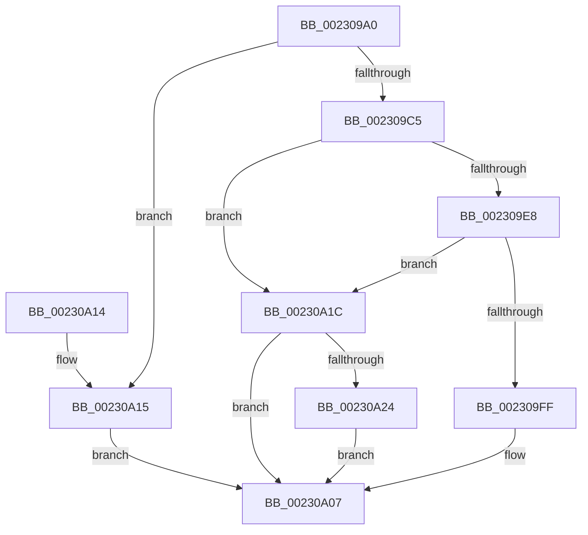

# PoCreatePowerRequest

- RVA: `0x002309A0`–`0x00230A30` (길이 `144` bytes)
- VA: `0x00000001402309A0`
- 실행 섹션: `.text`
- PDB 이름 있음: `예`; PDB Function 태그: `아니요`
- unwind 정보 RVA: `0x000602C4`
- 디코드: `44`개 명령, `144/144` bytes 표시
- 미해석 바이트: `0` (있으면 어셈블리에 `.byte`로 보존)

> 이 문서는 커널 이미지의 기계어와 PDB 기호를 분석해 생성했습니다. 4번과 5번은 함수 원형과 자료형을 바이너리 사용 방식에서 추정한 C 해석이며 원본 소스 복구 결과는 아닙니다.

## 1. Dependencies

- 직접 호출 지점: **3**; 고유 호출 대상: **3**
- 직접 호출자로 확인된 함수: **0**
- RIP 상대 이미지 참조: **0**

### Outgoing calls
- `0x002309DD` → [PoCaptureReasonContext](PoCaptureReasonContext_function_00230A38.md) (function, `0x00230A38`)
- `0x002309F4` → [PopPowerRequestCreateCommon](PopPowerRequestCreateCommon_function_00230150.md) (function, `0x00230150`)
- `0x00230A29` → [PoDestroyReasonContext](PoDestroyReasonContext_function_00230944.md) (function, `0x00230944`)

### Direct callers
- 이 함수 시작 RVA로 연결되는 직접 call은 확인되지 않았습니다. 간접 호출은 완전히 역산할 수 없습니다.

### Static image references
- 디코드된 RIP-relative 메모리 참조가 없습니다.

## 2. Other-region calls and transfers

- 다른 실행 섹션으로 향하는 call: **0**
- 별도 외부 분기/꼬리 이동을 확인하지 못했습니다.

## 3. Assembly (complete function range)

```asm
002309A0  4C 8B DC                        mov r11, rsp
002309A3  49 89 5B 18                     mov qword ptr [r11 + 0x18], rbx
002309A7  56                              push rsi
002309A8  48 83 EC 30                     sub rsp, 0x30
002309AC  49 83 63 10 00                  and qword ptr [r11 + 0x10], 0
002309B1  49 8B C0                        mov rax, r8
002309B4  49 83 63 08 00                  and qword ptr [r11 + 8], 0
002309B9  48 8B F1                        mov rsi, rcx
002309BC  48 83 21 00                     and qword ptr [rcx], 0
002309C0  48 85 D2                        test rdx, rdx
002309C3  74 50                           je 0x140230a15
002309C5  49 8D 4B 08                     lea rcx, [r11 + 8]
002309C9  4C 8B C2                        mov r8, rdx
002309CC  49 89 4B F0                     mov qword ptr [r11 - 0x10], rcx
002309D0  41 B1 01                        mov r9b, 1
002309D3  49 83 63 E8 00                  and qword ptr [r11 - 0x18], 0
002309D8  48 8B C8                        mov rcx, rax
002309DB  33 D2                           xor edx, edx
002309DD  E8 56 00 00 00                  call 0x140230a38
002309E2  8B D8                           mov ebx, eax
002309E4  85 C0                           test eax, eax
002309E6  78 34                           js 0x140230a1c
002309E8  48 8B 4C 24 40                  mov rcx, qword ptr [rsp + 0x40]
002309ED  4C 8D 44 24 48                  lea r8, [rsp + 0x48]
002309F2  33 D2                           xor edx, edx
002309F4  E8 57 F7 FF FF                  call 0x140230150
002309F9  8B D8                           mov ebx, eax
002309FB  85 C0                           test eax, eax
002309FD  78 1D                           js 0x140230a1c
002309FF  48 8B 44 24 48                  mov rax, qword ptr [rsp + 0x48]
00230A04  48 89 06                        mov qword ptr [rsi], rax
00230A07  8B C3                           mov eax, ebx
00230A09  48 8B 5C 24 50                  mov rbx, qword ptr [rsp + 0x50]
00230A0E  48 83 C4 30                     add rsp, 0x30
00230A12  5E                              pop rsi
00230A13  C3                              ret
00230A14  CC                              int3
00230A15  BB 0D 00 00 C0                  mov ebx, 0xc000000d
00230A1A  EB EB                           jmp 0x140230a07
00230A1C  48 83 7C 24 40 00               cmp qword ptr [rsp + 0x40], 0
00230A22  74 E3                           je 0x140230a07
00230A24  48 8B 4C 24 40                  mov rcx, qword ptr [rsp + 0x40]
00230A29  E8 16 FF FF FF                  call 0x140230944
00230A2E  EB D7                           jmp 0x140230a07
```

## 4. C-style interpretation (structured pseudocode)

```c
__int64 __fastcall PoCreatePowerRequest(__int64 a1, __int64 a2, __int64 a3)
{
    __int64 result;
    __int64 v_rsp;
    unsigned __int64 v_stack_p10;
    unsigned __int64 v_stack_p18;
    unsigned __int64 v_stack_p40;
    unsigned __int64 v_stack_p8;

    *(unsigned __int64 *)(v_rsp + 24) = v_rbx;
    v_rsp = (v_rsp) - (48);
    if (a2 == 0) goto loc_00230A15;
    *(unsigned __int64 *)(v_rsp - 16) = v_rsp + 8;
    a2 = 0;
    result = PoCaptureReasonContext(a3, a2, a2, 1);
    if (sign_flag) goto loc_00230A1C;
    a2 = 0;
    result = PopPowerRequestCreateCommon(v_stack_p8, a2, v_stack_p10, 1);
    if (sign_flag) goto loc_00230A1C;
    *(unsigned __int64 *)(a1) = v_stack_p10;
loc_00230A07:
    v_rsp = (v_rsp) + (48);
    return (unsigned int)((unsigned int)((unsigned int)((unsigned int)(result))));
loc_00230A15:
    goto loc_00230A07;
loc_00230A1C:
    if (v_stack_p40 == 0) goto loc_00230A07;
    result = PoDestroyReasonContext(v_stack_p40, a2, v_stack_p10, 1);
    goto loc_00230A07;
}
```

## 5. (Beta) C Style

```c
int64_t PoCreatePowerRequest(void *Arg1, int64_t Arg2, int64_t Arg3)
{
    uint8_t *arg1 = (uint8_t *)Arg1;

    int64_t result;
    int64_t local_rsp;
    uint64_t v_stack_p10;
    uint64_t v_stack_p18;
    uint64_t v_stack_p40;
    uint64_t v_stack_p8;

    *(uint64_t *)(local_rsp + 0x18) = local_rbx;
    local_rsp = (local_rsp) - (48);
    if (Arg2 == 0) goto loc_00230A15;
    *(uint64_t *)(local_rsp - 0x10) = local_rsp + 8;
    Arg2 = 0;
    result = PoCaptureReasonContext(Arg3, Arg2, Arg2, 1);
    if (sign_flag) goto loc_00230A1C;
    Arg2 = 0;
    result = PopPowerRequestCreateCommon(v_stack_p8, Arg2, v_stack_p10, 1);
    if (sign_flag) goto loc_00230A1C;
    *(uint64_t *)(arg1) = v_stack_p10;
loc_00230A07:
    local_rsp = (local_rsp) + (48);
    return (uint32_t)((uint32_t)((uint32_t)((uint32_t)(result))));
loc_00230A15:
    goto loc_00230A07;
loc_00230A1C:
    if (v_stack_p40 == 0) goto loc_00230A07;
    result = PoDestroyReasonContext(v_stack_p40, Arg2, v_stack_p10, 1);
    goto loc_00230A07;
}
```

### 관측된 메모리 오프셋

구조체 형식이 확인되지 않은 접근은 인자 기준의 오프셋으로만 기록했습니다.

| 기준 인자 | 오프셋 표현 | 폭 (bit) | 접근 |
|---|---:|---:|---|
| `Arg1` | `+ 0x0` | `64` | `R/W` |
| `Arg1` | `+ 0x0` | `64` | `W` |

## 6. Execution-region graph

[열기: 2D/3D 그래프와 함수 탐색 컨트롤 패널](../../../control-panel.html?section=text&rva=0x002309A0&view=graph)

- 2D 그래프는 위에서 아래로 흐르고, 3D 그래프는 빈 공간을 드래그해 회전합니다. Shift+드래그는 이동, 휠은 확대·축소, 함수 노드 선택은 대상 보고서 이동입니다.

### Static fallback


