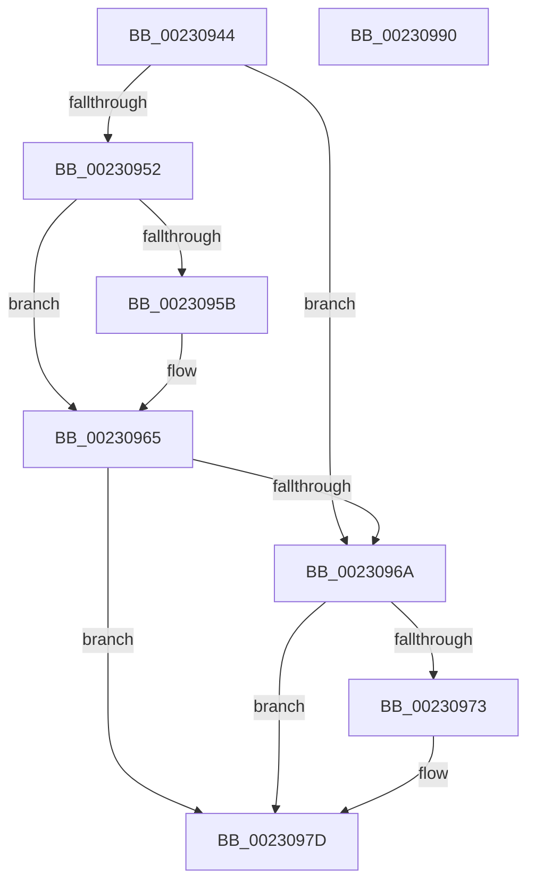

# PoDestroyReasonContext

- RVA: `0x00230944`–`0x00230991` (길이 `77` bytes)
- VA: `0x0000000140230944`
- 실행 섹션: `.text`
- PDB 이름 있음: `예`; PDB Function 태그: `아니요`
- unwind 정보 RVA: `0x0005CF00`
- 디코드: `24`개 명령, `77/77` bytes 표시
- 미해석 바이트: `0` (있으면 어셈블리에 `.byte`로 보존)

> 이 문서는 커널 이미지의 기계어와 PDB 기호를 분석해 생성했습니다. 4번과 5번은 함수 원형과 자료형을 바이너리 사용 방식에서 추정한 C 해석이며 원본 소스 복구 결과는 아닙니다.

## 1. Dependencies

- 직접 호출 지점: **3**; 고유 호출 대상: **2**
- 직접 호출자로 확인된 함수: **19**
- RIP 상대 이미지 참조: **0**

### Outgoing calls
- `0x00230960` → [ObfDereferenceObjectWithTag](../2F/ObfDereferenceObjectWithTag_function_002F78E0.md) (function, `0x002F78E0`)
- `0x00230978` → [ExFreePoolWithTag](../../poolcode/B8/ExFreePoolWithTag_function_00B82870.md) (function, `0x00B82870`)
- `0x00230985` → [ExFreePoolWithTag](../../poolcode/B8/ExFreePoolWithTag_function_00B82870.md) (function, `0x00B82870`)

### Direct callers
- [PopPowerRequestCreateUserModeRequest](../22/PopPowerRequestCreateUserModeRequest_function_0022F91C.md) at `0x0022FA01`
- [PoCreatePowerRequest](PoCreatePowerRequest_function_002309A0.md) at `0x00230A29`
- [ExpDeleteTimer](ExpDeleteTimer_function_00230C40.md) at `0x00230D71`
- [NtCancelTimer](NtCancelTimer_function_00230D90.md) at `0x00231160`
- [NtSetTimer](NtSetTimer_function_00231190.md) at `0x002313BD`
- [NtSetTimerEx](NtSetTimerEx_function_00231480.md) at `0x0023171C`
- [ExpSetTimerObject](ExpSetTimerObject_function_00231730.md) at `0x0023254A`
- [PoRegisterSystemState](../48/PoRegisterSystemState_function_00482740.md) at `0x004827AE`
- [PoCreatePowerLimitRequest](../../page/75/PoCreatePowerLimitRequest_function_00755960.md) at `0x00755A0B`
- [PoSetPowerLimitValue](../../page/75/PoSetPowerLimitValue_function_00755C30.md) at `0x00755DE1`
- [PopFreePowerLimitRequest](../../page/75/PopFreePowerLimitRequest_function_00756494.md) at `0x00756665`
- [PoCreateThermalRequest](../../page/75/PoCreateThermalRequest_function_00756BF0.md) at `0x00756CCA`
- [PoDeleteThermalRequest](../../page/75/PoDeleteThermalRequest_function_00756D00.md) at `0x00756D12`
- [NtInitiatePowerAction](../../page/75/NtInitiatePowerAction_function_0075FCB0.md) at `0x0075FF5B`
- [PopPowerRequestDelete](../../page/91/PopPowerRequestDelete_function_00913030.md) at `0x009130CD`
- [NtSetThreadExecutionState](../../page/AC/NtSetThreadExecutionState_function_00AC0A40.md) at `0x00AC0B3D`
- [NtSetSystemPowerState](../../pagelk/B7/NtSetSystemPowerState_function_00B70890.md) at `0x00B70A76`
- [PopInitializeHighPerfPowerRequest](../../init/C3/PopInitializeHighPerfPowerRequest_function_00C3D718.md) at `0x00C3D830`
- [PopPowerAggregatorInitialize](../../init/C7/PopPowerAggregatorInitialize_function_00C77B94.md) at `0x00C77D83`

### Static image references
- 디코드된 RIP-relative 메모리 참조가 없습니다.

## 2. Other-region calls and transfers

- 다른 실행 섹션으로 향하는 call: **2**
  - `0x00230978` → [ExFreePoolWithTag](../../poolcode/B8/ExFreePoolWithTag_function_00B82870.md) (`.text` → `POOLCODE`)
  - `0x00230985` → [ExFreePoolWithTag](../../poolcode/B8/ExFreePoolWithTag_function_00B82870.md) (`.text` → `POOLCODE`)
- 별도 외부 분기/꼬리 이동을 확인하지 못했습니다.

## 3. Assembly (complete function range)

```asm
00230944  40 53                           push rbx
00230946  48 83 EC 20                     sub rsp, 0x20
0023094A  83 39 00                        cmp dword ptr [rcx], 0
0023094D  48 8B D9                        mov rbx, rcx
00230950  75 18                           jne 0x14023096a
00230952  48 8B 49 08                     mov rcx, qword ptr [rcx + 8]
00230956  48 85 C9                        test rcx, rcx
00230959  74 0A                           je 0x140230965
0023095B  BA 50 6F 44 67                  mov edx, 0x67446f50
00230960  E8 7B 6F 0C 00                  call 0x1402f78e0
00230965  83 3B 00                        cmp dword ptr [rbx], 0
00230968  74 13                           je 0x14023097d
0023096A  48 8B 4B 18                     mov rcx, qword ptr [rbx + 0x18]
0023096E  48 85 C9                        test rcx, rcx
00230971  74 0A                           je 0x14023097d
00230973  BA 50 52 43 78                  mov edx, 0x78435250
00230978  E8 F3 1E 95 00                  call 0x140b82870
0023097D  BA 50 52 43 78                  mov edx, 0x78435250
00230982  48 8B CB                        mov rcx, rbx
00230985  E8 E6 1E 95 00                  call 0x140b82870
0023098A  48 83 C4 20                     add rsp, 0x20
0023098E  5B                              pop rbx
0023098F  C3                              ret
00230990  CC                              int3
```

## 4. C-style interpretation (structured pseudocode)

```c
__int64 __fastcall PoDestroyReasonContext(__int64 a1)
{
    __int64 result;
    __int64 v_rsp;

    v_rsp = (v_rsp) - (32);
    if ((*(unsigned int *)(a1)) != 0) goto loc_0023096A;
    if (*(unsigned __int64 *)(a1 + 8) != 0) {
        a2 = 0x67446F50ULL;
        result = ObfDereferenceObjectWithTag(*(unsigned __int64 *)(a1 + 8), a2, a3, a4);
    }
    if ((*(unsigned int *)(a1)) == 0) goto loc_0023097D;
loc_0023096A:
    if (*(unsigned __int64 *)(a1 + 24) != 0) {
        a2 = 0x78435250ULL;
        result = ExFreePoolWithTag(*(unsigned __int64 *)(a1 + 24), a2, a3, a4);
    }
    result = ExFreePoolWithTag(a1, (unsigned int)(0x78435250ULL), a3, a4);
    v_rsp = (v_rsp) + (32);
    return result;
}
```

## 5. (Beta) C Style

```c
int64_t PoDestroyReasonContext(void *Arg1)
{
    uint8_t *arg1 = (uint8_t *)Arg1;

    int64_t result;
    int64_t local_rsp;

    local_rsp = (local_rsp) - (32);
    if ((*(uint32_t *)(arg1)) != 0) goto loc_0023096A;
    if (*(uint64_t *)(arg1 + 0x8) != 0) {
        a2 = 0x67446F50ULL;
        result = ObfDereferenceObjectWithTag(*(uint64_t *)(arg1 + 0x8), a2, a3, a4);
    }
    if ((*(uint32_t *)(arg1)) == 0) goto loc_0023097D;
loc_0023096A:
    if (*(uint64_t *)(arg1 + 0x18) != 0) {
        a2 = 0x78435250ULL;
        result = ExFreePoolWithTag(*(uint64_t *)(arg1 + 0x18), a2, a3, a4);
    }
    result = ExFreePoolWithTag(Arg1, (uint32_t)(0x78435250ULL), a3, a4);
    local_rsp = (local_rsp) + (32);
    return result;
}
```

### 관측된 메모리 오프셋

구조체 형식이 확인되지 않은 접근은 인자 기준의 오프셋으로만 기록했습니다.

| 기준 인자 | 오프셋 표현 | 폭 (bit) | 접근 |
|---|---:|---:|---|
| `Arg1` | `+ 0x0` | `32` | `R` |
| `Arg1` | `+ 0x8` | `64` | `R` |
| `Arg1` | `+ 0x18` | `64` | `R` |

## 6. Execution-region graph

[열기: 2D/3D 그래프와 함수 탐색 컨트롤 패널](../../../control-panel.html?section=text&rva=0x00230944&view=graph)

- 2D 그래프는 위에서 아래로 흐르고, 3D 그래프는 빈 공간을 드래그해 회전합니다. Shift+드래그는 이동, 휠은 확대·축소, 함수 노드 선택은 대상 보고서 이동입니다.

### Static fallback


