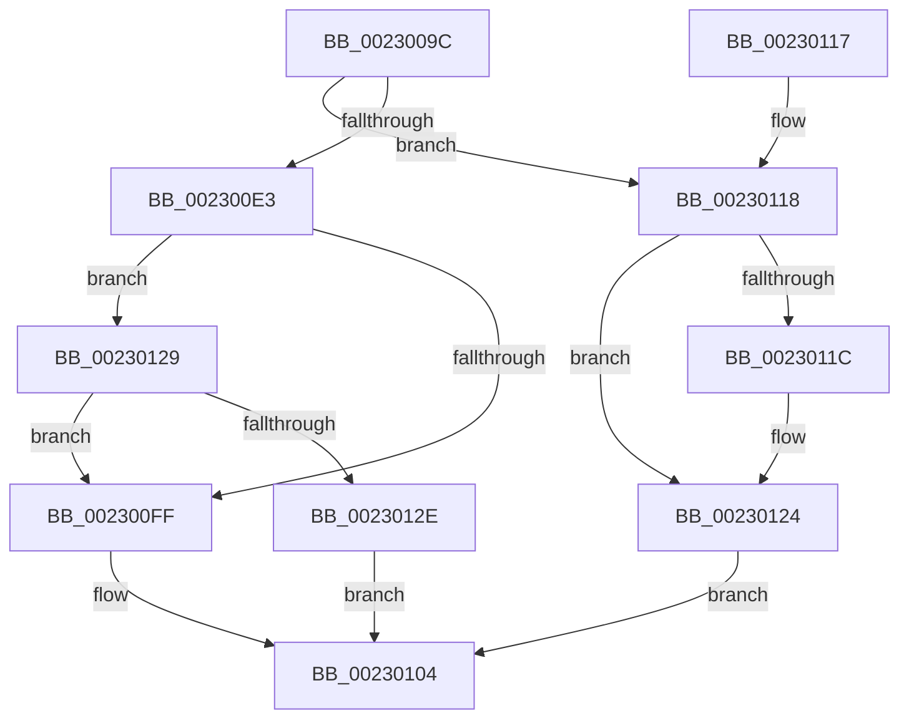

# PoStoreDiagnosticContext

- RVA: `0x0023009C`–`0x0023014A` (길이 `174` bytes)
- VA: `0x000000014023009C`
- 실행 섹션: `.text`
- PDB 이름 있음: `예`; PDB Function 태그: `아니요`
- unwind 정보 RVA: `0x00060238`
- 디코드: `57`개 명령, `174/174` bytes 표시
- 미해석 바이트: `0` (있으면 어셈블리에 `.byte`로 보존)

> 이 문서는 커널 이미지의 기계어와 PDB 기호를 분석해 생성했습니다. 4번과 5번은 함수 원형과 자료형을 바이너리 사용 방식에서 추정한 C 해석이며 원본 소스 복구 결과는 아닙니다.

## 1. Dependencies

- 직접 호출 지점: **2**; 고유 호출 대상: **2**
- 직접 호출자로 확인된 함수: **11**
- RIP 상대 이미지 참조: **0**

### Outgoing calls
- `0x002300C6` → [PoStoreRequester](PoStoreRequester_function_002304D4.md) (function, `0x002304D4`)
- `0x00230141` → [memcpy](../6C/memcpy_function_006C6840.md) (function, `0x006C6840`)

### Direct callers
- [PopTraceThermalRequestPassiveHistogram](../42/PopTraceThermalRequestPassiveHistogram_function_0042FFB4.md) at `0x00430037`
- [PopTraceThermalRequestPassiveHistogram](../42/PopTraceThermalRequestPassiveHistogram_function_0042FFB4.md) at `0x00430069`
- [ExGetWakeTimerList](../4C/ExGetWakeTimerList_function_004CB964.md) at `0x004CBA0A`
- [ExGetWakeTimerList](../4C/ExGetWakeTimerList_function_004CB964.md) at `0x004CBB39`
- [PopTraceThermalRequestActiveActivity](../4E/PopTraceThermalRequestActiveActivity_function_004E9104.md) at `0x004E9194`
- [PopTraceThermalRequestActiveActivity](../4E/PopTraceThermalRequestActiveActivity_function_004E9104.md) at `0x004E91C6`
- [PopTracePowerLimitHistogram](../5D/PopTracePowerLimitHistogram_function_005D7B10.md) at `0x005D7B89`
- [PopTracePowerLimitHistogram](../5D/PopTracePowerLimitHistogram_function_005D7B10.md) at `0x005D7BC6`
- [PopExecutePowerAction](../../page/75/PopExecutePowerAction_function_0075E6B4.md) at `0x0075EA38`
- [PopExecutePowerAction](../../page/75/PopExecutePowerAction_function_0075E6B4.md) at `0x0075EA68`
- [PopDiagTracePowerLimitRequest](../../page/76/PopDiagTracePowerLimitRequest_function_007626D0.md) at `0x007627B5`
- [PopDiagTracePowerLimitRequest](../../page/76/PopDiagTracePowerLimitRequest_function_007626D0.md) at `0x007627E7`
- [PopDiagTracePowerLimitRequestValueUpdate](../../page/76/PopDiagTracePowerLimitRequestValueUpdate_function_007629E8.md) at `0x00762A94`
- [PopDiagTracePowerLimitRequestValueUpdate](../../page/76/PopDiagTracePowerLimitRequestValueUpdate_function_007629E8.md) at `0x00762AC3`
- [PopUmpoSendPowerRequestCreate](../../page/A7/PopUmpoSendPowerRequestCreate_function_00A7CE40.md) at `0x00A7CE87`
- [PopUmpoSendPowerRequestCreate](../../page/A7/PopUmpoSendPowerRequestCreate_function_00A7CE40.md) at `0x00A7CEE0`
- [PopGetPowerRequestListInfo](../../page/A9/PopGetPowerRequestListInfo_function_00A92948.md) at `0x00A929AC`
- [PopGetPowerRequestListInfo](../../page/A9/PopGetPowerRequestListInfo_function_00A92948.md) at `0x00A92A96`
- [PopDiagTraceThermalRequest](../../page/AD/PopDiagTraceThermalRequest_function_00ADF828.md) at `0x00ADF8F7`
- [PopDiagTraceThermalRequest](../../page/AD/PopDiagTraceThermalRequest_function_00ADF828.md) at `0x00ADF929`
- [ExGetNextWakeTime](../../pagelk/B7/ExGetNextWakeTime_function_00B7E018.md) at `0x00B7E14C`
- [ExGetNextWakeTime](../../pagelk/B7/ExGetNextWakeTime_function_00B7E018.md) at `0x00B7E17B`

### Static image references
- 디코드된 RIP-relative 메모리 참조가 없습니다.

## 2. Other-region calls and transfers

- 다른 실행 섹션으로 향하는 call: **0**
- 별도 외부 분기/꼬리 이동을 확인하지 못했습니다.

## 3. Assembly (complete function range)

```asm
0023009C  48 8B C4                        mov rax, rsp
0023009F  48 89 58 10                     mov qword ptr [rax + 0x10], rbx
002300A3  48 89 68 18                     mov qword ptr [rax + 0x18], rbp
002300A7  56                              push rsi
002300A8  57                              push rdi
002300A9  41 56                           push r14
002300AB  48 83 EC 20                     sub rsp, 0x20
002300AF  4D 8B 30                        mov r14, qword ptr [r8]
002300B2  49 8B F0                        mov rsi, r8
002300B5  4C 8D 40 08                     lea r8, [rax + 8]
002300B9  4C 89 70 08                     mov qword ptr [rax + 8], r14
002300BD  45 33 C9                        xor r9d, r9d
002300C0  48 8B DA                        mov rbx, rdx
002300C3  48 8B E9                        mov rbp, rcx
002300C6  E8 09 04 00 00                  call 0x1402304d4
002300CB  4C 8B 4D 30                     mov r9, qword ptr [rbp + 0x30]
002300CF  8B D0                           mov edx, eax
002300D1  48 8B 4C 24 40                  mov rcx, qword ptr [rsp + 0x40]
002300D6  8B F8                           mov edi, eax
002300D8  C1 EA 1F                        shr edx, 0x1f
002300DB  80 F2 01                        xor dl, 1
002300DE  4D 85 C9                        test r9, r9
002300E1  74 35                           je 0x140230118
002300E3  48 83 C1 07                     add rcx, 7
002300E7  48 03 CB                        add rcx, rbx
002300EA  48 83 E1 F8                     and rcx, 0xfffffffffffffff8
002300EE  4C 8B C1                        mov r8, rcx
002300F1  4C 2B C3                        sub r8, rbx
002300F4  4B 8D 04 08                     lea rax, [r8 + r9]
002300F8  48 89 06                        mov qword ptr [rsi], rax
002300FB  84 D2                           test dl, dl
002300FD  75 2A                           jne 0x140230129
002300FF  B8 23 00 00 C0                  mov eax, 0xc0000023
00230104  48 8B 5C 24 48                  mov rbx, qword ptr [rsp + 0x48]
00230109  48 8B 6C 24 50                  mov rbp, qword ptr [rsp + 0x50]
0023010E  48 83 C4 20                     add rsp, 0x20
00230112  41 5E                           pop r14
00230114  5F                              pop rdi
00230115  5E                              pop rsi
00230116  C3                              ret
00230117  CC                              int3
00230118  84 D2                           test dl, dl
0023011A  74 08                           je 0x140230124
0023011C  48 83 63 20 00                  and qword ptr [rbx + 0x20], 0
00230121  48 89 0B                        mov qword ptr [rbx], rcx
00230124  48 89 0E                        mov qword ptr [rsi], rcx
00230127  EB DB                           jmp 0x140230104
00230129  4C 3B F0                        cmp r14, rax
0023012C  72 D1                           jb 0x1402300ff
0023012E  4C 89 43 20                     mov qword ptr [rbx + 0x20], r8
00230132  48 8D 55 3F                     lea rdx, [rbp + 0x3f]
00230136  48 89 03                        mov qword ptr [rbx], rax
00230139  48 83 E2 F8                     and rdx, 0xfffffffffffffff8
0023013D  4C 8B 45 30                     mov r8, qword ptr [rbp + 0x30]
00230141  E8 FA 66 49 00                  call 0x1406c6840
00230146  8B C7                           mov eax, edi
00230148  EB BA                           jmp 0x140230104
```

## 4. C-style interpretation (structured pseudocode)

```c
__int64 __fastcall PoStoreDiagnosticContext(__int64 a1, __int64 a2, __int64 a3, int a4)
{
    __int64 result;
    __int64 v_rsp;
    unsigned __int64 v_stack_p10;
    unsigned __int64 v_stack_p18;
    unsigned __int64 v_stack_p8;

    *(unsigned __int64 *)(v_rsp + 16) = v_rbx;
    *(unsigned __int64 *)(v_rsp + 24) = v_rbp;
    v_rsp = (v_rsp) - (32);
    *(unsigned __int64 *)(v_rsp + 8) = *(unsigned __int64 *)(a3);
    a4 = 0;
    result = PoStoreRequester(a1, a2, v_rsp + 8, a4);
    a2 = (unsigned int)(((unsigned int)((unsigned int)(result))) >> (31));
    a2 = (unsigned __int8)((a2) ^ (1));
    if (*(unsigned __int64 *)(a1 + 48) == 0) goto loc_00230118;
    a1 = (v_stack_p8) + (7);
    a1 = (a1) + (a2);
    a1 = (a1) & (-8);
    a3 = (a1) - (a2);
    *(unsigned __int64 *)(a3) = a3 + *(unsigned __int64 *)(a1 + 48) * 1;
    if ((unsigned __int8)(a2) != 0) goto loc_00230129;
loc_002300FF:
loc_00230104:
    v_rsp = (v_rsp) + (32);
    return (unsigned int)(0xC0000023ULL);
loc_00230118:
    if ((unsigned __int8)(a2) != 0) {
        *(unsigned __int64 *)(v_stack_p10) = a1;
    }
    *(unsigned __int64 *)(a3) = a1;
    goto loc_00230104;
loc_00230129:
    if ((*(unsigned __int64 *)(a3)) < ((unsigned int)(0xC0000023ULL))) goto loc_002300FF;
    *(unsigned __int64 *)(v_stack_p10 + 32) = a3;
    *(unsigned __int64 *)(v_stack_p10) = (unsigned int)(0xC0000023ULL);
    a2 = (v_stack_p18 + 63) & (-8);
    result = memcpy(a1, a2, *(unsigned __int64 *)(v_stack_p18 + 48), *(unsigned __int64 *)(a1 + 48));
    goto loc_00230104;
}
```

## 5. (Beta) C Style

```c
int64_t PoStoreDiagnosticContext(void *Arg1, void *Arg2, void *Arg3, int32_t Arg4)
{
    uint8_t *arg1 = (uint8_t *)Arg1;
    uint8_t *arg2 = (uint8_t *)Arg2;
    uint8_t *arg3 = (uint8_t *)Arg3;

    int64_t result;
    int64_t local_rsp;
    uint64_t v_stack_p10;
    uint64_t v_stack_p18;
    uint64_t v_stack_p8;

    *(uint64_t *)(local_rsp + 0x10) = local_rbx;
    *(uint64_t *)(local_rsp + 0x18) = local_rbp;
    local_rsp = (local_rsp) - (32);
    *(uint64_t *)(local_rsp + 0x8) = *(uint64_t *)(arg3);
    Arg4 = 0;
    result = PoStoreRequester(Arg1, Arg2, local_rsp + 8, Arg4);
    Arg2 = (uint32_t)(((uint32_t)((uint32_t)(result))) >> (31));
    Arg2 = (uint8_t)((Arg2) ^ (1));
    if (*(uint64_t *)(arg1 + 0x30) == 0) goto loc_00230118;
    Arg1 = (v_stack_p8) + (7);
    Arg1 = (Arg1) + (Arg2);
    Arg1 = (Arg1) & (-8);
    Arg3 = (Arg1) - (Arg2);
    *(void **)(arg3) = Arg3 + *(uint64_t *)(arg1 + 0x30) * 1;
    if ((uint8_t)(Arg2) != 0) goto loc_00230129;
loc_002300FF:
loc_00230104:
    local_rsp = (local_rsp) + (32);
    return (uint32_t)(0xC0000023ULL);
loc_00230118:
    if ((uint8_t)(Arg2) != 0) {
        *(void **)(v_stack_p10) = Arg1;
    }
    *(void **)(arg3) = Arg1;
    goto loc_00230104;
loc_00230129:
    if ((*(uint64_t *)(arg3)) < ((uint32_t)(0xC0000023ULL))) goto loc_002300FF;
    *(void **)(v_stack_p10 + 0x20) = Arg3;
    *(uint64_t *)(v_stack_p10) = (uint32_t)(0xC0000023ULL);
    Arg2 = (v_stack_p18 + 63) & (-8);
    result = memcpy(Arg1, Arg2, *(uint64_t *)(v_stack_p18 + 0x30), *(uint64_t *)(arg1 + 0x30));
    goto loc_00230104;
}
```

### 관측된 메모리 오프셋

구조체 형식이 확인되지 않은 접근은 인자 기준의 오프셋으로만 기록했습니다.

| 기준 인자 | 오프셋 표현 | 폭 (bit) | 접근 |
|---|---:|---:|---|
| `Arg1` | `+ 0x30` | `64` | `R` |
| `Arg1` | `+ 0x3F` | `64` | `R` |
| `Arg2` | `+ 0x0` | `64` | `W` |
| `Arg2` | `+ 0x20` | `64` | `R/W` |
| `Arg2` | `+ 0x20` | `64` | `W` |
| `Arg3` | `+ 0x0` | `64` | `R` |
| `Arg3` | `+ 0x0` | `64` | `W` |

## 6. Execution-region graph

[열기: 2D/3D 그래프와 함수 탐색 컨트롤 패널](../../../control-panel.html?section=text&rva=0x0023009C&view=graph)

- 2D 그래프는 위에서 아래로 흐르고, 3D 그래프는 빈 공간을 드래그해 회전합니다. Shift+드래그는 이동, 휠은 확대·축소, 함수 노드 선택은 대상 보고서 이동입니다.

### Static fallback


