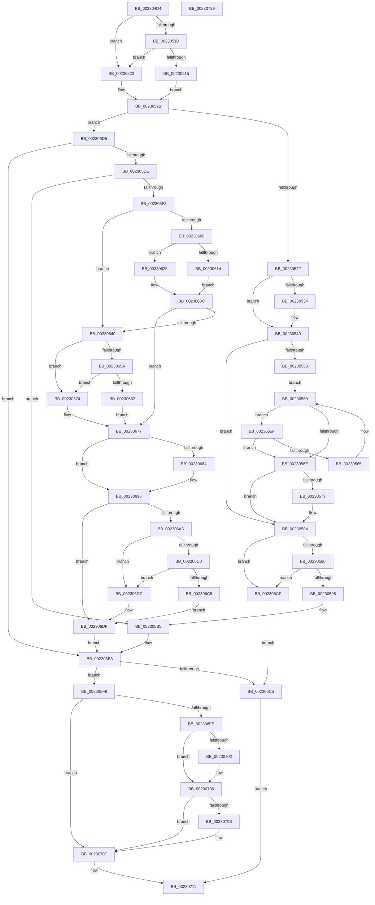

# PoStoreRequester

- RVA: `0x002304D4`–`0x0023072A` (길이 `598` bytes)
- VA: `0x00000001402304D4`
- 실행 섹션: `.text`
- PDB 이름 있음: `예`; PDB Function 태그: `아니요`
- unwind 정보 RVA: `0x00060284`
- 디코드: `187`개 명령, `598/598` bytes 표시
- 미해석 바이트: `0` (있으면 어셈블리에 `.byte`로 보존)

> 이 문서는 커널 이미지의 기계어와 PDB 기호를 분석해 생성했습니다. 4번과 5번은 함수 원형과 자료형을 바이너리 사용 방식에서 추정한 C 해석이며 원본 소스 복구 결과는 아닙니다.

## 1. Dependencies

- 직접 호출 지점: **7**; 고유 호출 대상: **5**
- 직접 호출자로 확인된 함수: **3**
- RIP 상대 이미지 참조: **0**

### Outgoing calls
- `0x0023059E` → [memcpy](../6C/memcpy_function_006C6840.md) (function, `0x006C6840`)
- `0x002305E3` → [IoGetDeviceAttachmentBaseRefWithTag](../27/IoGetDeviceAttachmentBaseRefWithTag_function_00272788.md) (function, `0x00272788`)
- `0x0023061B` → [IoGetDeviceProperty](../../page/8F/IoGetDeviceProperty_function_008FA720.md) (function, `0x008FA720`)
- `0x0023062B` → [IoGetDeviceProperty](../../page/8F/IoGetDeviceProperty_function_008FA720.md) (function, `0x008FA720`)
- `0x0023066A` → [RtlStringCbCopyUnicodeString](../41/RtlStringCbCopyUnicodeString_function_0041D164.md) (function, `0x0041D164`)
- `0x002306CE` → [RtlStringCbCopyUnicodeString](../41/RtlStringCbCopyUnicodeString_function_0041D164.md) (function, `0x0041D164`)
- `0x002306E7` → [ObfDereferenceObjectWithTag](../2F/ObfDereferenceObjectWithTag_function_002F78E0.md) (function, `0x002F78E0`)

### Direct callers
- [PoStoreDiagnosticContext](PoStoreDiagnosticContext_function_0023009C.md) at `0x002300C6`
- [PopUmpoSendPowerRequestOverrideQuery](PopUmpoSendPowerRequestOverrideQuery_function_00230418.md) at `0x00230441`
- [PopUmpoSendPowerRequestOverrideQuery](PopUmpoSendPowerRequestOverrideQuery_function_00230418.md) at `0x00230477`
- [PopDiagTracePowerRequestCreate](../../page/A3/PopDiagTracePowerRequestCreate_function_00A38EEC.md) at `0x00A38FCC`
- [PopDiagTracePowerRequestCreate](../../page/A3/PopDiagTracePowerRequestCreate_function_00A38EEC.md) at `0x00A39006`

### Static image references
- 디코드된 RIP-relative 메모리 참조가 없습니다.

## 2. Other-region calls and transfers

- 다른 실행 섹션으로 향하는 call: **2**
  - `0x0023061B` → [IoGetDeviceProperty](../../page/8F/IoGetDeviceProperty_function_008FA720.md) (`.text` → `PAGE`)
  - `0x0023062B` → [IoGetDeviceProperty](../../page/8F/IoGetDeviceProperty_function_008FA720.md) (`.text` → `PAGE`)
- 별도 외부 분기/꼬리 이동을 확인하지 못했습니다.

## 3. Assembly (complete function range)

```asm
002304D4  48 89 5C 24 18                  mov qword ptr [rsp + 0x18], rbx
002304D9  55                              push rbp
002304DA  56                              push rsi
002304DB  57                              push rdi
002304DC  41 54                           push r12
002304DE  41 55                           push r13
002304E0  41 56                           push r14
002304E2  41 57                           push r15
002304E4  48 83 EC 30                     sub rsp, 0x30
002304E8  4D 8B 38                        mov r15, qword ptr [r8]
002304EB  45 33 D2                        xor r10d, r10d
002304EE  48 8B DA                        mov rbx, rdx
002304F1  44 89 54 24 78                  mov dword ptr [rsp + 0x78], r10d
002304F6  41 8A D2                        mov dl, r10b
002304F9  4D 8B E8                        mov r13, r8
002304FC  88 54 24 70                     mov byte ptr [rsp + 0x70], dl
00230500  BE 28 00 00 00                  mov esi, 0x28
00230505  45 8B E2                        mov r12d, r10d
00230508  45 8B F2                        mov r14d, r10d
0023050B  48 85 DB                        test rbx, rbx
0023050E  74 13                           je 0x140230523
00230510  4C 3B FE                        cmp r15, rsi
00230513  72 0E                           jb 0x140230523
00230515  8B 01                           mov eax, dword ptr [rcx]
00230517  4C 8D 73 28                     lea r14, [rbx + 0x28]
0023051B  89 43 08                        mov dword ptr [rbx + 8], eax
0023051E  40 B7 01                        mov dil, 1
00230521  EB 03                           jmp 0x140230526
00230523  41 8A FA                        mov dil, r10b
00230526  44 39 11                        cmp dword ptr [rcx], r10d
00230529  0F 84 A6 00 00 00               je 0x1402305d5
0023052F  40 84 FF                        test dil, dil
00230532  74 0C                           je 0x140230540
00230534  8B 41 20                        mov eax, dword ptr [rcx + 0x20]
00230537  89 43 18                        mov dword ptr [rbx + 0x18], eax
0023053A  8B 41 28                        mov eax, dword ptr [rcx + 0x28]
0023053D  89 43 1C                        mov dword ptr [rbx + 0x1c], eax
00230540  44 0F B7 41 10                  movzx r8d, word ptr [rcx + 0x10]
00230545  48 8B 51 18                     mov rdx, qword ptr [rcx + 0x18]
00230549  44 89 44 24 78                  mov dword ptr [rsp + 0x78], r8d
0023054E  45 84 C9                        test r9b, r9b
00230551  74 31                           je 0x140230584
00230553  41 8B C0                        mov eax, r8d
00230556  48 D1 E8                        shr rax, 1
00230559  48 8D 04 42                     lea rax, [rdx + rax*2]
0023055D  EB 0A                           jmp 0x140230569
0023055F  66 83 38 5C                     cmp word ptr [rax], 0x5c
00230563  74 09                           je 0x14023056e
00230565  48 83 E8 02                     sub rax, 2
00230569  48 3B C2                        cmp rax, rdx
0023056C  75 F1                           jne 0x14023055f
0023056E  48 3B C2                        cmp rax, rdx
00230571  74 11                           je 0x140230584
00230573  48 83 C0 02                     add rax, 2
00230577  2B D0                           sub edx, eax
00230579  44 03 C2                        add r8d, edx
0023057C  48 8B D0                        mov rdx, rax
0023057F  44 89 44 24 78                  mov dword ptr [rsp + 0x78], r8d
00230584  41 8B E8                        mov ebp, r8d
00230587  49 8D 70 2A                     lea rsi, [r8 + 0x2a]
0023058B  40 84 FF                        test dil, dil
0023058E  74 3F                           je 0x1402305cf
00230590  4C 3B FE                        cmp r15, rsi
00230593  72 3A                           jb 0x1402305cf
00230595  44 8B C5                        mov r8d, ebp
00230598  49 8B CE                        mov rcx, r14
0023059B  40 B7 01                        mov dil, 1
0023059E  E8 9D 62 49 00                  call 0x1406c6840
002305A3  48 D1 ED                        shr rbp, 1
002305A6  45 33 D2                        xor r10d, r10d
002305A9  66 45 89 14 6E                  mov word ptr [r14 + rbp*2], r10w
002305AE  4C 2B F3                        sub r14, rbx
002305B1  4C 89 73 10                     mov qword ptr [rbx + 0x10], r14
002305B5  41 8A D2                        mov dl, r10b
002305B8  49 89 75 00                     mov qword ptr [r13], rsi
002305BC  40 84 FF                        test dil, dil
002305BF  0F 85 33 01 00 00               jne 0x1402306f8
002305C5  B8 23 00 00 C0                  mov eax, 0xc0000023
002305CA  E9 42 01 00 00                  jmp 0x140230711
002305CF  49 89 75 00                     mov qword ptr [r13], rsi
002305D3  EB F0                           jmp 0x1402305c5
002305D5  48 8B 49 08                     mov rcx, qword ptr [rcx + 8]
002305D9  48 85 C9                        test rcx, rcx
002305DC  74 DA                           je 0x1402305b8
002305DE  BA 50 6F 44 67                  mov edx, 0x67446f50
002305E3  E8 A0 21 04 00                  call 0x140272788
002305E8  45 33 D2                        xor r10d, r10d
002305EB  48 8B E8                        mov rbp, rax
002305EE  48 85 C0                        test rax, rax
002305F1  74 C2                           je 0x1402305b5
002305F3  48 8B 80 38 01 00 00            mov rax, qword ptr [rax + 0x138]
002305FA  4C 39 50 28                     cmp qword ptr [rax + 0x28], r10
002305FE  74 40                           je 0x140230640
00230600  33 D2                           xor edx, edx
00230602  48 8D 44 24 78                  lea rax, [rsp + 0x78]
00230607  48 89 44 24 20                  mov qword ptr [rsp + 0x20], rax
0023060C  48 8B CD                        mov rcx, rbp
0023060F  40 84 FF                        test dil, dil
00230612  74 11                           je 0x140230625
00230614  45 8D 47 D8                     lea r8d, [r15 - 0x28]
00230618  4D 8B CE                        mov r9, r14
0023061B  E8 00 A1 6C 00                  call 0x1408fa720
00230620  45 33 D2                        xor r10d, r10d
00230623  EB 17                           jmp 0x14023063c
00230625  45 33 C9                        xor r9d, r9d
00230628  45 33 C0                        xor r8d, r8d
0023062B  E8 F0 A0 6C 00                  call 0x1408fa720
00230630  3D 23 00 00 C0                  cmp eax, 0xc0000023
00230635  4D 8B D4                        mov r10, r12
00230638  41 0F 44 C2                     cmove eax, r10d
0023063C  85 C0                           test eax, eax
0023063E  79 37                           jns 0x140230677
00230640  4C 8B 45 08                     mov r8, qword ptr [rbp + 8]
00230644  49 83 C0 38                     add r8, 0x38
00230648  41 0F B7 08                     movzx ecx, word ptr [r8]
0023064C  83 C1 02                        add ecx, 2
0023064F  8B C1                           mov eax, ecx
00230651  89 4C 24 78                     mov dword ptr [rsp + 0x78], ecx
00230655  40 84 FF                        test dil, dil
00230658  74 1A                           je 0x140230674
0023065A  48 03 C6                        add rax, rsi
0023065D  4C 3B F8                        cmp r15, rax
00230660  72 12                           jb 0x140230674
00230662  8B D1                           mov edx, ecx
00230664  40 B7 01                        mov dil, 1
00230667  49 8B CE                        mov rcx, r14
0023066A  E8 F5 CA 1E 00                  call 0x14041d164
0023066F  45 33 D2                        xor r10d, r10d
00230672  EB 03                           jmp 0x140230677
00230674  41 8A FA                        mov dil, r10b
00230677  8B 4C 24 78                     mov ecx, dword ptr [rsp + 0x78]
0023067B  48 8D 71 28                     lea rsi, [rcx + 0x28]
0023067F  40 84 FF                        test dil, dil
00230682  74 12                           je 0x140230696
00230684  49 8B C6                        mov rax, r14
00230687  C6 44 24 70 01                  mov byte ptr [rsp + 0x70], 1
0023068C  48 2B C3                        sub rax, rbx
0023068F  48 89 43 10                     mov qword ptr [rbx + 0x10], rax
00230693  4C 03 F1                        add r14, rcx
00230696  48 8B 85 38 01 00 00            mov rax, qword ptr [rbp + 0x138]
0023069D  48 8B 48 28                     mov rcx, qword ptr [rax + 0x28]
002306A1  48 85 C9                        test rcx, rcx
002306A4  74 39                           je 0x1402306df
002306A6  4C 8D 61 28                     lea r12, [rcx + 0x28]
002306AA  41 0F B7 04 24                  movzx eax, word ptr [r12]
002306AF  83 C0 02                        add eax, 2
002306B2  48 03 F0                        add rsi, rax
002306B5  89 44 24 78                     mov dword ptr [rsp + 0x78], eax
002306B9  8B D0                           mov edx, eax
002306BB  40 84 FF                        test dil, dil
002306BE  74 1C                           je 0x1402306dc
002306C0  4C 3B FE                        cmp r15, rsi
002306C3  72 17                           jb 0x1402306dc
002306C5  4D 8B C4                        mov r8, r12
002306C8  49 8B CE                        mov rcx, r14
002306CB  40 B7 01                        mov dil, 1
002306CE  E8 91 CA 1E 00                  call 0x14041d164
002306D3  4C 2B F3                        sub r14, rbx
002306D6  4C 89 73 18                     mov qword ptr [rbx + 0x18], r14
002306DA  EB 03                           jmp 0x1402306df
002306DC  41 8A FA                        mov dil, r10b
002306DF  BA 50 6F 44 67                  mov edx, 0x67446f50
002306E4  48 8B CD                        mov rcx, rbp
002306E7  E8 F4 71 0C 00                  call 0x1402f78e0
002306EC  8A 54 24 70                     mov dl, byte ptr [rsp + 0x70]
002306F0  45 33 D2                        xor r10d, r10d
002306F3  E9 C0 FE FF FF                  jmp 0x1402305b8
002306F8  44 39 53 08                     cmp dword ptr [rbx + 8], r10d
002306FC  75 11                           jne 0x14023070f
002306FE  84 D2                           test dl, dl
00230700  75 04                           jne 0x140230706
00230702  4C 89 53 10                     mov qword ptr [rbx + 0x10], r10
00230706  4D 85 E4                        test r12, r12
00230709  75 04                           jne 0x14023070f
0023070B  4C 89 53 18                     mov qword ptr [rbx + 0x18], r10
0023070F  33 C0                           xor eax, eax
00230711  48 8B 9C 24 80 00 00 00         mov rbx, qword ptr [rsp + 0x80]
00230719  48 83 C4 30                     add rsp, 0x30
0023071D  41 5F                           pop r15
0023071F  41 5E                           pop r14
00230721  41 5D                           pop r13
00230723  41 5C                           pop r12
00230725  5F                              pop rdi
00230726  5E                              pop rsi
00230727  5D                              pop rbp
00230728  C3                              ret
00230729  CC                              int3
```

## 4. C-style interpretation (structured pseudocode)

```c
__int64 __fastcall PoStoreRequester(__int64 a1, __int64 a2, __int64 a3, unsigned __int8 a4)
{
    __int64 result;
    __int64 v_r10;
    __int64 v_r14;
    __int64 v_rbp;
    __int64 v_rsi;
    __int64 v_rsp;
    unsigned __int64 v_stack_m48;
    unsigned int v_stack_p10;
    unsigned __int64 v_stack_p18;
    unsigned __int8 v_stack_p8;

    v_stack_p18 = v_rbx;
    v_rsp = (v_rsp) - (48);
    v_r10 = 0;
    v_stack_p10 = 0;
    v_stack_p8 = 0;
    if (a2 == 0) goto loc_00230523;
    if ((*(unsigned __int64 *)(a3)) < 40) goto loc_00230523;
    *(unsigned int *)(a2 + 8) = (unsigned int)((unsigned int)(*(unsigned int *)(a1)));
    goto loc_00230526;
loc_00230523:
loc_00230526:
    if ((*(unsigned int *)(a1)) == 0) goto loc_002305D5;
    result = (unsigned int)(*(unsigned int *)(a1));
    if (0 != 0) {
        result = *(unsigned int *)(a1 + 32);
        *(unsigned int *)(a2 + 24) = (unsigned int)(result);
        result = *(unsigned int *)(a1 + 40);
        *(unsigned int *)(a2 + 28) = (unsigned int)(result);
    }
    v_stack_p10 = (unsigned int)(*(unsigned __int16 *)(a1 + 16));
    if (a4 == 0) goto loc_00230584;
    result = ((unsigned int)((unsigned int)(*(unsigned __int16 *)(a1 + 16)))) >> (1);
    goto loc_00230569;
loc_0023055F:
    if ((*(unsigned __int16 *)(*(unsigned __int64 *)(a1 + 24) + result * 2)) == 92) goto loc_0023056E;
    result = (*(unsigned __int64 *)(a1 + 24) + result * 2) - (2);
loc_00230569:
    if (result != (*(unsigned __int64 *)(a1 + 24))) goto loc_0023055F;
loc_0023056E:
    if (result != (*(unsigned __int64 *)(a1 + 24))) {
        result = (result) + (2);
        a2 = (unsigned int)((*(unsigned __int64 *)(a1 + 24)) - ((unsigned int)(result)));
        a3 = (unsigned int)((*(unsigned __int16 *)(a1 + 16)) + ((unsigned int)(a2)));
        a2 = result;
        v_stack_p10 = (unsigned int)(a3);
    }
    if (0 == 0) goto loc_002305CF;
    if ((*(unsigned __int64 *)(a3)) < (a3 + 42)) goto loc_002305CF;
    result = memcpy(a2 + 40, a2, (unsigned int)((unsigned int)((unsigned int)((unsigned int)(a3)))), a4);
    v_rbp = ((unsigned int)((unsigned int)(a3))) >> (1);
    v_r10 = 0;
    *(unsigned __int16 *)(a2 + 40 + v_rbp * 2) = 0;
    v_r14 = (a2 + 40) - (a2);
    *(unsigned __int64 *)(a2 + 16) = v_r14;
loc_002305B5:
loc_002305B8:
    *(unsigned __int64 *)(a3) = a3 + 42;
    if (1 != 0) goto loc_002306F8;
loc_002305C5:
    goto loc_00230711;
loc_002305CF:
    *(unsigned __int64 *)(a3) = a3 + 42;
    goto loc_002305C5;
loc_002305D5:
    if (*(unsigned __int64 *)(a2 + 40 + 8) == 0) goto loc_002305B8;
    result = IoGetDeviceAttachmentBaseRefWithTag(*(unsigned __int64 *)(a2 + 40 + 8), (unsigned int)(0x67446F50ULL), (unsigned int)((unsigned int)((unsigned int)((unsigned int)(a3)))), a4);
    v_r10 = 0;
    if (result == 0) goto loc_002305B5;
    if ((*(unsigned __int64 *)(*(unsigned __int64 *)(result + 312) + 40)) == 0) goto loc_00230640;
    a2 = 0;
    v_stack_m48 = v_stack_p10;
    if (1 == 0) goto loc_00230625;
    result = IoGetDeviceProperty(result, a2, *(unsigned __int64 *)(a3) - 40, v_r14);
    v_r10 = 0;
    goto loc_0023063C;
loc_00230625:
    a4 = 0;
    a3 = 0;
    result = IoGetDeviceProperty(result, a2, a3, a4);
    if (((unsigned int)(result)) == 0xC0000023ULL) { result = 0; }
loc_0023063C:
    if (!sign_flag) goto loc_00230677;
loc_00230640:
    a3 = (*(unsigned __int64 *)(result + 8)) + (56);
    a1 = (unsigned int)((*(unsigned __int16 *)(a3)) + (2));
    v_stack_p10 = (unsigned int)(a1);
    if (1 == 0) goto loc_00230674;
    result = ((unsigned int)((unsigned int)(a1))) + (a3 + 42);
    if ((*(unsigned __int64 *)(a3)) < result) goto loc_00230674;
    result = RtlStringCbCopyUnicodeString(v_r14, (unsigned int)((unsigned int)(a1)), a3, a4);
    v_r10 = 0;
    goto loc_00230677;
loc_00230674:
loc_00230677:
    if (0 != 0) {
        result = v_r14;
        v_stack_p8 = 1;
        result = (result) - (0);
        *(unsigned __int64 *)(a2 + 16) = result;
        v_r14 = (v_r14) + ((unsigned int)(v_stack_p10));
    }
    if (*(unsigned __int64 *)(*(unsigned __int64 *)(result + 312) + 40) == 0) goto loc_002306DF;
    result = (unsigned int)((*(unsigned __int16 *)(*(unsigned __int64 *)(*(unsigned __int64 *)(result + 312) + 40) + 40)) + (2));
    v_rsi = ((unsigned int)(v_stack_p10) + 40) + (result);
    v_stack_p10 = (unsigned int)(result);
    if (0 == 0) goto loc_002306DC;
    if ((*(unsigned __int64 *)(a3)) < v_rsi) goto loc_002306DC;
    result = RtlStringCbCopyUnicodeString(v_r14, (unsigned int)((unsigned int)(result)), *(unsigned __int64 *)(*(unsigned __int64 *)(result + 312) + 40) + 40, a4);
    v_r14 = (v_r14) - (0);
    *(unsigned __int64 *)(a2 + 24) = v_r14;
    goto loc_002306DF;
loc_002306DC:
loc_002306DF:
    result = ObfDereferenceObjectWithTag(result, (unsigned int)(0x67446F50ULL), *(unsigned __int64 *)(*(unsigned __int64 *)(result + 312) + 40) + 40, a4);
    v_r10 = 0;
    goto loc_002305B8;
loc_002306F8:
    if ((*(unsigned int *)(a2 + 8)) != 0) goto loc_0023070F;
    if ((unsigned __int8)(v_stack_p8) == 0) {
        *(unsigned __int64 *)(a2 + 16) = 0;
    }
    if (*(unsigned __int64 *)(*(unsigned __int64 *)(result + 312) + 40) + 40 == 0) {
        *(unsigned __int64 *)(a2 + 24) = 0;
    }
    result = 0;
loc_00230711:
    v_rsp = (v_rsp) + (48);
    return result;
}
```

## 5. (Beta) C Style

```c
int64_t PoStoreRequester(void *Arg1, int64_t Arg2, void *Arg3, uint8_t Arg4)
{
    uint8_t *arg1 = (uint8_t *)Arg1;
    uint8_t *arg3 = (uint8_t *)Arg3;

    int64_t result;
    int64_t local_r10;
    int64_t local_r14;
    int64_t local_rbp;
    int64_t local_rsi;
    int64_t local_rsp;
    uint64_t v_stack_m48;
    uint32_t v_stack_p10;
    uint64_t v_stack_p18;
    uint8_t v_stack_p8;

    v_stack_p18 = local_rbx;
    local_rsp = (local_rsp) - (48);
    local_r10 = 0;
    v_stack_p10 = 0;
    v_stack_p8 = 0;
    if (Arg2 == 0) goto loc_00230523;
    if ((*(uint64_t *)(arg3)) < 40) goto loc_00230523;
    *(uint32_t *)(Arg2 + 0x8) = (uint32_t)((uint32_t)(*(uint32_t *)(arg1)));
    goto loc_00230526;
loc_00230523:
loc_00230526:
    if ((*(uint32_t *)(arg1)) == 0) goto loc_002305D5;
    result = (uint32_t)(*(uint32_t *)(arg1));
    if (0 != 0) {
        result = *(uint32_t *)(arg1 + 0x20);
        *(uint32_t *)(Arg2 + 0x18) = (uint32_t)(result);
        result = *(uint32_t *)(arg1 + 0x28);
        *(uint32_t *)(Arg2 + 0x1C) = (uint32_t)(result);
    }
    v_stack_p10 = (uint32_t)(*(uint16_t *)(arg1 + 0x10));
    if (Arg4 == 0) goto loc_00230584;
    result = ((uint32_t)((uint32_t)(*(uint16_t *)(arg1 + 0x10)))) >> (1);
    goto loc_00230569;
loc_0023055F:
    if ((*(uint16_t *)(*(uint64_t *)(arg1 + 0x18) + result * 2)) == 92) goto loc_0023056E;
    result = (*(uint64_t *)(arg1 + 0x18) + result * 2) - (2);
loc_00230569:
    if (result != (*(uint64_t *)(arg1 + 0x18))) goto loc_0023055F;
loc_0023056E:
    if (result != (*(uint64_t *)(arg1 + 0x18))) {
        result = (result) + (2);
        Arg2 = (uint32_t)((*(uint64_t *)(arg1 + 0x18)) - ((uint32_t)(result)));
        Arg3 = (uint32_t)((*(uint16_t *)(arg1 + 0x10)) + ((uint32_t)(Arg2)));
        Arg2 = result;
        v_stack_p10 = (uint32_t)(Arg3);
    }
    if (0 == 0) goto loc_002305CF;
    if ((*(uint64_t *)(arg3)) < (Arg3 + 42)) goto loc_002305CF;
    result = memcpy(Arg2 + 40, Arg2, (uint32_t)((uint32_t)((uint32_t)((uint32_t)(Arg3)))), Arg4);
    local_rbp = ((uint32_t)((uint32_t)(Arg3))) >> (1);
    local_r10 = 0;
    *(uint16_t *)(Arg2 + 0x28 + local_rbp * 2) = 0;
    local_r14 = (Arg2 + 40) - (Arg2);
    *(uint64_t *)(Arg2 + 0x10) = local_r14;
loc_002305B5:
loc_002305B8:
    *(void **)(arg3) = Arg3 + 42;
    if (1 != 0) goto loc_002306F8;
loc_002305C5:
    goto loc_00230711;
loc_002305CF:
    *(void **)(arg3) = Arg3 + 42;
    goto loc_002305C5;
loc_002305D5:
    if (*(uint64_t *)(Arg2 + 0x28 + 0x8) == 0) goto loc_002305B8;
    result = IoGetDeviceAttachmentBaseRefWithTag(*(uint64_t *)(Arg2 + 0x28 + 0x8), (uint32_t)(0x67446F50ULL), (uint32_t)((uint32_t)((uint32_t)((uint32_t)(Arg3)))), Arg4);
    local_r10 = 0;
    if (result == 0) goto loc_002305B5;
    if ((*(uint64_t *)(*(uint64_t *)(result + 0x138) + 0x28)) == 0) goto loc_00230640;
    Arg2 = 0;
    v_stack_m48 = v_stack_p10;
    if (1 == 0) goto loc_00230625;
    result = IoGetDeviceProperty(result, Arg2, *(uint64_t *)(arg3) - 40, local_r14);
    local_r10 = 0;
    goto loc_0023063C;
loc_00230625:
    Arg4 = 0;
    Arg3 = 0;
    result = IoGetDeviceProperty(result, Arg2, Arg3, Arg4);
    if (((uint32_t)(result)) == 0xC0000023ULL) { result = 0; }
loc_0023063C:
    if (!sign_flag) goto loc_00230677;
loc_00230640:
    Arg3 = (*(uint64_t *)(result + 0x8)) + (56);
    Arg1 = (uint32_t)((*(uint16_t *)(arg3)) + (2));
    v_stack_p10 = (uint32_t)(Arg1);
    if (1 == 0) goto loc_00230674;
    result = ((uint32_t)((uint32_t)(Arg1))) + (Arg3 + 42);
    if ((*(uint64_t *)(arg3)) < result) goto loc_00230674;
    result = RtlStringCbCopyUnicodeString(local_r14, (uint32_t)((uint32_t)(Arg1)), Arg3, Arg4);
    local_r10 = 0;
    goto loc_00230677;
loc_00230674:
loc_00230677:
    if (0 != 0) {
        result = local_r14;
        v_stack_p8 = 1;
        result = (result) - (0);
        *(uint64_t *)(Arg2 + 0x10) = result;
        local_r14 = (local_r14) + ((uint32_t)(v_stack_p10));
    }
    if (*(uint64_t *)(*(uint64_t *)(result + 0x138) + 0x28) == 0) goto loc_002306DF;
    result = (uint32_t)((*(uint16_t *)(*(uint64_t *)(*(uint64_t *)(result + 0x138) + 0x28) + 0x28)) + (2));
    local_rsi = ((uint32_t)(v_stack_p10) + 40) + (result);
    v_stack_p10 = (uint32_t)(result);
    if (0 == 0) goto loc_002306DC;
    if ((*(uint64_t *)(arg3)) < local_rsi) goto loc_002306DC;
    result = RtlStringCbCopyUnicodeString(local_r14, (uint32_t)((uint32_t)(result)), *(uint64_t *)(*(uint64_t *)(result + 0x138) + 0x28) + 40, Arg4);
    local_r14 = (local_r14) - (0);
    *(uint64_t *)(Arg2 + 0x18) = local_r14;
    goto loc_002306DF;
loc_002306DC:
loc_002306DF:
    result = ObfDereferenceObjectWithTag(result, (uint32_t)(0x67446F50ULL), *(uint64_t *)(*(uint64_t *)(result + 0x138) + 0x28) + 40, Arg4);
    local_r10 = 0;
    goto loc_002305B8;
loc_002306F8:
    if ((*(uint32_t *)(Arg2 + 0x8)) != 0) goto loc_0023070F;
    if ((uint8_t)(v_stack_p8) == 0) {
        *(uint64_t *)(Arg2 + 0x10) = 0;
    }
    if (*(uint64_t *)(*(uint64_t *)(result + 0x138) + 0x28) + 40 == 0) {
        *(uint64_t *)(Arg2 + 0x18) = 0;
    }
    result = 0;
loc_00230711:
    local_rsp = (local_rsp) + (48);
    return result;
}
```

### 관측된 메모리 오프셋

구조체 형식이 확인되지 않은 접근은 인자 기준의 오프셋으로만 기록했습니다.

| 기준 인자 | 오프셋 표현 | 폭 (bit) | 접근 |
|---|---:|---:|---|
| `Arg1` | `+ 0x0` | `32` | `R` |
| `Arg1` | `+ 0x8` | `64` | `R` |
| `Arg1` | `+ 0x10` | `16` | `R` |
| `Arg1` | `+ 0x18` | `64` | `R` |
| `Arg1` | `+ 0x20` | `32` | `R` |
| `Arg1` | `+ 0x28` | `32` | `R` |
| `Arg3` | `+ 0x0` | `64` | `R` |
| `Arg3` | `+ 0x0` | `64` | `W` |

## 6. Execution-region graph

[열기: 2D/3D 그래프와 함수 탐색 컨트롤 패널](../../../control-panel.html?section=text&rva=0x002304D4&view=graph)

- 2D 그래프는 위에서 아래로 흐르고, 3D 그래프는 빈 공간을 드래그해 회전합니다. Shift+드래그는 이동, 휠은 확대·축소, 함수 노드 선택은 대상 보고서 이동입니다.

### Static fallback


