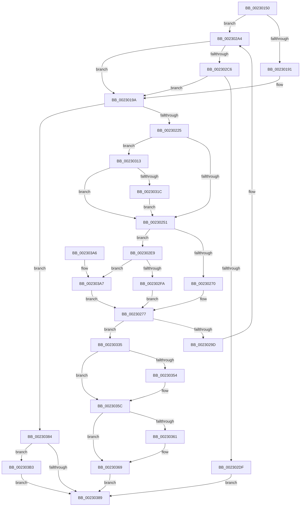

# PopPowerRequestCreateCommon

- RVA: `0x00230150`–`0x002303CA` (길이 `634` bytes)
- VA: `0x0000000140230150`
- 실행 섹션: `.text`
- PDB 이름 있음: `예`; PDB Function 태그: `아니요`
- unwind 정보 RVA: `0x00060250`
- 디코드: `162`개 명령, `634/634` bytes 표시
- 미해석 바이트: `0` (있으면 어셈블리에 `.byte`로 보존)

> 이 문서는 커널 이미지의 기계어와 PDB 기호를 분석해 생성했습니다. 4번과 5번은 함수 원형과 자료형을 바이너리 사용 방식에서 추정한 C 해석이며 원본 소스 복구 결과는 아닙니다.

## 1. Dependencies

- 직접 호출 지점: **19**; 고유 호출 대상: **15**
- 직접 호출자로 확인된 함수: **6**
- RIP 상대 이미지 참조: **7**

### Outgoing calls
- `0x0023019C` → [PopAcquirePowerRequestPushLock](../../page/A6/PopAcquirePowerRequestPushLock_function_00A66D94.md) (function, `0x00A66D94`)
- `0x002301B5` → [PopPowerRequestTableInsertEntry](../../page/A7/PopPowerRequestTableInsertEntry_function_00A7BFD8.md) (function, `0x00A7BFD8`)
- `0x002301BD` → [PopReleasePowerRequestPushLock](../../page/A7/PopReleasePowerRequestPushLock_function_00A712DC.md) (function, `0x00A712DC`)
- `0x00230216` → [ObCreateObject](../../page/87/ObCreateObject_function_00872CB0.md) (function, `0x00872CB0`)
- `0x00230234` → [memset](../6C/memset_function_006C6C40.md) (function, `0x006C6C40`)
- `0x00230239` → [PsGetCurrentProcessSessionId](PsGetCurrentProcessSessionId_function_002303D0.md) (function, `0x002303D0`)
- `0x0023027A` → [PopPowerRequestStatsCreate](../../page/A2/PopPowerRequestStatsCreate_function_00A2D6DC.md) (function, `0x00A2D6DC`)
- `0x00230281` → [PopAcquirePowerRequestPushLock](../../page/A6/PopAcquirePowerRequestPushLock_function_00A66D94.md) (function, `0x00A66D94`)
- `0x002302D0` → [PsQueryProcessAttributes](../../page/9D/PsQueryProcessAttributes_function_009DB630.md) (function, `0x009DB630`)
- `0x002302EC` → [PsGetProcessSessionIdEx](../22/PsGetProcessSessionIdEx_function_0022F8F0.md) (function, `0x0022F8F0`)
- `0x002302FC` → [SessionIsInteractive](../22/SessionIsInteractive_function_0022F768.md) (function, `0x0022F768`)
- `0x00230324` → [ObfReferenceObjectWithTag](../21/ObfReferenceObjectWithTag_function_00210710.md) (function, `0x00210710`)
- `0x00230357` → [PopUmpoSendPowerRequestOverrideQuery](PopUmpoSendPowerRequestOverrideQuery_function_00230418.md) (function, `0x00230418`)
- `0x00230364` → [PopUmpoSendPowerRequestCreate](../../page/A7/PopUmpoSendPowerRequestCreate_function_00A7CE40.md) (function, `0x00A7CE40`)
- `0x0023036E` → [PopDiagTracePowerRequestCreate](../../page/A3/PopDiagTracePowerRequestCreate_function_00A38EEC.md) (function, `0x00A38EEC`)
- `0x00230373` → [PopReleasePowerRequestPushLock](../../page/A7/PopReleasePowerRequestPushLock_function_00A712DC.md) (function, `0x00A712DC`)
- `0x002303B5` → [PopAcquirePowerRequestPushLock](../../page/A6/PopAcquirePowerRequestPushLock_function_00A66D94.md) (function, `0x00A66D94`)
- `0x002303BE` → [PopPowerRequestTableDeleteEntry](../../page/91/PopPowerRequestTableDeleteEntry_function_00913170.md) (function, `0x00913170`)
- `0x002303C3` → [PopReleasePowerRequestPushLock](../../page/A7/PopReleasePowerRequestPushLock_function_00A712DC.md) (function, `0x00A712DC`)

### Direct callers
- [PopPowerRequestCreateUserModeRequest](../22/PopPowerRequestCreateUserModeRequest_function_0022F91C.md) at `0x0022F970`
- [PoCreatePowerRequest](PoCreatePowerRequest_function_002309A0.md) at `0x002309F4`
- [PoRegisterSystemState](../48/PoRegisterSystemState_function_00482740.md) at `0x004827DC`
- [NtSetThreadExecutionState](../../page/AC/NtSetThreadExecutionState_function_00AC0A40.md) at `0x00AC0B26`
- [PopInitializeHighPerfPowerRequest](../../init/C3/PopInitializeHighPerfPowerRequest_function_00C3D718.md) at `0x00C3D820`
- [PopPowerAggregatorInitialize](../../init/C7/PopPowerAggregatorInitialize_function_00C77B94.md) at `0x00C77D74`

### Static image references
- `0x002301A1` → RVA `0x00F0EFB4` (`.data`; read)
- `0x002301AF` → RVA `0x00F0EFB4` (`.data`; write)
- `0x002301FC` → RVA `0x00FC53B8` (`ALMOSTRO`; read)
- `0x00230286` → RVA `0x00F0ED48` (`.data`; read)
- `0x0023028D` → RVA `0x00F0ED40` (`.data`; read)
- `0x00230335` → RVA `0x00F0ED50` (`.data`; read/write)
- `0x00230345` → RVA `0x00F0ED48` (`.data`; write)

## 2. Other-region calls and transfers

- 다른 실행 섹션으로 향하는 call: **13**
  - `0x0023019C` → [PopAcquirePowerRequestPushLock](../../page/A6/PopAcquirePowerRequestPushLock_function_00A66D94.md) (`.text` → `PAGE`)
  - `0x002301B5` → [PopPowerRequestTableInsertEntry](../../page/A7/PopPowerRequestTableInsertEntry_function_00A7BFD8.md) (`.text` → `PAGE`)
  - `0x002301BD` → [PopReleasePowerRequestPushLock](../../page/A7/PopReleasePowerRequestPushLock_function_00A712DC.md) (`.text` → `PAGE`)
  - `0x00230216` → [ObCreateObject](../../page/87/ObCreateObject_function_00872CB0.md) (`.text` → `PAGE`)
  - `0x0023027A` → [PopPowerRequestStatsCreate](../../page/A2/PopPowerRequestStatsCreate_function_00A2D6DC.md) (`.text` → `PAGE`)
  - `0x00230281` → [PopAcquirePowerRequestPushLock](../../page/A6/PopAcquirePowerRequestPushLock_function_00A66D94.md) (`.text` → `PAGE`)
  - `0x002302D0` → [PsQueryProcessAttributes](../../page/9D/PsQueryProcessAttributes_function_009DB630.md) (`.text` → `PAGE`)
  - `0x00230364` → [PopUmpoSendPowerRequestCreate](../../page/A7/PopUmpoSendPowerRequestCreate_function_00A7CE40.md) (`.text` → `PAGE`)
  - `0x0023036E` → [PopDiagTracePowerRequestCreate](../../page/A3/PopDiagTracePowerRequestCreate_function_00A38EEC.md) (`.text` → `PAGE`)
  - `0x00230373` → [PopReleasePowerRequestPushLock](../../page/A7/PopReleasePowerRequestPushLock_function_00A712DC.md) (`.text` → `PAGE`)
  - `0x002303B5` → [PopAcquirePowerRequestPushLock](../../page/A6/PopAcquirePowerRequestPushLock_function_00A66D94.md) (`.text` → `PAGE`)
  - `0x002303BE` → [PopPowerRequestTableDeleteEntry](../../page/91/PopPowerRequestTableDeleteEntry_function_00913170.md) (`.text` → `PAGE`)
  - `0x002303C3` → [PopReleasePowerRequestPushLock](../../page/A7/PopReleasePowerRequestPushLock_function_00A712DC.md) (`.text` → `PAGE`)
- 별도 외부 분기/꼬리 이동을 확인하지 못했습니다.

## 3. Assembly (complete function range)

```asm
00230150  48 89 5C 24 10                  mov qword ptr [rsp + 0x10], rbx
00230155  4C 89 44 24 18                  mov qword ptr [rsp + 0x18], r8
0023015A  55                              push rbp
0023015B  56                              push rsi
0023015C  57                              push rdi
0023015D  41 54                           push r12
0023015F  41 55                           push r13
00230161  41 56                           push r14
00230163  41 57                           push r15
00230165  48 8B EC                        mov rbp, rsp
00230168  48 81 EC 80 00 00 00            sub rsp, 0x80
0023016F  45 33 FF                        xor r15d, r15d
00230172  44 8A F2                        mov r14b, dl
00230175  48 8B F1                        mov rsi, rcx
00230178  44 89 7D D4                     mov dword ptr [rbp - 0x2c], r15d
0023017C  44 89 7D EC                     mov dword ptr [rbp - 0x14], r15d
00230180  4C 89 7D 58                     mov qword ptr [rbp + 0x58], r15
00230184  44 88 7D 40                     mov byte ptr [rbp + 0x40], r15b
00230188  44 39 39                        cmp dword ptr [rcx], r15d
0023018B  0F 85 13 01 00 00               jne 0x1402302a4
00230191  41 8A DF                        mov bl, r15b
00230194  41 8B FF                        mov edi, r15d
00230197  45 8B E7                        mov r12d, r15d
0023019A  B1 01                           mov cl, 1
0023019C  E8 F3 6B 83 00                  call 0x140a66d94
002301A1  44 8B 2D 0C EE CD 00            mov r13d, dword ptr [rip + 0xcdee0c]
002301A8  41 8B CD                        mov ecx, r13d
002301AB  41 8D 45 01                     lea eax, [r13 + 1]
002301AF  89 05 FF ED CD 00               mov dword ptr [rip + 0xcdedff], eax
002301B5  E8 1E BE 84 00                  call 0x140a7bfd8
002301BA  4C 8B F8                        mov r15, rax
002301BD  E8 1A 11 84 00                  call 0x140a712dc
002301C2  8B 46 30                        mov eax, dword ptr [rsi + 0x30]
002301C5  48 8D 4D 58                     lea rcx, [rbp + 0x58]
002301C9  33 D2                           xor edx, edx
002301CB  48 89 4C 24 40                  mov qword ptr [rsp + 0x40], rcx
002301D0  89 54 24 38                     mov dword ptr [rsp + 0x38], edx
002301D4  4C 8D 45 D0                     lea r8, [rbp - 0x30]
002301D8  83 C0 38                        add eax, 0x38
002301DB  48 89 55 D8                     mov qword ptr [rbp - 0x28], rdx
002301DF  89 44 24 30                     mov dword ptr [rsp + 0x30], eax
002301E3  0F 57 C0                        xorps xmm0, xmm0
002301E6  48 89 55 E0                     mov qword ptr [rbp - 0x20], rdx
002301EA  44 8A CB                        mov r9b, bl
002301ED  C7 44 24 28 A8 00 00 00         mov dword ptr [rsp + 0x28], 0xa8
002301F5  33 C9                           xor ecx, ecx
002301F7  48 89 54 24 20                  mov qword ptr [rsp + 0x20], rdx
002301FC  48 8B 15 B5 51 D9 00            mov rdx, qword ptr [rip + 0xd951b5]
00230203  C7 45 D0 30 00 00 00            mov dword ptr [rbp - 0x30], 0x30
0023020A  C7 45 E8 20 00 00 00            mov dword ptr [rbp - 0x18], 0x20
00230211  F3 0F 7F 45 F0                  movdqu xmmword ptr [rbp - 0x10], xmm0
00230216  E8 95 2A 64 00                  call 0x140872cb0
0023021B  8B D8                           mov ebx, eax
0023021D  85 C0                           test eax, eax
0023021F  0F 88 5F 01 00 00               js 0x140230384
00230225  48 8B 5D 58                     mov rbx, qword ptr [rbp + 0x58]
00230229  33 D2                           xor edx, edx
0023022B  48 8B CB                        mov rcx, rbx
0023022E  41 B8 A8 00 00 00               mov r8d, 0xa8
00230234  E8 07 6A 49 00                  call 0x1406c6c40
00230239  E8 92 01 00 00                  call 0x1402303d0
0023023E  89 43 10                        mov dword ptr [rbx + 0x10], eax
00230241  44 89 63 68                     mov dword ptr [rbx + 0x68], r12d
00230245  45 33 E4                        xor r12d, r12d
00230248  44 39 26                        cmp dword ptr [rsi], r12d
0023024B  0F 85 C2 00 00 00               jne 0x140230313
00230251  44 88 B3 98 00 00 00            mov byte ptr [rbx + 0x98], r14b
00230258  48 8D 43 40                     lea rax, [rbx + 0x40]
0023025C  48 89 73 60                     mov qword ptr [rbx + 0x60], rsi
00230260  44 89 6B 24                     mov dword ptr [rbx + 0x24], r13d
00230264  48 89 40 08                     mov qword ptr [rax + 8], rax
00230268  48 89 00                        mov qword ptr [rax], rax
0023026B  44 39 26                        cmp dword ptr [rsi], r12d
0023026E  75 79                           jne 0x1402302e9
00230270  C7 43 14 12 00 00 00            mov dword ptr [rbx + 0x14], 0x12
00230277  48 8B CB                        mov rcx, rbx
0023027A  E8 5D D4 7F 00                  call 0x140a2d6dc
0023027F  B1 01                           mov cl, 1
00230281  E8 0E 6B 83 00                  call 0x140a66d94
00230286  48 8B 05 BB EA CD 00            mov rax, qword ptr [rip + 0xcdeabb]
0023028D  48 8D 0D AC EA CD 00            lea rcx, [rip + 0xcdeaac]
00230294  48 39 08                        cmp qword ptr [rax], rcx
00230297  0F 84 98 00 00 00               je 0x140230335
0023029D  B9 03 00 00 00                  mov ecx, 3
002302A2  CD 29                           int 0x29
002302A4  65 48 8B 04 25 88 01 00 00      mov rax, qword ptr gs:[0x188]
002302AD  B3 01                           mov bl, 1
002302AF  48 8B B8 B8 00 00 00            mov rdi, qword ptr [rax + 0xb8]
002302B6  44 8B A7 D0 01 00 00            mov r12d, dword ptr [rdi + 0x1d0]
002302BD  45 84 F6                        test r14b, r14b
002302C0  0F 84 D4 FE FF FF               je 0x14023019a
002302C6  45 33 C0                        xor r8d, r8d
002302C9  48 8D 55 40                     lea rdx, [rbp + 0x40]
002302CD  48 8B CF                        mov rcx, rdi
002302D0  E8 5B B3 7A 00                  call 0x1409db630
002302D5  44 38 7D 40                     cmp byte ptr [rbp + 0x40], r15b
002302D9  0F 84 BB FE FF FF               je 0x14023019a
002302DF  BB BB 00 00 C0                  mov ebx, 0xc00000bb
002302E4  E9 A0 00 00 00                  jmp 0x140230389
002302E9  48 8B CF                        mov rcx, rdi
002302EC  E8 FF F5 FF FF                  call 0x14022f8f0
002302F1  45 84 F6                        test r14b, r14b
002302F4  0F 85 AD 00 00 00               jne 0x1402303a7
002302FA  8B C8                           mov ecx, eax
002302FC  E8 67 F4 FF FF                  call 0x14022f768
00230301  F6 D8                           neg al
00230303  1B C9                           sbb ecx, ecx
00230305  83 E1 21                        and ecx, 0x21
00230308  83 C1 1E                        add ecx, 0x1e
0023030B  89 4B 14                        mov dword ptr [rbx + 0x14], ecx
0023030E  E9 64 FF FF FF                  jmp 0x140230277
00230313  45 84 F6                        test r14b, r14b
00230316  0F 85 35 FF FF FF               jne 0x140230251
0023031C  BA 50 6F 50 72                  mov edx, 0x72506f50
00230321  48 8B CF                        mov rcx, rdi
00230324  E8 E7 03 FE FF                  call 0x140210710
00230329  48 89 BB 88 00 00 00            mov qword ptr [rbx + 0x88], rdi
00230330  E9 1C FF FF FF                  jmp 0x140230251
00230335  FF 05 15 EA CD 00               inc dword ptr [rip + 0xcdea15]
0023033B  48 89 0B                        mov qword ptr [rbx], rcx
0023033E  48 89 43 08                     mov qword ptr [rbx + 8], rax
00230342  48 89 18                        mov qword ptr [rax], rbx
00230345  48 89 1D FC E9 CD 00            mov qword ptr [rip + 0xcde9fc], rbx
0023034C  49 89 1F                        mov qword ptr [r15], rbx
0023034F  45 84 F6                        test r14b, r14b
00230352  75 08                           jne 0x14023035c
00230354  48 8B CB                        mov rcx, rbx
00230357  E8 BC 00 00 00                  call 0x140230418
0023035C  44 39 26                        cmp dword ptr [rsi], r12d
0023035F  74 08                           je 0x140230369
00230361  8B 4B 24                        mov ecx, dword ptr [rbx + 0x24]
00230364  E8 D7 CA 84 00                  call 0x140a7ce40
00230369  48 8B D3                        mov rdx, rbx
0023036C  33 C9                           xor ecx, ecx
0023036E  E8 79 8B 80 00                  call 0x140a38eec
00230373  E8 64 0F 84 00                  call 0x140a712dc
00230378  48 8B 45 50                     mov rax, qword ptr [rbp + 0x50]
0023037C  48 89 18                        mov qword ptr [rax], rbx
0023037F  41 8B DC                        mov ebx, r12d
00230382  EB 05                           jmp 0x140230389
00230384  4D 85 FF                        test r15, r15
00230387  75 2A                           jne 0x1402303b3
00230389  8B C3                           mov eax, ebx
0023038B  48 8B 9C 24 C8 00 00 00         mov rbx, qword ptr [rsp + 0xc8]
00230393  48 81 C4 80 00 00 00            add rsp, 0x80
0023039A  41 5F                           pop r15
0023039C  41 5E                           pop r14
0023039E  41 5D                           pop r13
002303A0  41 5C                           pop r12
002303A2  5F                              pop rdi
002303A3  5E                              pop rsi
002303A4  5D                              pop rbp
002303A5  C3                              ret
002303A6  CC                              int3
002303A7  C7 43 14 08 00 00 00            mov dword ptr [rbx + 0x14], 8
002303AE  E9 C4 FE FF FF                  jmp 0x140230277
002303B3  B1 01                           mov cl, 1
002303B5  E8 DA 69 83 00                  call 0x140a66d94
002303BA  41 8B 4F 08                     mov ecx, dword ptr [r15 + 8]
002303BE  E8 AD 2D 6E 00                  call 0x140913170
002303C3  E8 14 0F 84 00                  call 0x140a712dc
002303C8  EB BF                           jmp 0x140230389
```

## 4. C-style interpretation (structured pseudocode)

```c
__int64 __fastcall PopPowerRequestCreateCommon(__int64 a1, int a2, __int64 a3)
{
    __int64 result;
    __int64 v_r12;
    __int64 v_r15;
    __int64 v_rsp;
    unsigned __int64 v_stack_m48;
    unsigned int v_stack_m4C;
    unsigned int v_stack_m50;
    unsigned __int64 v_stack_m58;
    unsigned __int64 v_stack_m60;
    unsigned int v_stack_m64;
    unsigned __int64 v_stack_m68;
    unsigned __int64 v_stack_m78;
    unsigned int v_stack_m80;
    unsigned int v_stack_m88;
    unsigned int v_stack_m90;
    unsigned __int64 v_stack_m98;
    unsigned __int64 v_stack_p10;
    unsigned __int64 v_stack_p18;
    unsigned __int64 v_stack_p20;
    unsigned __int8 v_stack_p8;

    v_stack_p10 = v_rbx;
    v_stack_p18 = a3;
    v_rsp = (v_rsp) - (128);
    v_r15 = 0;
    v_stack_m64 = 0;
    v_stack_m4C = 0;
    v_stack_p20 = 0;
    v_stack_p8 = 0;
    if ((*(unsigned int *)(a1)) != 0) goto loc_002302A4;
loc_0023019A:
    result = PopAcquirePowerRequestPushLock(1, a2, a3, a4);
    *(unsigned int *)(v_rip + 13495807) = (unsigned int)((unsigned int)(*(unsigned int *)(v_rip + 13495820)) + 1);
    result = PopPowerRequestTableInsertEntry((unsigned int)((unsigned int)((unsigned int)(*(unsigned int *)(v_rip + 13495820)))), a2, a3, a4);
    result = PopReleasePowerRequestPushLock((unsigned int)((unsigned int)((unsigned int)(*(unsigned int *)(v_rip + 13495820)))), a2, a3, a4);
    a2 = 0;
    v_stack_m78 = v_stack_p20;
    v_stack_m80 = 0;
    result = (unsigned int)(((unsigned int)(*(unsigned int *)(a1 + 48))) + (56));
    v_stack_m60 = 0;
    v_stack_m88 = (unsigned int)(result);
    v_stack_m58 = 0;
    v_stack_m90 = 168;
    a1 = 0;
    v_stack_m98 = 0;
    v_stack_m68 = 48;
    v_stack_m50 = 32;
    v_stack_m48 = v_xmm0;
    result = ObCreateObject(a1, *(unsigned __int64 *)(v_rip + 14242229), v_stack_m68, 0);
    if (sign_flag) goto loc_00230384;
    a2 = 0;
    result = memset(v_stack_p20, a2, 168, 0);
    result = PsGetCurrentProcessSessionId(v_stack_p20, a2, 168, 0);
    *(unsigned int *)(v_stack_p20 + 16) = (unsigned int)(result);
    *(unsigned int *)(v_stack_p20 + 104) = 0;
    v_r12 = 0;
    if ((*(unsigned int *)(a1)) != 0) goto loc_00230313;
loc_00230251:
    *(unsigned __int8 *)(v_stack_p20 + 152) = (unsigned __int8)((unsigned __int8)(a2));
    *(unsigned __int64 *)(v_stack_p20 + 96) = 0;
    *(unsigned int *)(v_stack_p20 + 36) = (unsigned int)((unsigned int)(*(unsigned int *)(v_rip + 13495820)));
    *(unsigned __int64 *)(v_stack_p20 + 64 + 8) = v_stack_p20 + 64;
    *(unsigned __int64 *)(v_stack_p20 + 64) = v_stack_p20 + 64;
    if ((*(unsigned int *)(a1)) != 0) goto loc_002302E9;
    *(unsigned int *)(v_stack_p20 + 20) = 18;
loc_00230277:
    result = PopPowerRequestStatsCreate(v_stack_p20, a2, 168, 0);
    result = PopAcquirePowerRequestPushLock(1, a2, 168, 0);
    if ((*(unsigned __int64 *)(*(unsigned __int64 *)(v_rip + 13494971))) == (v_rip + 13494956)) goto loc_00230335;
loc_002302A4:
    if ((unsigned __int8)((unsigned __int8)(a2)) == 0) goto loc_0023019A;
    a3 = 0;
    result = PsQueryProcessAttributes(*(unsigned __int64 *)(*(unsigned __int64 *)(gs_base + (0 + 392)) + 184), v_stack_p8, a3, 0);
    if (v_stack_p8 == ((unsigned __int8)(result))) goto loc_0023019A;
    goto loc_00230389;
loc_002302E9:
    result = PsGetProcessSessionIdEx(*(unsigned __int64 *)(*(unsigned __int64 *)(gs_base + (0 + 392)) + 184), v_stack_p8, a3, 0);
    if ((unsigned __int8)((unsigned __int8)(a2)) != 0) goto loc_002303A7;
    result = SessionIsInteractive((unsigned int)((unsigned int)(result)), v_stack_p8, a3, 0);
    result = (unsigned __int8)(-(result));
    a1 = (unsigned int)(((unsigned int)((unsigned int)(result))) & (33));
    a1 = (unsigned int)((a1) + (30));
    *(unsigned int *)((unsigned int)(0xC00000BBULL) + 20) = (unsigned int)(a1);
    goto loc_00230277;
loc_00230313:
    if ((unsigned __int8)((unsigned __int8)(a2)) != 0) goto loc_00230251;
    result = ObfReferenceObjectWithTag(*(unsigned __int64 *)(*(unsigned __int64 *)(gs_base + (0 + 392)) + 184), (unsigned int)(0x72506F50ULL), a3, 0);
    *(unsigned __int64 *)((unsigned int)(0xC00000BBULL) + 136) = *(unsigned __int64 *)(*(unsigned __int64 *)(gs_base + (0 + 392)) + 184);
    goto loc_00230251;
loc_00230335:
    *(unsigned __int64 *)((unsigned int)(0xC00000BBULL)) = *(unsigned __int64 *)(*(unsigned __int64 *)(gs_base + (0 + 392)) + 184);
    *(unsigned __int64 *)((unsigned int)(0xC00000BBULL) + 8) = result;
    *(unsigned __int64 *)(result) = (unsigned int)(0xC00000BBULL);
    *(unsigned __int64 *)(v_rip + 13494780) = (unsigned int)(0xC00000BBULL);
    *(unsigned __int64 *)(result) = (unsigned int)(0xC00000BBULL);
    if ((unsigned __int8)((unsigned __int8)(a2)) == 0) {
        a1 = (unsigned int)(0xC00000BBULL);
        result = PopUmpoSendPowerRequestOverrideQuery(a1, (unsigned int)(0x72506F50ULL), a3, 0);
    }
    if ((*(unsigned int *)(a1)) != ((unsigned int)((unsigned int)(*(unsigned int *)(*(unsigned __int64 *)(*(unsigned __int64 *)(gs_base + (0 + 392)) + 184) + 464))))) {
        a1 = *(unsigned int *)((unsigned int)(0xC00000BBULL) + 36);
        result = PopUmpoSendPowerRequestCreate(a1, (unsigned int)(0x72506F50ULL), a3, 0);
    }
    a1 = 0;
    result = PopDiagTracePowerRequestCreate(a1, (unsigned int)(0xC00000BBULL), a3, 0);
    result = PopReleasePowerRequestPushLock(a1, (unsigned int)(0xC00000BBULL), a3, 0);
    *(unsigned __int64 *)(v_stack_p18) = (unsigned int)(0xC00000BBULL);
    goto loc_00230389;
loc_00230384:
    if (result != 0) goto loc_002303B3;
loc_00230389:
    v_rsp = (v_rsp) + (128);
    return (unsigned int)((unsigned int)((unsigned int)((unsigned int)((unsigned int)(*(unsigned int *)(*(unsigned __int64 *)(*(unsigned __int64 *)(gs_base + (0 + 392)) + 184) + 464))))));
loc_002303A7:
    *(unsigned int *)(v_stack_p10 + 20) = 8;
    goto loc_00230277;
loc_002303B3:
    result = PopAcquirePowerRequestPushLock(1, (unsigned int)(0xC00000BBULL), a3, 0);
    result = PopPowerRequestTableDeleteEntry((unsigned int)(*(unsigned int *)(result + 8)), (unsigned int)(0xC00000BBULL), a3, 0);
    result = PopReleasePowerRequestPushLock((unsigned int)(*(unsigned int *)(result + 8)), (unsigned int)(0xC00000BBULL), a3, 0);
    goto loc_00230389;
}
```

## 5. (Beta) C Style

```c
int64_t PopPowerRequestCreateCommon(void *Arg1, int32_t Arg2, int64_t Arg3)
{
    uint8_t *arg1 = (uint8_t *)Arg1;

    int64_t result;
    int64_t local_r12;
    int64_t local_r15;
    int64_t local_rsp;
    uint64_t v_stack_m48;
    uint32_t v_stack_m4C;
    uint32_t v_stack_m50;
    uint64_t v_stack_m58;
    uint64_t v_stack_m60;
    uint32_t v_stack_m64;
    uint64_t v_stack_m68;
    uint64_t v_stack_m78;
    uint32_t v_stack_m80;
    uint32_t v_stack_m88;
    uint32_t v_stack_m90;
    uint64_t v_stack_m98;
    uint64_t v_stack_p10;
    uint64_t v_stack_p18;
    uint64_t v_stack_p20;
    uint8_t v_stack_p8;

    v_stack_p10 = local_rbx;
    v_stack_p18 = Arg3;
    local_rsp = (local_rsp) - (128);
    local_r15 = 0;
    v_stack_m64 = 0;
    v_stack_m4C = 0;
    v_stack_p20 = 0;
    v_stack_p8 = 0;
    if ((*(uint32_t *)(arg1)) != 0) goto loc_002302A4;
loc_0023019A:
    result = PopAcquirePowerRequestPushLock(1, Arg2, Arg3, a4);
    *(uint32_t *)(v_rip + 0xCDEDFF) = (uint32_t)((uint32_t)(*(uint32_t *)(v_rip + 0xCDEE0C)) + 1);
    result = PopPowerRequestTableInsertEntry((uint32_t)((uint32_t)((uint32_t)(*(uint32_t *)(v_rip + 0xCDEE0C)))), Arg2, Arg3, a4);
    result = PopReleasePowerRequestPushLock((uint32_t)((uint32_t)((uint32_t)(*(uint32_t *)(v_rip + 0xCDEE0C)))), Arg2, Arg3, a4);
    Arg2 = 0;
    v_stack_m78 = v_stack_p20;
    v_stack_m80 = 0;
    result = (uint32_t)(((uint32_t)(*(uint32_t *)(arg1 + 0x30))) + (56));
    v_stack_m60 = 0;
    v_stack_m88 = (uint32_t)(result);
    v_stack_m58 = 0;
    v_stack_m90 = 168;
    Arg1 = 0;
    v_stack_m98 = 0;
    v_stack_m68 = 48;
    v_stack_m50 = 32;
    v_stack_m48 = v_xmm0;
    result = ObCreateObject(Arg1, *(uint64_t *)(v_rip + 0xD951B5), v_stack_m68, 0);
    if (sign_flag) goto loc_00230384;
    Arg2 = 0;
    result = memset(v_stack_p20, Arg2, 168, 0);
    result = PsGetCurrentProcessSessionId(v_stack_p20, Arg2, 168, 0);
    *(uint32_t *)(v_stack_p20 + 0x10) = (uint32_t)(result);
    *(uint32_t *)(v_stack_p20 + 0x68) = 0;
    local_r12 = 0;
    if ((*(uint32_t *)(arg1)) != 0) goto loc_00230313;
loc_00230251:
    *(uint8_t *)(v_stack_p20 + 0x98) = (uint8_t)((uint8_t)(Arg2));
    *(uint64_t *)(v_stack_p20 + 0x60) = 0;
    *(uint32_t *)(v_stack_p20 + 0x24) = (uint32_t)((uint32_t)(*(uint32_t *)(v_rip + 0xCDEE0C)));
    *(uint64_t *)(v_stack_p20 + 0x40 + 0x8) = v_stack_p20 + 64;
    *(uint64_t *)(v_stack_p20 + 0x40) = v_stack_p20 + 64;
    if ((*(uint32_t *)(arg1)) != 0) goto loc_002302E9;
    *(uint32_t *)(v_stack_p20 + 0x14) = 18;
loc_00230277:
    result = PopPowerRequestStatsCreate(v_stack_p20, Arg2, 168, 0);
    result = PopAcquirePowerRequestPushLock(1, Arg2, 168, 0);
    if ((*(uint64_t *)(*(uint64_t *)(v_rip + 0xCDEABB))) == (v_rip + 13494956)) goto loc_00230335;
loc_002302A4:
    if ((uint8_t)((uint8_t)(Arg2)) == 0) goto loc_0023019A;
    Arg3 = 0;
    result = PsQueryProcessAttributes(*(uint64_t *)(*(uint64_t *)(gs_base + (0 + 0x188)) + 0xB8), v_stack_p8, Arg3, 0);
    if (v_stack_p8 == ((uint8_t)(result))) goto loc_0023019A;
    goto loc_00230389;
loc_002302E9:
    result = PsGetProcessSessionIdEx(*(uint64_t *)(*(uint64_t *)(gs_base + (0 + 0x188)) + 0xB8), v_stack_p8, Arg3, 0);
    if ((uint8_t)((uint8_t)(Arg2)) != 0) goto loc_002303A7;
    result = SessionIsInteractive((uint32_t)((uint32_t)(result)), v_stack_p8, Arg3, 0);
    result = (uint8_t)(-(result));
    Arg1 = (uint32_t)(((uint32_t)((uint32_t)(result))) & (33));
    Arg1 = (uint32_t)((Arg1) + (30));
    *(uint32_t *)((uint32_t)(0xC00000BBULL) + 0x14) = (uint32_t)(Arg1);
    goto loc_00230277;
loc_00230313:
    if ((uint8_t)((uint8_t)(Arg2)) != 0) goto loc_00230251;
    result = ObfReferenceObjectWithTag(*(uint64_t *)(*(uint64_t *)(gs_base + (0 + 0x188)) + 0xB8), (uint32_t)(0x72506F50ULL), Arg3, 0);
    *(uint64_t *)((uint32_t)(0xC00000BBULL) + 0x88) = *(uint64_t *)(*(uint64_t *)(gs_base + (0 + 0x188)) + 0xB8);
    goto loc_00230251;
loc_00230335:
    *(uint64_t *)((uint32_t)(0xC00000BBULL)) = *(uint64_t *)(*(uint64_t *)(gs_base + (0 + 0x188)) + 0xB8);
    *(uint64_t *)((uint32_t)(0xC00000BBULL) + 0x8) = result;
    *(uint64_t *)(result) = (uint32_t)(0xC00000BBULL);
    *(uint64_t *)(v_rip + 0xCDE9FC) = (uint32_t)(0xC00000BBULL);
    *(uint64_t *)(result) = (uint32_t)(0xC00000BBULL);
    if ((uint8_t)((uint8_t)(Arg2)) == 0) {
        Arg1 = (uint32_t)(0xC00000BBULL);
        result = PopUmpoSendPowerRequestOverrideQuery(Arg1, (uint32_t)(0x72506F50ULL), Arg3, 0);
    }
    if ((*(uint32_t *)(arg1)) != ((uint32_t)((uint32_t)(*(uint32_t *)(*(uint64_t *)(*(uint64_t *)(gs_base + (0 + 0x188)) + 0xB8) + 0x1D0))))) {
        Arg1 = *(uint32_t *)((uint32_t)(0xC00000BBULL) + 0x24);
        result = PopUmpoSendPowerRequestCreate(Arg1, (uint32_t)(0x72506F50ULL), Arg3, 0);
    }
    Arg1 = 0;
    result = PopDiagTracePowerRequestCreate(Arg1, (uint32_t)(0xC00000BBULL), Arg3, 0);
    result = PopReleasePowerRequestPushLock(Arg1, (uint32_t)(0xC00000BBULL), Arg3, 0);
    *(uint64_t *)(v_stack_p18) = (uint32_t)(0xC00000BBULL);
    goto loc_00230389;
loc_00230384:
    if (result != 0) goto loc_002303B3;
loc_00230389:
    local_rsp = (local_rsp) + (128);
    return (uint32_t)((uint32_t)((uint32_t)((uint32_t)((uint32_t)(*(uint32_t *)(*(uint64_t *)(*(uint64_t *)(gs_base + (0 + 0x188)) + 0xB8) + 0x1D0))))));
loc_002303A7:
    *(uint32_t *)(v_stack_p10 + 0x14) = 8;
    goto loc_00230277;
loc_002303B3:
    result = PopAcquirePowerRequestPushLock(1, (uint32_t)(0xC00000BBULL), Arg3, 0);
    result = PopPowerRequestTableDeleteEntry((uint32_t)(*(uint32_t *)(result + 0x8)), (uint32_t)(0xC00000BBULL), Arg3, 0);
    result = PopReleasePowerRequestPushLock((uint32_t)(*(uint32_t *)(result + 0x8)), (uint32_t)(0xC00000BBULL), Arg3, 0);
    goto loc_00230389;
}
```

### 관측된 메모리 오프셋

구조체 형식이 확인되지 않은 접근은 인자 기준의 오프셋으로만 기록했습니다.

| 기준 인자 | 오프셋 표현 | 폭 (bit) | 접근 |
|---|---:|---:|---|
| `Arg1` | `+ 0x0` | `32` | `R` |
| `Arg1` | `+ 0x30` | `32` | `R` |

## 6. Execution-region graph

[열기: 2D/3D 그래프와 함수 탐색 컨트롤 패널](../../../control-panel.html?section=text&rva=0x00230150&view=graph)

- 2D 그래프는 위에서 아래로 흐르고, 3D 그래프는 빈 공간을 드래그해 회전합니다. Shift+드래그는 이동, 휠은 확대·축소, 함수 노드 선택은 대상 보고서 이동입니다.

### Static fallback


