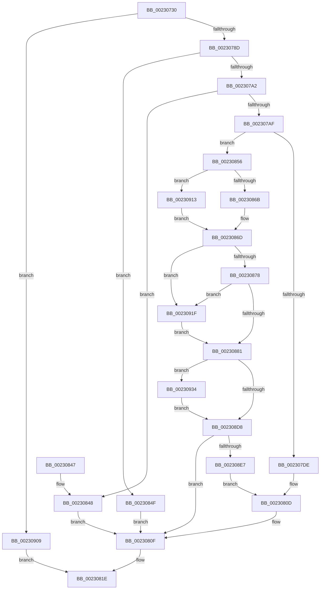

# PopUmpoSendPowerMessage

- RVA: `0x00230730`–`0x0023093B` (길이 `523` bytes)
- VA: `0x0000000140230730`
- 실행 섹션: `.text`
- PDB 이름 있음: `예`; PDB Function 태그: `아니요`
- unwind 정보 RVA: `0x000602A0`
- 디코드: `123`개 명령, `523/523` bytes 표시
- 미해석 바이트: `0` (있으면 어셈블리에 `.byte`로 보존)

> 이 문서는 커널 이미지의 기계어와 PDB 기호를 분석해 생성했습니다. 4번과 5번은 함수 원형과 자료형을 바이너리 사용 방식에서 추정한 C 해석이며 원본 소스 복구 결과는 아닙니다.

## 1. Dependencies

- 직접 호출 지점: **14**; 고유 호출 대상: **12**
- 직접 호출자로 확인된 함수: **11**
- RIP 상대 이미지 참조: **5**

### Outgoing calls
- `0x0023077C` → [ExAllocatePool2](../../poolcode/B8/ExAllocatePool2_function_00B820F0.md) (function, `0x00B820F0`)
- `0x0023078F` → [PopAcquireUmpoPushLock](../../page/A6/PopAcquireUmpoPushLock_function_00A65460.md) (function, `0x00A65460`)
- `0x002307BB` → [memset](../6C/memset_function_006C6C40.md) (function, `0x006C6C40`)
- `0x002307D4` → [memcpy](../6C/memcpy_function_006C6840.md) (function, `0x006C6840`)
- `0x00230808` → [ZwAlpcSendWaitReceivePort](../6A/ZwAlpcSendWaitReceivePort_function_006AE290.md) (function, `0x006AE290`)
- `0x0023080F` → [PopReleaseUmpoPushLock](../../page/A6/PopReleaseUmpoPushLock_function_00A68908.md) (function, `0x00A68908`)
- `0x00230819` → [ExFreePoolWithTag](../../poolcode/B8/ExFreePoolWithTag_function_00B82870.md) (function, `0x00B82870`)
- `0x0023082B` → [_security_check_cookie](../6A/_security_check_cookie_function_006AC640.md) (function, `0x006AC640`)
- `0x0023088E` → [memset](../6C/memset_function_006C6C40.md) (function, `0x006C6C40`)
- `0x002308CD` → [ZwAlpcSendWaitReceivePort](../6A/ZwAlpcSendWaitReceivePort_function_006AE290.md) (function, `0x006AE290`)
- `0x002308F1` → [AlpcGetMessageAttribute](../45/AlpcGetMessageAttribute_function_00450010.md) (function, `0x00450010`)
- `0x002308FF` → [PopUmpoProcessMessage](../../page/A2/PopUmpoProcessMessage_function_00A2E8C8.md) (function, `0x00A2E8C8`)
- `0x00230928` → [PopPushPowerStateTransitionRecord](../../pagelk/B7/PopPushPowerStateTransitionRecord_function_00B7CC90.md) (function, `0x00B7CC90`)
- `0x00230934` → [PoDelistPowerStateTransitionBlocker](../../pagelk/B7/PoDelistPowerStateTransitionBlocker_function_00B795D4.md) (function, `0x00B795D4`)

### Direct callers
- [PopUmpoSendPowerRequestOverrideQuery](PopUmpoSendPowerRequestOverrideQuery_function_00230418.md) at `0x0023049B`
- [PopUmpoSendFlushSleepStudyLoggerNotification](../4C/PopUmpoSendFlushSleepStudyLoggerNotification_function_004C4314.md) at `0x004C4352`
- [PopUmpoQuerySmartSuspendPrediction](../../page/76/PopUmpoQuerySmartSuspendPrediction_function_0076927C.md) at `0x007692B7`
- [PopUmpoSendPowerRequestAction](../../page/76/PopUmpoSendPowerRequestAction_function_007692D4.md) at `0x0076931E`
- [PopAdaptiveStandbyQueryReserveConfiguration](../../page/76/PopAdaptiveStandbyQueryReserveConfiguration_function_0076E6D0.md) at `0x0076E894`
- [PopPowerRequestDelete](../../page/91/PopPowerRequestDelete_function_00913030.md) at `0x00913155`
- [PopUmpoSendPowerRequestOverrideCleanup](../../page/91/PopUmpoSendPowerRequestOverrideCleanup_function_00913230.md) at `0x00913267`
- [PopUmpoSendPowerRequestCreate](../../page/A7/PopUmpoSendPowerRequestCreate_function_00A7CE40.md) at `0x00A7CEF6`
- [PopMonitorProcessBrightnessAction](../../page/A9/PopMonitorProcessBrightnessAction_function_00A97340.md) at `0x00A9738D`
- [PopUmpoSendLegacyEvent](../../page/AA/PopUmpoSendLegacyEvent_function_00AA48E8.md) at `0x00AA492E`
- [PopUmpoSendUserPresencePredictionAction](../../page/AD/PopUmpoSendUserPresencePredictionAction_function_00ADA83C.md) at `0x00ADA86F`

### Static image references
- `0x00230743` → RVA `0x00E0A740` (`.data`; read)
- `0x00230794` → RVA `0x00F084E0` (`.data`; read)
- `0x00230856` → RVA `0x00F084C8` (`.data`; read/write)
- `0x0023085D` → RVA `0x00F084C8` (`.data`; read)
- `0x00230913` → RVA `0x00F084C0` (`.data`; read)

## 2. Other-region calls and transfers

- 다른 실행 섹션으로 향하는 call: **7**
  - `0x0023077C` → [ExAllocatePool2](../../poolcode/B8/ExAllocatePool2_function_00B820F0.md) (`.text` → `POOLCODE`)
  - `0x0023078F` → [PopAcquireUmpoPushLock](../../page/A6/PopAcquireUmpoPushLock_function_00A65460.md) (`.text` → `PAGE`)
  - `0x0023080F` → [PopReleaseUmpoPushLock](../../page/A6/PopReleaseUmpoPushLock_function_00A68908.md) (`.text` → `PAGE`)
  - `0x00230819` → [ExFreePoolWithTag](../../poolcode/B8/ExFreePoolWithTag_function_00B82870.md) (`.text` → `POOLCODE`)
  - `0x002308FF` → [PopUmpoProcessMessage](../../page/A2/PopUmpoProcessMessage_function_00A2E8C8.md) (`.text` → `PAGE`)
  - `0x00230928` → [PopPushPowerStateTransitionRecord](../../pagelk/B7/PopPushPowerStateTransitionRecord_function_00B7CC90.md) (`.text` → `PAGELK`)
  - `0x00230934` → [PoDelistPowerStateTransitionBlocker](../../pagelk/B7/PoDelistPowerStateTransitionBlocker_function_00B795D4.md) (`.text` → `PAGELK`)
- 별도 외부 분기/꼬리 이동을 확인하지 못했습니다.

## 3. Assembly (complete function range)

```asm
00230730  48 89 5C 24 18                  mov qword ptr [rsp + 0x18], rbx
00230735  55                              push rbp
00230736  56                              push rsi
00230737  57                              push rdi
00230738  41 56                           push r14
0023073A  41 57                           push r15
0023073C  48 81 EC 00 01 00 00            sub rsp, 0x100
00230743  48 8B 05 F6 9F BD 00            mov rax, qword ptr [rip + 0xbd9ff6]
0023074A  48 33 C4                        xor rax, rsp
0023074D  48 89 84 24 F0 00 00 00         mov qword ptr [rsp + 0xf0], rax
00230755  48 83 64 24 40 00               and qword ptr [rsp + 0x40], 0
0023075B  45 8A F0                        mov r14b, r8b
0023075E  48 8B DA                        mov rbx, rdx
00230761  48 8B F1                        mov rsi, rcx
00230764  BA 00 10 00 00                  mov edx, 0x1000
00230769  B9 00 01 00 00                  mov ecx, 0x100
0023076E  41 B8 55 6D 70 6F               mov r8d, 0x6f706d55
00230774  4D 8B F9                        mov r15, r9
00230777  BD 01 00 00 C0                  mov ebp, 0xc0000001
0023077C  E8 6F 19 95 00                  call 0x140b820f0
00230781  48 8B F8                        mov rdi, rax
00230784  48 85 C0                        test rax, rax
00230787  0F 84 7C 01 00 00               je 0x140230909
0023078D  33 C9                           xor ecx, ecx
0023078F  E8 CC 4C 83 00                  call 0x140a65460
00230794  48 83 3D 44 7D CD 00 00         cmp qword ptr [rip + 0xcd7d44], 0
0023079C  0F 84 AD 00 00 00               je 0x14023084f
002307A2  48 81 FB D8 0F 00 00            cmp rbx, 0xfd8
002307A9  0F 87 99 00 00 00               ja 0x140230848
002307AF  48 8D 4F 04                     lea rcx, [rdi + 4]
002307B3  33 D2                           xor edx, edx
002307B5  41 B8 FC 0F 00 00               mov r8d, 0xffc
002307BB  E8 80 64 49 00                  call 0x1406c6c40
002307C0  8D 43 28                        lea eax, [rbx + 0x28]
002307C3  66 89 1F                        mov word ptr [rdi], bx
002307C6  48 8D 4F 28                     lea rcx, [rdi + 0x28]
002307CA  66 89 47 02                     mov word ptr [rdi + 2], ax
002307CE  4C 8B C3                        mov r8, rbx
002307D1  48 8B D6                        mov rdx, rsi
002307D4  E8 67 60 49 00                  call 0x1406c6840
002307D9  45 84 F6                        test r14b, r14b
002307DC  75 78                           jne 0x140230856
002307DE  48 83 64 24 38 00               and qword ptr [rsp + 0x38], 0
002307E4  45 33 C9                        xor r9d, r9d
002307E7  48 83 64 24 30 00               and qword ptr [rsp + 0x30], 0
002307ED  4C 8B C7                        mov r8, rdi
002307F0  48 83 64 24 28 00               and qword ptr [rsp + 0x28], 0
002307F6  BA 00 00 01 00                  mov edx, 0x10000
002307FB  48 83 64 24 20 00               and qword ptr [rsp + 0x20], 0
00230801  48 8B 0D D8 7C CD 00            mov rcx, qword ptr [rip + 0xcd7cd8]
00230808  E8 83 DA 47 00                  call 0x1406ae290
0023080D  8B D8                           mov ebx, eax
0023080F  E8 F4 80 83 00                  call 0x140a68908
00230814  33 D2                           xor edx, edx
00230816  48 8B CF                        mov rcx, rdi
00230819  E8 52 20 95 00                  call 0x140b82870
0023081E  8B C3                           mov eax, ebx
00230820  48 8B 8C 24 F0 00 00 00         mov rcx, qword ptr [rsp + 0xf0]
00230828  48 33 CC                        xor rcx, rsp
0023082B  E8 10 BE 47 00                  call 0x1406ac640
00230830  48 8B 9C 24 40 01 00 00         mov rbx, qword ptr [rsp + 0x140]
00230838  48 81 C4 00 01 00 00            add rsp, 0x100
0023083F  41 5F                           pop r15
00230841  41 5E                           pop r14
00230843  5F                              pop rdi
00230844  5E                              pop rsi
00230845  5D                              pop rbp
00230846  C3                              ret
00230847  CC                              int3
00230848  BB 05 00 00 80                  mov ebx, 0x80000005
0023084D  EB C0                           jmp 0x14023080f
0023084F  BB 42 00 00 C0                  mov ebx, 0xc0000042
00230854  EB B9                           jmp 0x14023080f
00230856  F0 FF 05 6B 7C CD 00            lock inc dword ptr [rip + 0xcd7c6b]
0023085D  8B 05 65 7C CD 00               mov eax, dword ptr [rip + 0xcd7c65]
00230863  85 C0                           test eax, eax
00230865  0F 8F A8 00 00 00               jg 0x140230913
0023086B  33 C9                           xor ecx, ecx
0023086D  8B 06                           mov eax, dword ptr [rsi]
0023086F  83 F8 0D                        cmp eax, 0xd
00230872  0F 84 A7 00 00 00               je 0x14023091f
00230878  83 F8 07                        cmp eax, 7
0023087B  0F 84 9E 00 00 00               je 0x14023091f
00230881  33 D2                           xor edx, edx
00230883  48 8D 4C 24 50                  lea rcx, [rsp + 0x50]
00230888  41 B8 A0 00 00 00               mov r8d, 0xa0
0023088E  E8 AD 63 49 00                  call 0x1406c6c40
00230893  48 83 64 24 38 00               and qword ptr [rsp + 0x38], 0
00230899  48 8D 44 24 50                  lea rax, [rsp + 0x50]
0023089E  48 8B 0D 3B 7C CD 00            mov rcx, qword ptr [rip + 0xcd7c3b]
002308A5  45 33 C9                        xor r9d, r9d
002308A8  48 89 44 24 30                  mov qword ptr [rsp + 0x30], rax
002308AD  4C 8B C7                        mov r8, rdi
002308B0  48 8D 44 24 40                  lea rax, [rsp + 0x40]
002308B5  48 C7 44 24 40 00 10 00 00      mov qword ptr [rsp + 0x40], 0x1000
002308BE  48 89 44 24 28                  mov qword ptr [rsp + 0x28], rax
002308C3  BA 00 00 02 00                  mov edx, 0x20000
002308C8  48 89 7C 24 20                  mov qword ptr [rsp + 0x20], rdi
002308CD  E8 BE D9 47 00                  call 0x1406ae290
002308D2  8B D8                           mov ebx, eax
002308D4  85 ED                           test ebp, ebp
002308D6  79 5C                           jns 0x140230934
002308D8  F0 FF 0D E9 7B CD 00            lock dec dword ptr [rip + 0xcd7be9]
002308DF  85 DB                           test ebx, ebx
002308E1  0F 88 28 FF FF FF               js 0x14023080f
002308E7  BA 00 00 00 20                  mov edx, 0x20000000
002308EC  48 8D 4C 24 50                  lea rcx, [rsp + 0x50]
002308F1  E8 1A F7 21 00                  call 0x140450010
002308F6  4D 8B C7                        mov r8, r15
002308F9  48 8B D0                        mov rdx, rax
002308FC  48 8B CF                        mov rcx, rdi
002308FF  E8 C4 DF 7F 00                  call 0x140a2e8c8
00230904  E9 04 FF FF FF                  jmp 0x14023080d
00230909  BB 9A 00 00 C0                  mov ebx, 0xc000009a
0023090E  E9 0B FF FF FF                  jmp 0x14023081e
00230913  48 8B 0D A6 7B CD 00            mov rcx, qword ptr [rip + 0xcd7ba6]
0023091A  E9 4E FF FF FF                  jmp 0x14023086d
0023091F  65 48 8B 14 25 88 01 00 00      mov rdx, qword ptr gs:[0x188]
00230928  E8 63 C3 94 00                  call 0x140b7cc90
0023092D  8B E8                           mov ebp, eax
0023092F  E9 4D FF FF FF                  jmp 0x140230881
00230934  E8 9B 8C 94 00                  call 0x140b795d4
00230939  EB 9D                           jmp 0x1402308d8
```

## 4. C-style interpretation (structured pseudocode)

```c
__int64 __fastcall PopUmpoSendPowerMessage(__int64 a1, __int64 a2, unsigned __int8 a3, __int64 a4)
{
    __int64 result;
    __int64 v_rsp;
    unsigned __int64 v_stack_m100;
    unsigned __int64 v_stack_m108;
    unsigned __int64 v_stack_m38;
    unsigned __int64 v_stack_mE8;
    unsigned __int64 v_stack_mF0;
    unsigned __int64 v_stack_mF8;
    unsigned __int64 v_stack_p18;
    unsigned __int64 v_stack_p20;
    unsigned __int64 v_stack_p28;
    unsigned __int64 v_stack_p30;
    unsigned __int64 v_stack_p38;
    unsigned __int64 v_stack_p40;
    unsigned __int64 v_stack_p50;

    v_stack_p18 = v_rbx;
    v_rsp = (v_rsp) - (256);
    result = (*(unsigned __int64 *)(v_rip + 12427254)) ^ (v_rsp);
    v_stack_m38 = result;
    result = ExAllocatePool2(256, (unsigned int)(0x1000ULL), (unsigned int)(0x6F706D55ULL), a4);
    if (result == 0) goto loc_00230909;
    a1 = 0;
    result = PopAcquireUmpoPushLock(a1, (unsigned int)(0x1000ULL), (unsigned int)(0x6F706D55ULL), a4);
    if ((*(unsigned __int64 *)(v_rip + 13466948)) == 0) goto loc_0023084F;
    if (a2 > 0xFD8ULL) goto loc_00230848;
    a2 = 0;
    result = memset(result + 4, a2, (unsigned int)(0xFFCULL), a4);
    *(unsigned __int16 *)(result) = 0;
    *(unsigned __int16 *)(result + 2) = (unsigned __int16)(a2 + 40);
    result = memcpy(result + 40, 0, 0, a4);
    if (a3 != 0) goto loc_00230856;
    a4 = 0;
    result = ZwAlpcSendWaitReceivePort(*(unsigned __int64 *)(v_rip + 13466840), (unsigned int)(0x10000ULL), result, a4);
loc_0023080D:
loc_0023080F:
    result = PopReleaseUmpoPushLock(*(unsigned __int64 *)(v_rip + 13466840), (unsigned int)(0x10000ULL), result, a4);
    a2 = 0;
    result = ExFreePoolWithTag(result, a2, result, a4);
loc_0023081E:
    a1 = (v_stack_m38) ^ (v_rsp);
    result = _security_check_cookie(a1, a2, result, a4);
    v_rsp = (v_rsp) + (256);
    return result;
loc_00230848:
    goto loc_0023080F;
loc_0023084F:
    goto loc_0023080F;
loc_00230856:
    if (condition_is_greater) goto loc_00230913;
    a1 = 0;
loc_0023086D:
    if (((unsigned int)((unsigned int)(*(unsigned int *)(a1)))) == 13) goto loc_0023091F;
    if (((unsigned int)((unsigned int)(*(unsigned int *)(a1)))) == 7) goto loc_0023091F;
loc_00230881:
    a2 = 0;
    result = memset(v_stack_p50, a2, 160, a4);
    a4 = 0;
    v_stack_p30 = v_stack_p50;
    v_stack_p40 = 0x1000ULL;
    v_stack_p28 = v_stack_p40;
    v_stack_p20 = result;
    result = ZwAlpcSendWaitReceivePort(*(unsigned __int64 *)(v_rip + 13466683), (unsigned int)(0x20000ULL), result, a4);
    if (!sign_flag) goto loc_00230934;
loc_002308D8:
    if (sign_flag) goto loc_0023080F;
    result = AlpcGetMessageAttribute(v_stack_p50, (unsigned int)(0x20000000ULL), result, a4);
    result = PopUmpoProcessMessage(result, result, 0, a4);
    goto loc_0023080D;
loc_00230909:
    goto loc_0023081E;
loc_00230913:
    goto loc_0023086D;
loc_0023091F:
    result = PopPushPowerStateTransitionRecord(*(unsigned __int64 *)(v_rip + 13466534), *(unsigned __int64 *)(gs_base + (0 + 392)), 0, a4);
    goto loc_00230881;
loc_00230934:
    result = PoDelistPowerStateTransitionBlocker(*(unsigned __int64 *)(v_rip + 13466534), *(unsigned __int64 *)(gs_base + (0 + 392)), 0, a4);
    goto loc_002308D8;
}
```

## 5. (Beta) C Style

```c
int64_t PopUmpoSendPowerMessage(void *Arg1, int64_t Arg2, uint8_t Arg3, int64_t Arg4)
{
    uint8_t *arg1 = (uint8_t *)Arg1;

    int64_t result;
    int64_t local_rsp;
    uint64_t v_stack_m100;
    uint64_t v_stack_m108;
    uint64_t v_stack_m38;
    uint64_t v_stack_mE8;
    uint64_t v_stack_mF0;
    uint64_t v_stack_mF8;
    uint64_t v_stack_p18;
    uint64_t v_stack_p20;
    uint64_t v_stack_p28;
    uint64_t v_stack_p30;
    uint64_t v_stack_p38;
    uint64_t v_stack_p40;
    uint64_t v_stack_p50;

    v_stack_p18 = local_rbx;
    local_rsp = (local_rsp) - (256);
    result = (*(uint64_t *)(v_rip + 0xBD9FF6)) ^ (local_rsp);
    v_stack_m38 = result;
    result = ExAllocatePool2(256, (uint32_t)(0x1000ULL), (uint32_t)(0x6F706D55ULL), Arg4);
    if (result == 0) goto loc_00230909;
    Arg1 = 0;
    result = PopAcquireUmpoPushLock(Arg1, (uint32_t)(0x1000ULL), (uint32_t)(0x6F706D55ULL), Arg4);
    if ((*(uint64_t *)(v_rip + 0xCD7D44)) == 0) goto loc_0023084F;
    if (Arg2 > 0xFD8ULL) goto loc_00230848;
    Arg2 = 0;
    result = memset(result + 4, Arg2, (uint32_t)(0xFFCULL), Arg4);
    *(uint16_t *)(result) = 0;
    *(uint16_t *)(result + 0x2) = (uint16_t)(Arg2 + 40);
    result = memcpy(result + 40, 0, 0, Arg4);
    if (Arg3 != 0) goto loc_00230856;
    Arg4 = 0;
    result = ZwAlpcSendWaitReceivePort(*(uint64_t *)(v_rip + 0xCD7CD8), (uint32_t)(0x10000ULL), result, Arg4);
loc_0023080D:
loc_0023080F:
    result = PopReleaseUmpoPushLock(*(uint64_t *)(v_rip + 0xCD7CD8), (uint32_t)(0x10000ULL), result, Arg4);
    Arg2 = 0;
    result = ExFreePoolWithTag(result, Arg2, result, Arg4);
loc_0023081E:
    Arg1 = (v_stack_m38) ^ (local_rsp);
    result = _security_check_cookie(Arg1, Arg2, result, Arg4);
    local_rsp = (local_rsp) + (256);
    return result;
loc_00230848:
    goto loc_0023080F;
loc_0023084F:
    goto loc_0023080F;
loc_00230856:
    if (condition_is_greater) goto loc_00230913;
    Arg1 = 0;
loc_0023086D:
    if (((uint32_t)((uint32_t)(*(uint32_t *)(arg1)))) == 13) goto loc_0023091F;
    if (((uint32_t)((uint32_t)(*(uint32_t *)(arg1)))) == 7) goto loc_0023091F;
loc_00230881:
    Arg2 = 0;
    result = memset(v_stack_p50, Arg2, 160, Arg4);
    Arg4 = 0;
    v_stack_p30 = v_stack_p50;
    v_stack_p40 = 0x1000ULL;
    v_stack_p28 = v_stack_p40;
    v_stack_p20 = result;
    result = ZwAlpcSendWaitReceivePort(*(uint64_t *)(v_rip + 0xCD7C3B), (uint32_t)(0x20000ULL), result, Arg4);
    if (!sign_flag) goto loc_00230934;
loc_002308D8:
    if (sign_flag) goto loc_0023080F;
    result = AlpcGetMessageAttribute(v_stack_p50, (uint32_t)(0x20000000ULL), result, Arg4);
    result = PopUmpoProcessMessage(result, result, 0, Arg4);
    goto loc_0023080D;
loc_00230909:
    goto loc_0023081E;
loc_00230913:
    goto loc_0023086D;
loc_0023091F:
    result = PopPushPowerStateTransitionRecord(*(uint64_t *)(v_rip + 0xCD7BA6), *(uint64_t *)(gs_base + (0 + 0x188)), 0, Arg4);
    goto loc_00230881;
loc_00230934:
    result = PoDelistPowerStateTransitionBlocker(*(uint64_t *)(v_rip + 0xCD7BA6), *(uint64_t *)(gs_base + (0 + 0x188)), 0, Arg4);
    goto loc_002308D8;
}
```

### 관측된 메모리 오프셋

구조체 형식이 확인되지 않은 접근은 인자 기준의 오프셋으로만 기록했습니다.

| 기준 인자 | 오프셋 표현 | 폭 (bit) | 접근 |
|---|---:|---:|---|
| `Arg1` | `+ 0x0` | `32` | `R` |

## 6. Execution-region graph

[열기: 2D/3D 그래프와 함수 탐색 컨트롤 패널](../../../control-panel.html?section=text&rva=0x00230730&view=graph)

- 2D 그래프는 위에서 아래로 흐르고, 3D 그래프는 빈 공간을 드래그해 회전합니다. Shift+드래그는 이동, 휠은 확대·축소, 함수 노드 선택은 대상 보고서 이동입니다.

### Static fallback


