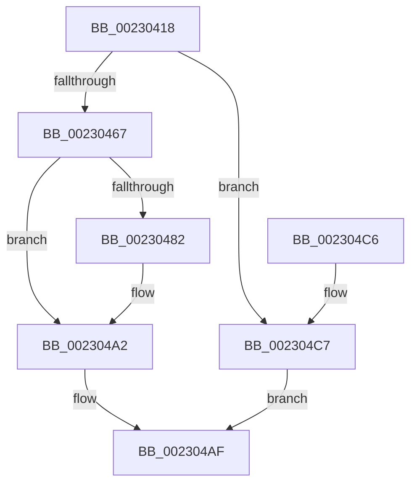

# PopUmpoSendPowerRequestOverrideQuery

- RVA: `0x00230418`–`0x002304CE` (길이 `182` bytes)
- VA: `0x0000000140230418`
- 실행 섹션: `.text`
- PDB 이름 있음: `예`; PDB Function 태그: `아니요`
- unwind 정보 RVA: `0x0006026C`
- 디코드: `51`개 명령, `182/182` bytes 표시
- 미해석 바이트: `0` (있으면 어셈블리에 `.byte`로 보존)

> 이 문서는 커널 이미지의 기계어와 PDB 기호를 분석해 생성했습니다. 4번과 5번은 함수 원형과 자료형을 바이너리 사용 방식에서 추정한 C 해석이며 원본 소스 복구 결과는 아닙니다.

## 1. Dependencies

- 직접 호출 지점: **5**; 고유 호출 대상: **4**
- 직접 호출자로 확인된 함수: **2**
- RIP 상대 이미지 참조: **0**

### Outgoing calls
- `0x00230441` → [PoStoreRequester](PoStoreRequester_function_002304D4.md) (function, `0x002304D4`)
- `0x0023045A` → [ExAllocatePool2](../../poolcode/B8/ExAllocatePool2_function_00B820F0.md) (function, `0x00B820F0`)
- `0x00230477` → [PoStoreRequester](PoStoreRequester_function_002304D4.md) (function, `0x002304D4`)
- `0x0023049B` → [PopUmpoSendPowerMessage](PopUmpoSendPowerMessage_function_00230730.md) (function, `0x00230730`)
- `0x002304AA` → [ExFreePoolWithTag](../../poolcode/B8/ExFreePoolWithTag_function_00B82870.md) (function, `0x00B82870`)

### Direct callers
- [PopPowerRequestCreateCommon](PopPowerRequestCreateCommon_function_00230150.md) at `0x00230357`
- [PopPowerRequestOverrideInitialize](../../page/75/PopPowerRequestOverrideInitialize_function_00754C04.md) at `0x00754C31`

### Static image references
- 디코드된 RIP-relative 메모리 참조가 없습니다.

## 2. Other-region calls and transfers

- 다른 실행 섹션으로 향하는 call: **2**
  - `0x0023045A` → [ExAllocatePool2](../../poolcode/B8/ExAllocatePool2_function_00B820F0.md) (`.text` → `POOLCODE`)
  - `0x002304AA` → [ExFreePoolWithTag](../../poolcode/B8/ExFreePoolWithTag_function_00B82870.md) (`.text` → `POOLCODE`)
- 별도 외부 분기/꼬리 이동을 확인하지 못했습니다.

## 3. Assembly (complete function range)

```asm
00230418  48 8B C4                        mov rax, rsp
0023041B  48 89 58 10                     mov qword ptr [rax + 0x10], rbx
0023041F  48 89 68 18                     mov qword ptr [rax + 0x18], rbp
00230423  48 89 70 20                     mov qword ptr [rax + 0x20], rsi
00230427  57                              push rdi
00230428  48 83 EC 20                     sub rsp, 0x20
0023042C  48 83 60 08 00                  and qword ptr [rax + 8], 0
00230431  4C 8D 40 08                     lea r8, [rax + 8]
00230435  48 8B F1                        mov rsi, rcx
00230438  41 B1 01                        mov r9b, 1
0023043B  48 8B 49 60                     mov rcx, qword ptr [rcx + 0x60]
0023043F  33 D2                           xor edx, edx
00230441  E8 8E 00 00 00                  call 0x1402304d4
00230446  48 8B 6C 24 30                  mov rbp, qword ptr [rsp + 0x30]
0023044B  41 B8 55 6D 70 6F               mov r8d, 0x6f706d55
00230451  B9 00 01 00 00                  mov ecx, 0x100
00230456  48 8D 55 10                     lea rdx, [rbp + 0x10]
0023045A  E8 91 1C 95 00                  call 0x140b820f0
0023045F  48 8B F8                        mov rdi, rax
00230462  48 85 C0                        test rax, rax
00230465  74 60                           je 0x1402304c7
00230467  48 8B 4E 60                     mov rcx, qword ptr [rsi + 0x60]
0023046B  48 8D 50 10                     lea rdx, [rax + 0x10]
0023046F  41 B1 01                        mov r9b, 1
00230472  4C 8D 44 24 30                  lea r8, [rsp + 0x30]
00230477  E8 58 00 00 00                  call 0x1402304d4
0023047C  8B D8                           mov ebx, eax
0023047E  85 C0                           test eax, eax
00230480  78 20                           js 0x1402304a2
00230482  C7 07 08 00 00 00               mov dword ptr [rdi], 8
00230488  48 8D 55 10                     lea rdx, [rbp + 0x10]
0023048C  8B 46 24                        mov eax, dword ptr [rsi + 0x24]
0023048F  45 33 C9                        xor r9d, r9d
00230492  45 33 C0                        xor r8d, r8d
00230495  89 47 08                        mov dword ptr [rdi + 8], eax
00230498  48 8B CF                        mov rcx, rdi
0023049B  E8 90 02 00 00                  call 0x140230730
002304A0  8B D8                           mov ebx, eax
002304A2  BA 55 6D 70 6F                  mov edx, 0x6f706d55
002304A7  48 8B CF                        mov rcx, rdi
002304AA  E8 C1 23 95 00                  call 0x140b82870
002304AF  48 8B 6C 24 40                  mov rbp, qword ptr [rsp + 0x40]
002304B4  8B C3                           mov eax, ebx
002304B6  48 8B 5C 24 38                  mov rbx, qword ptr [rsp + 0x38]
002304BB  48 8B 74 24 48                  mov rsi, qword ptr [rsp + 0x48]
002304C0  48 83 C4 20                     add rsp, 0x20
002304C4  5F                              pop rdi
002304C5  C3                              ret
002304C6  CC                              int3
002304C7  BB 9A 00 00 C0                  mov ebx, 0xc000009a
002304CC  EB E1                           jmp 0x1402304af
```

## 4. C-style interpretation (structured pseudocode)

```c
__int64 __fastcall PopUmpoSendPowerRequestOverrideQuery(__int64 a1, int a2)
{
    __int64 result;
    __int64 v_rbx;
    __int64 v_rsp;
    unsigned __int64 v_stack_p10;
    unsigned __int64 v_stack_p18;
    unsigned __int64 v_stack_p20;
    unsigned __int64 v_stack_p8;

    *(unsigned __int64 *)(v_rsp + 16) = v_rbx;
    *(unsigned __int64 *)(v_rsp + 24) = v_rbp;
    *(unsigned __int64 *)(v_rsp + 32) = v_rsi;
    v_rsp = (v_rsp) - (32);
    a2 = 0;
    result = PoStoreRequester(*(unsigned __int64 *)(a1 + 96), a2, v_rsp + 8, 1);
    result = ExAllocatePool2(256, v_stack_p8 + 16, (unsigned int)(0x6F706D55ULL), 1);
    if (result == 0) goto loc_002304C7;
    result = PoStoreRequester(*(unsigned __int64 *)(a1 + 96), result + 16, v_stack_p8, 1);
    v_rbx = (unsigned int)((unsigned int)(result));
    if (!(sign_flag)) {
        *(unsigned int *)(result) = 8;
        a2 = v_stack_p8 + 16;
        result = *(unsigned int *)(a1 + 36);
        a4 = 0;
        a3 = 0;
        *(unsigned int *)(result + 8) = (unsigned int)(result);
        a1 = result;
        result = PopUmpoSendPowerMessage(a1, a2, a3, a4);
        v_rbx = (unsigned int)(result);
    }
    result = ExFreePoolWithTag(result, (unsigned int)(0x6F706D55ULL), a3, a4);
loc_002304AF:
    v_rsp = (v_rsp) + (32);
    return (unsigned int)((unsigned int)(v_rbx));
loc_002304C7:
    goto loc_002304AF;
}
```

## 5. (Beta) C Style

```c
int64_t PopUmpoSendPowerRequestOverrideQuery(void *Arg1, int32_t Arg2)
{
    uint8_t *arg1 = (uint8_t *)Arg1;

    int64_t result;
    int64_t local_rbx;
    int64_t local_rsp;
    uint64_t v_stack_p10;
    uint64_t v_stack_p18;
    uint64_t v_stack_p20;
    uint64_t v_stack_p8;

    *(uint64_t *)(local_rsp + 0x10) = local_rbx;
    *(uint64_t *)(local_rsp + 0x18) = local_rbp;
    *(uint64_t *)(local_rsp + 0x20) = local_rsi;
    local_rsp = (local_rsp) - (32);
    Arg2 = 0;
    result = PoStoreRequester(*(uint64_t *)(arg1 + 0x60), Arg2, local_rsp + 8, 1);
    result = ExAllocatePool2(256, v_stack_p8 + 16, (uint32_t)(0x6F706D55ULL), 1);
    if (result == 0) goto loc_002304C7;
    result = PoStoreRequester(*(uint64_t *)(arg1 + 0x60), result + 16, v_stack_p8, 1);
    local_rbx = (uint32_t)((uint32_t)(result));
    if (!(sign_flag)) {
        *(uint32_t *)(result) = 8;
        Arg2 = v_stack_p8 + 16;
        result = *(uint32_t *)(arg1 + 0x24);
        a4 = 0;
        a3 = 0;
        *(uint32_t *)(result + 0x8) = (uint32_t)(result);
        Arg1 = result;
        result = PopUmpoSendPowerMessage(Arg1, Arg2, a3, a4);
        local_rbx = (uint32_t)(result);
    }
    result = ExFreePoolWithTag(result, (uint32_t)(0x6F706D55ULL), a3, a4);
loc_002304AF:
    local_rsp = (local_rsp) + (32);
    return (uint32_t)((uint32_t)(local_rbx));
loc_002304C7:
    goto loc_002304AF;
}
```

### 관측된 메모리 오프셋

구조체 형식이 확인되지 않은 접근은 인자 기준의 오프셋으로만 기록했습니다.

| 기준 인자 | 오프셋 표현 | 폭 (bit) | 접근 |
|---|---:|---:|---|
| `Arg1` | `+ 0x24` | `32` | `R` |
| `Arg1` | `+ 0x60` | `64` | `R` |

## 6. Execution-region graph

[열기: 2D/3D 그래프와 함수 탐색 컨트롤 패널](../../../control-panel.html?section=text&rva=0x00230418&view=graph)

- 2D 그래프는 위에서 아래로 흐르고, 3D 그래프는 빈 공간을 드래그해 회전합니다. Shift+드래그는 이동, 휠은 확대·축소, 함수 노드 선택은 대상 보고서 이동입니다.

### Static fallback


