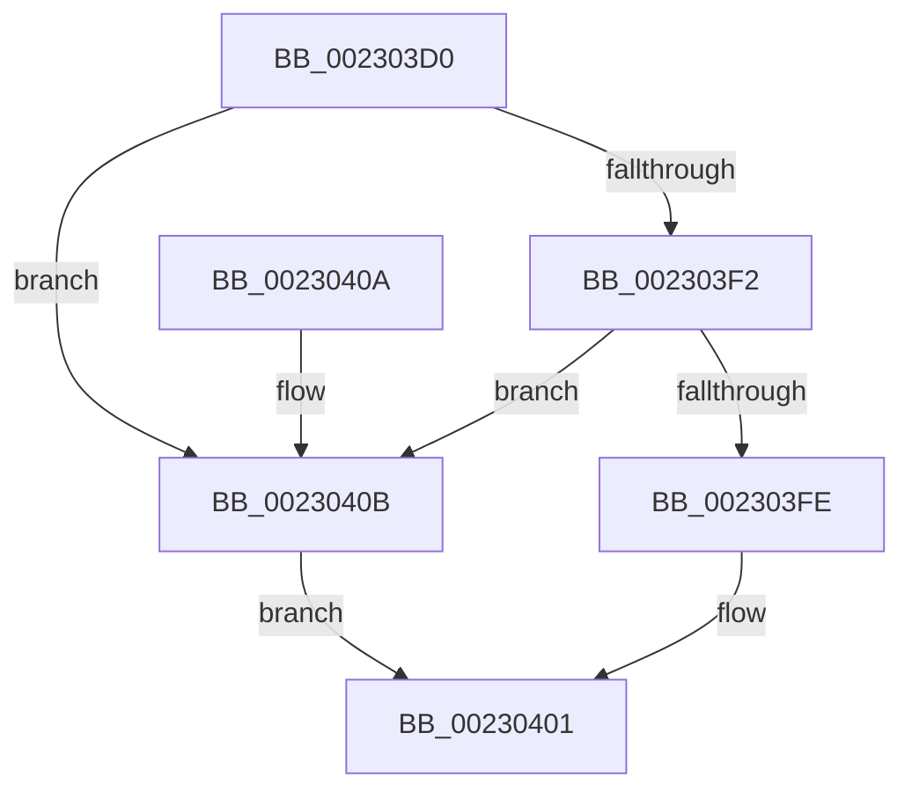

# PsGetCurrentProcessSessionId

- RVA: `0x002303D0`–`0x00230410` (길이 `64` bytes)
- VA: `0x00000001402303D0`
- 실행 섹션: `.text`
- PDB 이름 있음: `예`; PDB Function 태그: `아니요`
- unwind 정보 RVA: `0x000DB714`
- 디코드: `17`개 명령, `64/64` bytes 표시
- 미해석 바이트: `0` (있으면 어셈블리에 `.byte`로 보존)

> 이 문서는 커널 이미지의 기계어와 PDB 기호를 분석해 생성했습니다. 4번과 5번은 함수 원형과 자료형을 바이너리 사용 방식에서 추정한 C 해석이며 원본 소스 복구 결과는 아닙니다.

## 1. Dependencies

- 직접 호출 지점: **0**; 고유 호출 대상: **0**
- 직접 호출자로 확인된 함수: **9**
- RIP 상대 이미지 참조: **0**

### Outgoing calls
- 직접 디코드된 call 명령이 없습니다.

### Direct callers
- [EtwpEventWriteFull](../22/EtwpEventWriteFull_function_00225C10.md) at `0x00226D79`
- [PopPowerRequestCreateCommon](PopPowerRequestCreateCommon_function_00230150.md) at `0x00230239`
- [PsIsSessionInCurrentServerSilo](../5E/PsIsSessionInCurrentServerSilo_function_005E4FE8.md) at `0x005E4FFE`
- [IoGetContainerInformation](../../page/71/IoGetContainerInformation_function_0071E680.md) at `0x0071E6A9`
- [ObpLookupObjectName](../../page/89/ObpLookupObjectName_function_0089BE90.md) at `0x0089D8F6`
- [IopParseDevice](../../page/89/IopParseDevice_function_0089E510.md) at `0x008A0211`
- [IopParseDevice](../../page/89/IopParseDevice_function_0089E510.md) at `0x008A02D1`
- [IopParseDevice](../../page/89/IopParseDevice_function_0089E510.md) at `0x008A02ED`
- [EtwpWriteUserEvent](../../page/AF/EtwpWriteUserEvent_function_00AF2FEC.md) at `0x00AF3F5B`
- [sub_00B334D2](../../page/B3/Unknown_function_00B334D2.md) at `0x00B33533`
- [sub_00B334D2](../../page/B3/Unknown_function_00B334D2.md) at `0x00B33621`
- [sub_00B47AE6](../../page/B4/Unknown_function_00B47AE6.md) at `0x00B47AFD`
- [sub_00B47AE6](../../page/B4/Unknown_function_00B47AE6.md) at `0x00B47BD1`

### Static image references
- 디코드된 RIP-relative 메모리 참조가 없습니다.

## 2. Other-region calls and transfers

- 다른 실행 섹션으로 향하는 call: **0**
- 별도 외부 분기/꼬리 이동을 확인하지 못했습니다.

## 3. Assembly (complete function range)

```asm
002303D0  65 48 8B 04 25 88 01 00 00      mov rax, qword ptr gs:[0x188]
002303D9  41 83 C8 FF                     or r8d, 0xffffffff
002303DD  33 C9                           xor ecx, ecx
002303DF  48 8B 80 B8 00 00 00            mov rax, qword ptr [rax + 0xb8]
002303E6  48 8B 90 E8 02 00 00            mov rdx, qword ptr [rax + 0x2e8]
002303ED  48 85 D2                        test rdx, rdx
002303F0  74 19                           je 0x14023040b
002303F2  F7 80 FC 05 00 00 00 10 00 00   test dword ptr [rax + 0x5fc], 0x1000
002303FC  75 0D                           jne 0x14023040b
002303FE  8B 42 08                        mov eax, dword ptr [rdx + 8]
00230401  41 3B C0                        cmp eax, r8d
00230404  0F 45 C8                        cmovne ecx, eax
00230407  8B C1                           mov eax, ecx
00230409  C3                              ret
0023040A  CC                              int3
0023040B  41 8B C0                        mov eax, r8d
0023040E  EB F1                           jmp 0x140230401
```

## 4. C-style interpretation (structured pseudocode)

```c
__int64 __fastcall PsGetCurrentProcessSessionId(int a1, __int64 a2, int a3)
{
    a3 = (unsigned int)((a3) | (0xFFFFFFFFULL));
    a1 = 0;
    if (*(unsigned __int64 *)(*(unsigned __int64 *)(*(unsigned __int64 *)(gs_base + (0 + 392)) + 184) + 744) == 0) goto loc_0023040B;
    if (((*(unsigned int *)(*(unsigned __int64 *)(*(unsigned __int64 *)(gs_base + (0 + 392)) + 184) + 1532)) & (0x1000ULL)) != 0) goto loc_0023040B;
loc_00230401:
    if (((unsigned int)((unsigned int)(*(unsigned int *)(*(unsigned __int64 *)(*(unsigned __int64 *)(*(unsigned __int64 *)(gs_base + (0 + 392)) + 184) + 744) + 8)))) != a3) { a1 = (unsigned int)((unsigned int)(*(unsigned int *)(*(unsigned __int64 *)(*(unsigned __int64 *)(*(unsigned __int64 *)(gs_base + (0 + 392)) + 184) + 744) + 8))); }
    return (unsigned int)(a1);
loc_0023040B:
    goto loc_00230401;
}
```

## 5. (Beta) C Style

```c
int64_t PsGetCurrentProcessSessionId(int32_t Arg1, int64_t Arg2, int32_t Arg3)
{
    Arg3 = (uint32_t)((Arg3) | (0xFFFFFFFFULL));
    Arg1 = 0;
    if (*(uint64_t *)(*(uint64_t *)(*(uint64_t *)(gs_base + (0 + 0x188)) + 0xB8) + 0x2E8) == 0) goto loc_0023040B;
    if (((*(uint32_t *)(*(uint64_t *)(*(uint64_t *)(gs_base + (0 + 0x188)) + 0xB8) + 0x5FC)) & (0x1000ULL)) != 0) goto loc_0023040B;
loc_00230401:
    if (((uint32_t)((uint32_t)(*(uint32_t *)(*(uint64_t *)(*(uint64_t *)(*(uint64_t *)(gs_base + (0 + 0x188)) + 0xB8) + 0x2E8) + 0x8)))) != Arg3) { Arg1 = (uint32_t)((uint32_t)(*(uint32_t *)(*(uint64_t *)(*(uint64_t *)(*(uint64_t *)(gs_base + (0 + 0x188)) + 0xB8) + 0x2E8) + 0x8))); }
    return (uint32_t)(Arg1);
loc_0023040B:
    goto loc_00230401;
}
```

## 6. Execution-region graph

[열기: 2D/3D 그래프와 함수 탐색 컨트롤 패널](../../../control-panel.html?section=text&rva=0x002303D0&view=graph)

- 2D 그래프는 위에서 아래로 흐르고, 3D 그래프는 빈 공간을 드래그해 회전합니다. Shift+드래그는 이동, 휠은 확대·축소, 함수 노드 선택은 대상 보고서 이동입니다.

### Static fallback


