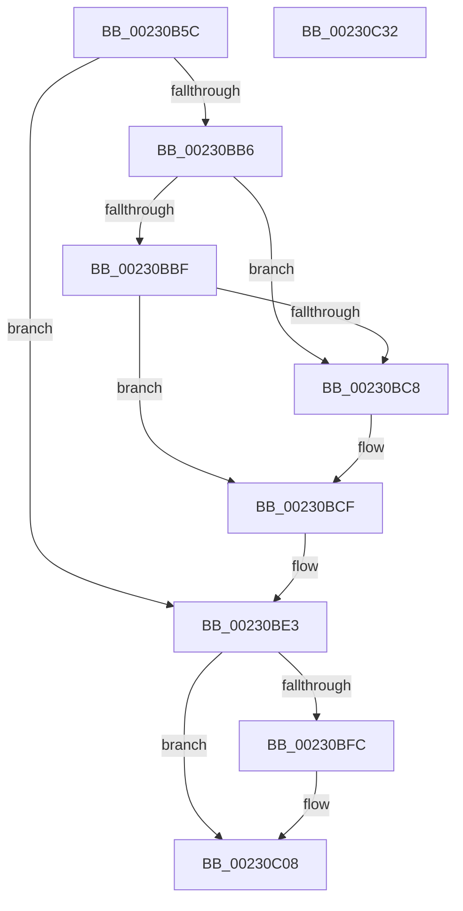

# PsRemoveVirtualizedTimer

- RVA: `0x00230B5C`–`0x00230C33` (길이 `215` bytes)
- VA: `0x0000000140230B5C`
- 실행 섹션: `.text`
- PDB 이름 있음: `예`; PDB Function 태그: `아니요`
- unwind 정보 RVA: `0x00060300`
- 디코드: `59`개 명령, `215/215` bytes 표시
- 미해석 바이트: `0` (있으면 어셈블리에 `.byte`로 보존)

> 이 문서는 커널 이미지의 기계어와 PDB 기호를 분석해 생성했습니다. 4번과 5번은 함수 원형과 자료형을 바이너리 사용 방식에서 추정한 C 해석이며 원본 소스 복구 결과는 아닙니다.

## 1. Dependencies

- 직접 호출 지점: **9**; 고유 호출 대상: **5**
- 직접 호출자로 확인된 함수: **1**
- RIP 상대 이미지 참조: **1**

### Outgoing calls
- `0x00230B8C` → [ObfReferenceObjectWithTag](../21/ObfReferenceObjectWithTag_function_00210710.md) (function, `0x00210710`)
- `0x00230B94` → [KxReleaseSpinLock](../20/KxReleaseSpinLock_function_00206670.md) (function, `0x00206670`)
- `0x00230BA3` → [KeAcquireSpinLockAtDpcLevel](../20/KeAcquireSpinLockAtDpcLevel_function_00208430.md) (function, `0x00208430`)
- `0x00230BAB` → [KeAcquireSpinLockAtDpcLevel](../20/KeAcquireSpinLockAtDpcLevel_function_00208430.md) (function, `0x00208430`)
- `0x00230BDE` → [ObfDereferenceObjectWithTag](../2F/ObfDereferenceObjectWithTag_function_002F78E0.md) (function, `0x002F78E0`)
- `0x00230BE6` → [KxReleaseSpinLock](../20/KxReleaseSpinLock_function_00206670.md) (function, `0x00206670`)
- `0x00230BEE` → [KxReleaseSpinLock](../20/KxReleaseSpinLock_function_00206670.md) (function, `0x00206670`)
- `0x00230C03` → [KiLowerIrqlProcessIrqlFlags](../4F/KiLowerIrqlProcessIrqlFlags_function_004F5698.md) (function, `0x004F5698`)
- `0x00230C14` → [ObfDereferenceObjectWithTag](../2F/ObfDereferenceObjectWithTag_function_002F78E0.md) (function, `0x002F78E0`)

### Direct callers
- [ExpDeleteTimer](ExpDeleteTimer_function_00230C40.md) at `0x00230C93`

### Static image references
- `0x00230BF3` → RVA `0x00FC6D20` (`ALMOSTRO`; read)

## 2. Other-region calls and transfers

- 다른 실행 섹션으로 향하는 call: **0**
- 별도 외부 분기/꼬리 이동을 확인하지 못했습니다.

## 3. Assembly (complete function range)

```asm
00230B5C  48 89 5C 24 08                  mov qword ptr [rsp + 8], rbx
00230B61  48 89 6C 24 10                  mov qword ptr [rsp + 0x10], rbp
00230B66  48 89 74 24 18                  mov qword ptr [rsp + 0x18], rsi
00230B6B  57                              push rdi
00230B6C  41 56                           push r14
00230B6E  41 57                           push r15
00230B70  48 83 EC 20                     sub rsp, 0x20
00230B74  48 8B 31                        mov rsi, qword ptr [rcx]
00230B77  48 8B FA                        mov rdi, rdx
00230B7A  48 8B D9                        mov rbx, rcx
00230B7D  41 0F B6 E9                     movzx ebp, r9b
00230B81  48 8B CE                        mov rcx, rsi
00230B84  BA 50 73 56 54                  mov edx, 0x54567350
00230B89  4D 8B F0                        mov r14, r8
00230B8C  E8 7F FB FD FF                  call 0x140210710
00230B91  49 8B CE                        mov rcx, r14
00230B94  E8 D7 5A FD FF                  call 0x140206670
00230B99  4C 8D BE 08 07 00 00            lea r15, [rsi + 0x708]
00230BA0  49 8B CF                        mov rcx, r15
00230BA3  E8 88 78 FD FF                  call 0x140208430
00230BA8  49 8B CE                        mov rcx, r14
00230BAB  E8 80 78 FD FF                  call 0x140208430
00230BB0  48 83 3B 00                     cmp qword ptr [rbx], 0
00230BB4  74 2D                           je 0x140230be3
00230BB6  48 8B 0F                        mov rcx, qword ptr [rdi]
00230BB9  48 39 79 08                     cmp qword ptr [rcx + 8], rdi
00230BBD  75 09                           jne 0x140230bc8
00230BBF  48 8B 47 08                     mov rax, qword ptr [rdi + 8]
00230BC3  48 39 38                        cmp qword ptr [rax], rdi
00230BC6  74 07                           je 0x140230bcf
00230BC8  B9 03 00 00 00                  mov ecx, 3
00230BCD  CD 29                           int 0x29
00230BCF  48 89 08                        mov qword ptr [rax], rcx
00230BD2  BA 50 73 56 54                  mov edx, 0x54567350
00230BD7  48 89 41 08                     mov qword ptr [rcx + 8], rax
00230BDB  48 8B CE                        mov rcx, rsi
00230BDE  E8 FD 6C 0C 00                  call 0x1402f78e0
00230BE3  49 8B CE                        mov rcx, r14
00230BE6  E8 85 5A FD FF                  call 0x140206670
00230BEB  49 8B CF                        mov rcx, r15
00230BEE  E8 7D 5A FD FF                  call 0x140206670
00230BF3  83 3D 26 61 D9 00 00            cmp dword ptr [rip + 0xd96126], 0
00230BFA  74 0C                           je 0x140230c08
00230BFC  44 0F 20 C1                     mov rcx, cr8
00230C00  40 8A D5                        mov dl, bpl
00230C03  E8 90 4A 2C 00                  call 0x1404f5698
00230C08  44 0F 22 C5                     mov cr8, rbp
00230C0C  BA 50 73 56 54                  mov edx, 0x54567350
00230C11  48 8B CE                        mov rcx, rsi
00230C14  E8 C7 6C 0C 00                  call 0x1402f78e0
00230C19  48 8B 5C 24 40                  mov rbx, qword ptr [rsp + 0x40]
00230C1E  48 8B 6C 24 48                  mov rbp, qword ptr [rsp + 0x48]
00230C23  48 8B 74 24 50                  mov rsi, qword ptr [rsp + 0x50]
00230C28  48 83 C4 20                     add rsp, 0x20
00230C2C  41 5F                           pop r15
00230C2E  41 5E                           pop r14
00230C30  5F                              pop rdi
00230C31  C3                              ret
00230C32  CC                              int3
```

## 4. C-style interpretation (structured pseudocode)

```c
__int64 __fastcall PsRemoveVirtualizedTimer(__int64 a1, __int64 a2, __int64 a3, unsigned __int8 a4)
{
    __int64 result;
    __int64 v_rsp;
    unsigned __int64 v_stack_p10;
    unsigned __int64 v_stack_p18;
    unsigned __int64 v_stack_p8;

    v_stack_p8 = v_rbx;
    v_stack_p10 = v_rbp;
    v_stack_p18 = v_rsi;
    v_rsp = (v_rsp) - (32);
    result = ObfReferenceObjectWithTag(*(unsigned __int64 *)(a1), (unsigned int)(0x54567350ULL), a3, a4);
    result = KxReleaseSpinLock(a3, (unsigned int)(0x54567350ULL), a3, a4);
    result = KeAcquireSpinLockAtDpcLevel(*(unsigned __int64 *)(a1) + 1800, (unsigned int)(0x54567350ULL), a3, a4);
    result = KeAcquireSpinLockAtDpcLevel(a3, (unsigned int)(0x54567350ULL), a3, a4);
    if ((*(unsigned __int64 *)(a1)) == 0) goto loc_00230BE3;
    if ((*(unsigned __int64 *)(*(unsigned __int64 *)(a2) + 8)) != a2) goto loc_00230BC8;
    if ((*(unsigned __int64 *)(*(unsigned __int64 *)(a2 + 8))) != a2) {
        a1 = 3;
    }
    *(unsigned __int64 *)(*(unsigned __int64 *)(a2 + 8)) = a1;
    *(unsigned __int64 *)(a1 + 8) = *(unsigned __int64 *)(a2 + 8);
    result = ObfDereferenceObjectWithTag(*(unsigned __int64 *)(a1), (unsigned int)(0x54567350ULL), a3, a4);
loc_00230BE3:
    result = KxReleaseSpinLock(a3, (unsigned int)(0x54567350ULL), a3, a4);
    result = KxReleaseSpinLock(*(unsigned __int64 *)(a1) + 1800, (unsigned int)(0x54567350ULL), a3, a4);
    if ((*(unsigned int *)(v_rip + 14246182)) != 0) {
        a1 = v_cr8;
        a2 = a4;
        result = KiLowerIrqlProcessIrqlFlags(a1, a2, a3, a4);
    }
    result = ObfDereferenceObjectWithTag(*(unsigned __int64 *)(a1), (unsigned int)(0x54567350ULL), a3, a4);
    v_rsp = (v_rsp) + (32);
    return result;
}
```

## 5. (Beta) C Style

```c
int64_t PsRemoveVirtualizedTimer(void *Arg1, void *Arg2, int64_t Arg3, uint8_t Arg4)
{
    uint8_t *arg1 = (uint8_t *)Arg1;
    uint8_t *arg2 = (uint8_t *)Arg2;

    int64_t result;
    int64_t local_rsp;
    uint64_t v_stack_p10;
    uint64_t v_stack_p18;
    uint64_t v_stack_p8;

    v_stack_p8 = local_rbx;
    v_stack_p10 = local_rbp;
    v_stack_p18 = local_rsi;
    local_rsp = (local_rsp) - (32);
    result = ObfReferenceObjectWithTag(*(uint64_t *)(arg1), (uint32_t)(0x54567350ULL), Arg3, Arg4);
    result = KxReleaseSpinLock(Arg3, (uint32_t)(0x54567350ULL), Arg3, Arg4);
    result = KeAcquireSpinLockAtDpcLevel(*(uint64_t *)(arg1) + 1800, (uint32_t)(0x54567350ULL), Arg3, Arg4);
    result = KeAcquireSpinLockAtDpcLevel(Arg3, (uint32_t)(0x54567350ULL), Arg3, Arg4);
    if ((*(uint64_t *)(arg1)) == 0) goto loc_00230BE3;
    if ((*(uint64_t *)(*(uint64_t *)(arg2) + 0x8)) != Arg2) goto loc_00230BC8;
    if ((*(uint64_t *)(*(uint64_t *)(arg2 + 0x8))) != Arg2) {
        Arg1 = 3;
    }
    *(void **)(*(uint64_t *)(arg2 + 0x8)) = Arg1;
    *(uint64_t *)(arg1 + 0x8) = *(uint64_t *)(arg2 + 0x8);
    result = ObfDereferenceObjectWithTag(*(uint64_t *)(arg1), (uint32_t)(0x54567350ULL), Arg3, Arg4);
loc_00230BE3:
    result = KxReleaseSpinLock(Arg3, (uint32_t)(0x54567350ULL), Arg3, Arg4);
    result = KxReleaseSpinLock(*(uint64_t *)(arg1) + 1800, (uint32_t)(0x54567350ULL), Arg3, Arg4);
    if ((*(uint32_t *)(v_rip + 0xD96126)) != 0) {
        Arg1 = v_cr8;
        Arg2 = Arg4;
        result = KiLowerIrqlProcessIrqlFlags(Arg1, Arg2, Arg3, Arg4);
    }
    result = ObfDereferenceObjectWithTag(*(uint64_t *)(arg1), (uint32_t)(0x54567350ULL), Arg3, Arg4);
    local_rsp = (local_rsp) + (32);
    return result;
}
```

### 관측된 메모리 오프셋

구조체 형식이 확인되지 않은 접근은 인자 기준의 오프셋으로만 기록했습니다.

| 기준 인자 | 오프셋 표현 | 폭 (bit) | 접근 |
|---|---:|---:|---|
| `Arg1` | `+ 0x0` | `64` | `R` |
| `Arg2` | `+ 0x0` | `64` | `R` |
| `Arg2` | `+ 0x8` | `64` | `R` |

## 6. Execution-region graph

[열기: 2D/3D 그래프와 함수 탐색 컨트롤 패널](../../../control-panel.html?section=text&rva=0x00230B5C&view=graph)

- 2D 그래프는 위에서 아래로 흐르고, 3D 그래프는 빈 공간을 드래그해 회전합니다. Shift+드래그는 이동, 휠은 확대·축소, 함수 노드 선택은 대상 보고서 이동입니다.

### Static fallback


