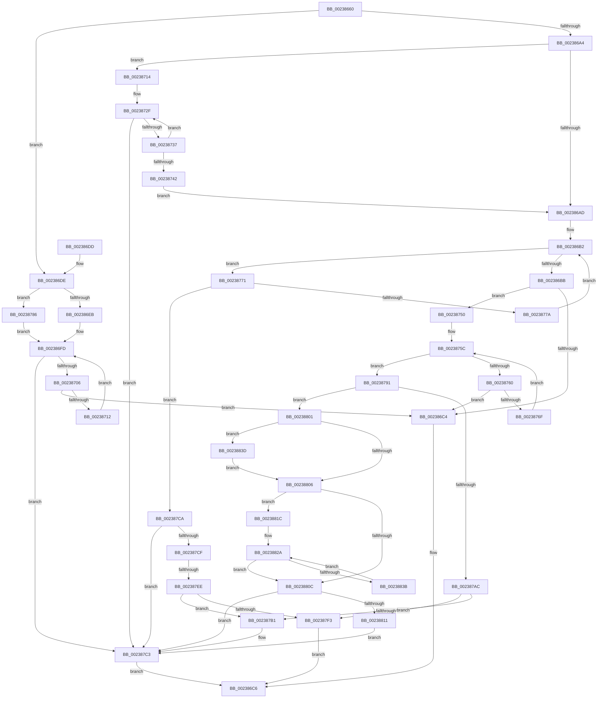

# RtlInterlockedSetClearRunEx

- RVA: `0x00238660`–`0x00238862` (길이 `514` bytes)
- VA: `0x0000000140238660`
- 실행 섹션: `.text`
- PDB 이름 있음: `예`; PDB Function 태그: `예`
- unwind 정보 RVA: `0x00060A74`
- 디코드: `157`개 명령, `514/514` bytes 표시
- 미해석 바이트: `0` (있으면 어셈블리에 `.byte`로 보존)

> 이 문서는 커널 이미지의 기계어와 PDB 기호를 분석해 생성했습니다. 4번과 5번은 함수 원형과 자료형을 바이너리 사용 방식에서 추정한 C 해석이며 원본 소스 복구 결과는 아닙니다.

## 1. Dependencies

- 직접 호출 지점: **0**; 고유 호출 대상: **0**
- 직접 호출자로 확인된 함수: **3**
- RIP 상대 이미지 참조: **0**

### Outgoing calls
- 직접 디코드된 call 명령이 없습니다.

### Direct callers
- [sub_00237DE0](Unknown_function_00237DE0.md) at `0x0023826C`
- [MiReservePtes](../31/MiReservePtes_function_00318D20.md) at `0x00319236`
- [MiAttemptCoalesce](../47/MiAttemptCoalesce_function_00479EB0.md) at `0x00479F81`

### Static image references
- 디코드된 RIP-relative 메모리 참조가 없습니다.

## 2. Other-region calls and transfers

- 다른 실행 섹션으로 향하는 call: **0**
- call이 아닌 외부 분기/꼬리 이동: **1**
  - `0x002387E8` → [sub_006D7892](../6D/Unknown_function_006D7892.md) (`tail-transfer`)

## 3. Assembly (complete function range)

```asm
00238660  48 89 5C 24 08                  mov qword ptr [rsp + 8], rbx
00238665  48 89 6C 24 10                  mov qword ptr [rsp + 0x10], rbp
0023866A  48 89 74 24 18                  mov qword ptr [rsp + 0x18], rsi
0023866F  48 89 7C 24 20                  mov qword ptr [rsp + 0x20], rdi
00238674  41 56                           push r14
00238676  4C 8B D2                        mov r10, rdx
00238679  4C 8B CA                        mov r9, rdx
0023867C  49 C1 E9 03                     shr r9, 3
00238680  41 83 E2 1F                     and r10d, 0x1f
00238684  4C 03 49 08                     add r9, qword ptr [rcx + 8]
00238688  4C 8B DA                        mov r11, rdx
0023868B  49 83 E1 FC                     and r9, 0xfffffffffffffffc
0023868F  48 8B D9                        mov rbx, rcx
00238692  49 8B F8                        mov rdi, r8
00238695  BA 01 00 00 00                  mov edx, 1
0023869A  4B 8D 04 02                     lea rax, [r10 + r8]
0023869E  48 83 F8 20                     cmp rax, 0x20
002386A2  76 3A                           jbe 0x1402386de
002386A4  44 8D 72 1F                     lea r14d, [rdx + 0x1f]
002386A8  4D 85 D2                        test r10, r10
002386AB  75 67                           jne 0x140238714
002386AD  BD FF FF FF FF                  mov ebp, 0xffffffff
002386B2  4D 3B C6                        cmp r8, r14
002386B5  0F 83 B6 00 00 00               jae 0x140238771
002386BB  4D 85 C0                        test r8, r8
002386BE  0F 85 8C 00 00 00               jne 0x140238750
002386C4  8B C2                           mov eax, edx
002386C6  48 8B 5C 24 10                  mov rbx, qword ptr [rsp + 0x10]
002386CB  48 8B 6C 24 18                  mov rbp, qword ptr [rsp + 0x18]
002386D0  48 8B 74 24 20                  mov rsi, qword ptr [rsp + 0x20]
002386D5  48 8B 7C 24 28                  mov rdi, qword ptr [rsp + 0x28]
002386DA  41 5E                           pop r14
002386DC  C3                              ret
002386DD  CC                              int3
002386DE  41 8B 01                        mov eax, dword ptr [r9]
002386E1  49 83 F8 20                     cmp r8, 0x20
002386E5  0F 84 9B 00 00 00               je 0x140238786
002386EB  49 8B C8                        mov rcx, r8
002386EE  44 8B C2                        mov r8d, edx
002386F1  41 D3 E0                        shl r8d, cl
002386F4  49 8B CA                        mov rcx, r10
002386F7  41 FF C8                        dec r8d
002386FA  41 D3 E0                        shl r8d, cl
002386FD  41 85 C0                        test r8d, eax
00238700  0F 85 BD 00 00 00               jne 0x1402387c3
00238706  8B C8                           mov ecx, eax
00238708  41 0B C8                        or ecx, r8d
0023870B  F0 41 0F B1 09                  lock cmpxchg dword ptr [r9], ecx
00238710  74 B2                           je 0x1402386c4
00238712  EB E9                           jmp 0x1402386fd
00238714  41 8B C3                        mov eax, r11d
00238717  41 8B EE                        mov ebp, r14d
0023871A  83 E0 1F                        and eax, 0x1f
0023871D  8B F2                           mov esi, edx
0023871F  2B E8                           sub ebp, eax
00238721  41 8B 01                        mov eax, dword ptr [r9]
00238724  8B CD                           mov ecx, ebp
00238726  D3 E6                           shl esi, cl
00238728  49 8B CA                        mov rcx, r10
0023872B  FF CE                           dec esi
0023872D  D3 E6                           shl esi, cl
0023872F  85 C6                           test esi, eax
00238731  0F 85 8C 00 00 00               jne 0x1402387c3
00238737  8B C8                           mov ecx, eax
00238739  0B CE                           or ecx, esi
0023873B  F0 41 0F B1 09                  lock cmpxchg dword ptr [r9], ecx
00238740  75 ED                           jne 0x14023872f
00238742  8B C5                           mov eax, ebp
00238744  4C 2B C0                        sub r8, rax
00238747  49 83 C1 04                     add r9, 4
0023874B  E9 5D FF FF FF                  jmp 0x1402386ad
00238750  41 8B 01                        mov eax, dword ptr [r9]
00238753  49 8B C8                        mov rcx, r8
00238756  8B F2                           mov esi, edx
00238758  D3 E6                           shl esi, cl
0023875A  FF CE                           dec esi
0023875C  85 C6                           test esi, eax
0023875E  75 31                           jne 0x140238791
00238760  8B C8                           mov ecx, eax
00238762  0B CE                           or ecx, esi
00238764  F0 41 0F B1 09                  lock cmpxchg dword ptr [r9], ecx
00238769  0F 84 55 FF FF FF               je 0x1402386c4
0023876F  EB EB                           jmp 0x14023875c
00238771  33 C0                           xor eax, eax
00238773  F0 41 0F B1 29                  lock cmpxchg dword ptr [r9], ebp
00238778  75 50                           jne 0x1402387ca
0023877A  49 83 C1 04                     add r9, 4
0023877E  4D 2B C6                        sub r8, r14
00238781  E9 2C FF FF FF                  jmp 0x1402386b2
00238786  41 B8 FF FF FF FF               mov r8d, 0xffffffff
0023878C  E9 6C FF FF FF                  jmp 0x1402386fd
00238791  48 8B 43 08                     mov rax, qword ptr [rbx + 8]
00238795  49 2B F8                        sub rdi, r8
00238798  49 8B CB                        mov rcx, r11
0023879B  48 C1 E9 05                     shr rcx, 5
0023879F  4C 8D 04 88                     lea r8, [rax + rcx*4]
002387A3  49 8D 04 3A                     lea rax, [r10 + rdi]
002387A7  49 3B C6                        cmp rax, r14
002387AA  77 55                           ja 0x140238801
002387AC  49 3B FE                        cmp rdi, r14
002387AF  74 42                           je 0x1402387f3
002387B1  48 8B CF                        mov rcx, rdi
002387B4  D3 E2                           shl edx, cl
002387B6  49 8B CA                        mov rcx, r10
002387B9  FF CA                           dec edx
002387BB  D3 E2                           shl edx, cl
002387BD  F7 D2                           not edx
002387BF  F0 41 21 10                     lock and dword ptr [r8], edx
002387C3  33 C0                           xor eax, eax
002387C5  E9 FC FE FF FF                  jmp 0x1402386c6
002387CA  49 3B F8                        cmp rdi, r8
002387CD  74 F4                           je 0x1402387c3
002387CF  48 8B 43 08                     mov rax, qword ptr [rbx + 8]
002387D3  49 2B F8                        sub rdi, r8
002387D6  49 8B CB                        mov rcx, r11
002387D9  48 C1 E9 05                     shr rcx, 5
002387DD  4C 8D 04 88                     lea r8, [rax + rcx*4]
002387E1  49 8D 04 3A                     lea rax, [r10 + rdi]
002387E5  49 3B C6                        cmp rax, r14
002387E8  0F 87 A4 F0 49 00               ja 0x1406d7892
002387EE  49 3B FE                        cmp rdi, r14
002387F1  75 BE                           jne 0x1402387b1
002387F3  41 C7 00 00 00 00 00            mov dword ptr [r8], 0
002387FA  33 C0                           xor eax, eax
002387FC  E9 C5 FE FF FF                  jmp 0x1402386c6
00238801  4D 85 D2                        test r10, r10
00238804  75 37                           jne 0x14023883d
00238806  48 83 FF 20                     cmp rdi, 0x20
0023880A  73 10                           jae 0x14023881c
0023880C  48 85 FF                        test rdi, rdi
0023880F  74 B2                           je 0x1402387c3
00238811  48 8B CF                        mov rcx, rdi
00238814  D3 E5                           shl ebp, cl
00238816  F0 41 21 28                     lock and dword ptr [r8], ebp
0023881A  EB A7                           jmp 0x1402387c3
0023881C  48 8B CF                        mov rcx, rdi
0023881F  48 C1 E9 05                     shr rcx, 5
00238823  48 6B C1 E0                     imul rax, rcx, -0x20
00238827  48 03 F8                        add rdi, rax
0023882A  41 C7 00 00 00 00 00            mov dword ptr [r8], 0
00238831  49 83 C0 04                     add r8, 4
00238835  48 83 E9 01                     sub rcx, 1
00238839  74 D1                           je 0x14023880c
0023883B  EB ED                           jmp 0x14023882a
0023883D  41 83 E3 1F                     and r11d, 0x1f
00238841  45 2B F3                        sub r14d, r11d
00238844  41 8B CE                        mov ecx, r14d
00238847  D3 E2                           shl edx, cl
00238849  49 8B CA                        mov rcx, r10
0023884C  FF CA                           dec edx
0023884E  D3 E2                           shl edx, cl
00238850  F7 D2                           not edx
00238852  F0 41 21 10                     lock and dword ptr [r8], edx
00238856  41 8B C6                        mov eax, r14d
00238859  48 2B F8                        sub rdi, rax
0023885C  49 83 C0 04                     add r8, 4
00238860  EB A4                           jmp 0x140238806
```

## 4. C-style interpretation (structured pseudocode)

```c
__int64 __fastcall RtlInterlockedSetClearRunEx(__int64 a1, __int64 a2, __int64 a3)
{
    __int64 result;
    __int64 v_r10;
    __int64 v_r11;
    __int64 v_r14;
    __int64 v_rbp;
    __int64 v_rdi;
    __int64 v_rsi;
    unsigned __int64 v_stack_p10;
    unsigned __int64 v_stack_p18;
    unsigned __int64 v_stack_p20;
    unsigned __int64 v_stack_p8;

    v_stack_p8 = v_rbx;
    v_stack_p10 = v_rbp;
    v_stack_p18 = v_rsi;
    v_stack_p20 = v_rdi;
    a4 = (a2) >> (3);
    v_r10 = (unsigned int)((a2) & (31));
    a4 = (a4) + (*(unsigned __int64 *)(a1 + 8));
    a4 = (a4) & (-4);
    if ((v_r10 + a3 * 1) <= 32) goto loc_002386DE;
    if (v_r10 != 0) goto loc_00238714;
loc_002386AD:
loc_002386B2:
    if (a3 >= (1 + 31)) goto loc_00238771;
    if (a3 != 0) goto loc_00238750;
loc_002386C4:
loc_002386C6:
    return 1;
loc_002386DE:
    if (a3 == 32) goto loc_00238786;
    a3 = (unsigned int)((1) << ((unsigned __int8)(a3)));
    a3 = (unsigned int)((a3) - 1);
    a3 = (unsigned int)((a3) << ((unsigned __int8)(v_r10)));
loc_002386FD:
    if ((((unsigned int)(a3)) & ((unsigned int)((unsigned int)(*(unsigned int *)(a4))))) != 0) goto loc_002387C3;
    a1 = (unsigned int)(((unsigned int)((unsigned int)((unsigned int)(*(unsigned int *)(a4))))) | ((unsigned int)(a3)));
    if (condition_is_equal) goto loc_002386C4;
    goto loc_002386FD;
loc_00238714:
    result = (unsigned int)(((unsigned int)((unsigned int)(a2))) & (31));
    v_rbp = (unsigned int)(((unsigned int)((unsigned int)(1 + 31))) - ((unsigned int)(result)));
    v_rsi = (unsigned int)((1) << ((unsigned __int8)((unsigned int)((unsigned int)(v_rbp)))));
    v_rsi = (unsigned int)((v_rsi) - 1);
    v_rsi = (unsigned int)((v_rsi) << ((unsigned __int8)(v_r10)));
loc_0023872F:
    if ((((unsigned int)(v_rsi)) & ((unsigned int)((unsigned int)(*(unsigned int *)(a4))))) != 0) goto loc_002387C3;
    a1 = (unsigned int)(((unsigned int)((unsigned int)((unsigned int)(*(unsigned int *)(a4))))) | ((unsigned int)(v_rsi)));
    if (condition_is_not_equal) goto loc_0023872F;
    a3 = (a3) - ((unsigned int)((unsigned int)(v_rbp)));
    a4 = (a4) + (4);
    goto loc_002386AD;
loc_00238750:
    v_rsi = (unsigned int)((1) << ((unsigned __int8)(a3)));
    v_rsi = (unsigned int)((v_rsi) - 1);
loc_0023875C:
    if ((((unsigned int)(v_rsi)) & ((unsigned int)((unsigned int)(*(unsigned int *)(a4))))) != 0) goto loc_00238791;
    a1 = (unsigned int)(((unsigned int)((unsigned int)((unsigned int)(*(unsigned int *)(a4))))) | ((unsigned int)(v_rsi)));
    if (condition_is_equal) goto loc_002386C4;
    goto loc_0023875C;
loc_00238771:
    result = 0;
    if (condition_is_not_equal) goto loc_002387CA;
    a4 = (a4) + (4);
    a3 = (a3) - (1 + 31);
    goto loc_002386B2;
loc_00238786:
    goto loc_002386FD;
loc_00238791:
    v_rdi = (v_stack_p20) - ((unsigned int)(0xFFFFFFFFULL));
    a1 = (a2) >> (5);
    if ((v_r10 + v_rdi * 1) > (1 + 31)) goto loc_00238801;
    if (v_rdi == (1 + 31)) goto loc_002387F3;
loc_002387B1:
    a2 = (unsigned int)((1) << ((unsigned __int8)(v_rdi)));
    a2 = (unsigned int)((a2) - 1);
    a2 = (unsigned int)((a2) << ((unsigned __int8)(v_r10)));
    a2 = (unsigned int)(~(a2));
loc_002387C3:
    result = 0;
    goto loc_002386C6;
loc_002387CA:
    if (v_rdi == (*(unsigned __int64 *)(v_stack_p8 + 8) + a1 * 4)) goto loc_002387C3;
    v_rdi = (v_rdi) - (*(unsigned __int64 *)(v_stack_p8 + 8) + a1 * 4);
    a1 = (a2) >> (5);
    if (v_rdi != (1 + 31)) goto loc_002387B1;
loc_002387F3:
    *(unsigned int *)(*(unsigned __int64 *)(v_stack_p8 + 8) + a1 * 4) = 0;
    result = 0;
    goto loc_002386C6;
loc_00238801:
    if (v_r10 != 0) goto loc_0023883D;
loc_00238806:
    if (v_rdi >= 32) goto loc_0023881C;
loc_0023880C:
    if (v_rdi == 0) goto loc_002387C3;
    v_rbp = (unsigned int)((v_rbp) << ((unsigned __int8)(v_rdi)));
    goto loc_002387C3;
loc_0023881C:
    a1 = (v_rdi) >> (5);
    result = (result) * (a1);
    v_rdi = (v_rdi) + (result);
loc_0023882A:
    *(unsigned int *)(*(unsigned __int64 *)(v_stack_p8 + 8) + a1 * 4) = 0;
    a3 = (*(unsigned __int64 *)(v_stack_p8 + 8) + a1 * 4) + (4);
    a1 = (a1) - (1);
    if (condition_is_equal) goto loc_0023880C;
    goto loc_0023882A;
loc_0023883D:
    v_r11 = (unsigned int)((a2) & (31));
    v_r14 = (unsigned int)((1 + 31) - ((unsigned int)(v_r11)));
    a2 = (unsigned int)((a2) << ((unsigned __int8)((unsigned int)((unsigned int)(v_r14)))));
    a2 = (unsigned int)((a2) - 1);
    a2 = (unsigned int)((a2) << ((unsigned __int8)(v_r10)));
    a2 = (unsigned int)(~(a2));
    v_rdi = (v_rdi) - ((unsigned int)((unsigned int)(v_r14)));
    a3 = (a3) + (4);
    goto loc_00238806;
}
```

## 5. (Beta) C Style

```c
int64_t RtlInterlockedSetClearRunEx(void *Arg1, void *Arg2, int64_t Arg3)
{
    uint8_t *arg1 = (uint8_t *)Arg1;
    uint8_t *arg2 = (uint8_t *)Arg2;

    int64_t result;
    int64_t local_r10;
    int64_t local_r11;
    int64_t local_r14;
    int64_t local_rbp;
    int64_t local_rdi;
    int64_t local_rsi;
    uint64_t v_stack_p10;
    uint64_t v_stack_p18;
    uint64_t v_stack_p20;
    uint64_t v_stack_p8;

    v_stack_p8 = local_rbx;
    v_stack_p10 = local_rbp;
    v_stack_p18 = local_rsi;
    v_stack_p20 = local_rdi;
    a4 = (Arg2) >> (3);
    local_r10 = (uint32_t)((Arg2) & (31));
    a4 = (a4) + (*(uint64_t *)(arg1 + 0x8));
    a4 = (a4) & (-4);
    if ((local_r10 + Arg3 * 1) <= 32) goto loc_002386DE;
    if (local_r10 != 0) goto loc_00238714;
loc_002386AD:
loc_002386B2:
    if (Arg3 >= (1 + 31)) goto loc_00238771;
    if (Arg3 != 0) goto loc_00238750;
loc_002386C4:
loc_002386C6:
    return 1;
loc_002386DE:
    if (Arg3 == 32) goto loc_00238786;
    Arg3 = (uint32_t)((1) << ((uint8_t)(Arg3)));
    Arg3 = (uint32_t)((Arg3) - 1);
    Arg3 = (uint32_t)((Arg3) << ((uint8_t)(local_r10)));
loc_002386FD:
    if ((((uint32_t)(Arg3)) & ((uint32_t)((uint32_t)(*(uint32_t *)(a4))))) != 0) goto loc_002387C3;
    Arg1 = (uint32_t)(((uint32_t)((uint32_t)((uint32_t)(*(uint32_t *)(a4))))) | ((uint32_t)(Arg3)));
    if (condition_is_equal) goto loc_002386C4;
    goto loc_002386FD;
loc_00238714:
    result = (uint32_t)(((uint32_t)((uint32_t)(Arg2))) & (31));
    local_rbp = (uint32_t)(((uint32_t)((uint32_t)(1 + 31))) - ((uint32_t)(result)));
    local_rsi = (uint32_t)((1) << ((uint8_t)((uint32_t)((uint32_t)(local_rbp)))));
    local_rsi = (uint32_t)((local_rsi) - 1);
    local_rsi = (uint32_t)((local_rsi) << ((uint8_t)(local_r10)));
loc_0023872F:
    if ((((uint32_t)(local_rsi)) & ((uint32_t)((uint32_t)(*(uint32_t *)(a4))))) != 0) goto loc_002387C3;
    Arg1 = (uint32_t)(((uint32_t)((uint32_t)((uint32_t)(*(uint32_t *)(a4))))) | ((uint32_t)(local_rsi)));
    if (condition_is_not_equal) goto loc_0023872F;
    Arg3 = (Arg3) - ((uint32_t)((uint32_t)(local_rbp)));
    a4 = (a4) + (4);
    goto loc_002386AD;
loc_00238750:
    local_rsi = (uint32_t)((1) << ((uint8_t)(Arg3)));
    local_rsi = (uint32_t)((local_rsi) - 1);
loc_0023875C:
    if ((((uint32_t)(local_rsi)) & ((uint32_t)((uint32_t)(*(uint32_t *)(a4))))) != 0) goto loc_00238791;
    Arg1 = (uint32_t)(((uint32_t)((uint32_t)((uint32_t)(*(uint32_t *)(a4))))) | ((uint32_t)(local_rsi)));
    if (condition_is_equal) goto loc_002386C4;
    goto loc_0023875C;
loc_00238771:
    result = 0;
    if (condition_is_not_equal) goto loc_002387CA;
    a4 = (a4) + (4);
    Arg3 = (Arg3) - (1 + 31);
    goto loc_002386B2;
loc_00238786:
    goto loc_002386FD;
loc_00238791:
    local_rdi = (v_stack_p20) - ((uint32_t)(0xFFFFFFFFULL));
    Arg1 = (Arg2) >> (5);
    if ((local_r10 + local_rdi * 1) > (1 + 31)) goto loc_00238801;
    if (local_rdi == (1 + 31)) goto loc_002387F3;
loc_002387B1:
    Arg2 = (uint32_t)((1) << ((uint8_t)(local_rdi)));
    Arg2 = (uint32_t)((Arg2) - 1);
    Arg2 = (uint32_t)((Arg2) << ((uint8_t)(local_r10)));
    Arg2 = (uint32_t)(~(Arg2));
loc_002387C3:
    result = 0;
    goto loc_002386C6;
loc_002387CA:
    if (local_rdi == (*(uint64_t *)(v_stack_p8 + 0x8) + Arg1 * 4)) goto loc_002387C3;
    local_rdi = (local_rdi) - (*(uint64_t *)(v_stack_p8 + 0x8) + Arg1 * 4);
    Arg1 = (Arg2) >> (5);
    if (local_rdi != (1 + 31)) goto loc_002387B1;
loc_002387F3:
    *(uint32_t *)(*(uint64_t *)(v_stack_p8 + 0x8) + arg1 * 4) = 0;
    result = 0;
    goto loc_002386C6;
loc_00238801:
    if (local_r10 != 0) goto loc_0023883D;
loc_00238806:
    if (local_rdi >= 32) goto loc_0023881C;
loc_0023880C:
    if (local_rdi == 0) goto loc_002387C3;
    local_rbp = (uint32_t)((local_rbp) << ((uint8_t)(local_rdi)));
    goto loc_002387C3;
loc_0023881C:
    Arg1 = (local_rdi) >> (5);
    result = (result) * (Arg1);
    local_rdi = (local_rdi) + (result);
loc_0023882A:
    *(uint32_t *)(*(uint64_t *)(v_stack_p8 + 0x8) + arg1 * 4) = 0;
    Arg3 = (*(uint64_t *)(v_stack_p8 + 0x8) + Arg1 * 4) + (4);
    Arg1 = (Arg1) - (1);
    if (condition_is_equal) goto loc_0023880C;
    goto loc_0023882A;
loc_0023883D:
    local_r11 = (uint32_t)((Arg2) & (31));
    local_r14 = (uint32_t)((1 + 31) - ((uint32_t)(local_r11)));
    Arg2 = (uint32_t)((Arg2) << ((uint8_t)((uint32_t)((uint32_t)(local_r14)))));
    Arg2 = (uint32_t)((Arg2) - 1);
    Arg2 = (uint32_t)((Arg2) << ((uint8_t)(local_r10)));
    Arg2 = (uint32_t)(~(Arg2));
    local_rdi = (local_rdi) - ((uint32_t)((uint32_t)(local_r14)));
    Arg3 = (Arg3) + (4);
    goto loc_00238806;
}
```

### 관측된 메모리 오프셋

구조체 형식이 확인되지 않은 접근은 인자 기준의 오프셋으로만 기록했습니다.

| 기준 인자 | 오프셋 표현 | 폭 (bit) | 접근 |
|---|---:|---:|---|
| `Arg1` | `+ 0x8` | `64` | `R` |
| `Arg2` | `+ 0x0 + r8*1` | `64` | `R` |

## 6. Execution-region graph

[열기: 2D/3D 그래프와 함수 탐색 컨트롤 패널](../../../control-panel.html?section=text&rva=0x00238660&view=graph)

- 2D 그래프는 위에서 아래로 흐르고, 3D 그래프는 빈 공간을 드래그해 회전합니다. Shift+드래그는 이동, 휠은 확대·축소, 함수 노드 선택은 대상 보고서 이동입니다.

### Static fallback


