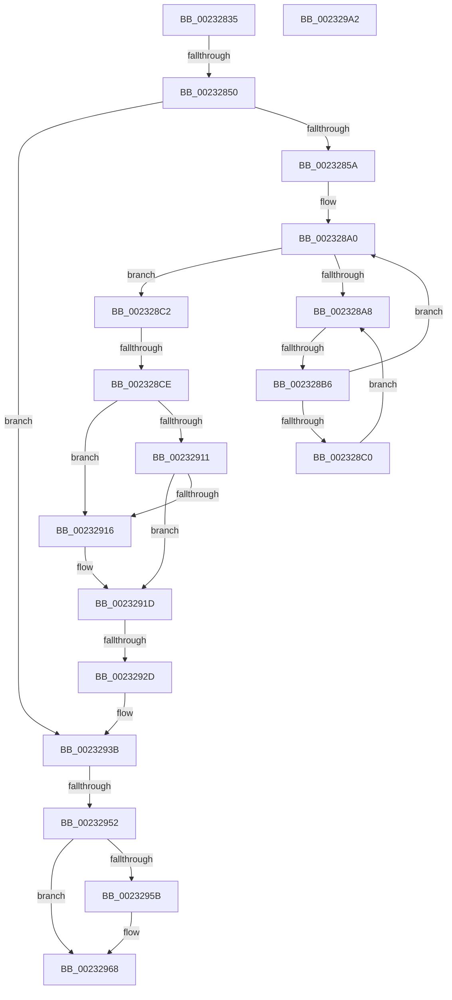

# sub_00232835

- RVA: `0x00232835`–`0x002329A3` (길이 `366` bytes)
- VA: `0x0000000140232835`
- 실행 섹션: `.text`
- PDB 이름 있음: `아니요`; PDB Function 태그: `아니요`
- unwind 정보 RVA: `0x00060494`
- 디코드: `91`개 명령, `366/366` bytes 표시
- 미해석 바이트: `0` (있으면 어셈블리에 `.byte`로 보존)

> 이 문서는 커널 이미지의 기계어와 PDB 기호를 분석해 생성했습니다. 4번과 5번은 함수 원형과 자료형을 바이너리 사용 방식에서 추정한 C 해석이며 원본 소스 복구 결과는 아닙니다.

## 1. Dependencies

- 직접 호출 지점: **2**; 고유 호출 대상: **2**
- 직접 호출자로 확인된 함수: **0**
- RIP 상대 이미지 참조: **3**

### Outgoing calls
- `0x00232963` → [KiLowerIrqlProcessIrqlFlags](../4F/KiLowerIrqlProcessIrqlFlags_function_004F5698.md) (function, `0x004F5698`)
- `0x00232984` → [_security_check_cookie](../6A/_security_check_cookie_function_006AC640.md) (function, `0x006AC640`)

### Direct callers
- 이 함수 시작 RVA로 연결되는 직접 call은 확인되지 않았습니다. 간접 호출은 완전히 역산할 수 없습니다.

### Static image references
- `0x002328AA` → RVA `0x00FC52AC` (`ALMOSTRO`; reference)
- `0x00232942` → RVA `0x00FC6B08` (`ALMOSTRO`; read)
- `0x00232952` → RVA `0x00FC6D20` (`ALMOSTRO`; read)

## 2. Other-region calls and transfers

- 다른 실행 섹션으로 향하는 call: **0**
- call이 아닌 외부 분기/꼬리 이동: **5**
  - `0x0023284A` → [sub_002329B4 + 0xAC](Unknown_function_002329B4.md) (`tail-transfer`)
  - `0x002328B0` → [sub_002329B4 + 0x153](Unknown_function_002329B4.md) (`tail-transfer`)
  - `0x002328C8` → [sub_002329B4 + 0x19B](Unknown_function_002329B4.md) (`tail-transfer`)
  - `0x00232927` → [sub_002329B4](Unknown_function_002329B4.md) (`tail-transfer`)
  - `0x0023294C` → [sub_002329B4 + 0x29E](Unknown_function_002329B4.md) (`tail-transfer`)

## 3. Assembly (complete function range)

```asm
00232835  4C 89 AC 24 A8 00 00 00         mov qword ptr [rsp + 0xa8], r13
0023283D  41 BF 7F FF FF FF               mov r15d, 0xffffff7f
00232843  33 DB                           xor ebx, ebx
00232845  F0 0F BA 2F 07                  lock bts dword ptr [rdi], 7
0023284A  0F 82 10 02 00 00               jb 0x140232a60
00232850  F6 47 03 C0                     test byte ptr [rdi + 3], 0xc0
00232854  0F 84 E1 00 00 00               je 0x14023293b
0023285A  44 0F B6 57 02                  movzx r10d, byte ptr [rdi + 2]
0023285F  0F B7 47 38                     movzx eax, word ptr [rdi + 0x38]
00232863  44 89 54 24 38                  mov dword ptr [rsp + 0x38], r10d
00232868  4C 89 54 24 30                  mov qword ptr [rsp + 0x30], r10
0023286D  49 8D 5A 10                     lea rbx, [r10 + 0x10]
00232871  4D 8B 9C C4 40 8C FC 00         mov r11, qword ptr [r12 + rax*8 + 0xfc8c40]
00232879  0F B7 47 3A                     movzx eax, word ptr [rdi + 0x3a]
0023287D  48 C1 E0 08                     shl rax, 8
00232881  48 03 D8                        add rbx, rax
00232884  4C 89 5C 24 50                  mov qword ptr [rsp + 0x50], r11
00232889  48 C1 E3 05                     shl rbx, 5
0023288D  4D 8D AB 00 41 00 00            lea r13, [r11 + 0x4100]
00232894  49 03 DD                        add rbx, r13
00232897  33 ED                           xor ebp, ebp
00232899  0F 1F 80 00 00 00 00            nop dword ptr [rax]
002328A0  F0 48 0F BA 2B 00               lock bts qword ptr [rbx], 0
002328A6  73 1A                           jae 0x1402328c2
002328A8  FF C5                           inc ebp
002328AA  85 2D FC 29 D9 00               test dword ptr [rip + 0xd929fc], ebp
002328B0  0F 84 51 02 00 00               je 0x140232b07
002328B6  F3 90                           pause
002328B8  48 8B 03                        mov rax, qword ptr [rbx]
002328BB  48 85 C0                        test rax, rax
002328BE  74 E0                           je 0x1402328a0
002328C0  EB E6                           jmp 0x1402328a8
002328C2  0F B6 47 03                     movzx eax, byte ptr [rdi + 3]
002328C6  84 C0                           test al, al
002328C8  0F 88 81 02 00 00               js 0x140232b4f
002328CE  4C 8B 4C 24 30                  mov r9, qword ptr [rsp + 0x30]
002328D3  48 8D 57 20                     lea rdx, [rdi + 0x20]
002328D7  44 0F B7 47 3A                  movzx r8d, word ptr [rdi + 0x3a]
002328DC  48 8B 0A                        mov rcx, qword ptr [rdx]
002328DF  41 8B C0                        mov eax, r8d
002328E2  48 C1 E0 08                     shl rax, 8
002328E6  4D 8D 79 10                     lea r15, [r9 + 0x10]
002328EA  4C 03 F8                        add r15, rax
002328ED  4D 8D 61 10                     lea r12, [r9 + 0x10]
002328F1  41 8B C0                        mov eax, r8d
002328F4  49 C1 E7 05                     shl r15, 5
002328F8  48 83 F0 01                     xor rax, 1
002328FC  48 C1 E0 08                     shl rax, 8
00232900  4C 03 E0                        add r12, rax
00232903  48 8B 42 08                     mov rax, qword ptr [rdx + 8]
00232907  49 C1 E4 05                     shl r12, 5
0023290B  48 39 51 08                     cmp qword ptr [rcx + 8], rdx
0023290F  75 05                           jne 0x140232916
00232911  48 39 10                        cmp qword ptr [rax], rdx
00232914  74 07                           je 0x14023291d
00232916  B9 03 00 00 00                  mov ecx, 3
0023291B  CD 29                           int 0x29
0023291D  48 89 08                        mov qword ptr [rax], rcx
00232920  48 89 41 08                     mov qword ptr [rcx + 8], rax
00232924  48 3B C1                        cmp rax, rcx
00232927  0F 84 87 00 00 00               je 0x1402329b4
0023292D  F0 48 83 23 00                  lock and qword ptr [rbx], 0
00232932  41 B6 01                        mov r14b, 1
00232935  41 BF 7F FF FF BF               mov r15d, 0xbfffff7f
0023293B  48 8B C7                        mov rax, rdi
0023293E  F0 44 21 38                     lock and dword ptr [rax], r15d
00232942  F7 05 BC 41 D9 00 00 00 02 00   test dword ptr [rip + 0xd941bc], 0x20000
0023294C  0F 85 00 03 00 00               jne 0x140232c52
00232952  83 3D C7 43 D9 00 00            cmp dword ptr [rip + 0xd943c7], 0
00232959  74 0D                           je 0x140232968
0023295B  44 0F 20 C1                     mov rcx, cr8
0023295F  40 0F B6 D6                     movzx edx, sil
00232963  E8 30 2D 2C 00                  call 0x1404f5698
00232968  40 0F B6 CE                     movzx ecx, sil
0023296C  44 0F 22 C1                     mov cr8, rcx
00232970  4C 8B AC 24 A8 00 00 00         mov r13, qword ptr [rsp + 0xa8]
00232978  41 0F B6 C6                     movzx eax, r14b
0023297C  48 8B 4C 24 68                  mov rcx, qword ptr [rsp + 0x68]
00232981  48 33 CC                        xor rcx, rsp
00232984  E8 B7 9C 47 00                  call 0x1406ac640
00232989  4C 8D 5C 24 70                  lea r11, [rsp + 0x70]
0023298E  49 8B 5B 40                     mov rbx, qword ptr [r11 + 0x40]
00232992  49 8B 6B 48                     mov rbp, qword ptr [r11 + 0x48]
00232996  49 8B E3                        mov rsp, r11
00232999  41 5F                           pop r15
0023299B  41 5E                           pop r14
0023299D  41 5C                           pop r12
0023299F  5F                              pop rdi
002329A0  5E                              pop rsi
002329A1  C3                              ret
002329A2  CC                              int3
```

## 4. C-style interpretation (structured pseudocode)

```c
__int64 __fastcall sub_00232835(__int64 a1, __int64 a2, __int64 a3, __int64 a4, __int64 a5, __int64 a6, __int64 a7, __int64 a8, __int64 a9, __int64 a10, __int64 a11, __int64 a12, __int64 a13, __int64 a14, __int64 a15, __int64 a16, __int64 a17, __int64 a18, __int64 a19, __int64 a20, __int64 a21)
{
    __int64 result;
    __int64 v_r12;
    __int64 v_r15;
    __int64 v_rbp;
    __int64 v_rbx;
    unsigned __int64 v_stack_p30;
    unsigned int v_stack_p38;
    unsigned __int64 v_stack_p50;
    unsigned __int64 v_stack_pA8;

    v_stack_pA8 = v_r13;
    v_rbx = 0;
    if (((*(unsigned __int8 *)(v_rdi + 3)) & (192)) == 0) goto loc_0023293B;
    v_stack_p38 = (unsigned int)(*(unsigned __int8 *)(v_rdi + 2));
    v_stack_p30 = *(unsigned __int8 *)(v_rdi + 2);
    result = (*(unsigned __int16 *)(v_rdi + 58)) << (8);
    v_rbx = (*(unsigned __int8 *)(v_rdi + 2) + 16) + (result);
    v_stack_p50 = *(unsigned __int64 *)(v_r12 + *(unsigned __int16 *)(v_rdi + 56) * 8 + 16550976);
    v_rbx = (v_rbx) << (5);
    v_rbx = (v_rbx) + (*(unsigned __int64 *)(v_r12 + *(unsigned __int16 *)(v_rdi + 56) * 8 + 16550976) + 16640);
    v_rbp = 0;
loc_002328A0:
    if (condition_is_above_or_equal) goto loc_002328C2;
loc_002328A8:
    v_rbp = (unsigned int)((v_rbp) + 1);
    if (*(unsigned __int64 *)(v_rbx) == 0) goto loc_002328A0;
    goto loc_002328A8;
loc_002328C2:
    result = ((unsigned int)((unsigned int)(*(unsigned __int16 *)(v_rdi + 58)))) << (8);
    v_r15 = (a6 + 16) + (result);
    v_r15 = (v_r15) << (5);
    result = ((unsigned int)((unsigned int)(*(unsigned __int16 *)(v_rdi + 58)))) ^ (1);
    result = (result) << (8);
    v_r12 = (a6 + 16) + (result);
    v_r12 = (v_r12) << (5);
    if ((*(unsigned __int64 *)(*(unsigned __int64 *)(v_rdi + 32) + 8)) != (v_rdi + 32)) goto loc_00232916;
    if ((*(unsigned __int64 *)(*(unsigned __int64 *)(v_rdi + 32 + 8))) != (v_rdi + 32)) {
        a1 = 3;
    }
    *(unsigned __int64 *)(*(unsigned __int64 *)(v_rdi + 32 + 8)) = a1;
    *(unsigned __int64 *)(a1 + 8) = *(unsigned __int64 *)(v_rdi + 32 + 8);
loc_0023293B:
    result = v_rdi;
    if ((*(unsigned int *)(v_rip + 14238663)) != 0) {
        a1 = v_cr8;
        a2 = (unsigned __int8)(v_rsi);
        result = KiLowerIrqlProcessIrqlFlags(a1, a2, *(unsigned __int16 *)(v_rdi + 58), a6);
    }
    a1 = (a13) ^ (v_rsp);
    result = _security_check_cookie(a1, a2, *(unsigned __int16 *)(v_rdi + 58), a6);
    return result;
}
```

## 5. (Beta) C Style

```c
int64_t sub_00232835(int64_t Arg1, int64_t Arg2, int64_t Arg3, int64_t Arg4, uint64_t Arg5, void *Arg6, uint64_t Arg7, uint64_t Arg8, uint64_t Arg9, uint64_t Arg10, uint64_t Arg11, uint64_t Arg12, int64_t Arg13, int64_t Arg14, uint64_t Arg15, uint64_t Arg16, uint64_t Arg17, uint64_t Arg18, uint64_t Arg19, uint64_t Arg20, int64_t Arg21)
{
    uint8_t *arg6 = (uint8_t *)Arg6;

    int64_t result;
    int64_t local_r12;
    int64_t local_r15;
    int64_t local_rbp;
    int64_t local_rbx;
    uint64_t v_stack_p30;
    uint32_t v_stack_p38;
    uint64_t v_stack_p50;
    uint64_t v_stack_pA8;

    v_stack_pA8 = local_r13;
    local_rbx = 0;
    if (((*(uint8_t *)(local_rdi + 0x3)) & (192)) == 0) goto loc_0023293B;
    v_stack_p38 = (uint32_t)(*(uint8_t *)(local_rdi + 0x2));
    v_stack_p30 = *(uint8_t *)(local_rdi + 0x2);
    result = (*(uint16_t *)(local_rdi + 0x3A)) << (8);
    local_rbx = (*(uint8_t *)(local_rdi + 0x2) + 16) + (result);
    v_stack_p50 = *(uint64_t *)(local_r12 + *(uint16_t *)(local_rdi + 0x38) * 8 + 0xFC8C40);
    local_rbx = (local_rbx) << (5);
    local_rbx = (local_rbx) + (*(uint64_t *)(local_r12 + *(uint16_t *)(local_rdi + 0x38) * 8 + 0xFC8C40) + 16640);
    local_rbp = 0;
loc_002328A0:
    if (condition_is_above_or_equal) goto loc_002328C2;
loc_002328A8:
    local_rbp = (uint32_t)((local_rbp) + 1);
    if (*(uint64_t *)(local_rbx) == 0) goto loc_002328A0;
    goto loc_002328A8;
loc_002328C2:
    result = ((uint32_t)((uint32_t)(*(uint16_t *)(local_rdi + 0x3A)))) << (8);
    local_r15 = (Arg6 + 16) + (result);
    local_r15 = (local_r15) << (5);
    result = ((uint32_t)((uint32_t)(*(uint16_t *)(local_rdi + 0x3A)))) ^ (1);
    result = (result) << (8);
    local_r12 = (Arg6 + 16) + (result);
    local_r12 = (local_r12) << (5);
    if ((*(uint64_t *)(*(uint64_t *)(local_rdi + 0x20) + 0x8)) != (local_rdi + 32)) goto loc_00232916;
    if ((*(uint64_t *)(*(uint64_t *)(local_rdi + 0x20 + 0x8))) != (local_rdi + 32)) {
        Arg1 = 3;
    }
    *(uint64_t *)(*(uint64_t *)(local_rdi + 0x20 + 0x8)) = Arg1;
    *(uint64_t *)(Arg1 + 0x8) = *(uint64_t *)(local_rdi + 0x20 + 0x8);
loc_0023293B:
    result = local_rdi;
    if ((*(uint32_t *)(v_rip + 0xD943C7)) != 0) {
        Arg1 = v_cr8;
        Arg2 = (uint8_t)(local_rsi);
        result = KiLowerIrqlProcessIrqlFlags(Arg1, Arg2, *(uint16_t *)(local_rdi + 0x3A), Arg6);
    }
    Arg1 = (Arg13) ^ (local_rsp);
    result = _security_check_cookie(Arg1, Arg2, *(uint16_t *)(local_rdi + 0x3A), Arg6);
    return result;
}
```

### 관측된 메모리 오프셋

구조체 형식이 확인되지 않은 접근은 인자 기준의 오프셋으로만 기록했습니다.

| 기준 인자 | 오프셋 표현 | 폭 (bit) | 접근 |
|---|---:|---:|---|
| `Arg6` | `+ 0x10` | `64` | `R` |

## 6. Execution-region graph

[열기: 2D/3D 그래프와 함수 탐색 컨트롤 패널](../../../control-panel.html?section=text&rva=0x00232835&view=graph)

- 2D 그래프는 위에서 아래로 흐르고, 3D 그래프는 빈 공간을 드래그해 회전합니다. Shift+드래그는 이동, 휠은 확대·축소, 함수 노드 선택은 대상 보고서 이동입니다.

### Static fallback


