# sub_002348D3

- RVA: `0x002348D3`–`0x00234B46` (길이 `627` bytes)
- VA: `0x00000001402348D3`
- 실행 섹션: `.text`
- PDB 이름 있음: `아니요`; PDB Function 태그: `아니요`
- unwind 정보 RVA: `0x000605D0`
- 디코드: `140`개 명령, `627/627` bytes 표시
- 미해석 바이트: `0` (있으면 어셈블리에 `.byte`로 보존)

> 이 문서는 커널 이미지의 기계어와 PDB 기호를 분석해 생성했습니다. 4번과 5번은 함수 원형과 자료형을 바이너리 사용 방식에서 추정한 C 해석이며 원본 소스 복구 결과는 아닙니다.

## 1. Dependencies

- 직접 호출 지점: **4**; 고유 호출 대상: **3**
- 직접 호출자로 확인된 함수: **0**
- RIP 상대 이미지 참조: **2**

### Outgoing calls
- `0x00234907` → [KeQueryPerformanceCounter](../37/KeQueryPerformanceCounter_function_0037E7E0.md) (function, `0x0037E7E0`)
- `0x00234974` → [EtwTraceKernelEvent](EtwTraceKernelEvent_function_00235350.md) (function, `0x00235350`)
- `0x00234A4E` → [KiProcessExpiredTimerList](KiProcessExpiredTimerList_function_00234200.md) (function, `0x00234200`)
- `0x00234AED` → [KiProcessExpiredTimerList](KiProcessExpiredTimerList_function_00234200.md) (function, `0x00234200`)

### Direct callers
- 이 함수 시작 RVA로 연결되는 직접 call은 확인되지 않았습니다. 간접 호출은 완전히 역산할 수 없습니다.

### Static image references
- `0x0023491B` → RVA `0x00FC6B08` (`ALMOSTRO`; read)
- `0x00234B19` → RVA `0x00FC6B7C` (`ALMOSTRO`; read)

## 2. Other-region calls and transfers

- 다른 실행 섹션으로 향하는 call: **0**
- call이 아닌 외부 분기/꼬리 이동: **7**
  - `0x002349A4` → [sub_00234B6E + 0x26E](Unknown_function_00234B6E.md) (`tail-transfer`)
  - `0x00234A07` → [sub_00234FE8 + 0x15D](Unknown_function_00234FE8.md) (`tail-transfer`)
  - `0x00234A15` → [sub_00234B6E](Unknown_function_00234B6E.md) (`tail-transfer`)
  - `0x00234AA6` → [sub_00234FE8 + 0x16C](Unknown_function_00234FE8.md) (`tail-transfer`)
  - `0x00234AB4` → [sub_00234B6E + 0x64](Unknown_function_00234B6E.md) (`tail-transfer`)
  - `0x00234AFB` → [sub_00234B6E + 0x287](Unknown_function_00234B6E.md) (`tail-transfer`)
  - `0x00234B21` → [sub_00234FE8 + 0x331](Unknown_function_00234FE8.md) (`tail-transfer`)

## 3. Assembly (complete function range)

```asm
002348D3  48 89 9C 24 40 01 00 00         mov qword ptr [rsp + 0x140], rbx
002348DB  8B D9                           mov ebx, ecx
002348DD  48 03 DB                        add rbx, rbx
002348E0  48 89 B4 24 00 01 00 00         mov qword ptr [rsp + 0x100], rsi
002348E8  48 89 BC 24 F8 00 00 00         mov qword ptr [rsp + 0xf8], rdi
002348F0  8D 41 01                        lea eax, [rcx + 1]
002348F3  33 C9                           xor ecx, ecx
002348F5  83 E0 0F                        and eax, 0xf
002348F8  41 89 86 40 94 00 00            mov dword ptr [r14 + 0x9440], eax
002348FF  49 89 AC DE 48 94 00 00         mov qword ptr [r14 + rbx*8 + 0x9448], rbp
00234907  E8 D4 9E 14 00                  call 0x14037e7e0
0023490C  49 89 84 DE 50 94 00 00         mov qword ptr [r14 + rbx*8 + 0x9450], rax
00234914  48 8B DD                        mov rbx, rbp
00234917  48 C1 EB 12                     shr rbx, 0x12
0023491B  F7 05 E3 21 D9 00 00 00 02 00   test dword ptr [rip + 0xd921e3], 0x20000
00234925  74 52                           je 0x140234979
00234927  48 8D 84 24 C8 00 00 00         lea rax, [rsp + 0xc8]
0023492F  48 89 AC 24 C8 00 00 00         mov qword ptr [rsp + 0xc8], rbp
00234937  41 B9 50 0F 00 00               mov r9d, 0xf50
0023493D  48 89 84 24 D8 00 00 00         mov qword ptr [rsp + 0xd8], rax
00234945  BA 01 00 00 00                  mov edx, 1
0023494A  C6 84 24 D0 00 00 00 00         mov byte ptr [rsp + 0xd0], 0
00234952  41 B8 00 00 02 40               mov r8d, 0x40020000
00234958  48 C7 84 24 E0 00 00 00 10 00 00 00  mov qword ptr [rsp + 0xe0], 0x10
00234964  48 8D 8C 24 D8 00 00 00         lea rcx, [rsp + 0xd8]
0023496C  C7 44 24 20 02 06 00 00         mov dword ptr [rsp + 0x20], 0x602
00234974  E8 D7 09 00 00                  call 0x140235350
00234979  8B FB                           mov edi, ebx
0023497B  33 F6                           xor esi, esi
0023497D  41 2B FF                        sub edi, r15d
00234980  FF C7                           inc edi
00234982  81 FF 00 01 00 00               cmp edi, 0x100
00234988  76 0F                           jbe 0x140234999
0023498A  8B C7                           mov eax, edi
0023498C  48 8B F3                        mov rsi, rbx
0023498F  48 2B F0                        sub rsi, rax
00234992  48 FF C6                        inc rsi
00234995  48 C1 E6 12                     shl rsi, 0x12
00234999  B8 18 00 00 00                  mov eax, 0x18
0023499E  81 FF 00 01 00 00               cmp edi, 0x100
002349A4  0F 87 32 04 00 00               ja 0x140234ddc
002349AA  48 8B F5                        mov rsi, rbp
002349AD  89 7C 24 54                     mov dword ptr [rsp + 0x54], edi
002349B1  BD 00 01 00 00                  mov ebp, 0x100
002349B6  44 8B D7                        mov r10d, edi
002349B9  2B EF                           sub ebp, edi
002349BB  3B E8                           cmp ebp, eax
002349BD  0F 47 E8                        cmova ebp, eax
002349C0  45 8D 4A FF                     lea r9d, [r10 - 1]
002349C4  C6 44 24 30 C0                  mov byte ptr [rsp + 0x30], 0xc0
002349C9  45 03 CF                        add r9d, r15d
002349CC  41 8D 4F FF                     lea ecx, [r15 - 1]
002349D0  33 D2                           xor edx, edx
002349D2  44 89 4C 24 60                  mov dword ptr [rsp + 0x60], r9d
002349D7  45 33 C0                        xor r8d, r8d
002349DA  89 54 24 58                     mov dword ptr [rsp + 0x58], edx
002349DE  44 89 44 24 38                  mov dword ptr [rsp + 0x38], r8d
002349E3  45 8D 14 29                     lea r10d, [r9 + rbp]
002349E7  44 89 54 24 64                  mov dword ptr [rsp + 0x64], r10d
002349EC  FF C1                           inc ecx
002349EE  0F B6 C1                        movzx eax, cl
002349F1  89 4C 24 50                     mov dword ptr [rsp + 0x50], ecx
002349F5  89 44 24 34                     mov dword ptr [rsp + 0x34], eax
002349F9  48 8D 58 10                     lea rbx, [rax + 0x10]
002349FD  48 C1 E3 05                     shl rbx, 5
00234A01  49 03 DC                        add rbx, r12
00234A04  41 3B D1                        cmp edx, r9d
00234A07  0F 87 38 07 00 00               ja 0x140235145
00234A0D  4C 8D 6B 08                     lea r13, [rbx + 8]
00234A11  4D 3B 6D 00                     cmp r13, qword ptr [r13]
00234A15  0F 85 53 01 00 00               jne 0x140234b6e
00234A1B  8B 54 24 58                     mov edx, dword ptr [rsp + 0x58]
00234A1F  8B 4C 24 50                     mov ecx, dword ptr [rsp + 0x50]
00234A23  FF C2                           inc edx
00234A25  44 8B 4C 24 60                  mov r9d, dword ptr [rsp + 0x60]
00234A2A  44 8B 54 24 64                  mov r10d, dword ptr [rsp + 0x64]
00234A2F  89 54 24 58                     mov dword ptr [rsp + 0x58], edx
00234A33  41 3B CA                        cmp ecx, r10d
00234A36  75 B4                           jne 0x1402349ec
00234A38  45 85 C0                        test r8d, r8d
00234A3B  74 16                           je 0x140234a53
00234A3D  48 8B 94 24 80 00 00 00         mov rdx, qword ptr [rsp + 0x80]
00234A45  45 8B C8                        mov r9d, r8d
00234A48  4D 8B C4                        mov r8, r12
00234A4B  49 8B CE                        mov rcx, r14
00234A4E  E8 AD F7 FF FF                  call 0x140234200
00234A53  80 7C 24 3C 00                  cmp byte ptr [rsp + 0x3c], 0
00234A58  0F 84 94 00 00 00               je 0x140234af2
00234A5E  8B 4C 24 54                     mov ecx, dword ptr [rsp + 0x54]
00234A62  45 8D 6F FF                     lea r13d, [r15 - 1]
00234A66  FF C9                           dec ecx
00234A68  C6 44 24 30 C0                  mov byte ptr [rsp + 0x30], 0xc0
00234A6D  41 03 CF                        add ecx, r15d
00234A70  33 D2                           xor edx, edx
00234A72  45 33 C0                        xor r8d, r8d
00234A75  89 4C 24 64                     mov dword ptr [rsp + 0x64], ecx
00234A79  89 54 24 50                     mov dword ptr [rsp + 0x50], edx
00234A7D  44 89 44 24 34                  mov dword ptr [rsp + 0x34], r8d
00234A82  44 8D 0C 29                     lea r9d, [rcx + rbp]
00234A86  44 89 4C 24 60                  mov dword ptr [rsp + 0x60], r9d
00234A8B  41 FF C5                        inc r13d
00234A8E  41 0F B6 C5                     movzx eax, r13b
00234A92  89 44 24 38                     mov dword ptr [rsp + 0x38], eax
00234A96  48 8D 98 10 01 00 00            lea rbx, [rax + 0x110]
00234A9D  48 C1 E3 05                     shl rbx, 5
00234AA1  49 03 DC                        add rbx, r12
00234AA4  3B D1                           cmp edx, ecx
00234AA6  0F 87 A8 06 00 00               ja 0x140235154
00234AAC  4C 8D 63 08                     lea r12, [rbx + 8]
00234AB0  4D 3B 24 24                     cmp r12, qword ptr [r12]
00234AB4  0F 85 18 01 00 00               jne 0x140234bd2
00234ABA  8B 54 24 50                     mov edx, dword ptr [rsp + 0x50]
00234ABE  4C 8B 64 24 48                  mov r12, qword ptr [rsp + 0x48]
00234AC3  FF C2                           inc edx
00234AC5  8B 4C 24 64                     mov ecx, dword ptr [rsp + 0x64]
00234AC9  44 8B 4C 24 60                  mov r9d, dword ptr [rsp + 0x60]
00234ACE  89 54 24 50                     mov dword ptr [rsp + 0x50], edx
00234AD2  45 3B E9                        cmp r13d, r9d
00234AD5  75 B4                           jne 0x140234a8b
00234AD7  45 85 C0                        test r8d, r8d
00234ADA  74 16                           je 0x140234af2
00234ADC  48 8B 94 24 80 00 00 00         mov rdx, qword ptr [rsp + 0x80]
00234AE4  45 8B C8                        mov r9d, r8d
00234AE7  4D 8B C4                        mov r8, r12
00234AEA  49 8B CE                        mov rcx, r14
00234AED  E8 0E F7 FF FF                  call 0x140234200
00234AF2  44 03 7C 24 54                  add r15d, dword ptr [rsp + 0x54]
00234AF7  2B 7C 24 54                     sub edi, dword ptr [rsp + 0x54]
00234AFB  0F 85 F4 02 00 00               jne 0x140234df5
00234B01  41 F6 86 BC 38 00 00 08         test byte ptr [r14 + 0x38bc], 8
00234B09  75 23                           jne 0x140234b2e
00234B0B  41 8B 86 68 86 00 00            mov eax, dword ptr [r14 + 0x8668]
00234B12  41 89 BE 64 86 00 00            mov dword ptr [r14 + 0x8664], edi
00234B19  8B 0D 5D 20 D9 00               mov ecx, dword ptr [rip + 0xd9205d]
00234B1F  3B C1                           cmp eax, ecx
00234B21  0F 83 F2 07 00 00               jae 0x140235319
00234B27  41 89 BE 68 86 00 00            mov dword ptr [r14 + 0x8668], edi
00234B2E  48 8B BC 24 F8 00 00 00         mov rdi, qword ptr [rsp + 0xf8]
00234B36  48 8B B4 24 00 01 00 00         mov rsi, qword ptr [rsp + 0x100]
00234B3E  48 8B 9C 24 40 01 00 00         mov rbx, qword ptr [rsp + 0x140]
```

## 4. C-style interpretation (structured pseudocode)

```c
__int64 __fastcall sub_002348D3(__int64 a1, __int64 a2, __int64 a3, __int64 a4, __int64 a5, __int64 a6, __int64 a7, __int64 a8, __int64 a9, unsigned int a10, unsigned int a11, unsigned int a12, __int64 a13, __int64 a14, __int64 a15, __int64 a16, __int64 a17, __int64 a18, __int64 a19, __int64 a20, __int64 a21, __int64 a22, __int64 a23, __int64 a24, __int64 a25, __int64 a26, __int64 a27, __int64 a28, __int64 a29, __int64 a30, __int64 a31, __int64 a32, __int64 a33, __int64 a34, __int64 a35, __int64 a36, __int64 a37, __int64 a38, __int64 a39, __int64 a40)
{
    __int64 result;
    __int64 v_r13;
    __int64 v_r15;
    __int64 v_rbp;
    __int64 v_rbx;
    __int64 v_rdi;
    __int64 v_rsi;
    unsigned __int64 v_stack_p100;
    unsigned __int64 v_stack_p140;
    unsigned int v_stack_p20;
    unsigned __int8 v_stack_p30;
    unsigned int v_stack_p34;
    unsigned int v_stack_p38;
    unsigned __int8 v_stack_p3C;
    unsigned int v_stack_p50;
    unsigned int v_stack_p54;
    unsigned int v_stack_p58;
    unsigned int v_stack_p60;
    unsigned int v_stack_p64;
    unsigned __int64 v_stack_pC8;
    unsigned __int8 v_stack_pD0;
    unsigned __int64 v_stack_pD8;
    unsigned __int64 v_stack_pE0;
    unsigned __int64 v_stack_pF8;

    v_stack_p140 = v_rbx;
    v_rbx = ((unsigned int)((unsigned int)(a1))) + ((unsigned int)((unsigned int)(a1)));
    v_stack_p100 = v_rsi;
    v_stack_pF8 = v_rdi;
    a1 = 0;
    result = (unsigned int)((a1 + 1) & (15));
    *(unsigned int *)(v_r14 + 37952) = (unsigned int)(result);
    *(unsigned __int64 *)(v_r14 + v_rbx * 8 + 37960) = v_rbp;
    result = KeQueryPerformanceCounter(a1, a2, a3, a4);
    *(unsigned __int64 *)(v_r14 + v_rbx * 8 + 37968) = result;
    v_rbx = (v_rbp) >> (18);
    if (((*(unsigned int *)(v_rip + 14229987)) & (0x20000ULL)) != 0) {
        result = a25;
        v_stack_pC8 = v_rbp;
        a4 = 0xF50ULL;
        v_stack_pD8 = result;
        a2 = 1;
        v_stack_pD0 = 0;
        a3 = 0x40020000ULL;
        v_stack_pE0 = 16;
        a1 = a27;
        v_stack_p20 = 0x602ULL;
        result = EtwTraceKernelEvent(a1, a2, a3, a4);
    }
    v_rsi = 0;
    v_rdi = (unsigned int)(((unsigned int)((unsigned int)(v_rbx))) - ((unsigned int)(v_r15)));
    v_rdi = (unsigned int)((v_rdi) + 1);
    if (((unsigned int)(v_rdi)) >= = 256) {
        result = (unsigned int)(v_rdi);
        v_rsi = v_rbx;
        v_rsi = (v_rsi) - (result);
        v_rsi = (v_rsi) + 1;
        v_rsi = (v_rsi) << (18);
    }
    v_stack_p54 = (unsigned int)(v_rdi);
    v_rbp = (unsigned int)((256) - ((unsigned int)(v_rdi)));
    if (((unsigned int)(v_rbp)) > 24) { v_rbp = 24; }
    v_stack_p30 = 192;
    a4 = (unsigned int)(((unsigned int)((unsigned int)(v_rdi)) - 1) + ((unsigned int)(v_r15)));
    a2 = 0;
    v_stack_p60 = (unsigned int)(a4);
    a3 = 0;
    v_stack_p58 = 0;
    v_stack_p38 = 0;
    v_stack_p64 = (unsigned int)(a4 + v_rbp * 1);
loc_002349EC:
    a1 = (unsigned int)((v_r15 - 1) + 1);
    v_stack_p50 = (unsigned int)(a1);
    v_stack_p34 = (unsigned int)((unsigned __int8)(a1));
    v_rbx = ((unsigned __int8)(a1) + 16) << (5);
    v_rbx = (v_rbx) + (v_r12);
    a2 = (unsigned int)(((unsigned int)(a11)) + 1);
    v_stack_p58 = (unsigned int)(a2);
    if (((unsigned int)((unsigned int)(a10))) != ((unsigned int)((unsigned int)(v_stack_p64)))) goto loc_002349EC;
    result = (unsigned __int8)(a1);
    if (0 != 0) {
        a2 = a16;
        a4 = 0;
        a3 = v_r12;
        a1 = v_r14;
        result = KiProcessExpiredTimerList(a1, a2, a3, a4);
    }
    if (v_stack_p3C == 0) goto loc_00234AF2;
    a1 = (unsigned int)(((unsigned int)(v_stack_p54)) - 1);
    v_stack_p30 = 192;
    a1 = (unsigned int)((a1) + ((unsigned int)(v_r15)));
    a2 = 0;
    a3 = 0;
    v_stack_p64 = (unsigned int)(a1);
    v_stack_p50 = 0;
    v_stack_p34 = 0;
    v_stack_p60 = (unsigned int)(a1 + v_rbp * 1);
loc_00234A8B:
    v_r13 = (unsigned int)((v_r15 - 1) + 1);
    v_stack_p38 = (unsigned int)((unsigned __int8)(v_r13));
    v_rbx = ((unsigned __int8)(v_r13) + 272) << (5);
    v_rbx = (v_rbx) + (v_r12);
    a2 = (unsigned int)(((unsigned int)(a10)) + 1);
    v_stack_p50 = (unsigned int)(a2);
    if (((unsigned int)(v_r13)) != ((unsigned int)((unsigned int)(a12)))) goto loc_00234A8B;
    result = (unsigned __int8)(v_r13);
    if (0 != 0) {
        a2 = a16;
        a4 = 0;
        a3 = a9;
        a1 = v_r14;
        result = KiProcessExpiredTimerList(a1, a2, a3, a4);
    }
    v_r15 = (unsigned int)((v_r15) + (v_stack_p54));
    v_rdi = (unsigned int)((v_rdi) - (v_stack_p54));
    if (((*(unsigned __int8 *)(v_r14 + 14524)) & (8)) != 0) goto loc_00234B2E;
    *(unsigned int *)(v_r14 + 34404) = (unsigned int)(v_rdi);
    *(unsigned int *)(v_r14 + 34408) = (unsigned int)(v_rdi);
loc_00234B2E:
    return (unsigned int)(*(unsigned int *)(v_r14 + 34408));
}
```

## 5. (Beta) C Style

```c
int64_t sub_002348D3(void *Arg1, int64_t Arg2, int64_t Arg3, int64_t Arg4, uint64_t Arg5, uint64_t Arg6, uint64_t Arg7, uint64_t Arg8, int64_t Arg9, uint32_t Arg10, uint32_t Arg11, uint32_t Arg12, uint64_t Arg13, uint64_t Arg14, uint64_t Arg15, int64_t Arg16, uint64_t Arg17, uint64_t Arg18, uint64_t Arg19, uint64_t Arg20, uint64_t Arg21, uint64_t Arg22, uint64_t Arg23, uint64_t Arg24, int64_t Arg25, uint64_t Arg26, int64_t Arg27, uint64_t Arg28, uint64_t Arg29, uint64_t Arg30, int64_t Arg31, int64_t Arg32, uint64_t Arg33, uint64_t Arg34, uint64_t Arg35, uint64_t Arg36, uint64_t Arg37, uint64_t Arg38, uint64_t Arg39, int64_t Arg40)
{
    uint8_t *arg1 = (uint8_t *)Arg1;

    int64_t result;
    int64_t local_r13;
    int64_t local_r15;
    int64_t local_rbp;
    int64_t local_rbx;
    int64_t local_rdi;
    int64_t local_rsi;
    uint64_t v_stack_p100;
    uint64_t v_stack_p140;
    uint32_t v_stack_p20;
    uint8_t v_stack_p30;
    uint32_t v_stack_p34;
    uint32_t v_stack_p38;
    uint8_t v_stack_p3C;
    uint32_t v_stack_p50;
    uint32_t v_stack_p54;
    uint32_t v_stack_p58;
    uint32_t v_stack_p60;
    uint32_t v_stack_p64;
    uint64_t v_stack_pC8;
    uint8_t v_stack_pD0;
    uint64_t v_stack_pD8;
    uint64_t v_stack_pE0;
    uint64_t v_stack_pF8;

    v_stack_p140 = local_rbx;
    local_rbx = ((uint32_t)((uint32_t)(Arg1))) + ((uint32_t)((uint32_t)(Arg1)));
    v_stack_p100 = local_rsi;
    v_stack_pF8 = local_rdi;
    Arg1 = 0;
    result = (uint32_t)((Arg1 + 1) & (15));
    *(uint32_t *)(local_r14 + 0x9440) = (uint32_t)(result);
    *(uint64_t *)(local_r14 + local_rbx * 8 + 0x9448) = local_rbp;
    result = KeQueryPerformanceCounter(Arg1, Arg2, Arg3, Arg4);
    *(uint64_t *)(local_r14 + local_rbx * 8 + 0x9450) = result;
    local_rbx = (local_rbp) >> (18);
    if (((*(uint32_t *)(v_rip + 0xD921E3)) & (0x20000ULL)) != 0) {
        result = Arg25;
        v_stack_pC8 = local_rbp;
        Arg4 = 0xF50ULL;
        v_stack_pD8 = result;
        Arg2 = 1;
        v_stack_pD0 = 0;
        Arg3 = 0x40020000ULL;
        v_stack_pE0 = 16;
        Arg1 = Arg27;
        v_stack_p20 = 0x602ULL;
        result = EtwTraceKernelEvent(Arg1, Arg2, Arg3, Arg4);
    }
    local_rsi = 0;
    local_rdi = (uint32_t)(((uint32_t)((uint32_t)(local_rbx))) - ((uint32_t)(local_r15)));
    local_rdi = (uint32_t)((local_rdi) + 1);
    if (((uint32_t)(local_rdi)) >= = 256) {
        result = (uint32_t)(local_rdi);
        local_rsi = local_rbx;
        local_rsi = (local_rsi) - (result);
        local_rsi = (local_rsi) + 1;
        local_rsi = (local_rsi) << (18);
    }
    v_stack_p54 = (uint32_t)(local_rdi);
    local_rbp = (uint32_t)((256) - ((uint32_t)(local_rdi)));
    if (((uint32_t)(local_rbp)) > 24) { local_rbp = 24; }
    v_stack_p30 = 192;
    Arg4 = (uint32_t)(((uint32_t)((uint32_t)(local_rdi)) - 1) + ((uint32_t)(local_r15)));
    Arg2 = 0;
    v_stack_p60 = (uint32_t)(Arg4);
    Arg3 = 0;
    v_stack_p58 = 0;
    v_stack_p38 = 0;
    v_stack_p64 = (uint32_t)(Arg4 + local_rbp * 1);
loc_002349EC:
    Arg1 = (uint32_t)((local_r15 - 1) + 1);
    v_stack_p50 = (uint32_t)(Arg1);
    v_stack_p34 = (uint32_t)((uint8_t)(Arg1));
    local_rbx = ((uint8_t)(Arg1) + 16) << (5);
    local_rbx = (local_rbx) + (local_r12);
    Arg2 = (uint32_t)(((uint32_t)(Arg11)) + 1);
    v_stack_p58 = (uint32_t)(Arg2);
    if (((uint32_t)((uint32_t)(Arg10))) != ((uint32_t)((uint32_t)(v_stack_p64)))) goto loc_002349EC;
    result = (uint8_t)(Arg1);
    if (0 != 0) {
        Arg2 = Arg16;
        Arg4 = 0;
        Arg3 = local_r12;
        Arg1 = local_r14;
        result = KiProcessExpiredTimerList(Arg1, Arg2, Arg3, Arg4);
    }
    if (v_stack_p3C == 0) goto loc_00234AF2;
    Arg1 = (uint32_t)(((uint32_t)(v_stack_p54)) - 1);
    v_stack_p30 = 192;
    Arg1 = (uint32_t)((Arg1) + ((uint32_t)(local_r15)));
    Arg2 = 0;
    Arg3 = 0;
    v_stack_p64 = (uint32_t)(Arg1);
    v_stack_p50 = 0;
    v_stack_p34 = 0;
    v_stack_p60 = (uint32_t)(Arg1 + local_rbp * 1);
loc_00234A8B:
    local_r13 = (uint32_t)((local_r15 - 1) + 1);
    v_stack_p38 = (uint32_t)((uint8_t)(local_r13));
    local_rbx = ((uint8_t)(local_r13) + 272) << (5);
    local_rbx = (local_rbx) + (local_r12);
    Arg2 = (uint32_t)(((uint32_t)(Arg10)) + 1);
    v_stack_p50 = (uint32_t)(Arg2);
    if (((uint32_t)(local_r13)) != ((uint32_t)((uint32_t)(Arg12)))) goto loc_00234A8B;
    result = (uint8_t)(local_r13);
    if (0 != 0) {
        Arg2 = Arg16;
        Arg4 = 0;
        Arg3 = Arg9;
        Arg1 = local_r14;
        result = KiProcessExpiredTimerList(Arg1, Arg2, Arg3, Arg4);
    }
    local_r15 = (uint32_t)((local_r15) + (v_stack_p54));
    local_rdi = (uint32_t)((local_rdi) - (v_stack_p54));
    if (((*(uint8_t *)(local_r14 + 0x38BC)) & (8)) != 0) goto loc_00234B2E;
    *(uint32_t *)(local_r14 + 0x8664) = (uint32_t)(local_rdi);
    *(uint32_t *)(local_r14 + 0x8668) = (uint32_t)(local_rdi);
loc_00234B2E:
    return (uint32_t)(*(uint32_t *)(local_r14 + 0x8668));
}
```

### 관측된 메모리 오프셋

구조체 형식이 확인되지 않은 접근은 인자 기준의 오프셋으로만 기록했습니다.

| 기준 인자 | 오프셋 표현 | 폭 (bit) | 접근 |
|---|---:|---:|---|
| `Arg1` | `+ 0x1` | `32` | `R` |

## 6. Execution-region graph

[열기: 2D/3D 그래프와 함수 탐색 컨트롤 패널](../../../control-panel.html?section=text&rva=0x002348D3&view=graph)

- 2D 그래프는 위에서 아래로 흐르고, 3D 그래프는 빈 공간을 드래그해 회전합니다. Shift+드래그는 이동, 휠은 확대·축소, 함수 노드 선택은 대상 보고서 이동입니다.

### Static fallback

```mermaid
flowchart TD
  bb_002348D3[BB_002348D3]
  bb_00234927[BB_00234927]
  bb_00234979[BB_00234979]
  bb_0023498A[BB_0023498A]
  bb_00234999[BB_00234999]
  bb_002349AA[BB_002349AA]
  bb_002349EC[BB_002349EC]
  bb_00234A0D[BB_00234A0D]
  bb_00234A1B[BB_00234A1B]
  bb_00234A38[BB_00234A38]
  bb_00234A3D[BB_00234A3D]
  bb_00234A53[BB_00234A53]
  bb_00234A5E[BB_00234A5E]
  bb_00234A8B[BB_00234A8B]
  bb_00234AAC[BB_00234AAC]
  bb_00234ABA[BB_00234ABA]
  bb_00234AD7[BB_00234AD7]
  bb_00234ADC[BB_00234ADC]
  bb_00234AF2[BB_00234AF2]
  bb_00234B01[BB_00234B01]
  bb_00234B0B[BB_00234B0B]
  bb_00234B27[BB_00234B27]
  bb_00234B2E[BB_00234B2E]
  bb_002348D3 -->|branch| bb_00234979
  bb_002348D3 -->|fallthrough| bb_00234927
  bb_00234927 -->|flow| bb_00234979
  bb_00234979 -->|branch| bb_00234999
  bb_00234979 -->|fallthrough| bb_0023498A
  bb_0023498A -->|flow| bb_00234999
  bb_00234999 -->|fallthrough| bb_002349AA
  bb_002349AA -->|flow| bb_002349EC
  bb_002349EC -->|fallthrough| bb_00234A0D
  bb_00234A0D -->|fallthrough| bb_00234A1B
  bb_00234A1B -->|branch| bb_002349EC
  bb_00234A1B -->|fallthrough| bb_00234A38
  bb_00234A38 -->|branch| bb_00234A53
  bb_00234A38 -->|fallthrough| bb_00234A3D
  bb_00234A3D -->|flow| bb_00234A53
  bb_00234A53 -->|branch| bb_00234AF2
  bb_00234A53 -->|fallthrough| bb_00234A5E
  bb_00234A5E -->|flow| bb_00234A8B
  bb_00234A8B -->|fallthrough| bb_00234AAC
  bb_00234AAC -->|fallthrough| bb_00234ABA
  bb_00234ABA -->|branch| bb_00234A8B
  bb_00234ABA -->|fallthrough| bb_00234AD7
  bb_00234AD7 -->|branch| bb_00234AF2
  bb_00234AD7 -->|fallthrough| bb_00234ADC
  bb_00234ADC -->|flow| bb_00234AF2
  bb_00234AF2 -->|fallthrough| bb_00234B01
  bb_00234B01 -->|branch| bb_00234B2E
  bb_00234B01 -->|fallthrough| bb_00234B0B
  bb_00234B0B -->|fallthrough| bb_00234B27
  bb_00234B27 -->|flow| bb_00234B2E
```


