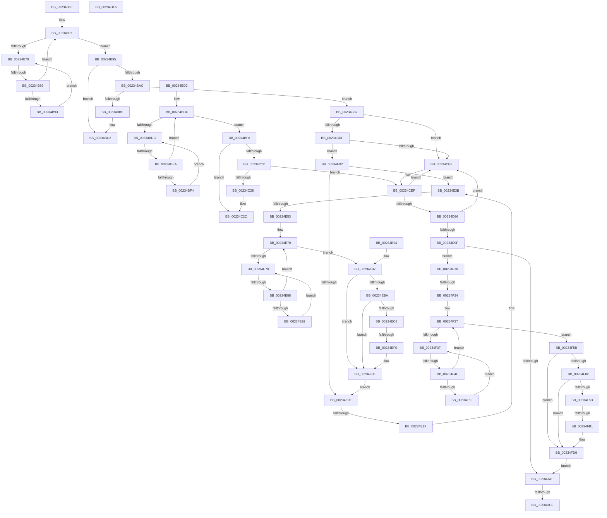

# sub_00234B6E

- RVA: `0x00234B6E`–`0x00234FE0` (길이 `1,138` bytes)
- VA: `0x0000000140234B6E`
- 실행 섹션: `.text`
- PDB 이름 있음: `아니요`; PDB Function 태그: `아니요`
- unwind 정보 RVA: `0x00060610`
- 디코드: `267`개 명령, `1,138/1,138` bytes 표시
- 미해석 바이트: `0` (있으면 어셈블리에 `.byte`로 보존)

> 이 문서는 커널 이미지의 기계어와 PDB 기호를 분석해 생성했습니다. 4번과 5번은 함수 원형과 자료형을 바이너리 사용 방식에서 추정한 C 해석이며 원본 소스 복구 결과는 아닙니다.

## 1. Dependencies

- 직접 호출 지점: **2**; 고유 호출 대상: **1**
- 직접 호출자로 확인된 함수: **0**
- RIP 상대 이미지 참조: **3**

### Outgoing calls
- `0x00234DD6` → [KeBugCheckEx](../4F/KeBugCheckEx_function_004FD660.md) (function, `0x004FD660`)
- `0x00234E35` → [KeBugCheckEx](../4F/KeBugCheckEx_function_004FD660.md) (function, `0x004FD660`)

### Direct callers
- 이 함수 시작 RVA로 연결되는 직접 call은 확인되지 않았습니다. 간접 호출은 완전히 역산할 수 없습니다.

### Static image references
- `0x00234B7C` → RVA `0x00FC52AC` (`ALMOSTRO`; reference)
- `0x00234ED0` → RVA `0x00FC8520` (`ALMOSTRO`; read)
- `0x00234EDA` → RVA `0x00FC5030` (`ALMOSTRO`; read)

## 2. Other-region calls and transfers

- 다른 실행 섹션으로 향하는 call: **0**
- call이 아닌 외부 분기/꼬리 이동: **14**
  - `0x00234B83` → [sub_00234FE8](Unknown_function_00234FE8.md) (`tail-transfer`)
  - `0x00234BCD` → [sub_002348D3 + 0x148](Unknown_function_002348D3.md) (`tail-transfer`)
  - `0x00234BE4` → [sub_00234FE8 + 0x28](Unknown_function_00234FE8.md) (`tail-transfer`)
  - `0x00234C32` → [sub_002348D3 + 0x1E7](Unknown_function_002348D3.md) (`tail-transfer`)
  - `0x00234DBA` → [sub_00234FE8 + 0x1B3](Unknown_function_00234FE8.md) (`tail-transfer`)
  - `0x00234DF0` → [sub_002348D3 + 0xED](Unknown_function_002348D3.md) (`tail-transfer`)
  - `0x00234DFD` → [sub_002348D3 + 0xC6](Unknown_function_002348D3.md) (`tail-transfer`)
  - `0x00234E19` → [sub_00234FE8 + 0x17B](Unknown_function_00234FE8.md) (`tail-transfer`)
  - `0x00234E4D` → [sub_00234FE8 + 0x4F](Unknown_function_00234FE8.md) (`tail-transfer`)
  - `0x00234E82` → [sub_00234FE8 + 0x239](Unknown_function_00234FE8.md) (`tail-transfer`)
  - `0x00234EEA` → [sub_00234FE8 + 0x1E6](Unknown_function_00234FE8.md) (`tail-transfer`)
  - `0x00234F2E` → [sub_00234FE8 + 0xD6](Unknown_function_00234FE8.md) (`tail-transfer`)
  - `0x00234F49` → [sub_00234FE8 + 0x266](Unknown_function_00234FE8.md) (`tail-transfer`)
  - `0x00234FAB` → [sub_00234FE8 + 0x20B](Unknown_function_00234FE8.md) (`tail-transfer`)

## 3. Assembly (complete function range)

```asm
00234B6E  45 33 E4                        xor r12d, r12d
00234B71  F0 48 0F BA 2B 00               lock bts qword ptr [rbx], 0
00234B77  73 1C                           jae 0x140234b95
00234B79  41 FF C4                        inc r12d
00234B7C  44 85 25 29 07 D9 00            test dword ptr [rip + 0xd90729], r12d
00234B83  0F 84 5F 04 00 00               je 0x140234fe8
00234B89  F3 90                           pause
00234B8B  48 8B 03                        mov rax, qword ptr [rbx]
00234B8E  48 85 C0                        test rax, rax
00234B91  74 DE                           je 0x140234b71
00234B93  EB E4                           jmp 0x140234b79
00234B95  44 8B 44 24 38                  mov r8d, dword ptr [rsp + 0x38]
00234B9A  4C 8B E3                        mov r12, rbx
00234B9D  49 8B 4D 00                     mov rcx, qword ptr [r13]
00234BA1  44 0F B6 4C 24 30               movzx r9d, byte ptr [rsp + 0x30]
00234BA7  4C 3B E9                        cmp r13, rcx
00234BAA  74 16                           je 0x140234bc2
00234BAC  48 8B 41 F8                     mov rax, qword ptr [rcx - 8]
00234BB0  48 8D 51 E0                     lea rdx, [rcx - 0x20]
00234BB4  48 89 54 24 70                  mov qword ptr [rsp + 0x70], rdx
00234BB9  48 3B C6                        cmp rax, rsi
00234BBC  76 79                           jbe 0x140234c37
00234BBE  48 89 43 18                     mov qword ptr [rbx + 0x18], rax
00234BC2  F0 49 83 24 24 00               lock and qword ptr [r12], 0
00234BC8  4C 8B 64 24 48                  mov r12, qword ptr [rsp + 0x48]
00234BCD  E9 49 FE FF FF                  jmp 0x140234a1b
00234BD2  33 ED                           xor ebp, ebp
00234BD4  F0 48 0F BA 2B 00               lock bts qword ptr [rbx], 0
00234BDA  73 1A                           jae 0x140234bf6
00234BDC  FF C5                           inc ebp
00234BDE  85 2D C8 06 D9 00               test dword ptr [rip + 0xd906c8], ebp
00234BE4  0F 84 26 04 00 00               je 0x140235010
00234BEA  F3 90                           pause
00234BEC  48 8B 03                        mov rax, qword ptr [rbx]
00234BEF  48 85 C0                        test rax, rax
00234BF2  74 E0                           je 0x140234bd4
00234BF4  EB E6                           jmp 0x140234bdc
00234BF6  44 8B 44 24 34                  mov r8d, dword ptr [rsp + 0x34]
00234BFB  48 8B EB                        mov rbp, rbx
00234BFE  4C 8B 54 24 48                  mov r10, qword ptr [rsp + 0x48]
00234C03  49 8B 0C 24                     mov rcx, qword ptr [r12]
00234C07  44 0F B6 4C 24 30               movzx r9d, byte ptr [rsp + 0x30]
00234C0D  4C 3B E1                        cmp r12, rcx
00234C10  74 1A                           je 0x140234c2c
00234C12  48 8B 41 F8                     mov rax, qword ptr [rcx - 8]
00234C16  48 8D 51 E0                     lea rdx, [rcx - 0x20]
00234C1A  48 89 54 24 40                  mov qword ptr [rsp + 0x40], rdx
00234C1F  48 3B C6                        cmp rax, rsi
00234C22  0F 86 C7 00 00 00               jbe 0x140234cef
00234C28  48 89 43 18                     mov qword ptr [rbx + 0x18], rax
00234C2C  F0 48 83 65 00 00               lock and qword ptr [rbp], 0
00234C32  E9 83 FE FF FF                  jmp 0x140234aba
00234C37  41 0F B6 C1                     movzx eax, r9b
00234C3B  C7 84 24 98 00 00 00 00 00 00 00  mov dword ptr [rsp + 0x98], 0
00234C46  41 32 C0                        xor al, r8b
00234C49  24 3F                           and al, 0x3f
00234C4B  41 32 C1                        xor al, r9b
00234C4E  88 44 24 30                     mov byte ptr [rsp + 0x30], al
00234C52  32 42 03                        xor al, byte ptr [rdx + 3]
00234C55  88 84 24 9B 00 00 00            mov byte ptr [rsp + 0x9b], al
00234C5C  8B 84 24 98 00 00 00            mov eax, dword ptr [rsp + 0x98]
00234C63  F0 31 02                        lock xor dword ptr [rdx], eax
00234C66  4C 8B 4C 24 48                  mov r9, qword ptr [rsp + 0x48]
00234C6B  4C 8B DA                        mov r11, rdx
00234C6E  44 8B 6C 24 34                  mov r13d, dword ptr [rsp + 0x34]
00234C73  41 8B C0                        mov eax, r8d
00234C76  49 83 C5 10                     add r13, 0x10
00234C7A  44 8B 44 24 38                  mov r8d, dword ptr [rsp + 0x38]
00234C7F  4D 87 1C C1                     xchg qword ptr [r9 + rax*8], r11
00234C83  44 0F B7 52 3A                  movzx r10d, word ptr [rdx + 0x3a]
00234C88  41 8B C2                        mov eax, r10d
00234C8B  4C 89 54 24 40                  mov qword ptr [rsp + 0x40], r10
00234C90  48 C1 E0 08                     shl rax, 8
00234C94  49 03 C5                        add rax, r13
00234C97  4C 89 5C 24 78                  mov qword ptr [rsp + 0x78], r11
00234C9C  48 C1 E0 05                     shl rax, 5
00234CA0  4C 8D 6B 08                     lea r13, [rbx + 8]
00234CA4  49 03 C1                        add rax, r9
00234CA7  48 89 44 24 68                  mov qword ptr [rsp + 0x68], rax
00234CAC  41 8B C2                        mov eax, r10d
00234CAF  44 8B 54 24 34                  mov r10d, dword ptr [rsp + 0x34]
00234CB4  48 83 F0 01                     xor rax, 1
00234CB8  48 C1 E0 08                     shl rax, 8
00234CBC  49 83 C2 10                     add r10, 0x10
00234CC0  49 03 C2                        add rax, r10
00234CC3  4C 8B 11                        mov r10, qword ptr [rcx]
00234CC6  48 C1 E0 05                     shl rax, 5
00234CCA  49 03 C1                        add rax, r9
00234CCD  48 89 84 24 88 00 00 00         mov qword ptr [rsp + 0x88], rax
00234CD5  48 8B 41 08                     mov rax, qword ptr [rcx + 8]
00234CD9  49 39 4A 08                     cmp qword ptr [r10 + 8], rcx
00234CDD  75 09                           jne 0x140234ce8
00234CDF  48 39 08                        cmp qword ptr [rax], rcx
00234CE2  0F 84 1A 01 00 00               je 0x140234e02
00234CE8  B9 03 00 00 00                  mov ecx, 3
00234CED  CD 29                           int 0x29
00234CEF  41 0F B6 C1                     movzx eax, r9b
00234CF3  C7 84 24 B0 00 00 00 00 00 00 00  mov dword ptr [rsp + 0xb0], 0
00234CFE  41 32 C0                        xor al, r8b
00234D01  24 3F                           and al, 0x3f
00234D03  41 32 C1                        xor al, r9b
00234D06  88 44 24 30                     mov byte ptr [rsp + 0x30], al
00234D0A  32 42 03                        xor al, byte ptr [rdx + 3]
00234D0D  88 84 24 B3 00 00 00            mov byte ptr [rsp + 0xb3], al
00234D14  8B 84 24 B0 00 00 00            mov eax, dword ptr [rsp + 0xb0]
00234D1B  F0 31 02                        lock xor dword ptr [rdx], eax
00234D1E  44 8B 64 24 38                  mov r12d, dword ptr [rsp + 0x38]
00234D23  4C 8B DA                        mov r11, rdx
00234D26  41 8B C0                        mov eax, r8d
00234D29  49 83 C4 10                     add r12, 0x10
00234D2D  44 8B 44 24 34                  mov r8d, dword ptr [rsp + 0x34]
00234D32  4D 87 1C C2                     xchg qword ptr [r10 + rax*8], r11
00234D36  44 0F B7 4A 3A                  movzx r9d, word ptr [rdx + 0x3a]
00234D3B  41 8B C1                        mov eax, r9d
00234D3E  4C 89 8C 24 88 00 00 00         mov qword ptr [rsp + 0x88], r9
00234D46  48 C1 E0 08                     shl rax, 8
00234D4A  49 03 C4                        add rax, r12
00234D4D  4C 89 5C 24 78                  mov qword ptr [rsp + 0x78], r11
00234D52  48 C1 E0 05                     shl rax, 5
00234D56  4C 8D 63 08                     lea r12, [rbx + 8]
00234D5A  49 03 C2                        add rax, r10
00234D5D  48 89 44 24 68                  mov qword ptr [rsp + 0x68], rax
00234D62  41 8B C1                        mov eax, r9d
00234D65  44 8B 4C 24 38                  mov r9d, dword ptr [rsp + 0x38]
00234D6A  48 83 F0 01                     xor rax, 1
00234D6E  48 C1 E0 08                     shl rax, 8
00234D72  49 83 C1 10                     add r9, 0x10
00234D76  49 03 C1                        add rax, r9
00234D79  4C 8B 09                        mov r9, qword ptr [rcx]
00234D7C  48 C1 E0 05                     shl rax, 5
00234D80  49 03 C2                        add rax, r10
00234D83  48 89 44 24 58                  mov qword ptr [rsp + 0x58], rax
00234D88  48 8B 41 08                     mov rax, qword ptr [rcx + 8]
00234D8C  49 39 49 08                     cmp qword ptr [r9 + 8], rcx
00234D90  0F 85 52 FF FF FF               jne 0x140234ce8
00234D96  48 39 08                        cmp qword ptr [rax], rcx
00234D99  0F 85 49 FF FF FF               jne 0x140234ce8
00234D9F  4C 89 08                        mov qword ptr [rax], r9
00234DA2  49 89 41 08                     mov qword ptr [r9 + 8], rax
00234DA6  49 3B C1                        cmp rax, r9
00234DA9  0F 84 69 01 00 00               je 0x140234f18
00234DAF  41 FF C0                        inc r8d
00234DB2  44 89 44 24 34                  mov dword ptr [rsp + 0x34], r8d
00234DB7  4D 85 DB                        test r11, r11
00234DBA  0F 84 DB 03 00 00               je 0x14023519b
00234DC0  4C 8B CA                        mov r9, rdx
00234DC3  4C 89 5C 24 20                  mov qword ptr [rsp + 0x20], r11
00234DC8  BA 08 00 00 00                  mov edx, 8
00234DCD  B9 C7 00 00 00                  mov ecx, 0xc7
00234DD2  44 8D 42 F9                     lea r8d, [rdx - 7]
00234DD6  E8 85 88 2C 00                  call 0x1404fd660
00234DDB  CC                              int3
00234DDC  41 BA 00 01 00 00               mov r10d, 0x100
00234DE2  48 81 C6 00 00 00 04            add rsi, 0x4000000
00234DE9  44 89 54 24 54                  mov dword ptr [rsp + 0x54], r10d
00234DEE  33 ED                           xor ebp, ebp
00234DF0  E9 CB FB FF FF                  jmp 0x1402349c0
00234DF5  48 8B AC 24 90 00 00 00         mov rbp, qword ptr [rsp + 0x90]
00234DFD  E9 97 FB FF FF                  jmp 0x140234999
00234E02  4C 89 10                        mov qword ptr [rax], r10
00234E05  49 89 42 08                     mov qword ptr [r10 + 8], rax
00234E09  49 3B C2                        cmp rax, r10
00234E0C  74 2D                           je 0x140234e3b
00234E0E  41 FF C0                        inc r8d
00234E11  44 89 44 24 38                  mov dword ptr [rsp + 0x38], r8d
00234E16  4D 85 DB                        test r11, r11
00234E19  0F 84 44 03 00 00               je 0x140235163
00234E1F  4C 8B CA                        mov r9, rdx
00234E22  4C 89 5C 24 20                  mov qword ptr [rsp + 0x20], r11
00234E27  BA 08 00 00 00                  mov edx, 8
00234E2C  B9 C7 00 00 00                  mov ecx, 0xc7
00234E31  44 8D 42 F9                     lea r8d, [rdx - 7]
00234E35  E8 26 88 2C 00                  call 0x1404fd660
00234E3A  CC                              int3
00234E3B  66 83 7C 24 40 00               cmp word ptr [rsp + 0x40], 0
00234E41  48 8B 44 24 68                  mov rax, qword ptr [rsp + 0x68]
00234E46  C7 40 1C FF FF FF FF            mov dword ptr [rax + 0x1c], 0xffffffff
00234E4D  0F 85 E4 01 00 00               jne 0x140235037
00234E53  8B 4C 24 34                     mov ecx, dword ptr [rsp + 0x34]
00234E57  48 81 C1 10 01 00 00            add rcx, 0x110
00234E5E  48 C1 E1 05                     shl rcx, 5
00234E62  49 03 C9                        add rcx, r9
00234E65  48 89 4C 24 40                  mov qword ptr [rsp + 0x40], rcx
00234E6A  45 33 ED                        xor r13d, r13d
00234E6D  0F 1F 00                        nop dword ptr [rax]
00234E70  F0 48 0F BA 29 00               lock bts qword ptr [rcx], 0
00234E76  73 1F                           jae 0x140234e97
00234E78  41 FF C5                        inc r13d
00234E7B  44 85 2D 2A 04 D9 00            test dword ptr [rip + 0xd9042a], r13d
00234E82  0F 84 99 03 00 00               je 0x140235221
00234E88  F3 90                           pause
00234E8A  48 8B 01                        mov rax, qword ptr [rcx]
00234E8D  48 85 C0                        test rax, rax
00234E90  74 DE                           je 0x140234e70
00234E92  EB E4                           jmp 0x140234e78
00234E94  48 8B CB                        mov rcx, rbx
00234E97  48 8B 44 24 68                  mov rax, qword ptr [rsp + 0x68]
00234E9C  4C 8D 6B 08                     lea r13, [rbx + 8]
00234EA0  4C 8B 5C 24 78                  mov r11, qword ptr [rsp + 0x78]
00234EA5  4C 8B 4C 24 48                  mov r9, qword ptr [rsp + 0x48]
00234EAA  44 8B 44 24 38                  mov r8d, dword ptr [rsp + 0x38]
00234EAF  48 8B 54 24 70                  mov rdx, qword ptr [rsp + 0x70]
00234EB4  83 78 1C FF                     cmp dword ptr [rax + 0x1c], -1
00234EB8  75 54                           jne 0x140234f0e
00234EBA  48 8B 84 24 88 00 00 00         mov rax, qword ptr [rsp + 0x88]
00234EC2  83 78 1C FF                     cmp dword ptr [rax + 0x1c], -1
00234EC6  75 46                           jne 0x140234f0e
00234EC8  41 0F B6 81 D0 BF FF FF         movzx eax, byte ptr [r9 - 0x4030]
00234ED0  4C 8D 15 49 36 D9 00            lea r10, [rip + 0xd93649]
00234ED7  48 03 C0                        add rax, rax
00234EDA  83 3D 4F 01 D9 00 00            cmp dword ptr [rip + 0xd9014f], 0
00234EE1  4D 8B 54 C2 08                  mov r10, qword ptr [r10 + rax*8 + 8]
00234EE6  8B 44 24 34                     mov eax, dword ptr [rsp + 0x34]
00234EEA  0F 84 DE 02 00 00               je 0x1402351ce
00234EF0  44 8B 4C 24 34                  mov r9d, dword ptr [rsp + 0x34]
00234EF5  48 8B 54 24 70                  mov rdx, qword ptr [rsp + 0x70]
00234EFA  41 83 E1 3F                     and r9d, 0x3f
00234EFE  48 C1 E8 06                     shr rax, 6
00234F02  4D 8D 14 C2                     lea r10, [r10 + rax*8]
00234F06  41 8B C1                        mov eax, r9d
00234F09  F0 49 0F B3 02                  lock btr qword ptr [r10], rax
00234F0E  F0 48 83 21 00                  lock and qword ptr [rcx], 0
00234F13  E9 F6 FE FF FF                  jmp 0x140234e0e
00234F18  66 83 BC 24 88 00 00 00 00      cmp word ptr [rsp + 0x88], 0
00234F21  4C 8B 4C 24 68                  mov r9, qword ptr [rsp + 0x68]
00234F26  41 C7 41 1C FF FF FF FF         mov dword ptr [r9 + 0x1c], 0xffffffff
00234F2E  0F 85 8A 01 00 00               jne 0x1402350be
00234F34  45 33 E4                        xor r12d, r12d
00234F37  F0 48 0F BA 2B 00               lock bts qword ptr [rbx], 0
00234F3D  73 1C                           jae 0x140234f5b
00234F3F  41 FF C4                        inc r12d
00234F42  44 85 25 63 03 D9 00            test dword ptr [rip + 0xd90363], r12d
00234F49  0F 84 FF 02 00 00               je 0x14023524e
00234F4F  F3 90                           pause
00234F51  48 8B 03                        mov rax, qword ptr [rbx]
00234F54  48 85 C0                        test rax, rax
00234F57  74 DE                           je 0x140234f37
00234F59  EB E4                           jmp 0x140234f3f
00234F5B  48 8B CB                        mov rcx, rbx
00234F5E  4C 8B 4C 24 68                  mov r9, qword ptr [rsp + 0x68]
00234F63  4C 8D 63 08                     lea r12, [rbx + 8]
00234F67  4C 8B 5C 24 78                  mov r11, qword ptr [rsp + 0x78]
00234F6C  4C 8B 54 24 48                  mov r10, qword ptr [rsp + 0x48]
00234F71  44 8B 44 24 34                  mov r8d, dword ptr [rsp + 0x34]
00234F76  48 8B 54 24 40                  mov rdx, qword ptr [rsp + 0x40]
00234F7B  41 83 79 1C FF                  cmp dword ptr [r9 + 0x1c], -1
00234F80  75 54                           jne 0x140234fd6
00234F82  48 8B 44 24 58                  mov rax, qword ptr [rsp + 0x58]
00234F87  83 78 1C FF                     cmp dword ptr [rax + 0x1c], -1
00234F8B  75 49                           jne 0x140234fd6
00234F8D  41 0F B6 82 D0 BF FF FF         movzx eax, byte ptr [r10 - 0x4030]
00234F95  4C 8D 0D 84 35 D9 00            lea r9, [rip + 0xd93584]
00234F9C  48 03 C0                        add rax, rax
00234F9F  83 3D 8A 00 D9 00 00            cmp dword ptr [rip + 0xd9008a], 0
00234FA6  4D 8B 4C C1 08                  mov r9, qword ptr [r9 + rax*8 + 8]
00234FAB  0F 84 42 02 00 00               je 0x1402351f3
00234FB1  8B 44 24 38                     mov eax, dword ptr [rsp + 0x38]
00234FB5  48 8B 54 24 40                  mov rdx, qword ptr [rsp + 0x40]
00234FBA  83 E0 3F                        and eax, 0x3f
00234FBD  89 44 24 58                     mov dword ptr [rsp + 0x58], eax
00234FC1  8B 44 24 38                     mov eax, dword ptr [rsp + 0x38]
00234FC5  48 C1 E8 06                     shr rax, 6
00234FC9  4D 8D 0C C1                     lea r9, [r9 + rax*8]
00234FCD  8B 44 24 58                     mov eax, dword ptr [rsp + 0x58]
00234FD1  F0 49 0F B3 01                  lock btr qword ptr [r9], rax
00234FD6  F0 48 83 21 00                  lock and qword ptr [rcx], 0
00234FDB  E9 CF FD FF FF                  jmp 0x140234daf
```

## 4. C-style interpretation (structured pseudocode)

```c
__int64 __fastcall sub_00234B6E(__int64 a1, __int64 a2, __int64 a3, __int64 a4, __int64 a5, unsigned __int8 a6, unsigned int a7, unsigned __int16 a8, __int64 a9, __int64 a10, unsigned int a11, __int64 a12, __int64 a13, __int64 a14, __int64 a15, __int64 a16, unsigned __int16 a17, __int64 a18, unsigned int a19, __int64 a20, __int64 a21, unsigned int a22)
{
    __int64 result;
    __int64 v_r10;
    __int64 v_r12;
    __int64 v_r13;
    __int64 v_rbp;
    __int64 v_rsi;
    unsigned __int64 v_stack_p20;
    unsigned __int8 v_stack_p30;
    unsigned int v_stack_p34;
    unsigned int v_stack_p38;
    unsigned __int64 v_stack_p40;
    unsigned __int64 v_stack_p48;
    unsigned int v_stack_p54;
    unsigned __int64 v_stack_p58;
    unsigned __int64 v_stack_p68;
    unsigned __int64 v_stack_p70;
    unsigned __int64 v_stack_p78;
    unsigned __int64 v_stack_p88;
    unsigned __int64 v_stack_p90;
    unsigned int v_stack_p98;
    unsigned __int8 v_stack_p9B;
    unsigned int v_stack_pB0;
    unsigned __int8 v_stack_pB3;

    v_r12 = 0;
loc_00234B71:
    if (condition_is_above_or_equal) goto loc_00234B95;
loc_00234B79:
    v_r12 = (unsigned int)((v_r12) + 1);
    if (*(unsigned __int64 *)(v_rbx) == 0) goto loc_00234B71;
    goto loc_00234B79;
loc_00234B95:
    if (v_r13 == (*(unsigned __int64 *)(v_r13))) goto loc_00234BC2;
    v_stack_p70 = *(unsigned __int64 *)(v_r13) - 32;
    if ((*(unsigned __int64 *)(*(unsigned __int64 *)(v_r13) - 8)) <= v_rsi) goto loc_00234C37;
    *(unsigned __int64 *)(v_rbx + 24) = *(unsigned __int64 *)(*(unsigned __int64 *)(v_r13) - 8);
loc_00234BC2:
loc_00234C37:
    v_stack_p98 = 0;
    result = (unsigned __int8)((a6) ^ ((unsigned __int8)((unsigned int)(a7))));
    result = (unsigned __int8)((result) & (63));
    result = (unsigned __int8)((result) ^ (a6));
    v_stack_p30 = (unsigned __int8)(result);
    result = (unsigned __int8)((result) ^ (*(unsigned __int8 *)(*(unsigned __int64 *)(v_r13) - 32 + 3)));
    v_stack_p9B = (unsigned __int8)(result);
    v_r13 = ((unsigned int)(v_stack_p34)) + (16);
    v_stack_p40 = *(unsigned __int16 *)(*(unsigned __int64 *)(v_r13) - 32 + 58);
    result = ((unsigned int)((unsigned int)(*(unsigned __int16 *)(*(unsigned __int64 *)(v_r13) - 32 + 58)))) << (8);
    result = (result) + (v_r13);
    v_stack_p78 = *(unsigned __int64 *)(v_r13) - 32;
    result = (result) << (5);
    result = (result) + (a9);
    v_stack_p68 = result;
    result = ((unsigned int)((unsigned int)(*(unsigned __int16 *)(*(unsigned __int64 *)(v_r13) - 32 + 58)))) ^ (1);
    result = (result) << (8);
    v_r10 = ((unsigned int)(v_stack_p34)) + (16);
    result = (result) + (v_r10);
    result = (result) << (5);
    result = (result) + (a9);
    v_stack_p88 = result;
    if ((*(unsigned __int64 *)(*(unsigned __int64 *)(*(unsigned __int64 *)(v_r13)) + 8)) != (*(unsigned __int64 *)(v_r13))) goto loc_00234CE8;
    if ((*(unsigned __int64 *)(*(unsigned __int64 *)(*(unsigned __int64 *)(v_r13) + 8))) == (*(unsigned __int64 *)(v_r13))) goto loc_00234E02;
loc_00234CE8:
loc_00234CEF:
    v_stack_pB0 = 0;
    result = (unsigned __int8)(((unsigned __int8)(a9)) ^ ((unsigned __int8)((unsigned int)(a7))));
    result = (unsigned __int8)((result) & (63));
    result = (unsigned __int8)((result) ^ ((unsigned __int8)(a9)));
    v_stack_p30 = (unsigned __int8)(result);
    result = (unsigned __int8)((result) ^ (*(unsigned __int8 *)(*(unsigned __int64 *)(v_r13) - 32 + 3)));
    v_stack_pB3 = (unsigned __int8)(result);
    v_r12 = ((unsigned int)(a7)) + (16);
    v_stack_p88 = *(unsigned __int16 *)(*(unsigned __int64 *)(v_r13) - 32 + 58);
    result = ((unsigned int)((unsigned int)(*(unsigned __int16 *)(*(unsigned __int64 *)(v_r13) - 32 + 58)))) << (8);
    result = (result) + (v_r12);
    v_stack_p78 = *(unsigned __int64 *)(v_r13) - 32;
    result = (result) << (5);
    result = (result) + (*(unsigned __int64 *)(*(unsigned __int64 *)(v_r13)));
    v_stack_p68 = result;
    result = ((unsigned int)((unsigned int)(*(unsigned __int16 *)(*(unsigned __int64 *)(v_r13) - 32 + 58)))) ^ (1);
    result = (result) << (8);
    a4 = ((unsigned int)(a7)) + (16);
    result = (result) + (a4);
    result = (result) << (5);
    result = (result) + (*(unsigned __int64 *)(*(unsigned __int64 *)(v_r13)));
    v_stack_p58 = result;
    if ((*(unsigned __int64 *)(*(unsigned __int64 *)(3) + 8)) != 3) goto loc_00234CE8;
    if ((*(unsigned __int64 *)(*(unsigned __int64 *)(3 + 8))) != 3) goto loc_00234CE8;
    *(unsigned __int64 *)(*(unsigned __int64 *)(3 + 8)) = *(unsigned __int64 *)(3);
    *(unsigned __int64 *)(*(unsigned __int64 *)(3) + 8) = *(unsigned __int64 *)(3 + 8);
    if ((*(unsigned __int64 *)(3 + 8)) == (*(unsigned __int64 *)(3))) goto loc_00234F18;
loc_00234DAF:
    a3 = (unsigned int)(((unsigned int)(v_stack_p34)) + 1);
    v_stack_p34 = (unsigned int)(a3);
    v_stack_p20 = *(unsigned __int64 *)(v_r13) - 32;
    result = KeBugCheckEx(199, 8, 8 - 7, *(unsigned __int64 *)(v_r13) - 32);
    v_rsi = (v_rsi) + (0x4000000ULL);
    v_stack_p54 = 256;
    v_rbp = 0;
loc_00234E02:
    *(unsigned __int64 *)(result) = 256;
    *(unsigned __int64 *)(256 + 8) = result;
    if (result == 256) goto loc_00234E3B;
loc_00234E0E:
    a3 = (unsigned int)((8 - 7) + 1);
    v_stack_p38 = (unsigned int)(a3);
    v_stack_p20 = *(unsigned __int64 *)(v_r13) - 32;
    result = KeBugCheckEx(199, 8, 8 - 7, 8);
loc_00234E3B:
    *(unsigned int *)(a13 + 28) = 0xFFFFFFFFULL;
    a1 = ((unsigned int)(v_stack_p34)) + (272);
    a1 = (a1) << (5);
    a1 = (a1) + (8);
    v_stack_p40 = a1;
    v_r13 = 0;
loc_00234E70:
    if (condition_is_above_or_equal) goto loc_00234E97;
loc_00234E78:
    v_r13 = (unsigned int)((v_r13) + 1);
    if (*(unsigned __int64 *)(a1) == 0) goto loc_00234E70;
    goto loc_00234E78;
loc_00234E97:
    if ((*(unsigned int *)(a13 + 28)) != -1) goto loc_00234F0E;
    if ((*(unsigned int *)(a17 + 28)) != -1) goto loc_00234F0E;
    result = (*(unsigned __int8 *)(a9 - 16432)) + (*(unsigned __int8 *)(a9 - 16432));
    a4 = (unsigned int)(((unsigned int)(v_stack_p34)) & (63));
    result = ((unsigned int)(v_stack_p34)) >> (6);
loc_00234F0E:
    goto loc_00234E0E;
loc_00234F18:
    *(unsigned int *)(a13 + 28) = 0xFFFFFFFFULL;
    v_r12 = 0;
loc_00234F37:
    if (condition_is_above_or_equal) goto loc_00234F5B;
loc_00234F3F:
    v_r12 = (unsigned int)((v_r12) + 1);
    if (*(unsigned __int64 *)(v_rbx) == 0) goto loc_00234F37;
    goto loc_00234F3F;
loc_00234F5B:
    if ((*(unsigned int *)(a13 + 28)) != -1) goto loc_00234FD6;
    if ((*(unsigned int *)(a11 + 28)) != -1) goto loc_00234FD6;
    result = (*(unsigned __int8 *)(a9 - 16432)) + (*(unsigned __int8 *)(a9 - 16432));
    result = (unsigned int)(((unsigned int)(a7)) & (63));
    v_stack_p58 = (unsigned int)(result);
    result = ((unsigned int)(a7)) >> (6);
loc_00234FD6:
    goto loc_00234DAF;
}
```

## 5. (Beta) C Style

```c
int64_t sub_00234B6E(int64_t Arg1, int64_t Arg2, int64_t Arg3, int64_t Arg4, uint64_t Arg5, uint8_t Arg6, uint32_t Arg7, uint16_t Arg8, void *Arg9, uint64_t Arg10, void *Arg11, uint64_t Arg12, void *Arg13, int64_t Arg14, int64_t Arg15, uint64_t Arg16, void *Arg17, uint64_t Arg18, uint32_t Arg19, uint64_t Arg20, uint64_t Arg21, uint32_t Arg22)
{
    uint8_t *arg9 = (uint8_t *)Arg9;
    uint8_t *arg11 = (uint8_t *)Arg11;
    uint8_t *arg13 = (uint8_t *)Arg13;
    uint8_t *arg17 = (uint8_t *)Arg17;

    int64_t result;
    int64_t local_r10;
    int64_t local_r12;
    int64_t local_r13;
    int64_t local_rbp;
    int64_t local_rsi;
    uint64_t v_stack_p20;
    uint8_t v_stack_p30;
    uint32_t v_stack_p34;
    uint32_t v_stack_p38;
    uint64_t v_stack_p40;
    uint64_t v_stack_p48;
    uint32_t v_stack_p54;
    uint64_t v_stack_p58;
    uint64_t v_stack_p68;
    uint64_t v_stack_p70;
    uint64_t v_stack_p78;
    uint64_t v_stack_p88;
    uint64_t v_stack_p90;
    uint32_t v_stack_p98;
    uint8_t v_stack_p9B;
    uint32_t v_stack_pB0;
    uint8_t v_stack_pB3;

    local_r12 = 0;
loc_00234B71:
    if (condition_is_above_or_equal) goto loc_00234B95;
loc_00234B79:
    local_r12 = (uint32_t)((local_r12) + 1);
    if (*(uint64_t *)(local_rbx) == 0) goto loc_00234B71;
    goto loc_00234B79;
loc_00234B95:
    if (local_r13 == (*(uint64_t *)(local_r13))) goto loc_00234BC2;
    v_stack_p70 = *(uint64_t *)(local_r13) - 32;
    if ((*(uint64_t *)(*(uint64_t *)(local_r13) - 0x8)) <= local_rsi) goto loc_00234C37;
    *(uint64_t *)(local_rbx + 0x18) = *(uint64_t *)(*(uint64_t *)(local_r13) - 0x8);
loc_00234BC2:
loc_00234C37:
    v_stack_p98 = 0;
    result = (uint8_t)((Arg6) ^ ((uint8_t)((uint32_t)(Arg7))));
    result = (uint8_t)((result) & (63));
    result = (uint8_t)((result) ^ (Arg6));
    v_stack_p30 = (uint8_t)(result);
    result = (uint8_t)((result) ^ (*(uint8_t *)(*(uint64_t *)(local_r13) - 0x20 + 0x3)));
    v_stack_p9B = (uint8_t)(result);
    local_r13 = ((uint32_t)(v_stack_p34)) + (16);
    v_stack_p40 = *(uint16_t *)(*(uint64_t *)(local_r13) - 0x20 + 0x3A);
    result = ((uint32_t)((uint32_t)(*(uint16_t *)(*(uint64_t *)(local_r13) - 0x20 + 0x3A)))) << (8);
    result = (result) + (local_r13);
    v_stack_p78 = *(uint64_t *)(local_r13) - 32;
    result = (result) << (5);
    result = (result) + (Arg9);
    v_stack_p68 = result;
    result = ((uint32_t)((uint32_t)(*(uint16_t *)(*(uint64_t *)(local_r13) - 0x20 + 0x3A)))) ^ (1);
    result = (result) << (8);
    local_r10 = ((uint32_t)(v_stack_p34)) + (16);
    result = (result) + (local_r10);
    result = (result) << (5);
    result = (result) + (Arg9);
    v_stack_p88 = result;
    if ((*(uint64_t *)(*(uint64_t *)(*(uint64_t *)(local_r13)) + 0x8)) != (*(uint64_t *)(local_r13))) goto loc_00234CE8;
    if ((*(uint64_t *)(*(uint64_t *)(*(uint64_t *)(local_r13) + 0x8))) == (*(uint64_t *)(local_r13))) goto loc_00234E02;
loc_00234CE8:
loc_00234CEF:
    v_stack_pB0 = 0;
    result = (uint8_t)(((uint8_t)(Arg9)) ^ ((uint8_t)((uint32_t)(Arg7))));
    result = (uint8_t)((result) & (63));
    result = (uint8_t)((result) ^ ((uint8_t)(Arg9)));
    v_stack_p30 = (uint8_t)(result);
    result = (uint8_t)((result) ^ (*(uint8_t *)(*(uint64_t *)(local_r13) - 0x20 + 0x3)));
    v_stack_pB3 = (uint8_t)(result);
    local_r12 = ((uint32_t)(Arg7)) + (16);
    v_stack_p88 = *(uint16_t *)(*(uint64_t *)(local_r13) - 0x20 + 0x3A);
    result = ((uint32_t)((uint32_t)(*(uint16_t *)(*(uint64_t *)(local_r13) - 0x20 + 0x3A)))) << (8);
    result = (result) + (local_r12);
    v_stack_p78 = *(uint64_t *)(local_r13) - 32;
    result = (result) << (5);
    result = (result) + (*(uint64_t *)(*(uint64_t *)(local_r13)));
    v_stack_p68 = result;
    result = ((uint32_t)((uint32_t)(*(uint16_t *)(*(uint64_t *)(local_r13) - 0x20 + 0x3A)))) ^ (1);
    result = (result) << (8);
    Arg4 = ((uint32_t)(Arg7)) + (16);
    result = (result) + (Arg4);
    result = (result) << (5);
    result = (result) + (*(uint64_t *)(*(uint64_t *)(local_r13)));
    v_stack_p58 = result;
    if ((*(uint64_t *)(*(uint64_t *)(3) + 0x8)) != 3) goto loc_00234CE8;
    if ((*(uint64_t *)(*(uint64_t *)(3 + 0x8))) != 3) goto loc_00234CE8;
    *(uint64_t *)(*(uint64_t *)(3 + 0x8)) = *(uint64_t *)(3);
    *(uint64_t *)(*(uint64_t *)(3) + 0x8) = *(uint64_t *)(3 + 0x8);
    if ((*(uint64_t *)(3 + 0x8)) == (*(uint64_t *)(3))) goto loc_00234F18;
loc_00234DAF:
    Arg3 = (uint32_t)(((uint32_t)(v_stack_p34)) + 1);
    v_stack_p34 = (uint32_t)(Arg3);
    v_stack_p20 = *(uint64_t *)(local_r13) - 32;
    result = KeBugCheckEx(199, 8, 8 - 7, *(uint64_t *)(local_r13) - 32);
    local_rsi = (local_rsi) + (0x4000000ULL);
    v_stack_p54 = 256;
    local_rbp = 0;
loc_00234E02:
    *(uint64_t *)(result) = 256;
    *(uint64_t *)(256 + 0x8) = result;
    if (result == 256) goto loc_00234E3B;
loc_00234E0E:
    Arg3 = (uint32_t)((8 - 7) + 1);
    v_stack_p38 = (uint32_t)(Arg3);
    v_stack_p20 = *(uint64_t *)(local_r13) - 32;
    result = KeBugCheckEx(199, 8, 8 - 7, 8);
loc_00234E3B:
    *(uint32_t *)(arg13 + 0x1C) = 0xFFFFFFFFULL;
    Arg1 = ((uint32_t)(v_stack_p34)) + (272);
    Arg1 = (Arg1) << (5);
    Arg1 = (Arg1) + (8);
    v_stack_p40 = Arg1;
    local_r13 = 0;
loc_00234E70:
    if (condition_is_above_or_equal) goto loc_00234E97;
loc_00234E78:
    local_r13 = (uint32_t)((local_r13) + 1);
    if (*(uint64_t *)(Arg1) == 0) goto loc_00234E70;
    goto loc_00234E78;
loc_00234E97:
    if ((*(uint32_t *)(arg13 + 0x1C)) != -1) goto loc_00234F0E;
    if ((*(uint32_t *)(arg17 + 0x1C)) != -1) goto loc_00234F0E;
    result = (*(uint8_t *)(arg9 - 0x4030)) + (*(uint8_t *)(arg9 - 0x4030));
    Arg4 = (uint32_t)(((uint32_t)(v_stack_p34)) & (63));
    result = ((uint32_t)(v_stack_p34)) >> (6);
loc_00234F0E:
    goto loc_00234E0E;
loc_00234F18:
    *(uint32_t *)(arg13 + 0x1C) = 0xFFFFFFFFULL;
    local_r12 = 0;
loc_00234F37:
    if (condition_is_above_or_equal) goto loc_00234F5B;
loc_00234F3F:
    local_r12 = (uint32_t)((local_r12) + 1);
    if (*(uint64_t *)(local_rbx) == 0) goto loc_00234F37;
    goto loc_00234F3F;
loc_00234F5B:
    if ((*(uint32_t *)(arg13 + 0x1C)) != -1) goto loc_00234FD6;
    if ((*(uint32_t *)(arg11 + 0x1C)) != -1) goto loc_00234FD6;
    result = (*(uint8_t *)(arg9 - 0x4030)) + (*(uint8_t *)(arg9 - 0x4030));
    result = (uint32_t)(((uint32_t)(Arg7)) & (63));
    v_stack_p58 = (uint32_t)(result);
    result = ((uint32_t)(Arg7)) >> (6);
loc_00234FD6:
    goto loc_00234DAF;
}
```

### 관측된 메모리 오프셋

구조체 형식이 확인되지 않은 접근은 인자 기준의 오프셋으로만 기록했습니다.

| 기준 인자 | 오프셋 표현 | 폭 (bit) | 접근 |
|---|---:|---:|---|
| `Arg9` | `- 0x4030` | `8` | `R` |
| `Arg9` | `+ 0x0 + rax*8` | `64` | `R/W` |
| `Arg11` | `+ 0x1C` | `32` | `R` |
| `Arg13` | `+ 0x0` | `32` | `R` |
| `Arg13` | `+ 0x1C` | `32` | `R` |
| `Arg13` | `+ 0x1C` | `32` | `W` |
| `Arg17` | `+ 0x1C` | `32` | `R` |

## 6. Execution-region graph

[열기: 2D/3D 그래프와 함수 탐색 컨트롤 패널](../../../control-panel.html?section=text&rva=0x00234B6E&view=graph)

- 2D 그래프는 위에서 아래로 흐르고, 3D 그래프는 빈 공간을 드래그해 회전합니다. Shift+드래그는 이동, 휠은 확대·축소, 함수 노드 선택은 대상 보고서 이동입니다.

### Static fallback


