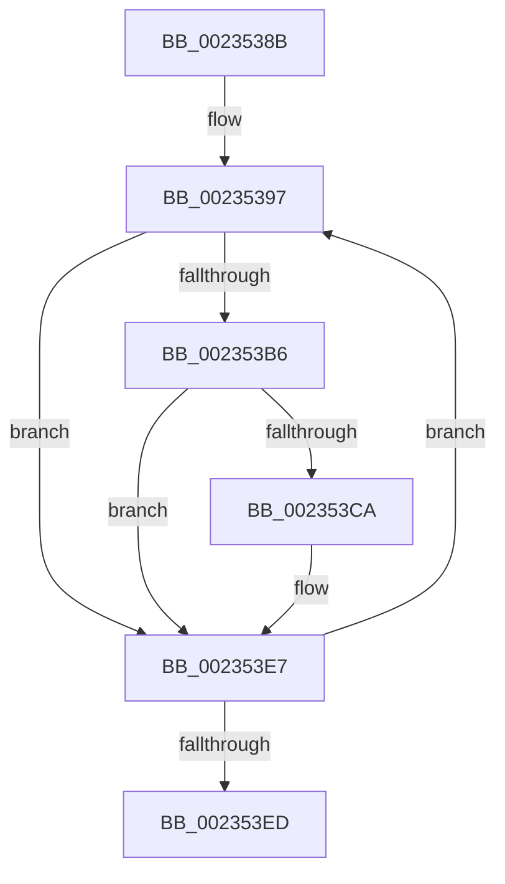

# sub_0023538B

- RVA: `0x0023538B`–`0x002353F2` (길이 `103` bytes)
- VA: `0x000000014023538B`
- 실행 섹션: `.text`
- PDB 이름 있음: `아니요`; PDB Function 태그: `아니요`
- unwind 정보 RVA: `0x00060674`
- 디코드: `25`개 명령, `103/103` bytes 표시
- 미해석 바이트: `0` (있으면 어셈블리에 `.byte`로 보존)

> 이 문서는 커널 이미지의 기계어와 PDB 기호를 분석해 생성했습니다. 4번과 5번은 함수 원형과 자료형을 바이너리 사용 방식에서 추정한 C 해석이며 원본 소스 복구 결과는 아닙니다.

## 1. Dependencies

- 직접 호출 지점: **1**; 고유 호출 대상: **1**
- 직접 호출자로 확인된 함수: **0**
- RIP 상대 이미지 참조: **1**

### Outgoing calls
- `0x002353E2` → [EtwpLogKernelEvent](../25/EtwpLogKernelEvent_function_0025CC00.md) (function, `0x0025CC00`)

### Direct callers
- 이 함수 시작 RVA로 연결되는 직접 call은 확인되지 않았습니다. 간접 호출은 완전히 역산할 수 없습니다.

### Static image references
- `0x00235397` → RVA `0x00FC6AA8` (`ALMOSTRO`; read)

## 2. Other-region calls and transfers

- 다른 실행 섹션으로 향하는 call: **0**
- 별도 외부 분기/꼬리 이동을 확인하지 못했습니다.

## 3. Assembly (complete function range)

```asm
0023538B  48 89 74 24 60                  mov qword ptr [rsp + 0x60], rsi
00235390  8B B4 24 80 00 00 00            mov esi, dword ptr [rsp + 0x80]
00235397  48 8B 15 0A 17 D9 00            mov rdx, qword ptr [rip + 0xd9170a]
0023539E  8D 43 FF                        lea eax, [rbx - 1]
002353A1  23 D8                           and ebx, eax
002353A3  41 8B C2                        mov eax, r10d
002353A6  48 C1 E0 05                     shl rax, 5
002353AA  48 8D 8A CC 11 00 00            lea rcx, [rdx + 0x11cc]
002353B1  48 03 C8                        add rcx, rax
002353B4  74 31                           je 0x1402353e7
002353B6  48 8B C7                        mov rax, rdi
002353B9  48 C1 E8 1D                     shr rax, 0x1d
002353BD  8B 0C 81                        mov ecx, dword ptr [rcx + rax*4]
002353C0  23 CF                           and ecx, edi
002353C2  F7 C1 FF FF FF 1F               test ecx, 0x1fffffff
002353C8  74 1D                           je 0x1402353e7
002353CA  46 0F B6 84 52 98 11 00 00      movzx r8d, byte ptr [rdx + r10*2 + 0x1198]
002353D3  45 8B CE                        mov r9d, r14d
002353D6  89 74 24 28                     mov dword ptr [rsp + 0x28], esi
002353DA  49 8B CF                        mov rcx, r15
002353DD  66 89 6C 24 20                  mov word ptr [rsp + 0x20], bp
002353E2  E8 19 78 02 00                  call 0x14025cc00
002353E7  44 0F BC D3                     bsf r10d, ebx
002353EB  75 AA                           jne 0x140235397
002353ED  48 8B 74 24 60                  mov rsi, qword ptr [rsp + 0x60]
```

## 4. C-style interpretation (structured pseudocode)

```c
__int64 __fastcall sub_0023538B(__int64 a1, __int64 a2, __int64 a3, __int64 a4, __int64 a5, __int64 a6, __int64 a7, __int64 a8, __int64 a9, __int64 a10, __int64 a11, __int64 a12, __int64 a13, __int64 a14, __int64 a15, unsigned int a16)
{
    __int64 result;
    __int64 v_rbx;
    unsigned __int16 v_stack_p20;
    unsigned int v_stack_p28;
    unsigned __int64 v_stack_p60;

    v_stack_p60 = v_rsi;
loc_00235397:
    v_rbx = (unsigned int)((v_rbx) & ((unsigned int)(v_rbx - 1)));
    result = ((unsigned int)((unsigned int)(v_r10))) << (5);
    a1 = (*(unsigned __int64 *)(v_rip + 14227210) + 4556) + (result);
    if (condition_is_equal) goto loc_002353E7;
    result = (v_rdi) >> (29);
    a1 = (unsigned int)(((unsigned int)(*(unsigned int *)(a1 + result * 4))) & ((unsigned int)(v_rdi)));
    if ((((unsigned int)(a1)) & (0x1FFFFFFFULL)) != 0) {
        a3 = *(unsigned __int8 *)(*(unsigned __int64 *)(v_rip + 14227210) + v_r10 * 2 + 4504);
        a4 = (unsigned int)(v_r14);
        v_stack_p28 = (unsigned int)((unsigned int)(a16));
        a1 = v_r15;
        v_stack_p20 = (unsigned __int16)(v_rbp);
        result = EtwpLogKernelEvent(a1, *(unsigned __int64 *)(v_rip + 14227210), a3, a4);
    }
    if ((((unsigned int)(a1)) & (0x1FFFFFFFULL)) != 0) goto loc_00235397;
    return result;
}
```

## 5. (Beta) C Style

```c
int64_t sub_0023538B(int64_t Arg1, int64_t Arg2, int64_t Arg3, int64_t Arg4, uint64_t Arg5, uint64_t Arg6, uint64_t Arg7, uint64_t Arg8, uint64_t Arg9, uint64_t Arg10, uint64_t Arg11, int64_t Arg12, uint64_t Arg13, uint64_t Arg14, uint64_t Arg15, uint32_t Arg16)
{
    int64_t result;
    int64_t local_rbx;
    uint16_t v_stack_p20;
    uint32_t v_stack_p28;
    uint64_t v_stack_p60;

    v_stack_p60 = local_rsi;
loc_00235397:
    local_rbx = (uint32_t)((local_rbx) & ((uint32_t)(local_rbx - 1)));
    result = ((uint32_t)((uint32_t)(local_r10))) << (5);
    Arg1 = (*(uint64_t *)(v_rip + 0xD9170A) + 4556) + (result);
    if (condition_is_equal) goto loc_002353E7;
    result = (local_rdi) >> (29);
    Arg1 = (uint32_t)(((uint32_t)(*(uint32_t *)(Arg1 + result * 4))) & ((uint32_t)(local_rdi)));
    if ((((uint32_t)(Arg1)) & (0x1FFFFFFFULL)) != 0) {
        Arg3 = *(uint8_t *)(*(uint64_t *)(v_rip + 0xD9170A) + local_r10 * 2 + 0x1198);
        Arg4 = (uint32_t)(local_r14);
        v_stack_p28 = (uint32_t)((uint32_t)(Arg16));
        Arg1 = local_r15;
        v_stack_p20 = (uint16_t)(local_rbp);
        result = EtwpLogKernelEvent(Arg1, *(uint64_t *)(v_rip + 0xD9170A), Arg3, Arg4);
    }
    if ((((uint32_t)(Arg1)) & (0x1FFFFFFFULL)) != 0) goto loc_00235397;
    return result;
}
```

## 6. Execution-region graph

[열기: 2D/3D 그래프와 함수 탐색 컨트롤 패널](../../../control-panel.html?section=text&rva=0x0023538B&view=graph)

- 2D 그래프는 위에서 아래로 흐르고, 3D 그래프는 빈 공간을 드래그해 회전합니다. Shift+드래그는 이동, 휠은 확대·축소, 함수 노드 선택은 대상 보고서 이동입니다.

### Static fallback


