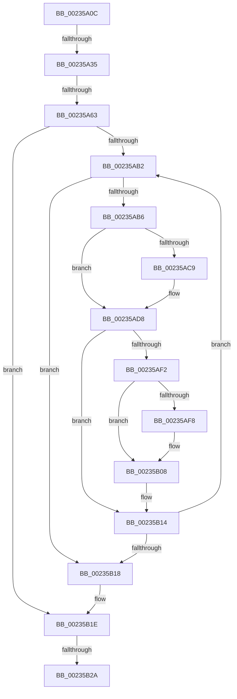

# sub_00235A0C

- RVA: `0x00235A0C`–`0x00235B42` (길이 `310` bytes)
- VA: `0x0000000140235A0C`
- 실행 섹션: `.text`
- PDB 이름 있음: `아니요`; PDB Function 태그: `아니요`
- unwind 정보 RVA: `0x000606FC`
- 디코드: `80`개 명령, `310/310` bytes 표시
- 미해석 바이트: `0` (있으면 어셈블리에 `.byte`로 보존)

> 이 문서는 커널 이미지의 기계어와 PDB 기호를 분석해 생성했습니다. 4번과 5번은 함수 원형과 자료형을 바이너리 사용 방식에서 추정한 C 해석이며 원본 소스 복구 결과는 아닙니다.

## 1. Dependencies

- 직접 호출 지점: **3**; 고유 호출 대상: **2**
- 직접 호출자로 확인된 함수: **0**
- RIP 상대 이미지 참조: **1**

### Outgoing calls
- `0x00235AD3` → [memcpy](../6C/memcpy_function_006C6840.md) (function, `0x006C6840`)
- `0x00235AE7` → [VslpEnterIumSecureMode](VslpEnterIumSecureMode_function_00235E50.md) (function, `0x00235E50`)
- `0x00235B03` → [memcpy](../6C/memcpy_function_006C6840.md) (function, `0x006C6840`)

### Direct callers
- 이 함수 시작 RVA로 연결되는 직접 call은 확인되지 않았습니다. 간접 호출은 완전히 역산할 수 없습니다.

### Static image references
- `0x00235A43` → RVA `0x004393E0` (`VslAccessPciDevice`; read)

## 2. Other-region calls and transfers

- 다른 실행 섹션으로 향하는 call: **0**
- call이 아닌 외부 분기/꼬리 이동: **3**
  - `0x00235A2F` → [sub_00235B5D](Unknown_function_00235B5D.md) (`tail-transfer`)
  - `0x00235A5D` → [sub_00235D85 + 0x8](Unknown_function_00235D85.md) (`tail-transfer`)
  - `0x00235B24` → [sub_00235B5D + 0x18C](Unknown_function_00235B5D.md) (`tail-transfer`)

## 3. Assembly (complete function range)

```asm
00235A0C  4C 89 A4 24 08 01 00 00         mov qword ptr [rsp + 0x108], r12
00235A14  44 8B 65 68                     mov r12d, dword ptr [rbp + 0x68]
00235A18  4C 89 AC 24 00 01 00 00         mov qword ptr [rsp + 0x100], r13
00235A20  4C 89 BC 24 F8 00 00 00         mov qword ptr [rsp + 0xf8], r15
00235A28  44 8B 7D 70                     mov r15d, dword ptr [rbp + 0x70]
00235A2C  48 85 DB                        test rbx, rbx
00235A2F  0F 84 28 01 00 00               je 0x140235b5d
00235A35  45 3B FE                        cmp r15d, r14d
00235A38  8B C7                           mov eax, edi
00235A3A  44 8B CF                        mov r9d, edi
00235A3D  41 8B D3                        mov edx, r11d
00235A40  0F 94 C1                        sete cl
00235A43  4C 8D 1D 96 39 20 00            lea r11, [rip + 0x203996]
00235A4A  C1 E8 05                        shr eax, 5
00235A4D  41 83 E1 1F                     and r9d, 0x1f
00235A51  83 E0 07                        and eax, 7
00235A54  45 33 ED                        xor r13d, r13d
00235A57  45 8B C2                        mov r8d, r10d
00235A5A  49 3B DB                        cmp rbx, r11
00235A5D  0F 85 2A 03 00 00               jne 0x140235d8d
00235A63  0F 57 C0                        xorps xmm0, xmm0
00235A66  4C 8B F6                        mov r14, rsi
00235A69  8B 75 60                        mov esi, dword ptr [rbp + 0x60]
00235A6C  45 33 DB                        xor r11d, r11d
00235A6F  4C 89 5D C0                     mov qword ptr [rbp - 0x40], r11
00235A73  41 8B DC                        mov ebx, r12d
00235A76  0F 11 44 24 70                  movups xmmword ptr [rsp + 0x70], xmm0
00235A7B  89 74 24 7C                     mov dword ptr [rsp + 0x7c], esi
00235A7F  41 8B F5                        mov esi, r13d
00235A82  44 89 54 24 70                  mov dword ptr [rsp + 0x70], r10d
00235A87  44 89 4C 24 74                  mov dword ptr [rsp + 0x74], r9d
00235A8C  89 44 24 78                     mov dword ptr [rsp + 0x78], eax
00235A90  0F 11 44 24 60                  movups xmmword ptr [rsp + 0x60], xmm0
00235A95  88 4C 24 68                     mov byte ptr [rsp + 0x68], cl
00235A99  89 54 24 6C                     mov dword ptr [rsp + 0x6c], edx
00235A9D  0F 11 45 80                     movups xmmword ptr [rbp - 0x80], xmm0
00235AA1  0F 11 45 90                     movups xmmword ptr [rbp - 0x70], xmm0
00235AA5  0F 11 45 A0                     movups xmmword ptr [rbp - 0x60], xmm0
00235AA9  0F 11 45 B0                     movups xmmword ptr [rbp - 0x50], xmm0
00235AAD  45 85 E4                        test r12d, r12d
00235AB0  74 6C                           je 0x140235b1e
00235AB2  85 F6                           test esi, esi
00235AB4  78 62                           js 0x140235b18
00235AB6  B8 40 00 00 00                  mov eax, 0x40
00235ABB  3B D8                           cmp ebx, eax
00235ABD  0F 42 C3                        cmovb eax, ebx
00235AC0  89 45 80                        mov dword ptr [rbp - 0x80], eax
00235AC3  41 83 FF 01                     cmp r15d, 1
00235AC7  75 0F                           jne 0x140235ad8
00235AC9  44 8B C0                        mov r8d, eax
00235ACC  48 8D 4D 88                     lea rcx, [rbp - 0x78]
00235AD0  49 8B D6                        mov rdx, r14
00235AD3  E8 68 0D 49 00                  call 0x1406c6840
00235AD8  BA 0D 01 00 00                  mov edx, 0x10d
00235ADD  4C 8D 4C 24 60                  lea r9, [rsp + 0x60]
00235AE2  45 33 C0                        xor r8d, r8d
00235AE5  B1 02                           mov cl, 2
00235AE7  E8 64 03 00 00                  call 0x140235e50
00235AEC  8B F0                           mov esi, eax
00235AEE  85 C0                           test eax, eax
00235AF0  78 22                           js 0x140235b14
00235AF2  41 83 FF 01                     cmp r15d, 1
00235AF6  74 10                           je 0x140235b08
00235AF8  44 8B 45 80                     mov r8d, dword ptr [rbp - 0x80]
00235AFC  48 8D 55 88                     lea rdx, [rbp - 0x78]
00235B00  49 8B CE                        mov rcx, r14
00235B03  E8 38 0D 49 00                  call 0x1406c6840
00235B08  8B 4D 80                        mov ecx, dword ptr [rbp - 0x80]
00235B0B  4C 03 F1                        add r14, rcx
00235B0E  2B D9                           sub ebx, ecx
00235B10  01 4C 24 7C                     add dword ptr [rsp + 0x7c], ecx
00235B14  85 DB                           test ebx, ebx
00235B16  75 9A                           jne 0x140235ab2
00235B18  44 0F B6 54 24 50               movzx r10d, byte ptr [rsp + 0x50]
00235B1E  44 8B 75 60                     mov r14d, dword ptr [rbp + 0x60]
00235B22  85 F6                           test esi, esi
00235B24  0F 88 BF 01 00 00               js 0x140235ce9
00235B2A  4C 8B AC 24 00 01 00 00         mov r13, qword ptr [rsp + 0x100]
00235B32  4C 8B A4 24 08 01 00 00         mov r12, qword ptr [rsp + 0x108]
00235B3A  4C 8B BC 24 F8 00 00 00         mov r15, qword ptr [rsp + 0xf8]
```

## 4. C-style interpretation (structured pseudocode)

```c
__int64 __fastcall sub_00235A0C(__int64 a1, __int64 a2, __int64 a3, __int64 a4, __int64 a5, __int64 a6, __int64 a7, __int64 a8, __int64 a9, unsigned __int8 a10, __int64 a11, __int64 a12, __int64 a13, __int64 a14, __int64 a15, __int64 a16, __int64 a17, __int64 a18, __int64 a19, __int64 a20, __int64 a21, __int64 a22, __int64 a23, __int64 a24, __int64 a25, __int64 a26, __int64 a27, __int64 a28, __int64 a29, __int64 a30, __int64 a31, __int64 a32, __int64 a33)
{
    __int64 result;
    __int64 v_r11;
    __int64 v_r13;
    __int64 v_r14;
    __int64 v_rbx;
    unsigned __int64 v_stack_p100;
    unsigned __int64 v_stack_p108;
    unsigned __int8 v_stack_p68;
    unsigned int v_stack_p6C;
    unsigned int v_stack_p70;
    unsigned int v_stack_p74;
    unsigned int v_stack_p78;
    unsigned int v_stack_p7C;
    unsigned __int64 v_stack_pF8;

    v_stack_p108 = v_r12;
    v_stack_p100 = v_r13;
    v_stack_pF8 = v_r15;
    a1 = (((unsigned int)((unsigned int)(*(unsigned int *)(v_rbp + 112)))) == ((unsigned int)(v_r14))) ? 1 : 0;
    result = (unsigned int)(((unsigned int)((unsigned int)(v_rdi))) >> (5));
    a4 = (unsigned int)(((unsigned int)((unsigned int)(v_rdi))) & (31));
    result = (unsigned int)((result) & (7));
    v_r13 = 0;
    v_r11 = 0;
    *(unsigned __int64 *)(v_rbp - 64) = 0;
    a14 = v_xmm0;
    v_stack_p7C = (unsigned int)((unsigned int)(*(unsigned int *)(v_rbp + 96)));
    v_stack_p70 = (unsigned int)(v_r10);
    v_stack_p74 = (unsigned int)(a4);
    v_stack_p78 = (unsigned int)(result);
    a12 = v_xmm0;
    v_stack_p68 = (unsigned __int8)(a1);
    v_stack_p6C = (unsigned int)((unsigned int)((unsigned int)(v_r11)));
    *(unsigned __int64 *)(v_rbp - 128) = v_xmm0;
    *(unsigned __int64 *)(v_rbp - 112) = v_xmm0;
    *(unsigned __int64 *)(v_rbp - 96) = v_xmm0;
    *(unsigned __int64 *)(v_rbp - 80) = v_xmm0;
    if ((unsigned int)((unsigned int)(*(unsigned int *)(v_rbp + 104))) == 0) goto loc_00235B1E;
loc_00235AB2:
    if (sign_flag) goto loc_00235B18;
    result = 64;
    if (((unsigned int)((unsigned int)((unsigned int)((unsigned int)(*(unsigned int *)(v_rbp + 104)))))) < 64) { result = (unsigned int)((unsigned int)((unsigned int)((unsigned int)(*(unsigned int *)(v_rbp + 104))))); }
    *(unsigned int *)(v_rbp - 128) = (unsigned int)(result);
    if (((unsigned int)((unsigned int)(*(unsigned int *)(v_rbp + 112)))) == 1) {
        a3 = (unsigned int)(result);
        a1 = v_rbp - 120;
        a2 = v_rsi;
        result = memcpy(a1, a2, a3, a4);
    }
    a3 = 0;
    result = VslpEnterIumSecureMode(2, 269, a3, a12);
    if (sign_flag) goto loc_00235B14;
    if (((unsigned int)((unsigned int)(*(unsigned int *)(v_rbp + 112)))) != 1) {
        a3 = *(unsigned int *)(v_rbp - 128);
        a2 = v_rbp - 120;
        a1 = v_rsi;
        result = memcpy(a1, a2, a3, a12);
    }
    v_r14 = (v_rsi) + ((unsigned int)(*(unsigned int *)(v_rbp - 128)));
    v_rbx = (unsigned int)(((unsigned int)((unsigned int)((unsigned int)(*(unsigned int *)(v_rbp + 104))))) - ((unsigned int)((unsigned int)(*(unsigned int *)(v_rbp - 128)))));
loc_00235B14:
    if ((unsigned int)(v_rbx) != 0) goto loc_00235AB2;
loc_00235B18:
loc_00235B1E:
    return result;
}
```

## 5. (Beta) C Style

```c
int64_t sub_00235A0C(int64_t Arg1, int64_t Arg2, int64_t Arg3, int64_t Arg4, uint64_t Arg5, uint64_t Arg6, uint64_t Arg7, uint64_t Arg8, uint64_t Arg9, uint8_t Arg10, uint64_t Arg11, int64_t Arg12, uint64_t Arg13, int64_t Arg14, uint64_t Arg15, uint64_t Arg16, uint64_t Arg17, uint64_t Arg18, uint64_t Arg19, uint64_t Arg20, uint64_t Arg21, uint64_t Arg22, uint64_t Arg23, uint64_t Arg24, uint64_t Arg25, uint64_t Arg26, uint64_t Arg27, uint64_t Arg28, uint64_t Arg29, uint64_t Arg30, int64_t Arg31, int64_t Arg32, int64_t Arg33)
{
    int64_t result;
    int64_t local_r11;
    int64_t local_r13;
    int64_t local_r14;
    int64_t local_rbx;
    uint64_t v_stack_p100;
    uint64_t v_stack_p108;
    uint8_t v_stack_p68;
    uint32_t v_stack_p6C;
    uint32_t v_stack_p70;
    uint32_t v_stack_p74;
    uint32_t v_stack_p78;
    uint32_t v_stack_p7C;
    uint64_t v_stack_pF8;

    v_stack_p108 = local_r12;
    v_stack_p100 = local_r13;
    v_stack_pF8 = local_r15;
    Arg1 = (((uint32_t)((uint32_t)(*(uint32_t *)(local_rbp + 0x70)))) == ((uint32_t)(local_r14))) ? 1 : 0;
    result = (uint32_t)(((uint32_t)((uint32_t)(local_rdi))) >> (5));
    Arg4 = (uint32_t)(((uint32_t)((uint32_t)(local_rdi))) & (31));
    result = (uint32_t)((result) & (7));
    local_r13 = 0;
    local_r11 = 0;
    *(uint64_t *)(local_rbp - 0x40) = 0;
    Arg14 = v_xmm0;
    v_stack_p7C = (uint32_t)((uint32_t)(*(uint32_t *)(local_rbp + 0x60)));
    v_stack_p70 = (uint32_t)(local_r10);
    v_stack_p74 = (uint32_t)(Arg4);
    v_stack_p78 = (uint32_t)(result);
    Arg12 = v_xmm0;
    v_stack_p68 = (uint8_t)(Arg1);
    v_stack_p6C = (uint32_t)((uint32_t)((uint32_t)(local_r11)));
    *(uint64_t *)(local_rbp - 0x80) = v_xmm0;
    *(uint64_t *)(local_rbp - 0x70) = v_xmm0;
    *(uint64_t *)(local_rbp - 0x60) = v_xmm0;
    *(uint64_t *)(local_rbp - 0x50) = v_xmm0;
    if ((uint32_t)((uint32_t)(*(uint32_t *)(local_rbp + 0x68))) == 0) goto loc_00235B1E;
loc_00235AB2:
    if (sign_flag) goto loc_00235B18;
    result = 64;
    if (((uint32_t)((uint32_t)((uint32_t)((uint32_t)(*(uint32_t *)(local_rbp + 0x68)))))) < 64) { result = (uint32_t)((uint32_t)((uint32_t)((uint32_t)(*(uint32_t *)(local_rbp + 0x68))))); }
    *(uint32_t *)(local_rbp - 0x80) = (uint32_t)(result);
    if (((uint32_t)((uint32_t)(*(uint32_t *)(local_rbp + 0x70)))) == 1) {
        Arg3 = (uint32_t)(result);
        Arg1 = local_rbp - 120;
        Arg2 = local_rsi;
        result = memcpy(Arg1, Arg2, Arg3, Arg4);
    }
    Arg3 = 0;
    result = VslpEnterIumSecureMode(2, 269, Arg3, Arg12);
    if (sign_flag) goto loc_00235B14;
    if (((uint32_t)((uint32_t)(*(uint32_t *)(local_rbp + 0x70)))) != 1) {
        Arg3 = *(uint32_t *)(local_rbp - 0x80);
        Arg2 = local_rbp - 120;
        Arg1 = local_rsi;
        result = memcpy(Arg1, Arg2, Arg3, Arg12);
    }
    local_r14 = (local_rsi) + ((uint32_t)(*(uint32_t *)(local_rbp - 0x80)));
    local_rbx = (uint32_t)(((uint32_t)((uint32_t)((uint32_t)(*(uint32_t *)(local_rbp + 0x68))))) - ((uint32_t)((uint32_t)(*(uint32_t *)(local_rbp - 0x80)))));
loc_00235B14:
    if ((uint32_t)(local_rbx) != 0) goto loc_00235AB2;
loc_00235B18:
loc_00235B1E:
    return result;
}
```

## 6. Execution-region graph

[열기: 2D/3D 그래프와 함수 탐색 컨트롤 패널](../../../control-panel.html?section=text&rva=0x00235A0C&view=graph)

- 2D 그래프는 위에서 아래로 흐르고, 3D 그래프는 빈 공간을 드래그해 회전합니다. Shift+드래그는 이동, 휠은 확대·축소, 함수 노드 선택은 대상 보고서 이동입니다.

### Static fallback


