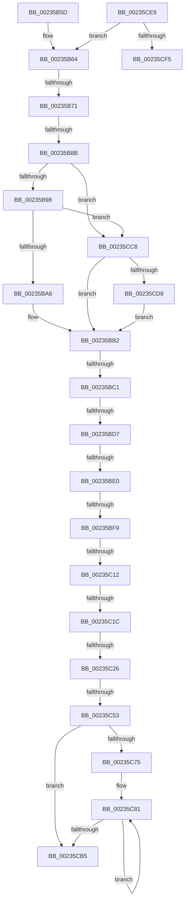

# sub_00235B5D

- RVA: `0x00235B5D`–`0x00235D12` (길이 `437` bytes)
- VA: `0x0000000140235B5D`
- 실행 섹션: `.text`
- PDB 이름 있음: `아니요`; PDB Function 태그: `아니요`
- unwind 정보 RVA: `0x0006072C`
- 디코드: `96`개 명령, `437/437` bytes 표시
- 미해석 바이트: `0` (있으면 어셈블리에 `.byte`로 보존)

> 이 문서는 커널 이미지의 기계어와 PDB 기호를 분석해 생성했습니다. 4번과 5번은 함수 원형과 자료형을 바이너리 사용 방식에서 추정한 C 해석이며 원본 소스 복구 결과는 아닙니다.

## 1. Dependencies

- 직접 호출 지점: **6**; 고유 호출 대상: **6**
- 직접 호출자로 확인된 함수: **0**
- RIP 상대 이미지 참조: **12**

### Outgoing calls
- `0x00235BAD` → [KiAcquireSpinLockInstrumented](../20/KiAcquireSpinLockInstrumented_function_002084F0.md) (function, `0x002084F0`)
- `0x00235C53` → [HalpPciMapMmConfigPhysicalAddress](HalpPciMapMmConfigPhysicalAddress_function_00236340.md) (function, `0x00236340`)
- `0x00235CA3` → [guard_dispatch_icall](../6B/guard_dispatch_icall_function_006BAAD0.md) (function, `0x006BAAD0`)
- `0x00235CBE` → [HalpPCIReleaseConfigSpaceLock](HalpPCIReleaseConfigSpaceLock_function_002362D8.md) (function, `0x002362D8`)
- `0x00235CDF` → [KxWaitForSpinLockAndAcquire](../20/KxWaitForSpinLockAndAcquire_function_002085C0.md) (function, `0x002085C0`)
- `0x00235D0C` → [KeBugCheckEx](../4F/KeBugCheckEx_function_004FD660.md) (function, `0x004FD660`)

### Direct callers
- 이 함수 시작 RVA로 연결되는 직접 call은 확인되지 않았습니다. 간접 호출은 완전히 역산할 수 없습니다.

### Static image references
- `0x00235B64` → RVA `0x00FC19B8` (`.data`; read)
- `0x00235B7E` → RVA `0x00FC6D20` (`ALMOSTRO`; read)
- `0x00235B8B` → RVA `0x00FC6B06` (`ALMOSTRO`; read)
- `0x00235B98` → RVA `0x00F0DE58` (`.data`; read)
- `0x00235BA6` → RVA `0x00FC1708` (`.data`; read)
- `0x00235BC1` → RVA `0x00E0A830` (`.data`; read)
- `0x00235BEC` → RVA `0x00F901E0` (`.data`; read)
- `0x00235C00` → RVA `0x00F90200` (`.data`; read)
- `0x00235C5B` → RVA `0x00001018` (`.rdata`; read)
- `0x00235C65` → RVA `0x00001000` (`.rdata`; read)
- `0x00235C7A` → RVA `0x000105D0` (`.rdata`; read)
- `0x00235CC8` → RVA `0x00FC1708` (`.data`; read/write)

## 2. Other-region calls and transfers

- 다른 실행 섹션으로 향하는 call: **0**
- call이 아닌 외부 분기/꼬리 이동: **11**
  - `0x00235B6B` → [sub_00235D85](Unknown_function_00235D85.md) (`tail-transfer`)
  - `0x00235B85` → [sub_00235D54](Unknown_function_00235D54.md) (`tail-transfer`)
  - `0x00235BBB` → [sub_00235D85 + 0x69](Unknown_function_00235D85.md) (`tail-transfer`)
  - `0x00235BD1` → [sub_006D754E](../6D/Unknown_function_006D754E.md) (`tail-transfer`)
  - `0x00235BDA` → [sub_00235D85 + 0x34](Unknown_function_00235D85.md) (`tail-transfer`)
  - `0x00235BF3` → [sub_00235D85 + 0x75](Unknown_function_00235D85.md) (`tail-transfer`)
  - `0x00235C0C` → [sub_00235D85 + 0x61](Unknown_function_00235D85.md) (`tail-transfer`)
  - `0x00235C16` → [sub_00235D85 + 0x61](Unknown_function_00235D85.md) (`tail-transfer`)
  - `0x00235C20` → [sub_00235D85 + 0x61](Unknown_function_00235D85.md) (`tail-transfer`)
  - `0x00235C4D` → [sub_00235D85 + 0x75](Unknown_function_00235D85.md) (`tail-transfer`)
  - `0x00235CC3` → [sub_00235A0C + 0x11E](Unknown_function_00235A0C.md) (`tail-transfer`)

## 3. Assembly (complete function range)

```asm
00235B5D  44 8B 75 60                     mov r14d, dword ptr [rbp + 0x60]
00235B61  45 33 ED                        xor r13d, r13d
00235B64  80 3D 4D BE D8 00 00            cmp byte ptr [rip + 0xd8be4d], 0
00235B6B  0F 85 14 02 00 00               jne 0x140235d85
00235B71  44 0F 20 C6                     mov rsi, cr8
00235B75  B8 0F 00 00 00                  mov eax, 0xf
00235B7A  44 0F 22 C0                     mov cr8, rax
00235B7E  83 3D 9B 11 D9 00 00            cmp dword ptr [rip + 0xd9119b], 0
00235B85  0F 85 C9 01 00 00               jne 0x140235d54
00235B8B  F6 05 74 0F D9 00 21            test byte ptr [rip + 0xd90f74], 0x21
00235B92  0F 84 30 01 00 00               je 0x140235cc8
00235B98  8B 05 BA 82 CD 00               mov eax, dword ptr [rip + 0xcd82ba]
00235B9E  85 C0                           test eax, eax
00235BA0  0F 85 22 01 00 00               jne 0x140235cc8
00235BA6  48 8D 0D 5B BB D8 00            lea rcx, [rip + 0xd8bb5b]
00235BAD  E8 3E 29 FD FF                  call 0x1402084f0
00235BB2  43 8D 04 26                     lea eax, [r14 + r12]
00235BB6  3D 00 10 00 00                  cmp eax, 0x1000
00235BBB  0F 87 2D 02 00 00               ja 0x140235dee
00235BC1  8B 05 69 4C BD 00               mov eax, dword ptr [rip + 0xbd4c69]
00235BC7  0F 57 C0                        xorps xmm0, xmm0
00235BCA  0F 11 45 D0                     movups xmmword ptr [rbp - 0x30], xmm0
00235BCE  83 F8 FF                        cmp eax, -1
00235BD1  0F 84 77 19 4A 00               je 0x1406d754e
00235BD7  83 F8 01                        cmp eax, 1
00235BDA  0F 84 D9 01 00 00               je 0x140235db9
00235BE0  44 0F B7 5C 24 52               movzx r11d, word ptr [rsp + 0x52]
00235BE6  44 0F B6 54 24 50               movzx r10d, byte ptr [rsp + 0x50]
00235BEC  44 3B 2D ED A5 D5 00            cmp r13d, dword ptr [rip + 0xd5a5ed]
00235BF3  0F 83 01 02 00 00               jae 0x140235dfa
00235BF9  41 8B DD                        mov ebx, r13d
00235BFC  48 C1 E3 04                     shl rbx, 4
00235C00  48 03 1D F9 A5 D5 00            add rbx, qword ptr [rip + 0xd5a5f9]
00235C07  66 44 3B 5B 34                  cmp r11w, word ptr [rbx + 0x34]
00235C0C  0F 85 D4 01 00 00               jne 0x140235de6
00235C12  44 3A 53 36                     cmp r10b, byte ptr [rbx + 0x36]
00235C16  0F 82 CA 01 00 00               jb 0x140235de6
00235C1C  44 3A 53 37                     cmp r10b, byte ptr [rbx + 0x37]
00235C20  0F 87 C0 01 00 00               ja 0x140235de6
00235C26  48 8B C7                        mov rax, rdi
00235C29  41 0F B6 CA                     movzx ecx, r10b
00235C2D  48 C1 E1 05                     shl rcx, 5
00235C31  83 E0 1F                        and eax, 0x1f
00235C34  48 03 C8                        add rcx, rax
00235C37  48 8B D7                        mov rdx, rdi
00235C3A  48 C1 EA 05                     shr rdx, 5
00235C3E  83 E2 07                        and edx, 7
00235C41  48 8D 0C CA                     lea rcx, [rdx + rcx*8]
00235C45  48 C1 E1 0C                     shl rcx, 0xc
00235C49  48 03 4B 2C                     add rcx, qword ptr [rbx + 0x2c]
00235C4D  0F 84 A7 01 00 00               je 0x140235dfa
00235C53  E8 E8 06 00 00                  call 0x140236340
00235C58  45 85 FF                        test r15d, r15d
00235C5B  48 8D 1D B6 B3 DC FF            lea rbx, [rip - 0x234c4a]
00235C62  48 8B F8                        mov rdi, rax
00235C65  48 8D 05 94 B3 DC FF            lea rax, [rip - 0x234c6c]
00235C6C  48 0F 45 D8                     cmovne rbx, rax
00235C70  45 85 E4                        test r12d, r12d
00235C73  74 40                           je 0x140235cb5
00235C75  4C 8B 6C 24 58                  mov r13, qword ptr [rsp + 0x58]
00235C7A  4C 8D 3D 4F A9 DD FF            lea r15, [rip - 0x2256b1]
00235C81  41 8B C4                        mov eax, r12d
00235C84  41 8B CE                        mov ecx, r14d
00235C87  83 E0 03                        and eax, 3
00235C8A  83 E1 03                        and ecx, 3
00235C8D  45 8B C6                        mov r8d, r14d
00235C90  49 8B D5                        mov rdx, r13
00235C93  48 8D 0C 88                     lea rcx, [rax + rcx*4]
00235C97  42 0F B6 04 39                  movzx eax, byte ptr [rcx + r15]
00235C9C  48 8B CF                        mov rcx, rdi
00235C9F  48 8B 04 C3                     mov rax, qword ptr [rbx + rax*8]
00235CA3  E8 28 4E 48 00                  call 0x1406baad0
00235CA8  8B C8                           mov ecx, eax
00235CAA  44 03 F0                        add r14d, eax
00235CAD  4C 03 E9                        add r13, rcx
00235CB0  44 2B E0                        sub r12d, eax
00235CB3  75 CC                           jne 0x140235c81
00235CB5  F0 83 0C 24 00                  lock or dword ptr [rsp], 0
00235CBA  40 0F B6 CE                     movzx ecx, sil
00235CBE  E8 15 06 00 00                  call 0x1402362d8
00235CC3  E9 62 FE FF FF                  jmp 0x140235b2a
00235CC8  F0 48 0F BA 2D 36 BA D8 00 00   lock bts qword ptr [rip + 0xd8ba36], 0
00235CD2  0F 83 DA FE FF FF               jae 0x140235bb2
00235CD8  48 8D 0D 29 BA D8 00            lea rcx, [rip + 0xd8ba29]
00235CDF  E8 DC 28 FD FF                  call 0x1402085c0
00235CE4  E9 C9 FE FF FF                  jmp 0x140235bb2
00235CE9  81 FE 02 00 00 C0               cmp esi, 0xc0000002
00235CEF  0F 84 6F FE FF FF               je 0x140235b64
00235CF5  48 63 C6                        movsxd rax, esi
00235CF8  4C 8B C7                        mov r8, rdi
00235CFB  45 8B CE                        mov r9d, r14d
00235CFE  B9 C0 00 00 00                  mov ecx, 0xc0
00235D03  41 0F B6 D2                     movzx edx, r10b
00235D07  48 89 44 24 20                  mov qword ptr [rsp + 0x20], rax
00235D0C  E8 4F 79 2C 00                  call 0x1404fd660
00235D11  CC                              int3
```

## 4. C-style interpretation (structured pseudocode)

```c
__int64 __fastcall sub_00235B5D(__int64 a1, __int64 a2, __int64 a3, __int64 a4, __int64 a5, __int64 a6, __int64 a7, __int64 a8, __int64 a9, unsigned __int8 a10, __int64 a11)
{
    __int64 result;
    __int64 v_r12;
    __int64 v_r13;
    __int64 v_r14;
    __int64 v_rbx;
    unsigned int v_stack_p0;
    unsigned __int64 v_stack_p20;
    unsigned __int16 v_stack_p52;

    v_r13 = 0;
loc_00235B64:
    if (((*(unsigned __int8 *)(v_rip + 14225268)) & (33)) == 0) goto loc_00235CC8;
    if ((unsigned int)((unsigned int)(*(unsigned int *)(v_rip + 13468346))) != 0) goto loc_00235CC8;
    result = KiAcquireSpinLockInstrumented(v_rip + 14203739, a2, a3, a4);
loc_00235BB2:
    *(unsigned __int64 *)(v_rbp - 48) = v_xmm0;
    v_rbx = (0) << (4);
    v_rbx = (v_rbx) + (*(unsigned __int64 *)(v_rip + 14001657));
    a1 = (a10) << (5);
    result = (unsigned int)((v_rdi) & (31));
    a1 = (a1) + (result);
    a2 = (v_rdi) >> (5);
    a2 = (unsigned int)((a2) & (7));
    a1 = (a2 + a1 * 8) << (12);
    a1 = (a1) + (*(unsigned __int64 *)(v_rbx + 44));
    result = HalpPciMapMmConfigPhysicalAddress(a1, a2, a3, a4);
    v_rbx = v_rip - 2313290;
    if ((unsigned int)(v_r15) != 0) { v_rbx = v_rip - 2313324; }
    if ((unsigned int)(v_r12) == 0) goto loc_00235CB5;
loc_00235C81:
    result = (unsigned int)(((unsigned int)((unsigned int)(v_r12))) & (3));
    a1 = (unsigned int)(((unsigned int)((unsigned int)((unsigned int)(*(unsigned int *)(v_rbp + 96))))) & (3));
    result = guard_dispatch_icall(result, a11, (unsigned int)((unsigned int)((unsigned int)(*(unsigned int *)(v_rbp + 96)))), a4);
    v_r14 = (unsigned int)(((unsigned int)(*(unsigned int *)(v_rbp + 96))) + ((unsigned int)(result)));
    v_r13 = (a11) + ((unsigned int)((unsigned int)(result)));
    v_r12 = (unsigned int)((v_r12) - ((unsigned int)(result)));
    if (condition_is_not_equal) goto loc_00235C81;
loc_00235CB5:
    result = HalpPCIReleaseConfigSpaceLock((unsigned __int8)(v_cr8), a11, (unsigned int)((unsigned int)((unsigned int)(*(unsigned int *)(v_rbp + 96)))), a4);
loc_00235CC8:
    if (condition_is_above_or_equal) goto loc_00235BB2;
    result = KxWaitForSpinLockAndAcquire(v_rip + 14203433, a11, (unsigned int)((unsigned int)((unsigned int)(*(unsigned int *)(v_rbp + 96)))), a4);
    goto loc_00235BB2;
}
```

## 5. (Beta) C Style

```c
int64_t sub_00235B5D(int64_t Arg1, int64_t Arg2, int64_t Arg3, int64_t Arg4, uint64_t Arg5, uint64_t Arg6, uint64_t Arg7, uint64_t Arg8, uint64_t Arg9, uint8_t Arg10, int64_t Arg11)
{
    int64_t result;
    int64_t local_r12;
    int64_t local_r13;
    int64_t local_r14;
    int64_t local_rbx;
    uint32_t v_stack_p0;
    uint64_t v_stack_p20;
    uint16_t v_stack_p52;

    local_r13 = 0;
loc_00235B64:
    if (((*(uint8_t *)(v_rip + 0xD90F74)) & (33)) == 0) goto loc_00235CC8;
    if ((uint32_t)((uint32_t)(*(uint32_t *)(v_rip + 0xCD82BA))) != 0) goto loc_00235CC8;
    result = KiAcquireSpinLockInstrumented(v_rip + 14203739, Arg2, Arg3, Arg4);
loc_00235BB2:
    *(uint64_t *)(local_rbp - 0x30) = v_xmm0;
    local_rbx = (0) << (4);
    local_rbx = (local_rbx) + (*(uint64_t *)(v_rip + 0xD5A5F9));
    Arg1 = (Arg10) << (5);
    result = (uint32_t)((local_rdi) & (31));
    Arg1 = (Arg1) + (result);
    Arg2 = (local_rdi) >> (5);
    Arg2 = (uint32_t)((Arg2) & (7));
    Arg1 = (Arg2 + Arg1 * 8) << (12);
    Arg1 = (Arg1) + (*(uint64_t *)(local_rbx + 0x2C));
    result = HalpPciMapMmConfigPhysicalAddress(Arg1, Arg2, Arg3, Arg4);
    local_rbx = v_rip - 2313290;
    if ((uint32_t)(local_r15) != 0) { local_rbx = v_rip - 2313324; }
    if ((uint32_t)(local_r12) == 0) goto loc_00235CB5;
loc_00235C81:
    result = (uint32_t)(((uint32_t)((uint32_t)(local_r12))) & (3));
    Arg1 = (uint32_t)(((uint32_t)((uint32_t)((uint32_t)(*(uint32_t *)(local_rbp + 0x60))))) & (3));
    result = guard_dispatch_icall(result, Arg11, (uint32_t)((uint32_t)((uint32_t)(*(uint32_t *)(local_rbp + 0x60)))), Arg4);
    local_r14 = (uint32_t)(((uint32_t)(*(uint32_t *)(local_rbp + 0x60))) + ((uint32_t)(result)));
    local_r13 = (Arg11) + ((uint32_t)((uint32_t)(result)));
    local_r12 = (uint32_t)((local_r12) - ((uint32_t)(result)));
    if (condition_is_not_equal) goto loc_00235C81;
loc_00235CB5:
    result = HalpPCIReleaseConfigSpaceLock((uint8_t)(v_cr8), Arg11, (uint32_t)((uint32_t)((uint32_t)(*(uint32_t *)(local_rbp + 0x60)))), Arg4);
loc_00235CC8:
    if (condition_is_above_or_equal) goto loc_00235BB2;
    result = KxWaitForSpinLockAndAcquire(v_rip + 14203433, Arg11, (uint32_t)((uint32_t)((uint32_t)(*(uint32_t *)(local_rbp + 0x60)))), Arg4);
    goto loc_00235BB2;
}
```

## 6. Execution-region graph

[열기: 2D/3D 그래프와 함수 탐색 컨트롤 패널](../../../control-panel.html?section=text&rva=0x00235B5D&view=graph)

- 2D 그래프는 위에서 아래로 흐르고, 3D 그래프는 빈 공간을 드래그해 회전합니다. Shift+드래그는 이동, 휠은 확대·축소, 함수 노드 선택은 대상 보고서 이동입니다.

### Static fallback


