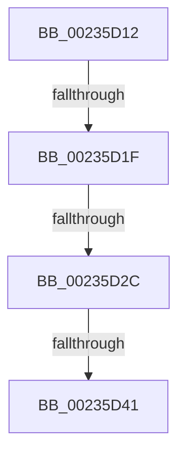

# sub_00235D12

- RVA: `0x00235D12`–`0x00235D54` (길이 `66` bytes)
- VA: `0x0000000140235D12`
- 실행 섹션: `.text`
- PDB 이름 있음: `아니요`; PDB Function 태그: `아니요`
- unwind 정보 RVA: `0x00060748`
- 디코드: `14`개 명령, `66/66` bytes 표시
- 미해석 바이트: `0` (있으면 어셈블리에 `.byte`로 보존)

> 이 문서는 커널 이미지의 기계어와 PDB 기호를 분석해 생성했습니다. 4번과 5번은 함수 원형과 자료형을 바이너리 사용 방식에서 추정한 C 해석이며 원본 소스 복구 결과는 아닙니다.

## 1. Dependencies

- 직접 호출 지점: **0**; 고유 호출 대상: **0**
- 직접 호출자로 확인된 함수: **0**
- RIP 상대 이미지 참조: **0**

### Outgoing calls
- 직접 디코드된 call 명령이 없습니다.

### Direct callers
- 이 함수 시작 RVA로 연결되는 직접 call은 확인되지 않았습니다. 간접 호출은 완전히 역산할 수 없습니다.

### Static image references
- 디코드된 RIP-relative 메모리 참조가 없습니다.

## 2. Other-region calls and transfers

- 다른 실행 섹션으로 향하는 call: **0**
- call이 아닌 외부 분기/꼬리 이동: **4**
  - `0x00235D19` → [HalpPCIConfig + 0x78](HalpPCIConfig_function_00235980.md) (`tail-transfer`)
  - `0x00235D26` → [HalpPCIConfig + 0x78](HalpPCIConfig_function_00235980.md) (`tail-transfer`)
  - `0x00235D3B` → [HalpPCIConfig + 0x78](HalpPCIConfig_function_00235980.md) (`tail-transfer`)
  - `0x00235D4F` → [HalpPCIConfig + 0x78](HalpPCIConfig_function_00235980.md) (`tail-transfer`)

## 3. Assembly (complete function range)

```asm
00235D12  44 39 9A E0 01 00 00            cmp dword ptr [rdx + 0x1e0], r11d
00235D19  0F 85 D9 FC FF FF               jne 0x1402359f8
00235D1F  44 39 92 E4 01 00 00            cmp dword ptr [rdx + 0x1e4], r10d
00235D26  0F 85 CC FC FF FF               jne 0x1402359f8
00235D2C  44 8B 82 E8 01 00 00            mov r8d, dword ptr [rdx + 0x1e8]
00235D33  41 8B C8                        mov ecx, r8d
00235D36  33 CF                           xor ecx, edi
00235D38  F6 C1 1F                        test cl, 0x1f
00235D3B  0F 85 B7 FC FF FF               jne 0x1402359f8
00235D41  44 32 C7                        xor r8b, dil
00235D44  0F B6 DB                        movzx ebx, bl
00235D47  41 F6 C0 E0                     test r8b, 0xe0
00235D4B  41 0F 44 DE                     cmove ebx, r14d
00235D4F  E9 A4 FC FF FF                  jmp 0x1402359f8
```

## 4. C-style interpretation (structured pseudocode)

```c
void __fastcall sub_00235D12(__int64 a1, __int64 a2)
{
    __int64 v_rbx;

    a1 = (unsigned int)(((unsigned int)((unsigned int)((unsigned int)(*(unsigned int *)(a2 + 488))))) ^ ((unsigned int)(v_rdi)));
    a3 = (unsigned __int8)(((unsigned int)(*(unsigned int *)(a2 + 488))) ^ ((unsigned __int8)(v_rdi)));
    v_rbx = (unsigned __int8)(v_rbx);
    if ((((unsigned __int8)(a3)) & (224)) == 0) { v_rbx = (unsigned int)(v_r14); }
}
```

## 5. (Beta) C Style

```c
void sub_00235D12(int64_t Arg1, void *Arg2)
{
    uint8_t *arg2 = (uint8_t *)Arg2;

    int64_t local_rbx;

    Arg1 = (uint32_t)(((uint32_t)((uint32_t)((uint32_t)(*(uint32_t *)(arg2 + 0x1E8))))) ^ ((uint32_t)(local_rdi)));
    a3 = (uint8_t)(((uint32_t)(*(uint32_t *)(arg2 + 0x1E8))) ^ ((uint8_t)(local_rdi)));
    local_rbx = (uint8_t)(local_rbx);
    if ((((uint8_t)(a3)) & (224)) == 0) { local_rbx = (uint32_t)(local_r14); }
}
```

### 관측된 메모리 오프셋

구조체 형식이 확인되지 않은 접근은 인자 기준의 오프셋으로만 기록했습니다.

| 기준 인자 | 오프셋 표현 | 폭 (bit) | 접근 |
|---|---:|---:|---|
| `Arg2` | `+ 0x1E0` | `32` | `R` |
| `Arg2` | `+ 0x1E4` | `32` | `R` |
| `Arg2` | `+ 0x1E8` | `32` | `R` |

## 6. Execution-region graph

[열기: 2D/3D 그래프와 함수 탐색 컨트롤 패널](../../../control-panel.html?section=text&rva=0x00235D12&view=graph)

- 2D 그래프는 위에서 아래로 흐르고, 3D 그래프는 빈 공간을 드래그해 회전합니다. Shift+드래그는 이동, 휠은 확대·축소, 함수 노드 선택은 대상 보고서 이동입니다.

### Static fallback


