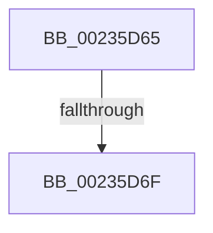

# sub_00235D65

- RVA: `0x00235D65`–`0x00235D85` (길이 `32` bytes)
- VA: `0x0000000140235D65`
- 실행 섹션: `.text`
- PDB 이름 있음: `아니요`; PDB Function 태그: `아니요`
- unwind 정보 RVA: `0x00060774`
- 디코드: `7`개 명령, `32/32` bytes 표시
- 미해석 바이트: `0` (있으면 어셈블리에 `.byte`로 보존)

> 이 문서는 커널 이미지의 기계어와 PDB 기호를 분석해 생성했습니다. 4번과 5번은 함수 원형과 자료형을 바이너리 사용 방식에서 추정한 C 해석이며 원본 소스 복구 결과는 아닙니다.

## 1. Dependencies

- 직접 호출 지점: **1**; 고유 호출 대상: **1**
- 직접 호출자로 확인된 함수: **0**
- RIP 상대 이미지 참조: **0**

### Outgoing calls
- `0x00235D7B` → [memset](../6C/memset_function_006C6C40.md) (function, `0x006C6C40`)

### Direct callers
- 이 함수 시작 RVA로 연결되는 직접 call은 확인되지 않았습니다. 간접 호출은 완전히 역산할 수 없습니다.

### Static image references
- 디코드된 RIP-relative 메모리 참조가 없습니다.

## 2. Other-region calls and transfers

- 다른 실행 섹션으로 향하는 call: **0**
- call이 아닌 외부 분기/꼬리 이동: **2**
  - `0x00235D69` → [sub_00235B42](Unknown_function_00235B42.md) (`tail-transfer`)
  - `0x00235D80` → [sub_00235B42](Unknown_function_00235B42.md) (`tail-transfer`)

## 3. Assembly (complete function range)

```asm
00235D65  83 7D 70 00                     cmp dword ptr [rbp + 0x70], 0
00235D69  0F 85 D3 FD FF FF               jne 0x140235b42
00235D6F  44 8B 45 68                     mov r8d, dword ptr [rbp + 0x68]
00235D73  BA FF 00 00 00                  mov edx, 0xff
00235D78  48 8B CE                        mov rcx, rsi
00235D7B  E8 C0 0E 49 00                  call 0x1406c6c40
00235D80  E9 BD FD FF FF                  jmp 0x140235b42
```

## 4. C-style interpretation (structured pseudocode)

```c
__int64 __fastcall sub_00235D65(void)
{
    __int64 result;

    result = memset(v_rsi, 255, (unsigned int)(*(unsigned int *)(v_rbp + 104)), a4);
}
```

## 5. (Beta) C Style

```c
void sub_00235D65(void)
{
    int64_t result;

    result = memset(local_rsi, 255, (uint32_t)(*(uint32_t *)(local_rbp + 0x68)), a4);
}
```

## 6. Execution-region graph

[열기: 2D/3D 그래프와 함수 탐색 컨트롤 패널](../../../control-panel.html?section=text&rva=0x00235D65&view=graph)

- 2D 그래프는 위에서 아래로 흐르고, 3D 그래프는 빈 공간을 드래그해 회전합니다. Shift+드래그는 이동, 휠은 확대·축소, 함수 노드 선택은 대상 보고서 이동입니다.

### Static fallback


