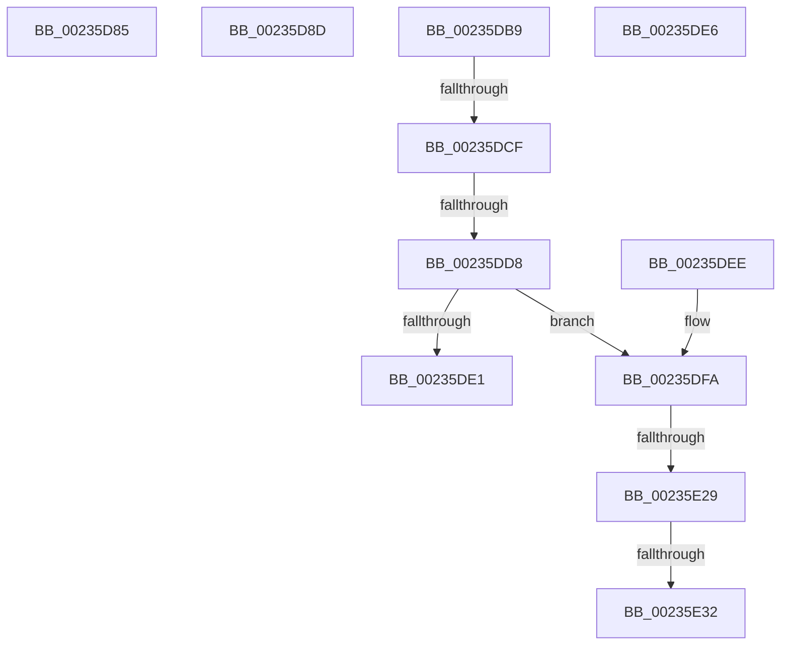

# sub_00235D85

- RVA: `0x00235D85`–`0x00235E47` (길이 `194` bytes)
- VA: `0x0000000140235D85`
- 실행 섹션: `.text`
- PDB 이름 있음: `아니요`; PDB Function 태그: `아니요`
- unwind 정보 RVA: `0x00060784`
- 디코드: `45`개 명령, `194/194` bytes 표시
- 미해석 바이트: `0` (있으면 어셈블리에 `.byte`로 보존)

> 이 문서는 커널 이미지의 기계어와 PDB 기호를 분석해 생성했습니다. 4번과 5번은 함수 원형과 자료형을 바이너리 사용 방식에서 추정한 C 해석이며 원본 소스 복구 결과는 아닙니다.

## 1. Dependencies

- 직접 호출 지점: **3**; 고유 호출 대상: **3**
- 직접 호출자로 확인된 함수: **0**
- RIP 상대 이미지 참조: **0**

### Outgoing calls
- `0x00235DA7` → [guard_dispatch_icall](../6B/guard_dispatch_icall_function_006BAAD0.md) (function, `0x006BAAD0`)
- `0x00235E1C` → [HalpPciAccessIoConfigSpace](../55/HalpPciAccessIoConfigSpace_function_00553948.md) (function, `0x00553948`)
- `0x00235E3D` → [memset](../6C/memset_function_006C6C40.md) (function, `0x006C6C40`)

### Direct callers
- 이 함수 시작 RVA로 연결되는 직접 call은 확인되지 않았습니다. 간접 호출은 완전히 역산할 수 없습니다.

### Static image references
- 디코드된 RIP-relative 메모리 참조가 없습니다.

## 2. Other-region calls and transfers

- 다른 실행 섹션으로 향하는 call: **0**
- call이 아닌 외부 분기/꼬리 이동: **9**
  - `0x00235D88` → [sub_00235B5D + 0x55](Unknown_function_00235B5D.md) (`tail-transfer`)
  - `0x00235DB4` → [sub_00235A0C + 0x116](Unknown_function_00235A0C.md) (`tail-transfer`)
  - `0x00235DC9` → [sub_00235B5D + 0x8F](Unknown_function_00235B5D.md) (`tail-transfer`)
  - `0x00235DD2` → [sub_00235B5D + 0x8F](Unknown_function_00235B5D.md) (`tail-transfer`)
  - `0x00235DE1` → [sub_00235B5D + 0x8F](Unknown_function_00235B5D.md) (`tail-transfer`)
  - `0x00235DE9` → [sub_00235B5D + 0x8F](Unknown_function_00235B5D.md) (`tail-transfer`)
  - `0x00235E23` → [sub_00235B5D + 0x15D](Unknown_function_00235B5D.md) (`tail-transfer`)
  - `0x00235E2C` → [sub_00235B5D + 0x15D](Unknown_function_00235B5D.md) (`tail-transfer`)
  - `0x00235E42` → [sub_00235B5D + 0x15D](Unknown_function_00235B5D.md) (`tail-transfer`)

## 3. Assembly (complete function range)

```asm
00235D85  40 B6 0F                        mov sil, 0xf
00235D88  E9 25 FE FF FF                  jmp 0x140235bb2
00235D8D  44 8B 75 60                     mov r14d, dword ptr [rbp + 0x60]
00235D91  48 89 74 24 38                  mov qword ptr [rsp + 0x38], rsi
00235D96  44 89 64 24 30                  mov dword ptr [rsp + 0x30], r12d
00235D9B  44 89 74 24 28                  mov dword ptr [rsp + 0x28], r14d
00235DA0  89 44 24 20                     mov dword ptr [rsp + 0x20], eax
00235DA4  48 8B C3                        mov rax, rbx
00235DA7  E8 24 4D 48 00                  call 0x1406baad0
00235DAC  44 0F B6 54 24 50               movzx r10d, byte ptr [rsp + 0x50]
00235DB2  8B F0                           mov esi, eax
00235DB4  E9 69 FD FF FF                  jmp 0x140235b22
00235DB9  44 0F B7 5C 24 52               movzx r11d, word ptr [rsp + 0x52]
00235DBF  44 0F B6 54 24 50               movzx r10d, byte ptr [rsp + 0x50]
00235DC5  66 45 85 DB                     test r11w, r11w
00235DC9  0F 85 1D FE FF FF               jne 0x140235bec
00235DCF  45 84 D2                        test r10b, r10b
00235DD2  0F 85 14 FE FF FF               jne 0x140235bec
00235DD8  8B C7                           mov eax, edi
00235DDA  83 E0 1F                        and eax, 0x1f
00235DDD  3C 18                           cmp al, 0x18
00235DDF  73 19                           jae 0x140235dfa
00235DE1  E9 06 FE FF FF                  jmp 0x140235bec
00235DE6  41 FF C5                        inc r13d
00235DE9  E9 FE FD FF FF                  jmp 0x140235bec
00235DEE  44 0F B6 54 24 50               movzx r10d, byte ptr [rsp + 0x50]
00235DF4  44 0F B7 5C 24 52               movzx r11d, word ptr [rsp + 0x52]
00235DFA  4C 8B 6C 24 58                  mov r13, qword ptr [rsp + 0x58]
00235DFF  44 8B C7                        mov r8d, edi
00235E02  44 89 7C 24 30                  mov dword ptr [rsp + 0x30], r15d
00235E07  4D 8B CD                        mov r9, r13
00235E0A  44 89 64 24 28                  mov dword ptr [rsp + 0x28], r12d
00235E0F  41 0F B6 D2                     movzx edx, r10b
00235E13  41 0F B7 CB                     movzx ecx, r11w
00235E17  44 89 74 24 20                  mov dword ptr [rsp + 0x20], r14d
00235E1C  E8 27 DB 31 00                  call 0x140553948
00235E21  84 C0                           test al, al
00235E23  0F 85 91 FE FF FF               jne 0x140235cba
00235E29  45 85 FF                        test r15d, r15d
00235E2C  0F 85 88 FE FF FF               jne 0x140235cba
00235E32  45 8B C4                        mov r8d, r12d
00235E35  BA FF 00 00 00                  mov edx, 0xff
00235E3A  49 8B CD                        mov rcx, r13
00235E3D  E8 FE 0D 49 00                  call 0x1406c6c40
00235E42  E9 73 FE FF FF                  jmp 0x140235cba
```

## 4. C-style interpretation (structured pseudocode)

```c
__int64 __fastcall sub_00235D85(void)
{
    unsigned int v_stack_p20;
    unsigned int v_stack_p28;
    unsigned int v_stack_p30;
    unsigned __int64 v_stack_p38;
    unsigned __int8 v_stack_p50;
    unsigned __int16 v_stack_p52;
    unsigned __int64 v_stack_p58;
}
```

## 5. (Beta) C Style

```c
void sub_00235D85(void)
{
    uint32_t v_stack_p20;
    uint32_t v_stack_p28;
    uint32_t v_stack_p30;
    uint64_t v_stack_p38;
    uint8_t v_stack_p50;
    uint16_t v_stack_p52;
    uint64_t v_stack_p58;
}
```

## 6. Execution-region graph

[열기: 2D/3D 그래프와 함수 탐색 컨트롤 패널](../../../control-panel.html?section=text&rva=0x00235D85&view=graph)

- 2D 그래프는 위에서 아래로 흐르고, 3D 그래프는 빈 공간을 드래그해 회전합니다. Shift+드래그는 이동, 휠은 확대·축소, 함수 노드 선택은 대상 보고서 이동입니다.

### Static fallback


