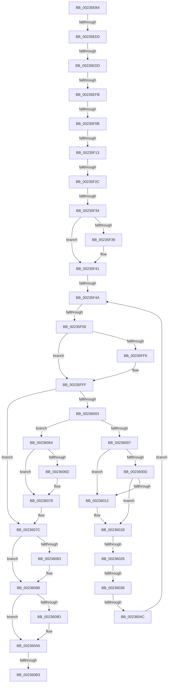

# sub_00235EB4

- RVA: `0x00235EB4`–`0x002360BE` (길이 `522` bytes)
- VA: `0x0000000140235EB4`
- 실행 섹션: `.text`
- PDB 이름 있음: `아니요`; PDB Function 태그: `아니요`
- unwind 정보 RVA: `0x000607D8`
- 디코드: `118`개 명령, `522/522` bytes 표시
- 미해석 바이트: `0` (있으면 어셈블리에 `.byte`로 보존)

> 이 문서는 커널 이미지의 기계어와 PDB 기호를 분석해 생성했습니다. 4번과 5번은 함수 원형과 자료형을 바이너리 사용 방식에서 추정한 C 해석이며 원본 소스 복구 결과는 아닙니다.

## 1. Dependencies

- 직접 호출 지점: **7**; 고유 호출 대상: **6**
- 직접 호출자로 확인된 함수: **0**
- RIP 상대 이미지 참조: **4**

### Outgoing calls
- `0x00235ED0` → [KeAreInterruptsEnabled](../2F/KeAreInterruptsEnabled_function_002F8060.md) (function, `0x002F8060`)
- `0x00235F90` → [EtwTraceKernelEvent](EtwTraceKernelEvent_function_00235350.md) (function, `0x00235350`)
- `0x00235F9F` → [HvlSwitchToVsmVtl1](../6A/HvlSwitchToVsmVtl1_function_006ACEE0.md) (function, `0x006ACEE0`)
- `0x00235FE9` → [EtwTraceKernelEvent](EtwTraceKernelEvent_function_00235350.md) (function, `0x00235350`)
- `0x00236073` → [KiLowerIrqlProcessIrqlFlags](../4F/KiLowerIrqlProcessIrqlFlags_function_004F5698.md) (function, `0x004F5698`)
- `0x00236093` → [KeReleaseSemaphore](../39/KeReleaseSemaphore_function_00397080.md) (function, `0x00397080`)
- `0x002360A0` → [KeLeaveCriticalRegionThread](../25/KeLeaveCriticalRegionThread_function_0025EFF0.md) (function, `0x0025EFF0`)

### Direct callers
- 이 함수 시작 RVA로 연결되는 직접 call은 확인되지 않았습니다. 간접 호출은 완전히 역산할 수 없습니다.

### Static image references
- `0x00235F4A` → RVA `0x00FC6B14` (`ALMOSTRO`; read)
- `0x0023602C` → RVA `0x012018D0` (`CFGRO`; read)
- `0x00236064` → RVA `0x00FC6D20` (`ALMOSTRO`; read)
- `0x00236086` → RVA `0x00F8EB80` (`.data`; read)

## 2. Other-region calls and transfers

- 다른 실행 섹션으로 향하는 call: **0**
- call이 아닌 외부 분기/꼬리 이동: **13**
  - `0x00235ECA` → [sub_002361D4 + 0x49](Unknown_function_002361D4.md) (`tail-transfer`)
  - `0x00235ED7` → [sub_002361D4 + 0x88](Unknown_function_002361D4.md) (`tail-transfer`)
  - `0x00235EF5` → [sub_002360DC + 0x33](Unknown_function_002360DC.md) (`tail-transfer`)
  - `0x00235F05` → [sub_002361D4 + 0x40](Unknown_function_002361D4.md) (`tail-transfer`)
  - `0x00235F0D` → [sub_002360DC + 0xB4](Unknown_function_002360DC.md) (`tail-transfer`)
  - `0x00235F26` → [sub_002360DC](Unknown_function_002360DC.md) (`tail-transfer`)
  - `0x00235F2E` → [sub_002361D4 + 0xC5](Unknown_function_002361D4.md) (`tail-transfer`)
  - `0x00235F44` → [sub_002360DC + 0x3C](Unknown_function_002360DC.md) (`tail-transfer`)
  - `0x00235F52` → [sub_002361D4 + 0x16](Unknown_function_002361D4.md) (`tail-transfer`)
  - `0x00236022` → [sub_002360DC + 0x8](Unknown_function_002360DC.md) (`tail-transfer`)
  - `0x00236032` → [sub_002360DC + 0x67](Unknown_function_002360DC.md) (`tail-transfer`)
  - `0x00236046` → [sub_002361D4](Unknown_function_002361D4.md) (`tail-transfer`)
  - `0x002360AD` → [sub_002361D4 + 0xDC](Unknown_function_002361D4.md) (`tail-transfer`)

## 3. Assembly (complete function range)

```asm
00235EB4  48 89 AC 24 C0 00 00 00         mov qword ptr [rsp + 0xc0], rbp
00235EBC  8B A8 10 05 00 00               mov ebp, dword ptr [rax + 0x510]
00235EC2  89 6C 24 3C                     mov dword ptr [rsp + 0x3c], ebp
00235EC6  41 80 FE 02                     cmp r14b, 2
00235ECA  0F 87 4D 03 00 00               ja 0x14023621d
00235ED0  E8 8B 21 0C 00                  call 0x1402f8060
00235ED5  84 C0                           test al, al
00235ED7  0F 84 7F 03 00 00               je 0x14023625c
00235EDD  65 48 8B 2C 25 88 01 00 00      mov rbp, qword ptr gs:[0x188]
00235EE6  44 0F 20 C0                     mov rax, cr8
00235EEA  45 33 C0                        xor r8d, r8d
00235EED  BA 01 00 00 00                  mov edx, 1
00235EF2  44 3A F2                        cmp r14b, dl
00235EF5  0F 84 14 02 00 00               je 0x14023610f
00235EFB  48 8D 8D 1C 03 00 00            lea rcx, [rbp + 0x31c]
00235F02  45 85 E4                        test r12d, r12d
00235F05  0F 85 09 03 00 00               jne 0x140236214
00235F0B  3C 02                           cmp al, 2
00235F0D  0F 82 7D 02 00 00               jb 0x140236190
00235F13  44 89 43 04                     mov dword ptr [rbx + 4], r8d
00235F17  44 8B E2                        mov r12d, edx
00235F1A  44 39 01                        cmp dword ptr [rcx], r8d
00235F1D  40 0F B6 F6                     movzx esi, sil
00235F21  0F 44 F2                        cmove esi, edx
00235F24  3C 01                           cmp al, 1
00235F26  0F 84 B0 01 00 00               je 0x1402360dc
00235F2C  3C 02                           cmp al, 2
00235F2E  0F 83 65 03 00 00               jae 0x140236299
00235F34  40 84 F6                        test sil, sil
00235F37  74 08                           je 0x140235f41
00235F39  66 FF 8D E4 01 00 00            dec word ptr [rbp + 0x1e4]
00235F40  90                              nop
00235F41  40 84 FF                        test dil, dil
00235F44  0F 85 CE 01 00 00               jne 0x140236118
00235F4A  8B 05 C4 0B D9 00               mov eax, dword ptr [rip + 0xd90bc4]
00235F50  A8 08                           test al, 8
00235F52  0F 84 92 02 00 00               je 0x1402361ea
00235F58  48 8D 44 24 34                  lea rax, [rsp + 0x34]
00235F5D  66 44 89 7C 24 36               mov word ptr [rsp + 0x36], r15w
00235F63  41 B9 49 05 00 00               mov r9d, 0x549
00235F69  48 89 44 24 48                  mov qword ptr [rsp + 0x48], rax
00235F6E  41 B8 08 00 00 A0               mov r8d, 0xa0000008
00235F74  66 44 89 74 24 34               mov word ptr [rsp + 0x34], r14w
00235F7A  48 8D 4C 24 48                  lea rcx, [rsp + 0x48]
00235F7F  48 C7 44 24 50 04 00 00 00      mov qword ptr [rsp + 0x50], 4
00235F88  C7 44 24 20 02 19 50 00         mov dword ptr [rsp + 0x20], 0x501902
00235F90  E8 BB F3 FF FF                  call 0x140235350
00235F95  44 8B 44 24 3C                  mov r8d, dword ptr [rsp + 0x3c]
00235F9A  48 8B D3                        mov rdx, rbx
00235F9D  33 C9                           xor ecx, ecx
00235F9F  E8 3C 6F 47 00                  call 0x1406acee0
00235FA4  0F B7 44 24 32                  movzx eax, word ptr [rsp + 0x32]
00235FA9  48 8D 4C 24 58                  lea rcx, [rsp + 0x58]
00235FAE  44 8B 7B 08                     mov r15d, dword ptr [rbx + 8]
00235FB2  33 FF                           xor edi, edi
00235FB4  66 89 44 24 3A                  mov word ptr [rsp + 0x3a], ax
00235FB9  41 B9 4A 05 00 00               mov r9d, 0x54a
00235FBF  48 8D 44 24 38                  lea rax, [rsp + 0x38]
00235FC4  66 44 89 74 24 38               mov word ptr [rsp + 0x38], r14w
00235FCA  41 B8 08 00 00 A0               mov r8d, 0xa0000008
00235FD0  48 89 44 24 58                  mov qword ptr [rsp + 0x58], rax
00235FD5  8D 57 01                        lea edx, [rdi + 1]
00235FD8  48 C7 44 24 60 04 00 00 00      mov qword ptr [rsp + 0x60], 4
00235FE1  C7 44 24 20 02 19 50 00         mov dword ptr [rsp + 0x20], 0x501902
00235FE9  E8 62 F3 FF FF                  call 0x140235350
00235FEE  0F B6 43 01                     movzx eax, byte ptr [rbx + 1]
00235FF2  84 C0                           test al, al
00235FF4  79 09                           jns 0x140235fff
00235FF6  CC                              int3
00235FF7  80 63 01 7F                     and byte ptr [rbx + 1], 0x7f
00235FFB  0F B6 43 01                     movzx eax, byte ptr [rbx + 1]
00235FFF  3C 01                           cmp al, 1
00236001  74 79                           je 0x14023607c
00236003  3C 06                           cmp al, 6
00236005  74 5D                           je 0x140236064
00236007  41 80 FE 01                     cmp r14b, 1
0023600B  74 05                           je 0x140236012
0023600D  45 85 E4                        test r12d, r12d
00236010  75 09                           jne 0x14023601b
00236012  8B 43 04                        mov eax, dword ptr [rbx + 4]
00236015  89 85 1C 03 00 00               mov dword ptr [rbp + 0x31c], eax
0023601B  0F B6 4B 01                     movzx ecx, byte ptr [rbx + 1]
0023601F  80 F9 03                        cmp cl, 3
00236022  0F 85 BC 00 00 00               jne 0x1402360e4
00236028  0F B7 43 02                     movzx eax, word ptr [rbx + 2]
0023602C  3B 05 9E B8 FC 00               cmp eax, dword ptr [rip + 0xfcb89e]
00236032  0F 82 0B 01 00 00               jb 0x140236143
00236038  48 C7 43 08 1C 00 00 C0         mov qword ptr [rbx + 8], 0xffffffffc000001c
00236040  45 33 C0                        xor r8d, r8d
00236043  45 85 E4                        test r12d, r12d
00236046  0F 84 88 01 00 00               je 0x1402361d4
0023604C  C6 03 00                        mov byte ptr [rbx], 0
0023604F  66 44 89 43 02                  mov word ptr [rbx + 2], r8w
00236054  44 0F B7 7C 24 32               movzx r15d, word ptr [rsp + 0x32]
0023605A  BA 01 00 00 00                  mov edx, 1
0023605F  E9 E6 FE FF FF                  jmp 0x140235f4a
00236064  83 3D B5 0C D9 00 00            cmp dword ptr [rip + 0xd90cb5], 0
0023606B  74 0B                           je 0x140236078
0023606D  44 0F 20 C1                     mov rcx, cr8
00236071  33 D2                           xor edx, edx
00236073  E8 20 F6 2B 00                  call 0x1404f5698
00236078  44 0F 22 C7                     mov cr8, rdi
0023607C  80 7C 24 30 00                  cmp byte ptr [rsp + 0x30], 0
00236081  74 15                           je 0x140236098
00236083  45 33 C9                        xor r9d, r9d
00236086  48 8D 0D F3 8A D5 00            lea rcx, [rip + 0xd58af3]
0023608D  33 D2                           xor edx, edx
0023608F  45 8D 41 01                     lea r8d, [r9 + 1]
00236093  E8 E8 0F 16 00                  call 0x140397080
00236098  40 84 F6                        test sil, sil
0023609B  74 08                           je 0x1402360a5
0023609D  48 8B CD                        mov rcx, rbp
002360A0  E8 4B 8F 02 00                  call 0x14025eff0
002360A5  48 8B 5C 24 40                  mov rbx, qword ptr [rsp + 0x40]
002360AA  80 FB 0F                        cmp bl, 0xf
002360AD  0F 85 FD 01 00 00               jne 0x1402362b0
002360B3  41 8B C7                        mov eax, r15d
002360B6  48 8B AC 24 C0 00 00 00         mov rbp, qword ptr [rsp + 0xc0]
```

## 4. C-style interpretation (structured pseudocode)

```c
__int64 __fastcall sub_00235EB4(__int64 a1, __int64 a2, int a3, __int64 a4, __int64 a5, unsigned __int8 a6, __int64 a7, __int64 a8, __int64 a9, __int64 a10, __int64 a11, __int64 a12, __int64 a13, __int64 a14, __int64 a15, __int64 a16, __int64 a17, __int64 a18, __int64 a19, __int64 a20, __int64 a21, __int64 a22, __int64 a23, __int64 a24)
{
    __int64 result;
    __int64 v_rdi;
    __int64 v_rsi;
    unsigned int v_stack_p20;
    unsigned __int16 v_stack_p32;
    unsigned __int64 v_stack_p34;
    unsigned __int16 v_stack_p36;
    unsigned __int16 v_stack_p38;
    unsigned __int16 v_stack_p3A;
    unsigned int v_stack_p3C;
    unsigned __int64 v_stack_p48;
    unsigned __int64 v_stack_p50;
    unsigned __int64 v_stack_p58;
    unsigned __int64 v_stack_p60;
    unsigned __int64 v_stack_pC0;

    v_stack_pC0 = v_rbp;
    v_stack_p3C = (unsigned int)((unsigned int)(*(unsigned int *)(result + 1296)));
    result = KeAreInterruptsEnabled(a1, a2, a3, a4);
    a3 = 0;
    *(unsigned int *)(v_rbx + 4) = 0;
    v_rsi = (unsigned __int8)(v_rsi);
    if ((*(unsigned int *)(*(unsigned __int64 *)(gs_base + (0 + 392)) + 796)) == 0) { v_rsi = 1; }
    if ((unsigned __int8)(v_rsi) != 0) {
    }
loc_00235F4A:
    v_stack_p36 = (unsigned __int16)(v_r15);
    v_stack_p48 = v_stack_p34;
    v_stack_p34 = (unsigned __int16)(v_r14);
    v_stack_p50 = 4;
    v_stack_p20 = 0x501902ULL;
    result = EtwTraceKernelEvent(a9, 1, (unsigned int)(0xA0000008ULL), (unsigned int)(0x549ULL));
    a1 = 0;
    result = HvlSwitchToVsmVtl1(a1, v_rbx, (unsigned int)(v_stack_p3C), (unsigned int)(0x549ULL));
    v_rdi = 0;
    v_stack_p3A = (unsigned __int16)(v_stack_p32);
    v_stack_p38 = (unsigned __int16)(v_r14);
    v_stack_p58 = a7;
    v_stack_p60 = 4;
    v_stack_p20 = 0x501902ULL;
    result = EtwTraceKernelEvent(a11, v_rdi + 1, (unsigned int)(0xA0000008ULL), (unsigned int)(0x54AULL));
    result = *(unsigned __int8 *)(v_rbx + 1);
    if (sign_flag) {
        result = *(unsigned __int8 *)(v_rbx + 1);
    }
    if (((unsigned __int8)(result)) == 1) goto loc_0023607C;
    if (((unsigned __int8)(result)) == 6) goto loc_00236064;
    if (((unsigned __int8)(v_r14)) == 1) goto loc_00236012;
    if (1 == 0) {
        result = *(unsigned int *)(v_rbx + 4);
        *(unsigned int *)(*(unsigned __int64 *)(gs_base + (0 + 392)) + 796) = (unsigned int)(result);
    }
    *(unsigned __int64 *)(v_rbx + 8) = 0xFFFFFFFFC000001CULL;
    a3 = 0;
    *(unsigned __int8 *)(v_rbx) = 0;
    *(unsigned __int16 *)(v_rbx + 2) = 0;
    goto loc_00235F4A;
loc_00236064:
    result = *(unsigned __int16 *)(v_rbx + 2);
    if ((*(unsigned int *)(v_rip + 14224565)) != 0) {
        a1 = v_cr8;
        a2 = 0;
        result = KiLowerIrqlProcessIrqlFlags(a1, a2, a3, (unsigned int)(0x54AULL));
    }
loc_0023607C:
    if (a6 != 0) {
        a4 = 0;
        a1 = v_rip + 13994739;
        a2 = 0;
        a3 = a4 + 1;
        result = KeReleaseSemaphore(a1, a2, a3, a4);
    }
    if ((unsigned __int8)(v_rsi) != 0) {
        a1 = *(unsigned __int64 *)(gs_base + (0 + 392));
        result = KeLeaveCriticalRegionThread(a1, a2, a3, a4);
    }
    return (unsigned int)((unsigned int)(v_stack_p32));
}
```

## 5. (Beta) C Style

```c
int64_t sub_00235EB4(int64_t Arg1, int64_t Arg2, int32_t Arg3, int64_t Arg4, uint64_t Arg5, uint8_t Arg6, int64_t Arg7, int64_t Arg8, int64_t Arg9, uint64_t Arg10, int64_t Arg11, uint64_t Arg12, uint64_t Arg13, uint64_t Arg14, uint64_t Arg15, uint64_t Arg16, uint64_t Arg17, uint64_t Arg18, uint64_t Arg19, uint64_t Arg20, uint64_t Arg21, uint64_t Arg22, uint64_t Arg23, int64_t Arg24)
{
    int64_t result;
    int64_t local_rdi;
    int64_t local_rsi;
    uint32_t v_stack_p20;
    uint16_t v_stack_p32;
    uint64_t v_stack_p34;
    uint16_t v_stack_p36;
    uint16_t v_stack_p38;
    uint16_t v_stack_p3A;
    uint32_t v_stack_p3C;
    uint64_t v_stack_p48;
    uint64_t v_stack_p50;
    uint64_t v_stack_p58;
    uint64_t v_stack_p60;
    uint64_t v_stack_pC0;

    v_stack_pC0 = local_rbp;
    v_stack_p3C = (uint32_t)((uint32_t)(*(uint32_t *)(result + 0x510)));
    result = KeAreInterruptsEnabled(Arg1, Arg2, Arg3, Arg4);
    Arg3 = 0;
    *(uint32_t *)(local_rbx + 0x4) = 0;
    local_rsi = (uint8_t)(local_rsi);
    if ((*(uint32_t *)(*(uint64_t *)(gs_base + (0 + 0x188)) + 0x31C)) == 0) { local_rsi = 1; }
    if ((uint8_t)(local_rsi) != 0) {
    }
loc_00235F4A:
    v_stack_p36 = (uint16_t)(local_r15);
    v_stack_p48 = v_stack_p34;
    v_stack_p34 = (uint16_t)(local_r14);
    v_stack_p50 = 4;
    v_stack_p20 = 0x501902ULL;
    result = EtwTraceKernelEvent(Arg9, 1, (uint32_t)(0xA0000008ULL), (uint32_t)(0x549ULL));
    Arg1 = 0;
    result = HvlSwitchToVsmVtl1(Arg1, local_rbx, (uint32_t)(v_stack_p3C), (uint32_t)(0x549ULL));
    local_rdi = 0;
    v_stack_p3A = (uint16_t)(v_stack_p32);
    v_stack_p38 = (uint16_t)(local_r14);
    v_stack_p58 = Arg7;
    v_stack_p60 = 4;
    v_stack_p20 = 0x501902ULL;
    result = EtwTraceKernelEvent(Arg11, local_rdi + 1, (uint32_t)(0xA0000008ULL), (uint32_t)(0x54AULL));
    result = *(uint8_t *)(local_rbx + 0x1);
    if (sign_flag) {
        result = *(uint8_t *)(local_rbx + 0x1);
    }
    if (((uint8_t)(result)) == 1) goto loc_0023607C;
    if (((uint8_t)(result)) == 6) goto loc_00236064;
    if (((uint8_t)(local_r14)) == 1) goto loc_00236012;
    if (1 == 0) {
        result = *(uint32_t *)(local_rbx + 0x4);
        *(uint32_t *)(*(uint64_t *)(gs_base + (0 + 0x188)) + 0x31C) = (uint32_t)(result);
    }
    *(uint64_t *)(local_rbx + 0x8) = 0xFFFFFFFFC000001CULL;
    Arg3 = 0;
    *(uint8_t *)(local_rbx) = 0;
    *(uint16_t *)(local_rbx + 0x2) = 0;
    goto loc_00235F4A;
loc_00236064:
    result = *(uint16_t *)(local_rbx + 0x2);
    if ((*(uint32_t *)(v_rip + 0xD90CB5)) != 0) {
        Arg1 = v_cr8;
        Arg2 = 0;
        result = KiLowerIrqlProcessIrqlFlags(Arg1, Arg2, Arg3, (uint32_t)(0x54AULL));
    }
loc_0023607C:
    if (Arg6 != 0) {
        Arg4 = 0;
        Arg1 = v_rip + 13994739;
        Arg2 = 0;
        Arg3 = Arg4 + 1;
        result = KeReleaseSemaphore(Arg1, Arg2, Arg3, Arg4);
    }
    if ((uint8_t)(local_rsi) != 0) {
        Arg1 = *(uint64_t *)(gs_base + (0 + 0x188));
        result = KeLeaveCriticalRegionThread(Arg1, Arg2, Arg3, Arg4);
    }
    return (uint32_t)((uint32_t)(v_stack_p32));
}
```

## 6. Execution-region graph

[열기: 2D/3D 그래프와 함수 탐색 컨트롤 패널](../../../control-panel.html?section=text&rva=0x00235EB4&view=graph)

- 2D 그래프는 위에서 아래로 흐르고, 3D 그래프는 빈 공간을 드래그해 회전합니다. Shift+드래그는 이동, 휠은 확대·축소, 함수 노드 선택은 대상 보고서 이동입니다.

### Static fallback


