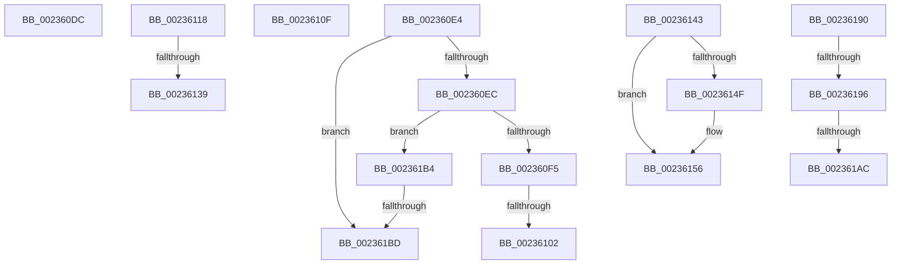

# sub_002360DC

- RVA: `0x002360DC`–`0x002361CA` (길이 `238` bytes)
- VA: `0x00000001402360DC`
- 실행 섹션: `.text`
- PDB 이름 있음: `아니요`; PDB Function 태그: `아니요`
- unwind 정보 RVA: `0x00060800`
- 디코드: `54`개 명령, `238/238` bytes 표시
- 미해석 바이트: `0` (있으면 어셈블리에 `.byte`로 보존)

> 이 문서는 커널 이미지의 기계어와 PDB 기호를 분석해 생성했습니다. 4번과 5번은 함수 원형과 자료형을 바이너리 사용 방식에서 추정한 C 해석이며 원본 소스 복구 결과는 아닙니다.

## 1. Dependencies

- 직접 호출 지점: **3**; 고유 호출 대상: **3**
- 직접 호출자로 확인된 함수: **0**
- RIP 상대 이미지 참조: **3**

### Outgoing calls
- `0x00236129` → [KeWaitForSingleObject](../20/KeWaitForSingleObject_function_0020E6B0.md) (function, `0x0020E6B0`)
- `0x00236178` → [VslpDispatchIumSyscall](../6A/VslpDispatchIumSyscall_function_006AD050.md) (function, `0x006AD050`)
- `0x002361C0` → [PsDispatchIumService](../4A/PsDispatchIumService_function_004A2F0C.md) (function, `0x004A2F0C`)

### Direct callers
- 이 함수 시작 RVA로 연결되는 직접 call은 확인되지 않았습니다. 간접 호출은 완전히 역산할 수 없습니다.

### Static image references
- `0x00236122` → RVA `0x00F8EB80` (`.data`; read)
- `0x00236156` → RVA `0x012018C0` (`CFGRO`; read)
- `0x0023619F` → RVA `0x00FC6A84` (`ALMOSTRO`; read)

## 2. Other-region calls and transfers

- 다른 실행 섹션으로 향하는 call: **0**
- call이 아닌 외부 분기/꼬리 이동: **12**
  - `0x002360DF` → [sub_00235EB4 + 0x85](Unknown_function_00235EB4.md) (`tail-transfer`)
  - `0x002360FC` → [sub_00235EB4 + 0x174](Unknown_function_00235EB4.md) (`tail-transfer`)
  - `0x0023610A` → [sub_00235EB4 + 0x18C](Unknown_function_00235EB4.md) (`tail-transfer`)
  - `0x00236113` → [sub_00235EB4 + 0x70](Unknown_function_00235EB4.md) (`tail-transfer`)
  - `0x00236133` → [sub_00235EB4 + 0x1E4](Unknown_function_00235EB4.md) (`tail-transfer`)
  - `0x0023613E` → [sub_00235EB4 + 0x1A0](Unknown_function_00235EB4.md) (`tail-transfer`)
  - `0x0023618B` → [sub_00235EB4 + 0x18C](Unknown_function_00235EB4.md) (`tail-transfer`)
  - `0x00236194` → [sub_002361D4 + 0x30](Unknown_function_002361D4.md) (`tail-transfer`)
  - `0x002361A6` → [sub_00235EB4 + 0x66](Unknown_function_00235EB4.md) (`tail-transfer`)
  - `0x002361AF` → [sub_00235EB4 + 0x66](Unknown_function_00235EB4.md) (`tail-transfer`)
  - `0x002361B7` → [sub_00235EB4 + 0x18C](Unknown_function_00235EB4.md) (`tail-transfer`)
  - `0x002361C5` → [sub_00235EB4 + 0x18C](Unknown_function_00235EB4.md) (`tail-transfer`)

## 3. Assembly (complete function range)

```asm
002360DC  40 B6 01                        mov sil, 1
002360DF  E9 55 FE FF FF                  jmp 0x140235f39
002360E4  84 C9                           test cl, cl
002360E6  0F 84 D1 00 00 00               je 0x1402361bd
002360EC  80 F9 02                        cmp cl, 2
002360EF  0F 85 BF 00 00 00               jne 0x1402361b4
002360F5  80 BD 32 02 00 00 00            cmp byte ptr [rbp + 0x232], 0
002360FC  0F 85 26 FF FF FF               jne 0x140236028
00236102  48 C7 43 08 30 00 00 C0         mov qword ptr [rbx + 8], 0xffffffffc0000030
0023610A  E9 31 FF FF FF                  jmp 0x140236040
0023610F  44 89 63 04                     mov dword ptr [rbx + 4], r12d
00236113  E9 0C FE FF FF                  jmp 0x140235f24
00236118  45 33 C9                        xor r9d, r9d
0023611B  4C 89 44 24 20                  mov qword ptr [rsp + 0x20], r8
00236120  33 D2                           xor edx, edx
00236122  48 8D 0D 57 8A D5 00            lea rcx, [rip + 0xd58a57]
00236129  E8 82 85 FD FF                  call 0x14020e6b0
0023612E  44 8B F8                        mov r15d, eax
00236131  85 C0                           test eax, eax
00236133  0F 88 5F FF FF FF               js 0x140236098
00236139  C6 44 24 30 01                  mov byte ptr [rsp + 0x30], 1
0023613E  E9 11 FF FF FF                  jmp 0x140236054
00236143  0F B6 BD 32 02 00 00            movzx edi, byte ptr [rbp + 0x232]
0023614A  80 F9 03                        cmp cl, 3
0023614D  75 07                           jne 0x140236156
0023614F  C6 85 32 02 00 00 00            mov byte ptr [rbp + 0x232], 0
00236156  48 8B 15 63 B7 FC 00            mov rdx, qword ptr [rip + 0xfcb763]
0023615D  0F B7 43 02                     movzx eax, word ptr [rbx + 2]
00236161  8B 0C 82                        mov ecx, dword ptr [rdx + rax*4]
00236164  44 8B C1                        mov r8d, ecx
00236167  C1 F9 04                        sar ecx, 4
0023616A  41 83 E0 0F                     and r8d, 0xf
0023616E  48 63 C9                        movsxd rcx, ecx
00236171  48 03 CA                        add rcx, rdx
00236174  48 8D 53 08                     lea rdx, [rbx + 8]
00236178  E8 D3 6E 47 00                  call 0x1406ad050
0023617D  48 63 C8                        movsxd rcx, eax
00236180  48 89 4B 08                     mov qword ptr [rbx + 8], rcx
00236184  40 88 BD 32 02 00 00            mov byte ptr [rbp + 0x232], dil
0023618B  E9 B0 FE FF FF                  jmp 0x140236040
00236190  8B 11                           mov edx, dword ptr [rcx]
00236192  85 D2                           test edx, edx
00236194  75 6E                           jne 0x140236204
00236196  44 89 43 04                     mov dword ptr [rbx + 4], r8d
0023619A  BA 01 00 00 00                  mov edx, 1
0023619F  40 38 35 DE 08 D9 00            cmp byte ptr [rip + 0xd908de], sil
002361A6  0F 84 6E FD FF FF               je 0x140235f1a
002361AC  0F B6 FA                        movzx edi, dl
002361AF  E9 66 FD FF FF                  jmp 0x140235f1a
002361B4  80 F9 05                        cmp cl, 5
002361B7  0F 85 83 FE FF FF               jne 0x140236040
002361BD  48 8B CB                        mov rcx, rbx
002361C0  E8 47 CD 26 00                  call 0x1404a2f0c
002361C5  E9 76 FE FF FF                  jmp 0x140236040
```

## 4. C-style interpretation (structured pseudocode)

```c
__int64 __fastcall sub_002360DC(unsigned __int8 a1, int a2, __int64 a3, int a4)
{
    unsigned __int64 v_stack_p20;
    unsigned __int8 v_stack_p30;
}
```

## 5. (Beta) C Style

```c
int64_t sub_002360DC(uint8_t Arg1, int32_t Arg2, int64_t Arg3, int32_t Arg4)
{
    uint64_t v_stack_p20;
    uint8_t v_stack_p30;
}
```

## 6. Execution-region graph

[열기: 2D/3D 그래프와 함수 탐색 컨트롤 패널](../../../control-panel.html?section=text&rva=0x002360DC&view=graph)

- 2D 그래프는 위에서 아래로 흐르고, 3D 그래프는 빈 공간을 드래그해 회전합니다. Shift+드래그는 이동, 휠은 확대·축소, 함수 노드 선택은 대상 보고서 이동입니다.

### Static fallback


