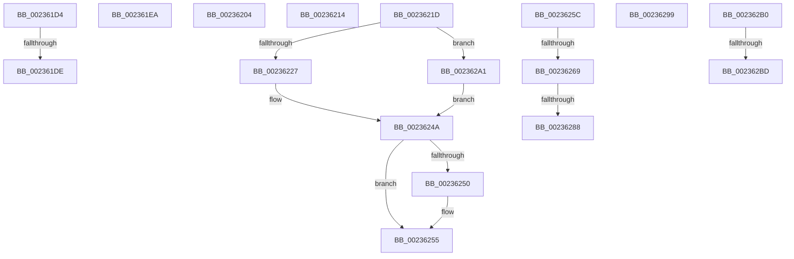

# sub_002361D4

- RVA: `0x002361D4`–`0x002362CF` (길이 `251` bytes)
- VA: `0x00000001402361D4`
- 실행 섹션: `.text`
- PDB 이름 있음: `아니요`; PDB Function 태그: `아니요`
- unwind 정보 RVA: `0x00060824`
- 디코드: `61`개 명령, `251/251` bytes 표시
- 미해석 바이트: `0` (있으면 어셈블리에 `.byte`로 보존)

> 이 문서는 커널 이미지의 기계어와 PDB 기호를 분석해 생성했습니다. 4번과 5번은 함수 원형과 자료형을 바이너리 사용 방식에서 추정한 C 해석이며 원본 소스 복구 결과는 아닙니다.

## 1. Dependencies

- 직접 호출 지점: **7**; 고유 호출 대상: **5**
- 직접 호출자로 확인된 함수: **0**
- RIP 상대 이미지 참조: **3**

### Outgoing calls
- `0x002361F4` → [HvlSwitchToVsmVtl1](../6A/HvlSwitchToVsmVtl1_function_006ACEE0.md) (function, `0x006ACEE0`)
- `0x0023622B` → [EtwTraceEnterVtl1](../4A/EtwTraceEnterVtl1_function_004ADEEC.md) (function, `0x004ADEEC`)
- `0x00236238` → [HvlSwitchToVsmVtl1](../6A/HvlSwitchToVsmVtl1_function_006ACEE0.md) (function, `0x006ACEE0`)
- `0x00236245` → [EtwTraceExitVtl1](../4B/EtwTraceExitVtl1_function_004B0A30.md) (function, `0x004B0A30`)
- `0x0023628F` → [KiRaiseIrqlProcessIrqlFlags](../4F/KiRaiseIrqlProcessIrqlFlags_function_004F56FC.md) (function, `0x004F56FC`)
- `0x002362A9` → [HvlSwitchToVsmVtl1](../6A/HvlSwitchToVsmVtl1_function_006ACEE0.md) (function, `0x006ACEE0`)
- `0x002362C4` → [KiLowerIrqlProcessIrqlFlags](../4F/KiLowerIrqlProcessIrqlFlags_function_004F5698.md) (function, `0x004F5698`)

### Direct callers
- 이 함수 시작 RVA로 연결되는 직접 call은 확인되지 않았습니다. 간접 호출은 완전히 역산할 수 없습니다.

### Static image references
- `0x0023621D` → RVA `0x00FC6B14` (`ALMOSTRO`; read)
- `0x0023625C` → RVA `0x00FC6A84` (`ALMOSTRO`; read)
- `0x0023627B` → RVA `0x00FC6D20` (`ALMOSTRO`; read)

## 2. Other-region calls and transfers

- 다른 실행 섹션으로 향하는 call: **0**
- call이 아닌 외부 분기/꼬리 이동: **12**
  - `0x002361D8` → [sub_00235EB4 + 0x198](Unknown_function_00235EB4.md) (`tail-transfer`)
  - `0x002361E5` → [sub_00235EB4 + 0x198](Unknown_function_00235EB4.md) (`tail-transfer`)
  - `0x002361FF` → [sub_00235EB4 + 0x13A](Unknown_function_00235EB4.md) (`tail-transfer`)
  - `0x0023620F` → [sub_00235EB4 + 0x66](Unknown_function_00235EB4.md) (`tail-transfer`)
  - `0x00236218` → [sub_00235EB4 + 0x66](Unknown_function_00235EB4.md) (`tail-transfer`)
  - `0x00236257` → [sub_00235EB4 + 0x202](Unknown_function_00235EB4.md) (`tail-transfer`)
  - `0x00236263` → [sub_00235EB4 + 0x29](Unknown_function_00235EB4.md) (`tail-transfer`)
  - `0x00236282` → [sub_00235EB4 + 0x29](Unknown_function_00235EB4.md) (`tail-transfer`)
  - `0x00236294` → [sub_00235EB4 + 0x29](Unknown_function_00235EB4.md) (`tail-transfer`)
  - `0x0023629C` → [sub_00235EB4 + 0x8D](Unknown_function_00235EB4.md) (`tail-transfer`)
  - `0x002362B7` → [sub_006D75BC](../6D/Unknown_function_006D75BC.md) (`tail-transfer`)
  - `0x002362CA` → [sub_006D75BC](../6D/Unknown_function_006D75BC.md) (`tail-transfer`)

## 3. Assembly (complete function range)

```asm
002361D4  41 80 FE 01                     cmp r14b, 1
002361D8  0F 84 6E FE FF FF               je 0x14023604c
002361DE  44 89 85 1C 03 00 00            mov dword ptr [rbp + 0x31c], r8d
002361E5  E9 62 FE FF FF                  jmp 0x14023604c
002361EA  44 8B 44 24 3C                  mov r8d, dword ptr [rsp + 0x3c]
002361EF  48 8B D3                        mov rdx, rbx
002361F2  33 C9                           xor ecx, ecx
002361F4  E8 E7 6C 47 00                  call 0x1406acee0
002361F9  44 8B 7B 08                     mov r15d, dword ptr [rbx + 8]
002361FD  33 FF                           xor edi, edi
002361FF  E9 EA FD FF FF                  jmp 0x140235fee
00236204  44 8B E2                        mov r12d, edx
00236207  89 53 04                        mov dword ptr [rbx + 4], edx
0023620A  BA 01 00 00 00                  mov edx, 1
0023620F  E9 06 FD FF FF                  jmp 0x140235f1a
00236214  44 89 63 04                     mov dword ptr [rbx + 4], r12d
00236218  E9 FD FC FF FF                  jmp 0x140235f1a
0023621D  8B 05 F1 08 D9 00               mov eax, dword ptr [rip + 0xd908f1]
00236223  A8 08                           test al, 8
00236225  74 7A                           je 0x1402362a1
00236227  41 0F B7 CE                     movzx ecx, r14w
0023622B  E8 BC 7C 27 00                  call 0x1404adeec
00236230  44 8B C5                        mov r8d, ebp
00236233  48 8B D3                        mov rdx, rbx
00236236  33 C9                           xor ecx, ecx
00236238  E8 A3 6C 47 00                  call 0x1406acee0
0023623D  41 0F B7 D7                     movzx edx, r15w
00236241  41 0F B7 CE                     movzx ecx, r14w
00236245  E8 E6 A7 27 00                  call 0x1404b0a30
0023624A  40 38 73 01                     cmp byte ptr [rbx + 1], sil
0023624E  7D 05                           jge 0x140236255
00236250  CC                              int3
00236251  80 63 01 7F                     and byte ptr [rbx + 1], 0x7f
00236255  33 C0                           xor eax, eax
00236257  E9 5A FE FF FF                  jmp 0x1402360b6
0023625C  40 38 35 21 08 D9 00            cmp byte ptr [rip + 0xd90821], sil
00236263  0F 84 74 FC FF FF               je 0x140235edd
00236269  45 0F 20 C5                     mov r13, cr8
0023626D  4C 89 6C 24 40                  mov qword ptr [rsp + 0x40], r13
00236272  B8 0F 00 00 00                  mov eax, 0xf
00236277  44 0F 22 C0                     mov cr8, rax
0023627B  83 3D 9E 0A D9 00 00            cmp dword ptr [rip + 0xd90a9e], 0
00236282  0F 84 55 FC FF FF               je 0x140235edd
00236288  0F B6 D0                        movzx edx, al
0023628B  41 0F B6 CD                     movzx ecx, r13b
0023628F  E8 68 F4 2B 00                  call 0x1404f56fc
00236294  E9 44 FC FF FF                  jmp 0x140235edd
00236299  40 32 F6                        xor sil, sil
0023629C  E9 A0 FC FF FF                  jmp 0x140235f41
002362A1  44 8B C5                        mov r8d, ebp
002362A4  48 8B D3                        mov rdx, rbx
002362A7  33 C9                           xor ecx, ecx
002362A9  E8 32 6C 47 00                  call 0x1406acee0
002362AE  EB 9A                           jmp 0x14023624a
002362B0  83 3D 69 0A D9 00 00            cmp dword ptr [rip + 0xd90a69], 0
002362B7  0F 84 FF 12 4A 00               je 0x1406d75bc
002362BD  44 0F 20 C1                     mov rcx, cr8
002362C1  0F B6 D3                        movzx edx, bl
002362C4  E8 CF F3 2B 00                  call 0x1404f5698
002362C9  90                              nop
002362CA  E9 ED 12 4A 00                  jmp 0x1406d75bc
```

## 4. C-style interpretation (structured pseudocode)

```c
__int64 __fastcall sub_002361D4(int a1, __int64 a2, int a3)
{
    unsigned int v_stack_p3C;
    unsigned __int64 v_stack_p40;

    *(unsigned int *)(v_rbp + 796) = a3;
}
```

## 5. (Beta) C Style

```c
int64_t sub_002361D4(int32_t Arg1, int64_t Arg2, int32_t Arg3)
{
    uint32_t v_stack_p3C;
    uint64_t v_stack_p40;

    *(uint32_t *)(local_rbp + 0x31C) = Arg3;
}
```

## 6. Execution-region graph

[열기: 2D/3D 그래프와 함수 탐색 컨트롤 패널](../../../control-panel.html?section=text&rva=0x002361D4&view=graph)

- 2D 그래프는 위에서 아래로 흐르고, 3D 그래프는 빈 공간을 드래그해 회전합니다. Shift+드래그는 이동, 휠은 확대·축소, 함수 노드 선택은 대상 보고서 이동입니다.

### Static fallback


