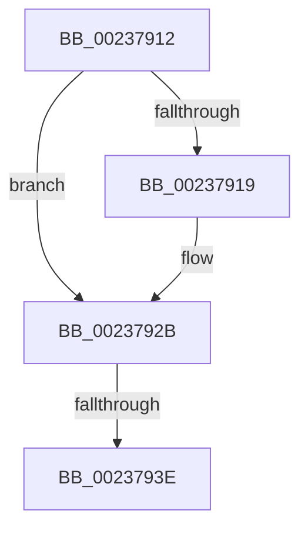

# sub_00237912

- RVA: `0x00237912`–`0x00237945` (길이 `51` bytes)
- VA: `0x0000000140237912`
- 실행 섹션: `.text`
- PDB 이름 있음: `아니요`; PDB Function 태그: `아니요`
- unwind 정보 RVA: `0x00060988`
- 디코드: `13`개 명령, `51/51` bytes 표시
- 미해석 바이트: `0` (있으면 어셈블리에 `.byte`로 보존)

> 이 문서는 커널 이미지의 기계어와 PDB 기호를 분석해 생성했습니다. 4번과 5번은 함수 원형과 자료형을 바이너리 사용 방식에서 추정한 C 해석이며 원본 소스 복구 결과는 아닙니다.

## 1. Dependencies

- 직접 호출 지점: **1**; 고유 호출 대상: **1**
- 직접 호출자로 확인된 함수: **0**
- RIP 상대 이미지 참조: **0**

### Outgoing calls
- `0x00237926` → [ObpPushStackInfo](../21/ObpPushStackInfo_function_002109E4.md) (function, `0x002109E4`)

### Direct callers
- 이 함수 시작 RVA로 연결되는 직접 call은 확인되지 않았습니다. 간접 호출은 완전히 역산할 수 없습니다.

### Static image references
- 디코드된 RIP-relative 메모리 참조가 없습니다.

## 2. Other-region calls and transfers

- 다른 실행 섹션으로 향하는 call: **0**
- call이 아닌 외부 분기/꼬리 이동: **2**
  - `0x0023793C` → [sub_00237945](Unknown_function_00237945.md) (`tail-transfer`)
  - `0x00237943` → [ObFastDereferenceObjectDeferDelete + 0x44](ObFastDereferenceObjectDeferDelete_function_002378C0.md) (`tail-transfer`)

## 3. Assembly (complete function range)

```asm
00237912  48 89 7C 24 40                  mov qword ptr [rsp + 0x40], rdi
00237917  74 12                           je 0x14023792b
00237919  33 D2                           xor edx, edx
0023791B  48 8D 4B D0                     lea rcx, [rbx - 0x30]
0023791F  45 8B CA                        mov r9d, r10d
00237922  44 8D 42 01                     lea r8d, [rdx + 1]
00237926  E8 B9 90 FD FF                  call 0x1402109e4
0023792B  48 C7 C0 FF FF FF FF            mov rax, 0xffffffffffffffff
00237932  F0 48 0F C1 43 D0               lock xadd qword ptr [rbx - 0x30], rax
00237938  48 83 E8 01                     sub rax, 1
0023793C  7E 07                           jle 0x140237945
0023793E  48 8B 7C 24 40                  mov rdi, qword ptr [rsp + 0x40]
00237943  EB BF                           jmp 0x140237904
```

## 4. C-style interpretation (structured pseudocode)

```c
__int64 __fastcall sub_00237912(__int64 a1, int a2, __int64 a3, __int64 a4, __int64 a5, __int64 a6, __int64 a7, __int64 a8)
{
    __int64 result;
    unsigned __int64 v_stack_p40;

    v_stack_p40 = v_rdi;
    if (!(condition_is_equal)) {
        a2 = 0;
        a1 = v_rbx - 48;
        a4 = (unsigned int)(v_r10);
        a3 = a2 + 1;
        result = ObpPushStackInfo(a1, a2, a3, a4);
    }
    result = (-1) - (1);
}
```

## 5. (Beta) C Style

```c
int64_t sub_00237912(int64_t Arg1, int32_t Arg2, int64_t Arg3, int64_t Arg4, uint64_t Arg5, uint64_t Arg6, uint64_t Arg7, int64_t Arg8)
{
    int64_t result;
    uint64_t v_stack_p40;

    v_stack_p40 = local_rdi;
    if (!(condition_is_equal)) {
        Arg2 = 0;
        Arg1 = local_rbx - 48;
        Arg4 = (uint32_t)(local_r10);
        Arg3 = Arg2 + 1;
        result = ObpPushStackInfo(Arg1, Arg2, Arg3, Arg4);
    }
    result = (-1) - (1);
}
```

## 6. Execution-region graph

[열기: 2D/3D 그래프와 함수 탐색 컨트롤 패널](../../../control-panel.html?section=text&rva=0x00237912&view=graph)

- 2D 그래프는 위에서 아래로 흐르고, 3D 그래프는 빈 공간을 드래그해 회전합니다. Shift+드래그는 이동, 휠은 확대·축소, 함수 노드 선택은 대상 보고서 이동입니다.

### Static fallback


